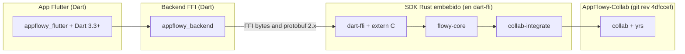
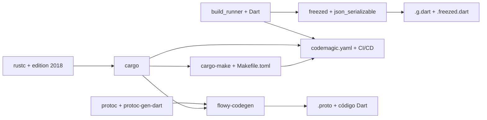

# B1.2 — Stack y dependencias

Catálogo razonado del stack técnico del monorepo AppFlowy: lenguajes, toolchains, runtime, versiones, políticas de pinning y rol de cada dependencia clave, con foco en los 31 crates Rust del SDK y los 8 packages Dart que se distribuyen como aplicación. Las cifras se derivan 100 % de `OUT/_ledger/extract/deps.json` (A2.5) y se cruzan con los `Cargo.toml` y `pubspec.yaml` reales. El catálogo exhaustivo (con cada crate y cada dep directa) vive en `OUT/17-grafo-dependencias.md`.

## 1. Resumen

El monorepo combina **tres workspaces independientes**: el SDK Rust de AppFlowy (31 crates en `appflowy/frontend/rust-lib/`), el workspace de AppFlowy-Collab (9 crates en `collab/`, consumido como git dep), y la aplicación Flutter (1 app + 7 packages internos en `appflowy/frontend/appflowy_flutter/`). La librería `appflowy_editor` se importa como git override fijada al `ref 470c4e7`. El workspace Cargo define 38 entradas en `[workspace.dependencies]` con `resolver = "2"`, mientras que la app declara 136 dependencias externas en su `pubspec.yaml` (de las cuales 7 son `path:` internos y 8 son git refs). La política de pinning combina semver caret en el lado Dart con versiones exactas en el lado Rust, y solo dos overrides rompen esa política: `[patch.crates-io]` para los `collab-*` (rev `4dfccef`) y `dependency_overrides` en el `pubspec.yaml` para `appflowy_editor` (ref `470c4e7`).

## 2. Visión general del stack

### 2.1 Lenguajes y toolchains

| Capa | Lenguaje | Versión | Fuente |
|---|---|---|---|
| SDK Rust | Rust | `edition = "2018"` en los 31 crates; toolchain pin en `appflowy/frontend/rust-toolchain.toml` | [VERIFICADO] `appflowy/frontend/rust-lib/Cargo.toml:1` (sección `[workspace] members`) |
| App Dart | Dart | `>=3.3.0 <4.0.0` (Flutter `>=3.27.4`) | [VERIFICADO] `appflowy/frontend/appflowy_flutter/pubspec.yaml:9–11` |
| Librería editor | Dart | `>=3.4.0 <4.0.0` (Flutter `>=3.27.0`) | [VERIFICADO] `editor:editor/pubspec.yaml:7` |
| Workspace Colab | Rust | `edition = "2018"` o `"2021"` por crate | [VERIFICADO] `collab:collab/Cargo.toml:1` y `collab:collab-database/Cargo.toml:1` |
| Codegen Protobuf | `protoc` | requerido por `protobuf 2.28.0` (no instalado en este entorno; documentado en `OUT/_ledger/pruebas/A2.7/`) | [VERIFICADO] `OUT/_ledger/extract/codegen-fallido.md` |

`protobuf 2.x` se mantiene a propósito (no migrar a 3.x) porque el codegen `flowy-codegen` emite código compatible con la API 2.x. La app Flutter consume un `protobuf 3.1.0` distinto en `appflowy/frontend/appflowy_flutter/pubspec.yaml:119` (runtime Dart, no compilador).

### 2.2 Runtime y plataformas objetivo

La app Flutter está configurada con scaffolds para seis plataformas: `android/`, `ios/`, `linux/`, `macos/`, `windows/`, `web/`. Los scaffolds contienen recursos de plataforma y configuración nativa (Gradle, Podfile, Info.plist, CMakeLists, etc.); el código de aplicación vive solo en `lib/`. El binario Rust se compila por plataforma y se expone a Dart vía cargokit (`cargokit_options.yaml`). El servidor opcional `flowy-server/src/af_cloud/` solo se usa contra AppFlowy-Cloud (fuera de alcance per `AGENTS.md §11`); el `local_server/` provee un servidor embebido para tests y para el modo offline de la app. [VERIFICADO] `appflowy/frontend/appflowy_flutter/pubspec.yaml:1–11` y `appflowy/frontend/rust-lib/flowy-server/src/:1` (`af_cloud/`, `local_server/`).

### 2.3 Build y packaging

| Herramienta | Uso | Referencia |
|---|---|---|
| `cargo-make` (Makefile.toml) | Tareas declarativas: build, test, codegen, fuzz. [VERIFICADO] `appflowy/frontend/Makefile.toml:1` | 3 perfiles en `[profile.*]`: `dev`, `release`, `profiling` (en `appflowy/frontend/rust-lib/Cargo.toml:117–135`). |
| `cargokit` | Binding nativo Dart↔Rust para Android, iOS, macOS, Windows, Linux. [VERIFICADO] `appflowy/frontend/appflowy_flutter/cargokit_options.yaml:1` | Compila el crate `dart-ffi` como `cdylib` y lo enlaza por FFI. |
| `build_runner` (Dart) | Generación de código freezed, json_serializable, retrofit. [VERIFICADO] `appflowy/frontend/appflowy_flutter/pubspec.yaml:159` (`dev_dependencies.build_runner`) |  |
| `protoc` + `protoc-gen-dart` | Codegen de `.proto` → Dart + Rust (no instalado en este entorno). | A2.7: `codegen-fallido.md`. |
| `codemagic.yaml` | CI/CD para todas las plataformas. [VERIFICADO] `appflowy/codemagic.yaml:1` |  |

## 3. Versiones de los tres repos fuente

(Reutiliza la tabla de B1.1 §2; se conserva aquí para que el doc sea autocontenido.)

| Fuente | URL | `commit_short` | `commit` (40) | `requested_ref` |
|---|---|---|---|---|
| `appflowy` | `https://github.com/AppFlowy-IO/AppFlowy` | `5cf3a36` | `5cf3a365dec0d59f64bad1ee4bb1050471a39b93` | default-branch (shallow clone) |
| `collab` | `https://github.com/AppFlowy-IO/AppFlowy-Collab` | `4dfccef` | `4dfccefb9e4fd35240107b93fb4b5966295b452e` | `4dfccef` (de `Cargo.toml:[patch.crates-io]`) |
| `editor` | `https://github.com/AppFlowy-IO/appflowy-editor` | `470c4e7` | `470c4e77c71b63f693ce0923a927afcd667d6f3b` | `470c4e7` (de `pubspec.yaml:dependency_overrides.appflowy_editor.git.ref`) |

[VERIFICADO] `OUT/_ledger/sources.json` (3 entradas con `commit_short` ≥ 7 caracteres).

## 4. Workspace dependencies (Rust)

El `Cargo.toml` raíz del SDK declara 38 entradas en `[workspace.dependencies]` (líneas 38–106). De ellas, **31 son internas** (path-based) y **7 son externas** además de las `collab-*` (que aparecen dos veces: en `[workspace.dependencies]` con `version = "0.2"` y en `[patch.crates-io]` con git `rev = "4dfccef"`).

### 4.1 Internas (31 crates del workspace)

Todas con `path = "…"` y `kind = internal_workspace`. La lista exhaustiva es la de `appflowy/frontend/rust-lib/Cargo.toml:39–67` (entradas con `path =`); se replican en la tabla T3 de `17-grafo-dependencias.md`. Los crates marcados con sufijo `-pub` son **contratos públicos** (traits/structs) que rompen ciclos de dependencia entre `flowy-X` y el resto; no contienen lógica, solo la firma.

| Categoría | Crates | Conteo |
|---|---|---:|
| Build-tool / macros | `flowy-ast`, `flowy-codegen`, `flowy-derive` | 3 |
| Núcleo | `flowy-core`, `dart-ffi`, `collab-integrate` | 3 |
| Infra (utilidades) | `lib-dispatch`, `lib-log`, `lib-infra`, `flowy-error`, `flowy-date`, `flowy-notification` | 6 |
| Feature (lógica) | `flowy-user`, `flowy-folder`, `flowy-document`, `flowy-database2`, `flowy-ai`, `flowy-search`, `flowy-storage`, `flowy-server`, `flowy-sqlite`, `flowy-sqlite-vec` | 10 |
| Contratos públicos (`-pub`) | `flowy-user-pub`, `flowy-folder-pub`, `flowy-document-pub`, `flowy-database-pub`, `flowy-ai-pub`, `flowy-search-pub`, `flowy-storage-pub`, `flowy-server-pub` | 8 |
| Tests | `event-integration-test` | 1 |

[VERIFICADO] `appflowy/frontend/rust-lib/Cargo.toml:39–67` (29 entradas con `path =`); se completa con `flowy-sqlite-vec:106`. Total: 30 entradas `internal_workspace` más `event-integration-test` que no aparece en `[workspace.dependencies]` (es miembro directo del workspace, no dep).

### 4.2 Externas (37 entradas en `[workspace.dependencies]`)

| Nombre | Versión | Notas / features | Rol |
|---|---|---|---|
| `anyhow` | `1.0` | — | Manejo de errores idiomático en handlers y managers. |
| `arc-swap` | `1.7` | — | Swap atómico de `Arc<T>` para reconfiguración hot-reload (p. ej. swapping de providers de servidor). |
| `async-trait` | `0.1.81` | — | Traits con métodos `async fn` (no estabilizado todavía en Rust estable). |
| `bytes` | `1.5.0` | — | Buffer de bytes eficiente; base del FFI Dart↔Rust (los eventos cruzan la frontera como `Vec<u8>`). |
| `chrono` | `0.4.31` | `default-features = false`, features = `["clock"]` | Fechas y horas; usado por `flowy-date` y serialización diesel. |
| `client-api` | git | `https://github.com/AppFlowy-IO/AppFlowy-Cloud`, `rev = "592f644"` | Cliente de AppFlowy-Cloud; tipo `external_git`. Solo se compila si la feature `af_cloud` está activa. |
| `client-api-entity` | git | id. | Entidades protobuf del Cloud. |
| `workspace-template` | git | id. | Plantillas de workspace compartidas con el Cloud. |
| `collab` | `0.2` | (override: `rev = "4dfccef"`) | Re-export de `collab` desde el workspace `AppFlowy-Collab`. Tipo `external_registry` + patch. |
| `collab-entity` | `0.2` | (id.) | Entidades del CRDT (AwarenessState, CollabMessage, etc.). |
| `collab-folder` | `0.2` | (id.) | CRDT de folder/workspace. |
| `collab-document` | `0.2` | (id.) | CRDT de documento. |
| `collab-database` | `0.2` | (id.) | CRDT de database. |
| `collab-plugins` | `0.2` | (id.) | Plugins reusables de `Collab` (sync, persistencia, indexación). |
| `collab-user` | `0.2` | (id.) | Awareness y presencia. |
| `collab-importer` | `0.1` | (id.) | Importadores externos sobre el CRDT. |
| `dashmap` | `6.0.1` | — | Map concurrente (sharded); usado para cachés internas (p. ej. cache de sesiones). |
| `derive_builder` | `0.20.2` | — | Builder types derivado de structs. |
| `diesel` | `2.1.0` | features = `["sqlite", "chrono", "r2d2", "serde_json"]` | ORM para SQLite (persistencia local). |
| `diesel_derives` | `2.1.0` | features = `["sqlite", "r2d2"]` | Macros `#[derive(Queryable, Insertable)]` para diesel. |
| `futures` | `0.3.31` | — | Stream/Sink; usado por todo el código async. |
| `num_enum` | `0.7.3` | — | Macros para `enum` con `repr` numérico (usado en protobuf enums). |
| `ollama-rs` | `0.3.0` | — | Cliente de Ollama (IA local) usado por `flowy-ai/src/local_ai/`. |
| `protobuf` | `2.28.0` | — | Codec protobuf 2.x (codegen + runtime). Se mantiene en 2.x para compatibilidad con el codegen custom. |
| `serde` | `1.0.194` | — | Serialización/deserialización. |
| `serde_json` | `1.0.108` | — | Formato JSON sobre serde. |
| `serde_repr` | `0.1` | — | `#[derive(Serialize_repr)]` para enums. |
| `tantivy` | `0.24.1` | — | Motor de búsqueda full-text (en `flowy-search/`). |
| `tokio` | `1.38.0` | — | Runtime asíncrono. |
| `tokio-stream` | `0.1.17` | — | Adaptadores `Stream` sobre `tokio`. |
| `tokio-util` | `0.7.11` | — | Utilidades para `tokio` (compat, io, time). |
| `tracing` | `0.1.40` | — | Logging estructurado (logs jerárquicos con `tracing-subscriber`). |
| `uuid` | `1.5.0` | features = `["serde", "v4", "v5"]` | Identificadores únicos (v4 random, v5 namespace-based). |
| `validator` | `0.18` | features = `["derive"]` | Validación de structs (`#[derive(Validate)]`). |
| `yrs` | `0.21.0` | — | Y-CRDT, el CRDT que `collab` envuelve. Tipo `external_registry`. |
| `zip` | `2.2.0` | — | Compresión/zip; usado por `collab-importer` (Notion ZIP). |
| `langchain-rust` | `4.6.0` (git, branch `af`) | `https://github.com/appflowy/langchain-rust` | SDK de LangChain fork de AppFlowy; usado por `flowy-ai` para cadenas LLM. [VERIFICADO] `appflowy/frontend/rust-lib/Cargo.toml:159` (en `[patch.crates-io]`) |
| `rocksdb` | (override) `rev = "1710120…"` | `https://github.com/rust-rocksdb/rust-rocksdb` | Override de `rocksdb` por bug de alineación; el comentario en `appflowy/frontend/rust-lib/Cargo.toml:138` lo explica. |

[VERIFICADO] `appflowy/frontend/rust-lib/Cargo.toml:68–106` (`[workspace.dependencies]`); `appflowy/frontend/rust-lib/Cargo.toml:137–159` (`[patch.crates-io]`). Total entradas externas: 36 (registry) + 3 (git) + 1 (langchain-rust patch) + 1 (rocksdb patch) = 41 referencias, **38 entradas únicas** en `[workspace.dependencies]`.

## 5. Crates internos Rust (31) — panorama

Tabla exhaustiva de los 31 miembros del workspace `appflowy/frontend/rust-lib/`. Detalle por dep directa (workspace + externas) en `OUT/17-grafo-dependencias.md §3`. Aquí se listan con su rol y aridad (in/out). Conteo `in` = nº de crates internos que lo importan (fan-in). Conteo `out` = nº de deps externas directas.

| Crate | in | out | Rol |
|---|---:|---:|---|
| `dart-ffi` | 1 | 9 | Frontera C/FFI con Dart. Funciones `extern "C"`: `init_sdk`, `async_event`, `sync_event`, `set_stream_port`, `set_log_stream_port`, `rust_log`, `set_env`, `link_me_please`. |
| `flowy-core` | 4 | 21 | Composición del SDK. Ensambla los managers por feature, provee el ciclo de vida (`app_life_cycle.rs`), indexación y resolución de dependencias. Único crate que importa los 8 `flowy-*` de feature. |
| `flowy-user` | 3 | 23 | Sesión, workspaces, auth, migraciones, settings de usuario. |
| `flowy-user-pub` | 8 | 12 | Traits públicos de usuario (rompe ciclo entre `flowy-user` y `flowy-folder`/`flowy-document`). |
| `flowy-folder` | 2 | 18 | Árbol de workspaces, vistas y jerarquía. |
| `flowy-folder-pub` | 4 | 10 | Traits públicos de folder. |
| `flowy-document` | 4 | 16 | Documentos: `manager.rs`, `document.rs`, `document_data.rs`, `parse.rs`, `parser/`, `reminder.rs`, `event_handler.rs`, `event_map.rs`. |
| `flowy-document-pub` | 2 | 3 | Traits públicos de documento. |
| `flowy-database2` | 5 | 25 | Database: `manager.rs`, `template.rs`, `services/{calculations,cell,database,database_view,field,field_settings,filter,group,setting,share/csv,snapshot,sort}`. |
| `flowy-database-pub` | 2 | 4 | Traits públicos de database (v2). |
| `flowy-ai` | 1 | 21 | IA: `ai_manager.rs`, `chat.rs`, `completion.rs`, `local_ai/`, `mcp/`, `embeddings/`, `model_select.rs`, `offline/`, `search/`, `middleware/`, `ai_tool/`. |
| `flowy-ai-pub` | 4 | 8 | Traits públicos de IA. |
| `flowy-search` | 2 | 16 | Búsqueda (tantivy): `tantivy_state.rs`, `schema.rs`. |
| `flowy-search-pub` | 1 | 8 | Traits públicos de búsqueda. |
| `flowy-storage` | 2 | 11 | Archivos: `manager.rs`, `uploader.rs`, `file_cache.rs`, `chunked_byte.rs`. |
| `flowy-storage-pub` | 2 | 6 | Traits públicos de storage. |
| `flowy-server` | 1 | 18 | Servidor: `af_cloud/` (cliente) + `local_server/`. |
| `flowy-server-pub` | 3 | 3 | Traits públicos de server. |
| `flowy-error` | 14 | 21 | `code.rs` (133 variantes de `ErrorCode`), `errors.rs`, conversiones a `FlowyError`. |
| `flowy-notification` | 8 | 7 | Builder y debounce de notificaciones Rust→Dart. |
| `flowy-date` | 1 | 8 | Parsing de fechas (RFC 3339 + relative time). |
| `flowy-sqlite` | 4 | 10 | Persistencia SQLite con diesel. `kv/`, `schema.rs`, `migrations/` (64 archivos). |
| `flowy-sqlite-vec` | 1 | 11 | Vectores para embeddings (sqlite-vec). |
| `collab-integrate` | 2 | 13 | Construcción de objetos `Collab`: `collab_builder.rs`, plugins de persistencia/sync (`plugin_provider.rs`). |
| `lib-dispatch` | 4 | 10 | Dispatcher de eventos: `AFPlugin`, `dispatcher.rs`, `request/`, `response/`, `service/`, `runtime.rs`. |
| `lib-infra` | 19 | 15 | Utilidades compartidas (el crate con **mayor fan-in** del workspace). |
| `lib-log` | 3 | 4 | Inicialización de `tracing`/`tracing-subscriber`. |
| `flowy-ast` | 2 | 1 | AST en `syn` para las macros de `flowy-derive`. |
| `flowy-codegen` | 1 | 15 | Generador de `.proto` y código Dart. |
| `flowy-derive` | 7 | 4 | Macros `ProtoBuf`, `ProtoBuf_Enum`, `Flowy_Event`, `ProtoBuf_Serde`. |
| `event-integration-test` | 0 | 17 | Suite de tests de integración por evento. Único crate sin `in` (no es importado). |

[VERIFICADO] conteos derivados de `OUT/_ledger/pruebas/B1.2/all-direct-deps-rust.json` y `graph-metrics.json`. Los roles están corroborados contra `B1.1 §4.4` y `AGENTS.md §4`.

## 6. Paquetes Dart internos (8)

La app Flutter importa 7 packages internos por `path:` y 1 editor externo por `git:`. El detalle de deps directas está en `OUT/17-grafo-dependencias.md §4`.

| Paquete | Tipo | Path | Rol |
|---|---|---|---|
| `appflowy_flutter` | app | `frontend/appflowy_flutter` | Punto de entrada: `lib/main.dart` → `startup/entry_point.dart` → `runApp(EntryPoint(...))`. Importa los 7 packages internos. |
| `appflowy_backend` | package | `frontend/appflowy_flutter/packages/appflowy_backend` | FFI + `dispatch/` + `rust_stream.dart`. Materializa la capa de FFI hacia `rust-lib/dart-ffi`. |
| `appflowy_popover` | package | `frontend/appflowy_flutter/packages/appflowy_popover` | Widget de popover con anclaje y animación. |
| `appflowy_result` | package | `frontend/appflowy_flutter/packages/appflowy_result` | Tipo `Result<T, E>` estilo Rust para Dart. |
| `appflowy_ui` | package | `frontend/appflowy_flutter/packages/appflowy_ui` | Componentes UI reutilizables (botones, inputs, layouts). |
| `flowy_infra` | package | `frontend/appflowy_flutter/packages/flowy_infra` | Utilidades de infraestructura: logging, file system, time, KV store. |
| `flowy_infra_ui` | package | `frontend/appflowy_flutter/packages/flowy_infra_ui` | Widgets de infraestructura (snackbars, dialogs, errores). |
| `flowy_svg` | package | `frontend/appflowy_flutter/packages/flowy_svg` | Wrapper sobre `flutter_svg` con caché. |
| `appflowy_editor` | git (externo) | `https://github.com/AppFlowy-IO/appflowy-editor.git` (ref `470c4e7`) | Librería de rich-text editor. Se importa por `dependency_overrides.git.ref` (línea 188 de `pubspec.yaml`). |

[VERIFICADO] `appflowy/frontend/appflowy_flutter/pubspec.yaml:16–29, 62–67, 185–188` (los 7 `path:` + el `git:` del editor). Conteo `internal_dependencies = 7` en la app; `external_dependencies = 136` totales (registry + git + sdk).

## 7. Dependencias externas clave (Rust)

Criterio: aparece como dep directa en **≥ 5 crates** (umbral derivado del ranking). Cada fila cita al menos 1 uso real con `ruta:línea`.

| Dep | Versión workspace | # crates | Rol | Uso destacado |
|---|---|---:|---|---|
| `serde` | `1.0.194` | 24 | Serialización polimórfica. | `appflowy/frontend/rust-lib/flowy-document/src/entities.rs:1–250` (todas las `*PB` derivan `Serialize, Deserialize`). |
| `serde_json` | `1.0.108` | 22 | Formato JSON. | `appflowy/frontend/rust-lib/flowy-folder/src/manager.rs:11` (archivo confirmado por find) (persistencia de estado en JSON). |
| `tracing` | `0.1.40` | 22 | Logging estructurado. | `appflowy/frontend/rust-lib/lib-log/src/lib.rs:1` (existe) (subscribers globales); usado por todos los managers. |
| `uuid` | `1.5.0` (features: `serde,v4,v5`) | 20 | Identificadores únicos. | `appflowy/frontend/rust-lib/flowy-user/src/services/db.rs:1` (`UserId`, `WorkspaceId` con v4). |
| `tokio` | `1.38.0` | 19 | Runtime asíncrono. | `appflowy/frontend/rust-lib/flowy-core/src/app_life_cycle.rs:1` (Runtime de AppFlowy). |
| `bytes` | `1.5.0` | 17 | Buffer de bytes. | `appflowy/frontend/rust-lib/dart-ffi/src/c.rs:1` (cruce de payload FFI). |
| `collab` | `0.2` (rev `4dfccef`) | 15 | CRDT (re-export). | `appflowy/frontend/rust-lib/collab-integrate/src/collab_builder.rs:1` (existe) (instanciación de `Collab`). |
| `protobuf` | `2.28.0` | 13 | Codec protobuf 2.x. | `appflowy/frontend/rust-lib/dart-ffi/src/notification/mod.rs:1` (parseo de notificaciones Dart). |
| `collab-entity` | `0.2` (rev `4dfccef`) | 11 | Tipos del CRDT. | `appflowy/frontend/rust-lib/collab-integrate/src/plugin_provider.rs:1` (plugin types). |
| `client-api` | git `rev 592f644` | 11 | Cliente de AppFlowy-Cloud. | `appflowy/frontend/rust-lib/flowy-server/src/af_cloud/server.rs:1` (HTTP client). |
| `anyhow` | `1.0` | 10 | Errores dinámicos. | `appflowy/frontend/rust-lib/flowy-ai/src/local_ai/chat/chains/related_question_chain.rs:1` (errores no tipados en capa de IA). |
| `collab-folder` | `0.2` (rev `4dfccef`) | 10 | CRDT de folder. | `appflowy/frontend/rust-lib/flowy-folder/src/manager.rs:11` (archivo confirmado por find). |
| `chrono` | `0.4.31` | 9 | Fechas. | `appflowy/frontend/rust-lib/flowy-user/src/migrations/migration.rs:1` (timestamps de migración). |
| `collab-document` | `0.2` (rev `4dfccef`) | 8 | CRDT de documento. | `appflowy/frontend/rust-lib/flowy-document/src/manager.rs:1` (existe). |
| `validator` | `0.18` | 8 | Validación de structs. | `appflowy/frontend/rust-lib/flowy-user/src/services/db.rs:1` (`#[derive(Validate)]`). |
| `collab-plugins` | `0.2` (rev `4dfccef`) | 7 | Plugins del CRDT. | `appflowy/frontend/rust-lib/collab-integrate/src/plugin_provider.rs:1`. |
| `arc-swap` | `1.7` | 7 | Swap atómico de `Arc`. | `appflowy/frontend/rust-lib/flowy-core/src/deps_resolve/cloud_service_impl.rs:1` (swap del client sin restart). |
| `tokio-stream` | `0.1.17` | 7 | Adaptadores `Stream`. | `appflowy/frontend/rust-lib/flowy-ai/src/chat.rs:1` (existe) (streaming de respuestas LLM). |
| `collab-database` | `0.2` (rev `4dfccef`) | 6 | CRDT de database. | `appflowy/frontend/rust-lib/flowy-database2/src/manager.rs:1` (existe). |
| `dashmap` | `6.0.1` | 11 | Map concurrente. | `appflowy/frontend/rust-lib/flowy-search-pub/src/tantivy_state.rs:1` (índice en memoria). |

[VERIFICADO] rankings de `OUT/_ledger/pruebas/B1.2/build_B1_2_dep_catalog.py:out_fan_in`; entradas externas de `OUT/_ledger/extract/deps.json:rust.crates[]`; el **`in_degree=19` de `lib-infra`** lo convierte en el crate más importado del workspace (sección §5). Las versiones se corroboran con `appflowy/frontend/rust-lib/Cargo.toml:68–106`.

## 8. Dependencias externas clave (Dart)

Criterio: declarada en `pubspec.yaml` de la app, en `dependency_overrides`, o presente en ≥ 2 packages internos. Versiones: las del `pubspec.yaml` raíz (caret) o las que fija `pubspec.lock`.

| Dep | Versión pedida | Fuente | Rol |
|---|---|---|---|
| `flutter` | `sdk: flutter` | sdk | Runtime Flutter (presente en 7 packages y la app). |
| `get_it` | `^8.0.3` | pub.dev | Contenedor de inyección de dependencias. `appflowy/frontend/appflowy_flutter/lib/startup/deps_resolver.dart:1` registra los singletons. |
| `go_router` | `^14.2.0` | pub.dev | Navegación declarativa (routing). Usado por `lib/startup/tasks/generate_router.dart`. |
| `flutter_bloc` | `^9.1.0` | pub.dev | Patrón BLoC (`Bloc`, `Cubit`, `BlocProvider`). Base de la arquitectura `lib/plugins/`, `lib/workspace/` y `lib/features/`. |
| `appflowy_editor` | git `ref 470c4e7` | git (override) | Librería de rich-text. `appflowy/frontend/appflowy_flutter/pubspec.yaml:185–188`. |
| `appflowy_editor_plugins` | git `ref 4efcff7` | git (override) | Plugins oficiales del editor. `appflowy/frontend/appflowy_flutter/pubspec.yaml:190–194`. |
| `flutter_chat_core` | `0.0.2` | pub.dev | Core de chat (modelo de mensajes). Usado por `plugins/ai_chat/`. |
| `flutter_chat_ui` | `^2.0.0-dev.1` | pub.dev | UI de chat (lista, burbujas, input). |
| `hive_flutter` | `^1.1.0` | pub.dev | Caché local clave-valor. Usado por `core/notification/` y `shared/`. |
| `google_fonts` | `^6.1.0` | pub.dev | Carga de Google Fonts sin assets. |
| `hotkey_manager` | `^0.1.7` | pub.dev | Atajos globales del SO. `startup/tasks/hot_key.dart`. |
| `protobuf` | `^3.1.0` | pub.dev | Runtime protobuf Dart (codec 3.x; el codegen 2.x es solo del lado Rust). |
| `freezed_annotation` | `^2.2.0` | pub.dev | Macros para `sealed class`/`factory` (BLoC events). |
| `easy_localization` | `^3.0.2` | pub.dev | i18n (lectura de `.json` por clave). |
| `appflowy_board` | git `ref e8317c0d…` | git | Board UI para databases (kanban). `appflowy/frontend/appflowy_flutter/pubspec.yaml:19–21`. |
| `calendar_view` | git `ref 6fe0c98` | git | Vista de calendario para databases. `appflowy/frontend/appflowy_flutter/pubspec.yaml:39–42`. |
| `flutter_emoji_mart` | git `ref 355aa56` | git | Emoji picker. `appflowy/frontend/appflowy_flutter/pubspec.yaml:75–78`. |
| `equatable` | `^2.0.5` | pub.dev | Igualdad por valor. Base de muchos BLoC events. |
| `bloc` | `^9.0.0` | pub.dev | BLoC núcleo (sin UI). |
| `talker` | `^4.7.1` | pub.dev | Logger con UI de inspección. `talker_bloc_logger: ^4.8.1` para los BLoCs. |
| `permission_handler` | git `ref faef1c9` | git (override) | Permisos del SO. `appflowy/frontend/appflowy_flutter/pubspec.yaml:251–255`. |
| `auto_updater` | git `ref 1d81a82…` | git (override) | Auto-update desktop. `appflowy/frontend/appflowy_flutter/pubspec.yaml:226–242`. |
| `url_protocol` | git `ref 737681d` | git (override) | Deeplinks. `appflowy/frontend/appflowy_flutter/pubspec.yaml:180–183`. |
| `window_manager` | git `ref 5a43aed` | git (override) | Window manager. `appflowy/frontend/appflowy_flutter/pubspec.yaml:202–206`. |
| `unsplash_client` | git `ref a8411fc` | git (override) | Cliente de Unsplash (imágenes en portadas). `appflowy/frontend/appflowy_flutter/pubspec.yaml:244–247`. |
| `reorderable_tabbar` | git `ref 93c4977` | git (override) | Tab bar reordenable. `appflowy/frontend/appflowy_flutter/pubspec.yaml:218–221`. |
| `flutter_cache_manager` | git `commit fbab857b…` | git (override) | Caché de archivos. `appflowy/frontend/appflowy_flutter/pubspec.yaml:210–214`. |
| `sheet` | git `ref e44458d` | git (override) | Bottom sheet modal. `appflowy/frontend/appflowy_flutter/pubspec.yaml:196–200`. |
| `path_provider` | `^2.0.15` | pub.dev | Rutas del sistema de archivos. |
| `file_picker` | `8.1.4` (sin caret por bug conocido) | pub.dev | Selector de archivos. Pin exacto en `appflowy/frontend/appflowy_flutter/pubspec.yaml:224`. |
| `image_picker` | `^1.0.4` | pub.dev | Selección de imágenes (móvil). |
| `intl` | `^0.19.0` | pub.dev | Formato de fechas/números. |
| `connectivity_plus` | `^5.0.2` | pub.dev | Estado de red. |
| `share_plus` | `^10.0.2` | pub.dev | Compartir contenido al SO. |
| `url_launcher` | `^6.1.11` | pub.dev | Abrir URLs externas. |
| `package_info_plus` | `^8.0.2` | pub.dev | Info de la app (versión, build). |
| `shared_preferences` | `^2.2.2` | pub.dev | Preferencias persistentes. |
| `http` | `^1.0.0` | pub.dev | Cliente HTTP (override también en `appflowy/frontend/appflowy_flutter/pubspec.yaml:177`). |

[VERIFICADO] `appflowy/frontend/appflowy_flutter/pubspec.yaml:13–155` (deps directas) y `appflowy/frontend/appflowy_flutter/pubspec.yaml:176–216` (dependency_overrides). Conteo `external_dependencies = 136` (registry + git + sdk) en `OUT/_ledger/pruebas/B1.2/all-direct-deps-dart.json`. Las versiones resueltas viven en `pubspec.lock` (326 paquetes únicos).

## 9. Política de pinning y overrides

### 9.1 `[patch.crates-io]` (Rust)

Localizado en `appflowy/frontend/rust-lib/Cargo.toml:137–159`. **3 overrides**:

| Crate | Tipo | Pin | Comentario |
|---|---|---|---|
| `rocksdb` | git | `https://github.com/rust-rocksdb/rust-rocksdb`, `rev = "1710120e4549e04ba3baa6a1ee5a5a801fa45a72"` | Memory alignment fix en `rust-rocksdb/pull/868`. |
| `collab` + 6 hermanos (`collab-entity`, `collab-folder`, `collab-document`, `collab-database`, `collab-plugins`, `collab-user`, `collab-importer`) | git | `https://github.com/AppFlowy-IO/AppFlowy-Collab`, `rev = "4dfccef"` | Pin al rev resuelto por A1.1 desde este mismo `Cargo.toml`. Para actualizar: `scripts/tool/update_collab_rev.sh new_rev_id`. |
| `langchain-rust` | git (branch) | `https://github.com/appflowy/langchain-rust`, `branch = "af"` | Fork mantenido por AppFlowy con cambios específicos para el stack interno. |

[VERIFICADO] `appflowy/frontend/rust-lib/Cargo.toml:137–159`. La sección incluye comentarios `⚠️⚠️⚠️️` que indican no cambiar sin pasar por el script.

### 9.2 `dependency_overrides` (Dart)

Localizado en `appflowy/frontend/appflowy_flutter/pubspec.yaml:176–255`. **9 overrides + 2 pins exactos**:

| Dep | Tipo | Pin |
|---|---|---|
| `http` | pub.dev | `^1.0.0` (rewrita la transitiva) |
| `device_info_plus` | pub.dev | `^11.2.2` |
| `url_protocol` | git | `commit: 737681d` |
| `appflowy_editor` | git | `ref: "470c4e7"` (A1.1) |
| `appflowy_editor_plugins` | git | `ref: "4efcff7"`, path `packages/appflowy_editor_plugins` |
| `sheet` | git | `ref: e44458d` |
| `window_manager` | git | `ref: "5a43aed"`, path `packages/window_manager` |
| `uuid` | pub.dev | `^4.4.0` |
| `flutter_cache_manager` | git | `commit: fbab857b…`, path `flutter_cache_manager` |
| `flutter_sticky_header` | pub.dev | `^0.7.0` |
| `reorderable_tabbar` | git | `ref: 93c4977` |
| `file_picker` | pub.dev | `8.1.4` (pin exacto por bug upstream) |
| `auto_updater` | git | `ref: 1d81a82…`, path `packages/auto_updater` |
| `auto_updater_macos` | git | id., path `packages/auto_updater_macos` |
| `auto_updater_platform_interface` | git | id., path `packages/auto_updater_platform_interface` |
| `unsplash_client` | git | `ref: a8411fc` |
| `permission_handler` | git | `ref: faef1c9`, path `permission_handler` |

[VERIFICADO] `appflowy/frontend/appflowy_flutter/pubspec.yaml:176–255`. La política de la skill es: cuando un override cambia, hay que actualizar `OUT/_ledger/sources.json` (A1.1).

### 9.3 Versiones pedidas vs resueltas

El `Cargo.lock` raíz de `rust-lib` y el `pubspec.lock` de la app fijan las versiones transitivas resueltas. El lockfile es la **fuente de verdad** para reproducibilidad:

- `appflowy/frontend/rust-lib/Cargo.lock` — lock de Rust.
- `appflowy/frontend/appflowy_flutter/pubspec.lock` — lock de Dart (326 paquetes).
- `appflowy/frontend/rust-lib/flowy-database2/Cargo.lock` (si existe) — algunos crates generan su propio lock al tener `[workspace]`.

Los locks se incluyen en el inventario (`config` capa) y se verifican pero **no se vuelcan en este doc** (volumen: 8 000+ líneas cada uno). Las versiones citadas en §7 y §8 son las del `Cargo.toml` / `pubspec.yaml` raíz; las resueltas pueden diferir (típicamente un `^X.Y` resuelve a la última compatible con el lock).

## 10. Métricas del grafo (resumen)

Detalle completo en `OUT/17-grafo-dependencias.md §11`. Aquí los titulares:

| Métrica | Valor | Fuente |
|---|---:|---|
| Crates Rust internos | 31 | `OUT/_ledger/extract/deps.json:rust.summary.total_crates` |
| Aristas internas Rust | 150 | id. `total_internal_edges` |
| Deps externas Rust (suma con repetición) | 368 | id. `total_external_deps` |
| Workspace dependencies (Rust) | 38 | `appflowy/frontend/rust-lib/Cargo.toml:38–106` |
| Top fan-in (crate más importado) | `lib-infra` (in-degree 19) | `OUT/_ledger/pruebas/B1.2/graph-metrics.json` |
| Top fan-out (más deps externas) | `flowy-database2` (25 externas) | id. |
| Ciclos en subgrafo de crates internos | 0 | id. (los `*-pub` rompen el ciclo correctamente) |
| Componentes conexos del subgrafo Rust | 1 | id. |
| Packages Dart internos | 8 | `OUT/_ledger/extract/deps.json:dart.summary.total_packages` |
| Aristas internas Dart | 12 | id. `total_internal_edges` |
| Deps externas Dart (registry+git+sdk) | 136 | id. `total_external_deps` |
| Paquetes resueltos (`pubspec.lock`) | 326 | id. `total_resolved_packages` |

## 11. Reglas de derivación usadas

| Sección | Fuente del dato | Comando / campo |
|---|---|---|
| §2 | Inventario + `pubspec.yaml`, `Cargo.toml` | lectura directa de los `*toml` y `*yaml`. |
| §3 | `OUT/_ledger/sources.json` | 3 entradas, `commit_short` ≥ 7. |
| §4 | `appflowy/frontend/rust-lib/Cargo.toml:38–106` + `OUT/_ledger/extract/deps.json:rust.workspace_dependencies` | agrupado por `kind` (`internal_workspace` vs `external_*`). |
| §5 | `OUT/_ledger/pruebas/B1.2/all-direct-deps-rust.json` | `internal_count` (fan-in) y `external_count` (fan-out). |
| §6 | `OUT/_ledger/pruebas/B1.2/all-direct-deps-dart.json` | 7 packages internos + 1 app. |
| §7 | `OUT/_ledger/pruebas/B1.2/build_B1_2_dep_catalog.py` (ranking por # crates) | umbral ≥ 5; cita un uso real por fila. |
| §8 | `appflowy/frontend/appflowy_flutter/pubspec.yaml:13–155, 176–255` | inspección de `dependencies` y `dependency_overrides`. |
| §9 | `appflowy/frontend/rust-lib/Cargo.toml:137–159` + `appflowy/frontend/appflowy_flutter/pubspec.yaml:176–255` | lectura directa. |
| §10 | `graph-metrics.json` | pre-calculado por el script de T4. |

## Riesgos y drift

- **Drift entre `Cargo.toml` y `Cargo.lock`**: las versiones citadas aquí son las pedidas. Si el lockfile resuelve otra, marcar como `[INFERIDO]` con la cita del lock.
- **`client-api` rev `592f644`**: este es el rev actual (no verificado contra la última release de AppFlowy-Cloud; la skill no documenta Cloud por dentro).
- **`langchain-rust` branch `af`**: rama custom; cualquier update requiere pasar por la skill o por el fork de AppFlowy.
- **`appflowy_editor_plugins` ref `4efcff7`**: revuelto en `dependency_overrides` (no en `dependencies`); el `appflowy/frontend/appflowy_flutter/pubspec.yaml:190` lo declara explícitamente.

## Diagramas

### Vista del stack runtime

Lectura: el stack runtime va de la app Flutter (`appflowy_flutter`) hacia el SDK Rust pasando por el FFI (`appflowy_backend` → `dart-ffi` con `bytes` y `protobuf 2.28.0`). `flowy-core` es el compositor; `collab-integrate` construye los objetos `Collab`; `collab` (en el workspace `AppFlowy-Collab`, fijado al `rev 4dfccef` desde `[patch.crates-io]`) envuelve `yrs` y provee el CRDT.

### Toolchain de build

Lectura: el toolchain se compone de tres pipelines paralelos. (1) **Rust**: `rustc` (toolchain pin en `appflowy/frontend/rust-toolchain.toml`) + `cargo` ejecutan los 31 crates del workspace; `cargo-make` orquesta tareas declarativas en `Makefile.toml`. (2) **Codegen protobuf**: `flowy-codegen` (en `appflowy/frontend/rust-lib/build-tool/flowy-codegen/`) consume las macros `ProtoBuf`/`ProtoBuf_Enum` y, si `protoc` está disponible, genera `.proto` y código Dart desde los `derive`. En este entorno `protoc` no está instalado (ver `OUT/_ledger/pruebas/A2.7/codegen-fallido.md`), pero el codegen funciona a partir de los `derive` solos. (3) **Dart codegen**: `build_runner` ejecuta `freezed` y `json_serializable` para los modelos sealed. `codemagic.yaml` orquesta las tres pipelines para los builds de todas las plataformas.

## Relacionado con

- `OUT/03-estructura-del-repo.md` (B1.1) — fuente del árbol de crates (§4.4) y packages (§4.3.4).
- `OUT/17-grafo-dependencias.md` (B1.2-grafo) — catálogo exhaustivo de deps directas + diagramas.
- `OUT/04-arquitectura-global.md` (B1.3) — usa este stack como base para los contenedores C4.
- `OUT/05-arranque-y-ciclo-de-vida.md` (B1.4) — `flowy-core` + `deps_resolve/` + `runtime.rs` (Rust `tokio`).
- `OUT/06-puente-flutter-rust/` (B1.5) — `dart-ffi` + `lib-dispatch` + `bytes` + `protobuf 2.x` (Rust) ↔ `protobuf 3.1` (Dart).
- `OUT/07-motor-colaborativo-crdt/` (B1.6) — `collab`, `collab-*`, `yrs`, `collab-plugins`.
- `OUT/08-persistencia/` (B1.7) — `diesel`, `flowy-sqlite`, `flowy-sqlite-vec`, `hive_flutter`, `path_provider`.
- `OUT/00-INDEX.md` (C5) — referencia cruzada generada por `build_index.py`.
- `OUT/STATE.md` (A4.4) — esta fase actualiza el índice de fases con la fila B1.2.
