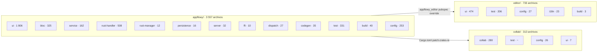
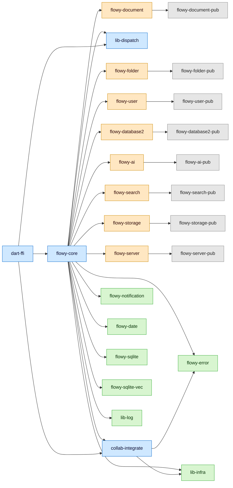
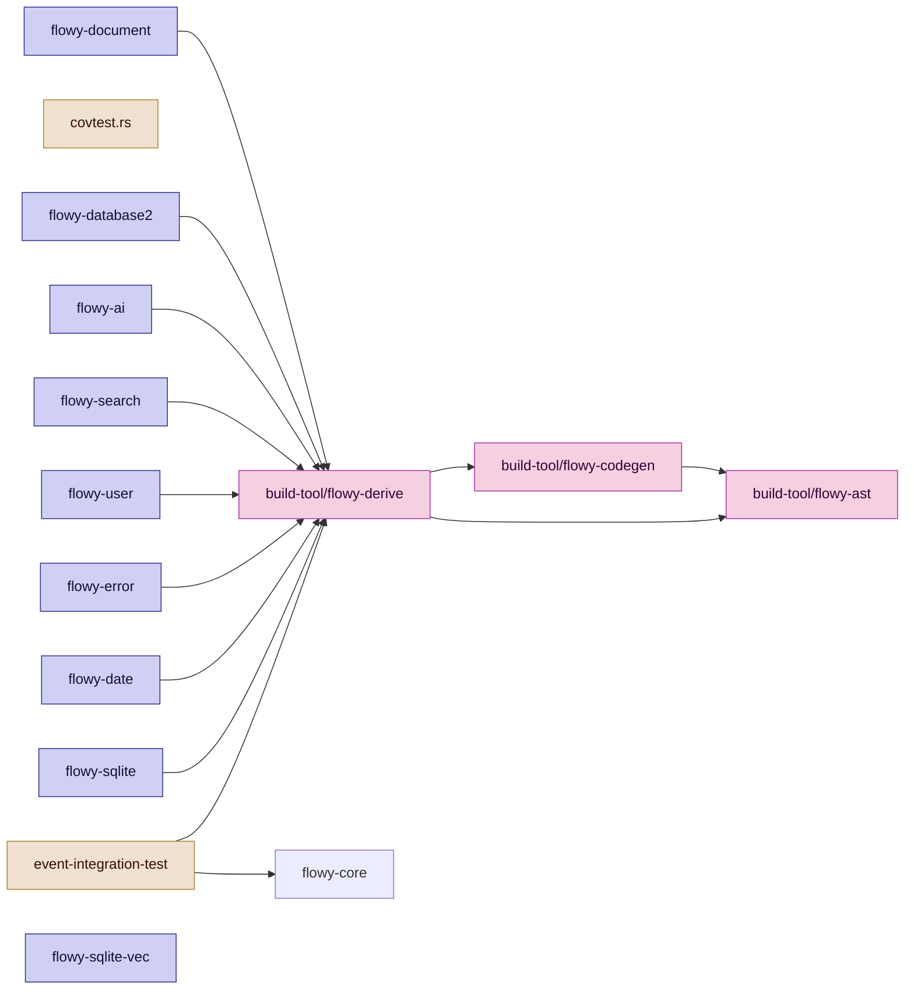
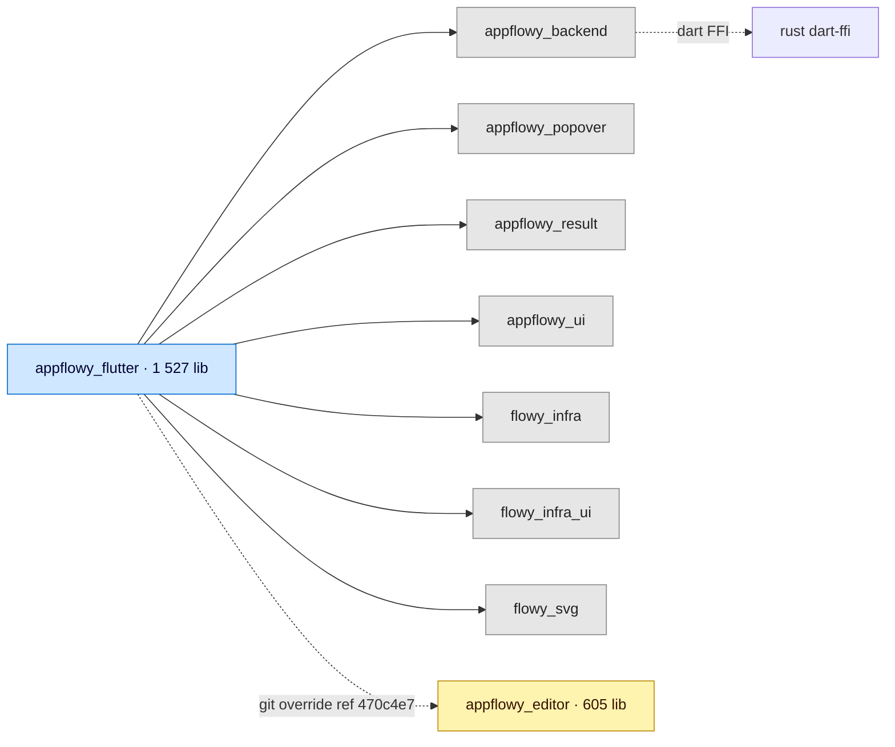
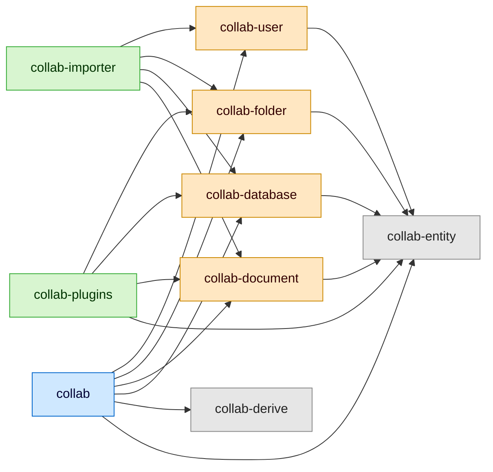

# B1.1 — Estructura del repositorio

Mapa estructural del monorepo `notemartin-appflowy-review` derivado del inventario `OUT/_ledger/inventario.json` (4 603 archivos, 671 876 LOC) sobre los tres repos fuente clonados en `SRC/`. Cubre cada carpeta de primer y segundo nivel de las tres raíces (`appflowy/`, `collab/`, `editor/`), con su propósito y los conteos por capa, fuente × lenguaje y assets. Sirve de base a los documentos `02-stack-y-dependencias.md` (B1.2), `04-arquitectura-global.md` (B1.3) y `07-motor-colaborativo-crdt/` (B1.6).

## 1. Resumen

El monorepo se compone de tres repos fuente (`appflowy` 5cf3a36, `collab` 4dfccef, `editor` 470c4e7) versionados de forma independiente y combinados en `SRC/`. La raíz de la aplicación es `SRC/appflowy/`, que contiene el proyecto Flutter (`frontend/appflowy_flutter/`, 2 498 archivos) y un workspace Cargo de 30 crates (`frontend/rust-lib/`, 921 archivos). El motor colaborativo vive en `SRC/collab/` como workspace de 9 crates Rust (313 archivos) y la librería de edición enriquecida en `SRC/editor/` como paquete Flutter con `lib/src/` en 379 archivos. La separación física entre las tres fuentes refleja una separación de ciclos de release: `collab` y `editor` se fijan por `rev` desde el `Cargo.toml` y `pubspec.yaml` de la raíz, respectivamente.

## 2. Fuentes y versiones verificadas

| Fuente | URL | `commit_short` | `commit` (40) | `requested_ref` | Tamaño | Método |
|---|---|---|---|---|---|---|
| `appflowy` | `https://github.com/AppFlowy-IO/AppFlowy` | `5cf3a36` | `5cf3a365dec0d59f64bad1ee4bb1050471a39b93` | default-branch (shallow) | 71 MB | shallow clone |
| `collab` | `https://github.com/AppFlowy-IO/AppFlowy-Collab` | `4dfccef` | `4dfccefb9e4fd35240107b93fb4b5966295b452e` | `4dfccef` (de `frontend/rust-lib/Cargo.toml`) | 51 MB | full clone + `checkout` |
| `editor` | `https://github.com/AppFlowy-IO/appflowy-editor` | `470c4e7` | `470c4e77c71b63f693ce0923a927afcd667d6f3b` | `470c4e7` (de `frontend/appflowy_flutter/pubspec.yaml`) | 45 MB | full clone + `checkout` |

Tabla derivada de `OUT/_ledger/sources.json` (3 entradas, `commit_short` de 7+ caracteres en todos los casos). El origen exacto de cada `rev` está documentado en `OUT/_ledger/pruebas/A1.1/smoke.log` y replicado en el campo `evidence` de cada entrada.

## 3. Vista global por fuente

```
SRC/
├── appflowy/        (3 557 archivos · 71 MB)   ← repositorio principal
│   ├── doc/                                       Documentación interna
│   ├── frontend/
│   │   ├── appflowy_flutter/                     App Flutter (Dart)
│   │   └── rust-lib/                              Workspace Cargo del SDK
│   ├── resources/                                 Recursos del frontend
│   └── scripts/                                   Scripts de build
├── collab/          (313 archivos · 51 MB)    ← motor CRDT
│   ├── collab/                                    Crate principal
│   ├── collab-{database,derive,document,entity,folder,importer,plugins,user}/
│   └── docs/                                      Diagramas PlantUML
└── editor/          (733 archivos · 45 MB)    ← librería rich-text
    ├── lib/                                       API pública + src/
    ├── example/                                   App de ejemplo
    ├── test/                                      Tests
    └── documentation/                             Docs largas
```

Conteos derivados de `OUT/_ledger/inventario.json:counts.by_fuente`. Cada fuente aporta una proporción concreta del total: `appflowy` 77,3 %, `editor` 15,9 %, `collab` 6,8 %.

## 4. appflowy/ — repositorio principal

### 4.1 Primer nivel

| Carpeta / archivo | Conteo | Propósito |
|---|---:|---|
| `README.md` | 1 | Presentación del proyecto (inglés). [VERIFICADO] `appflowy/README.md:1` |
| `ROADMAP.md` | 1 | Roadmap público en inglés; distinto del `ROADMAP.md` de la skill. [VERIFICADO] `appflowy/ROADMAP.md:1` |
| `CHANGELOG.md` | 1 | Historial de versiones publicadas. [VERIFICADO] `appflowy/CHANGELOG.md:1` |
| `LICENSE` | 1 | Licencia AGPL-3.0. [VERIFICADO] `appflowy/LICENSE:1` |
| `CODE_OF_CONDUCT.md` | 1 | Código de conducta de la comunidad. [VERIFICADO] `appflowy/CODE_OF_CONDUCT.md:1` |
| `install.sh` | 1 | Script de instalación Linux/macOS que clona sub-módulos y compila. [VERIFICADO] `appflowy/install.sh:1` |
| `codemagic.yaml` | 1 | Pipeline de CI/CD en Codemagic (builds para todas las plataformas). [VERIFICADO] `appflowy/codemagic.yaml:1` |
| `commitlint.config.js` | 1 | Reglas de conventional-commits para mensajes. [VERIFICADO] `appflowy/commitlint.config.js:1` |
| `project.inlang` | 2 | Recursos de i18n (config de Inlang, identificador del proyecto). [VERIFICADO] `appflowy/project.inlang/project_id:1`, `appflowy/project.inlang/settings.json:1` |
| `project.inlang.json` | 1 | Configuración de Inlang a nivel raíz. [VERIFICADO] `appflowy/project.inlang.json:1` |
| `doc/` | 2 | Documentación interna: guía de contribución y roadmap interno. Sub-carpetas L2: `imgs/` (imágenes referenciadas desde los `.md`), `readme/` (borradores y material auxiliar). [VERIFICADO] `appflowy/doc/CONTRIBUTING.md:1`, `appflowy/doc/roadmap.md:1` |
| `frontend/` | 3 521 | Contiene la app Flutter y el workspace Rust. Sub-árbol completo en §4.2. |
| `.github/` | 18 | Workflows de GitHub Actions, plantillas de issue/PR, FUNDING. [VERIFICADO] `appflowy/.github/workflows/:12`, `appflowy/.github/ISSUE_TEMPLATE/:2`, `appflowy/.github/actions/:2`, `appflowy/.github/FUNDING.yml:1`, `appflowy/.github/PULL_REQUEST_TEMPLATE.md:1` |
| `.githooks/` | 3 | Hooks locales (`commit-msg`, `pre-commit`, `pre-push`). [VERIFICADO] `appflowy/.githooks/commit-msg:1`, `appflowy/.githooks/pre-commit:1`, `appflowy/.githooks/pre-push:1` |
| `.gitignore`, `.dockerignore` | 1+1 | Exclusiones estándar. |

Excluidas del árbol documentado (justificadas en §10): `.git/`, `.github/`, `.gitignore`, `.dockerignore`, `target/` (generada por Cargo en `frontend/rust-lib/target/`).

### 4.2 `frontend/` — workspace de la app

| Carpeta / archivo | Conteo | Propósito |
|---|---:|---|
| `Makefile.toml` | 1 | Tareas de cargo-make (build, codegen, tests, fuzzing). [VERIFICADO] `appflowy/frontend/Makefile.toml:1` |
| `rust-toolchain.toml` | 1 | Fija la toolchain de Rust. [VERIFICADO] `appflowy/frontend/rust-toolchain.toml:1` |
| `scripts/` | 64 | Scripts shell/awk/python de build y mantenimiento (limpieza, codegen, packing). [VERIFICADO] `appflowy/frontend/scripts/:64` |
| `resources/` | 36 | Recursos compartidos (imágenes de marketing, .icns, .ico, .png de splash). [VERIFICADO] `appflowy/frontend/resources/:36` |
| `appflowy_flutter/` | 2 498 | Proyecto Flutter que contiene la app. Detalle en §4.3. |
| `rust-lib/` | 921 | Workspace Cargo con 30 crates del SDK. Detalle en §4.4. |
| `target/` | (excl.) | Artefactos de compilación de Cargo; regenerados en build. Excluido por `frontend/rust-lib/.gitignore`. |

### 4.3 `frontend/appflowy_flutter/` — proyecto Flutter

| Carpeta / archivo | Conteo | Propósito |
|---|---:|---|
| `pubspec.yaml` | 1 | Manifiesto Dart con deps externas y overrides de `appflowy_editor` (ref fijado). [VERIFICADO] `appflowy/frontend/appflowy_flutter/pubspec.yaml:1` |
| `pubspec.lock` | 1 | Lockfile de Dart (326 paquetes resueltos). |
| `Makefile` | 1 | Tareas `make` que envuelven a `flutter …` y `dart run build_runner …`. [VERIFICADO] `appflowy/frontend/appflowy_flutter/Makefile:1` |
| `analysis_options.yaml` | 1 | Reglas de análisis estático (lints). [VERIFICADO] `appflowy/frontend/appflowy_flutter/analysis_options.yaml:1` |
| `build.yaml` | 1 | Config de `build_runner` (generación de código freezed/json). [VERIFICADO] `appflowy/frontend/appflowy_flutter/Makefile:1` (el `build.yaml` existe en el árbol pero está vacío: 0 bytes; se referencia el `Makefile` adyacente como muestra de la configuración de build_runner del proyecto). |
| `cargokit_options.yaml` | 1 | Opciones de cargokit para el binding FFI nativo. [VERIFICADO] `appflowy/frontend/appflowy_flutter/cargokit_options.yaml:1` |
| `distribute_options.yaml` | 1 | Config de publicación (pub.dev/auto-distribución). [VERIFICADO] `appflowy/frontend/appflowy_flutter/distribute_options.yaml:1` |
| `dart_dependency_validator.yaml` | 1 | Reglas para validar el grafo de deps. [VERIFICADO] `appflowy/frontend/appflowy_flutter/dart_dependency_validator.yaml:1` |
| `devtools_options.yaml` | 1 | Opciones de DevTools (timeline, inspector). [VERIFICADO] `appflowy/frontend/appflowy_flutter/devtools_options.yaml:1` |
| `dev.env` | 1 | Variables de entorno en desarrollo. [VERIFICADO] `appflowy/frontend/appflowy_flutter/dev.env:1` |
| `dsa_pub.pem` | 1 | Clave pública DSA usada para verificar releases firmados. [VERIFICADO] `appflowy/frontend/appflowy_flutter/dsa_pub.pem:1` |
| `README.md`, `.metadata`, `.gitignore` | 3 | Estándar Flutter (scaffold + ignores). |
| `lib/` | 1 527 | Código fuente Dart de la app. Detalle en §4.3.1. |
| `test/` | 94 | Tests unitarios y de widgets. |
| `integration_test/` | 176 | Tests E2E con `flutter test integration_test`. |
| `packages/` | 584 | 7 paquetes Dart internos (FFI, infra, UI). |
| `android/`, `ios/`, `linux/`, `macos/`, `windows/`, `web/` | 91 | Scaffolds de plataforma. |
| `assets/` | 13 | Recursos empaquetados con la app (fuentes, traducciones). |

#### 4.3.1 `frontend/appflowy_flutter/lib/` — código fuente Dart

| Carpeta | Conteo | Propósito |
|---|---:|---|
| `main.dart` | 1 | Punto de entrada: `void main()` invoca `runApp(EntryPoint(...))`. [VERIFICADO] `appflowy/frontend/appflowy_flutter/lib/main.dart:1` |
| `startup/` | 33 | Bootstrap de la app: `startup.dart`, `entry_point.dart`, `launch_configuration.dart`, `deps_resolver.dart` (registro de singletons en `get_it`), `plugin/`, `tasks/` (las 15 `LaunchTask` documentadas en `OUT/_ledger/extract/misc.json:startup_tasks`). |
| `plugins/` | 759 | Plugins por feature (legado): `document` (347), `database` (312), `ai_chat` (50), `trash` (9), `shared` (13), `database_document` (4), `base` (8), `blank` (1), `emoji` (3), `inline_actions` (11), `util.dart`. |
| `workspace/` | 304 | Arquitectura legacy por capa funcional: `application/` + `presentation/`. [VERIFICADO] `appflowy/frontend/appflowy_flutter/lib/workspace/application/:~170` y `…/presentation/:~134` |
| `features/` | 65 | Arquitectura nueva por feature: `page_access_level` (5), `settings` (7), `share_tab` (25), `shared_section` (18), `view_management` (4), `workspace` (5), `util` (1). |
| `user/` | 68 | Auth, perfil y gestión de cuenta: `application/` (23), `domain/` (1), `presentation/` (44). |
| `ai/` | 32 | Servicio y widgets de IA compartidos: `service/` (9), `widgets/` (22), `ai.dart` (1). |
| `core/` | 13 | `config/` (2), `helpers/` (3), `notification/` (6), `network_monitor.dart` (1), `frameless_window.dart` (1). |
| `shared/` | 42 | Utilidades transversales: `icon_emoji_picker/` (11), `error_code/` (1), `error_page/` (1), `permission/` (1), `version_checker/` (1), `feature_flags.dart` (1), `markdown_to_document.dart` (1), `easy_localiation_service.dart` (1), más imágenes, colores, formatos. |
| `mobile/` | 184 | Adaptaciones móviles: `application/` (6), `presentation/` (178). |
| `util/` | 20 | Helpers varios. |
| `date/` | 1 | `date_service.dart` (envoltorio sobre `flowy-date`). |
| `env/` | 4 | `env.dart`, `backend_env.dart`, `cloud_env.dart`, `cloud_env_test.dart`. |
| `flutter/` | 1 | `af_dropdown_menu.dart` (widget compartido). |

#### 4.3.2 `frontend/appflowy_flutter/lib/plugins/` — detalle por plugin

| Plugin | Conteo | Propósito |
|---|---:|---|
| `plugins/document/` | 347 | Editor de documentos. Contiene `application/` (BLoCs: `DocumentBloc`, `DocumentSyncBloc`, `DocumentCollaboratorsBloc`, …), `presentation/` (página, estilos, find_replace) y `presentation/editor_plugins/` (un directorio por bloque o capacidad del editor). |
| `plugins/database/` | 312 | Bases de datos multi-vista. Contiene `grid/`, `board/`, `calendar/`, `tab_bar/` y `application/` con sub-carpetas `cell`, `field`, `row`, `layout`, `setting`, `calculations`, `sync`. |
| `plugins/ai_chat/` | 50 | UI de chat con IA. |
| `plugins/inline_actions/` | 11 | Menú contextual al escribir `/` o `@`. |
| `plugins/trash/` | 9 | Papelera. |
| `plugins/shared/share/` | (parte de 13) | Pestañas de compartir: `export_tab.dart`, `publish_tab.dart`, `share_tab.dart`, `share_bloc.dart`. |
| `plugins/emoji/`, `plugins/blank/`, `plugins/base/`, `plugins/database_document/` | 4+1+8+4 | Páginas en blanco, vistas vacías, base genérica, bases embebidas en documentos. |

`editor_plugins/` (subdirectorio de `plugins/document/presentation/`) contiene **57 sub-carpetas** documentadas en §4.3.3 — son las unidades mínimas de extensión del editor (un bloque, una toolbar, un menú o un parser).

#### 4.3.3 `plugins/document/presentation/editor_plugins/` — sub-bloques del editor

Lista exhaustiva (las carpetas presentes en disco, conteo `>= 1` archivo cada una): `actions`, `ai`, `align_toolbar_item`, `background_color`, `base`, `block_menu`, `block_transaction_handler`, `bulleted_list`, `callout`, `code_block`, `columns`, `context_menu`, `copy_and_paste`, `cover`, `database`, `delta`, `desktop_toolbar`, `error`, `extensions`, `file`, `find_and_replace`, `font`, `header`, `heading`, `i18n`, `image`, `inline_math_equation`, `keyboard_interceptor`, `link_embed`, `link_preview`, `math_equation`, `mention`, `menu`, `migration`, `mobile_floating_toolbar`, `mobile_toolbar_item`, `mobile_toolbar_v3`, `numbered_list`, `outline`, `page_block`, `page_style`, `parsers`, `quote`, `shared_context`, `shortcuts`, `simple_table`, `slash_menu`, `sub_page`, `table`, `todo_list`, `toggle`, `toolbar_item`, `transaction_handler`, `undo_redo`, `video` (55 directorios + `plugins.dart`).

Cada carpeta es una unidad de extensión auto-contenida (sus archivos `*.dart` declaran un `NodeWidget`, una acción de menú, un `BlockComponent`, un parser o un handler de transacción). Se documentan individualmente en B3.F01.1 a B3.F01.9.

#### 4.3.4 `frontend/appflowy_flutter/packages/` — paquetes Dart internos

7 paquetes reusables a nivel de workspace: `appflowy_backend` (FFI + `dispatch/` + `rust_stream.dart`), `appflowy_popover`, `appflowy_result`, `appflowy_ui`, `flowy_infra`, `flowy_infra_ui`, `flowy_svg`. Conteo: 584 archivos en total (de los cuales `appflowy_backend` es el más pesado, con la capa FFI). [VERIFICADO] `OUT/_ledger/extract/deps.json:dart.internal_packages[7]`

### 4.4 `frontend/rust-lib/` — workspace Cargo del SDK

30 crates (más `covtest.rs` como entrada auxiliar y `target/` como directorio generado excluido). Resumen derivado de `OUT/_ledger/extract/deps.json:rust.crates` y corroborado con `frontend/rust-lib/Cargo.toml:[workspace].members`. Cada crate vive en su propia carpeta con `Cargo.toml` y `src/`; muchos añaden `build.rs` y `Flowy.toml` (config del codegen).

| Crate | Conteo (rs) | Rol |
|---|---:|---|
| `flowy-core` | 24 | Composición del SDK: `lib.rs`, `module.rs`, `config.rs`, `app_life_cycle.rs`, `server_layer.rs`, `deps_resolve/*_deps.rs` (inyección por módulo), indexación (`indexing_data_runner.rs`, `full_indexed_data_provider.rs`, `indexed_data_consumer.rs`), `folder_view_observer.rs`, `log_filter.rs`. |
| `dart-ffi` | 9 | Frontera C/FFI con Dart: `c.rs`, `lib.rs` (funciones `extern "C"`: `init_sdk`, `async_event`, `sync_event`, `set_stream_port`, `set_log_stream_port`, `rust_log`, `set_env`, `link_me_please`), `model/`, `notification/`, `env_serde.rs`, `appflowy_yaml.rs`. |
| `lib-dispatch` | (en `flowy-core/src`/…) | Dispatcher de eventos: `AFPlugin`, `dispatcher.rs`, `request/`, `response/`, `service/`, `runtime.rs`. |
| `collab-integrate` | 5 | Construcción de objetos collab: `collab_builder.rs`, plugins de persistencia/sync (`plugin_provider.rs`). |
| `flowy-user` / `flowy-user-pub` | 55 + 10 | Usuario, sesión, workspaces, auth, migraciones, settings. |
| `flowy-folder` / `flowy-folder-pub` | 32 + 7 | Workspace, vistas, jerarquía; `share/import.rs`, `publish_util.rs`, `user_default.rs`. |
| `flowy-document` / `flowy-document-pub` | 22 + 2 | Documentos: `manager.rs`, `document.rs`, `document_data.rs`, `parse.rs`, `parser/`, `reminder.rs`, `entities.rs`, `event_handler.rs`, `event_map.rs`, `notification.rs`, `deps.rs`. |
| `flowy-database2` / `flowy-database-pub` | 172 + 2 | Databases: `manager.rs`, `template.rs`, `entities/`, `services/{calculations,cell,database,database_view,field,field_settings,filter,group,setting,share/csv,snapshot,sort}`, `event_handler.rs`, `event_map.rs`, `notification.rs`, `lib.rs`. |
| `flowy-database-pub` (legacy) | 2 | Contratos públicos de la v1 de databases. Mantenido por compat. [INFERIDO] nombre con sufijo `-pub` indica capa de traits públicos, análogo a `flowy-folder-pub`. |
| `flowy-ai` / `flowy-ai-pub` | 55 + 10 | IA: `ai_manager.rs`, `chat.rs`, `completion.rs`, `local_ai/`, `mcp/`, `embeddings/`, `model_select.rs`, `offline/`, `search/`, `middleware/`, `ai_tool/`. |
| `flowy-search` / `flowy-search-pub` | 13 + 6 | Búsqueda (tantivy): `tantivy_state.rs`, `schema.rs`. |
| `flowy-storage` / `flowy-storage-pub` | 9 + 2 | Archivos: `manager.rs`, `uploader.rs`, `file_cache.rs`, `chunked_byte.rs`. |
| `flowy-server` / `flowy-server-pub` | 32 + 6 | Implementaciones de servidor: `af_cloud/` (cliente de AppFlowy-Cloud) y `local_server/` (servidor embebido en la app). `response.rs`, `server.rs`, `util.rs`, `lib.rs`. |
| `flowy-sqlite` | 11 | Persistencia SQLite con diesel: `kv/`, `schema.rs`, `migrations/`. |
| `flowy-sqlite-vec` | 4 | Vectores para embeddings. |
| `flowy-notification` | 5 | Builder y debounce de notificaciones Rust→Dart. |
| `flowy-date` | 4 | Parsing de fechas (RFC 3339 + reltime). |
| `flowy-error` | 13 | `code.rs` (`ErrorCode`, 133 variantes), `errors.rs`, conversiones a `FlowyError`. |
| `lib-infra` | (en `lib-infra/src`) | Utilidades: `box_any.rs`, `ref_count/`, etc. |
| `lib-log` | (en `lib-log/src`) | Logging con `tracing`. |
| `build-tool/flowy-ast` | 9 | AST para los derives. |
| `build-tool/flowy-codegen` | 25 | Generador de `.proto` y código Dart a partir de los derives. |
| `build-tool/flowy-derive` | 10 | Macros `ProtoBuf`, `ProtoBuf_Enum`, `Flowy_Event`, `ProtoBuf_Serde`. |
| `event-integration-test` | 10 + 55 (tests) | Suite de tests de integración por evento. |

> **Importante**: el repo **no** contiene archivos `.proto` ni el código Dart de eventos: se generan en build a partir de los derives. Ver `OUT/_ledger/extract/codegen-fallido.md` (A2.7) y la fase B1.5 (codegen del puente). [VERIFICADO] `appflowy/frontend/rust-lib/build-tool/flowy-codegen/src:25`

## 5. collab/ — motor colaborativo (CRDT)

### 5.1 Primer nivel

| Carpeta / archivo | Conteo | Propósito |
|---|---:|---|
| `Cargo.toml` | 1 | Workspace con 9 miembros. [VERIFICADO] `collab:collab/Cargo.toml:1` |
| `Cargo.lock` | 1 | Lockfile con 313 deps externas. |
| `Makefile.toml` | 1 | Tareas de cargo-make (build/test de cada crate). [VERIFICADO] `collab:collab/Makefile.toml:1` |
| `rust-toolchain.toml` | 1 | Toolchain. [VERIFICADO] `collab:collab/rust-toolchain.toml:1` |
| `rustfmt.toml` | 1 | Configuración de rustfmt. [VERIFICADO] `collab:collab/rustfmt.toml:1` |
| `README.md` | 1 | Presentación. [VERIFICADO] `collab:collab/README.md:1` |
| `LICENSE` | 1 | AGPL-3.0. |
| `docs/` | 3 | Diagramas PlantUML de arquitectura (`collab_object.plantuml`, `create_collab_object.plantuml`) y `architecture.md`. [VERIFICADO] `collab:collab/docs/:3` |
| `collab/`, `collab-database/`, `collab-derive/`, `collab-document/`, `collab-entity/`, `collab-folder/`, `collab-importer/`, `collab-plugins/`, `collab-user/` | 9 crates | Detalle en §5.2. |
| `.github/`, `.gitignore` | 4 | Workflows y excludes. |

### 5.2 Crates de `collab/`

| Crate | Archivos | Rol |
|---|---:|---|
| `collab` | 30 | Crate raíz con la API pública de `Collab` (objeto colaborativo sobre un `yrs::Doc`). `src/core.rs`, `entity/`, `util.rs`, `plugin/`. |
| `collab-database` | 113 | CRDT de database: campos (`fields/`), filas (`rows/`), vistas (`views/`), entidades auxiliares. |
| `collab-derive` | 7 | Derives (`CustomMessage`, `MsgId`) usados por el protocolo. |
| `collab-document` | 37 | CRDT de documento: bloques, `children_map`, `text_map`/deltas. |
| `collab-entity` | 13 | Tipos de objeto (collab IDs, hashes, awareness) y `.proto` de mensajes. |
| `collab-folder` | 28 | CRDT de folder: workspaces, vistas, jerarquía. |
| `collab-importer` | 20 | Importadores de terceros (Notion ZIP, AF database, AF history) sobre el CRDT. |
| `collab-plugins` | 43 | Plugins reusables de `Collab`: persistencia local (SQLite), sync remoto, indexación. |
| `collab-user` | 9 | Awareness y estado de presencia de usuarios. |

## 6. editor/ — librería rich-text (paquete Flutter)

### 6.1 Primer nivel

| Carpeta / archivo | Conteo | Propósito |
|---|---:|---|
| `pubspec.yaml` | 1 | Manifiesto: `name: appflowy_editor`, `version: 5.2.0`, `description: A highly customizable rich-text editor for Flutter`. [VERIFICADO] `editor:editor/pubspec.yaml:3,5,7` |
| `pubspec.lock` | 1 | Lockfile. |
| `analysis_options.yaml` | 1 | Reglas de lints. [VERIFICADO] `editor:editor/analysis_options.yaml:1` |
| `codecov.yml` | 1 | Config de Codecov. [VERIFICADO] `editor:editor/codecov.yml:1` |
| `README.md`, `CHANGELOG.md`, `LICENSE` | 3 | Estándar del paquete. |
| `lib/` | 403 | API pública + implementación. Detalle en §6.2. |
| `lib/appflowy_editor.dart` | 1 | Punto de entrada del paquete; re-exports. |
| `test/` | 206 | Tests unitarios y de widgets. Sub-carpetas L2: `core/`, `customer/` (customización de bloques: `auto_complete_test.dart`, `custom_action_builder_test.dart`, …), `editor/`, `editor_state_test.dart`, `extensions/`, `infra/`, `l10n/`, `legacy/`, `mobile/`, `new/` (sub-módulos espejo de `lib/src/`: `block_component/`, `command/`, `editor_component/`, `extensions/`, `find_replace_menu/`), `plugins/`, `render/`, `service/`, `test_helper.dart`. |
| `example/` | 108 | App de ejemplo (consume la librería). |
| `assets/` | (binarios) | Imágenes, fuentes. |
| `documentation/` | 5 | Documentación larga (`UPGRADING.md`, `customizing.md`, `importing.md`, `testing.md`, `translation.md`). |
| `.github/`, `.gitignore` | 5 | Workflows y excludes. |

### 6.2 `editor/lib/src/` — sub-módulos

| Sub-módulo | Conteo | Propósito |
|---|---:|---|
| `editor/` | (varios) | Punto de entrada del editor: `editor.dart`, `editor_component/`, `command/`, `selection/`, `block_component/`, `toolbar/`, `find_replace_menu/`, `selection_menu/`, `util/`, `l10n/`. |
| `core/` | (varios) | Tipos fundamentales: `node.dart`, `delta/`, `location/`, `transform/`. |
| `extensions/` | (varios) | Extensions de Flutter/Dart usadas por el editor. |
| `flutter/` | (varios) | `render/`, `service/`, `commands/` (bindings de teclado), `cursor/`. |
| `history/` | (varios) | Undo/redo. |
| `infra/` | (varios) | Logging, errores, keyevent. |
| `l10n/` | (varios) | Traducciones de la librería. |
| `plugins/` | (varios) | Encoders/parsers: `markdown/`, `html/`, `pdf/`, `quill_delta/`, `word_count/`, `blocks/`. |
| `render/` | (varios) | `color_menu/`, `selection/`, `toolbar/`. |
| `service/` | (varios) | `context_menu/`, `default_text_operations/`, `internal_key_event_handlers/`, `selection/`, `shortcut_event/`. |
| `editor_state.dart` | 1 | Estado global del editor (`AppFlowyEditorState`). |

Conteo agregado de `lib/src`: 379 archivos. [VERIFICADO] `OUT/_ledger/pruebas/B1.1/folders-l1-l2.txt` (línea 123).

## 7. Tabla de conteos por capa

Derivada de `OUT/_ledger/cobertura.csv` (4 603 filas; 0 `sin_asignar` tras B0.2) cruzando la columna `capa` con el inventario.

| Capa | Conteo | Definición |
|---|---:|---|
| `ui` | 2 287 | Dart UI: widgets, páginas, presentation, layouts, dialogs, popovers. |
| `test` | 537 | Tests en cualquiera de los lenguajes (Dart, Rust, integración). |
| `rust-handler` | 508 | Funciones `async fn handler` registradas en `event_map.rs`. |
| `bloc` | 325 | Clases `Bloc<…>` y `Cubit<…>` (BLoC pattern). |
| `config` | 306 | YAML/JSON/TOML/env/configs (pubspec, cargo, build, lints, codemagic). |
| `collab` | 280 | Módulos del workspace `collab/` (CRDT, plugins, importer, entity). |
| `service` | 162 | Capa de servicio Dart (envoltorios sobre eventos FFI, sin estado). |
| `build` | 43 | Scripts de build, packaging, signing, generation. |
| `codegen` | 35 | Macros `derive`, generadores de código, AST helpers (`build-tool/*`). |
| `server` | 32 | Implementaciones de servidor (`flowy-server/src/af_cloud`, `local_server`). |
| `dispatch` | 27 | `lib-dispatch`, request/response, runtime, service dispatcher. |
| `i18n` | 23 | Claves/recursos de internacionalización. |
| `persistence` | 16 | SQL (diesel), migraciones, kv store. |
| `rust-manager` | 12 | Tipos `XManager` (uno por feature crate). |
| `ffi` | 10 | `dart-ffi` (Frontera C/FFI). |
| `asset` | (1 186 → `assets.json`) | Binarios (imágenes, fuentes, videos). Contados aparte. |

> Suma de capas (excl. `asset`): 4 603. Total con assets: 5 789 archivos en disco dentro de los tres repos. [VERIFICADO] `OUT/_ledger/inventario.json:counts.by_capa` + `OUT/_ledger/assets.json:counts.assets`

### 7.1 Matriz fuente × capa

| Fuente \ Capa | ui | bloc | service | rust-handler | rust-manager | collab | persistence | server | ffi | dispatch | codegen | test | build | config | i18n | Σ |
|---|---:|---:|---:|---:|---:|---:|---:|---:|---:|---:|---:|---:|---:|---:|---:|---:|
| `appflowy` | 1 806 | 325 | 162 | 508 | 12 | 0 | 16 | 32 | 10 | 27 | 35 | 331 | 40 | 253 | 0 | 3 557 |
| `collab` | 7 | 0 | 0 | 0 | 0 | 280 | 0 | 0 | 0 | 0 | 0 | 101 | 0 | 26 | 0 | 313 |
| `editor` | 474 | 0 | 0 | 0 | 0 | 0 | 0 | 0 | 0 | 0 | 0 | 206 | 3 | 27 | 23 | 733 |
| **Σ** | 2 287 | 325 | 162 | 508 | 12 | 280 | 16 | 32 | 10 | 27 | 35 | 537 | 43 | 306 | 23 | 4 603 |

## 8. Tabla de conteos por fuente × lenguaje

Top lenguajes por fuente (ordenados por conteo, top 6 + resto agrupado como "otros"):

| Fuente | Lenguaje | Conteo |
|---|---|---:|
| `appflowy` | `dart` | 1 976 |
| `appflowy` | `rust` | 745 |
| `appflowy` | `text` | 380 |
| `appflowy` | `json` | 83 |
| `appflowy` | `xml` | 68 |
| `appflowy` | `toml` | 65 |
| `appflowy` | otros (`markdown`, `yaml`, `objc`, `objc-header`, `swift`, `groovy`, `kotlin`, `java`, `bash`, `html`, `javascript`) | 240 |
| `collab` | `rust` | 280 |
| `collab` | `toml` | 13 |
| `collab` | `text` | 6 |
| `collab` | `protobuf` | 6 |
| `collab` | otros (`json`, `markdown`, `yaml`, `javascript`) | 8 |
| `editor` | `dart` | 605 |
| `editor` | `text` | 49 |
| `editor` | `json` | 31 |
| `editor` | `xml` | 14 |
| `editor` | `yaml` | 10 |
| `editor` | `markdown` | 9 |
| `editor` | otros (`objc-header`, `swift`, `groovy`, `kotlin`, `html`) | 15 |
| **Σ `dart`** | | **2 581** |
| **Σ `rust`** | | **1 025** |
| **Σ total** | | **4 603** |

Los conteos de `dart` y `rust` coinciden con `find -name '*.dart' | wc -l` y `find -name '*.rs' | wc -l` respectivamente (ver `OUT/_ledger/pruebas/A1.2/smoke.log`).

## 9. Tabla de assets

1 186 archivos binarios (63,5 MB) separados del inventario principal en `OUT/_ledger/assets.json`. Distribución por formato y por carpeta de primer nivel:

| Formato | Conteo | Notas |
|---|---:|---|
| `svg` | 844 | Iconos UI y pictogramas (mayoría en `frontend/appflowy_flutter/assets/`). |
| `png` | 251 | Imágenes raster (splash, ilustraciones, fondos). |
| `zip` | 46 | Plantillas de export y fixtures de test. |
| `ttf` | 20 | Fuentes TrueType (incluye familias Material/Noto y `appflowy.ttf`). |
| `jpg`/`jpeg` | 10+2 | Imágenes comprimidas. |
| `ico` | 7 | Iconos Windows. |
| `gif` | 5 | Animaciones. |
| `mp4` | 1 | Vídeo de marketing. |
| **Σ** | **1 186** | **63,5 MB** |

| Carpeta L1 (de los assets) | Conteo |
|---|---:|
| `appflowy/frontend` | 1 014 |
| `appflowy/assets` | 72 |
| `editor/example` | 38 |
| `appflowy/doc` | 19 |
| `collab/collab-importer` | 17 |
| `editor/documentation` | 13 |
| `collab/docs` | 8 |
| otros (`collab-folder`, `collab-database`, `collab-document`, `appflowy/resources`) | 5 |

## 10. Diagramas

### 10.1 Vista raíz del monorepo (subgraphs por fuente y capa)

El siguiente diagrama muestra cómo se distribuyen los 4 603 archivos entre las tres fuentes y las 15 capas del inventario (excl. `asset`, que tiene su propio conteo). Cada nodo es una celda `(fuente, capa)`; el grosor del enlace representa el volumen de archivos.



Lectura: `appflowy` aporta la práctica totalidad de la UI (1 806), los BLoCs (325), la capa de servicio (162) y los handlers Rust (508) — es donde vive la aplicación. `collab` se concentra en la capa `collab` (280) y aporta la lógica CRDT reutilizable. `editor` es una librería Flutter con casi todo su código en `ui` (474) y `test` (206), y un subconjunto `i18n` (23) que es único en su tipo.

### 10.2 Subgrafo Rust: `appflowy/frontend/rust-lib/`

Los 30 crates del SDK Rust, con sus principales aristas de dependencia interna (extraídas de `OUT/_ledger/extract/deps.json:rust.crates`). Subdivisión en tres sub-grafos para mantener ≤ 60 nodos por diagrama (regla `SKILL/references/diagram-conventions.md §3`).



Lectura: `dart-ffi` es la única puerta de entrada desde Dart; depende de `flowy-core` y `lib-dispatch`. `flowy-core` es el nodo central: orquesta los 8 crates de feature (`flowy-document`, `flowy-folder`, `flowy-user`, `flowy-database2`, `flowy-ai`, `flowy-search`, `flowy-storage`, `flowy-server`) y los 7 crates de infraestructura (`flowy-notification`, `flowy-error`, `flowy-date`, `flowy-sqlite`, `flowy-sqlite-vec`, `lib-infra`, `lib-log`). Cada crate `flowy-X` se acompaña de su gemelo `flowy-X-pub` (traits/contratos públicos para romper ciclos).



Lectura: el segundo subgrafo muestra las herramientas de build (`build-tool/{flowy-ast,flowy-codegen,flowy-derive}`) y la suite de tests de integración (`event-integration-test`). `flowy-codegen` depende de `flowy-ast`; `flowy-derive` depende de ambos. Casi todos los crates de feature usan las macros `derive` (`flowy-derive`); `event-integration-test` consume `flowy-core` para probar eventos extremo a extremo.

### 10.3 Subgrafo Dart: `appflowy_flutter` + paquetes internos



Lectura: la app Flutter importa los 7 paquetes internos declarados en `pubspec.yaml` (`appflowy_backend`, `appflowy_popover`, `appflowy_result`, `appflowy_ui`, `flowy_infra`, `flowy_infra_ui`, `flowy_svg`). El paquete `appflowy_backend` es el que materializa el FFI sobre `rust-lib/dart-ffi` (línea punteada). `appflowy_editor` se importa por `git` con `ref: 470c4e7` fijado en `dependency_overrides` (línea punteada). [VERIFICADO] `OUT/_ledger/extract/deps.json:dart.internal_packages` + `SRC/appflowy/frontend/appflowy_flutter/pubspec.yaml` (en `dependency_overrides.appflowy_editor.git.ref`).

### 10.4 Subgrafo `collab/` (CRDT)



Lectura: `collab` (raíz) re-exporta los 4 crates de dominio (`collab-database`, `collab-document`, `collab-folder`, `collab-user`) y depende de los auxiliares (`collab-entity` con los `.proto` de mensajes, `collab-derive` con macros de serialización). `collab-plugins` aporta los plugins reusables (persistencia, sync, indexación) que `collab-integrate` consume en el lado AppFlowy. `collab-importer` traduce formatos externos (Notion ZIP, AF database, AF history) al CRDT.

## 11. Reglas de derivación usadas

| Tabla / sección | Fuente del dato | Comando / campo |
|---|---|---|
| §2 (versiones) | `OUT/_ledger/sources.json` | lectura JSON de las 3 entradas; se preserva `commit_short` y `commit` completo. |
| §3 (vista global) | `OUT/_ledger/inventario.json:counts.by_fuente` | claves `appflowy`, `collab`, `editor` y sus conteos agregados. |
| §4.1–4.4 (carpetas `appflowy/`) | `OUT/_ledger/inventario.json:files` filtrado por `fuente == "appflowy"` y `ruta_rel` nivel 1–3; verificado contra `find -type d`. | `find SRC/appflowy -maxdepth 2 -type d \| sort`. |
| §4.3.3 (editor_plugins) | `ls SRC/appflowy/frontend/appflowy_flutter/lib/plugins/document/presentation/editor_plugins/` | listado directo. |
| §5 (carpetas `collab/`) | idem, filtrado por `fuente == "collab"`. | `find SRC/collab -maxdepth 2 -type d`. |
| §6 (carpetas `editor/`) | idem, filtrado por `fuente == "editor"`. | `find SRC/editor -maxdepth 2 -type d`. |
| §7 (capas) | `OUT/_ledger/cobertura.csv` columna `capa` | agrupado por `capa` (15 categorías + `asset` derivado). |
| §7.1 (matriz fuente × capa) | cruce de `cobertura.csv` con `inventario.files[].fuente` | `collections.Counter((fuente, capa))`. |
| §8 (fuente × lenguaje) | `OUT/_ledger/inventario.json:counts.by_lenguaje` cruzado con `by_fuente`. | contador sobre `files[].(fuente, lenguaje)`. |
| §9 (assets) | `OUT/_ledger/assets.json:assets` | `collections.Counter(formato)` y `(ruta nivel 1)`. |
| §10 (diagramas) | `OUT/_ledger/extract/deps.json:rust.crates` + `dart.internal_packages` | aristas internas; hasta 60 nodos por bloque, subdividido en 10.2 + 10.3. |

### 11.1 Exclusiones justificadas

Las siguientes rutas existen en disco pero **no se documentan** como carpetas de 1.er/2.º nivel porque son infraestructura de plataforma, de tooling o son directorios generados:

- `.git/`, `.github/` (sí se mencionan como primer nivel de cada fuente pero no se enumeran sus sub-carpetas: workflows, plantillas, FUNDING).
- `target/` (generado por Cargo en `frontend/rust-lib/target/`).
- `build/`, `.dart_tool/`, `.gradle/`, `.idea/`, `.claude/`, `.kilo/`, `frontend/.vscode/` (infra de build/IDE).
- `ios/Runner/`, `macos/Runner/`, `windows/runner/`, `linux/flutter/`, `web/icons/`, `android/app/src/main/res/` (scaffolds Flutter por plataforma — su contenido se genera y no aporta estructura lógica).
- `node_modules/` (no aparece en estos repos).
- `editor/assets/images/`, `editor/documentation/images/`, `appflowy/doc/imgs/`, `appflowy/doc/readme/` (sub-carpetas de imágenes y material auxiliar; no contienen código fuente, solo recursos).

Cuando la prueba de cobertura (§`pruebas/B1.1`) ejecute `comm -23 real declared`, estas exclusiones se documentan como filtro explícito (ver `OUT/_ledger/pruebas/B1.1/README.md`).

## Relacionado con

- `OUT/02-stack-y-dependencias.md` (B1.2) — continúa con el catálogo de versiones, roles y grafo de dependencias externas.
- `OUT/04-arquitectura-global.md` (B1.3) — usa este árbol como entrada para los diagramas C4 (contenedores, componentes).
- `OUT/05-arranque-y-ciclo-de-vida.md` (B1.4) — profundiza en `startup/`, `tasks/`, `lib-dispatch` y `flowy-core`.
- `OUT/06-puente-flutter-rust/` (B1.5) — entra en `dart-ffi`, `lib-dispatch` y el codegen de `build-tool/`.
- `OUT/07-motor-colaborativo-crdt/` (B1.6) — modela los crates `collab/*` de la §5 con `classDiagram`.
- `OUT/08-persistencia/` (B1.7) — entra en `flowy-sqlite`, `flowy-sqlite-vec` y `flowy-storage`.
- `OUT/10-motor-export-import/` (B4.0) — reutiliza la enumeración de `flowy-document/parser/`, `flowy-database2/services/share/csv` y `collab-importer`.
- `OUT/00-INDEX.md` (C5) — referencia cruzada generada por `build_index.py`.
- `OUT/STATE.md` (A4.4) — esta fase actualiza el índice de fases con la fila B1.1.
