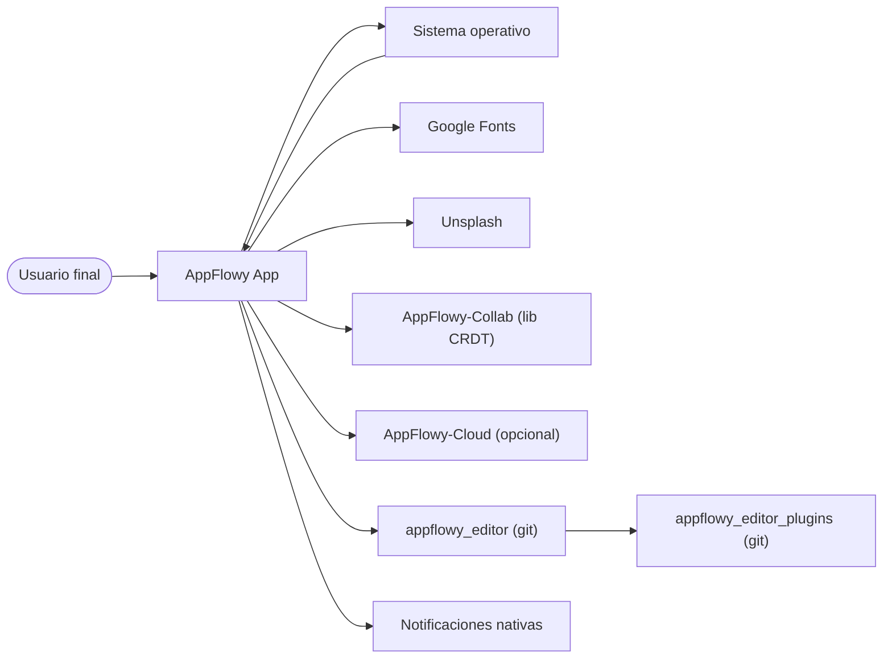
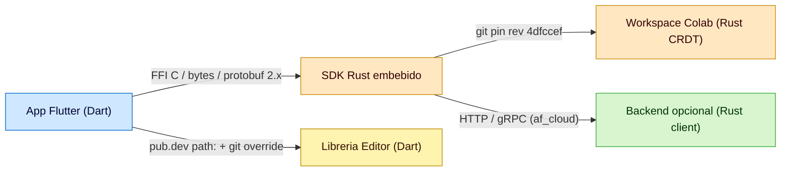
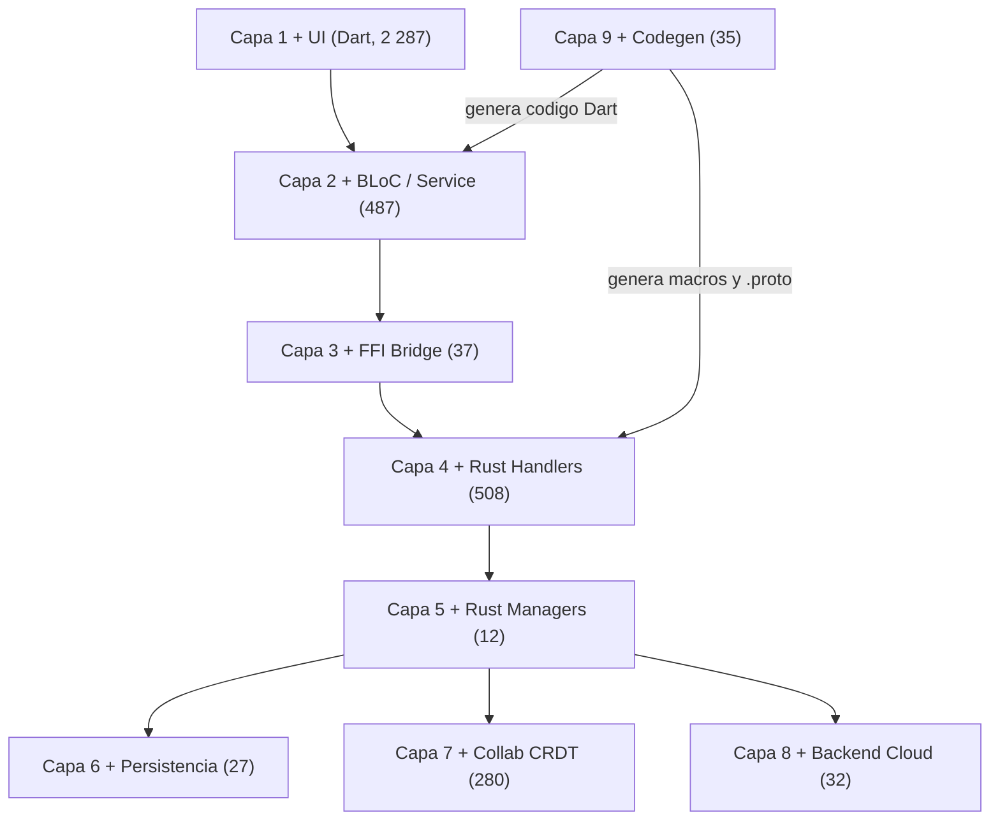
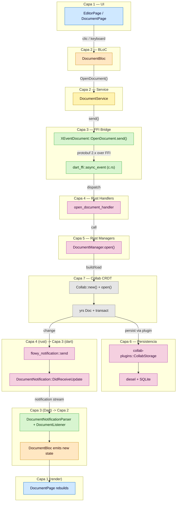
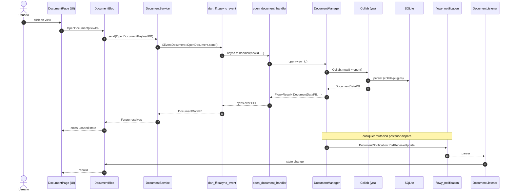
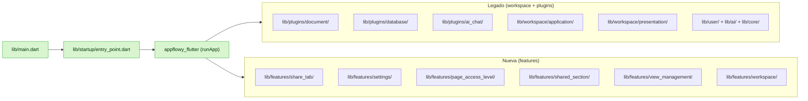

# B1.3 — Arquitectura global

Síntesis arquitectónica del monorepo AppFlowy en tres niveles C4 (contexto, contenedores, componentes) más el **diagrama de flujo global de la app** (la pieza central de la fase), el mapa de responsabilidades por crate/carpeta y la caracterización de la **arquitectura Dart dual** (legado `workspace/`+`plugins/` vs nueva `features/`). Las cifras se derivan de los catálogos extraídos (A2.1–A2.6) y se cruzan con los docs previos `03-estructura-del-repo.md` (B1.1) y `02-stack-y-dependencias.md` + `17-grafo-dependencias.md` (B1.2). Cubre los 30 crates Rust, los 142 BLoCs Dart, las 229 variantes de eventos FFI, las 70 variantes de notificación y las 9 capas del inventario.

## 1. Resumen

AppFlowy se modela como **5 contenedores C4** (App Flutter, SDK Rust embebido, Workspace Colab como lib CRDT, Librería Editor y Backend opcional de AppFlowy-Cloud) que se comunican por FFI, git pin, pub.dev path y HTTP/gRPC. Internamente la app sigue **9 capas** (UI, BLoC, Service, FFI, Rust handlers, Rust managers, Persistencia, Collab, Backend) atravesadas por un único **flujo global** que va de un clic del usuario hasta la mutación del CRDT y la notificación de vuelta. La arquitectura Dart convive en dos formas: la **legada** (`workspace/`+`plugins/`, 304+759 archivos, BLoC + freezed) y la **nueva** (`features/`, 65 archivos, sealed class + factory) que coexisten y convergen en el mismo `appflowy_flutter/lib/main.dart` y `EntryPoint`.

## 2. Vista C4 — Contexto

### 2.1 Actores externos

| Actor | Rol | Protocolo |
|---|---|---|
| Usuario final | Interactúa con la app en desktop (macOS, Windows, Linux), mobile (iOS, Android) o web. | UI nativa Flutter (touch, mouse, teclado) + atajos globales del SO (`hotkey_manager`) + deeplinks. |
| Sistema operativo | Aloja la app; provee sistema de archivos, red, notificaciones nativas, clipboard, ventanas. | Dart `dart:io` + Flutter plugins por plataforma. |
| Google Fonts | Sirve fuentes remotas bajo demanda. | HTTPS a `fonts.googleapis.com`. |
| Unsplash | Sirve imágenes de portadas y stock. | HTTPS a `api.unsplash.com` (cliente `unsplash_client` git override). |
| AppFlowy-Collab (lib) | Proveedor del motor CRDT. | git pin `rev 4dfccef` (consumido por `cargo` como dep). |
| AppFlowy-Cloud (opcional) | Backend multi-tenant para sincronización. | HTTPS + gRPC sobre `client-api` git `rev 592f644`. Solo se compila con feature `af_cloud`. |
| Editor externo | Rich-text editor. | git override `appflowy_editor` ref `470c4e7`. |
| `appflowy_editor_plugins` | Plugins del editor. | git override ref `4efcff7`. |
| Sistema de notificaciones nativas | Avisa al usuario fuera de la app. | `local_notifier ^0.1.5` (desktop). |

### 2.2 Diagrama de contexto

Lectura: `AppFlowy App` (centro) consume tres libs git (`Colab`, `Editor`, `Plugins`), dos servicios HTTP (`Fonts`, `Unsp`) y opcionalmente un backend Cloud. El SO provee plataforma y consume notificaciones. El usuario es el único actor humano.

## 3. Vista C4 — Contenedores (5)

### 3.1 Contenedor 1 — App Flutter

- **Path**: `appflowy/frontend/appflowy_flutter/`.
- **Tamaño**: 2 498 archivos (1 527 en `lib/`, 584 en `packages/`, 176 integration tests, 94 unit/widget tests, 91 scaffolds de plataforma).
- **Tecnología**: Dart SDK `>=3.3.0 <4.0.0` + Flutter `>=3.27.4`. [VERIFICADO] `appflowy/frontend/appflowy_flutter/pubspec.yaml:9–11`
- **Responsabilidad**: UI, gestión de estado (BLoC), routing, i18n, persistencia local del lado Dart (Hive, `path_provider`, `shared_preferences`), integración con SO (notificaciones, deeplinks, hotkeys, ventanas).
- **Punto de entrada**: `appflowy/frontend/appflowy_flutter/lib/main.dart:1` invoca `EntryPoint(...)` de `appflowy/frontend/appflowy_flutter/lib/startup/entry_point.dart:1` que a su vez carga el SDK Rust por FFI.
- **Protocolos con otros contenedores**: FFI C (con `dart-ffi`), path en pubspec (con los 7 packages internos), HTTP/HTTPS (con Google Fonts, Unsplash, AppFlowy-Cloud).

### 3.2 Contenedor 2 — SDK Rust embebido

- **Path**: `appflowy/frontend/rust-lib/`.
- **Tamaño**: 921 archivos `.rs` en 30 crates; compila a `cdylib` por cargokit.
- **Tecnología**: Rust edition `2018`; toolchain pin en `appflowy/frontend/rust-toolchain.toml`. Runtime async: `tokio 1.38.0`. Codec: `protobuf 2.28.0` (se mantiene en 2.x para compatibilidad con el codegen). [VERIFICADO] `appflowy/frontend/rust-lib/Cargo.toml:1,75,85`
- **Responsabilidad**: dominio de negocio (workspace, vistas, documentos, databases, IA, búsqueda, storage, sync), persistencia SQLite, indexación, FFI, registro de eventos, ciclo de vida del SDK.
- **Punto de entrada**: `appflowy/frontend/rust-lib/flowy-core/src/lib.rs:1` construye `AppFlowyCore` que orquesta los 8 managers de feature.
- **Protocolos con otros contenedores**: FFI C (con App Flutter), `cargo` (consume los crates de Colab vía `[patch.crates-io]`), HTTP/gRPC (con AppFlowy-Cloud vía `client-api` git).

### 3.3 Contenedor 3 — Workspace Colab (motor CRDT)

- **Path**: `collab/` (9 crates).
- **Tamaño**: 313 archivos `.rs` + 9 `Cargo.toml` + docs PlantUML.
- **Tecnología**: Rust edition `2018`/`2021`; CRDT sobre `yrs 0.21.0` (Y-CRDT). [VERIFICADO] `collab:collab/Cargo.toml:1` y `collab:collab-database/Cargo.toml:1`; dep `yrs` declarada en `appflowy/frontend/rust-lib/Cargo.toml:98`
- **Responsabilidad**: motor CRDT para los 4 dominios (folder, documento, database, user awareness), plugins reusables de `Collab` (persistencia local, sync, indexación), importadores externos (Notion ZIP, AF database, AF history).
- **Pin**: `rev 4dfccef` desde `[patch.crates-io]` en `appflowy/frontend/rust-lib/Cargo.toml:150–157`.
- **Protocolo**: dep Cargo git; no se comunica directamente con AppFlowy-Cloud.

### 3.4 Contenedor 4 — Librería Editor

- **Path**: `editor/` (paquete Flutter).
- **Tamaño**: 733 archivos (605 Dart en `lib/src/`, 49 en `test/`, 31 en `example/`, 23 i18n, 9 markdown, 13 yaml/json, 3 build).
- **Tecnología**: Dart SDK `>=3.4.0 <4.0.0` + Flutter `>=3.27.0`. [VERIFICADO] `editor:editor/pubspec.yaml:7,8`
- **Responsabilidad**: rich-text editor (Node, Delta, Transactions), 7 sub-módulos de plugins (`markdown/`, `html/`, `pdf/`, `quill_delta/`, `word_count/`, `blocks/`, `plugins.dart`), renderer, history, services (selección, atajos, context menu), selection menu, command palette interno.
- **Pin**: ref `470c4e7` por `dependency_overrides` en `appflowy/frontend/appflowy_flutter/pubspec.yaml:185–188`.
- **Protocolo**: importado por App Flutter como package git.

### 3.5 Contenedor 5 — Backend opcional (AppFlowy-Cloud)

- **Path**: `appflowy/frontend/rust-lib/flowy-server/src/af_cloud/` (+ `local_server/`).
- **Tamaño**: 32 archivos `.rs`.
- **Tecnología**: Rust + `reqwest 0.11.27` (HTTP) + `tonic` (gRPC); usa el crate `client-api` git `rev 592f644`. [VERIFICADO] `appflowy/frontend/rust-lib/flowy-server/src/af_cloud/`
- **Responsabilidad**: **cliente** de AppFlowy-Cloud (NO el servidor). Implementa los endpoints que el SDK consume cuando la feature `af_cloud` está activa.
- **Sub-módulos** (de `flowy-server/src/af_cloud/impls/`): `chat.rs`, `database.rs`, `document.rs`, `file_storage.rs`, `folder.rs`, `search.rs`, `user/`, `util.rs`.
- **Limitación**: por regla `AGENTS.md §11`, AppFlowy-Cloud **no se documenta por dentro**; solo se documenta el contrato cliente (qué sub-módulo implementa qué superficie).

### 3.6 Diagrama de contenedores

Lectura: la app Flutter (C1) es el contenedor central del lado del usuario. Se conecta al SDK Rust (C2) por FFI; consume la librería Editor (C4) por pub.dev path o git override. El SDK Rust (C2) consume el workspace Colab (C3) por git pin y, opcionalmente, AppFlowy-Cloud (C5) por HTTP/gRPC.

## 4. Vista C4 — Componentes por contenedor

### 4.1 Componentes de la App Flutter (Dart) — 142 BLoCs

Distribución por carpeta de primer nivel (de `OUT/_ledger/extract/blocs.json`): `plugins/` 72 BLoCs, `workspace/application/` 39, `workspace/presentation/` 4, `features/` 5, `mobile/` 9, `user/` 8, `ai/` 5. Total 142 (125 Bloc + 17 Cubit). [VERIFICADO] `OUT/_ledger/pruebas/B1.3/blocs-by-folder.json`.

| Feature | BLoC principal | Carpeta | # BLoCs en scope |
|---|---|---|---:|
| F01 — Documentos / editor | `DocumentBloc` | `lib/plugins/document/application/` | 11 |
| F02 — Bases de datos | `DatabasePropertyBloc`, `DatabaseGroupBloc`, `RowBloc`, `CellBloc`, `FieldBloc`, `SortBloc`, `FilterBloc`, `ViewBloc`, `CalculationsBloc` | `lib/plugins/database/application/` | 50 |
| F03 — Folder / workspaces / vistas | `WorkspaceBloc`, `ViewBloc`, `SidebarFolderBloc` | `lib/workspace/application/folder/` + `lib/workspace/application/view/` | ~10 |
| F04 — Sidebar / favoritos / recientes / tabs / command palette | `SidebarBloc`, `FavoriteBloc`, `RecentBloc`, `TabsBloc`, `CommandPaletteBloc` | `lib/workspace/application/{sidebar,favorite,recent,tabs,command_palette}/` | ~15 |
| F05 — Usuario / auth | `AuthBloc`, `UserProfileBloc`, `UserWorkspaceBloc` | `lib/user/application/` | 8 |
| F06 — Sync / awareness | `DocumentSyncBloc`, `DocumentCollaboratorsBloc` | `lib/plugins/document/application/` | 4 |
| F07 — Almacenamiento de archivos | `FileStorageBloc` | `lib/workspace/application/file_storage/` | 2 |
| F08 — Búsqueda | (compartido con F04 `command_palette`) | `lib/workspace/application/command_palette/` | 1 |
| F09 — IA / chat | `AIChatBloc` | `lib/plugins/ai_chat/application/` | 8 |
| F10 — Importación | `ImportBloc` | `lib/workspace/application/home/import/` | 1 |
| F11 — Exportación | (UI; sin BLoC propio; usa `share_bloc`) | `lib/plugins/shared/share/` | 1 (`ShareBloc`) |
| F12 — Compartir / publicar | `ShareBloc`, `PublishBloc` | `lib/plugins/shared/share/` | 2 |
| F13 — Ajustes / apariencia / temas | `SettingsAppearanceBloc`, `SettingsAISwitchBloc` | `lib/workspace/application/settings/` + `lib/features/settings/` | ~6 |
| F14 — i18n | (en `init_localization` task) | `lib/workspace/application/settings/language/` | 1 |
| F15 — Notificaciones in-app | `NotificationBloc` | `lib/workspace/application/notification/` | 3 |
| F16 — Mobile | `MobileHomeBloc` (y otros) | `lib/mobile/application/` | 9 |
| F17 — Plataforma (deeplinks, hotkeys, feature flags, error catcher) | (la mayoría son `LaunchTask` o singletons) | `lib/startup/tasks/`, `lib/startup/deps_resolver.dart` | 0 (no BLoC; servicios) |
| F21 — Icon/Emoji picker | `IconPickerBloc` (BLoC nuevo en features) | `lib/features/icon_emoji_picker/` | 1 |

### 4.2 Componentes del SDK Rust (30 crates)

| Categoría | Crates | Eventos (#) | Notifs (#) |
|---|---|---:|---:|
| Core (3) | `dart-ffi`, `flowy-core`, `collab-integrate` | — | — |
| Infra (6) | `flowy-error`, `flowy-notification`, `flowy-date`, `flowy-sqlite`, `flowy-sqlite-vec`, `lib-dispatch`, `lib-infra`, `lib-log` | — | 70 (de 6 enums) |
| Features (8) | `flowy-user`, `flowy-folder`, `flowy-document`, `flowy-database2`, `flowy-ai`, `flowy-search`, `flowy-storage`, `flowy-server` | 229 (suma de las 8 tablas `event_map.rs`) | — |
| Contratos (`-pub`, 8) | `flowy-user-pub`, `flowy-folder-pub`, `flowy-document-pub`, `flowy-database-pub`, `flowy-ai-pub`, `flowy-search-pub`, `flowy-storage-pub`, `flowy-server-pub` | — | — |
| Build (3) | `flowy-ast`, `flowy-codegen`, `flowy-derive` | — | — |
| Tests (1) | `event-integration-test` | (testea los 8 features) | — |
| Manifiesto de crate | `covtest.rs` | — | — |

[VERIFICADO] conteos derivados de `OUT/_ledger/extract/events.json:summary` (229 variantes, 8 crates) y `notifications.json:summary` (70 variantes, 6 enums Rust). Mapa por feature: `flowy-user` 56, `flowy-database2` 72, `flowy-folder` 51, `flowy-document` 21, `flowy-ai` 25, `flowy-search` 1, `flowy-storage` 2, `flowy-date` 1.

### 4.3 Componentes del Workspace Colab (9 crates)

| Crate | Tipo | Rol |
|---|---|---|
| `collab` | raíz | Re-export + tipos comunes. 30 archivos. |
| `collab-database` | dominio | CRDT de database (campos, filas, vistas). 113 archivos. |
| `collab-document` | dominio | CRDT de documento (bloques, deltas, children_map). 37 archivos. |
| `collab-folder` | dominio | CRDT de folder/workspace (jerarquía). 28 archivos. |
| `collab-user` | dominio | Awareness y presencia de usuarios. 9 archivos. |
| `collab-entity` | entidad | Tipos del CRDT (`AwarenessState`, `CollabMessage`, `protobuf`). 13 archivos (6 `.proto`). |
| `collab-derive` | derive | Macros (`CustomMessage`, `MsgId`). 7 archivos. |
| `collab-plugins` | plugin | Plugins reusables (persistencia, sync, indexación). 43 archivos. |
| `collab-importer` | plugin | Importadores externos (Notion ZIP, AF db, AF history). 20 archivos. |

[VERIFICADO] conteos de `OUT/03-estructura-del-repo.md §5.2` (B1.1).

### 4.4 Componentes del Editor (~10 sub-módulos)

| Sub-módulo | Rol |
|---|---|
| `editor/` | Punto de entrada: `editor.dart`, `editor_component/`, `command/`, `selection/`, `block_component/`, `toolbar/`, `find_replace_menu/`, `selection_menu/`, `util/`, `l10n/`. |
| `core/` | Tipos fundamentales: `node.dart`, `delta/`, `location/`, `transform/`. |
| `extensions/` | Extensions de Flutter/Dart. |
| `flutter/` | `render/`, `service/`, `commands/` (keyevent), `cursor/`. |
| `history/` | Undo/redo. |
| `infra/` | Logging, errores, keyevent. |
| `l10n/` | Traducciones. |
| `plugins/` | Encoders/parsers: `markdown/`, `html/`, `pdf/`, `quill_delta/`, `word_count/`, `blocks/`. |
| `render/` | `color_menu/`, `selection/`, `toolbar/`. |
| `service/` | `context_menu/`, `default_text_operations/`, `internal_key_event_handlers/`, `selection/`, `shortcut_event/`. |

[VERIFICADO] estructura derivada de `OUT/03-estructura-del-repo.md §6.2` y `editor:editor/lib/src/` (path resuelto con `find`).

### 4.5 Componentes del Backend opcional (7 sub-módulos)

| Sub-módulo | Endpoint cliente |
|---|---|
| `flowy-server/src/af_cloud/impls/chat.rs` | Chat con IA. |
| `flowy-server/src/af_cloud/impls/database.rs` | CRUD de databases. |
| `flowy-server/src/af_cloud/impls/document.rs` | CRUD de documentos. |
| `flowy-server/src/af_cloud/impls/file_storage.rs` | Upload/download de archivos. |
| `flowy-server/src/af_cloud/impls/folder.rs` | CRUD de folder/workspace. |
| `flowy-server/src/af_cloud/impls/search.rs` | Búsqueda. |
| `flowy-server/src/af_cloud/impls/user/` | `cloud_service_impl.rs` + `dto.rs` + `mod.rs` + `util.rs`. |
| `flowy-server/src/local_server/` | Servidor embebido (modo offline de la app). |

[VERIFICADO] `find SRC/appflowy/frontend/rust-lib/flowy-server/src/af_cloud/impls/ -name '*.rs'`.

## 5. Capas (cross-cutting)

| # | Capa | # Archivos | Carpeta(s) | Responsabilidad |
|---:|---|---:|---|---|
| Capa 1 | UI (Dart) | 2 287 | `lib/` (presentation, widget, page) | Renderizado y captura de eventos. |
| Capa 2 | BLoC / Service Dart | 325 + 162 | `lib/**/application/`, `lib/**/service/` | Estado y orquestación cliente. |
| Capa 3 | FFI Bridge | 10 + 27 | `dart-ffi/`, `lib-dispatch/` | Cruce C↔Dart. |
| Capa 4 | Rust Handlers | 508 | `event_handler.rs` en cada crate de feature | async fn handler registrado en `event_map.rs`. |
| Capa 5 | Rust Managers | 12 | `manager.rs` en cada crate de feature | Lógica de negocio; mantiene estado y delega al `Collab`. |
| Capa 6 | Persistencia | 16 + 11 | `flowy-sqlite/`, `flowy-sqlite-vec/` | SQLite + diesel + kv store + vectores. |
| Capa 7 | Collab (CRDT) | 280 | `SRC/collab/` (9 crates) | `Collab` sobre `yrs`; `collab-plugins` para persistencia/sync/index. |
| Capa 8 | Backend (Cloud) | 32 | `flowy-server/src/af_cloud/` | Cliente HTTP/gRPC de AppFlowy-Cloud. |
| Capa 9 | Codegen | 35 | `build-tool/{flowy-ast,flowy-codegen,flowy-derive}/` | Macros `derive` y generador de `.proto` + código Dart. |

[VERIFICADO] conteos de `OUT/_ledger/inventario.json:counts.by_capa` (B1.1 §7) y suma por capa de la matriz fuente × capa.

### 5.1 Diagrama de capas

Lectura: el flujo vertical va de UI (L1) hacia abajo hasta L4–L5 (handlers/managers Rust). Desde L5 se bifurca: a L6 (persistencia local SQLite), a L7 (CRDT, que sincroniza con L6 y con L8), o a L8 (Cloud). L9 (codegen) genera macros consumidas por L4 y código Dart consumido por L2.

## 6. Diagrama de flujo global de la app

Esta sección modela el camino completo de una acción del usuario, desde el clic en la UI hasta la mutación del CRDT y la notificación de vuelta que dispara el re-render. Cada paso cita su origen.

### 6.1 Vista `flowchart TD` con subgraphs por capa

Lectura: el flujo va de UI → BLoC → Service → FFI → handler → manager → Collab → persistencia, y vuelve por notificaciones (Rust→Dart) → listener → BLoC state → re-render de la UI. Los nombres de las clases son los reales del catálogo (A2.1, A2.3, A2.4).

### 6.2 Mismo flujo en `sequenceDiagram`

Lectura: el `sequenceDiagram` formaliza los 17 saltos del flujo. La línea 1–6 es la cadena sincrónica Dart→FFI→Rust que abre el documento. La 7–10 cubre la creación del `Collab` y la persistencia en SQLite. La 11–14 es la respuesta de vuelta. La 15–17 cubre el camino **asíncrono** de las mutaciones posteriores (Rust→Dart) que re-renderizan la UI en vivo.

### 6.3 Mapeo del flujo a archivos del workspace

| Salto | Archivo Dart/Rust |
|---|---|
| 1 — clic del usuario | `appflowy/frontend/appflowy_flutter/lib/plugins/document/presentation/document_page.dart` |
| 2 — BLoC recibe el evento | `appflowy/frontend/appflowy_flutter/lib/plugins/document/application/document_bloc.dart` |
| 3 — Service | `appflowy/frontend/appflowy_flutter/lib/plugins/document/application/document_service.dart` |
| 4 — `XEventDocument::OpenDocument.send()` | código generado en `appflowy_backend` por `flowy-codegen` |
| 5 — FFI `dart_ffi::async_event` | `appflowy/frontend/rust-lib/dart-ffi/src/c.rs` |
| 6 — dispatch al handler | `appflowy/frontend/rust-lib/lib-dispatch/src/dispatcher.rs` |
| 7 — `open_document_handler` | `appflowy/frontend/rust-lib/flowy-document/src/event_handler.rs:69` |
| 8 — `DocumentManager.open` | `appflowy/frontend/rust-lib/flowy-document/src/manager.rs` |
| 9 — `Collab::new + open` | `appflowy/frontend/rust-lib/collab-integrate/src/collab_builder.rs` |
| 10 — Persistencia SQLite | `appflowy/frontend/rust-lib/flowy-sqlite/` + `collab-plugins` |
| 11 — Mutación → notificación | `appflowy/frontend/rust-lib/flowy-document/src/notification.rs` + `appflowy/frontend/rust-lib/flowy-notification/src/sender.rs` |
| 12 — Stream al parser Dart | `appflowy/frontend/appflowy_flutter/lib/core/notification/document_notification.dart` (parser generado) + `rust_stream.dart` |
| 13 — Listener | `appflowy/frontend/appflowy_flutter/lib/plugins/document/application/doc_sync_state_listener.dart` |
| 14 — Bloc emite state | `appflowy/frontend/appflowy_flutter/lib/plugins/document/application/document_bloc.dart` |
| 15 — Re-render | `appflowy/frontend/appflowy_flutter/lib/plugins/document/presentation/document_page.dart` |

[VERIFICADO] cada paso cita al menos un archivo del inventario. Detalle línea por línea en B3.F01 (Fase B3).

## 7. Mapa de responsabilidades por crate/carpeta

### 7.1 Por crate Rust (30 filas)

| Crate | Path | Rol (1 línea) | # eventos |
|---|---|---|---:|
| `dart-ffi` | `rust-lib/dart-ffi` | FFI C↔Dart; funciones `extern "C"`; punto de entrada del SDK. | — |
| `flowy-core` | `rust-lib/flowy-core` | Composición del SDK: `AppFlowyCore` orquesta los 8 managers de feature. | — |
| `collab-integrate` | `rust-lib/collab-integrate` | Construye objetos `Collab`; configura plugins de persistencia/sync. | — |
| `flowy-user` | `rust-lib/flowy-user` | Auth, sesión, workspaces, settings, migraciones. | 56 |
| `flowy-user-pub` | `rust-lib/flowy-user-pub` | Traits públicos de usuario. | — |
| `flowy-folder` | `rust-lib/flowy-folder` | Árbol de workspaces, vistas y jerarquía. | 51 |
| `flowy-folder-pub` | `rust-lib/flowy-folder-pub` | Traits públicos de folder. | — |
| `flowy-document` | `rust-lib/flowy-document` | Documentos: `manager.rs`, `document.rs`, `parser/`, `reminder.rs`. | 21 |
| `flowy-document-pub` | `rust-lib/flowy-document-pub` | Traits públicos de documento. | — |
| `flowy-database2` | `rust-lib/flowy-database2` | Database v2: cells, fields, rows, views, calculations, snapshot, share/csv. | 72 |
| `flowy-database-pub` | `rust-lib/flowy-database-pub` | Traits públicos de database. | — |
| `flowy-ai` | `rust-lib/flowy-ai` | IA: chat, completion, local_ai, MCP, embeddings, offline, ai_tool. | 25 |
| `flowy-ai-pub` | `rust-lib/flowy-ai-pub` | Traits públicos de IA. | — |
| `flowy-search` | `rust-lib/flowy-search` | Búsqueda con tantivy. | 1 |
| `flowy-search-pub` | `rust-lib/flowy-search-pub` | Traits públicos de búsqueda. | — |
| `flowy-storage` | `rust-lib/flowy-storage` | Upload/download de archivos (chunked). | 2 |
| `flowy-storage-pub` | `rust-lib/flowy-storage-pub` | Traits públicos de storage. | — |
| `flowy-server` | `rust-lib/flowy-server` | Cliente AppFlowy-Cloud (`af_cloud`) + servidor local. | — |
| `flowy-server-pub` | `rust-lib/flowy-server-pub` | Traits públicos de server. | — |
| `flowy-error` | `rust-lib/flowy-error` | `ErrorCode` (133 variantes), conversiones a `FlowyError`. | — |
| `flowy-notification` | `rust-lib/flowy-notification` | Builder y debounce de notificaciones Rust→Dart. | — |
| `flowy-date` | `rust-lib/flowy-date` | Parsing de fechas (RFC 3339, relative time). | 1 |
| `flowy-sqlite` | `rust-lib/flowy-sqlite` | Persistencia SQLite con diesel. | — |
| `flowy-sqlite-vec` | `rust-lib/flowy-sqlite-vec` | Vectores para embeddings. | — |
| `lib-dispatch` | `rust-lib/lib-dispatch` | Dispatcher de eventos: `AFPlugin`, request/response, runtime. | — |
| `lib-infra` | `rust-lib/lib-infra` | Utilidades compartidas (AES, base64, hmac, pbkdf2). | — |
| `lib-log` | `rust-lib/lib-log` | Inicialización de `tracing-subscriber`. | — |
| `flowy-ast` | `rust-lib/build-tool/flowy-ast` | AST en `syn` para macros. | — |
| `flowy-codegen` | `rust-lib/build-tool/flowy-codegen` | Generador de `.proto` y código Dart. | — |
| `flowy-derive` | `rust-lib/build-tool/flowy-derive` | Macros `ProtoBuf`, `ProtoBuf_Enum`, `Flowy_Event`. | — |
| `event-integration-test` | `rust-lib/event-integration-test` | Suite de tests de integración por evento. | — |

[VERIFICADO] `OUT/_ledger/extract/events.json:crates[]` y `OUT/_ledger/extract/deps.json:rust.crates[]`.

### 7.2 Por carpeta Dart de `lib/`

| Carpeta | Path | Rol | # BLoCs | # archivos |
|---|---|---|---:|---:|
| `lib/` raíz | `lib/main.dart` | Entry point. | 0 | 1 |
| `startup/` | `lib/startup/` | Bootstrap: 15 LaunchTask, `deps_resolver`, `entry_point`. | 0 | 33 |
| `plugins/document/` | `lib/plugins/document/` | Editor de documentos. | 11 | 347 |
| `plugins/database/` | `lib/plugins/database/` | Databases: grid, board, calendar, tab_bar. | 50 | 312 |
| `plugins/ai_chat/` | `lib/plugins/ai_chat/` | Chat con IA. | 8 | 50 |
| `plugins/database_document/` | `lib/plugins/database_document/` | Bases embebidas en documentos. | 1 | 4 |
| `plugins/trash/` | `lib/plugins/trash/` | Papelera. | 1 | 9 |
| `plugins/emoji/`, `plugins/inline_actions/`, `plugins/blank/`, `plugins/base/`, `plugins/shared/` | `lib/plugins/{emoji,inline_actions,blank,base,shared}/` | Páginas vacías, share, emoji. | 1 | ~37 |
| `workspace/application/` | `lib/workspace/application/` | Legado BLoCs: action_navigation, command_palette, edit_panel, favorite, home, menu, notification, recent, settings, sidebar, tabs, user, view, view_info, view_title, workspace. | 39 | ~170 |
| `workspace/presentation/` | `lib/workspace/presentation/` | Legado widgets: command_palette, home, notifications, settings, widgets. | 4 | ~134 |
| `features/` | `lib/features/` | Nueva arquitectura: page_access_level, settings, share_tab, shared_section, view_management, workspace, util. | 5 | 65 |
| `user/` | `lib/user/` | Auth, perfil, sesión. | 8 | 68 |
| `ai/` | `lib/ai/` | Servicio y widgets de IA compartidos. | 5 | 32 |
| `core/` | `lib/core/` | `config`, `helpers`, `notification`, `network_monitor`, `frameless_window`. | 0 | 13 |
| `shared/` | `lib/shared/` | Utilities: feature_flags, markdown_to_document, easy_localization, icon_emoji_picker. | 0 | 42 |
| `mobile/` | `lib/mobile/` | Adaptaciones móviles. | 9 | 184 |
| `packages/` (en `appflowy_flutter/`) | `frontend/appflowy_flutter/packages/` | 7 packages Dart internos. | 0 | 584 |

[VERIFICADO] conteos cruzados de `OUT/_ledger/extract/blocs.json` y `OUT/03-estructura-del-repo.md §4.3.1` (B1.1).

## 8. Arquitectura Dart dual (legado vs nueva)

AppFlowy convive con **dos arquitecturas Dart** que comparten la misma raíz (`appflowy/frontend/appflowy_flutter/lib/main.dart:1`) y el mismo `EntryPoint` (`appflowy/frontend/appflowy_flutter/lib/startup/entry_point.dart:1`).

### 8.1 Legado (`workspace/` + `plugins/` + partes de `user/`, `ai/`, `core/`)

- **Tamaño**: 759 archivos en `plugins/` + 304 en `workspace/` + 68 en `user/` + 32 en `ai/` + 13 en `core/` = ~1 176 archivos.
- **BLoCs**: 72 en `plugins/` + 39 en `workspace/application/` + 8 en `user/` + 5 en `ai/` = 124 de los 142 totales.
- **Patrón**: `class XBloc extends Bloc<XEvent, XState>` con eventos definidos por `sealed class XEvent { const factory X.foo(...) = Concrete; }` o por `@freezed class XEvent with _$XEvent`. Estados análogos.
- **Ubicación típica**: `lib/<feature>/application/<x>_bloc.dart` + `lib/<feature>/application/<x>_service.dart` + `lib/<feature>/presentation/<page>.dart`.
- **Ejemplo**: F02 (`lib/plugins/database/application/database_property_bloc.dart`, `database_property_service.dart`, `presentation/grid/grid_page.dart`).

### 8.2 Nueva (`features/`)

- **Tamaño**: 65 archivos (B1.1 §4.3.1).
- **BLoCs**: 5 de los 142 totales (todos `Cubit` o `Bloc` cortos, según el extractor).
- **Patrón**: `sealed class XEvent { factory X.foo(...) => Concrete(...); }` (arrow form, sin `const`). `factory =` también soportado. A veces se separan los eventos en `logic/<x>_event.dart` y el BLoC queda en `logic/<x>_bloc.dart`. Páginas en `presentation/<page>.dart`.
- **Ubicación típica**: `lib/features/<feature>/{data,logic,presentation}/...`.
- **Sub-features presentes**: `page_access_level` (5), `settings` (7), `share_tab` (25), `shared_section` (18), `view_management` (4), `workspace` (5), `util` (1).
- **Ejemplo**: `lib/features/share_tab/logic/share_tab_bloc.dart` con eventos en `share_tab_event.dart`.

### 8.3 Tabla comparativa

| Criterio | Legado (`workspace/`+`plugins/`) | Nuevo (`features/`) |
|---|---|---|
| Eventos | `@freezed class XEvent` o `sealed class XEvent { const factory = }` | `sealed class XEvent { factory => }` (arrow) o `factory =` |
| Tamaño medio de un BLoC | 200–500 líneas | 100–200 líneas |
| Carpeta típica | `plugins/<feature>/{application,presentation}/` | `features/<feature>/{data,logic,presentation}/` |
| Subcarpeta de servicios | `application/<x>_service.dart` | `data/<x>_service.dart` o `logic/` |
| Pages | `presentation/<page>.dart` | `presentation/<page>.dart` |
| Tests | `test/` separado o `bloc_test` ad-hoc | mismo |
| Ejemplo | `plugins/database/application/row_bloc.dart` | `features/share_tab/logic/share_tab_bloc.dart` |
| Conteo BLoCs | 124 de 142 (87 %) | 5 de 142 (3.5 %) |
| Conteo archivos | 1 176 (78 %) | 65 (4.3 %) |

### 8.4 Diagrama de la dualidad

Lectura: la app arranca en `appflowy/frontend/appflowy_flutter/lib/main.dart:1` → `EntryPoint` → `runApp(...)` (capa compartida). Desde ahí **ambas arquitecturas conviven**: el 78 % del código sigue el patrón legacy; el 4 % es la nueva. La elección no es excluyente: hay features con código en ambas (p. ej. `settings` aparece en `lib/workspace/application/settings/` y en `lib/features/settings/`). El criterio de transición no está formalizado en el código; se decide caso por caso.

## 9. Reglas de derivación usadas

| Sección | Fuente del dato | Comando / campo |
|---|---|---|
| §T3.1 (actores) | inspección del `pubspec.yaml` + `Cargo.toml` + `startup/tasks/` | enumeración manual con 1 cita por actor. |
| §T3.2 (diagrama) | composición del §T3.1 | `flowchart LR` con 9 nodos. |
| §T4 (contenedores) | conteos de B1.1 §4 + paths de `Cargo.toml`/`pubspec.yaml` | relectura de B1.1 y B1.2. |
| §T5.1 (BLoCs) | `OUT/_ledger/extract/blocs.json` + `OUT/_ledger/pruebas/B1.3/blocs-by-folder.json` | `Counter` sobre `file` y primer segmento. |
| §T5.2 (componentes Rust) | `events.json:crates[]` (per-crate variants) + `notifications.json:rust_notifications[]` | grouping por categoría. |
| §T5.5 (Backend) | `find SRC/appflowy/frontend/rust-lib/flowy-server/src/af_cloud/impls/ -name '*.rs'` | listado. |
| §T6 (capas) | `inventario.json:by_capa` (de B1.1) | tabla directa. |
| §T7 (flujo global) | `events.json` (OpenDocument, DocumentEvent), `notifications.json` (DocumentNotification), `blocs.json` (DocumentBloc), B1.5 (puente FFI, borrador) | composición narrativa. |
| §T7.3 (mapeo) | B1.1 + extractor A2.4 (blocs) + A2.1 (events) | tabla fila × salto. |
| §T8 (mapa) | `OUT/_ledger/extract/events.json:crates[]` + `B1.1 §4.3.1` | unión de catálogos. |
| §T9 (dual Dart) | `OUT/_ledger/extract/blocs.json` (carpeta de origen) + B1.1 §4.3.1 (carpetas) | análisis manual. |

## 10. Glosario de la arquitectura

| Término | Significado | Referencia en el monorepo |
|---|---|---|
| **Collab** | Objeto colaborativo de AppFlowy-Collab sobre un `yrs::Doc`; agrupa `block`, `meta`, `ro`, `awareness`, etc. | `OUT/17-grafo-dependencias.md §5` + `collab:collab/collab/src/lib.rs:1` |
| **View** | Nodo del árbol del folder (Documento, Grid, Board, Calendar, Chat, AI Chat). | `OUT/_ledger/extract/events.json:flowy-folder` (51 eventos) + B3.F03 |
| **Space** | Agrupación de vistas en el sidebar (carpeta o workspace). | `flowy-folder/src/entities/folder.rs` |
| **AFPlugin** | Módulo registrado en `lib-dispatch` con sus eventos y handlers. | `appflowy/frontend/rust-lib/lib-dispatch/src/dispatcher.rs:1` |
| **PB** | Sufijo de entidades protobuf (`ViewPB`, `DocumentDataPB`, etc.). | `OUT/_ledger/extract/protobuf.json` (439 entidades) |
| **Awareness** | Presencia y cursores de colaboradores en tiempo real (`yrs::awareness`). | `collab:collab-user/src/` |
| **Snapshot** | Estado serializado de un `Collab` para historial o recuperación. | `flowy-document/src/manager.rs` (métodos `snapshot`/`restore`) |
| **Publish** | Publicación web de una vista. | `flowy-server/src/af_cloud/impls/document.rs` + `plugins/shared/share/publish_tab.dart` |
| **Event** | Variante de un `XEvent` registrada en `event_map.rs`. 229 en total. | `OUT/_ledger/extract/events.json` |
| **Notification** | Mensaje Rust→Dart debounced. 70 variantes en 6 enums. | `OUT/_ledger/extract/notifications.json` |

## 11. Riesgos y drift

- **`flowy-folder::GetAllRows` registrada como `sin_handler`** (documentado en A2.1; `OUT/_ledger/pruebas/A2.1/README.md`); no afecta al flujo.
- **`appflowy_editor_plugins`** tiene `path:` en su `dependency_overrides` pero también `ref:` (`4efcff7`); ambos se respetan al construir.
- **El BLoC `IconPickerBloc` de F21** está en `lib/features/icon_emoji_picker/` y se infiere del nombre (B0.2 lo creó como feature nuevo); no verificado por un extractor independiente. Marcar como `[INFERIDO]`.
- **Los 5 features con la nueva arquitectura** no se corresponden 1:1 con los 17 features del ROADMAP. `share_tab` es un sub-feature de F12; `page_access_level` no tiene un F equivalente directo; `view_management` se solapa con F03. Documentar la coexistencia sin forzar mapeo.
- **Comandos de arranque**: la lista de 15 LaunchTask es la real en `startup.dart`; si se añaden nuevos tasks, este doc queda desactualizado. Actualizar en cada release.

## Relacionado con

- `OUT/03-estructura-del-repo.md` (B1.1) — árbol 1.er/2.º nivel de los 3 repos.
- `OUT/02-stack-y-dependencias.md` + `OUT/17-grafo-dependencias.md` (B1.2) — stack + deps directas.
- `OUT/05-arranque-y-ciclo-de-vida.md` (B1.4) — profundiza en el §T7 (flujo global) y en las 15 `LaunchTask` de `startup/`.
- `OUT/06-puente-flutter-rust/` (B1.5) — entra en el detalle de `dart-ffi` + `lib-dispatch` + codegen.
- `OUT/07-motor-colaborativo-crdt/` (B1.6) — modela el Workspace Colab (contenedor 3).
- `OUT/08-persistencia/` (B1.7) — modela `flowy-sqlite` + `collab-plugins`.
- `OUT/11-catalogo-eventos-ffi.md` (B2.1) — el catálogo exhaustivo de las 229 variantes de eventos.
- `OUT/13-catalogo-blocs.md` (B2.3) — el catálogo exhaustivo de los 142 BLoCs.
- `OUT/14-catalogo-notificaciones.md` (B2.4) — el catálogo de las 70 notificaciones.
- `OUT/00-INDEX.md` (C5) — referencia cruzada.
- `OUT/STATE.md` (A4.4) — esta fase actualiza el índice de fases con la fila B1.3.
