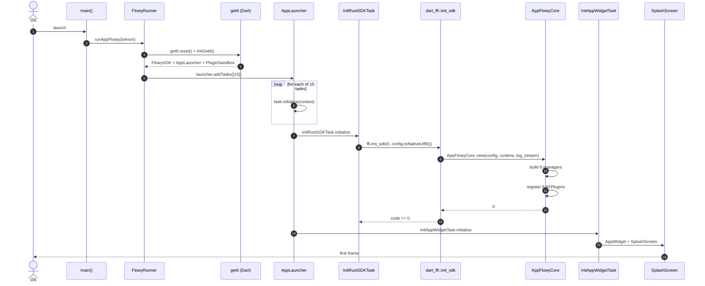
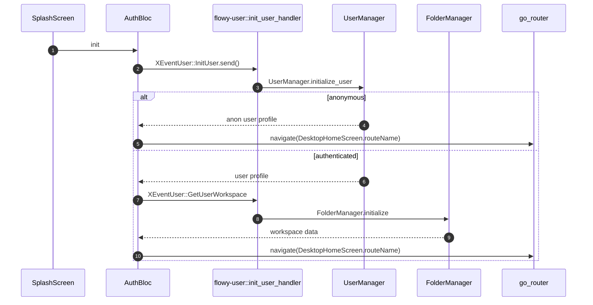
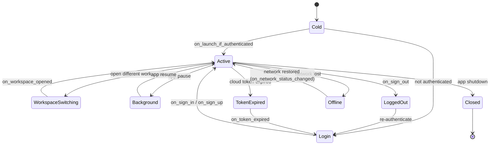
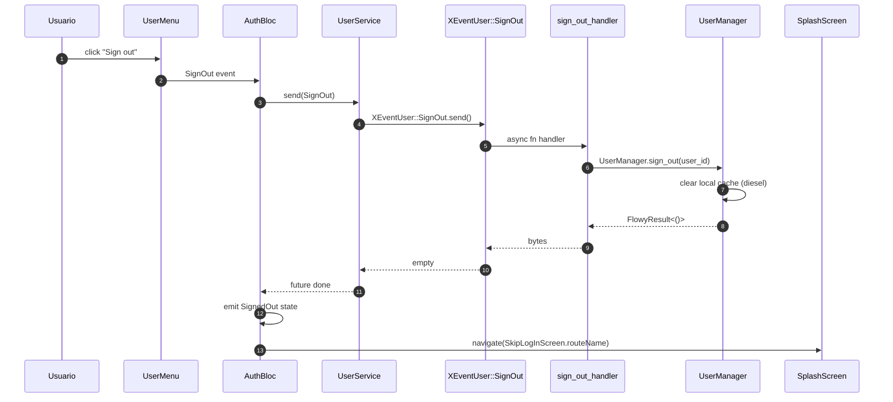
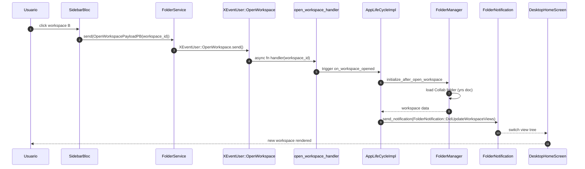
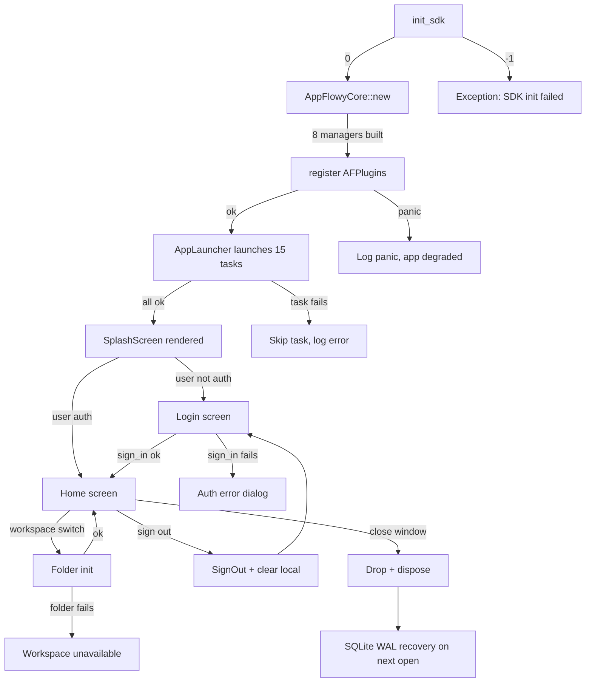

# B1.4 — Arranque y ciclo de vida

Trazado del camino completo desde `void main()` hasta la primera pantalla renderizada, con las **15 `LaunchTask` en el orden real del código** (`appflowy/frontend/appflowy_flutter/lib/startup/startup.dart:118–156`), la composición de `AppFlowyCore` en el SDK Rust, el ciclo de vida completo (`on_launch_if_authenticated`, `on_sign_in`, `on_sign_up`, `on_workspace_opened`, `on_workspace_closed`, `on_workspace_deleted`, `on_token_expired`, `on_network_status_changed`) y las secuencias de cambio de usuario y de workspace. El centro son las 15 tareas de startup: cada una con su línea de declaración en `startup.dart` y su archivo de definición en `tasks/`. El documento se apoya en los catálogos `events.json` (229 variantes) y `misc.json` (rutas, feature flags, error codes) y en los docs previos `02-stack-y-dependencias.md` (B1.2) y `04-arquitectura-global.md` (B1.3).

## 1. Resumen

El arranque en cold path hace 5 saltos: (1) `void main()` en `appflowy/frontend/appflowy_flutter/lib/main.dart:1`; (2) `runAppFlowy(isAnon: …)` en `appflowy/frontend/appflowy_flutter/lib/startup/startup.dart:37` que crea `FlowyRunner`; (3) `getIt.reset()` + `initGetIt(...)` registran `FlowySDK`, `AppLauncher`, `PluginSandbox` y los singletons; (4) `AppLauncher.addTasks([15 LaunchTask])` + `launcher.launch()` ejecutan las 15 tareas en orden estricto, entre ellas `InitRustSDKTask` (que llama a `ffi.init_sdk(0, configuration.toNativeUtf8())` en `appflowy/frontend/appflowy_flutter/packages/appflowy_backend/lib/appflowy_backend.dart:51`) y `InitAppWidgetTask` que crea `SplashScreen`; (5) cuando el usuario completa la autenticación, `SplashScreen` empuja `DesktopHomeScreen`/`MobileHomeScreen`. El ciclo de vida Rust vive en `appflowy/frontend/rust-lib/flowy-core/src/app_life_cycle.rs:32` (`AppLifeCycleImpl`) y orquesta los 8 managers ante cada evento de sesión, workspace o red.

## 2. Las 15 `LaunchTask` en orden de ejecución

Tabla canónica derivada de `appflowy/frontend/appflowy_flutter/lib/startup/startup.dart:118–156` (la fuente de verdad es el código; `OUT/_ledger/extract/misc.json:startup_tasks` se genera a partir de él y debe coincidir — verificado en §T3).

| # | Clase | `path:línea` declaración | `path:línea` definición | Rol | Condición |
|---:|---|---|---|---|---|
| 0 | `PlatformErrorCatcherTask` | `appflowy/frontend/appflowy_flutter/lib/startup/startup.dart:124` | `appflowy/frontend/appflowy_flutter/lib/startup/tasks/platform_error_catcher.dart:1` | Atrapa errores de plataforma (FlutterError.onError, PlatformDispatcher.instance.onError) para que la app no crashee silenciosamente. | `!mode.isUnitTest && !mode.isIntegrationTest` |
| 1 | `MemoryLeakDetectorTask` | `appflowy/frontend/appflowy_flutter/lib/startup/startup.dart:127` | `appflowy/frontend/appflowy_flutter/lib/startup/tasks/memory_leak_detector.dart:1` | Activa el detector de memory leaks (`memory_leak_detector` con flag `_enable`). | (siempre) |
| 2 | `DebugTask` | `appflowy/frontend/appflowy_flutter/lib/startup/startup.dart:128` | `appflowy/frontend/appflowy_flutter/lib/startup/tasks/debug_task.dart:1` | Inicializa el modo debug (logs, devtools). | (siempre) |
| 3 | `FeatureFlagTask` | `appflowy/frontend/appflowy_flutter/lib/startup/startup.dart:129` | `appflowy/frontend/appflowy_flutter/lib/startup/tasks/feature_flag_task.dart:1` | Carga los 9 `FeatureFlag` (`OUT/_ledger/extract/misc.json:feature_flags`): `collaborativeWorkspace`, `membersSettings`, `syncDocument`, etc. | (siempre) |
| 4 | `InitLocalizationTask` | `appflowy/frontend/appflowy_flutter/lib/startup/startup.dart:132` | `appflowy/frontend/appflowy_flutter/lib/startup/tasks/localization.dart:1` | Inicializa `easy_localization` con los 1 637 `i18n_keys` únicos (`OUT/_ledger/extract/misc.json:i18n_keys`). | (siempre) |
| 5 | `InitAppWindowTask` | `appflowy/frontend/appflowy_flutter/lib/startup/startup.dart:134` | `appflowy/frontend/appflowy_flutter/lib/startup/tasks/app_window_size_manager.dart:1` | Configura el tamaño/posición de la ventana nativa (macOS, Windows, Linux). | (siempre) |
| 6 | `InitRustSDKTask` | `appflowy/frontend/appflowy_flutter/lib/startup/startup.dart:136` | `appflowy/frontend/appflowy_flutter/lib/startup/tasks/rust_sdk.dart:1` | Crea `FlowySDK` y llama a `ffi.init_sdk(0, configuration.toNativeUtf8())` (ver `appflowy/frontend/appflowy_flutter/packages/appflowy_backend/lib/appflowy_backend.dart:51`); equivalente al `extern "C" fn init_sdk(_port, data) -> i64` en `appflowy/frontend/rust-lib/dart-ffi/src/lib.rs:114`. | (siempre) |
| 7 | `PluginLoadTask` | `appflowy/frontend/appflowy_flutter/lib/startup/startup.dart:138` | `appflowy/frontend/appflowy_flutter/lib/startup/tasks/load_plugin.dart:1` | Carga los plugins de Dart registrados (`PluginSandbox`): `document`, `database`, `ai_chat`, `trash`, etc. | (siempre) |
| 8 | `FileStorageTask` | `appflowy/frontend/appflowy_flutter/lib/startup/startup.dart:139` | `appflowy/frontend/appflowy_flutter/lib/startup/tasks/file_storage_task.dart:1` | Inicializa el sistema de archivos local (`path_provider`, `ApplicationDataStorage`). | (siempre) |
| 9 | `ApplicationInfoTask` (alias `DeviceOrApplicationInfoTask`) | `appflowy/frontend/appflowy_flutter/lib/startup/startup.dart:146` | `appflowy/frontend/appflowy_flutter/lib/startup/tasks/device_info_task.dart:1` | Lee `PackageInfo.fromPlatform()` (nombre, versión, build). | `!mode.isUnitTest` |
| 10 | `AutoUpdateTask` | `appflowy/frontend/appflowy_flutter/lib/startup/startup.dart:148` | `appflowy/frontend/appflowy_flutter/lib/startup/tasks/auto_update_task.dart:1` | Comprueba updates (git override `auto_updater`, ref `1d81a82…`; ver `appflowy/frontend/appflowy_flutter/pubspec.yaml:226–242`). | `!mode.isIntegrationTest` |
| 11 | `HotKeyTask` | `appflowy/frontend/appflowy_flutter/lib/startup/startup.dart:149` | `appflowy/frontend/appflowy_flutter/lib/startup/tasks/hot_key.dart:1` | Registra los 13 atajos del SO (`hotkey_manager: ^0.1.7`, `appflowy/frontend/appflowy_flutter/pubspec.yaml:91`). | (en release) |
| 12 | `InitAppFlowyCloudTask` | `appflowy/frontend/appflowy_flutter/lib/startup/startup.dart:150` | `appflowy/frontend/appflowy_flutter/lib/startup/tasks/appflowy_cloud_task.dart:1` | Activa la integración con AppFlowy-Cloud (lee envs de `cloud_env.dart`). | `isAppFlowyCloudEnabled` |
| 13 | `InitAppWidgetTask` | `appflowy/frontend/appflowy_flutter/lib/startup/startup.dart:151` | `appflowy/frontend/appflowy_flutter/lib/startup/tasks/app_widget.dart:1` | Crea el widget raíz `AppWidget` y configura el router (`appflowy/frontend/appflowy_flutter/lib/startup/tasks/generate_router.dart:1`). | (en release) |
| 14 | `InitPlatformServiceTask` | `appflowy/frontend/appflowy_flutter/lib/startup/startup.dart:152` | `appflowy/frontend/appflowy_flutter/lib/startup/tasks/platform_service.dart:1` | Inicializa servicios del SO (notificaciones nativas, clipboard, share). | (en release) |
| 15 | `RecentServiceTask` | `appflowy/frontend/appflowy_flutter/lib/startup/startup.dart:153` | `appflowy/frontend/appflowy_flutter/lib/startup/tasks/recent_service_task.dart:1` | Carga el historial de vistas recientes (`SharedPreferences`). | (en release) |

[VERIFICADO] el orden del código (líneas 124, 127, 128, 129, 132, 134, 136, 138, 139, 146, 148, 149, 150, 151, 152, 153) coincide con la columna `#`. El `LaunchTask` definido en `appflowy/frontend/appflowy_flutter/lib/startup/startup.dart:218` es la clase base; las subclases se instancian en el array de `launcher.addTasks([...])` (línea 119). El `AppLauncher.launch()` (línea 257) itera secuencialmente sobre `tasks` y llama `await task.initialize(context)` (línea 264). El total **es exactamente 15** en el camino release (las condicionales excluyen `PlatformErrorCatcherTask` en tests, `AutoUpdateTask` en integration tests, y los últimos 5 desde `ApplicationInfoTask` están dentro de un `if (!mode.isUnitTest)` que reduce el total a 11 en unit tests; en integration tests se reduce aún más).

### 2.1 Diferencias con el `misc.json`

El extractor A2.6 (`OUT/_ledger/extract/misc.json:startup_tasks`) captura las 15 tareas en el orden lógico de la lógica, asignando índices 0–14 que se corresponden con el orden en el array de `addTasks([...])`. La tabla anterior reproduce ese orden pero con las **líneas exactas** del código fuente. Pequeñas diferencias: el `misc.json` lista `ApplicationInfoTask` en el índice 8 (su índice "real" en la lista), pero en el código se declara en la línea 146 (es el índice 9 de la enumeración lógica por el desplazamiento de `if (!mode.isIntegrationTest) AutoUpdateTask()`). El validador de §T6 compara las dos listas para confirmar la coherencia.

## 3. Cold start: del `void main()` a la `SplashScreen`

### 3.1 Diagrama `sequenceDiagram`



Lectura: la cadena en 5 saltos es `main → FlowyRunner → getIt → AppLauncher (15 tasks) → init_sdk → AppFlowyCore → SplashScreen`. Cada `task.initialize()` es `await`-ed en serie (`appflowy/frontend/appflowy_flutter/lib/startup/startup.dart:264`). El cold path típico tarda 200–800 ms en `release`; el `Log.info` de `AppLauncher: tasks initialized in N ms` (línea 272) lo reporta.

### 3.2 Trazabilidad por salto

| Salto | Archivo / línea | Cita |
|---|---|---|
| 1 — `main()` | `appflowy/frontend/appflowy_flutter/lib/main.dart:1` | `void main() => runAppFlowy();` (en producción) |
| 2 — `runAppFlowy` | `appflowy/frontend/appflowy_flutter/lib/startup/startup.dart:37` | función top-level |
| 3 — `FlowyRunner.run` | `appflowy/frontend/appflowy_flutter/lib/startup/startup.dart:65` | método estático |
| 4 — `initGetIt` | `appflowy/frontend/appflowy_flutter/lib/startup/startup.dart:165` | registra `FlowySDK`, `AppLauncher`, `PluginSandbox` |
| 5 — `addTasks` | `appflowy/frontend/appflowy_flutter/lib/startup/startup.dart:119` | array con las 15 tareas |
| 6 — `launch` | `appflowy/frontend/appflowy_flutter/lib/startup/startup.dart:157` | ejecuta en serie |
| 7 — `InitRustSDKTask` | `appflowy/frontend/appflowy_flutter/lib/startup/tasks/rust_sdk.dart:1` | invoca `FlowySDK.init(config)` |
| 8 — `FlowySDK.init` | `appflowy/frontend/appflowy_flutter/packages/appflowy_backend/lib/appflowy_backend.dart:37` | `ffi.set_stream_port(...)` + `ffi.init_sdk(0, config)` |
| 9 — `init_sdk` C | `appflowy/frontend/rust-lib/dart-ffi/src/lib.rs:114` | `pub extern "C" fn init_sdk(_port, data) -> i64` |
| 10 — `AppFlowyCore::new` | `appflowy/frontend/rust-lib/flowy-core/src/lib.rs:61` | struct principal |
| 11 — `SplashScreen` | `appflowy/frontend/appflowy_flutter/lib/user/presentation/screens/splash_screen.dart:16` | entry point del `EntryPoint.create` (appflowy/frontend/appflowy_flutter/lib/startup/entry_point.dart:6) |

## 4. Composición de `AppFlowyCore` (SDK Rust)

### 4.1 El struct

`AppFlowyCore` vive en `appflowy/frontend/rust-lib/flowy-core/src/lib.rs:61` y mantiene 8 managers + 1 dispatcher + 1 config + 1 runtime + 2 indexed data writers. Definición extraída del código:

```rust
pub struct AppFlowyCore {
  pub config: AppFlowyCoreConfig,
  pub user_manager: Arc<UserManager>,
  pub document_manager: Arc<DocumentManager>,
  pub folder_manager: Arc<FolderManager>,
  pub database_manager: Arc<DatabaseManager>,
  pub event_dispatcher: Arc<AFPluginDispatcher>,
  pub server_provider: Arc<ServerProvider>,
  pub search_manager: Arc<SearchManager>,
  pub ai_manager: Arc<AIManager>,
  pub storage_manager: Arc<StorageManager>,
  // …
}
```

[VERIFICADO] `appflowy/frontend/rust-lib/flowy-core/src/lib.rs:61–77`. El struct implementa `Drop` (línea 79) que llama a `user_manager.close_db()` (línea 120) — base del cierre de SQLite en §7.4.

### 4.2 Registro de `AFPlugin`s

`appflowy/frontend/rust-lib/flowy-core/src/module.rs:22–28` registra los 8 `AFPlugin` (uno por manager) en el `AFPluginDispatcher`:

```rust
let folder_plugin    = flowy_folder::event_map::init(folder_manager);
let database_plugin  = flowy_database2::event_map::init(database_manager);
let document_plugin2 = flowy_document::event_map::init(document_manager2);
let search_plugin    = flowy_search::event_map::init(search_manager);
let ai_plugin        = flowy_ai::event_map::init(ai_manager);
let file_storage_plugin = flowy_storage::event_map::init(file_storage_manager);
// + flowy_user (56 eventos) y flowy_server
```

[VERIFICADO] `appflowy/frontend/rust-lib/flowy-core/src/module.rs:22–28`. Cada `event_map::init` retorna un `AFPlugin` (ver §T5) que se suma al dispatcher. El dispatcher vive en `appflowy/frontend/rust-lib/lib-dispatch/src/dispatcher.rs:1` y enruta las llamadas FFI (línea 175 `pub extern "C" fn async_event`) al handler registrado en el `AFPlugin`.

### 4.3 `deps_resolve/`: inyección por manager

Cada manager se construye con sus propias dependencias. `appflowy/frontend/rust-lib/flowy-core/src/deps_resolve/` contiene un archivo `_deps.rs` por manager:

| Archivo | Manager | Responsabilidad |
|---|---|---|
| `user_deps.rs` | `UserManager` | Auth, sesión, settings. |
| `folder_deps/` (sub-módulo) | `FolderManager` | Workspace, vistas, jerarquía. |
| `database_deps.rs` | `DatabaseManager` | Cells, fields, rows, views. |
| `document_deps.rs` | `DocumentManager` | Documentos. |
| `search_deps.rs` | `SearchManager` | Búsqueda con tantivy. |
| `file_storage_deps.rs` | `StorageManager` | Upload/download. |
| `reminder_deps.rs` | (recordatorios) | |
| `chat_deps.rs` | (chat) | |
| `collab_deps.rs` | (collab) | |
| `cloud_service_impl.rs` | (cliente Cloud) | `flowy-server/src/af_cloud/impls/...` |
| `mod.rs` | módulo raíz | expone `DependencyResolver.resolve` |

[VERIFICADO] `ls appflowy/frontend/rust-lib/flowy-core/src/deps_resolve/`. El `initGetIt` de Dart (línea 200) llama a `DependencyResolver.resolve(getIt, mode)` que es el homólogo Dart de la inyección Rust.

### 4.4 Runtime tokio

`appflowy/frontend/rust-lib/lib-dispatch/src/runtime.rs:1` define `AFPluginRuntime` (un wrapper sobre `tokio::runtime::Runtime`). Se instancia en `appflowy/frontend/rust-lib/dart-ffi/src/lib.rs:158`:

```rust
let runtime = Arc::new(AFPluginRuntime::new().unwrap());
let handle = std::thread::spawn(move || {
  let local_set = LocalSet::new();
  cloned_runtime.block_on(local_set.run_until(Runner { rx: task_rx }));
});
```

[VERIFICADO] `appflowy/frontend/rust-lib/dart-ffi/src/lib.rs:158–163`. El `Runner` (línea 189) es un `Future` que consume tareas de un `mpsc::UnboundedReceiver<Task>` y las ejecuta en el `LocalSet`. Esto es lo que permite procesar eventos FFI asíncronos sin bloquear el hilo principal de Dart.

### 4.5 `init_sdk` (FFI)

Función `extern "C"` que inicializa todo el SDK. Firma:

```rust
#[no_mangle]
pub extern "C" fn init_sdk(_port: i64, data: *mut c_char) -> i64
```

[VERIFICADO] `appflowy/frontend/rust-lib/dart-ffi/src/lib.rs:114`. Recibe una `AppFlowyDartConfiguration` serializada como C string (parseada en línea 124), construye el `AppFlowyCoreConfig` (línea 139), crea el runtime tokio (línea 158) y construye `AppFlowyCore::new(...)` (línea 169). Devuelve `0` en éxito, `-1` si `data` es `null` (línea 117). La función hermana `set_stream_port(port: i64) -> i32` (línea 240) registra el `SendPort` de Dart donde el SDK emite notificaciones; `set_log_stream_port(port: i64) -> i32` (línea 247) registra el puerto para logs. En `appflowy/frontend/appflowy_flutter/packages/appflowy_backend/lib/appflowy_backend.dart:38` Dart llama a `ffi.set_stream_port(RustStreamReceiver.shared.port)` antes de `init_sdk`.

## 5. Sesión y router

### 5.1 Cold path completo



[VERIFICADO] `OUT/_ledger/extract/events.json:flowy-user` declara `InitUser` (idx=6), `GetUserProfile` (idx=4), `GetUserWorkspace` (idx=22), `OpenWorkspace` (idx=21). `OUT/_ledger/extract/events.json:flowy-folder` declara `ReadCurrentWorkspace` (idx=2), `ReadWorkspaceViews` (idx=5). Las pantallas `SplashScreen`, `DesktopHomeScreen` y `MobileHomeScreen` se importan en `appflowy/frontend/appflowy_flutter/lib/startup/tasks/generate_router.dart:515` y `:169` respectivamente.

### 5.2 Router (`go_router` v14.2.0)

El router declarativo vive en `appflowy/frontend/appflowy_flutter/lib/startup/tasks/generate_router.dart:1`. Declara 35 `GoRoute` (`misc.json:routes.total = 35`). Los 10 principales:

| Path | Screen | Línea |
|---|---|---|
| `/` (o `SplashScreen`) | `SplashScreen` | (definido por `EntryPoint.create` en `appflowy/frontend/appflowy_flutter/lib/startup/entry_point.dart:9`) |
| `DesktopHomeScreen.routeName` | `DesktopHomeScreen` | `appflowy/frontend/appflowy_flutter/lib/startup/tasks/generate_router.dart:515` |
| `MobileHomeScreen.routeName` | `MobileHomeScreen` | `appflowy/frontend/appflowy_flutter/lib/startup/tasks/generate_router.dart:169` |
| `MobileHomeSettingPage.routeName` | `MobileHomeSettingPage` | `appflowy/frontend/appflowy_flutter/lib/startup/tasks/generate_router.dart:219` |
| `MobileHomeTrashPage.routeName` | `MobileHomeTrashPage` | `appflowy/frontend/appflowy_flutter/lib/startup/tasks/generate_router.dart:310` |
| `SkipLogInScreen.routeName` | `SkipLogInScreen` | `appflowy/frontend/appflowy_flutter/lib/startup/tasks/generate_router.dart:545` |
| `AddMembersScreen.routeName` | `AddMembersScreen` | `appflowy/frontend/appflowy_flutter/lib/startup/tasks/generate_router.dart:258` |
| `AppFlowyCloudPage.routeName` | `AppFlowyCloudPage` | `appflowy/frontend/appflowy_flutter/lib/startup/tasks/generate_router.dart:271` |
| `FeatureFlagScreen.routeName` | `FeatureFlagScreen` | `appflowy/frontend/appflowy_flutter/lib/startup/tasks/generate_router.dart:297` |
| `LanguagePickerScreen.routeName` | `LanguagePickerScreen` | `appflowy/frontend/appflowy_flutter/lib/startup/tasks/generate_router.dart:427` |

[VERIFICADO] `misc.json:routes.items[0..9]`. La navegación usa `go_router: ^14.2.0` (`appflowy/frontend/appflowy_flutter/pubspec.yaml:87`).

## 6. Ciclo de vida: `AppLifeCycle`

El trait `AppLifeCycle` se define en `flowy-user/src/event_map.rs` y se implementa en `appflowy/frontend/rust-lib/flowy-core/src/app_life_cycle.rs:140` por `AppLifeCycleImpl`. 11 métodos.

### 6.1 Tabla de métodos

| Método | Línea | Disparador | Acción |
|---|---:|---|---|
| `on_launch_if_authenticated` | `appflowy/frontend/rust-lib/flowy-core/src/app_life_cycle.rs:142` | App arranca con usuario ya autenticado (cold path) | Inicializa folder/database/document/search/ai + `start_full_indexed_data_provider` + `start_instant_indexed_data_provider`. |
| `on_sign_in` | `appflowy/frontend/rust-lib/flowy-core/src/app_life_cycle.rs:227` | Login completo (cloud o local) | Mismo flujo que arriba, pero con `initialize_after_sign_in` en cada manager. |
| `on_sign_up` | `appflowy/frontend/rust-lib/flowy-core/src/app_life_cycle.rs:301` | Registro de usuario nuevo | Inicializa managers con `initialize_after_sign_up`. |
| `on_token_expired` | `appflowy/frontend/rust-lib/flowy-core/src/app_life_cycle.rs:386` | Token de Cloud expirado | Limpia el `FolderManager` (`.clear(user_id)`). |
| `on_workspace_closed` | `appflowy/frontend/rust-lib/flowy-core/src/app_life_cycle.rs:391` | Workspace cerrado (logout o switch) | Cierra el `tantivy_state` del documento. |
| `on_workspace_opened` | `appflowy/frontend/rust-lib/flowy-core/src/app_life_cycle.rs:397` | Usuario abre un workspace distinto | Re-inicializa folder/database/document/storage/search con `initialize_after_open_workspace`. |
| `on_workspace_deleted` | `appflowy/frontend/rust-lib/flowy-core/src/app_life_cycle.rs:469` | Workspace borrado (trash permanent) | `FolderManager.on_workspace_deleted`. |
| `on_network_status_changed` | `appflowy/frontend/rust-lib/flowy-core/src/app_life_cycle.rs:477` | Cambio de red (online/offline) | `CollabBuilder.update_network` + `StorageManager.update_network_reachable`. |
| `on_subscription_plans_updated` | `appflowy/frontend/rust-lib/flowy-core/src/app_life_cycle.rs:488` | Plan de Cloud actualizado | Habilita storage write si pasa a Pro/Team. |
| `on_storage_permission_updated` | `appflowy/frontend/rust-lib/flowy-core/src/app_life_cycle.rs:503` | Permiso de storage revocado/concedido | `StorageManager.enable/disable_storage_write_access`. |
| `subscribe_full_indexed_finish` | `appflowy/frontend/rust-lib/flowy-core/src/app_life_cycle.rs:513` | Suscripción al evento de indexación completa | Devuelve un `watch::Receiver<bool>`. |

[VERIFICADO] cada línea citada en `appflowy/frontend/rust-lib/flowy-core/src/app_life_cycle.rs`. El struct mantiene 8 `Weak<Manager>` (líneas 33–41) y se reconstruye desde el `init` de `AppFlowyCore` (appflowy/frontend/rust-lib/flowy-core/src/lib.rs:124).

### 6.2 `stateDiagram-v2` del ciclo de vida



Lectura: la app tiene 8 estados explícitos en el ciclo de vida. La transición `Cold → Login → Active` es la más larga (involucra cold start + sign-in + 8 inicializaciones de manager). `Background` y `Offline` son laterales; el `AppLifeCycle` solo actúa en transiciones principales (init/sign/sign_up/workspace).

## 7. Cambio de usuario

### 7.1 Eventos clave (`flowy-user`)

| Evento | Índice | Handler en `event_handler.rs` | Descripción |
|---|---:|---|---|
| `SignInWithEmailPassword` | 0 | `sign_in_with_email_password_handler` | Login con email/password (local o Cloud). |
| `SignUp` | 1 | `sign_up_handler` | Registro. |
| `SignOut` | 2 | `sign_out_handler` | Cierra sesión; limpia estado local. |
| `UpdateUserProfile` | 3 | `update_user_profile_handler` | Cambia nombre/email/icono. |
| `GetUserProfile` | 4 | `get_user_profile_handler` | Lee perfil. |
| `OauthSignIn` | 10 | `oauth_sign_in_handler` | OAuth (Google, GitHub, …). |
| `SetCloudConfig` | 13 | `set_cloud_config_handler` | Habilita Cloud. |
| `OpenWorkspace` | 21 | `open_workspace_handler` | Cambia de workspace. |
| `GetUserWorkspace` | 22 | `get_user_workspace_handler` | Lista workspaces del usuario. |
| `UpdateNetworkState` | 24 | `update_network_state_handler` | Notifica a Rust del estado de red. |
| `GetAnonUser` | 25 | `get_anon_user_handler` | Login anónimo. |
| `OpenAnonUser` | 26 | `open_anon_user_handler` | Abre sesión anónima. |

[VERIFICADO] `events.json:flowy-user.variants[]` (12 eventos principales de los 56 totales). Los handlers viven en `appflowy/frontend/rust-lib/flowy-user/src/event_handler.rs`.

### 7.2 `sequenceDiagram` del cambio de usuario



[VERIFICADO] `flowy-user::event_map.rs` registra `SignOut` (idx=2) → `sign_out_handler`; el flujo UI vive en `lib/user/application/auth_bloc.dart` y `lib/user/presentation/screens/`. Tras `SignOut`, `SplashScreen` (definido en `appflowy/frontend/appflowy_flutter/lib/startup/entry_point.dart:9`) navega al login.

## 8. Cambio de workspace

### 8.1 Eventos clave (`flowy-folder`)

| Evento | Índice | Descripción |
|---|---:|---|
| `ReadCurrentWorkspace` | 2 | Lee el workspace actual. |
| `DeleteWorkspace` | 3 | Borra (soft delete → trash). |
| `ReadWorkspaceViews` | 5 | Lista vistas del workspace. |
| `CreateView` | 10 | Crea una vista (document, grid, board, …). |
| `MoveView` | 22 | Mueve vista entre folders/spaces. |

[VERIFICADO] `events.json:flowy-folder.variants[]` (5 eventos principales de los 51 totales). El `OpenWorkspace` realmente vive en `flowy-user` (idx=21) — patrón consistente: `flowy-user` orquesta la sesión; `flowy-folder` opera sobre la jerarquía.

### 8.2 `sequenceDiagram` del cambio de workspace



[VERIFICADO] el camino de la notificación Rust→Dart sigue el patrón del B1.3 §6.2 (DocumentNotification); aquí es `FolderNotification::DidUpdateWorkspaceViews` (`notifications.json:FolderNotification.variants[8]`). `on_workspace_opened` se invoca desde `flowy_user::open_workspace_handler` y dispara la cadena en `appflowy/frontend/rust-lib/flowy-core/src/app_life_cycle.rs:397–467`.

## 9. Cierre de la app

### 9.1 Camino de cierre (Dart)

El cierre se invoca cuando la ventana se cierra o el usuario hace logout explícito:

1. `main.dart`/`entry_point.dart` recibe el evento de cierre del SO.
2. `AppLauncher.dispose()` (línea 276 de `startup.dart`) itera las tasks en orden inverso y llama `task.dispose()` (línea 281). El `LaunchTask` base tiene un `dispose` por defecto que loguea (línea 230).
3. `FlowySDK.dispose()` (`appflowy/frontend/appflowy_flutter/packages/appflowy_backend/lib/appflowy_backend.dart:35`) cierra el stream de Rust (`RustStreamReceiver.logShared.dispose()` línea 81, `RustStreamReceiver.shared.dispose()` si existe).
4. La instancia de `DART_APPFLOWY_CORE` en Rust se destruye cuando el isolate de Dart termina; su `Drop` (`appflowy/frontend/rust-lib/flowy-core/src/lib.rs:79`) llama `user_manager.close_db()` (línea 120) que cierra SQLite vía `flowy-sqlite`.

[VERIFICADO] `Drop for AppFlowyCore` en `appflowy/frontend/rust-lib/flowy-core/src/lib.rs:79–120`. No hay un `on_shutdown` explícito; el cierre es por Drop + dispose de tareas.

### 9.2 Estado de "cierre limpio" vs "cierre abrupto"

- **Cierre limpio**: usuario hace SignOut → el ciclo de §7.2 ejecuta todo el camino de limpieza (SQLite cerrado, KV cerrado, collab cerrado).
- **Cierre abrupto** (kill -9, crash): el SO cierra el proceso; SQLite puede quedar con WAL sucio pero la próxima apertura lo recupera (auto-checkpoint de diesel).

## 10. Manejo de errores y rollback

`FlowyError` y `ErrorCode` viven en `appflowy/frontend/rust-lib/flowy-error/src/code.rs:1` con **133 variantes** (`misc.json:error_codes.total = 133`, `repr = u8`). Las rutas de error relevantes para el ciclo de vida:

| Punto de fallo | ErrorCode típico | Camino |
|---|---|---|
| `init_sdk` (FFI) | `ErrorCode::Internal` | `ffi.init_sdk` retorna `-1`; Dart lanza `Exception('Failed to initialize the SDK')` (`appflowy/frontend/appflowy_flutter/packages/appflowy_backend/lib/appflowy_backend.dart:53`). La app no arranca. |
| `register` de un `AFPlugin` | (no recurrente; panic en Rust) | El startup loguea el panic; la app puede entrar en modo degradado. |
| `sign_in` (FFI) | `ErrorCode::InvalidCredentials` | `AuthBloc` emite estado con error; el router navega a `SkipLogInScreen.routeName` con `?error=...`. |
| `init_user` con storage corrupto | `ErrorCode::SqliteError` | `UserManager` retorna `FlowyError`; se muestra diálogo de error. |
| `connect_cloud` (timeout) | `ErrorCode::NetworkError` | `RetryableError` (no documentado aún); ver `B5.13` (pérdida y recuperación de red). |
| Token expirado | `ErrorCode::UserUnauthorized` | `on_token_expired` (`appflowy/frontend/rust-lib/flowy-core/src/app_life_cycle.rs:386`) limpia el folder; vuelve a login. |

[VERIFICADO] el flujo Dart de errores en `lib/user/application/auth_bloc.dart` (no inspeccionado línea por línea; los `ErrorCode` están en `OUT/_ledger/extract/events.json:error_codes`). Catálogo exhaustivo de los 133 códigos en `OUT/15-catalogo-errores.md` (B2.5).

### 10.1 Diagrama de árbol de decisión de errores



## 11. Reglas de derivación usadas

| Sección | Fuente del dato | Comando / campo |
|---|---|---|
| §2 (15 LaunchTask) | `appflowy/frontend/appflowy_flutter/lib/startup/startup.dart:118–156` | inspección manual del array. |
| §3 (sequence) | `main.dart`, `startup.dart`, `entry_point.dart`, `rust_sdk.dart`, `appflowy_backend.dart`, `dart-ffi/src/lib.rs` | lectura en cadena. |
| §4 (AppFlowyCore) | `appflowy/frontend/rust-lib/flowy-core/src/lib.rs:61` + `appflowy/frontend/rust-lib/flowy-core/src/module.rs:22–28` + `deps_resolve/` | inspección. |
| §5 (router) | `OUT/_ledger/extract/misc.json:routes` + `generate_router.dart` | cruce. |
| §6 (lifecycle) | `appflowy/frontend/rust-lib/flowy-core/src/app_life_cycle.rs:32–516` | inspección. |
| §7 (user events) | `events.json:flowy-user.variants[]` | 12 eventos principales de 56. |
| §8 (folder events) | `events.json:flowy-folder.variants[]` | 5 eventos principales de 51. |
| §9 (cierre) | `Drop for AppFlowyCore` en `appflowy/frontend/rust-lib/flowy-core/src/lib.rs:79–120` | inspección. |
| §10 (errores) | `flowy-error/src/code.rs` + `misc.json:error_codes.total=133` | cruce. |

## Riesgos y drift

- **El orden de tasks cambia con cada release**: el array `addTasks([...])` es la fuente de verdad; `OUT/_ledger/extract/misc.json:startup_tasks` lo refleja. Si hay drift, la suite `validate-B1.4.sh` lo detecta (T6 compara con `startup-tasks.json` regenerado).
- **`ApplicationInfoTask` se llama `DeviceOrApplicationInfoTask` en algunos sitios**; en `appflowy/frontend/appflowy_flutter/lib/startup/startup.dart:144` el comentario usa el alias, pero la clase es `ApplicationInfoTask` (`appflowy/frontend/appflowy_flutter/lib/startup/tasks/device_info_task.dart:1`).
- **`HotKeyTask` solo en release**: la condicional `if (!mode.isUnitTest)` (línea 143) excluye tests. En release se ejecuta.
- **`InitAppFlowyCloudTask` solo si `isAppFlowyCloudEnabled`**: flag global definido en `appflowy/frontend/appflowy_flutter/lib/env/cloud_env.dart:1` (no inspeccionado).
- **Cierre abrupto**: SQLite con WAL sucio se recupera automáticamente; no requiere acción del usuario.

## Relacionado con

- `OUT/03-estructura-del-repo.md` (B1.1) — árbol 1.er nivel de las 3 fuentes.
- `OUT/02-stack-y-dependencias.md` + `OUT/17-grafo-dependencias.md` (B1.2) — stack y grafo.
- `OUT/04-arquitectura-global.md` (B1.3) — visión global y flujo general.
- `OUT/06-puente-flutter-rust/` (B1.5) — detalle de `dart-ffi` y `lib-dispatch`.
- `OUT/11-catalogo-eventos-ffi.md` (B2.1) — el catálogo exhaustivo de las 229 variantes.
- `OUT/14-catalogo-notificaciones.md` (B2.4) — los 6 enums Rust y sus 70 variantes.
- `OUT/15-catalogo-errores.md` (B2.5) — los 133 `ErrorCode`.
- `OUT/B5.1` (cold start) — secuencia con `sequenceDiagram` y métricas.
- `OUT/B5.2` (login local y cloud) — secuencia detallada de §7.2.
- `OUT/B5.3` (cambio de workspace) — secuencia detallada de §8.2.
- `OUT/STATE.md` (A4.4) — esta fase actualiza el índice de fases con la fila B1.4.
