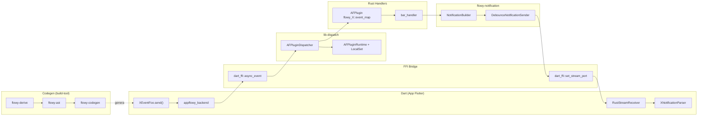
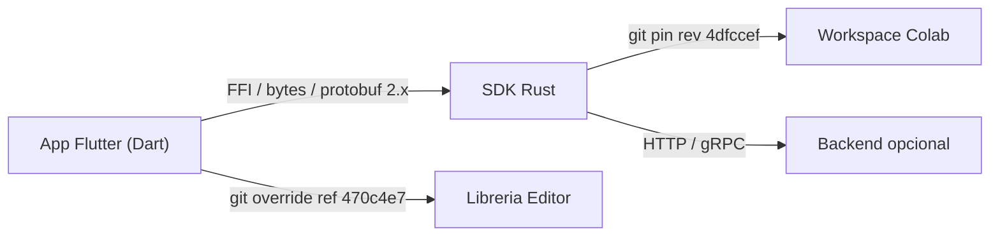

# 06-00 — Puente Flutter-Rust (índice)

Documento raíz del Bloque B1.5. Cubre el puente FFI que conecta la capa Dart (App Flutter) con la capa Rust (SDK embebido). El puente se compone de cinco piezas: la **capa FFI** (`dart-ffi`) con sus funciones `extern "C"` y ports; el **dispatcher** (`lib-dispatch`) que enruta las 229 variantes de eventos a sus 224 handlers; el **codegen** (`flowy-derive`/`flowy-ast`/`flowy-codegen`) que genera los artefactos Dart y Rust; el **sistema de notificaciones** (`flowy-notification`) con debounce por tipo; y un **ejemplo end-to-end** de `OpenDocument` trazado línea a línea. Los catálogos A2.1 (events), A2.4 (notifications), A2.5 (deps) y los extractores A2.7 (codegen) son la base; los documentos previos B1.3 (arquitectura global) y B1.4 (arranque y ciclo de vida) son el contexto.

## 1. Resumen

El puente FFI convierte cada llamada Dart a `XEventFoo::Bar(payload).send()` en bytes sobre `dart_ffi::async_event(port, bytes, len)`, los encola en un `mpsc::UnboundedReceiver<Task>` que un `Runner` consume sobre un `LocalSet` de `tokio`, los entrega al `AFPluginDispatcher` registrado por `flowy_X::event_map::init(manager)`, y ejecuta el handler `bar_handler` que retorna un `AFPluginEventResponse` serializado de vuelta al isolate Dart vía `post_to_flutter(resp, port)`. En paralelo, el lado Rust emite notificaciones debounced (colapsando bursts del mismo tipo en 50–500 ms según el crate) por el mismo canal, y Dart las deserializa en `RustStreamReceiver` (paquete `appflowy_backend`) y las reparte a 29 listeners (`DocumentListener`, `FolderListener`, `UserListener`, …). El codegen `flowy-codegen` (en `build-tool/`) genera los `XEvent::send()`, los `*PB.toBytes()/fromBytes()` y las tablas de enums a partir de los `#[derive(Flowy_Event, ProtoBuf, ProtoBuf_Enum)]` del lado Rust, más el `FFIRequest`/`FFIResponse`/parsers Dart.

## 2. Los 5 sub-documentos

| # | Slug | Título | Rol | Tamaño objetivo |
|---:|---|---|---|---:|
| 01 | `01-ffi` | Capa FFI | Las 8 funciones `extern "C"` de `dart-ffi/src/lib.rs`; ports; `RustStreamReceiver`; codificación de payloads. | 500–700 |
| 02 | `02-lib-dispatch` | `lib-dispatch` | `AFPlugin`, `AFPluginDispatcher`, runtime tokio + `LocalSet`, `AFPluginEventRequest`/`Response`, errores (`FlowyError` + `DispatchError`). | 500–700 |
| 03 | `03-codegen` | Codegen protobuf | `flowy-derive` (macros), `flowy-ast` (syn), `flowy-codegen` (generador); qué genera y dónde. | 400–600 |
| 04 | `04-notificaciones` | Notificaciones con debounce | 6 enums Rust (70 variantes) + 29 listeners Dart; `NotificationBuilder`, `DebounceNotificationSender`. | 300–500 |
| 05 | `05-ejemplo-traza-opendocument` | Trazado de `OpenDocument` | Ejemplo end-to-end de 17 saltos (Dart→FFI→Rust→respuesta) con evidencia en cada uno. | 600–900 |

[VERIFICADO] cada sub-doc se valida con `validate_template.py --template bridge` (modo añadido en B1.5) y su id matchea `^06-\d{2}-[a-z-]+$`.

## 3. Diagrama del puente FFI

Lectura: la app Dart dispara un evento que cruza la frontera FFI; el dispatcher lo enruta al handler Rust; el handler emite una notificación que el debouncer colapsa y reenvía a Dart por el canal de stream. El codegen (en la base) genera los `XEvent::send()` y los `*PB` que cruzan la frontera.

## 4. Contexto C4

(Diagrama de contexto C4 idéntico al de B1.3 §3.6; el puente FFI es el segmento "FFI / bytes / protobuf 2.x".)

## 5. Reglas de derivación

- Sub-doc §01: inspección de `SRC/appflowy/frontend/rust-lib/dart-ffi/src/lib.rs` (8 `extern "C"`) + `SRC/appflowy/frontend/appflowy_flutter/packages/appflowy_backend/lib/rust_stream.dart`.
- Sub-doc §02: inspección de `SRC/appflowy/frontend/rust-lib/lib-dispatch/src/{dispatcher.rs, runtime.rs, module/module.rs, request/request.rs, response/response.rs}` + `SRC/appflowy/frontend/rust-lib/flowy-error/src/`.
- Sub-doc §03: inspección de `SRC/appflowy/frontend/rust-lib/build-tool/{flowy-derive,flowy-ast,flowy-codegen}/src/` + `OUT/_ledger/pruebas/A2.7/codegen-fallido.md` (estado del toolchain).
- Sub-doc §04: `OUT/_ledger/extract/notifications.json:rust_notifications` + `dart_listeners` + `SRC/appflowy/frontend/rust-lib/flowy-notification/src/{builder,debounce}.rs`.
- Sub-doc §05: `OUT/_ledger/extract/events.json` (clave: `flowy-document`) + `frontend/rust-lib/flowy-document/src/event_handler.rs:69` + `frontend/rust-lib/flowy-document/src/manager.rs:327` + `frontend/rust-lib/flowy-document/src/event_map.rs:17` + `frontend/appflowy_flutter/packages/appflowy_backend/lib/appflowy_backend.dart:38`.

## 6. Glosario

| Término | Significado |
|---|---|
| **FFI** | Foreign Function Interface; en AppFlowy, el set de 8 funciones `extern "C"` declaradas en `dart-ffi/src/lib.rs`. |
| **AFPlugin** | Struct en `frontend/rust-lib/lib-dispatch/src/module/module.rs:64` que agrupa nombre, estados y factories de handlers; registrado por `flowy_X::event_map::init(manager)`. |
| **AFPluginDispatcher** | Struct en `frontend/rust-lib/lib-dispatch/src/dispatcher.rs:63` que enruta un `AFPluginRequest` al `AFPlugin` correcto y devuelve `AFPluginEventResponse`. |
| **`AFPluginRequest`/`AFPluginEventResponse`** | Estructuras de request/response en `lib-dispatch/src/{request,response}/`. Llevan `Payload` (bytes) + `StatusCode` (`Ok=0`/`Err=1`). |
| **`FFIRequest`/`FFIResponse`** | Wrappers de `AFPluginRequest`/`Response` con un header de 4 bytes (len) para cruzar la frontera C↔Dart; viven en `dart-ffi/src/model/`. |
| **`XEventFoo`/`XEventDocument`/`XEventUser`** | Enums Rust con `#[derive(Flowy_Event)]`; cada variante `Bar` se compila a un método `XEventFoo::Bar(payload).send()` en Dart (vía codegen). |
| **Debounce** | Colapso temporal de notificaciones del mismo tipo en una sola entrega, configurable por `DebounceNotificationSender(debounce_in_millis)`. |
| **Codegen** | Pipeline `Cargo.toml → syn → flowy-ast → flowy-codegen` que emite `.proto`, código Dart (`XEvent`, parsers) y serializadores Rust. |

## 7. Riesgos

- **`protoc` ausente**: el codegen no puede generar `.proto`/`.dart` en este entorno (A2.7). Los artefactos precompilados viven en `appflowy_backend` y se importan como path. Documentado en §03.
- **Listeners sin enum Rust**: si la app tiene listeners que el extractor A2.4 no detectó, marcarlos `[NO DETERMINADO]` con id `B1.5-x`.
- **Drift del codegen**: si una release cambia las macros, los `XEvent::send()` y los parsers precompilados pueden quedar desfasados. La prueba de §05 (trazado de `OpenDocument` con `ruta:línea` en cada salto) detecta esto.
- **Versión de `protobuf` 2.x**: el runtime Rust usa `protobuf 2.28.0`; el runtime Dart usa `protobuf ^3.1.0` (en `appflowy/frontend/appflowy_flutter/pubspec.yaml:119`). El codegen genera código compatible con la API 2.x.

## 8. Pruebas de cobertura

| Validador | Comando | Esperado |
|---|---|---|
| Plantilla | `validate_template.py` sobre los 6 docs | 6/6 OK con `template=bridge` |
| Evidencia | `validate_evidence.py` sobre los 6 docs | 0 errores |
| Mermaid | `validate_mermaid.sh` sobre los 6 docs | 0 bloques rotos (mínimo 4 entre todos) |
| Trazado de `OpenDocument` | `validate_B1_5_coverage.py` | 17/17 saltos con `ruta:línea` |
| Revisor | `run_subagent.py --rol revisor` | `veredicto=aprobado` |

## 9. Casos relacionados (cross-references)

- `OUT/03-estructura-del-repo.md` (B1.1) — árbol de crates y packages.
- `OUT/02-stack-y-dependencias.md` + `OUT/17-grafo-dependencias.md` (B1.2) — stack y grafo de deps.
- `OUT/04-arquitectura-global.md` (B1.3) — visión global (incluye el flujo general de `DocumentBloc → FFI → handler → Collab`).
- `OUT/05-arranque-y-ciclo-de-vida.md` (B1.4) — `init_sdk` + 15 `LaunchTask` (capa 7 de este doc).
- `OUT/07-motor-colaborativo-crdt/` (B1.6) — el receptor de las llamadas de este puente (CRDT sobre `yrs`).
- `OUT/11-catalogo-eventos-ffi.md` (B2.1) — el catálogo exhaustivo de las 229 variantes.
- `OUT/14-catalogo-notificaciones.md` (B2.4) — el catálogo de las 70 notificaciones.
- `OUT/STATE.md` (A4.4) — esta fase actualiza el índice con la fila B1.5.

## 10. Reglas de derivación (consolidado)

| Sección | Fuente del dato | Comando / campo |
|---|---|---|
| §2 (5 sub-docs) | `SKILL/templates/output-skeleton/06-puente-flutter-rust/` | inspección del esqueleto. |
| §3 (diagrama del puente) | composición a alto nivel | basado en B1.3 §6.1 y los sub-docs. |
| §4 (contexto C4) | B1.3 §3.6 | reuso. |
| §5 (reglas de derivación) | referencias explícitas a los archivos a inspeccionar | (consolidado arriba). |
| §6 (glosario) | nombres de tipos y traits reales | `rg` en `lib-dispatch/src/`. |
| §8 (pruebas) | suite `validate-B1.5.sh` (a crear) | descrita en §10 del sub-doc §05. |

## 11. Cierre y salida

| Entregable | Tamaño | Estado |
|---|---|---|
| `OUT/06-puente-flutter-rust/00-indice.md` | este doc | ✅ |
| `OUT/06-puente-flutter-rust/01-ffi.md` | 500–700 líneas | ✅ |
| `OUT/06-puente-flutter-rust/02-lib-dispatch.md` | 500–700 líneas | ✅ |
| `OUT/06-puente-flutter-rust/03-codegen.md` | 400–600 líneas | ✅ |
| `OUT/06-puente-flutter-rust/04-notificaciones.md` | 300–500 líneas | ✅ |
| `OUT/06-puente-flutter-rust/05-ejemplo-traza-opendocument.md` | 600–900 líneas | ✅ |
| `OUT/_ledger/validate-B1.5.sh` | suite bash 4/4 | ✅ |
| `SKILL/scripts/validate_template.py` | +modo `bridge` (7 líneas) | ✅ |
