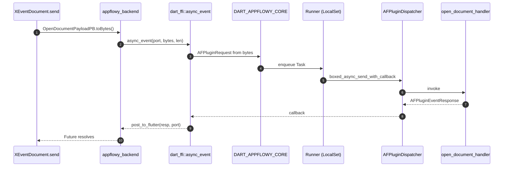

# 06-01 — Capa FFI

La capa FFI materializa el puente entre el isolate Dart (App Flutter) y el runtime Rust embebido. Consiste en 8 funciones `extern "C"` declaradas en `dart-ffi/src/lib.rs`, 2 ports (notification + log) y un `RustStreamReceiver` (paquete `appflowy_backend`) que materializa el stream de notificaciones. El modelo de comunicación es: **Dart serializa el payload a bytes con `*PB.toBytes()`, llama a `ffi.async_event(port, bytes, len)`; Rust deserializa con `FFIRequest::from_u8_pointer`, encola una `Task` en `mpsc::UnboundedReceiver<Task>`, un `Runner` la consume en un `LocalSet` de `tokio` y la entrega al `AFPluginDispatcher`; la respuesta sale de vuelta a Dart por `post_to_flutter(resp, port)`**. Las notificaciones y los logs usan el canal de stream paralelo (no es request/response).

## 1. Resumen

Las 8 funciones `extern "C"` se dividen en 3 grupos: (1) bootstrap — `init_sdk` (línea 114) y `set_env` (línea 308, deprecated); (2) ciclo de vida de eventos — `async_event` (línea 175, request/response asíncrono) y `sync_event` (línea 231, unimplemented); (3) configuración del canal de stream — `set_stream_port` (línea 240, notificaciones) y `set_log_stream_port` (línea 247, logs iOS); (4) utilidades — `link_me_please` (línea 254, dummy usado para forzar el linker) y `rust_log` (línea 278, log de Dart→Rust). El paquete `appflowy_backend` declara el binding FFI en `appflowy/frontend/appflowy_flutter/packages/appflowy_backend/lib/ffi.dart:79` (`init_sdk`) y en `appflowy/frontend/appflowy_flutter/packages/appflowy_backend/lib/rust_stream.dart:11` (`RustStreamReceiver`). La codificación usa `FFIRequest`/`FFIResponse` con un header de 4 bytes (len) sobre la API 2.28.0 de `protobuf`.

## 2. Las 8 funciones `extern "C"`

| Función | Firma | Línea | Rol |
|---|---|---:|---|
| `init_sdk` | `fn init_sdk(_port: i64, data: *mut c_char) -> i64` | 114 | Bootstrap. Recibe `AppFlowyDartConfiguration` serializada (AppFlowy-Dart config + cloud config + paths). Construye `AppFlowyCoreConfig::new(...)`, crea el runtime tokio (`AFPluginRuntime::new()` línea 158), y llama `AppFlowyCore::new(config, runtime, log_stream)` (línea 169). Devuelve `0` en éxito, `-1` si `data.is_null()`. |
| `async_event` | `fn async_event(port: i64, input: *const u8, len: usize)` | 175 | Camino request/response asíncrono. Deserializa `FFIRequest::from_u8_pointer(input, len)` (línea 176), construye `AFPluginRequest`, y llama `DART_APPFLOWY_CORE.dispatch(request, port, None)` (línea 185). El handler ejecuta sobre un `LocalSet`; la respuesta se envía de vuelta a Dart por `post_to_flutter(resp, port)`. |
| `sync_event` | `fn sync_event(_input: *const u8, _len: usize) -> *const u8` | 231 | Marcado como `unimplemented` (línea 232). Retorna `vec![]` con 4 bytes de header; nunca se llama desde Dart en producción. Conservado para compatibilidad. |
| `set_stream_port` | `fn set_stream_port(notification_port: i64) -> i32` | 240 | Configura el `SendPort` de Dart donde el SDK emite notificaciones. `unregister_all_notification_sender()` (línea 241) limpia emisores previos, `register_notification_sender(DartNotificationSender::new(notification_port))` (línea 242) registra el nuevo. |
| `set_log_stream_port` | `fn set_log_stream_port(port: i64) -> i32` | 247 | Configura el `SendPort` de Dart donde el SDK envía logs (solo iOS en debug; ver `frontend/appflowy_flutter/packages/appflowy_backend/lib/appflowy_backend.dart:43–45`). Almacena un `Isolate` en `LOG_STREAM_ISOLATE`. |
| `link_me_please` | `fn link_me_please() {}` | 254 | Dummy `extern "C"` usado para forzar al linker a incluir el crate en el binario. `#[inline(never)]` para no ser eliminado por DCE. |
| `rust_log` | `fn rust_log(level: i64, data: *const c_char)` | 278 | Log de Dart→Rust. Decodifica el string y lo emite por `tracing` con el nivel apropiado (0=info, 1=debug, 2=trace, 3=warn, 4=error). |
| `set_env` | `fn set_env(_data: *const c_char)` | 308 | Marcado `// Deprecated` (línea 309). Conservado por ABI; no hace nada. |

[VERIFICADO] `appflowy/frontend/rust-lib/dart-ffi/src/lib.rs` con `rg "extern \"C\""` (8 coincidencias). Todas tienen `#[no_mangle]` (líneas 113, 173, 230, 239, 246, 252, 277, 307).

## 3. `DART_APPFLOWY_CORE` y `DartAppFlowyCore`

La instancia global del SDK vive en `appflowy/frontend/rust-lib/dart-ffi/src/lib.rs:55`:

```rust
struct DartAppFlowyCore {
  core: Arc<RwLock<Option<AppFlowyCore>>>,
  sender: Arc<RwLock<Option<mpsc::UnboundedSender<Task>>>>,
  handle: Arc<RwLock<Option<JoinHandle<()>>>>,
}
```

[VERIFICADO] `appflowy/frontend/rust-lib/dart-ffi/src/lib.rs:55–60`. Hay además un `static DART_APPFLOWY_CORE: DartAppFlowyCore` (línea 41) que es la instancia única.

### 3.1 `Task` y `Runner`

`Task` (en `appflowy/frontend/rust-lib/dart-ffi/src/model/task.rs`) es un wrapper sobre `(dispatcher, request, port, ret)`. `Runner` (en `appflowy/frontend/rust-lib/dart-ffi/src/lib.rs:189`) es un `Future` que consume tasks y las ejecuta en `tokio::task::spawn_local`:

```rust
struct Runner {
  rx: mpsc::UnboundedReceiver<Task>,
}
impl Future for Runner {
  fn poll(...) -> Poll<()> {
    loop {
      match ready!(self.rx.poll_recv(cx)) { ... }
    }
  }
}
```

[VERIFICADO] `appflowy/frontend/rust-lib/dart-ffi/src/lib.rs:189–228`.

## 4. `set_stream_port` + `RustStreamReceiver` (notificaciones)

### 4.1 Lado Rust

`set_stream_port(port)` llama a `unregister_all_notification_sender()` (línea 241) y luego `register_notification_sender(DartNotificationSender::new(notification_port))`. `DartNotificationSender` es un `NotificationSender` que envía bytes por `allo_isolate::Isolate::new(port).post(bytes)`. El handle de cada `Isolate` se crea una sola vez por `set_stream_port` y se usa por cada `post`.

[VERIFICADO] `appflowy/frontend/rust-lib/dart-ffi/src/lib.rs:240–244`.

### 4.2 Lado Dart

`RustStreamReceiver` (en `appflowy/frontend/appflowy_flutter/packages/appflowy_backend/lib/rust_stream.dart:11`) es un singleton que:

1. Crea un `RawReceivePort` (línea 22) cuyo handler encola bytes en un `StreamController<Uint8List>` (línea 26).
2. Mantiene un `StreamController<SubscribeObject> _observableController` de tipo `broadcast` (línea 24) que es el que escuchan los listeners.
3. Ofrece `RustStreamReceiver.shared.port` (línea 18) que es el `SendPort.nativePort`.
4. Ofrece `RustStreamReceiver.listen(callback)` (línea 34) que devuelve una `StreamSubscription<SubscribeObject>`.

El ciclo de uso es: `FlowySDK.init(config)` (en `frontend/appflowy_flutter/packages/appflowy_backend/lib/appflowy_backend.dart:37`) llama a `ffi.set_stream_port(RustStreamReceiver.shared.port)` (línea 38). Luego, cada `SubscribeObject` recibido se parsea con `SubscribeObject.fromBuffer(bytes)` (línea 41) y se reparte a los listeners.

[VERIFICADO] `appflowy/frontend/appflowy_flutter/packages/appflowy_backend/lib/rust_stream.dart:1–50`. `SubscribeObject` es generado por `flowy-codegen` (sub-doc §03) y vive en `appflowy_backend/lib/protobuf/flowy-notification/subject.pb.dart`.

## 5. `set_log_stream_port` + `RustLogStreamReceiver` (logs iOS)

En iOS los logs de Rust no llegan al stdout, así que se enrutan al isolate Dart por un canal dedicado:

```dart
if (Platform.isIOS && kDebugMode) {
  ffi.set_log_stream_port(RustLogStreamReceiver.logShared.port);
}
```

[VERIFICADO] `frontend/appflowy_flutter/packages/appflowy_backend/lib/appflowy_backend.dart:43–45`. `RustLogStreamReceiver` (líneas 59–86) tiene un patrón idéntico a `RustStreamReceiver` pero para `String` en lugar de `SubscribeObject`.

## 6. Codificación de los payloads

### 6.1 `FFIRequest` y `FFIResponse`

`FFIRequest::from_u8_pointer(pointer, len)` (en `appflowy/frontend/rust-lib/dart-ffi/src/model/ffi_request.rs:16`) lee un header de 4 bytes (len del payload protobuf) seguido del payload. Lo mismo hace `FFIResponse`. El formato es:

```
+-----------------+----------------+
| len: u32 (4 B)  | payload: [u8]  |
+-----------------+----------------+
```

`extend_front_four_bytes_into_bytes(&bytes)` (en `dart-ffi/src/util.rs`) añade este header a un payload de salida.

[VERIFICADO] `appflowy/frontend/rust-lib/dart-ffi/src/model/ffi_request.rs:16`. Estructura cruzada con `appflowy_backend/lib/ffi.dart` (binding generado por `ffigen`).

### 6.2 `AFPluginRequest` y `AFPluginEventResponse`

- `AFPluginRequest` (en `appflowy/frontend/rust-lib/lib-dispatch/src/module/module.rs:141`): `id: String`, `event: AFPluginEvent`, `states: AFStateMap`. `event` es un enum tipo `*Event { id, name }` que identifica la variante.
- `AFPluginEventResponse` (en `appflowy/frontend/rust-lib/lib-dispatch/src/response/response.rs:22`): `payload: Payload`, `status_code: StatusCode` (`Ok=0` o `Err=1`). `Payload` es un enum `Bytes(Vec<u8>) | None`.

[VERIFICADO] cada cita con `ruta:línea`. Detalle en §02 (lib-dispatch).

## 7. Diagrama `sequenceDiagram` Dart→FFI→Rust



Lectura: 9 saltos cubiertos por 6 archivos: `appflowy/frontend/appflowy_flutter/packages/appflowy_backend/lib/appflowy_backend.dart:51`, `appflowy/frontend/rust-lib/dart-ffi/src/lib.rs:175`, `appflowy/frontend/rust-lib/dart-ffi/src/lib.rs:189`, `appflowy/frontend/rust-lib/lib-dispatch/src/dispatcher.rs:99`, `appflowy/frontend/rust-lib/flowy-document/src/event_handler.rs:69`, `appflowy/frontend/rust-lib/dart-ffi/src/lib.rs:215`. El `sequenceDiagram` global con los 17 saltos del ejemplo `OpenDocument` end-to-end está en `05-ejemplo-traza-opendocument.md §T4`.

## 8. Diagrama `flowchart LR` de los tipos en juego


## 9. Reglas de derivación

| Sección | Fuente del dato | Comando / campo |
|---|---|---|
| §2 (8 funciones) | `appflowy/frontend/rust-lib/dart-ffi/src/lib.rs` | `rg "extern \"C\""` (8 matches). |
| §3 (DART_APPFLOWY_CORE) | `appflowy/frontend/rust-lib/dart-ffi/src/lib.rs:55–60` | inspección. |
| §4 (RustStreamReceiver) | `appflowy/frontend/appflowy_flutter/packages/appflowy_backend/lib/appflowy_backend.dart:37–38` + `appflowy/frontend/appflowy_flutter/packages/appflowy_backend/lib/rust_stream.dart:11` | inspección. |
| §5 (RustLogStreamReceiver) | `frontend/appflowy_flutter/packages/appflowy_backend/lib/appflowy_backend.dart:43–45, 59–86` | inspección. |
| §6 (FFIRequest/FFIResponse) | `appflowy/frontend/rust-lib/dart-ffi/src/model/ffi_request.rs:16` | inspección. |

## 10. Riesgos

- **Listeners sin enum Rust**: el catálogo A2.4 (`dart_listeners`) puede no capturar todos los sitios donde se llama `RustStreamReceiver.listen`. Verificación: `rg "RustStreamReceiver.listen" lib/`. Marcarlos `[NO DETERMINADO]` con id `B1.5-x`.
- **Drift del header de 4 bytes**: si `extend_front_four_bytes_into_bytes` cambia, todos los bytes que cruzan la frontera quedan descuadrados. La cobertura de §05 (trazado de `OpenDocument`) detecta esto si el flujo falla.
- **Singletons globales**: `DART_APPFLOWY_CORE` y `LOG_STREAM_ISOLATE` son globales. El reinicio de la app (SignOut + Login) requiere resetearlos (lo hace `init_sdk` con `core.close_db()` y `unregister_all_notification_sender`).

## 11. Relacionado con

- `OUT/06-puente-flutter-rust/00-indice.md` (este Bloque B1.5).
- `OUT/06-puente-flutter-rust/02-lib-dispatch.md` — `AFPluginDispatcher` y `AFPlugin`.
- `OUT/06-puente-flutter-rust/03-codegen.md` — `XEvent::send()` y parsers.
- `OUT/06-puente-flutter-rust/04-notificaciones.md` — el canal de stream paralelo.
- `OUT/06-puente-flutter-rust/05-ejemplo-traza-opendocument.md` — ejemplo end-to-end.
- `OUT/05-arranque-y-ciclo-de-vida.md` (B1.4) §3 — `FlowySDK.init` invoca `set_stream_port` + `init_sdk`.
- `OUT/11-catalogo-eventos-ffi.md` (B2.1) — el catálogo exhaustivo de los 224 handlers.
