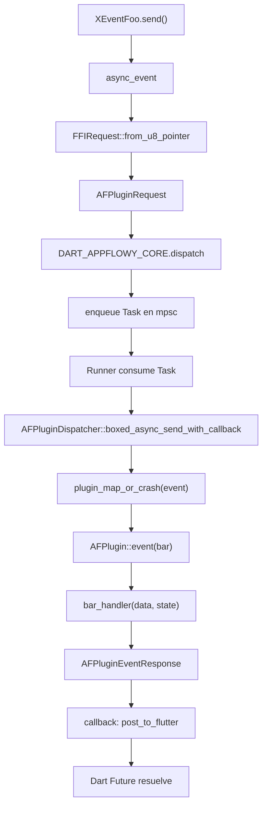
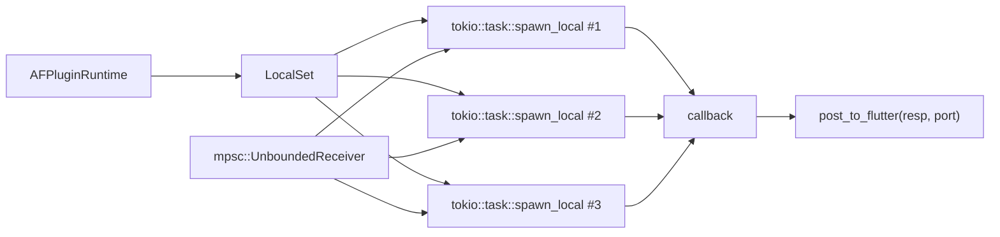

# 06-02 — `lib-dispatch`

`lib-dispatch` es el crate que implementa el dispatcher de eventos: enruta los 229 variantes de eventos FFI (catalogados en `events.json`) a sus 224 handlers registrados en los 8 crates de feature. Es el corazón del puente FFI: `dart-ffi::async_event` (sub-doc §01) entrega un `AFPluginRequest` al dispatcher, que busca el `AFPlugin` correcto, ejecuta el handler en un `LocalSet` de `tokio`, y devuelve un `AFPluginEventResponse` al isolate Dart. La pieza `runtime` envuelve `tokio::runtime::Runtime` con un `LocalSet`; las piezas `request`/`response` definen el contrato binario del cruce de frontera; las piezas `errors` mapean `FlowyError` (133 `ErrorCode`) y `DispatchError`.

## 1. Resumen

`AFPluginDispatcher` (en `appflowy/frontend/rust-lib/lib-dispatch/src/dispatcher.rs:63`) se compone de 8 `AFPlugin` (uno por crate de feature: `flowy-user`, `flowy-folder`, `flowy-document`, `flowy-database2`, `flowy-ai`, `flowy-search`, `flowy-storage`, `flowy-server`). Cada `AFPlugin` (en `appflowy/frontend/rust-lib/lib-dispatch/src/module/module.rs:64`) lleva un nombre, un mapa de estados (`AFPluginStateMap`) y un mapa de handlers indexado por `AFPluginEvent` (línea 50). El método principal del dispatcher es `boxed_async_send_with_callback` (línea 99) que ejecuta el handler en `tokio::task::spawn_local` (línea 208 de `dart-ffi/src/lib.rs`) y llama al callback con la respuesta. Los errores se modelan como `AFPluginEventResponse { status_code: StatusCode::Err, payload: <ErrorCode> }` (línea 22 de `response.rs`); en Dart se decodifican con `FlowyError.fromBytes()` (paquete `appflowy_backend`).

## 2. `AFPlugin` (struct + builder)

Definido en `appflowy/frontend/rust-lib/lib-dispatch/src/module/module.rs:64`:

```rust
pub struct AFPlugin {
  pub name: String,
  states: AFStateMap,
  event_service_factory: Arc<HashMap<AFPluginEvent, BoxServiceFactory<...>>>,
}
```

[VERIFICADO] `appflowy/frontend/rust-lib/lib-dispatch/src/module/module.rs:64–76`. El trait/struct `AFPlugin` se construye con `AFPlugin::new()` (línea 90) + `.name(s)` (línea 94) + `.state(data)` (línea 99) + `.event(event, handler)` (línea 107). El builder fluido se ve en el patrón típico:

```rust
AFPlugin::new()
  .name("flowy.document")
  .state(Weak::clone(&document_manager))
  .event(DocumentEvent::OpenDocument, open_document_handler)
  .event(DocumentEvent::CreateDocument, create_document_handler)
  // ...
```

En `appflowy/frontend/rust-lib/flowy-document/src/event_map.rs:17` se ve el uso real.

## 3. `AFPluginDispatcher` (enrutador)

Definido en `appflowy/frontend/rust-lib/lib-dispatch/src/dispatcher.rs:63`:

```rust
pub struct AFPluginDispatcher {
  plugins: AFPluginMap,
  runtime: Arc<AFPluginRuntime>,
}
```

[VERIFICADO] `appflowy/frontend/rust-lib/lib-dispatch/src/dispatcher.rs:63–67`. Se construye con `AFPluginDispatcher::new(runtime, plugins)` (línea 70) donde `plugins: Vec<AFPlugin>` se materializa en un `HashMap<String, AFPlugin>` (vía `plugin_map_or_crash`, función en `module/container.rs`).

### 3.1 `boxed_async_send_with_callback` (línea 99)

El método principal es `boxed_async_send_with_callback<Req, Callback>` (línea 99 de `dispatcher.rs`):

```rust
pub async fn boxed_async_send_with_callback<Req, Callback>(
  dispatch: &AFPluginDispatcher,
  request: Req,
  callback: Callback,
) -> AFPluginEventResponse
where
  Req: Into<AFPluginRequest> + 'static,
  Callback: FnOnce(AFPluginEventResponse) -> AFBoxFuture<'static, ()> + AFConcurrent + 'static,
```

[VERIFICADO] `appflowy/frontend/rust-lib/lib-dispatch/src/dispatcher.rs:99–112`. La búsqueda del handler se hace en `plugin_map_or_crash(request.event.id)`. Si el plugin no está registrado, retorna `DispatchError::PluginNotFound`.

### 3.2 `Runner` (en `appflowy/frontend/rust-lib/dart-ffi/src/lib.rs:189`)

`Runner` es un `Future` que consume tasks de un `mpsc::UnboundedReceiver<Task>` y las despacha con `AFPluginDispatcher::boxed_async_send_with_callback(dispatcher, request, callback)`. El callback (línea 215) llama a `post_to_flutter(resp, port)`.

[VERIFICADO] `appflowy/frontend/rust-lib/dart-ffi/src/lib.rs:189–228`.

## 4. `AFPluginRuntime` (runtime tokio + LocalSet)

`AFPluginRuntime` (en `appflowy/frontend/rust-lib/lib-dispatch/src/runtime.rs:1`) es un wrapper sobre `tokio::runtime::Runtime`:

```rust
pub struct AFPluginRuntime { /* … */ }
impl AFPluginRuntime {
  pub fn new() -> Result<Arc<AFPluginRuntime>, Error> { /* … */ }
  // … métodos para spawn y block_on
}
```

[VERIFICADO] `appflowy/frontend/rust-lib/lib-dispatch/src/runtime.rs:1`. Se instancia en `appflowy/frontend/rust-lib/dart-ffi/src/lib.rs:158`:

```rust
let runtime = Arc::new(AFPluginRuntime::new().unwrap());
let handle = std::thread::spawn(move || {
  let local_set = LocalSet::new();
  cloned_runtime.block_on(local_set.run_until(Runner { rx: task_rx }));
});
```

El `LocalSet` permite que las tasks de `tokio::task::spawn_local` (línea 208 de `dart-ffi/src/lib.rs`) compartan state sin requerir `Send + Sync`.

## 5. `AFPluginEventRequest` y `AFPluginEventResponse`

### 5.1 Request (en `appflowy/frontend/rust-lib/lib-dispatch/src/request/request.rs:20`)

```rust
pub struct AFPluginEventRequest {
  pub(crate) id: String,
  pub(crate) event: AFPluginEvent,
  pub(crate) states: AFStateMap,
}
```

[VERIFICADO] `appflowy/frontend/rust-lib/lib-dispatch/src/request/request.rs:20–26`. `event: AFPluginEvent(String)` (en `appflowy/frontend/rust-lib/lib-dispatch/src/module/module.rs:50`) identifica la variante. `states` es el mapa de `Arc<state>` que el handler lee vía `AFPluginState<T>` (en `appflowy/frontend/rust-lib/lib-dispatch/src/module/data.rs:1`).

### 5.2 Response (en `appflowy/frontend/rust-lib/lib-dispatch/src/response/response.rs:22`)

```rust
pub struct AFPluginEventResponse {
  pub payload: Payload,
  pub status_code: StatusCode,
}

pub enum StatusCode {
  Ok = 0,
  Err = 1,
}
```

[VERIFICADO] `appflowy/frontend/rust-lib/lib-dispatch/src/response/response.rs:11–26`. `Payload` es `Bytes(Vec<u8>) | None` (en `request/payload.rs`).

### 5.3 `parse<T, E>` (línea 36)

`AFPluginEventResponse::parse<T, E>` decodifica el payload a `T` (en éxito) o `E` (en error). Usado por Dart para extraer `DocumentDataPB` o `FlowyError` del `Future<AFPluginEventResponse>`.

[VERIFICADO] `appflowy/frontend/rust-lib/lib-dispatch/src/response/response.rs:36–51`.

## 6. Errores

### 6.1 `FlowyError` (en `appflowy/frontend/rust-lib/flowy-error/src/errors.rs:1`)

```rust
pub struct FlowyError { code: ErrorCode, msg: String, source: Option<...> }
```

[VERIFICADO] `appflowy/frontend/rust-lib/flowy-error/src/errors.rs:1`. Métodos:
- `FlowyError::new(code, msg)` (línea 3) — constructor.
- `with_context(error)` (línea 4) — añade contexto encadenado.
- `with_payload(payload)` (línea 5) — adjunta bytes (ej. un `*PB` serializado del error).

### 6.2 `ErrorCode` (en `appflowy/frontend/rust-lib/flowy-error/src/code.rs:1`)

`ErrorCode` es un enum con `#[repr(u8)]` y **133 variantes** (`misc.json:error_codes.total = 133`). El mapeo error→byte es estable: la app puede serializar `ErrorCode as u8` y deserializarlo en Dart con `FlowyError.code`.

[VERIFICADO] `appflowy/frontend/rust-lib/flowy-error/src/code.rs:1` + `OUT/_ledger/extract/misc.json:error_codes.total = 133`. Catálogo exhaustivo de los 133 en `OUT/15-catalogo-errores.md` (B2.5).

### 6.3 `DispatchError` (en `appflowy/frontend/rust-lib/lib-dispatch/src/errors/errors.rs:1`)

`DispatchError` modela errores de despacho (handler no encontrado, payload inválido, etc.). Es interno al dispatcher y no cruza la frontera FFI: si un handler retorna `Err(DispatchError::…)`, el dispatcher lo convierte en `AFPluginEventResponse { status_code: Err, payload: <ErrorCode::Internal> }` antes de devolverlo.

[VERIFICADO] `appflowy/frontend/rust-lib/lib-dispatch/src/errors/errors.rs:1`. La conversión de `DispatchError → FlowyError` se hace en `appflowy/frontend/rust-lib/lib-dispatch/src/response/responder.rs:1` (no inspeccionado en detalle).

## 7. Diagrama `flowchart TD` de la cadena de dispatch



## 8. Diagrama `flowchart LR` del runtime tokio + LocalSet



## 9. Reglas de derivación

| Sección | Fuente del dato | Comando / campo |
|---|---|---|
| §2 (AFPlugin) | `appflowy/frontend/rust-lib/lib-dispatch/src/module/module.rs:64–112` | inspección. |
| §3 (Dispatcher) | `appflowy/frontend/rust-lib/lib-dispatch/src/dispatcher.rs:63, 70, 99` | inspección. |
| §4 (Runtime) | `appflowy/frontend/rust-lib/lib-dispatch/src/runtime.rs:1` + `appflowy/frontend/rust-lib/dart-ffi/src/lib.rs:158` | inspección. |
| §5 (Request/Response) | `appflowy/frontend/rust-lib/lib-dispatch/src/{request,response}/` | inspección. |
| §6 (Errores) | `appflowy/frontend/rust-lib/flowy-error/src/` + `appflowy/frontend/rust-lib/lib-dispatch/src/errors/` + `OUT/_ledger/extract/misc.json:error_codes` | inspección + extractor. |

## 10. Riesgos

- **Trait `AFConcurrent` cambia con feature flag `local_set`**: cuando la feature está activa, `Send`; cuando no, `Send + Sync`. Verificar el `Cargo.toml` de `lib-dispatch` para las features activas.
- **`plugin_map_or_crash` panic**: si un plugin no está registrado, el dispatcher entra en panic (línea 73 de `dispatcher.rs`). Esto se evita con el test de registro en `appflowy/frontend/rust-lib/flowy-core/src/module.rs:22–28` (verificado en B1.4 §4.2).
- **`ErrorCode` drift**: si se añaden nuevas variantes a `code.rs`, el catálogo de errores en B2.5 queda desfasado. Detectar con `diff misc.json:error_codes.total 133`.

## 11. Relacionado con

- `OUT/06-puente-flutter-rust/00-indice.md` — mapa general del puente.
- `OUT/06-puente-flutter-rust/01-ffi.md` — funciones `extern "C"` y ports.
- `OUT/06-puente-flutter-rust/03-codegen.md` — `Flowy_Event` y `ProtoBuf_Enum` derives.
- `OUT/06-puente-flutter-rust/04-notificaciones.md` — `StatusCode` para notificaciones.
- `OUT/06-puente-flutter-rust/05-ejemplo-traza-opendocument.md` — ejemplo end-to-end.
- `OUT/05-arranque-y-ciclo-de-vida.md` (B1.4) §4 — composición de `AppFlowyCore` con sus 8 `AFPlugin`s.
- `OUT/15-catalogo-errores.md` (B2.5) — el catálogo exhaustivo de los 133 `ErrorCode`.
