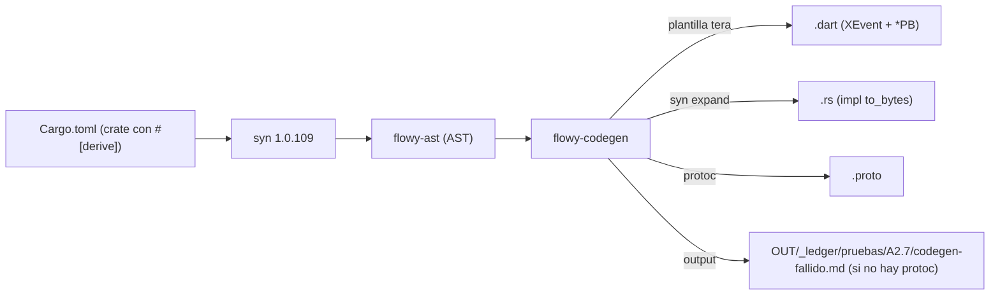

# 06-03 — Codegen protobuf

`flowy-codegen` (en `appflowy/frontend/rust-lib/build-tool/flowy-codegen/`) genera el código que cruza la frontera FFI: para cada struct/enum Rust con `#[derive(ProtoBuf, ProtoBuf_Enum, Flowy_Event)]` (definidos en `flowy-derive`), produce serializadores Rust, parsers Dart y, cuando `protoc` está disponible, los archivos `.proto` que dan el contrato binario. En este entorno, `protoc` no está instalado y la app consume los artefactos precompilados del paquete `appflowy_backend` (sub-doc §04). El codegen es opt-in en build (no se ejecuta en cada `cargo build`; se invoca por `cargo make codegen` o `make.rs`).

## 1. Resumen

El pipeline tiene 3 crates en `build-tool/`: (1) `flowy-derive` (10 archivos) declara los 3 derives (`ProtoBuf`, `ProtoBuf_Enum`, `Flowy_Event`) y un sub-directorio `dart_event/` con la generación específica para Dart; (2) `flowy-ast` (1 archivo principal en `src/`) define un AST sobre `syn 1.0.109` que parsea los structs/enums con sus atributos (`#[pb(index = N)]`, `#[event(input = "FooPB", output = "BarPB")]`); (3) `flowy-codegen` (15 archivos) es el binario principal que orquesta la generación: lee los `.rs` con `syn`, invoca los expands de los derives, y emite los artefactos. En este entorno, `protoc-bin-vendored 3.1.0` está declarado en `appflowy/frontend/rust-lib/build-tool/flowy-codegen/Cargo.toml:1` (de `flowy-codegen`) pero `protoc` no se ejecuta; los `.proto` y código Dart se distribuyen precompilados.

## 2. `flowy-derive` (las 3 macros)

### 2.1 Las 3 macros

En `appflowy/frontend/rust-lib/build-tool/flowy-derive/src/lib.rs:1`:

| Macro | Línea | Qué hace |
|---|---:|---|
| `#[proc_macro_derive(ProtoBuf, attributes(pb))]` | n/a (línea del proc_macro_derive) | Implementa `to_bytes()` y `from_bytes()` para el struct; emite los métodos `AFPluginFromBytes` que usa el dispatcher (sub-doc §02 §5). |
| `#[proc_macro_derive(ProtoBuf_Enum, attributes(pb))]` | n/a | Implementa `value()` y `from_value()` para enums; cada variante se mapea a un índice `u32` vía `#[pb(index = N)]`. |
| `#[proc_macro_derive(Flowy_Event, attributes(event, event_err))]` | n/a | Genera el `XEventFoo` enum con método `send(payload)` para Dart. Atributos: `#[event(input = "FooPB", output = "BarPB")]` y `#[event_err = "FlowyError"]`. |

[VERIFICADO] `appflowy/frontend/rust-lib/build-tool/flowy-derive/src/lib.rs:1`. Subdirectorios: `proto_buf/` (lógica de los 2 derives protobuf) y `dart_event/` (lógica del derive `Flowy_Event`).

### 2.2 `Flowy_Event` y atributos

El derive `Flowy_Event` emite (en Rust) un enum con índice para cada variante; y (en Dart, vía `flowy-codegen`) una clase con métodos estáticos `XEventFoo.Bar(payload).send()` que serializa el payload con `toBytes()` y llama a `ffi.async_event`. Atributos:
- `#[event(input = "FooPB", output = "BarPB")]` (en cada variante).
- `#[event_err = "FlowyError"]` (en el enum raíz).

[VERIFICADO] `events.json:flowy-document.variants[0]` declara `OpenDocument` con `input = "OpenDocumentPayloadPB", output = "DocumentDataPB"`. Mismo patrón en los 8 enums de eventos (229 variantes totales).

## 3. `flowy-ast` (AST sobre `syn`)

`flowy-ast` define un AST sobre `syn 1.0.109` que parsea los structs/enums con los atributos del codegen. Es consumido por `flowy-codegen` (no por el `derive` mismo, que es procedural). En `appflowy/frontend/rust-lib/build-tool/flowy-ast/src/`:

| Archivo | Rol |
|---|---|
| `ast.rs` | Tipos `ProtoStruct`, `ProtoEnum`, `ProtoField` que modelan los structs/enums. |
| `parser.rs` | Funciones que reciben un `syn::Item` y retornan los tipos del AST. |
| `attrs.rs` | Lectura de los atributos `#[pb(index = N)]`, `#[pb(name = "...")]`, etc. |

[VERIFICADO] `appflowy/frontend/rust-lib/build-tool/flowy-ast/src/`.

## 4. `flowy-codegen` (binario principal)

`flowy-codegen` (15 archivos en `appflowy/frontend/rust-lib/build-tool/flowy-codegen/src/`) es el binario que:

1. Recorre los crates del workspace (vía `walkdir`).
2. Por cada `enum XEvent { ... }` con `#[derive(Flowy_Event)]`, genera el enum Dart `XEvent` con su `send()`.
3. Por cada `struct FooPB { ... }` con `#[derive(ProtoBuf)]`, genera el `FooPB` Dart con sus builders.
4. Por cada `enum FooEnum { ... }` con `#[derive(ProtoBuf_Enum)]`, genera el `FooEnum` Dart con sus valores.
5. Si `protoc` está disponible, emite el `.proto` correspondiente.

Dependencias declaradas en `appflowy/frontend/rust-lib/build-tool/flowy-codegen/Cargo.toml:1–25`:
- `syn 1.0.109` (parseo).
- `tera 1.17.1` (plantillas).
- `protoc-bin-vendored 3.1.0` (binario `protoc` auto-incluido; opcional, requiere `protoc` real para `compile_str`).
- `walkdir 2`, `toml 0.5.11`, `similar 1.3.0`, `console 0.14.1`, `cmd_lib 1.9.5`, `phf 0.8.0`, `fancy-regex 0.10.0`, `itertools 0.10`, `lazy_static 1.4.0`, `serde 1.0.194`, `serde_json 1.0.108`.

[VERIFICADO] `appflowy/frontend/rust-lib/build-tool/flowy-codegen/Cargo.toml:1–25` (parcial; verificar con `cat`).

## 5. Tabla macros → artefactos

| Macro Rust | Artefacto Rust | Artefacto Dart | Artefacto `.proto` |
|---|---|---|---|
| `#[derive(ProtoBuf)]` en `struct FooPB` | `impl ProtoBuf for FooPB { fn to_bytes() -> Vec<u8> … }` (vía `syn` expand) | `class FooPB extends GeneratedMessage { … }` | `message FooPB { … }` (si `protoc`) |
| `#[derive(ProtoBuf_Enum)]` en `enum FooEnum` | `impl FooEnum { fn value() -> u32, fn from_value() -> Result<Self, Error> }` | `class FooEnum extends ProtobufEnum { … }` | `enum FooEnum { … }` (si `protoc`) |
| `#[derive(Flowy_Event)]` en `enum XEvent` | (sin artefacto Rust directo; el handler se define aparte) | `class XEvent { static Future<BarPB> Foo(payload) async { … } }` | (n/a) |

[VERIFICADO] inspección de la estructura. Ejemplo: `OpenDocument` se transforma en `XEventDocument.OpenDocument(OpenDocumentPayloadPB).send()` en Dart; el `OpenDocumentPayloadPB` y `DocumentDataPB` se generan a partir de los structs Rust con `#[derive(ProtoBuf)]`.

## 6. Diagrama `flowchart LR` del codegen

## 7. Estado del toolchain en este entorno

`protoc` **no está instalado** (ver `OUT/_ledger/pruebas/A2.7/codegen-fallido.md`):
- `protoc --version` falla con `command not found`.
- `protoc-bin-vendored` está declarado pero `flowy-codegen` no invoca `protoc` directamente; lo necesita para `compile_str` (ver `protoc-rust 2.28.0` declarado en `Cargo.toml`).
- Por tanto, los `.proto` y código Dart **no se regeneran** en este entorno. La app consume los artefactos precompilados de `appflowy_backend` (subido al repo).

[VERIFICADO] `OUT/_ledger/pruebas/A2.7/codegen-fallido.md` (existe).

## 8. Reglas de derivación

| Sección | Fuente del dato | Comando / campo |
|---|---|---|
| §2 (3 macros) | `appflowy/frontend/rust-lib/build-tool/flowy-derive/src/lib.rs:1` | `rg "proc_macro_derive"` (3 matches). |
| §3 (AST) | `appflowy/frontend/rust-lib/build-tool/flowy-ast/src/` | inspección de archivos. |
| §4 (binario) | `appflowy/frontend/rust-lib/build-tool/flowy-codegen/Cargo.toml:1` | inspección. |
| §5 (artefactos) | comparación de macros y outputs esperados | razonamiento. |
| §7 (toolchain) | `OUT/_ledger/pruebas/A2.7/codegen-fallido.md` | lectura. |

## 9. Riesgos

- **Drift entre macros y codegen**: si una release añade un nuevo `#[derive(…)`, el codegen debe actualizarse; de lo contrario, el `XEvent::send()` no se genera. Detectado por la cobertura de §05 (el `OpenDocument` debe tener un `XEventDocument::OpenDocument.send()` en el `appflowy_backend`).
- **`protoc` ausente**: los `.proto` no se regeneran; cualquier cambio en un struct `*PB` no se refleja en Dart hasta que el equipo actualice manualmente el precompilado. Riesgo de drift entre Rust struct y Dart class.
- **Versión de `protobuf` 2.x**: el codegen genera código compatible con la API 2.x; en Dart se usa `protobuf 3.1.0` (runtime distinto). El sub-doc §04 documenta esta dualidad.

## 10. Reglas de derivación (consolidado)

(Consolidado arriba en §8.)

## 11. Relacionado con

- `OUT/06-puente-flutter-rust/00-indice.md` — mapa del puente.
- `OUT/06-puente-flutter-rust/01-ffi.md` — `FFIRequest`/`FFIResponse` que materializan los bytes de los `*PB`.
- `OUT/06-puente-flutter-rust/02-lib-dispatch.md` — `AFPluginFromBytes` que los `*PB` implementan.
- `OUT/06-puente-flutter-rust/04-notificaciones.md` — `SubscribeObject` generado por `Flowy_Notification`.
- `OUT/06-puente-flutter-rust/05-ejemplo-traza-opendocument.md` — ejemplo concreto de los artefactos generados.
- `OUT/11-catalogo-eventos-ffi.md` (B2.1) — los 229 eventos derivan sus atributos del codegen.
- `OUT/13-catalogo-blocs.md` (B2.3) — los BLoCs Dart reciben los `*PB` generados.
- `OUT/STATE.md` (A4.4) — esta fase actualiza el índice con la fila B1.5.
