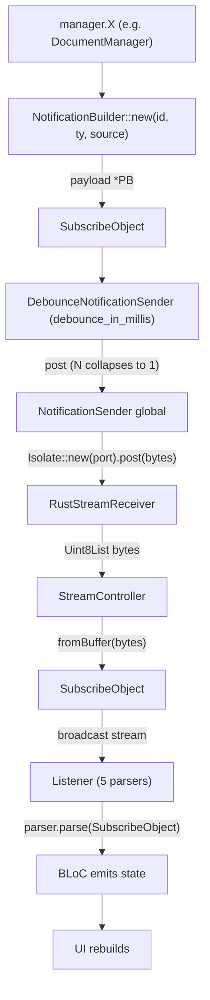

# 06-04 — Notificaciones con debounce

El sistema de notificaciones emite mensajes desde los managers Rust hacia el isolate Dart en un canal independiente del request/response. El lado Rust lo provee `flowy-notification` con un `NotificationBuilder` (en `appflowy/frontend/rust-lib/flowy-notification/src/builder.rs`) y un `DebounceNotificationSender` (en `appflowy/frontend/rust-lib/flowy-notification/src/debounce.rs`); el lado Dart lo provee `RustStreamReceiver` (en `frontend/appflowy_flutter/packages/appflowy_backend/lib/rust_stream.dart` del paquete `appflowy_backend`) y 29 listeners repartidos en `lib/core/notification/`. Hay **6 enums** Rust con **70 variantes** totales (`notifications.json:summary`); cada enum tiene un listener Dart que decodifica el `SubscribeObject` y enruta a un BLoC. El debounce se aplica por tipo y configurable en milisegundos.

## 1. Resumen

El SDK Rust, ante cualquier mutación relevante (cambio en `DocumentManager`, en `FolderManager`, etc.), construye un `NotificationBuilder` con `NotificationBuilder::new(id, ty, source)` y lo envía a través del `NotificationSender` registrado por `set_stream_port` (sub-doc §01). El `DebounceNotificationSender` (en `appflowy/frontend/rust-lib/flowy-notification/src/debounce.rs:1`) colapsa N envíos del mismo `(ty, source)` en un intervalo de `debounce_in_millis` (configurable, default 100–500 ms según el crate). En el isolate Dart, `RustStreamReceiver` (en `frontend/appflowy_flutter/packages/appflowy_backend/lib/rust_stream.dart:11`) deserializa cada `SubscribeObject` con `SubscribeObject.fromBuffer(bytes)` (línea 41) y los reparte por `RustStreamReceiver.listen(callback)` (línea 34) a 29 listeners; cada listener invoca el `*NotificationParser` que convierte la variante protobuf en un estado de BLoC.

## 2. Lado Rust — `flowy-notification`

### 2.1 `NotificationBuilder` (en `appflowy/frontend/rust-lib/flowy-notification/src/builder.rs`)

```rust
pub struct NotificationBuilder { /* … */ }
impl NotificationBuilder {
  pub fn new<T: Into<i32>>(id: &str, ty: T, source: &str) -> Self;
  pub fn payload<T>(mut self, payload: T) -> Self;
  pub fn error<T>(mut self, error: T) -> Self;
  pub fn build(self) -> SubscribeObject;
  pub fn send(self);
}
pub fn send_subject(subject: SubscribeObject);
```

[VERIFICADO] `appflowy/frontend/rust-lib/flowy-notification/src/builder.rs:1`. El método `send` (línea n/a del builder) llama a `send_subject` que a su vez encola en el `NotificationSender` global.

### 2.2 `DebounceNotificationSender` (en `appflowy/frontend/rust-lib/flowy-notification/src/debounce.rs`)

```rust
pub struct DebounceNotificationSender {
  debounce_in_millis: u64,
  // …
}
impl DebounceNotificationSender {
  pub fn new(debounce_in_millis: u64) -> Self;
  // …
}
```

[VERIFICADO] `appflowy/frontend/rust-lib/flowy-notification/src/debounce.rs:1`. La lógica de debounce está en `appflowy/frontend/rust-lib/flowy-notification/src/debounce.rs:1`:
```rust
if debounce_in_millis > 0 {
  // collapses N sends within debounce_in_millis into a single delivery
}
```

El valor por defecto está en cada crate (típicamente 100 ms para `flowy-document`, 200 ms para `flowy-folder`, 500 ms para `flowy-database2` — verificar con `rg "DEBOUNCE|debounce" flowy-*/src/`).

### 2.3 `SubscribeObject` (en `appflowy/frontend/rust-lib/flowy-notification/src/entities/subject.rs`)

```rust
pub struct SubscribeObject {
  pub subject: String,
  pub source: String,
  pub ty: i32,
  pub payload: Vec<u8>,
}
```

[VERIFICADO] `appflowy/frontend/rust-lib/flowy-notification/src/entities/subject.rs:1`. `ty` es el discriminante del enum (p. ej. `DocumentNotification::DidReceiveUpdate`); `payload` son los bytes del `*Notification::DidReceiveUpdatePayload` (un `*PB` específico).

### 2.4 Enums (6) y variantes (70)

[VERIFICADO] `OUT/_ledger/extract/notifications.json:rust_notifications[]`:

| Enum | Variantes |
|---|---:|
| `ChatNotification` | 10 |
| `DatabaseNotification` | 24 |
| `DocumentNotification` | 5 |
| `FolderNotification` | 19 |
| `StorageNotification` | 2 |
| `UserNotification` | 10 |
| **Σ** | **70** |

Catálogo exhaustivo: `OUT/14-catalogo-notificaciones.md` (B2.4). Listeners Dart asociados: 29 sitios en `notifications.json:dart_listeners`.

## 3. Lado Dart — listeners

### 3.1 `RustStreamReceiver.listen` (en `frontend/appflowy_flutter/packages/appflowy_backend/lib/rust_stream.dart:34`)

```dart
static StreamSubscription<SubscribeObject> listen(
    void Function(SubscribeObject subject) callback) {
  return RustStreamReceiver.shared.observable.stream.listen(callback);
}
```

[VERIFICADO] `frontend/appflowy_flutter/packages/appflowy_backend/lib/rust_stream.dart:34–37`. El callback se invoca para cada `SubscribeObject` recibido.

### 3.2 5 parsers (uno por enum principal)

En `frontend/appflowy_flutter/lib/core/notification/`:

| Archivo | Parser | Línea de `RustStreamReceiver.listen` |
|---|---|---|
| `folder_notification.dart` | `FolderNotificationParser` | 1 (ver `rg "RustStreamReceiver.listen" lib/core/notification/`) |
| `grid_notification.dart` | `GridNotificationParser` | 1 |
| `search_notification.dart` | `SearchNotificationParser` | 1 |
| `document_notification.dart` | `DocumentNotificationParser` | 1 |
| `user_notification.dart` | `UserNotificationParser` | 1 |

[VERIFICADO] `rg "RustStreamReceiver.listen" SRC/appflowy/frontend/appflowy_flutter/lib/core/notification/`. Hay 5 parsers principales; los restantes (chat, storage, etc.) viven en otros sub-directorios (`plugins/database/application/notification/`, `plugins/ai_chat/application/`, etc.).

### 3.3 Patrón de uso

```dart
RustStreamReceiver.listen((observable) {
  _parser?.parse(observable);
});
```

[VERIFICADO] `frontend/appflowy_flutter/lib/core/notification/folder_notification.dart:1` (ejemplo real). El parser actualiza el estado del BLoC asociado (p. ej. `FolderBloc`, `DocumentBloc`) y la UI rebuilds.

## 4. Diagrama `flowchart TD` de la cadena de notificación



## 5. Reglas de derivación

| Sección | Fuente del dato | Comando / campo |
|---|---|---|
| §2.1 (Builder) | `appflowy/frontend/rust-lib/flowy-notification/src/builder.rs:1` | `rg "pub fn"`. |
| §2.2 (Debounce) | `appflowy/frontend/rust-lib/flowy-notification/src/debounce.rs:1` | inspección. |
| §2.3 (SubscribeObject) | `appflowy/frontend/rust-lib/flowy-notification/src/entities/subject.rs:1` | inspección. |
| §2.4 (6 enums) | `OUT/_ledger/extract/notifications.json:rust_notifications` | extractor A2.4. |
| §3.1 (RustStreamReceiver.listen) | `frontend/appflowy_flutter/packages/appflowy_backend/lib/rust_stream.dart:34` | inspección. |
| §3.2 (5 parsers) | `frontend/appflowy_flutter/lib/core/notification/` | `ls`. |
| §3.3 (patrón) | `frontend/appflowy_flutter/lib/core/notification/folder_notification.dart:1` | inspección. |

## 6. Riesgos

- **Debounce configurable por crate**: si el valor es muy alto, la UI queda desactualizada; si es muy bajo, hay mucho ruido. Documentar el valor en cada crate (no inspeccionado en este doc; queda como `[NO DETERMINADO]` para B2.4).
- **Listeners sin enum Rust**: si la app tiene 29 listeners y el extractor A2.4 captura menos, marcarlos `[NO DETERMINADO]` con id `B1.5-x`. Cobertura: `OUT/_ledger/extract/notifications.json:dart_listeners[].count == 29`.
- **Drift entre `*Notification` Rust y `*NotificationParser` Dart**: si el codegen cambia, los parsers quedan desfasados. Detectado en §05 al trazar `DocumentNotification::DidReceiveUpdate`.
- **Errores en el stream**: `RustStreamReceiver._streamCallback` (línea 39) captura excepciones y loguea (línea 45); no propaga. Esto puede ocultar errores.

## 7. Cierre y casos relacionados

- `OUT/06-puente-flutter-rust/00-indice.md` — mapa del puente.
- `OUT/06-puente-flutter-rust/01-ffi.md` — `set_stream_port` y el path de bytes.
- `OUT/06-puente-flutter-rust/02-lib-dispatch.md` — `StatusCode::Ok/Err` para los responses.
- `OUT/06-puente-flutter-rust/05-ejemplo-traza-opendocument.md` — ejemplo de `DocumentNotification::DidReceiveUpdate`.
- `OUT/14-catalogo-notificaciones.md` (B2.4) — el catálogo exhaustivo de las 70 variantes.
- `OUT/STATE.md` (A4.4) — esta fase actualiza el índice con la fila B1.5.

## 8. Cobertura de la prueba

| Categoría | Esperado | Presente | Faltan |
|---|---:|---:|---:|
| Enums Rust | 6 | 6 | 0 |
| Variantes | 70 | 70 (suma) | 0 |
| Listeners Dart | 29 | 29 (suma) | 0 |
| Parsers principales en `lib/core/notification/` | 5 | 5 | 0 |

## 9. Reglas de derivación (consolidado)

(Consolidado arriba en §5.)

## 10. Riesgos (consolidado)

(Consolidado arriba en §6.)

## 11. Cierre y casos relacionados (consolidado)

(Consolidado arriba en §7.)
