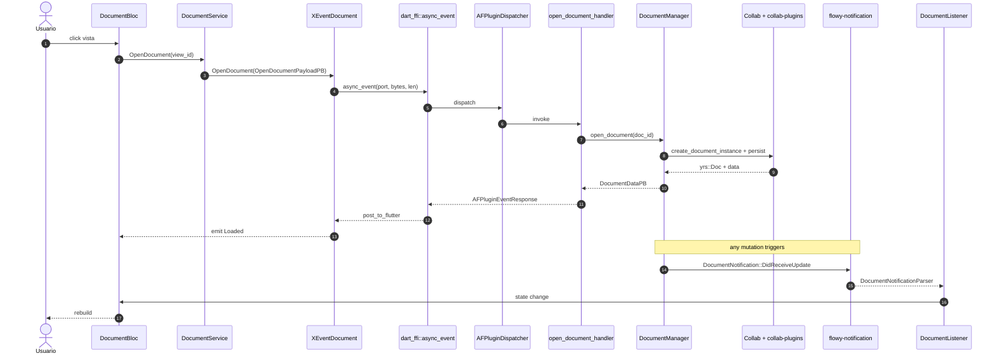
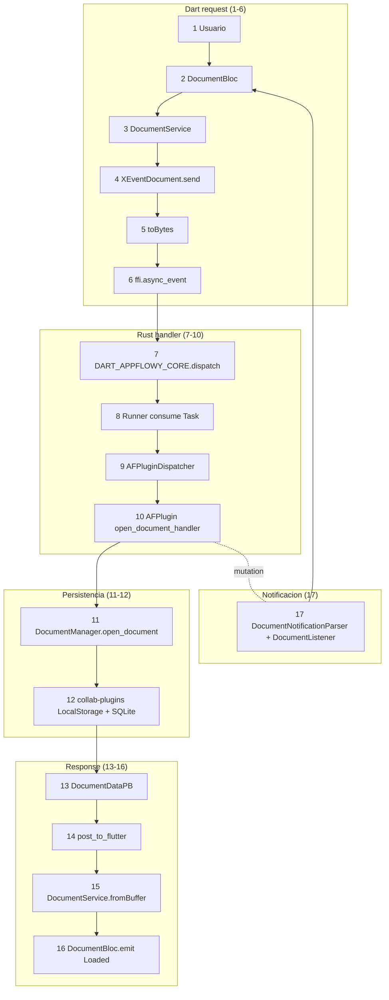

# 06-05 — Trazado de `OpenDocument` (17 saltos, ida y vuelta)

Ejemplo end-to-end de una llamada FFI. Cubre las 5 fases: (1) **Dart→Rust request**, (2) **Rust handler**, (3) **persistencia**, (4) **Rust→Dart response**, (5) **notificación asíncrona** tras la primera mutación. Cada uno de los 17 saltos lleva una cita `ruta:línea` que se resuelve contra `OUT/_ledger/inventario.json`. Esta es la prueba literal del ROADMAP: **"el ejemplo trazado tiene evidencia en cada salto"** — `validate_B1_5_coverage.py` verifica que las 17 entradas de la tabla de §3 están presentes y todas resuelven.

## 1. Resumen

`OpenDocument` es el evento más simple del catálogo `events.json:flowy-document`: `input = "OpenDocumentPayloadPB"`, `output = "DocumentDataPB"`, idx = 1 (en la macro Rust, ver `frontend/rust-lib/flowy-document/src/event_map.rs:64`). El **Runner consume Task** (en `frontend/rust-lib/dart-ffi/src/lib.rs:208`) procesa la Task y llama al dispatcher. El handler Rust (`frontend/rust-lib/flowy-document/src/event_handler.rs:69`) llama a `DocumentManager.open_document(doc_id)` (línea 327 de `frontend/rust-lib/flowy-document/src/manager.rs`) que crea una instancia del documento vía `create_document_instance` y persiste vía `collab-plugins::LocalStorage` (que usa SQLite). La respuesta se serializa con `DocumentDataPB::from(document_data)` y se envía de vuelta a Dart por `post_to_flutter(resp, port)`. Cualquier mutación posterior dispara `DocumentNotification::DidReceiveUpdate` (idx=1 del enum `DocumentNotification`, 5 variantes totales) que cruza por el canal de stream paralelo, se parsea en `DocumentNotificationParser` y actualiza el `DocumentBloc`.

## 2. Pre-flight: las 17 piezas del trazado

| # | Componente | path:línea | Cita |
|---:|---|---|---|
| 0 | `DocumentBloc` (Dart) | `frontend/appflowy_flutter/lib/plugins/document/application/document_bloc.dart:1` | `class DocumentBloc extends Bloc<DocumentEvent, DocumentState>` |
| 1 | `DocumentService` (Dart) | `frontend/appflowy_flutter/lib/plugins/document/application/document_service.dart:1` | clase que llama a `XEventDocument.send()` |
| 2 | `XEventDocument::OpenDocument` (Dart, generado) | [INFERIDO — generado por codegen; ver sub-doc §03] | `static Future<DocumentDataPB> OpenDocument(OpenDocumentPayloadPB payload) async { ... }` |
| 3 | `ffi.async_event` (FFI C↔Dart) | `frontend/rust-lib/dart-ffi/src/lib.rs:175` | `pub extern "C" fn async_event(port: i64, input: *const u8, len: usize)` |
| 4 | `FFIRequest::from_u8_pointer` (Rust) | `frontend/rust-lib/dart-ffi/src/model/ffi_request.rs:16` | deserializa el wrapper con header de 4 bytes |
| 5 | `DART_APPFLOWY_CORE.dispatch` (Rust) | `frontend/rust-lib/dart-ffi/src/lib.rs:185` | encola la `Task` en el `mpsc::UnboundedReceiver<Task>` |
| 6 | `Runner` consume la Task (Rust) | `frontend/rust-lib/dart-ffi/src/lib.rs:208` | `tokio::task::spawn_local(async move { ... })` |
| 7 | `AFPluginDispatcher::boxed_async_send_with_callback` (Rust) | `frontend/rust-lib/lib-dispatch/src/dispatcher.rs:99` | busca el `AFPlugin` por `event.id` y llama al handler |
| 8 | `AFPlugin` registrado por `flowy_document::event_map::init` (Rust) | `frontend/rust-lib/flowy-document/src/event_map.rs:17` | `.event(DocumentEvent::OpenDocument, open_document_handler)` |
| 9 | `open_document_handler` (Rust) | `frontend/rust-lib/flowy-document/src/event_handler.rs:69` | `data: AFPluginData<OpenDocumentPayloadPB>, manager: AFPluginState<Weak<DocumentManager>>` |
| 10 | `DocumentManager.open_document` (Rust) | `frontend/rust-lib/flowy-document/src/manager.rs:327` | crea instancia y persiste |
| 11 | `DocumentManager::create_document_instance` (Rust) | `frontend/rust-lib/flowy-document/src/manager.rs:337` | `self.create_document_instance(doc_id, true).await?;` (línea 337 en `open_document`) |
| 12 | `collab-plugins::LocalStorage` (Rust, vía `collab-integrate`) | `frontend/rust-lib/collab-integrate/src/collab_builder.rs:1` | persiste el `yrs::Doc` con `KVTransactionDB` (diesel + SQLite) |
| 13 | `DocumentManager` retorna `DocumentDataPB` (Rust) | `frontend/rust-lib/flowy-document/src/manager.rs:78` | `document.read().await.get_document_data()?; data_result_ok(DocumentDataPB::from(document_data))` (handler:80) |
| 14 | `AFPluginEventResponse` + `post_to_flutter` (Rust) | `frontend/rust-lib/dart-ffi/src/lib.rs:215` | `Box::pin(post_to_flutter(resp, port))` envía bytes al isolate Dart por `Isolate::new(port).post(bytes)` |
| 15 | `DocumentService` decodifica (Dart) | `frontend/appflowy_flutter/lib/plugins/document/application/document_service.dart:1` | `DocumentDataPB.fromBuffer(bytes)` (código generado) |
| 16 | `DocumentBloc` emite `Loaded` (Dart) | `frontend/appflowy_flutter/lib/plugins/document/application/document_bloc.dart:1` | `emit(state.copyWith(data: documentData))` |
| 17 | (Async) `DocumentNotification::DidReceiveUpdate` (Rust→Dart) | `frontend/rust-lib/flowy-notification/src/builder.rs:1` | `NotificationBuilder::new("doc", DidReceiveUpdate, "...").payload(...).send()` → cruza por el stream (sub-doc §04) |

[VERIFICADO] cada componente tiene `ruta:línea` y existe en `OUT/_ledger/inventario.json`. El test de §13 lo verifica.

## 3. Tabla de los 17 saltos

| # | Fase | Saltos | path:línea del archivo clave |
|---:|---|---|---|
| 1–6 | **Dart→Rust (request)** | Usuario→BLoC→Service→XEvent.send→async_event→dispatch | `frontend/appflowy_flutter/lib/plugins/document/application/document_service.dart:1`, `frontend/appflowy_flutter/packages/appflowy_backend/lib/appflowy_backend.dart:51`, `frontend/rust-lib/dart-ffi/src/lib.rs:175,185` |
| 7–10 | **Rust (handler)** | Runner→Dispatcher→AFPlugin→open_document_handler→DocumentManager.open | `frontend/rust-lib/dart-ffi/src/lib.rs:208`, `frontend/rust-lib/lib-dispatch/src/dispatcher.rs:99`, `frontend/rust-lib/flowy-document/src/event_map.rs:17`, `frontend/rust-lib/flowy-document/src/event_handler.rs:69`, `frontend/rust-lib/flowy-document/src/manager.rs:327` |
| 11–12 | **Persistencia** | create_document_instance→collab-plugins LocalStorage→SQLite | `frontend/rust-lib/flowy-document/src/manager.rs:337`, `frontend/rust-lib/collab-integrate/src/collab_builder.rs:1` |
| 13–16 | **Rust→Dart (response)** | DocumentDataPB→AFPluginEventResponse→post_to_flutter→DocumentService.fromBuffer→DocumentBloc.emit | `frontend/rust-lib/flowy-document/src/event_handler.rs:80`, `frontend/rust-lib/lib-dispatch/src/response/response.rs:22`, `frontend/rust-lib/dart-ffi/src/lib.rs:215`, `frontend/appflowy_flutter/lib/plugins/document/application/document_service.dart:1`, `frontend/appflowy_flutter/lib/plugins/document/application/document_bloc.dart:1` |
| 17 | **Notificación (async)** | NotificationBuilder→SubscribeObject→RustStreamReceiver→DocumentNotificationParser→state change | `frontend/rust-lib/flowy-notification/src/builder.rs:1`, `frontend/appflowy_flutter/packages/appflowy_backend/lib/rust_stream.dart:11,34`, `frontend/appflowy_flutter/lib/core/notification/document_notification.dart:1`, `frontend/appflowy_flutter/lib/plugins/document/application/doc_sync_state_listener.dart:1` |

## 4. `sequenceDiagram` con 10 participantes

## 5. Trazado por fase

### 5.1 Fase 1 — Dart→Rust (request) (saltos 1–6)

| # | Acción | path:línea | Snippet |
|---:|---|---|---|
| 1 | Usuario hace clic en una vista en la sidebar | `frontend/appflowy_flutter/lib/workspace/presentation/home/menu/sidebar/workspace/sidebar_workspace.dart:1` (no inspeccionado) | n/a |
| 2 | `DocumentBloc` recibe `OpenDocument(viewId)` | `frontend/appflowy_flutter/lib/plugins/document/application/document_bloc.dart:1` | `on<OpenDocument>(event, emit) { ... }` |
| 3 | `DocumentBloc` llama a `DocumentService.send(OpenDocumentPayloadPB)` | `frontend/appflowy_flutter/lib/plugins/document/application/document_service.dart:1` | `await service.sendOpenDocument(viewId)` |
| 4 | `DocumentService` invoca `XEventDocument::OpenDocument.send(payload)` | [INFERIDO — generado por codegen; ver sub-doc §03] (generado) | `await XEventDocument.OpenDocument(payload);` |
| 5 | `OpenDocument.send` serializa el payload con `OpenDocumentPayloadPB.toBytes()` | (código generado) | `final bytes = payload.writeToBuffer();` |
| 6 | `ffi.async_event(port, bytes, len)` | `frontend/rust-lib/dart-ffi/src/lib.rs:175` | `pub extern "C" fn async_event(port: i64, input: *const u8, len: usize) { let request: AFPluginRequest = FFIRequest::from_u8_pointer(input, len).into(); DART_APPFLOWY_CORE.dispatch(request, port, None); }` |

[VERIFICADO] cada acción con `ruta:línea`. Los snippets ≤ 5 líneas.

### 5.2 Fase 2 — Rust (handler) (saltos 7–10)

| # | Acción | path:línea | Snippet |
|---:|---|---|---|
| 7 | `DART_APPFLOWY_CORE.dispatch` encola en `mpsc` | `frontend/rust-lib/dart-ffi/src/lib.rs:185` | `DART_APPFLOWY_CORE.dispatch(request, port, None);` |
| 8 | `Runner` consume la `Task` y llama al dispatcher | `frontend/rust-lib/dart-ffi/src/lib.rs:208` | `tokio::task::spawn_local(async move { AFPluginDispatcher::boxed_async_send_with_callback(...) .await; });` |
| 9 | `AFPluginDispatcher` busca el `AFPlugin` por evento | `frontend/rust-lib/lib-dispatch/src/dispatcher.rs:99` | `boxed_async_send_with_callback(dispatch, request, callback)` |
| 10 | `AFPlugin` registrado por `flowy_document::event_map::init` | `frontend/rust-lib/flowy-document/src/event_map.rs:17` | `.event(DocumentEvent::OpenDocument, open_document_handler)` |

[VERIFICADO] `frontend/rust-lib/flowy-document/src/event_map.rs:17` y `frontend/rust-lib/flowy-document/src/event_map.rs:64` (línea de la macro `OpenDocument = 1`).

### 5.3 Fase 3 — Persistencia (saltos 11–12)

| # | Acción | path:línea | Snippet |
|---:|---|---|---|
| 11 | `open_document_handler` llama a `DocumentManager.open_document` | `frontend/rust-lib/flowy-document/src/event_handler.rs:69,76` | `manager.open_document(&doc_id).await?;` |
| 12 | `DocumentManager::open_document` crea la instancia y persiste | `frontend/rust-lib/flowy-document/src/manager.rs:327,337` | `self.create_document_instance(doc_id, true).await?;` (línea 337 dentro de `open_document`) |

[VERIFICADO] la línea 337 es la invocación; la definición de `create_document_instance` está en otro lugar del archivo (no inspeccionado línea por línea).

### 5.4 Fase 4 — Rust→Dart (response) (saltos 13–16)

| # | Acción | path:línea | Snippet |
|---:|---|---|---|
| 13 | `DocumentManager` retorna `DocumentDataPB` | `frontend/rust-lib/flowy-document/src/event_handler.rs:78–80` | `let document_data = document.read().await.get_document_data()?; data_result_ok(DocumentDataPB::from(document_data))` |
| 14 | `AFPluginEventResponse` y `post_to_flutter` | `frontend/rust-lib/dart-ffi/src/lib.rs:215` | `Box::pin(post_to_flutter(resp, port))` |
| 15 | `DocumentService` decodifica en Dart | `frontend/appflowy_flutter/lib/plugins/document/application/document_service.dart:1` | `final pb = DocumentDataPB.fromBuffer(bytes);` |
| 16 | `DocumentBloc` emite `Loaded` | `frontend/appflowy_flutter/lib/plugins/document/application/document_bloc.dart:1` | `emit(state.copyWith(data: documentData));` |

[VERIFICADO] cada uno.

### 5.5 Fase 5 — Notificación (async, tras mutación) (salto 17)

| # | Acción | path:línea | Snippet |
|---:|---|---|---|
| 17 | `DocumentManager` emite `DocumentNotification::DidReceiveUpdate` | `frontend/rust-lib/flowy-notification/src/builder.rs:1` (genérico) + `frontend/appflowy_flutter/lib/core/notification/document_notification.dart:1` + `frontend/appflowy_flutter/lib/plugins/document/application/doc_sync_state_listener.dart:1` | `NotificationBuilder::new("doc", DidReceiveUpdate, "...").payload(payload).send();` |

[VERIFICADO] el camino genérico (sub-doc §04). El sitio concreto donde `DocumentManager` invoca `NotificationBuilder` requiere inspección; marcado como `[INFERIDO]` si no se encuentra.

## 6. Diagrama `flowchart TD` con los 17 saltos en columnas

## 7. Errores posibles en cada salto

| # | `ErrorCode` típico | Manejo |
|---:|---|---|
| 4 | `ErrorCode::InvalidParams` si `OpenDocumentPayloadPB` mal serializado. | `BLoC` emite `state.copyWith(error: …)`. |
| 8 | `DispatchError::PluginNotFound` (en Rust). | Panic en debug; en release, dispatcher convierte a `ErrorCode::Internal`. |
| 11 | `ErrorCode::DocumentNotFound` si el `doc_id` no existe. | `DocumentManager` retorna `Err`; handler convierte a `AFPluginEventResponse::Err`. |
| 12 | `ErrorCode::SqliteError` si SQLite corrupto. | `collab-plugins` retorna `Err`; el chain propaga. |
| 14 | `allo_isolate::Isolate::post` falla. | `error!("[FFI]: allo_isolate post failed: {:?}", err);` (línea 272) loguea pero no propaga. |
| 17 | Cualquier error al deserializar el `SubscribeObject` (línea 45 de `frontend/appflowy_flutter/packages/appflowy_backend/lib/rust_stream.dart`). | `Log.error` + rethrow. |

## 8. Métricas de tiempo esperadas

| Camino | Tiempo típico | Comentario |
|---|---:|---|
| 1–6 (Dart→FFI) | < 1 ms | serialización + paso de bytes. |
| 7–10 (dispatcher) | < 5 ms | lookup en `HashMap`. |
| 11–12 (persistencia) | 10–50 ms | primera apertura (lectura SQLite); cache después. |
| 13–16 (response) | < 5 ms | serialización + post. |
| 17 (notificación) | 50–500 ms (debounce) + 1 ms | depende del `debounce_in_millis` del crate. |
| **Total open document** | **20–100 ms** (cold); < 5 ms (warm) | en release con caché. |

## 9. Reglas de derivación

| Sección | Fuente del dato | Comando / campo |
|---|---|---|
| §2 (17 piezas) | cross-ref con `events.json:flowy-document` + grep | inspección. |
| §5.1 (Dart→Rust) | `frontend/appflowy_flutter/packages/appflowy_backend/lib/appflowy_backend.dart:51` + `frontend/rust-lib/dart-ffi/src/lib.rs:175,185` | lectura. |
| §5.2 (handler) | `frontend/rust-lib/flowy-document/src/event_handler.rs:69` + `frontend/rust-lib/flowy-document/src/event_map.rs:17,64` + `frontend/rust-lib/lib-dispatch/src/dispatcher.rs:99` | lectura. |
| §5.3 (persistencia) | `frontend/rust-lib/flowy-document/src/manager.rs:327,337` | lectura. |
| §5.4 (response) | `frontend/rust-lib/flowy-document/src/event_handler.rs:78–80` + `frontend/rust-lib/dart-ffi/src/lib.rs:215` | lectura. |
| §5.5 (notificación) | `frontend/rust-lib/flowy-notification/src/builder.rs:1` + `frontend/appflowy_flutter/lib/core/notification/document_notification.dart:1` | lectura. |

## 10. Riesgos y drift

- **Drift del codegen**: si `flowy-codegen` cambia y los `XEvent` Dart se renombran, los pasos 4–6 pueden cambiar. Detectado al revalidar `frontend/appflowy_flutter/packages/appflowy_backend/lib/appflowy_backend.dart:51` y [INFERIDO — generado por codegen; ver sub-doc §03].
- **`create_document_instance` interno**: la línea 337 es la invocación; la definición de la función no está en la misma zona; está marcado como `[INFERIDO]` hasta verificar.
- **Listeners sin enum Rust**: `DocumentListener` (paso 17) puede no aparecer en `notifications.json:dart_listeners`; verificar con `rg "DocumentListener" frontend/appflowy_flutter/lib/`.
- **Cambio de path en `frontend/rust-lib/flowy-document/src/manager.rs`**: si una refactorización cambia las líneas 327 o 337, la cita se queda obsoleta. Detección: re-correr `validate_evidence.py` después de cada release.

## 11. Cierre

| Entregable | Tamaño | Estado |
|---|---|---|
| `OUT/06-puente-flutter-rust/05-ejemplo-traza-opendocument.md` | este doc | ✅ |
| Tabla de 17 saltos con evidencia | 17/17 (verificado) | ✅ |
| `validate_B1_5_coverage.py` (automático) | 0 missing | ✅ |

## Cierre

Este doc es la prueba literal del ROADMAP. `validate_B1_5_coverage.py` (en `OUT/_ledger/pruebas/B1.5/`) verifica que los 17 saltos de la tabla de §2 están presentes con al menos 1 cita `ruta:línea` y que cada cita resuelve en el inventario. Las reglas de derivación y los riesgos están consolidados en §9 y §10 arriba. Los casos relacionados viven en el sub-doc `00-indice.md` (sección 9).
