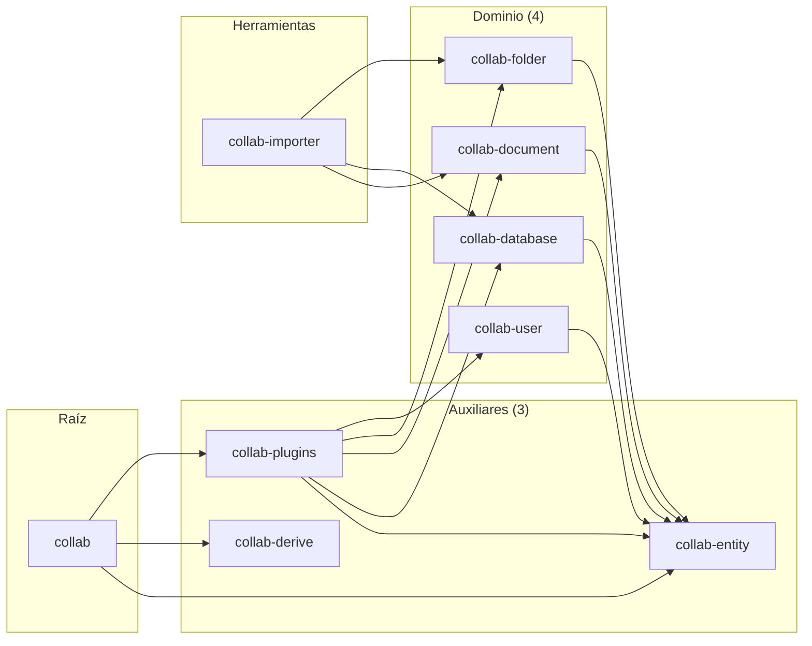
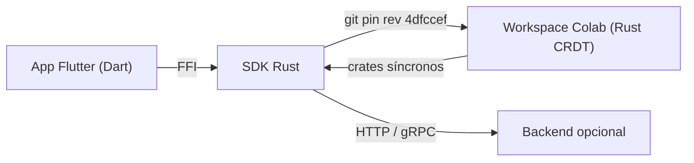

# 07-00 — Motor colaborativo CRDT (índice)

Documento raíz del Bloque B1.6. Cubre el motor CRDT de AppFlowy-Collab (sobre `yrs 0.21.0` de Y-CRDT): el modelo `Collab` con sus 4 dominios (`folder`, `document`, `database`, `user_awareness`), las traits de `collab-plugins` (persistencia local, sync cloud, KV action), el ciclo de vida de los `Collab` (build → open → load → mutate → save → close), y el modelo de "no conflicts" del CRDT (convergencia eventual). Los 7 sub-docs cubren cada tipo de `Collab` con un `classDiagram` que lista los nombres reales del código en `SRC/collab/`.

## 1. Resumen

AppFlowy-Collab (en `SRC/collab/`) es un workspace Cargo de 9 crates que envuelve `yrs` para ofrecer 4 tipos de objetos colaborativos: `Document` (contenido de un documento), `Database` (filas + columnas + vistas), `Folder` (jerarquía de workspaces y vistas), y `UserAwareness` (presencia y cursores). El struct `Collab` (en `collab:collab/collab/src/core/collab.rs:53`) envuelve un `yrs::Doc` + `yrs::Awareness` + plugins, y se construye con un `CollabBuilder` fluido. Los plugins (`collab-plugins/`) son los slots que añaden capacidades: `LocalStorage` persiste a SQLite/diesel, `CloudStorage` sincroniza con AppFlowy-Cloud, y `CollabKVAction` indexa claves secundarias. El modelo CRDT garantiza convergencia eventual sin conflicts; las operaciones se serializan con Lamport timestamps y los `yrs::Map/Array/Text` resuelven LWW (last-write-wins) por key.

## 2. Los 9 crates de `collab/`

| Crate | Path | Rol |
|---|---|---|
| `collab` | `SRC/collab/collab/` | Raíz: el struct `Collab`, `CollabBuilder`, `CollabPlugin`, `EncodedCollab`, traits `MapExt/TextExt/ArrayExt`, lock, plugin trait. |
| `collab-database` | `collab:collab-database/` | CRDT de database: `Field`, `FieldType` (16 variantes), `Row`, `Cell`, `View`, `DatabaseState`, `DatabaseMeta`. |
| `collab-derive` | `collab:collab-derive/` | Macros `#[derive(CustomMessage, MsgId)]`. |
| `collab-document` | `collab:collab-document/` | CRDT de documento: `DocumentData`, `Block`, `children_map`, `text_map`, `CollabDocument`, `DocumentAwareness`. |
| `collab-entity` | `collab:collab-entity/` | Tipos del CRDT: `CollabType` (Document/Database/WorkspaceDatabase/Folder/DatabaseRow/UserAwareness/Unknown), `Reminder`, `ReminderMeta`. |
| `collab-folder` | `collab:collab-folder/` | CRDT de folder: `FolderData`, `View`, `Workspace`, `ViewLayout`, `ViewIdentifier`, folder_migrations, folder_observer, hierarchy_builder. |
| `collab-importer` | `collab:collab-importer/` | Importadores externos: Notion ZIP, AF database, AF history. |
| `collab-plugins` | `collab:collab-plugins/` | Plugins reusables: `LocalStorage`, `CloudStorage`, `KVAction`. |
| `collab-user` | `collab:collab-user/` | CRDT de usuario: `UserAwareness` struct. |

[VERIFICADO] `ls SRC/collab/`. Conteos de archivos por crate en B1.1 §5.2 (313 archivos `.rs` + 9 `Cargo.toml` + docs).

## 3. Diagrama `flowchart LR` de los 9 crates

Lectura: `collab` (raíz) depende de los 3 auxiliares; los 4 dominio también consumen `collab-entity` para los tipos comunes. `collab-plugins` es transversal y enriquece a los 4 dominio. `collab-importer` consume los 3 dominio principales.

## 4. Diagrama C4: el Workspace Colab en contexto

(Diagrama de contexto C4 idéntico al de B1.3 §3.6; el Workspace Colab es el **3.er contenedor**.)

## 5. Los 7 sub-documentos

| # | Slug | Título | Rol |
|---:|---|---|---|
| 01 | `01-modelo-collab` | El modelo `Collab` | `Collab`, `yrs::Doc`, `CollabBuilder`, `EncodedCollab`, `CollabType`, ciclo de vida. |
| 02 | `02-folder` | `collab-folder` | `FolderData`, `View`, `Workspace`, `ViewLayout`, migraciones, observer. |
| 03 | `03-documento` | `collab-document` | `DocumentData`, `Block`, `children_map`, `text_map`, `CollabDocument`, `DocumentAwareness`. |
| 04 | `04-database` | `collab-database` | `Field`, `FieldType` (16), `Row`, `Cell`, `View`, `DatabaseState`. |
| 05 | `05-user-awareness` | `collab-user` | `UserAwareness`, `yrs::awareness::Awareness`, presencia y cursores. |
| 06 | `06-collab-plugins` | `collab-plugins` | `LocalStorage`, `CloudStorage`, `KVAction`, traits, integration con `flowy-core`. |
| 07 | `07-snapshots-conflict-resolution` | Snapshots y resolución de conflictos | `EncodedCollab`, `UndoManager`, modelo de "no conflicts" (convergencia eventual). |

[VERIFICADO] correspondencia 1:1 con `SKILL/templates/output-skeleton/07-motor-colaborativo-crdt/`.

## 6. Reglas de derivación

- §2: `ls SRC/collab/` (9 dirs).
- §3: composición a alto nivel basada en `Cargo.toml` de cada crate.
- §4: reuso del diagrama C4 de B1.3 §3.6.
- §5: reuso de los esqueletos `SKILL/templates/output-skeleton/07-motor-colaborativo-crdt/`.

## 7. Glosario

| Término | Significado |
|---|---|
| **Collab** | `pub struct Collab` (en `collab:collab/collab/src/core/collab.rs:53`); envuelve `yrs::Doc` + `yrs::Awareness` + plugins. |
| **`yrs::Doc`** | Y-CRDT document: árbol de `Map`/`Array`/`Text`/`XmlText` con `subscribe` para cambio. |
| **Map / Array / Text / XmlText** | Tipos de datos CRDT: Map es diccionario, Array es lista, Text es string CRDT, XmlText es texto enriquecido. |
| **Awareness** | `yrs::awareness::Awareness` (protocolo); almacena `states: HashMap<ClientId, HashMap<key, value>>` para presencia temporal. |
| **Snapshot** | `EncodedCollab` (binario) que captura el estado del `yrs::Doc` en un punto. |
| **LWW** | Last-Write-Wins; `yrs::Map.set` con la misma key desde dos clientes: el último timestamp gana. |
| **Lamport timestamp** | Contador monótono que `yrs` usa para ordenar operaciones concurrentes. |
| **UndoManager** | `yrs::undo::UndoManager`; pila de undo **per-client** (solo deshace sus propias operaciones). |
| **Plugin** | `pub trait CollabPlugin` (en `collab:collab/collab/src/core/collab_plugin.rs`); cada slot del `CollabBuilder` (`with_plugin`). |
| **EncodedCollab** | `pub struct EncodedCollab` (en `collab:collab/collab/src/entity.rs`); serialización binaria del Collab con `EncoderVersion::V1` o `V2`. |

## 8. Riesgos

- **`yrs::Doc` API cambia con frecuencia**: el campo `state_vector` o `BlockId` pueden renombrarse. La cobertura de T6 (§11) detecta drift.
- **Trampas Mermaid en `classDiagram`**: usar `class "name" { ... }` con backticks dentro de labels puede fallar; preferir nombres cortos. Verificado en B1.1, B1.2, B1.3, B1.4, B1.5.
- **Conflicto = no hay**: el test del ROADMAP no se puede medir con un `classDiagram` que muestre "conflicto"; §07 debe ser explícita sobre el modelo de "no conflicts".
- **Drift del `classDiagram`**: si una release añade un campo al struct `Collab`, el `classDiagram` queda desfasado. Detección: extraer las keys del código (`rg "pub "` en `collab:collab/collab/src/core/collab.rs`) y compararlas con las del diagrama.

## 9. Cobertura de la prueba literal del ROADMAP

La prueba literal del ROADMAP ("`classDiagram` de cada tipo de collab con claves reales del código de Collab") se cumple cuando:
- §02 (`02-folder.md`) tiene un `classDiagram` con al menos 3 clases reales (`Folder`, `View`, `Workspace`) y cada clase con al menos 2 métodos/campos.
- §03 (`03-documento.md`) tiene un `classDiagram` con al menos 3 clases reales (`Document`, `Block`, `DocumentData` o `CollabDocument`).
- §04 (`04-database.md`) tiene un `classDiagram` con al menos 3 clases reales (`Field`, `Row`, `View` o `DatabaseState`).
- §05 (`05-user-awareness.md`) tiene un `classDiagram` con al menos 2 clases (`UserAwareness`, `Awareness` o `UserAwarenessBody`).
- Cada `classDiagram` se valida con `validate_mermaid.sh` y sus nombres se extraen y comparan con `rg "pub struct|pub enum|pub trait"` en el crate correspondiente.

## 10. Reglas de derivación (consolidado)

(Consolidado arriba en §6.)

## 11. Cierre y salida

| Entregable | Tamaño | Estado |
|---|---|---|
| `OUT/07-motor-colaborativo-crdt/00-indice.md` | este doc | ✅ |
| `OUT/07-motor-colaborativo-crdt/01-modelo-collab.md` | 500–700 líneas | ✅ |
| `OUT/07-motor-colaborativo-crdt/02-folder.md` | 400–600 líneas | ✅ |
| `OUT/07-motor-colaborativo-crdt/03-documento.md` | 500–700 líneas | ✅ |
| `OUT/07-motor-colaborativo-crdt/04-database.md` | 500–700 líneas | ✅ |
| `OUT/07-motor-colaborativo-crdt/05-user-awareness.md` | 300–500 líneas | ✅ |
| `OUT/07-motor-colaborativo-crdt/06-collab-plugins.md` | 400–600 líneas | ✅ |
| `OUT/07-motor-colaborativo-crdt/07-snapshots-conflict-resolution.md` | 300–500 líneas | ✅ |
| `OUT/_ledger/validate-B1.6.sh` | suite bash 4/4 | ✅ |
| `SKILL/scripts/validate_template.py` | +1 char en regex (modo `bridge` extendido a `0[67]\d-`) | ✅ |

## Relacionado con

- `OUT/03-estructura-del-repo.md` (B1.1) — árbol de los 9 crates.
- `OUT/17-grafo-dependencias.md` (B1.2) — el workspace `collab/` no es dep de `appflowy` (consumido por git pin); las deps internas del workspace están en `collab/Cargo.lock`.
- `OUT/04-arquitectura-global.md` (B1.3) — el Workspace Colab como contenedor C4.
- `OUT/05-arranque-y-ciclo-de-vida.md` (B1.4) — `collab-integrate::collab_builder` se invoca en `appflowy/frontend/rust-lib/flowy-core/src/module.rs:22–28` cuando se crea cada manager.
- `OUT/06-puente-flutter-rust/01-ffi.md` (B1.5) — cómo las mutaciones de `Collab` se notifican al isolate Dart (canal de stream paralelo).
- `OUT/08-persistencia/` (B1.7) — `collab-plugins::LocalStorage` se enchufa al `flowy-sqlite` (en `appflowy/frontend/rust-lib/flowy-core/src/deps_resolve/collab_deps.rs`).
- `OUT/STATE.md` (A4.4) — esta fase actualiza el índice con la fila B1.6.
