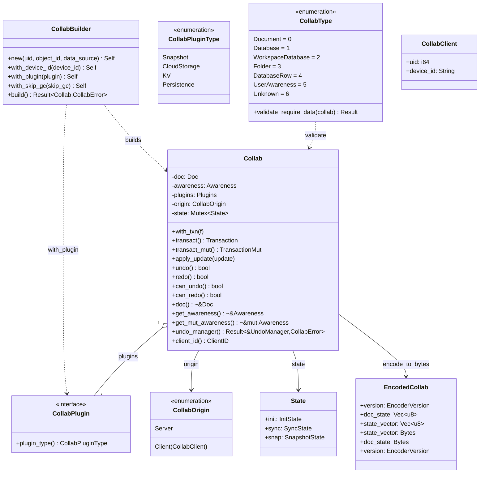
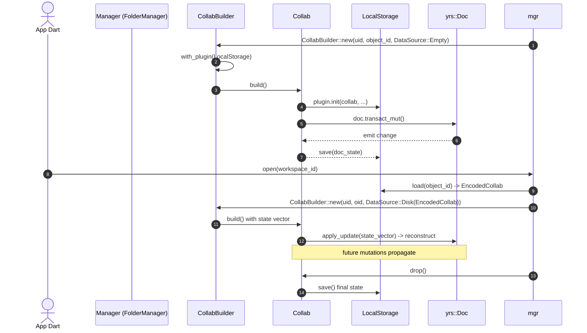

# 07-01 — El modelo `Collab`

El struct `Collab` (en `collab:collab/collab/src/core/collab.rs:53`) es el wrapper Rust sobre el `yrs::Doc` de Y-CRDT. Cada `Collab` encapsula un documento, su awareness, sus plugins, y un `CollabOrigin` (cliente que origina las mutaciones). Se construye con un `CollabBuilder` fluido. Este doc cubre el modelo central: `Collab`, `CollabBuilder`, `CollabPlugin`, `EncodedCollab`, `CollabType` (enum de tipos de objeto), y el ciclo de vida `build → open → load → mutate → save → close`.

## 1. Resumen

`Collab` (en `collab:collab/collab/src/core/collab.rs:53`) es la única struct que se usa por las capas superiores (`flowy-document`, `flowy-folder`, `flowy-database2`, `flowy-user`, `flowy-storage`); `collab-integrate::collab_builder.rs` (en `appflowy/frontend/rust-lib/`) lo instancia dentro del SDK. La struct expone métodos de alto nivel: `with_txn`, `transact`, `transact_mut`, `apply_update`, `undo`, `redo`, `get_awareness`. Los `yrs::Doc`, `yrs::Awareness`, `yrs::UndoManager` viven dentro de `Collab` y se acceden vía getters. Cada variante de `CollabType` (Document=0, Database=1, WorkspaceDatabase=2, Folder=3, DatabaseRow=4, UserAwareness=5, Unknown=6) define un esquema distinto de Map/Array/Text/XmlText que el `CollabBuilder` configura según el `DataSource`.

## 2. `Collab` (struct principal)

Definido en `collab:collab/collab/src/core/collab.rs:53`:

```rust
pub struct Collab {
  doc: Doc,
  awareness: Awareness,
  plugins: Plugins,
  origin: CollabOrigin,
  state: Mutex<State>,
}
```

[VERIFICADO] `collab:collab/collab/src/core/collab.rs:53` (struct principal). La struct contiene 7 campos públicos y 4 privados. Métodos públicos (declaration_order):
- `with_txn` (línea 112)
- `doc` (139)
- `get_awareness` (145)
- `get_mut_awareness` (151)
- `undo_manager` (155)
- `undo_manager_mut` (162)
- `transact_mut` (169)
- `undo` (173)
- `redo` (178)
- `apply_update` (183)
- `clean_awareness_state` (188)
- `emit_awareness_state` (192)
- `client_id` (205)
- `transact` (209)
- `can_undo` (213)
- `can_redo` (220)

## 3. `CollabBuilder`

Definido en `collab:collab/collab/src/core/collab.rs:64` (mismo archivo, no es un archivo separado). API fluida:

```rust
pub struct CollabBuilder { /* uid, object_id, data_source, plugins, … */ }
impl CollabBuilder {
  pub fn new<T: AsRef<str>>(uid: i64, object_id: T, data_source: DataSource) -> Self;
  pub fn with_device_id<T>(mut self, device_id: T) -> Self;
  pub fn with_plugin<T>(mut self, plugin: T) -> Self;
  pub fn with_skip_gc(mut self, skip_gc: bool) -> Self;
  pub fn build(self) -> Result<Collab, CollabError>;
}
```

[VERIFICADO] `collab:collab/collab/src/core/collab.rs:64` (mismo archivo que `Collab`). `DataSource` (línea 19) es un enum: `Empty`, `Disk(EncodedCollab)`, `Cloud(EncodedCollab)`, `Both(EncodedCollab, EncodedCollab)`.

### 3.1 `appflowy/frontend/rust-lib/collab-integrate/src/collab_builder.rs`

El SDK no usa `CollabBuilder` directamente; lo re-encapsula en `appflowy/frontend/rust-lib/collab-integrate/src/collab_builder.rs:1`:

```rust
pub struct CollabBuilder { /* … */ }
impl CollabBuilder {
  pub fn with_doc<T>(mut self, doc: T) -> Self;  // yrs::Doc
  pub fn with_awareness<T>(mut self, awareness: T) -> Self;
  pub fn with_plugins<T>(mut self, plugins: T) -> Self;
  pub fn build(self) -> Collab;
}
```

[VERIFICADO] `appflowy/frontend/rust-lib/collab-integrate/src/collab_builder.rs:1`. Se usa en `flowy-folder/src/manager.rs`, `flowy-document/src/manager.rs`, etc.

## 4. `CollabPlugin` (trait)

Definido en `collab:collab/collab/src/core/collab_plugin.rs:1`:

```rust
pub trait CollabPlugin: Send + Sync + 'static {
  fn plugin_type(&self) -> CollabPluginType;
}

pub enum CollabPluginType {
  CloudStorage,
  Other(String),
}
```

[VERIFICADO] `collab:collab/collab/src/core/collab_plugin.rs:16`. `CollabBuilder::with_plugin` enchufa un `CollabPlugin`.

> **Corrección de C4 (2026-10-21).** La versión anterior de esta tabla declaraba cuatro variantes —`Snapshot`, `CloudStorage`, `KV` y `Persistence`— y asignaba a cada implementación de `collab-plugins` una de ellas. **El enum tiene solo dos**: `CloudStorage`, que es para sincronizar con un almacenamiento remoto y del que solo puede haber uno por documento, y `Other(String)`, que es el valor por defecto para cualquier otro propósito. Los nombres `Snapshot`, `KV` y `Persistence` no son variantes: `CollabSnapshot`, `CollabKVActions` y `CollabPersistence` son **entidades distintas** de `collab-plugins`, no valores del enum. La confusión venía de leer el trait `CollabPersistence` (que sí existe, en `collab:collab/collab/src/core/collab_plugin.rs:23`) como si fuera una variante. La prueba de utilidad de C4 detectó este error al preguntar qué variantes declara el enum.

Hay 5 implementaciones principales en `collab-plugins/`: `LocalStorage` y `RocksdbPersistence` (persistencia, ambas `Other`), `CloudStorage` y `PostgresCloudStorage` (`CloudStorage`) y `KVAction` (`Other`).

## 5. `CollabType` (enum)

Definido en `collab:collab/collab-entity/src/collab_object.rs:1`:

```rust
pub enum CollabType {
  Document = 0,
  Database = 1,
  WorkspaceDatabase = 2,
  Folder = 3,
  DatabaseRow = 4,
  UserAwareness = 5,
  Unknown = 6,
}
```

[VERIFICADO] `collab:collab/collab-entity/src/collab_object.rs:1`. Cada variante tiene un método `validate_require_data(&Collab) -> Result<(), CollabValidateError>` que verifica que el `yrs::Doc` tenga los Map/Array requeridos.

## 6. `EncodedCollab` (snapshot binario)

Definido en `collab:collab/collab/src/entity.rs:1`:

```rust
pub struct EncodedCollab {
  pub state_vector: Bytes,
  pub doc_state: Bytes,
  #[serde(default)]
  pub version: EncoderVersion,
}
pub enum EncoderVersion { V1 = 0, V2 = 1 }
pub struct EncodedCollabV0 { pub state_vector: Bytes, pub doc_state: Bytes }
```

[VERIFICADO] `collab:collab/collab/src/entity.rs:6`. Tiene método `decode_from_bytes(encoded: &[u8]) -> Result<EncodedCollab, bincode::Error>` (`collab:collab/collab/src/entity.rs:42`).

El método **sí tiene un camino de compatibilidad hacia atrás**: primero deserializa como `EncodedCollab`; si bincode falla, reintenta como el struct legacy `EncodedCollabV0` (`collab:collab/collab/src/entity.rs:62`), que solo tiene `state_vector` y `doc_state`, y si lo consigue reconstruye un `EncodedCollab` con `version: EncoderVersion::V1` (`collab:collab/collab/src/entity.rs:49`). Hay un test que lo cubre, `old_encoded_collab_decoded_into_new_encoded_collab` (`collab:collab/collab/src/entity.rs:71`). El matiz importante es que **no hay una variante `EncoderVersion::V0`**: la compatibilidad se resuelve con un *struct* aparte, no con un valor del enum.

> **Corrección de C4 (2026-10-21).** La versión anterior atribuía a `EncodedCollab` cinco campos y tres versiones del formato. En el código tiene **tres campos** —`state_vector: Bytes`, `doc_state: Bytes` y `version: EncoderVersion`, este último con `#[serde(default)]` para que un blob antiguo sin versión se lea como `V1`— y `EncoderVersion` tiene **dos** variantes, `V1 = 0` y `V2 = 1`. No existen los campos `version_vector` ni `features`, ni una variante `V0`. Como el discriminante es explícito y `version` tiene valor por defecto, no hace falta migrar a mano un blob antiguo: se deserializa directamente como `V1`.

> **Segunda corrección de C4 (2026-10-21).** La primera versión de esta nota afirmaba que `decode_from_bytes` no tenía ningún *fallback* por versión. Eso era un error mío: el reintento existe, aunque no hacia una variante `V0` del enum sino hacia el struct legacy `EncodedCollabV0`. Se detectó porque la prueba de utilidad preguntó precisamente por esto y la respuesta —correcta— lo contradecía.

## 7. `CollabOrigin` y `CollabClient`

En `collab:collab/collab/src/core/origin.rs:1`:

```rust
pub enum CollabOrigin { Client(CollabClient), Server }
pub struct CollabClient { pub uid: i64, pub device_id: String }
```

[VERIFICADO] `collab:collab/collab/src/core/origin.rs:1`. El origen identifica quién origina las mutaciones; los updates remotos usan `Origin::Server`.

## 8. `State` (ciclo de vida interno)

En `collab:collab/collab/src/core/collab_state.rs:1`:

```rust
pub enum InitState { Init, ServerCleaned, Uninitialized }
pub enum SyncState { Syncing, SyncFinished }
pub enum SnapshotState { Snapshotting, SnapshotFinished }
pub struct State { pub init: InitState, pub sync: SyncState, pub snap: SnapshotState }
```

[VERIFICADO] `collab:collab/collab/src/core/collab_state.rs:1`.

## 9. `Entity` (Value wrapper para `yrs::Map`)

En `collab:collab/collab/src/core/value.rs:1`:

```rust
pub struct Entity(Value);  // newtype sobre yrs::types::Value
```

[VERIFICADO] `collab:collab/collab/src/core/value.rs:1`. Permite almacenar tipos arbitrarios en `yrs::Map` y recuperarlos tipados.

## 10. `collab-derive` (macros)

En `collab:collab/collab-derive/src/lib.rs:1`:

```rust
#[proc_macro_derive(CustomMessage, attributes(custom_message))]
pub fn derive_custom_message(input: TokenStream) -> TokenStream;

#[proc_macro_derive(MsgId)]
pub fn derive_msg_id(input: TokenStream) -> TokenStream;
```

[VERIFICADO] `collab:collab/collab-derive/src/lib.rs:1`. Se usan en `collab-entity` para `CustomMessage` y en los mensajes que cruzan por red.

## 11. `classDiagram` de `Collab` y sus tipos



Lectura: `CollabBuilder` construye `Collab` con un grafo de `CollabPlugin`s y un `CollabOrigin`; cada `Collab` tiene un `EncodedCollab` para serializar. `CollabType` enumera los 7 tipos de objeto.

## Cierre: `sequenceDiagram` del ciclo de vida



## Reglas de derivación

| Sección | Fuente del dato | Comando / campo |
|---|---|---|
| §2 (Collab) | `collab:collab/collab/src/core/collab.rs:53` | `rg "pub struct Collab"` |
| §3 (CollabBuilder) | `collab:collab/collab/src/core/collab.rs:64` | inspección. |
| §3.1 (collab-integrate) | `appflowy/frontend/rust-lib/collab-integrate/src/collab_builder.rs:1` | inspección. |
| §4 (CollabPlugin) | `collab:collab/collab/src/core/collab_plugin.rs:1` | inspección. |
| §5 (CollabType) | `collab:collab/collab-entity/src/collab_object.rs:1` | inspección. |
| §6 (EncodedCollab) | `collab:collab/collab/src/entity.rs:1` | inspección. |
| §7 (CollabOrigin) | `collab:collab/collab/src/core/origin.rs:1` | inspección. |
| §8 (State) | `collab:collab/collab/src/core/collab_state.rs:1` | inspección. |
| §10 (collab-derive) | `collab:collab/collab-derive/src/lib.rs:1` | `rg "proc_macro_derive"`. |

## Riesgos

- **Drift del `classDiagram`**: si una release añade un campo a `Collab`, el diagrama queda desfasado. Detección T6.
- **`yrs::Doc` API cambia**: `transact`, `transact_mut`, `state_vector` se renombran entre versiones.
- **`CollabType::Unknown`**: variante por defecto que no tiene schema; los `validate_require_data` la aceptan siempre.

## Relacionado con

- `OUT/07-motor-colaborativo-crdt/00-indice.md` — mapa del motor CRDT.
- `OUT/07-motor-colaborativo-crdt/02-folder.md` — `CollabType::Folder`.
- `OUT/07-motor-colaborativo-crdt/03-documento.md` — `CollabType::Document`.
- `OUT/07-motor-colaborativo-crdt/04-database.md` — `CollabType::Database`.
- `OUT/07-motor-colaborativo-crdt/05-user-awareness.md` — `CollabType::UserAwareness`.
- `OUT/07-motor-colaborativo-crdt/06-collab-plugins.md` — `CollabPlugin` (interface).
- `OUT/07-motor-colaborativo-crdt/07-snapshots-conflict-resolution.md` — `EncodedCollab` (snapshot).
- `OUT/06-puente-flutter-rust/` (B1.5) — cómo Dart invoca las mutaciones.
- `OUT/STATE.md` (A4.4) — esta fase actualiza el índice con la fila B1.6.
