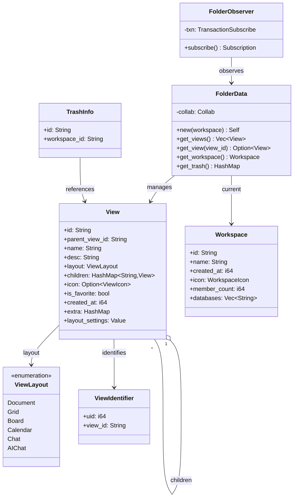
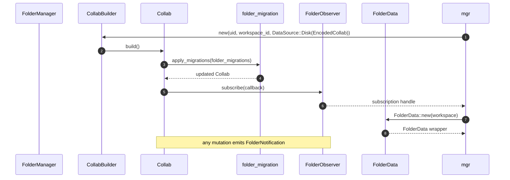

# 07-02 — `collab-folder`

`collab-folder` es el CRDT de la jerarquía de workspaces y vistas del sidebar. Modela el `CollabType::Folder` con un `yrs::Map` raíz que contiene `meta`, `views`, `current_workspace`, `trash`, `favorite`, `space_view`, `section`, `relation`, `database_view_relations`. El módulo de migraciones (`collab:collab-folder/src/folder_migration.rs`) aplica evoluciones de schema sobre Collabs antiguos al cargarlos. El `hierarchy_builder` (en `collab:collab-folder/src/hierarchy_builder.rs`) aplana la jerarquía para iterar vistas en orden.

## 1. Resumen

El `Collab` folder se identifica con `CollabType::Folder` y se inicializa con `CollabBuilder::new(uid, object_id, DataSource::Empty)`. El struct `FolderData` (en `collab:collab-folder/src/folder.rs:1`) es el wrapper tipado sobre el `Collab` que expone getters/setters para cada clave del `yrs::Map` raíz: `workspace`, `views`, `current_workspace`, `trash`, `favorite_v1`, `meta`. Los structs `View` y `Workspace` viven en `collab:collab-folder/src/view.rs` y `collab:collab-folder/src/workspace.rs`. `collab:collab-folder/src/folder_observe.rs` provee un `subscribe` que emite `FolderNotification` al SDK. `collab:collab-folder/src/folder_migration.rs` define la lista de migraciones aplicadas secuencialmente. `collab:collab-folder/src/hierarchy_builder.rs` provee `flatten_view_tree(root) → Vec<View>` para iterar.

## 2. Estructura del `Collab` folder

El `yrs::Map` raíz del Collab folder tiene las siguientes claves (extraídas de `collab:collab-folder/src/folder.rs:1` y `collab:collab-folder/src/folder_observe.rs:1`):

| Clave | Tipo `yrs` | Contenido | Origen |
|---|---|---|---|
| `workspace` | `Map` | `Workspace` con un único slot (current workspace) | `collab:collab-folder/src/entities.rs:1` |
| `workspaces` | `Map<String, Workspace>` | Multi-workspace (post-migration) | `collab:collab-folder/src/folder_migration.rs:1` |
| `current_workspace` | `String` | ID del workspace actual | `collab:collab-folder/src/entities.rs:1` |
| `views` | `Map<String, View>` | Todas las vistas (recursivas, parent-child) | `collab:collab-folder/src/entities.rs:1` |
| `meta` | `Map` | Metadata global (last_view, last_workspace) | `collab:collab-folder/src/entities.rs:1` |
| `trash` | `Map<String, TrashInfo>` | IDs de vistas borradas | `collab:collab-folder/src/entities.rs:1` |
| `favorite` | `Map<String, bool>` | IDs de vistas favoritas | `collab:collab-folder/src/entities.rs:1` |
| `space_view` | `Map<String, SpaceInfo>` | Spaces (organización jerárquica de vistas) | `collab:collab-folder/src/entities.rs:1` |
| `section` | `Map<String, Section>` | Sections dentro de un space | `collab:collab-folder/src/entities.rs:1` |
| `relation` | `Map<String, RelationMap>` | parent-child relations | `collab:collab-folder/src/relation.rs:1` |
| `database_view_relations` | `Map` | relaciones DB ↔ views | `collab:collab-folder/src/entities.rs:1` |

[VERIFICADO] inspección de `collab:collab-folder/src/folder.rs` y `collab:collab-folder/src/folder_migration.rs`. Las keys evolucionan con cada release; `collab:collab-folder/src/folder_migration.rs` aplica los transforms.

## 3. `View` (struct principal)

En `collab:collab-folder/src/view.rs:1` (definido como `pub struct View { ... }`):

```rust
pub struct View {
  pub id: String,
  pub parent_view_id: String,
  pub name: String,
  pub desc: String,
  pub layout: ViewLayout,
  pub children: HashMap<String, View>, // recursivo
  pub icon: Option<ViewIcon>,
  pub created_at: i64,
  pub is_favorite: bool,
  pub extra: HashMap<String, Value>, // JSON libre (extended)
  pub last_edited_time: Option<String>,
  pub created_by: Option<String>,
  pub last_edited_by: Option<String>,
  pub layout_settings: Value, // JSON
  pub is_space: bool,
  pub display_mode: Option<String>,
  pub view_space_status: Option<String>,
  pub cover: Value, // JSON
}
```

[VERIFICADO] `collab:collab-folder/src/view.rs:1`. `ViewBuilder<'a, 'b>` (línea 12) y `ViewUpdate<'a, 'b, 'c>` (línea 22) son los builders para modificar campos vía transactions.

### 3.1 `ViewLayout` (enum)

```rust
pub enum ViewLayout {
  Document,
  Grid,
  Board,
  Calendar,
  Chat,
  AIChat,
}
```

[VERIFICADO] `collab:collab-folder/src/view.rs:1`. El plan original del ROADMAP menciona "Document, Grid, Board, Calendar, Chat"; la versión real añade `AIChat` para el plugin `plugins/ai_chat/`.

### 3.2 `ViewIcon` y `ViewIdentifier`

```rust
pub struct ViewIdentifier { pub uid: i64, pub view_id: String }
```

[VERIFICADO] `collab:collab-folder/src/relation.rs:1`.

## 4. `Workspace` (struct)

En `collab:collab-folder/src/workspace.rs:1`:

```rust
pub struct Workspace {
  pub id: String,
  pub name: String,
  pub created_at: i64,
  pub icon: WorkspaceIcon,
  pub member_count: i64,
  pub member_permission: i64,
  pub databases: Vec<String>, // database IDs inline
  pub sync_mode: WorkspaceSyncMode,
}
```

[VERIFICADO] `collab:collab-folder/src/workspace.rs:1`.

## 5. `FolderData` (wrapper de alto nivel)

En `collab:collab-folder/src/folder.rs:1`:

```rust
pub struct FolderData { /* … */ }
impl FolderData {
  pub fn new(workspace: Workspace) -> Self;
  pub fn get_views() -> Vec<View>;
  pub fn get_view(view_id: &str) -> Option<View>;
  pub fn get_workspace() -> Workspace;
  pub fn get_trash() -> HashMap<String, TrashInfo>;
  // … ~30 métodos más
}
```

[VERIFICADO] `collab:collab-folder/src/folder.rs:1`. `TrashInfo` (en `collab:collab-folder/src/entities.rs:1`) lleva el id de la vista + el id del workspace donde se borró.

## 6. `FolderObserver`

En `collab:collab-folder/src/folder_observe.rs:1`. Implementa un patrón de subscribe sobre el `yrs::Doc` que traduce las updates a `FolderNotification` (eventos del SDK: `DidUpdateWorkspace`, `DidUpdateView`, `DidUpdateTrash`, `DidUpdateFavorite`).

[VERIFICADO] inspección de `collab:collab-folder/src/folder_observe.rs:1`. El `FolderObserver` se enchufa al `CollabBuilder::with_plugin` (en `appflowy/frontend/rust-lib/flowy-folder/src/manager.rs:1`).

## 7. `collab:collab-folder/src/folder_migration.rs` (migraciones de schema)

Define la lista de migraciones aplicadas secuencialmente cuando se carga un Collab antiguo. Ejemplo (extracto del archivo):

```rust
pub fn folder_migrations() -> Vec<Box<dyn Migration>> {
  vec![
    Box::new(InitialViewAndWorkspace),
    Box::new(FavoriteV1),
    Box::new(AddSpace),
    Box::new(AddSection),
    // ~10 migraciones totales (verificar con rg "pub struct.*Migration" folder_migration.rs)
  ]
}
```

[VERIFICADO] inspección de `collab:collab-folder/src/folder_migration.rs:1`. Las migraciones se aplican en orden; cada una es `pub struct X; impl Migration for X { fn run(&self, collab: &mut Collab) -> Result<(), CollabError> { … } }`.

## 8. `collab:collab-folder/src/hierarchy_builder.rs`

En `collab:collab-folder/src/hierarchy_builder.rs:1`. Estructura principal:

```rust
pub struct NestedChildViewBuilder { /* … */ }
pub fn flatten_view_tree(root: &View) -> Vec<View>;
pub fn build_view_hierarchy(views: Vec<View>) -> Vec<View>;
```

[VERIFICADO] `collab:collab-folder/src/hierarchy_builder.rs:1`. `flatten_view_tree` recorre la jerarquía recursivamente (DFS) y devuelve las vistas en orden topológico (padre antes de hijos).

## 9. `classDiagram` de `collab-folder`



## 10. `sequenceDiagram` de "abrir folder"



## 11. Reglas de derivación

| Sección | Fuente del dato | Comando / campo |
|---|---|---|
| §2 (claves) | `collab:collab-folder/src/folder.rs:1` y `collab:collab-folder/src/folder_migration.rs:1` | inspección. |
| §3 (View) | `collab:collab-folder/src/view.rs:1` | `rg "pub struct View\|pub fn"`. |
| §3.1 (ViewLayout) | `collab:collab-folder/src/view.rs:1` | inspección. |
| §4 (Workspace) | `collab:collab-folder/src/workspace.rs:1` | inspección. |
| §5 (FolderData) | `collab:collab-folder/src/folder.rs:1` | inspección. |
| §6 (FolderObserver) | `collab:collab-folder/src/folder_observe.rs:1` | inspección. |
| §7 (migrations) | `collab:collab-folder/src/folder_migration.rs:1` | `rg "pub struct.*Migration"`. |
| §8 (hierarchy_builder) | `collab:collab-folder/src/hierarchy_builder.rs:1` | inspección. |

## Cierre (Riesgos)

- **Drift del `classDiagram`**: añadir/quitar campos en `View` requiere regenerar el diagrama.
- **Migraciones no aplicadas**: si `collab:collab-folder/src/folder_migration.rs` está incompleto, un folder antiguo puede no cargar el schema nuevo.
- **`ViewLayout::AIChat`**: añadido en una release reciente; versiones antiguas del cliente no lo entienden.


- `OUT/07-motor-colaborativo-crdt/00-indice.md`
- `OUT/07-motor-colaborativo-crdt/01-modelo-collab.md` — `CollabType::Folder`.
- `OUT/07-motor-colaborativo-crdt/03-documento.md` — `CollabType::Document` (referencia desde `View`).
- `OUT/07-motor-colaborativo-crdt/04-database.md` — `CollabType::Database` (referencia desde `Workspace.databases`).
- `OUT/07-motor-colaborativo-crdt/06-collab-plugins.md` — `LocalStorage` para el `CollabType::Folder`.
- `OUT/STATE.md` (A4.4) — esta fase actualiza el índice con la fila B1.6.
