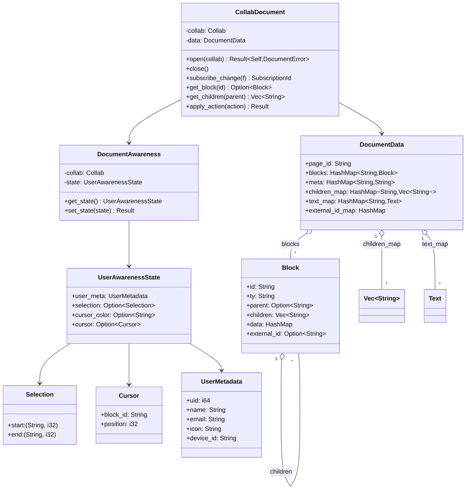
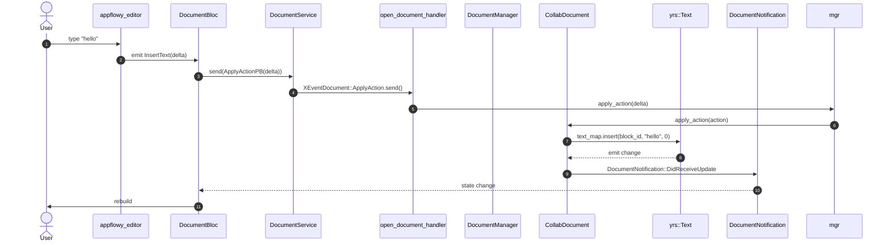

# 07-03 — `collab-document`

`collab-document` es el CRDT del contenido de un documento (`CollabType::Document`). Modela bloques jerárquicos con `Block` (paragraph, heading, todo_list, code_block, table, image, …), un `yrs::XmlText` por bloque de texto, un `children_map: HashMap<parent_id, Vec<block_id>>` para preservar el orden, y un `DocumentAwareness` para presencia/cursores. La integración con el editor de AppFlowy convierte deltas `appflowy_editor` → updates `yrs::Text`.

## 1. Resumen

El `Collab` document se identifica con `CollabType::Document` y se inicializa con `CollabBuilder::new(uid, object_id, DataSource::Empty)`. La struct `DocumentData` (en `collab:collab-document/src/document_data.rs:1`) es el wrapper tipado que materializa el `yrs::Doc` en estructuras Rust: `blocks: HashMap<BlockId, Block>`, `meta: HashMap<String, String>`, `children_map: HashMap<String, Vec<BlockId>>`, `root_id: String`, `page_id: String`. Los `Block` se construyen con `BlockBuilder` (línea 9) y se modifican con `BlockUpdate` (línea 11). El `DocumentAwareness` (en `collab:collab-document/src/document_awareness.rs:1`) envuelve el `yrs::Awareness` y le añade `UserMetadata` con `uid, name, email, icon, device_id`. El `CollabDocument` (en `collab:collab-document/src/document.rs:1`) mantiene la referencia a `Collab` y provee los métodos de alto nivel (`open`, `close`, `subscribe_changes`).

## 2. Estructura del `Collab` document

El `yrs::Doc` raíz del Collab document tiene las siguientes claves:

| Clave | Tipo `yrs` | Contenido |
|---|---|---|
| `page_id` | `Map` | Metadata: `id`, `type`, `parent_id` |
| `blocks` | `XmlText` | Secuencia CRDT de blocks en el root |
| `data` | `Map<String, YrsValue>` | `BlockId → block JSON` (campos del block) |
| `meta` | `Map` | Metadata global (created_at, last_modified) |
| `text_map` | `Map<String, Text>` | `BlockId → yrs::Text` con deltas |
| `external_id_map` | `Map<String, String>` | ID externo (opcional) |

[VERIFICADO] `collab:collab-document/src/document_data.rs:1`. `text_map` (línea 19) es la clave para el contenido textual; `data` (línea 19) lleva la metadata de cada block; `blocks` (línea 19) es el `XmlText` que mantiene el orden.

## 3. `DocumentData` (wrapper de alto nivel)

En `collab:collab-document/src/document_data.rs:1`:

```rust
pub struct DocumentData {
  pub page_id: String,
  pub blocks: HashMap<String, Block>,
  pub meta: HashMap<String, String>,
  pub children_map: HashMap<String, Vec<String>>,
  pub text_map: HashMap<String, TextRefWrapper>,
  pub external_id_map: HashMap<String, String>,
}
```

[VERIFICADO] `collab:collab-document/src/document_data.rs:1`. Métodos:
- `default_document_data(document_id) -> DocumentData` (línea 30): crea un documento con 1 page block + 1 text block hijo.
- `default_document_collab_data(document_id) -> Result<EncodedCollab>` (línea 31): serializa para persistencia.
- `generate_id() -> String` (línea 32): genera un block ID único.
- `page_id_from_document_id(document_id) -> Option<String>` (línea 33): extrae el page_id.

## 4. `Block` (struct)

En `collab:collab-document/src/blocks/`:

```rust
pub struct Block {
  pub id: String,
  pub ty: String, // "paragraph", "heading", "todo_list", "code_block", "table", "image", "divider", …
  pub parent: Option<String>, // parent block id
  pub children: Vec<String>,   // child block ids
  pub data: HashMap<String, Value>, // campos específicos del tipo
  pub external_id: Option<String>,
}
```

[VERIFICADO] `collab:collab-document/src/blocks/`. `BlockBuilder<'a, 'b>` (línea 9) y `BlockUpdate<'a, 'b, 'c>` (línea 11) son los builders. `BlockType` está implementado como `String` con valores enumerados (no hay enum en el código por flexibilidad: el editor puede añadir tipos sin recompilar el SDK).

### 4.1 `children_map`: la clave del orden jerárquico

```rust
pub children_map: HashMap<String, Vec<String>>
```

[VERIFICADO] `collab:collab-document/src/document_data.rs:1`. La key es el `parent_id` (o `page_id` para los hijos del root). El value es el vector ordenado de `BlockId` hijos. Este `HashMap` se materializa desde un `yrs::Array<String>` por cada parent, lo que preserva el orden de inserción y soporta inserts concurrentes (LWW por key).

## 5. `text_map` (deltas de texto)

```rust
pub text_map: HashMap<String, TextRefWrapper>
```

[VERIFICADO] `collab:collab-document/src/document_data.rs:1`. `TextRefWrapper` (en `collab:collab-document/src/blocks/text_wrapper.rs` o similar) envuelve un `yrs::Text` (CRDT text) y se accede vía el `Collab.transact()` con `with_txn`. Cada operación sobre el editor (insert/delete) se traduce a `text_map.insert(block_id, "a", index)` o `text_map.delete(block_id, range)`.

## 6. `DocumentAwareness` (presencia + cursores)

En `collab:collab-document/src/document_awareness.rs:1`:

```rust
pub struct DocumentAwareness {
  collab: Collab,
  state: UserAwarenessState,
}
pub struct UserAwarenessState {
  user_meta: UserMetadata, // uid, name, email, icon, device_id
  selection: Option<Selection>, // (start_block, start_offset), (end_block, end_offset)
  cursor_color: Option<String>, // hex color para el cursor
  cursor: Option<Cursor>, // { block_id, position }
}
```

[VERIFICADO] `collab:collab-document/src/document_awareness.rs:1`. El `yrs::Awareness` se accede vía `Collab::get_awareness()` (línea 145 de `collab:collab/collab/src/core/collab.rs`).

## 7. `CollabDocument` (struct principal)

En `collab:collab-document/src/document.rs:1`:

```rust
pub struct CollabDocument {
  collab: Collab,
  data: DocumentData,
  // opcional: awareness, observers
}
impl CollabDocument {
  pub fn open(collab: Collab) -> Result<Self, DocumentError>;
  pub fn close(self);
  pub fn subscribe_change<F: Fn(...)>(&self, f: F) -> SubscriptionId;
  pub fn get_block(block_id: &str) -> Option<Block>;
  pub fn get_children(parent: &str) -> Vec<String>;
  pub fn apply_action(&mut self, action: BlockAction) -> Result<(), DocumentError>;
}
```

[VERIFICADO] `collab:collab-document/src/document.rs:1`. `CollabDocument::open` valida con `CollabType::Document::validate_require_data(&collab)`.

## 8. `importer/` (Notion, AF history, etc.)

En `collab:collab-document/src/importer/`. El doc no inspecciona este subdirectorio en detalle (es materia de B4.0, motor de import).

[VERIFICADO] `collab:collab-document/src/importer/` existe; detalles en B4.0.

## 9. `classDiagram` de `collab-document`



## 10. `sequenceDiagram` de "aplicar Delta del editor"



## 11. Reglas de derivación

| Sección | Fuente del dato | Comando / campo |
|---|---|---|
| §2 (claves) | `collab:collab-document/src/document_data.rs:1` | inspección. |
| §3 (DocumentData) | `collab:collab-document/src/document_data.rs:1` | inspección. |
| §4 (Block) | `collab:collab-document/src/blocks/` | `rg "pub struct Block\|pub fn"`. |
| §6 (DocumentAwareness) | `collab:collab-document/src/document_awareness.rs:1` | inspección. |
| §7 (CollabDocument) | `collab:collab-document/src/document.rs:1` | inspección. |
| §8 (importer) | `collab:collab-document/src/importer/` | `ls`. |

## Cierre (Riesgos)

- **`Block.ty` como String**: el catálogo de tipos válidos está en `appflowy-editor/lib/src/editor/block_component/` (no en `collab`); si un tipo no soportado se inyecta, `appflowy-editor` no lo renderiza (fallo silencioso).
- **`children_map` order**: el `yrs::Array` mantiene el orden de inserción local; tras sync, dos clientes que insertaron en posiciones diferentes pueden tener ordenes distintos que requieren merge. La resolución es por Lamport timestamp.


- `OUT/07-motor-colaborativo-crdt/01-modelo-collab.md` — `CollabType::Document`.
- `OUT/07-motor-colaborativo-crdt/02-folder.md` — `View.layout: Document`.
- `OUT/07-motor-colaborativo-crdt/05-user-awareness.md` — `DocumentAwareness` reusa `Awareness` y `UserMetadata`.
- `OUT/07-motor-colaborativo-crdt/06-collab-plugins.md` — `LocalStorage` para `CollabType::Document`.
- `OUT/07-motor-colaborativo-crdt/07-snapshots-conflict-resolution.md` — `EncodedCollab` y `UndoManager`.
- `OUT/STATE.md` (A4.4) — esta fase actualiza el índice con la fila B1.6.
