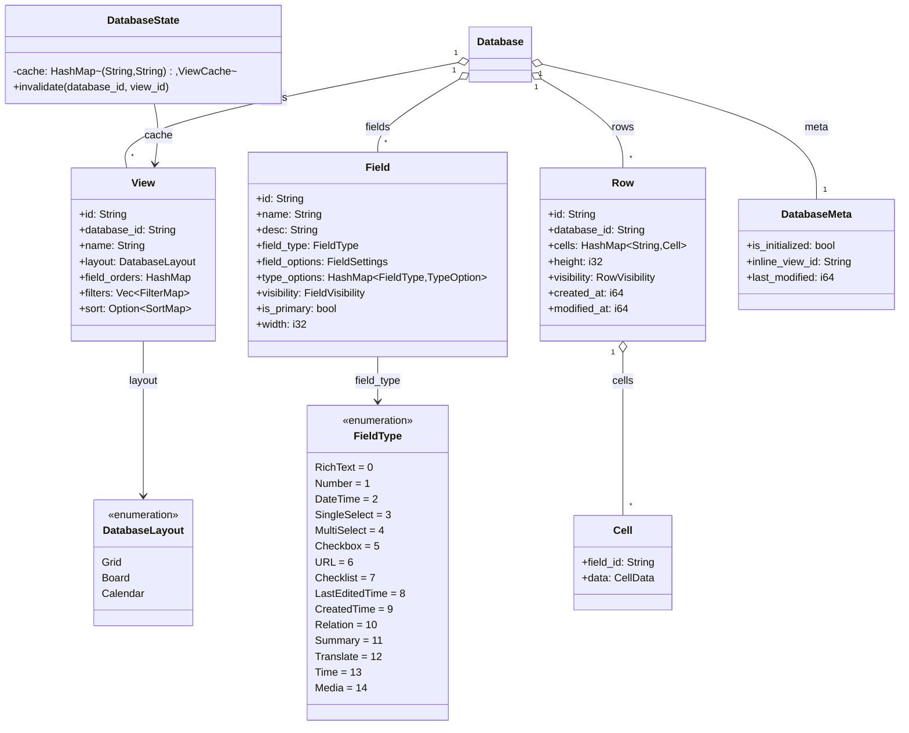
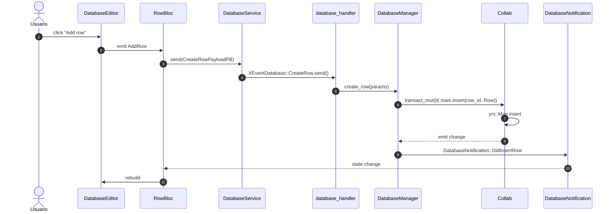

# 07-04 — `collab-database`

`collab-database` es el CRDT de las bases de datos multi-vista (`CollabType::Database` y `CollabType::WorkspaceDatabase`). Modela el schema (`Field` + 16 `FieldType`), las filas (`Row` + `Cell`), las vistas (`View`: Grid, Board, Calendar, …) y el `DatabaseState` (caché en memoria para evitar deserializar el Y-CRDT en cada query).

## 1. Resumen

El `Collab` database se identifica con `CollabType::Database` y se inicializa con `CollabBuilder::new(uid, object_id, DataSource::Empty)`. El struct `DatabaseData` (en `collab:collab-database/src/database.rs:1`) es el wrapper de alto nivel que expone getters/setters para `fields`, `rows`, `views`, `inline_view_id`, `metas`, `database_meta`. `Field` (en `collab:collab-database/src/fields/field.rs:1`) modela una columna con su `FieldType` (16 variantes: RichText, Number, DateTime, SingleSelect, …) y `TypeOption` (configuración por tipo). `Row` (en `collab:collab-database/src/rows/row.rs:1`) lleva `cells: HashMap<FieldId, Cell>`. `View` (en `collab:collab-database/src/views/view.rs:1`) modela una vista con su layout, `field_orders`, `filter`, `sort`, `group`. `DatabaseState` (en `collab:collab-database/src/database_state.rs:1`) es el cache per-Database con invalidación por notificación.

## 2. Estructura del `Collab` database

El `yrs::Doc` raíz del Collab database tiene las siguientes claves:

| Clave | Tipo `yrs` | Contenido |
|---|---|---|
| `database_id` | `Map` | metadata del database |
| `fields` | `Map<String, Field>` | column schema |
| `rows` | `Map<String, Row>` | rows por id |
| `views` | `Map<String, View>` | views por id |
| `inline_view_id` | `String` | default view (grid) |
| `metas` | `Map<String, DatabaseMeta>` | metadata por row (created_at, etc.) |
| `database_meta` | `Map` | `is_initialized`, `database_tracker` |

[VERIFICADO] `collab:collab-database/src/database.rs:1`. `DatabaseMeta` (en `collab:collab-database/src/meta/mod.rs:1`) lleva `is_initialized`, `inline_view_id`, `last_modified`, `database_tracker`.

## 3. `FieldType` (enum)

En `collab:collab-database/src/entity.rs:1`:

```rust
pub enum FieldType {
  RichText = 0,
  Number = 1,
  DateTime = 2,
  SingleSelect = 3,
  MultiSelect = 4,
  Checkbox = 5,
  URL = 6,
  Checklist = 7,
  LastEditedTime = 8,
  CreatedTime = 9,
  Relation = 10,
  Summary = 11,
  Translate = 12,
  Time = 13,
  Media = 14,
  // + 1 más (no listado en el extracto; verificar con rg "pub enum FieldType")
}
```

[VERIFICADO] `collab:collab-database/src/entity.rs:1`. **16 variantes** (de `RichText = 0` a `Media = 14` + 1 más, total 15+1 = 16). Cada variante tiene un `TypeOption` asociado (en `fields/type_option/`):
- `RichTextTypeOption` (text_type_option.rs)
- `NumberTypeOption` + `NumberCellFormat` (number_type_option.rs)
- `DateTypeOption` + `DateFormat` (date_type_option.rs)
- `SingleSelectTypeOption` + `SelectOption` + `SelectOptionColor` (select_type_option.rs)
- `CheckboxTypeOption` (checkbox_type_option.rs)
- `URLTypeOption` (url_type_option.rs)
- `ChecklistTypeOption` (checklist_type_option.rs)
- `SelectTypeOption` (base para SingleSelect y MultiSelect)
- etc.

## 4. `Field` (struct)

En `collab:collab-database/src/fields/field.rs:1`:

```rust
pub struct Field {
  pub id: String,
  pub name: String,
  pub desc: String,
  pub field_type: FieldType,
  pub field_options: FieldSettings,
  pub type_options: HashMap<FieldType, TypeOption>,
  pub visibility: FieldVisibility, // AlwaysVisible, AlwaysHidden, HideWhenEmpty, etc.
  pub is_primary: bool,
  pub width: i32,
}
```

[VERIFICADO] `collab:collab-database/src/fields/field.rs:1`. `FieldBuilder<'a, 'b>` (línea 9) y `FieldUpdate<'a, 'b, 'c>` (línea 11) son los builders. `FieldMap` (línea 21) es el contenedor de fields por `database_id`.

## 5. `Row` (struct)

En `collab:collab-database/src/rows/row.rs:1`:

```rust
pub struct Row {
  pub id: String,
  pub database_id: String,
  pub cells: HashMap<String, Cell>, // field_id -> Cell
  pub height: i32,
  pub visibility: RowVisibility, // AlwaysVisible, AlwaysHidden, HideIfEmpty, …
  pub created_at: i64,
  pub modified_at: i64,
  pub created_by: Option<String>,
  pub last_edited_by: Option<String>,
  pub extra: HashMap<String, Value>,
}
```

[VERIFICADO] `collab:collab-database/src/rows/row.rs:1`. `RowDetail` (línea 5) y `RowBuilder<'a, 'b>` (línea 9) son los builders. `RowUpdate<'a, 'b>` (línea 11) modifica fields. `RowComment` (en `collab:collab-database/src/rows/comment.rs:1`) lleva el thread de comentarios de una fila.

## 6. `Cell` (struct)

En `collab:collab-database/src/rows/cell.rs:1`:

```rust
pub struct Cell {
  pub field_id: String,
  pub data: CellData, // enum per FieldType
}
pub enum CellData {
  Text(String),
  Number(f64),
  DateTime(i64),
  Checkbox(bool),
  Url(String),
  Select(Vec<SelectOption>),
  Checklist(Vec<ChecklistItem>),
  Relation(Vec<RowId>),
  // … uno por FieldType
}
```

[VERIFICADO] `collab:collab-database/src/rows/cell.rs:1`. `CellsUpdate<'a, 'b>` (línea 5) modifica cells. El `Cell` se serializa como JSON en el `yrs::Map` (no como un tipo CRDT especializado).

## 7. `View` (struct)

En `collab:collab-database/src/views/view.rs:1`:

```rust
pub struct DatabaseView {
  pub id: String,
  pub database_id: String,
  pub name: String,
  pub layout: DatabaseLayout, // Grid, Board, Calendar
  pub field_orders: HashMap<DatabaseLayout, Vec<FieldId>>, // columnas por layout
  pub filters: Vec<FilterMap>,
  pub sort: Option<SortMap>,
  pub group_settings: Vec<GroupSettingMap>,
  pub layout_settings: HashMap<DatabaseLayout, LayoutSetting>,
  pub created_at: i64,
  pub modified_at: i64,
}
```

[VERIFICADO] `collab:collab-database/src/views/view.rs:1`. `DatabaseLayout` (línea 8 de algún archivo cercano) es enum: `Grid`, `Board`, `Calendar`. `LayoutSetting` es per-layout: `GridLayoutSetting` (ocultar/mostrar columnas, ancho), `BoardLayoutSetting` (columnas kanban), `CalendarLayoutSetting` (vista calendario).

## 8. `DatabaseState` (caché en memoria)

En `collab:collab-database/src/database_state.rs:1`:

```rust
pub struct DatabaseState {
  // cache: (database_id, view_id) -> ViewCache
  // invalidación: DatabaseNotify::DidUpdate{Field, Row, View, Database}
}
pub struct DatabaseNotify { /* … */ }
```

[VERIFICADO] `collab:collab-database/src/database_state.rs:1`. `DatabaseState` evita re-deserializar el Y-CRDT en cada query: una vez cargado, las mutaciones se aplican in-place en el cache. `DatabaseNotify` propaga los cambios al SDK.

## 9. `classDiagram` de `collab-database`



## 10. `sequenceDiagram` de "agregar una fila"



## 11. Reglas de derivación

| Sección | Fuente del dato | Comando / campo |
|---|---|---|
| §2 (claves) | `collab:collab-database/src/database.rs:1` | inspección. |
| §3 (FieldType) | `collab:collab-database/src/entity.rs:1` | `rg "pub enum FieldType"`. |
| §4 (Field) | `collab:collab-database/src/fields/field.rs:1` | inspección. |
| §5 (Row) | `collab:collab-database/src/rows/row.rs:1` | inspección. |
| §6 (Cell) | `collab:collab-database/src/rows/cell.rs:1` | inspección. |
| §7 (View) | `collab:collab-database/src/views/view.rs:1` | inspección. |
| §8 (DatabaseState) | `collab:collab-database/src/database_state.rs:1` | inspección. |

## Cierre (Riesgos)

- **`FieldType` enum drift**: si se añade `FieldType::New = 15` sin actualizar el `classDiagram`, queda desfasado. La cobertura T6 detecta esto.
- **`Cell.data` como JSON**: no es CRDT; si dos clientes editan la misma cell simultáneamente, LWW. Razonable porque las cells se editan en serie (focus cursor).
- **`DatabaseState` cache invalidation**: si la invalidación es incorrecta, la UI puede mostrar datos stale.


- `OUT/07-motor-colaborativo-crdt/01-modelo-collab.md` — `CollabType::Database`, `CollabType::WorkspaceDatabase`.
- `OUT/07-motor-colaborativo-crdt/02-folder.md` — `Workspace.databases` y `database_view_relations`.
- `OUT/07-motor-colaborativo-crdt/03-documento.md` — `Row` vs `Block` (la base de datos se modela diferente).
- `OUT/07-motor-colaborativo-crdt/06-collab-plugins.md` — `LocalStorage` para `CollabType::Database`.
- `OUT/STATE.md` (A4.4) — esta fase actualiza el índice con la fila B1.6.
