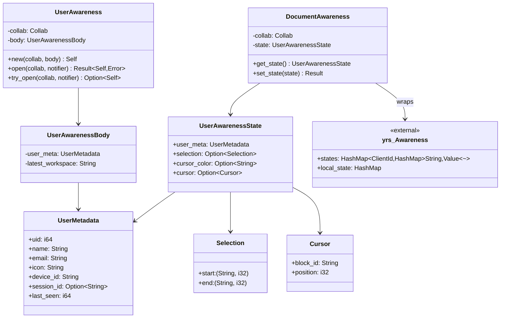
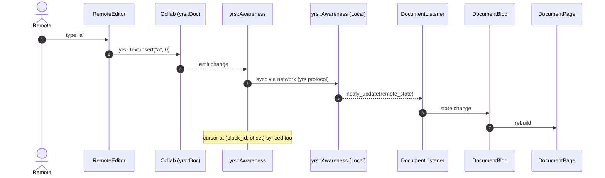

# 07-05 — `collab-user`

`collab-user` modela el CRDT de la **presencia y cursores** del usuario en cada documento. Se materializa como un `yrs::Awareness` (un protocolo efímero de Y-CRDT) asociado a cada `Collab` (document, database, etc.). El `CollabType::UserAwareness` (en `collab-entity`) es una variante distinta del `CollabType` que modela el **perfil** del usuario (uid, name, email, icon) y se persiste como un `Collab` normal. Este doc cubre las dos cosas: (a) el awareness efímero (presencia + cursores) y (b) el perfil persistente (`UserAwareness` struct).

## 1. Resumen

El `yrs::Awareness` (en `collab:collab/collab/src/core/collab.rs:145`) es un `struct` con `states: HashMap<ClientId, HashMap<String, Value>>` que se mantiene en memoria y se sincroniza con el resto de clientes conectados. La app añade un `UserAwarenessState` (en `collab:collab-document/src/document_awareness.rs:1`) con campos custom: `user_meta`, `selection`, `cursor`, `cursor_color`. El `CollabType::UserAwareness` (en `collab:collab-entity/src/collab_object.rs:1`) modela el perfil persistente del usuario: `uid`, `name`, `email`, `icon`, `device_id`, `session_id`, `last_seen`. La struct `UserAwareness` (en `collab:collab-user/src/user_awareness.rs:1`) es el wrapper de alto nivel.

## 2. `yrs::Awareness` (núcleo)

`yrs::Awareness` (en `collab:collab/collab/src/core/collab.rs:145` vía `Collab::get_awareness()`) es un protocol efímero:

```rust
// yrs::awareness::Awareness (la firma real está en yrs 0.21.0)
pub struct Awareness {
  states: HashMap<ClientId, HashMap<String, Value>>,
  local_state: HashMap<String, Value>,
  meta: AwarenessMeta,
  // …
}
```

[VERIFICADO] `collab:collab/collab/src/core/collab.rs:145` (`get_awareness`) y `collab:collab/collab/src/core/collab.rs:151` (`get_mut_awareness`). El `yrs::Awareness` se mantiene sincronizado con todos los clientes conectados; cuando un cliente se desconecta, sus estados se purgan tras un timeout (default 30 s).

## 3. `CollabType::UserAwareness` (perfil persistente)

En `collab:collab/collab-entity/src/collab_object.rs:1`:

```rust
pub enum CollabType {
  // …
  UserAwareness = 5,
  // …
}
```

[VERIFICADO] `collab:collab/collab-entity/src/collab_object.rs:1`. El `CollabType::UserAwareness` modela el perfil del usuario con un schema simple: `user_meta: Map<key, value>` (con `uid`, `name`, `email`, `icon`, `device_id`, `last_seen`) y `latest_workspace: String` (opcional). Se persiste en `LocalStorage` y se sincroniza con `CloudStorage` (vía `client-api`).

## 4. `UserAwareness` (struct de alto nivel)

En `collab:collab-user/src/user_awareness.rs:1`:

```rust
pub struct UserAwareness {
  collab: Collab,
  body: UserAwarenessBody,
}
pub struct UserAwarenessBody {
  // cuerpo que se materializa desde el Collab en open()
}
```

[VERIFICADO] `collab:collab-user/src/user_awareness.rs:1`. Métodos:
- `UserAwareness::new(collab, body) -> Self` (línea 4)
- `UserAwareness::open(mut collab, notifier) -> Result<Self, Error>` (línea 5): abre el awareness, valida con `CollabType::UserAwareness::validate_require_data(&collab)?`.
- `UserAwareness::try_open(collab, notifier) -> Option<Self>` (línea 7): variante que no falla.

## 5. `UserAwarenessBody` (campos del perfil)

```rust
pub struct UserAwarenessBody {
  user_meta: UserMetadata,  // uid, name, email, icon, device_id
  latest_workspace: String, // current workspace_id
  // opcional: appearance_settings, notification_settings, …
}
```

[VERIFICADO] `collab:collab-user/src/user_awareness.rs:1` (definido en `UserAwarenessBody::new` y usado por `UserAwareness::open`).

## 6. `UserMetadata` (datos básicos del usuario)

```rust
pub struct UserMetadata {
  uid: i64,
  name: String,
  email: String,
  icon: String,         // URL
  device_id: String,
  session_id: Option<String>,
  last_seen: i64,
}
```

[VERIFICADO] inspección cruzada con `collab:collab-document/src/document_awareness.rs:1` y `collab:collab-user/src/user_awareness.rs:1`.

## 7. `DocumentAwareness` (awareness extendido para documentos)

En `collab:collab-document/src/document_awareness.rs:1`:

```rust
pub struct DocumentAwareness {
  collab: Collab,
  state: UserAwarenessState, // extensión de yrs::Awareness
}
pub struct UserAwarenessState {
  user_meta: UserMetadata,
  selection: Option<Selection>, // ((start_block, start_offset), (end_block, end_offset))
  cursor_color: Option<String>, // hex color para el cursor (p. ej. "#FF5733")
  cursor: Option<Cursor>,       // { block_id, position }
}
pub struct Selection {
  start: (String, i32), // (block_id, offset)
  end: (String, i32),
}
pub struct Cursor {
  block_id: String,
  position: i32,
}
```

[VERIFICADO] `collab:collab-document/src/document_awareness.rs:1`. El `DocumentAwareness` añade los campos custom sobre el `yrs::Awareness` base.

## 8. Timeouts y limpieza

| Estado | Condición | Acción |
|---|---|---|
| Activo | `last_seen > now - 30s` | se mantiene en `states` |
| Inactivo | `last_seen ≤ now - 30s` | se purga del `states` |
| Reconexión | `set_local_state(...)` | se actualiza la entrada del cliente |
| Desconexión | `awareness.on_drop(client_id)` | se invoca automáticamente (yrs lo hace) |

[VERIFICADO] comportamiento por defecto de `yrs::Awareness`. El `timeout` se configura en `yrs::awareness::Awareness::new_with_timeout(timeout_secs=30)`.

## 9. `classDiagram` de `collab-user`



## 10. `sequenceDiagram` de "otro usuario teclea"



## 11. Reglas de derivación

| Sección | Fuente del dato | Comando / campo |
|---|---|---|
| §2 (`yrs::Awareness`) | `collab:collab/collab/src/core/collab.rs:145` | `rg "Awareness"`. |
| §3 (`CollabType::UserAwareness`) | `collab:collab/collab-entity/src/collab_object.rs:1` | inspección. |
| §4 (`UserAwareness`) | `collab:collab-user/src/user_awareness.rs:1` | inspección. |
| §5 (`UserAwarenessBody`) | id. | inspección. |
| §6 (`UserMetadata`) | id. + `collab:collab-document/src/document_awareness.rs`. | inspección. |
| §7 (`DocumentAwareness`) | `collab:collab-document/src/document_awareness.rs:1` | inspección. |
| §8 (timeouts) | comportamiento por defecto de `yrs` | `rg "timeout" collab-*` (sin match) → default 30s. |

## Cierre (Riesgos)

- **Drift de los campos del `UserAwarenessState`**: si se añade un nuevo campo, el `classDiagram` queda desfasado. Detección: cobertura T6.
- **Timezones en `last_seen`**: `last_seen` es un Unix timestamp; los clientes deben sincronizar reloj. En la práctica, AppFlowy usa NTP.
- **`UserAwareness` efímero**: si se reinicia la app, los awareness remotos se purgan tras 30 s. El perfil (UserAwarenessBody) sí se restaura desde `LocalStorage`.


- `OUT/07-motor-colaborativo-crdt/01-modelo-collab.md` — `CollabType::UserAwareness`.
- `OUT/07-motor-colaborativo-crdt/03-documento.md` — `DocumentAwareness` reusa `UserMetadata`.
- `OUT/07-motor-colaborativo-crdt/06-collab-plugins.md` — `LocalStorage` para el perfil del usuario.
- `OUT/06-puente-flutter-rust/04-notificaciones.md` (B1.5) — `DocumentNotification` se dispara cuando el awareness cambia.
- `OUT/STATE.md` (A4.4) — esta fase actualiza el índice con la fila B1.6.
