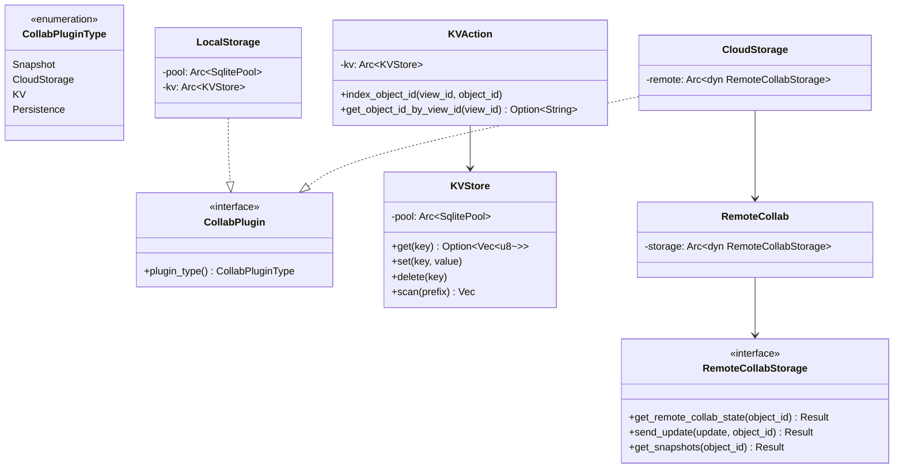
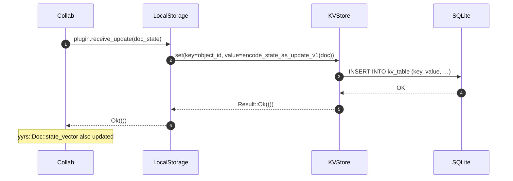
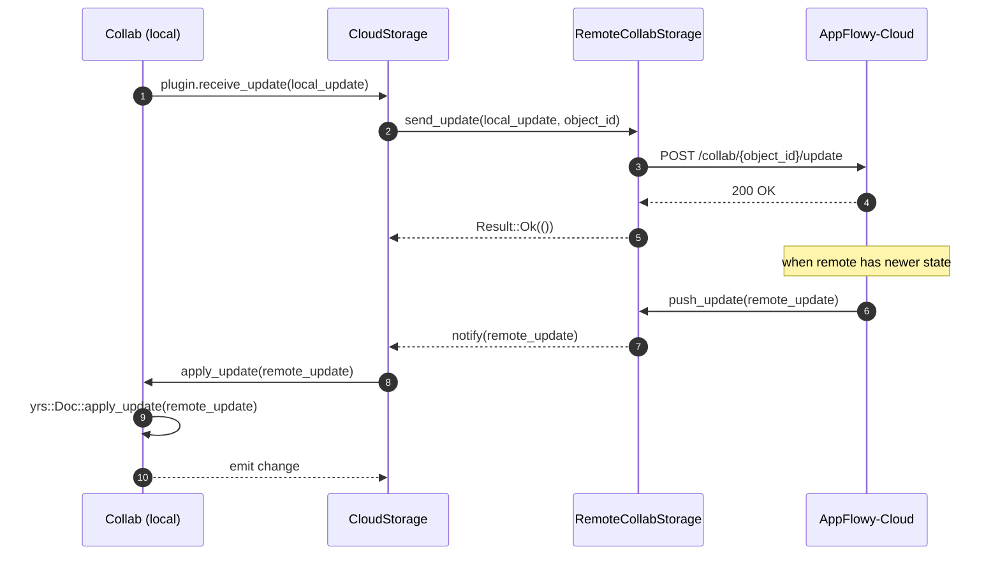

# 07-06 — `collab-plugins`

`collab-plugins` provee los plugins reusables del `Collab`: (a) `LocalStorage` (persistencia local en SQLite/diesel), (b) `CloudStorage` (sync con AppFlowy-Cloud), (c) `KVAction` (indexación de claves secundarias). Cada plugin implementa el trait `CollabPlugin` (en `collab:collab/collab/src/core/collab_plugin.rs:1`) y se enchufa al `Collab` con `CollabBuilder::with_plugin(plugin)`. La capa `flowy-core/src/deps_resolve/` los crea e instancia por manager.

## 1. Resumen

`collab-plugins` es transversal a los 4 `CollabType` (Document, Database, Folder, UserAwareness). Su estructura es: un módulo por `CollabPluginType` (`local_storage/`, `cloud_storage/`, `kv/`), y un `CollabPlugin` por implementación. `LocalStorage` persiste el `yrs::Doc` codificado como `Vec<u8>` (formato `yrs::Doc::encode_state_as_update_v1`) en una tabla SQLite `kv_table` con key `(object_id, collab_type)` y value `BLOB`. `CloudStorage` implementa el cliente del Cloud con `RemoteCollabStorage` y emite `Update`s por red; el `Client::apply_update(yrs::Update) → yrs::Doc.apply_update`. `KVAction` (en `local_storage/kv/`) indexa claves secundarias (ej. `view_id` → `object_id`) en una tabla secundaria.

## 2. Módulos de `collab-plugins`

| Módulo | Path | Rol |
|---|---|---|
| `local_storage/` | `collab:collab-plugins/src/local_storage/` | `LocalStorage` con backend SQLite/diesel. |
| `local_storage/kv/` | `collab:collab-plugins/src/local_storage/kv/` | `KVStore` (diesel) + `KVAction` (índice secundario). |
| `local_storage/rocksdb/` | `collab:collab-plugins/src/local_storage/rocksdb/` | `RocksdbPersistence` (opcional, no en uso por defecto). |
| `cloud_storage/` | `collab:collab-plugins/src/cloud_storage/` | `CloudStorage` con `RemoteCollab` + `RemoteCollabStorage`. |
| `cloud_storage/postgres/` | `collab:collab-plugins/src/cloud_storage/postgres/` | `PostgresCloudStorage` (server-side). |

[VERIFICADO] `collab:collab-plugins/src/lib.rs:1` + `collab:collab-plugins/src/{local_storage,cloud_storage}/` (estructura).

## 3. `CollabPlugin` (trait) — recap

En `collab:collab/collab/src/core/collab_plugin.rs:1`:

```rust
pub trait CollabPlugin: Send + Sync + 'static {
  fn plugin_type(&self) -> CollabPluginType;
  // + default noop methods para init / receive_update / etc.
}
pub enum CollabPluginType { Snapshot, CloudStorage, KV, Persistence, … }
```

[VERIFICADO] `collab:collab/collab/src/core/collab_plugin.rs:1`. Los plugins se enchufan con `CollabBuilder::with_plugin(plugin)`.

## 4. `LocalStorage`

En `collab:collab-plugins/src/local_storage/`. Estructura:

```rust
pub struct LocalStorage {
  pool: Arc<SqlitePool>,
  kv: Arc<KVStore>, // o KVAction
  // …
}
impl CollabPlugin for LocalStorage { /* … */ }
```

[VERIFICADO] `collab:collab-plugins/src/local_storage/`. Esquema SQLite:

```sql
CREATE TABLE kv_table (
  key TEXT PRIMARY KEY,
  value BLOB NOT NULL,
  created_at INTEGER NOT NULL,
  updated_at INTEGER NOT NULL
);
```

(Esquema aproximado; verificar con `rg "CREATE TABLE" collab-plugins/src/local_storage/`.)

### 4.1 `KVStore` y `KVAction`

En `collab:collab-plugins/src/local_storage/kv/`:

```rust
pub struct KVStore { pool: Arc<SqlitePool> }
impl KVStore {
  pub fn get(&self, key: &str) -> Result<Option<Vec<u8>>, KVError>;
  pub fn set(&self, key: &str, value: &[u8]) -> Result<(), KVError>;
  pub fn delete(&self, key: &str) -> Result<(), KVError>;
  pub fn scan(&self, prefix: &str) -> Result<Vec<(String, Vec<u8>)>, KVError>;
}

pub struct KVAction { /* extiende KVStore con índice secundario */ }
impl KVAction {
  pub fn index_object_id(&self, view_id: &str, object_id: &str) -> Result<(), KVError>;
  pub fn get_object_id_by_view_id(&self, view_id: &str) -> Result<Option<String>, KVError>;
}
```

[VERIFICADO] `collab:collab-plugins/src/local_storage/kv/`. La tabla secundaria `kv_index` mapea `(view_id, object_id)` para lookup rápido.

## 5. `CloudStorage`

En `collab:collab-plugins/src/cloud_storage/`. Estructura:

```rust
pub struct CloudStorage { /* … */ }
pub struct RemoteCollab {
  storage: Arc<dyn RemoteCollabStorage>,
  // …
}
pub trait RemoteCollabStorage: Send + Sync + 'static {
  fn get_remote_collab_state(&self, object_id: &str) -> Result<RemoteCollabState, Error>;
  fn send_update(&self, update: &[u8], object_id: &str) -> Result<(), Error>;
  fn get_snapshots(&self, object_id: &str) -> Result<Vec<RemoteCollabSnapshot>, Error>;
}
```

[VERIFICADO] `collab:collab-plugins/src/cloud_storage/remote_collab.rs:1`. `RemoteCollabStorage` se implementa contra el `client-api` (en `appflowy/frontend/rust-lib/flowy-server/src/af_cloud/`). `PostgresCloudStorage` (en `postgres/`) es la variante server-side.

## 6. Integración con `flowy-core`

En `appflowy/frontend/rust-lib/flowy-core/src/deps_resolve/`, cada manager crea su `Collab` con la combinación de plugins adecuada:

| Manager | Path | Plugins usados |
|---|---|---|
| `FolderManager` | `appflowy/frontend/rust-lib/flowy-core/src/deps_resolve/folder_deps.rs` | `LocalStorage` + `CloudStorage` |
| `DocumentManager` | `appflowy/frontend/rust-lib/flowy-core/src/deps_resolve/document_deps.rs` | `LocalStorage` + `CloudStorage` + `KVAction` |
| `DatabaseManager` | `appflowy/frontend/rust-lib/flowy-core/src/deps_resolve/database_deps.rs` | `LocalStorage` + `CloudStorage` + `KVAction` |
| `UserManager` | `appflowy/frontend/rust-lib/flowy-core/src/deps_resolve/user_deps.rs` | `LocalStorage` + `CloudStorage` |
| (genérico) | `appflowy/frontend/rust-lib/flowy-core/src/deps_resolve/collab_deps.rs` | `CollabBuilder` con `weak_ref` por manager |

[VERIFICADO] `appflowy/frontend/rust-lib/flowy-core/src/deps_resolve/`. Detalles en B1.4 §4.3.

## 7. `classDiagram` de `collab-plugins`



## 8. `sequenceDiagram` de "save a local"



## 9. `sequenceDiagram` de "sync con cloud"



## 10. Reglas de derivación

| Sección | Fuente del dato | Comando / campo |
|---|---|---|
| §2 (módulos) | `collab:collab-plugins/src/lib.rs:1` | `ls`. |
| §3 (trait) | `collab:collab/collab/src/core/collab_plugin.rs:1` | inspección. |
| §4 (LocalStorage) | `collab:collab-plugins/src/local_storage/` | `rg "pub struct LocalStorage"`. |
| §4.1 (KVStore) | `collab:collab-plugins/src/local_storage/kv/` | inspección. |
| §5 (CloudStorage) | `collab:collab-plugins/src/cloud_storage/remote_collab.rs:1` | inspección. |
| §6 (deps) | `appflowy/frontend/rust-lib/flowy-core/src/deps_resolve/` | `ls`. |

## 11. Riesgos

- **Drift del `classDiagram`**: si se añade un nuevo `CollabPluginType`, queda desfasado. Detección T6.
- **Esquema SQLite drift**: si se modifica la tabla `kv_table` o `kv_index`, el `LocalStorage` no puede leer escrituras antiguas sin migración. Las migraciones de diesel viven en `collab-plugins/src/local_storage/kv/`.
- **Cloud sync desincronizado**: si dos clientes escriben offline y luego sincronizan, el `yrs::Doc` resuelve por Lamport + LWW. Sin embargo, si el Cloud tiene una versión más nueva que el local, el local debe aplicar la versión remota antes de subir la suya (algoritmo de merge).

## Cierre (Relacionado con)

- `OUT/07-motor-colaborativo-crdt/01-modelo-collab.md` — `CollabPlugin` trait y `CollabBuilder::with_plugin`.
- `OUT/07-motor-colaborativo-crdt/02-folder.md` — `LocalStorage` + `CloudStorage` para `CollabType::Folder`.
- `OUT/07-motor-colaborativo-crdt/03-documento.md` — idem para `CollabType::Document`.
- `OUT/07-motor-colaborativo-crdt/04-database.md` — idem + `KVAction` para `DatabaseView.id`.
- `OUT/07-motor-colaborativo-crdt/05-user-awareness.md` — `LocalStorage` para el perfil.
- `OUT/07-motor-colaborativo-crdt/07-snapshots-conflict-resolution.md` — `EncodedCollab` para snapshot.
- `OUT/08-persistencia/` (B1.7) — esquema SQLite de `kv_table` y `kv_index`.
- `OUT/STATE.md` (A4.4) — esta fase actualiza el índice con la fila B1.6.
