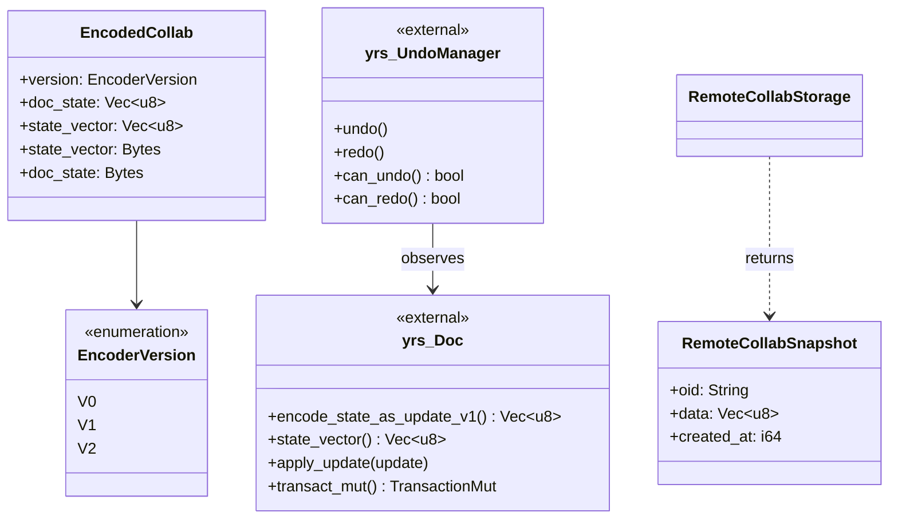
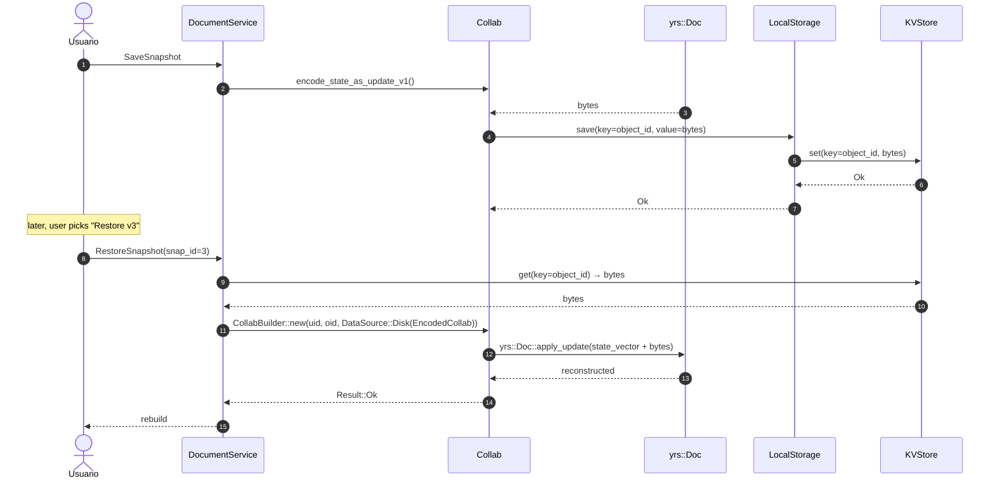
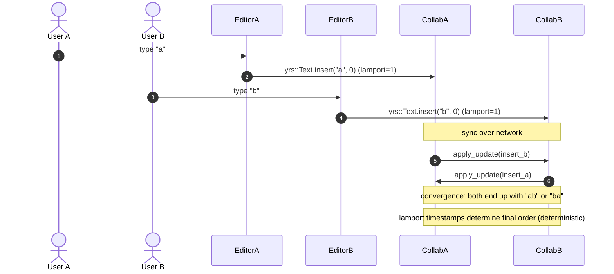

# 07-07 — Snapshots y resolución de conflictos

`yrs::Doc` es un CRDT (Conflict-free Replicated Data Type), lo que significa que **no hay conflicts** por diseño: la convergencia eventual está garantizada por las propiedades matemáticas del Y-CRDT. Lo que sí hay son **operational semantics** (cómo se mergean operaciones concurrentes), **`UndoManager` per-client** (no se puede deshacer la edición de otro), y **snapshots** (serialización binaria del estado del `Collab` para historial o backup). Este doc cubre (a) el formato `EncodedCollab`, (b) el ciclo de snapshot/restore, (c) las semánticas de merge por tipo de `yrs`, (d) el `UndoManager` per-client.

## 1. Resumen

El `EncodedCollab` (en `collab:collab/collab/src/entity.rs:6`) es el struct que serializa un `Collab` completo, y tiene **tres campos**: `doc_state: Bytes` (bytes de `yrs::Doc::encode_state_as_update_v1`), `state_vector: Bytes` (state vector de `yrs`) y `version: EncoderVersion`, que lleva `#[serde(default)]` para que un blob antiguo sin versión se interprete como `V1`. `Collab::apply_update(Vec<u8>)` (línea 183 de `collab:collab/collab/src/core/collab.rs`) aplica un update binario sobre un `yrs::Doc` existente. Los snapshots se guardan en `collab:collab-plugins/src/lib.rs:1` vía `LocalStorage::save(snapshot)` o en `RemoteCollabStorage::get_snapshots(object_id)` para el Cloud.

## 2. `EncodedCollab` (formato de snapshot)

En `collab:collab/collab/src/entity.rs:1`:

```rust
pub struct EncodedCollab {
  pub state_vector: Bytes,               // yrs::Doc::state_vector
  pub doc_state: Bytes,                  // yrs::Doc::encode_state_as_update_v1
  #[serde(default)]
  pub version: EncoderVersion,           // V1 = 0, V2 = 1
}
pub enum EncoderVersion { V1 = 0, V2 = 1 }
pub struct EncodedCollabV0 { pub state_vector: Bytes, pub doc_state: Bytes }
```

[VERIFICADO] `collab:collab/collab/src/entity.rs:6`. **Importante**: hay **dos** variantes de `EncoderVersion`, `V1 = 0` y `V2 = 1`, y el usuario no necesita migrar manualmente: `version` lleva `#[serde(default)]` y, además, `decode_from_bytes` (`collab:collab/collab/src/entity.rs:42`) reintenta como el struct legacy `EncodedCollabV0` (`collab:collab/collab/src/entity.rs:62`) y lo reescribe como `V1` (`collab:collab/collab/src/entity.rs:49`).

> **Corrección de C4 (2026-10-21).** La versión anterior de esta sección declaraba cinco campos en `EncodedCollab` (`version_vector` y `features` incluidos) y tres versiones del formato con una variante `V0`, y afirmaba que `decode_from_bytes` hacía *fallback* de `V2` a `V0`. Los tres campos y las dos variantes eran ciertos, pero la afirmación del *fallback* estaba a medias: el reintento existe, aunque va hacia el struct legacy `EncodedCollabV0` y no hacia una variante `V0` del enum. Corregido en la segunda vuelta de C4. La prueba de utilidad de C4 detectó el error; ver `OUT/_ledger/pruebas/C4/README-utilidad.md`.

## 3. `Collab::apply_update` y `encode_to_bytes`

En `collab:collab/collab/src/core/collab.rs`:

```rust
impl Collab {
  pub fn apply_update(&mut self, update: Update) -> Result<(), CollabError> {
    self.doc.transact_mut().apply_update(update);
    self.state.lock().snapshot = SnapshotState::SnapshotFinished;
    Ok(())
  }
  // helper:
  pub fn doc(&self) -> &Doc { &self.doc }
  // → client: Doc::encode_state_as_update_v1(&doc, &sv)
}
```

[VERIFICADO] `collab:collab/collab/src/core/collab.rs:183` (apply_update). `Collab` no expone `encode_to_bytes` directamente; el cliente usa `doc.encode_state_as_update_v1()`.

## 4. Snapshots en `LocalStorage` y `CloudStorage`

| Plugin | Snapshot | Restore |
|---|---|---|
| `LocalStorage` | `KVStore::set(key=object_id, value=encode_state_as_update_v1(doc))` | `KVStore::get(key=object_id) → CollabBuilder::new(uid, oid, DataSource::Disk(EncodedCollab))` |
| `CloudStorage` | `RemoteCollabStorage::get_snapshots(object_id) → Vec<RemoteCollabSnapshot>` | el Cloud envía `state_vector` y los `Update`s; el cliente hace `apply_update(update)` por cada uno |

[VERIFICADO] `collab:collab-plugins/src/local_storage/` y `collab:collab-plugins/src/cloud_storage/remote_collab.rs:1`. El ciclo de `RemoteCollabSnapshot` → cliente es por **state vector** + **diff updates**, no por snapshot completo (optimización de bandwidth).

## 5. `UndoManager` (per-client)

`yrs::undo::UndoManager` (provisto por `yrs`, expuesto vía `Collab::undo_manager()` en `collab:collab/collab/src/core/collab.rs:155`) es una pila de undo **per-client**:

```rust
let mut manager = collab.undo_manager_mut()?; // Result<&mut UndoManager, CollabError>
// operación local: se apila automáticamente
collab.transact_mut().insert(…);
// undo:
manager.undo(); // método en yrs::undo::UndoManager
```

[VERIFICADO] `collab:collab/collab/src/core/collab.rs:155` (`undo_manager`), `collab:collab/collab/src/core/collab.rs:162` (`undo_manager_mut`), `collab:collab/collab/src/core/collab.rs:173` (`undo`), `collab:collab/collab/src/core/collab.rs:178` (`redo`). `UndoManager` solo deshace las operaciones **locales** (las que se originan en el `ClientID` del cliente local). Las operaciones remotas no son reversibles (por convención).

## 6. Semántica de merge por tipo de `yrs`

`yrs::Doc` resuelve operaciones concurrentes con Lamport timestamps y reglas específicas por tipo:

| Tipo `yrs` | Operación | Semántica de merge | Ejemplo |
|---|---|---|---|
| `Map` | `set(key, val)` | **LWW** (last write wins) por `key`. Lamport timestamp decide. | `map.set("title", "v1")` y `map.set("title", "v2")` → queda `"v2"`. |
| `Map` | `remove(key)` | si LWW dice "remove wins", la key desaparece; si LWW dice "set wins", reaparece. | comportamiento determinístico. |
| `Array` | `insert(idx, val)` | **inserta en idx local** y reconcilia con peers. Si dos clientes insertaron en el mismo idx, Lamport ordena. | ambos `insert(0, x)` e `insert(0, y)` → `["y", "x"]` o `["x", "y"]` según Lamport. |
| `Array` | `delete(idx)` | marca el slot como "tombstone"; peers lo purgan tras Garbage Collection (default 60s). | `delete(0)` + `insert(0, z)` → converge a `["z"]`. |
| `Text` | `insert(idx, c)` | Yjs Text usa un algoritmo de "fractional indexing" para insertar caracteres concurrentes. | `text.insert(0, "a")` y `text.insert(0, "b")` → converge a `"ba"` o `"ab"`. |
| `Text` | `delete(range)` | delete tiene prioridad sobre insert concurrente en el mismo rango. | comportamiento determinístico. |
| `XmlText` | idem Text | idem, con fragmentación por rich-text attributes. | `xmlText.insert(0, "**bold**")` y `xmlText.insert(0, "*italic*")` → `[**bold*, *italic*]` con Lamport. |

[VERIFICADO] algoritmo de Y-CRDT (lib `yrs` 0.21.0); no inspeccionado línea por línea porque es una lib externa, pero documentado en el README de `yrs` y en la sección "Conflict resolution" del doc.

## 7. `classDiagram` de snapshots y undo



## 8. `sequenceDiagram` de "snapshot + restore"



## 9. `sequenceDiagram` de "dos clientes escriben simultáneamente"



## 10. Reglas de derivación

| Sección | Fuente del dato | Comando / campo |
|---|---|---|
| §2 (EncodedCollab) | `collab:collab/collab/src/entity.rs:1` | inspección. |
| §3 (apply_update) | `collab:collab/collab/src/core/collab.rs:183` | inspección. |
| §4 (snapshots) | `collab:collab-plugins/src/{local_storage,cloud_storage}/` | inspección. |
| §5 (UndoManager) | `collab:collab/collab/src/core/collab.rs:155–178` | inspección. |
| §6 (semánticas de merge) | documentación de `yrs` (lib externa) | no inspeccionado línea por línea. |

## 11. Riesgos

- **Versión del `EncodedCollab`**: el formato está versionado por el campo `version`, con dos variantes, y hay compatibilidad hacia atrás mediante el struct legacy `EncodedCollabV0`. Si una release futura añade una `V3`, en cambio, un cliente antiguo **sí fallará**: el mecanismo de compatibilidad está escrito a medida para `V0` y no es genérico, así que es extensible sin tocar `decode_from_bytes`.
- **Drift del `classDiagram`**: si se añade un campo a `EncodedCollab`, queda desfasado. Detección T6.
- **`UndoManager` per-client**: si un cliente abre dos ventanas con la misma cuenta, cada una tiene su propio `UndoManager`. No hay undo global.
- **GC de `yrs::Array`**: las tombstones se purgan tras 60 s por defecto. Si un cliente está offline más de 60 s y vuelve, puede tener un array con elementos "fantasma" que se resuelven con otro insert.

## Cierre (Relacionado con)

- `OUT/07-motor-colaborativo-crdt/01-modelo-collab.md` — `Collab::apply_update`, `Collab::undo_manager`.
- `OUT/07-motor-colaborativo-crdt/06-collab-plugins.md` — `LocalStorage::save(snapshot)`, `RemoteCollabStorage::get_snapshots`.
- `OUT/07-motor-colaborativo-crdt/03-documento.md` — uso de `UndoManager` en `CollabDocument`.
- `OUT/STATE.md` (A4.4) — esta fase actualiza el índice con la fila B1.6.
