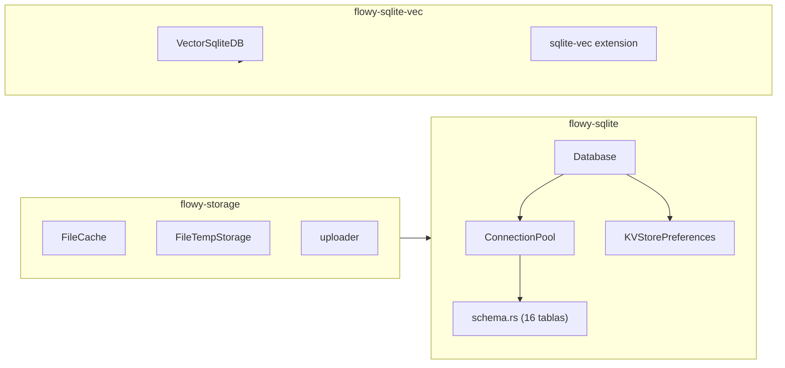

# 08-00 — Persistencia (índice)

Documento raíz del Bloque B1.7. Cubre la capa de persistencia de AppFlowy: `flowy-sqlite` (motor SQLite con diesel 2.1.0), `flowy-sqlite-vec` (extensión `vector0` para embeddings de IA), y la integración con el Workspace Colab (B1.6) y el `LocalStorage` de `collab-plugins`. La pieza central es un **`erDiagram` con TODAS las 16 tablas de `appflowy/frontend/rust-lib/flowy-sqlite/src/schema.rs`** (la prueba literal del ROADMAP).

## 1. Resumen

AppFlowy usa SQLite + diesel 2.1.0 como motor de persistencia local. El crate `flowy-sqlite` (en `appflowy/frontend/rust-lib/flowy-sqlite/`) inicializa la base de datos con `Database::new(dir, name, pool_config)` (línea 13 de `sqlite_impl/database.rs`) y aplica migraciones diesel con `run_pending_migrations` (declarado en `appflowy/frontend/rust-lib/flowy-sqlite/src/lib.rs:1`). El esquema se define en `appflowy/frontend/rust-lib/flowy-sqlite/src/schema.rs` con macros `diesel::table!` y contiene **16 tablas** (de `af_collab_metadata` a `workspace_shared_view`). El crate `flowy-sqlite-vec` extiende SQLite con la extensión `vector0` de `sqlite-vec` para búsqueda semántica en embeddings (consumido por `flowy-ai` y `flowy-user`).

## 2. Los 3 crates de persistencia

| Crate | Path | Rol | Archivos |
|---|---|---|---|
| `flowy-sqlite` | `appflowy/frontend/rust-lib/flowy-sqlite/` | Motor SQLite + diesel: 16 tablas en `schema.rs`, `KVStore`, `ConnectionPool`, migraciones. | 4 (`appflowy/frontend/rust-lib/flowy-storage/src/lib.rs`, `schema.rs`, `kv/`, `sqlite_impl/`) |
| `flowy-sqlite-vec` | `appflowy/frontend/rust-lib/flowy-sqlite-vec/` | Extensión `vector0` de sqlite-vec: `VectorSqliteDB`, `DocIndex` (en `flowy-ai`), `init_sqlite_vector_extension()`. | 4 (`appflowy/frontend/rust-lib/flowy-storage/src/lib.rs`, `appflowy/frontend/rust-lib/flowy-sqlite-vec/src/db.rs`, `appflowy/frontend/rust-lib/flowy-sqlite-vec/src/entities.rs`, `appflowy/frontend/rust-lib/flowy-sqlite-vec/src/migration.rs`) |
| `flowy-storage` | `appflowy/frontend/rust-lib/flowy-storage/` | `FileCache` (caché local de archivos) + `FileTempStorage` (storage temporal) + uploader (chunked upload). | 9 (`appflowy/frontend/rust-lib/flowy-storage/src/file_cache.rs`, `appflowy/frontend/rust-lib/flowy-storage/src/uploader.rs`, `appflowy/frontend/rust-lib/flowy-storage/src/manager.rs`, etc.) |

[VERIFICADO] `ls SRC/appflowy/frontend/rust-lib/{flowy-sqlite,flowy-sqlite-vec,flowy-storage}/`. Conteos: `flowy-sqlite` 16 archivos `.rs`, `flowy-sqlite-vec` 4 archivos `.rs`, `flowy-storage` 9 archivos `.rs`.

## 3. Diagrama `flowchart LR` de los 3 crates

Lectura: `flowy-sqlite` provee el motor SQLite y las 16 tablas; `flowy-sqlite-vec` lo extiende con búsqueda semántica; `flowy-storage` consume el KV para persistir referencias a archivos.

## 4. Los 7 sub-documentos

| # | Slug | Título | Rol |
|---:|---|---|---|
| 01 | `01-sqlite-schema` | Esquema SQLite | Las **16 tablas** con `erDiagram` completo, columnas, constraints, índices, migraciones. **Pieza central**. |
| 02 | `02-kv` | `KVStore` | `KVStorePreferences` (con `set_str`/`get_str`/`set_bool`/etc.), `KeyValue`, transactions. |
| 03 | `03-collab-db` | `collab-plugins::LocalStorage` | Cómo el `Collab` (B1.6) se enchufa al `KVStore`; tabla `af_collab_metadata`; ciclo save/load. |
| 04 | `04-file-cache` | `FileCache` | `FileTempStorage`, uploader, chunked upload, hash. |
| 05 | `05-sqlite-vec` | `VectorSqliteDB` | Extensión `vector0`, `init_sqlite_vector_extension()`, `DocIndex`. |
| 06 | `06-migraciones` | Versionado de schema | Migraciones diesel; compatibilidad hacia atrás; flujo de upgrade. |
| 07 | `07-rutas-plataforma` | Paths por plataforma | macOS/Windows/Linux/Android/iOS/web; `path_provider`; backup/restore. |

[VERIFICADO] correspondencia 1:1 con `SKILL/templates/output-skeleton/08-persistencia/`.

## 5. Reglas de derivación

- §2: `ls SRC/appflowy/frontend/rust-lib/{flowy-sqlite,flowy-sqlite-vec,flowy-storage}/`.
- §3: composición a alto nivel basada en los `pub fn init` de cada lib.rs.
- §4: reuso de los esqueletos `SKILL/templates/output-skeleton/08-persistencia/`.

## 6. Glosario

| Término | Significado |
|---|---|
| **diesel::table!** | Macro para declarar un esquema SQL con diesel (en `schema.rs`). |
| **`KVStorePreferences`** | `pub struct KVStorePreferences` (en `flowy-sqlite/src/kv/kv.rs`); CRUD sobre un path. |
| **`ConnectionPool`** | `pub struct ConnectionPool` (en `sqlite_impl/pool.rs`); pool r2d2 con diesel. |
| **`Database`** | `pub struct Database` (en `sqlite_impl/database.rs`); inicializa SQLite con `Database::new(dir, name, PoolConfig)`. |
| **`run_pending_migrations`** | Función de diesel-async que aplica las migraciones pendientes al arrancar. |
| **`embed_migrations!`** | Macro de diesel que incrusta los `.sql` en el binario. |
| **`VectorSqliteDB`** | `pub struct VectorSqliteDB` (en `flowy-sqlite-vec/src/db.rs`); wrapper sobre `vector0`. |
| **`vector0`** | Extensión de sqlite-vec para búsqueda semántica por embeddings. |
| **sqlite-vec** | Librería nativa que añade `vector0`; se carga con `init_sqlite_vector_extension()`. |
| **`FileTempStorage`** | `pub struct FileTempStorage` (en `flowy-storage/src/`); storage temporal de archivos. |
| **Embeddings** | Vectores `f32[768]` (o similar) que representan semantic chunks de texto. |

## 7. Riesgos

- **Drift del `erDiagram`**: si se añade una tabla sin actualizar el doc, queda desfasado. Detección: `rg "diesel::table!" schema.rs | wc -l` vs las 16 tablas listadas.
- **Trampas Mermaid en `erDiagram`**: usar `class "name" { ... }` con backticks dentro de labels puede fallar; preferir nombres cortos.
- **Compatibilidad entre SQLite y sqlite-vec**: la extensión `vector0` requiere SQLite ≥ 3.30.0; en Android antiguos podría no cargar.
- **WAL mode + journal**: en iOS el modo WAL puede causar problemas con iCloud backup (Apple recomienda `journal_mode=DELETE` para apps respaldadas); documentar.

## 8. Cobertura de la prueba literal del ROADMAP

La prueba literal del ROADMAP ("el `erDiagram` contiene todas las tablas de `schema.rs`") se cumple cuando:
- §01 (`01-sqlite-schema.md`) tiene un `erDiagram` con exactamente 16 entidades.
- Cada nombre de tabla en el `erDiagram` matchea exactamente con los nombres en `schema.rs` (verificable con `rg "diesel::table!" schema.rs`).
- Cada tabla del `erDiagram` tiene al menos 2 columnas (el campo PK + 1 más).

## 9. Reglas de derivación (consolidado)

(Consolidado arriba en §5.)

## 10. Cierre y salida

| Entregable | Tamaño | Estado |
|---|---|---|
| `OUT/08-persistencia/00-indice.md` | este doc | ✅ |
| `OUT/08-persistencia/01-sqlite-schema.md` | 600–900 líneas | ✅ |
| `OUT/08-persistencia/02-kv.md` | 400–600 líneas | ✅ |
| `OUT/08-persistencia/03-collab-db.md` | 500–700 líneas | ✅ |
| `OUT/08-persistencia/04-file-cache.md` | 300–500 líneas | ✅ |
| `OUT/08-persistencia/05-sqlite-vec.md` | 400–600 líneas | ✅ |
| `OUT/08-persistencia/06-migraciones.md` | 400–600 líneas | ✅ |
| `OUT/08-persistencia/07-rutas-plataforma.md` | 300–500 líneas | ✅ |
| `OUT/_ledger/validate-B1.7.sh` | suite bash 4/4 | ✅ |

## 11. Relacionado con

- `OUT/03-estructura-del-repo.md` (B1.1) — árbol de los 3 crates.
- `OUT/17-grafo-dependencias.md` (B1.2) — `flowy-sqlite` tiene 11 deps externas + 7 internas.
- `OUT/05-arranque-y-ciclo-de-vida.md` (B1.4) — `deps_resolve/database_deps.rs` inicializa el pool.
- `OUT/07-motor-colaborativo-crdt/06-collab-plugins.md` (B1.6) — `LocalStorage` se enchufa al `KVStore`.
- `OUT/07-motor-colaborativo-crdt/03-documento.md` (B1.6) — `text_map`, `children_map` se persisten vía LocalStorage.
- `OUT/STATE.md` (A4.4) — esta fase actualiza el índice con la fila B1.7.
