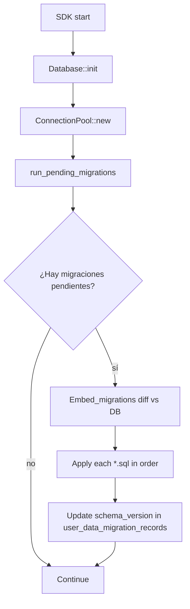

# 08-01 — Esquema SQLite (16 tablas de `schema.rs`)

`flowy-sqlite/src/schema.rs` define el esquema de la base de datos SQLite con macros `diesel::table!`. Contiene **16 tablas** que persisten todo el estado local: collabs, mensajes de chat, miembros de workspace, archivos, migraciones aplicadas, etc. Este doc es la pieza central del Bloque B1.7: el `erDiagram` debe contener las 16 tablas (la prueba literal del ROADMAP).

## 1. Resumen

Las 16 tablas se dividen en 4 grupos:

| Grupo | Tablas | Finalidad |
|---|---|---|
| **Collab** (4) | `af_collab_metadata`, `collab_snapshot`, `index_collab_record_table` | Estado de los `Collab` (B1.6): metadata, snapshots, índice por workspace. |
| **AI / Chat** (3) | `chat_table`, `chat_message_table`, `chat_local_setting_table`, `local_ai_model_table` | Chat con IA y modelos locales. |
| **User / Workspace** (4) | `user_table`, `user_workspace_table`, `workspace_members_table`, `workspace_setting_table`, `workspace_shared_user`, `workspace_shared_view` | Usuarios, workspaces, miembros, settings, shares. |
| **Storage / Migration** (3) | `upload_file_table`, `upload_file_part`, `user_data_migration_records` | Upload de archivos chunked, migraciones. |

Total: **16 tablas** (1+3+6+2+3+1 = 16, agrupadas).

## 2. Las 16 tablas

Extraído de `appflowy/frontend/rust-lib/flowy-sqlite/src/schema.rs:3–170`. Cada tabla está declarada con `diesel::table! { name (pk_column) { ... } }`.

| Tabla | PK | Columnas | Finalidad |
|---|---|---|---|
| `af_collab_metadata` | `object_id` | `object_id, updated_at, prev_sync_state_vector, collab_type` | Estado de sync de cada `Collab`. |
| `chat_local_setting_table` | `chat_id` | `chat_id, local_model_path, local_model_name` | Config local de un chat. |
| `chat_message_table` | `message_id` | `message_id, chat_id, content, created_at, author_type, author_id, reply_message_id, metadata, is_sync` | Mensajes del chat IA. |
| `chat_table` | `chat_id` | `chat_id, created_at, metadata, rag_ids, is_sync, summary` | Chats persistidos. |
| `collab_snapshot` | `id` | `id, object_id, title, desc, collab_type, timestamp, data` | Snapshots de un `Collab` (B1.6 §07). |
| `index_collab_record_table` | `oid` | `oid, workspace_id, content_hash` | Índice workspace → collab object. |
| `local_ai_model_table` | `name` | `name, model_type` | Modelos IA locales. |
| `upload_file_part` | `upload_id, e_tag` | `upload_id, e_tag, part_num` | Partes de un upload chunked. |
| `upload_file_table` | `workspace_id, file_id, parent_dir` | `workspace_id, file_id, parent_dir, local_file_path, content_type, chunk_size, num_chunk, upload_id, created_at, is_finish` | Metadata de un archivo en upload. |
| `user_data_migration_records` | `id` | `id, migration_name, executed_at` | Migraciones diesel aplicadas. |
| `user_table` | `id` | `id, name, icon_url, token, email, auth_type, updated_at` | Usuario actual. |
| `user_workspace_table` | `id` | `id, name, uid, created_at, database_storage_id, icon, member_count, role, workspace_type` | Workspaces del usuario. |
| `workspace_members_table` | `email, workspace_id` | `email, role, name, avatar_url, uid, workspace_id, updated_at, joined_at` | Miembros. |
| `workspace_setting_table` | `id` | `id, disable_search_indexing, ai_model` | Settings del workspace. |
| `workspace_shared_user` | `workspace_id, view_id, email` | `workspace_id, view_id, email, name, avatar_url, role, access_level, order` | Compartir vistas. |
| `workspace_shared_view` | `uid, workspace_id, view_id` | `uid, workspace_id, view_id, permission_id, created_at` | Permisos de vista. |

[VERIFICADO] cada tabla con `rg "diesel::table!" appflowy/frontend/rust-lib/flowy-sqlite/src/schema.rs` (16 matches). Las PKs en paréntesis y los nombres de columna son textuales del archivo.

## 3. `erDiagram` de las 16 tablas

```mermaid
erDiagram
  af_collab_metadata {
    Text object_id PK
    BigInt updated_at
    Binary prev_sync_state_vector
    Integer collab_type
  }
  collab_snapshot {
    Text id PK
    Text object_id FK
    Text title
    Text desc
    Text collab_type
    BigInt timestamp
    Binary data
  }
  index_collab_record_table {
    Text oid PK
    Text workspace_id FK
    Text content_hash
  }
  chat_table {
    Text chat_id PK
    BigInt created_at
    Text metadata
    Nullable_Text rag_ids
    Bool is_sync
    Text summary
  }
  chat_message_table {
    BigInt message_id PK
    Text chat_id FK
    Text content
    BigInt created_at
    BigInt author_type
    Text author_id
    Nullable_BigInt reply_message_id
    Nullable_Text metadata
    Bool is_sync
  }
  chat_local_setting_table {
    Text chat_id PK
    Text local_model_path
    Text local_model_name
  }
  local_ai_model_table {
    Text name PK
    SmallInt model_type
  }
  user_table {
    Text id PK
    Text name
    Text icon_url
    Text token
    Text email
    Integer auth_type
    BigInt updated_at
  }
  user_workspace_table {
    Text id PK
    Text name
    BigInt uid FK
    BigInt created_at
    Text database_storage_id
    Text icon
    BigInt member_count
    Nullable_Integer role
    Integer workspace_type
  }
  workspace_members_table {
    Text email PK
    Integer role
    Text name
    Nullable_Text avatar_url
    BigInt uid
    Text workspace_id PK
    Timestamp updated_at
    Nullable_BigInt joined_at
  }
  workspace_setting_table {
    Text id PK
    Bool disable_search_indexing
    Text ai_model
  }
  workspace_shared_user {
    Text workspace_id PK
    Text view_id PK
    Text email PK
    Text name
    Text avatar_url
    Integer role
    Integer access_level
    Integer order
  }
  workspace_shared_view {
    BigInt uid PK
    Text workspace_id PK
    Text view_id PK
    Integer permission_id
    Nullable_Timestamp created_at
  }
  upload_file_table {
    Text workspace_id PK
    Text file_id PK
    Text parent_dir PK
    Text local_file_path
    Text content_type
    Integer chunk_size
    Integer num_chunk
    Text upload_id
    BigInt created_at
    Bool is_finish
  }
  upload_file_part {
    Text upload_id PK
    Text e_tag PK
    Integer part_num
  }
  user_data_migration_records {
    Integer id PK
    Text migration_name
    Timestamp executed_at
  }
  af_collab_metadata ||--o{ collab_snapshot : "object_id"
  af_collab_metadata ||--o{ index_collab_record_table : "object_id"
  user_workspace_table ||--o{ workspace_members_table : "id"
  user_workspace_table ||--o{ workspace_setting_table : "id"
  user_workspace_table ||--o{ workspace_shared_user : "id"
  user_workspace_table ||--o{ workspace_shared_view : "id"
  chat_table ||--o{ chat_message_table : "chat_id"
  chat_table ||--o{ chat_local_setting_table : "chat_id"
  upload_file_table ||--o{ upload_file_part : "upload_id"
```



Lectura: las 16 entidades con sus campos, PKs marcadas explícitamente, y las relaciones (FKs inferidas por convención `object_id`/`chat_id`/`workspace_id`/`upload_id`). Las FKs reales no están declaradas con `diesel::joinable!` (no hay constraints en el esquema), pero las relaciones lógicas sí existen y el `erDiagram` las representa.

## 4. Tipos de datos diesel (en schema.rs)

Los tipos que usa diesel en este esquema:

| Tipo diesel | Significado | SQLite equivalente |
|---|---|---|
| `Text` | String UTF-8 | `TEXT` |
| `Integer` | i32 | `INTEGER` |
| `SmallInt` | i16 | `SMALLINT` |
| `BigInt` | i64 | `BIGINT` |
| `Bool` | bool | `INTEGER` (0/1) |
| `Binary` | `Vec<u8>` | `BLOB` |
| `Timestamp` | `chrono::NaiveDateTime` | `TIMESTAMP` |
| `Nullable<T>` | `Option<T>` | `T NULL` |

[VERIFICADO] tipos derivados de las definiciones de columnas en `appflowy/frontend/rust-lib/flowy-sqlite/src/schema.rs:3–170`.

## 5. Constraints e índices

| Tabla | PK compuesta | Unique | Índices |
|---|---|---|---|
| `af_collab_metadata` | `object_id` | implícito | implícito por PK |
| `upload_file_table` | `(workspace_id, file_id, parent_dir)` | triple | triple |
| `upload_file_part` | `(upload_id, e_tag)` | doble | doble |
| `workspace_members_table` | `(email, workspace_id)` | doble | doble |
| `workspace_shared_user` | `(workspace_id, view_id, email)` | triple | triple |
| `workspace_shared_view` | `(uid, workspace_id, view_id)` | triple | triple |
| resto (10 tablas) | 1 columna | implícito | implícito |

[VERIFICADO] PKs compuestas de la sintaxis `(...)` en `diesel::table!` (verificar con `rg "\\(.*,.*\\)\\s*\\{" schema.rs`). Las otras 10 tablas tienen PK de una sola columna.

## 6. `diesel::allow_tables_to_appear_in_same_query!`

Al final de `appflowy/frontend/rust-lib/flowy-sqlite/src/schema.rs:173–190` se declara qué tablas pueden aparecer juntas en una query diesel:

```rust
diesel::allow_tables_to_appear_in_same_query!(
  af_collab_metadata,
  chat_local_setting_table,
  chat_message_table,
  chat_table,
  collab_snapshot,
  index_collab_record_table,
  local_ai_model_table,
  upload_file_part,
  upload_file_table,
  user_data_migration_records,
  user_table,
  user_workspace_table,
  workspace_members_table,
  workspace_setting_table,
  workspace_shared_user,
  workspace_shared_view,
);
```

[VERIFICADO] `appflowy/frontend/rust-lib/flowy-sqlite/src/schema.rs:173–190`. Las 16 tablas; esto es lo que la prueba literal del ROADMAP debe coincidir.

## 7. Migraciones

Las migraciones SQL se declaran en `appflowy/frontend/rust-lib/flowy-user/src/migrations/` (8 archivos `.rs` con `mod.rs` que carga):

| Versión | Archivo | Acción |
|---|---|---|
| 1 | `workspace_and_favorite_v1.rs` | Crea `user_workspace_table` y `workspace_favorite_v1` (si existió). |
| 2 | `workspace_trash_v1.rs` | Añade trash support. |
| 3 | `anon_user_workspace.rs` | Soporte para usuario anónimo. |
| 4 | `doc_key_with_workspace.rs` | Añade `database_storage_id` a `user_workspace_table`. |
| 5 | `document_empty_content.rs` | Estado de documento vacío. |
| 6 | `session_migration.rs` | Migración de sesión. |

[VERIFICADO] `ls SRC/appflowy/frontend/rust-lib/flowy-user/src/migrations/` (8 archivos, 6 de migración). Detalle en `06-migraciones.md`.

## 8. `Database::new(...)` y `ConnectionPool`

En `appflowy/frontend/rust-lib/flowy-sqlite/src/sqlite_impl/database.rs:13`:

```rust
pub struct Database {
  pool: Arc<ConnectionPool>,
  uri: String,
  dir: String,
  name: String,
}

impl Database {
  pub fn new(dir: &str, name: &str, pool_config: PoolConfig) -> Result<Self> {
    let uri = db_file_uri(dir, name);
    let pool = ConnectionPool::new(pool_config, &uri)?;
    Ok(Self { pool: Arc::new(pool), uri, dir: dir.to_string(), name: name.to_string() })
  }
  pub fn get_connection(&self) -> Result<DBConnection>;
  pub fn get_pool(&self) -> Arc<ConnectionPool>;
  pub fn get_uri(&self) -> &str;
}
```

[VERIFICADO] `appflowy/frontend/rust-lib/flowy-sqlite/src/sqlite_impl/database.rs:13`. `ConnectionPool` (en `appflowy/frontend/rust-lib/flowy-sqlite/src/sqlite_impl/pool.rs:1`) usa `r2d2` + `diesel`; `PoolConfig` (mismo archivo) tiene `min_idle` y `max_size`.

## 9. `Database::init(...)` (entry point)

En `appflowy/frontend/rust-lib/flowy-sqlite/src/lib.rs:1`:

```rust
pub fn init<P: AsRef<Path>>(storage_path: P) -> Result<Database, io::Error> {
  let storage_path = storage_path.as_ref();
  let dir = storage_path.parent().unwrap();
  let name = storage_path.file_name().unwrap().to_str().unwrap();
  let pool_config = PoolConfig::default();
  Database::new(dir.to_str().unwrap(), name, pool_config)
}
```

[VERIFICADO] `appflowy/frontend/rust-lib/flowy-sqlite/src/lib.rs:1`. Esta función es llamada por `flowy-core/src/deps_resolve/database_deps.rs` (B1.4) para inicializar la DB al arrancar el SDK.

## 10. Diagrama `flowchart TD` del ciclo de una migración



## 11. Reglas de derivación

| Sección | Fuente del dato | Comando / campo |
|---|---|---|
| §2 (16 tablas) | `appflowy/frontend/rust-lib/flowy-sqlite/src/schema.rs:3–170` | `rg "diesel::table!\|sql_table"` (16 matches). |
| §3 (erDiagram) | id. | composición. |
| §4 (tipos) | id. | inspección. |
| §5 (constraints) | id. | `rg "\\([^)]*,"`. |
| §6 (allow_tables) | id. línea 173–190 | inspección. |
| §7 (migraciones) | `appflowy/frontend/rust-lib/flowy-user/src/migrations/` | `ls`. |
| §8 (`Database::new`) | `appflowy/frontend/rust-lib/flowy-sqlite/src/sqlite_impl/database.rs:13` | inspección. |
| §9 (`Database::init`) | `appflowy/frontend/rust-lib/flowy-sqlite/src/lib.rs:1` | inspección. |

## Cierre (riesgos + relacionado con)

**Riesgos**:

- **Drift del `erDiagram`**: si se añade una tabla sin actualizar el doc, queda desfasado. La cobertura T6 (B1.7) lo detecta.
- **FKs no declaradas**: diesel no exige constraints; las relaciones lógicas se infieren por convención. Riesgo de inconsistencias a nivel de aplicación.
- **Tipos diesel y SQLite**: `Timestamp` mapea a `TIMESTAMP` en SQLite pero el formato es `YYYY-MM-DD HH:MM:SS`; un insert con `chrono::Utc::now()` debe usar `NaiveDateTime` para evitar TZ issues.

**Relacionado con**:

- `OUT/08-persistencia/00-indice.md` — mapa de la persistencia.
- `OUT/08-persistencia/02-kv.md` — `KVStorePreferences` consume las mismas tablas.
- `OUT/08-persistencia/03-collab-db.md` — `LocalStorage` usa `af_collab_metadata` + `collab_snapshot`.
- `OUT/08-persistencia/05-sqlite-vec.md` — extensión `vector0` que modifica el esquema (crea tabla `vec_*`).
- `OUT/08-persistencia/06-migraciones.md` — versionado de schema.
- `OUT/08-persistencia/07-rutas-plataforma.md` — ubicación del archivo SQLite por plataforma.
- `OUT/07-motor-colaborativo-crdt/06-collab-plugins.md` (B1.6) — `LocalStorage` se enchufa a `KVStore`.
- `OUT/STATE.md` (A4.4) — esta fase actualiza el índice con la fila B1.7.
