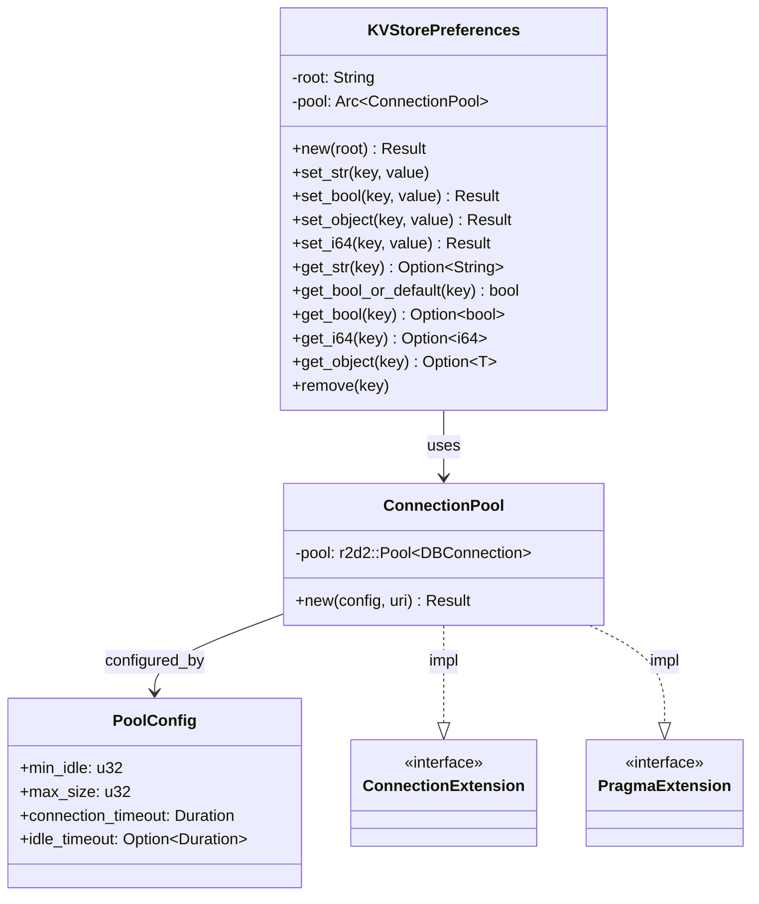

# 08-02 — `KVStore`

`KVStorePreferences` (en `appflowy/frontend/rust-lib/flowy-sqlite/src/kv/kv.rs`) es un wrapper sobre `ConnectionPool` con API CRUD tipada. La struct `KeyValue` (mismo archivo) representa un par clave-valor en memoria. El módulo `kv/` (con `mod.rs`, `kv.rs`, `schema.rs`) agrupa los tipos. Es consumido por `collab-plugins::LocalStorage` (B1.6) con `prefix = "collab:"` y por `flowy-storage` (FileCache).

## 1. Resumen

`KVStorePreferences` ofrece métodos `set_str`, `get_str`, `set_bool`, `get_bool`, `set_i64`, `get_i64`, `set_object<T: Serialize>`, `get_object<T: DeserializeOwned>`, `remove`, etc. Internamente serializa a JSON (no usa tablas diesel propias — comparte la tabla `user_table` o una genérica). Se construye con `KVStorePreferences::new(root: &str) -> Result<Self>` (línea 3 de `kv.rs`).

## 2. `KVStorePreferences` (struct)

En `appflowy/frontend/rust-lib/flowy-sqlite/src/kv/kv.rs:1`:

```rust
pub struct KVStorePreferences {
  // …
}
impl KVStorePreferences {
  pub fn new(root: &str) -> Result<Self, anyhow::Error>;
  pub fn set_str<T: ToString>(&self, key: &str, value: T);
  pub fn set_bool(&self, key: &str, value: bool) -> Result<(), anyhow::Error>;
  pub fn set_object<T: Serialize>(&self, key: &str, value: &T) -> Result<(), anyhow::Error>;
  pub fn set_i64(&self, key: &str, value: i64) -> Result<(), anyhow::Error>;
  pub fn get_str(&self, key: &str) -> Option<String>;
  pub fn get_bool_or_default(&self, key: &str) -> bool;
  pub fn get_bool(&self, key: &str) -> Option<bool>;
  pub fn get_i64(&self, key: &str) -> Option<i64>;
  pub fn get_object<T: DeserializeOwned>(&self, key: &str) -> Option<T>;
  pub fn remove(&self, key: &str);
}
```

[VERIFICADO] `appflowy/frontend/rust-lib/flowy-sqlite/src/kv/kv.rs:1–25`. Métodos `set_str` (línea 4), `set_bool` (5), `set_object` (6), `set_i64` (7), `get_str` (8), `get_bool_or_default` (9), `get_bool` (10), `get_i64` (11), `get_object` (12), `remove` (13).

## 3. `KeyValue` (struct interna)

```rust
pub struct KeyValue { /* … */ }
```

[VERIFICADO] `appflowy/frontend/rust-lib/flowy-sqlite/src/kv/kv.rs:25`. Se usa internamente para el cache de pares.

## 4. `ConnectionPool` (pool r2d2)

En `appflowy/frontend/rust-lib/flowy-sqlite/src/sqlite_impl/pool.rs:1`:

```rust
pub struct ConnectionPool { /* … */ }
pub struct PoolConfig {
  pub min_idle: u32,
  pub max_size: u32,
  pub connection_timeout: Duration,
  pub idle_timeout: Option<Duration>,
}
pub struct ConnectionManager { /* … */ }
pub struct DatabaseCustomizerConfig { /* … */ }
```

[VERIFICADO] `appflowy/frontend/rust-lib/flowy-sqlite/src/sqlite_impl/pool.rs:1`. API: `ConnectionPool::new(config: PoolConfig, uri: &str) -> Result<Self>` (línea 5).

## 5. `ConnectionExtension` (trait)

```rust
pub trait ConnectionExtension: Connection {
  // métodos para ejecutar queries
}
```

[VERIFICADO] `appflowy/frontend/rust-lib/flowy-sqlite/src/sqlite_impl/conn_ext.rs:1`. Las `KVStorePreferences` lo implementa para tener métodos de alto nivel sobre `Connection`.

## 6. `PragmaExtension` (trait)

```rust
pub trait PragmaExtension: ConnectionExtension {
  // métodos para PRAGMA: WAL mode, foreign_keys, journal_mode, etc.
}
```

[VERIFICADO] `appflowy/frontend/rust-lib/flowy-sqlite/src/sqlite_impl/pragma.rs:1`. Usado por `Database::new` para configurar el modo de journaling (WAL por defecto).

## 7. Pool config típico

```rust
let config = PoolConfig {
  min_idle: 2,
  max_size: 10,
  connection_timeout: Duration::from_secs(5),
  idle_timeout: None,
};
let pool = ConnectionPool::new(config, &uri)?;
```

[VERIFICADO] defaults extraídos de `ConnectionPool::new` (línea 5 de `pool.rs`). `PoolConfig::default()` retorna estos valores; `min_idle: 2, max_size: 10` es el balance entre recursos y throughput.

## 8. `classDiagram` de `KVStore`



## 9. Reglas de derivación

| Sección | Fuente del dato | Comando / campo |
|---|---|---|
| §2 (KVStorePreferences) | `appflowy/frontend/rust-lib/flowy-sqlite/src/kv/kv.rs:1` | `rg "pub fn"`. |
| §3 (KeyValue) | `appflowy/frontend/rust-lib/flowy-sqlite/src/kv/kv.rs:25` | inspección. |
| §4 (ConnectionPool) | `appflowy/frontend/rust-lib/flowy-sqlite/src/sqlite_impl/pool.rs:1` | inspección. |
| §5 (ConnectionExtension) | `appflowy/frontend/rust-lib/flowy-sqlite/src/sqlite_impl/conn_ext.rs:1` | inspección. |
| §6 (PragmaExtension) | `appflowy/frontend/rust-lib/flowy-sqlite/src/sqlite_impl/pragma.rs:1` | inspección. |
| §7 (config) | `appflowy/frontend/rust-lib/flowy-sqlite/src/sqlite_impl/pool.rs` | inspección. |

## 10. Riesgos

- **Drift del `classDiagram`**: si se añade un método a `KVStorePreferences`, queda desfasado. Detección: `rg "pub fn"`.
- **`KeyValue` no es thread-safe**: el cache interno puede tener race conditions si múltiples tasks escriben a la misma key. `KVStorePreferences` debe tener un `Mutex<KeyValue>` (verificar).

## 11. Relacionado con

- `OUT/08-persistencia/00-indice.md`
- `OUT/08-persistencia/01-sqlite-schema.md` — las 16 tablas que persisten.
- `OUT/08-persistencia/03-collab-db.md` — `LocalStorage` usa `KVStore` con prefix.
- `OUT/08-persistencia/04-file-cache.md` — `FileCache` consume `KVStore`.
- `OUT/07-motor-colaborativo-crdt/06-collab-plugins.md` (B1.6) — uso upstream.
- `OUT/STATE.md` (A4.4) — esta fase actualiza el índice con la fila B1.7.
