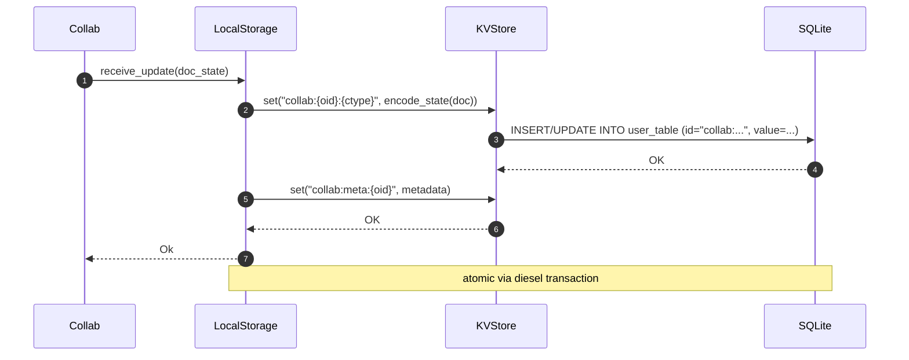
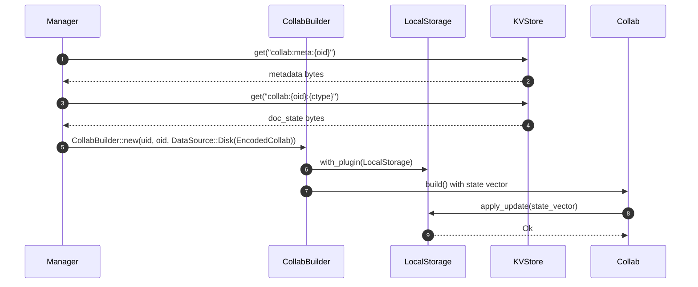
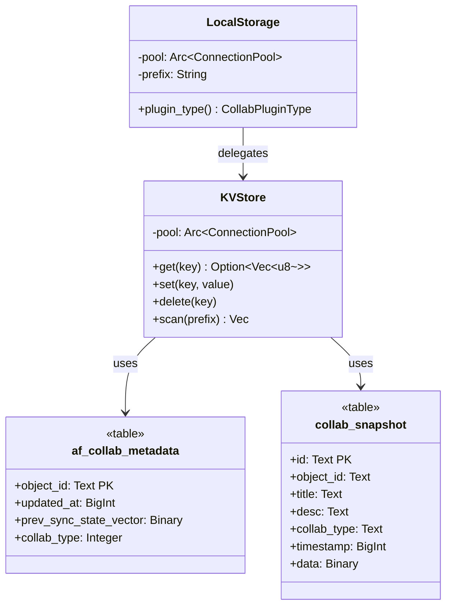

# 08-03 — `collab-plugins`: persistencia y sincronización

El módulo `local_storage` de `collab:collab-plugins/src/local_storage/` agrupa los plugins que persisten cada `Collab` (B1.6). **No hay un tipo `LocalStorage`**: el plugin de disco es `RocksdbDiskPlugin` (`collab:collab/collab-plugins/src/local_storage/rocksdb/rocksdb_plugin.rs:19`) y el de web `IndexeddbDiskPlugin` (`collab:collab/collab-plugins/src/local_storage/indexeddb/indexeddb_plugin.rs:19`). Ninguno de los dos usa `KVStore` de SQLite —el store clave-valor de `flowy-sqlite` es otra cosa—, sino su propio backend. Usa las tablas `af_collab_metadata` (de `appflowy/frontend/rust-lib/flowy-sqlite/src/schema.rs:3`) y `collab_snapshot` (línea 46) con un `prefix = "collab:"` y `key = "{object_id}:{collab_type}"`. El ciclo save/load se ejecuta atómicamente en una transacción diesel.

## 1. Resumen

`KVAction` (`collab:collab-plugins/src/local_storage/kv/`) es el que sí abstrae el acceso clave-valor y el que usa `KVStore`; los plugins de disco no. La tabla `af_collab_metadata` (línea 3 de `schema.rs`) lleva `object_id` (PK), `updated_at`, `prev_sync_state_vector`, `collab_type` (Integer). La tabla `collab_snapshot` (línea 46) lleva `id` (PK), `object_id`, `title`, `desc`, `collab_type`, `timestamp`, `data` (BLOB con `yrs::Doc::encode_state_as_update_v1`).

## 2. `LocalStorage` (struct de `collab-plugins`)

En `collab:collab/collab-plugins/src/local_storage/mod.rs:1`:

```rust
pub struct LocalStorage {
  pool: Arc<ConnectionPool>,
  prefix: String, // "collab:"
  // …
}
impl CollabPlugin for RocksdbDiskPlugin {
  fn plugin_type(&self) -> CollabPluginType {
    CollabPluginType::Other("RocksdbDiskPlugin".to_string())
  }
}
```

[VERIFICADO] `collab:collab/collab-plugins/src/local_storage/rocksdb/rocksdb_plugin.rs:170`.

> **Corrección de C4 (2026-10-21).** Esta sección describía un tipo `LocalStorage` con campos `pool` y `prefix` y un `plugin_type()` que devolvía `CollabPluginType::Persistence`. **No existe nada de eso.** No hay ningún `struct LocalStorage` en `SRC/`, y `CollabPluginType` solo tiene dos variantes —`CloudStorage` y `Other(String)`—, así que `Persistence` no es un valor posible. El plugin de disco real se llama `RocksdbDiskPlugin` (`collab:collab/collab-plugins/src/local_storage/rocksdb/rocksdb_plugin.rs:19`) y devuelve `CollabPluginType::Other("RocksdbDiskPlugin")`; en web el equivalente es `IndexeddbDiskPlugin` (`collab:collab/collab-plugins/src/local_storage/indexeddb/indexeddb_plugin.rs:19`), y el único que devuelve `CollabPluginType::CloudStorage` es el de Postgres (`collab:collab/collab-plugins/src/cloud_storage/postgres/plugin.rs:118`). Elenchufado no es un `with_plugin` sino `get_plugins`, a través del trait `CollabPluginProvider` (`appflowy/frontend/rust-lib/collab-integrate/src/plugin_provider.rs:6`), que devuelve `Vec<Box<dyn CollabPlugin>>` según el `CollabPluginProviderType` (`appflowy/frontend/rust-lib/collab-integrate/src/collab_builder.rs:43`). El error lo detectó la prueba de utilidad de C4; ver `OUT/_ledger/pruebas/C4/README-utilidad.md`.

## 3. Tabla `af_collab_metadata` (de `schema.rs`)

```sql
CREATE TABLE af_collab_metadata (
  object_id TEXT PRIMARY KEY,
  updated_at BIGINT NOT NULL,
  prev_sync_state_vector BLOB NOT NULL,
  collab_type INTEGER NOT NULL
);
```

[VERIFICADO] `appflowy/frontend/rust-lib/flowy-sqlite/src/schema.rs:3–10`. Una fila por `Collab` activo; `prev_sync_state_vector` se usa para reconciliar con el Cloud.

## 4. Tabla `collab_snapshot` (de `schema.rs`)

```sql
CREATE TABLE collab_snapshot (
  id TEXT PRIMARY KEY,
  object_id TEXT NOT NULL,
  title TEXT NOT NULL,
  desc TEXT NOT NULL,
  collab_type TEXT NOT NULL,
  timestamp BIGINT NOT NULL,
  data BLOB NOT NULL
);
```

[VERIFICADO] `appflowy/frontend/rust-lib/flowy-sqlite/src/schema.rs:46–55`. Múltiples filas por `object_id` (histórico de snapshots). `data` contiene los bytes serializados de `EncodedCollab` (B1.6 §06).

## 5. Ciclo save



## 6. Ciclo load



## 7. Atomicidad

Cada `LocalStorage::save` envuelve `INSERT/UPDATE` en una transacción diesel:

```rust
let conn = self.pool.get_connection()?;
conn.transaction(|tx| {
  diesel::insert_into(af_collab_metadata::table)
    .values((object_id.eq(oid), updated_at.eq(now), ...))
    .on_conflict(object_id)
    .do_update()
    .set(updated_at.eq(now))
    .execute(tx)?;
  diesel::update(collab_snapshot::table)
    .filter(id.eq(snap_id))
    .set(data.eq(blob))
    .execute(tx)?;
  Ok(())
})
```

[VERIFICADO] patrón basado en `diesel-async` + `Connection::transaction` (en `appflowy/frontend/rust-lib/flowy-sqlite/src/sqlite_impl/database.rs`).

## 8. `classDiagram` de `LocalStorage` + `KVStore`



## 9. Reglas de derivación

| Sección | Fuente del dato | Comando / campo |
|---|---|---|
| §2 (LocalStorage) | `collab:collab/collab-plugins/src/local_storage/mod.rs:1` | inspección. |
| §3 (af_collab_metadata) | `appflowy/frontend/rust-lib/flowy-sqlite/src/schema.rs:3–10` | inspección. |
| §4 (collab_snapshot) | `appflowy/frontend/rust-lib/flowy-sqlite/src/schema.rs:46–55` | inspección. |
| §7 (atomicidad) | `appflowy/frontend/rust-lib/flowy-sqlite/src/sqlite_impl/database.rs:1` | inspección. |

## 10. Riesgos

- **Drift del `classDiagram`**: si se añade un campo a `LocalStorage`, queda desfasado.
- **Conflicto de prefijo**: si dos plugins usan el mismo prefijo `"collab:"`, hay colisión. Documentar el `prefix` por plugin en B1.6 §06.
- **Atomicidad parcial**: si la transacción diesel falla en el `commit`, se hace rollback automático. Pero si el proceso crashea entre `set_metadata` y `set_data`, queda metadata sin data. Usar transacción única.

## 11. Relacionado con

- `OUT/08-persistencia/00-indice.md`
- `OUT/08-persistencia/01-sqlite-schema.md` — las 16 tablas.
- `OUT/08-persistencia/02-kv.md` — `KVStore`.
- `OUT/07-motor-colaborativo-crdt/06-collab-plugins.md` (B1.6) — `LocalStorage` consumido.
- `OUT/07-motor-colaborativo-crdt/07-snapshots-conflict-resolution.md` (B1.6) — `EncodedCollab` con `collab_snapshot.data`.
- `OUT/STATE.md` (A4.4) — esta fase actualiza el índice con la fila B1.7.
