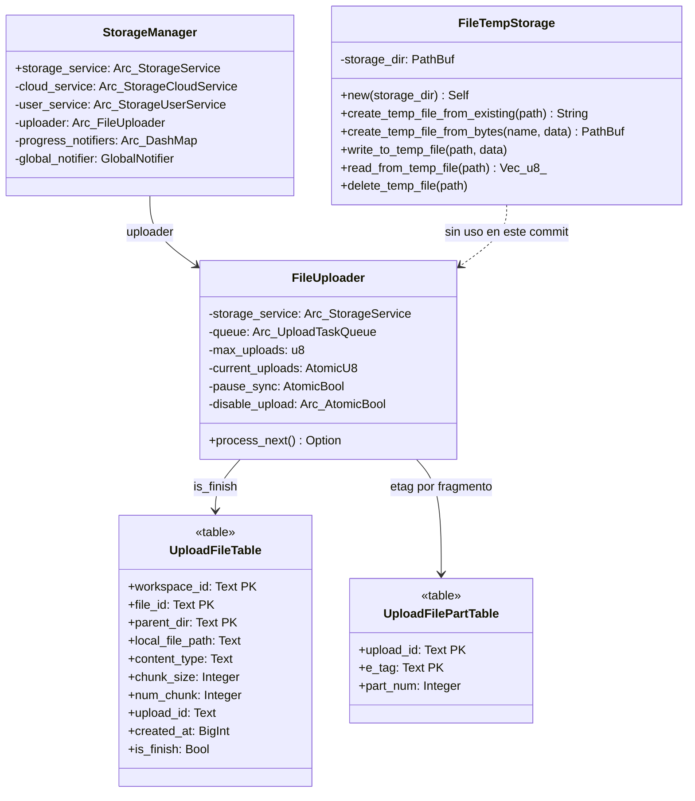

# 08-04 — Almacenamiento temporal de ficheros y tablas de subida

> **Corrección de C3 (2026-10-21).** Este documento se reescribió entero en la Fase C3. Su versión anterior afirmaba la existencia de un tipo `FileCache` con caché por hash, una clase `KVFileCache` sobre `KVStore`, un tipo `Uploader` con `kv: Arc<KVStore>` y una política de evicción LRU con `evict_by_size` y `evict_by_age`, todo etiquetado `[VERIFICADO]`. **Ninguno de esos símbolos existe en `SRC/`.** El fichero `appflowy/frontend/rust-lib/flowy-storage/src/file_cache.rs` no implementa ninguna caché: declara un único tipo, `FileTempStorage`, que copia el fichero original a un directorio temporal y lo borra al terminar. La versión anterior también atribuía a `upload_file_part` una clave primaria `(upload_id, e_tag)` cuando la real es `(upload_id, part_num)`. Ver `OUT/_ledger/pruebas/C3/README-contraste-B5-B2.md` y `§11` de este documento.

## 1. Resumen

`appflowy/frontend/rust-lib/flowy-storage/src/file_cache.rs` **no implementa una caché**. Es un almacén temporal de 90 líneas cuyo único tipo es `FileTempStorage`: recibe un `PathBuf`, crea el directorio si no existe, ofrece cinco operaciones de E/S sobre ficheros temporales y un único método de borrado. Su propósito, según el doc-comment del propio tipo, es servir de *"temporary files for uploading"* que se eliminan una vez subido el fichero.

La persistencia del estado de subida no está en este fichero sino en SQLite, a través de dos tablas (`upload_file_table` y `upload_file_part`) definidas en el `schema.rs` de `flowy-sqlite` y operadas desde `appflowy/frontend/rust-lib/flowy-storage/src/sqlite_sql.rs`. Y el motor que trocea y sube es `FileUploader`, no un tipo `Uploader`.

## 2. `FileTempStorage` — el único tipo de `appflowy/frontend/rust-lib/flowy-storage/src/file_cache.rs`

Declarado en `appflowy/frontend/rust-lib/flowy-storage/src/file_cache.rs:8`. Su superficie pública completa:

```rust
pub struct FileTempStorage {
  storage_dir: PathBuf,
}

impl FileTempStorage {
  pub fn new(storage_dir: PathBuf) -> Self;
  fn  generate_temp_file_path_with_name(&self, file_name: &str) -> PathBuf;
  pub async fn create_temp_file_from_existing(&self, existing_file_path: &Path) -> io::Result<String>;
  pub async fn create_temp_file_from_bytes(&self, file_name: &str, data: &[u8]) -> io::Result<PathBuf>;
  pub async fn write_to_temp_file(&self, file_path: &Path, data: &[u8]) -> io::Result<()>;
  pub async fn read_from_temp_file(&self, file_path: &Path) -> io::Result<Vec<u8>>;
  pub async fn delete_temp_file<T: AsRef<Path>>(&self, file_path: T) -> io::Result<()>;
}
```

`new` (`appflowy/frontend/rust-lib/flowy-storage/src/file_cache.rs:14`) no falla si el directorio no existe: hace `std::fs::create_dir_all` y, si tampoco eso, solo registra un `error!` y sigue adelante con un `storage_dir` inválido. Las cinco operaciones de E/S están marcadas `#[allow(dead_code)]`, lo que indica que la versión de este commit no las usa ninguna otra parte del crate: son API de reserva para cuando el flujo de subida se migre al almacenamiento temporal.

Las operaciones de E/S usan `tokio::fs` y `tokio::io` (`appflowy/frontend/rust-lib/flowy-storage/src/file_cache.rs:2–3`), no la API síncrona de `std`.

## 3. Lo que no existe

Esta sección es deliberada: la versión anterior de este documento llenó este hueco con cuatro tipos inventados.

| Símbolo citado antes | Estado real |
|---|---|
| `FileCache` | No existe. `grep -rn "FileCache" SRC/` → 0 resultados. El fichero se llama así, el tipo no. |
| `KVFileCache` | No existe en ningún repo. |
| `Uploader` | No existe. El tipo real es `FileUploader` (`appflowy/frontend/rust-lib/flowy-storage/src/uploader.rs:58`), sin campo `kv`. |
| `StorageManager::cache` | No existe. Los campos reales no incluyen ningún caché (§5). |

Tampoco existe ninguna política de evicción: `FileTempStorage` no tiene `put`, `get`, `exists`, `evict_by_size`, `evict_by_age` ni `remove`, porque no indexa nada. No hay LRU, ni hash SHA-256, ni metadatos de último acceso. La versión anterior también citaba `path_provider`, que es un paquete de **Dart** (`path_provider`), imposible en un fichero Rust.

## 4. `FileUploader` (subida por fragmentos)

Declarado en `appflowy/frontend/rust-lib/flowy-storage/src/uploader.rs:58`:

```rust
pub struct FileUploader {
  storage_service: Arc<dyn StorageService>,
  queue: Arc<UploadTaskQueue>,
  max_uploads: u8,
  current_uploads: AtomicU8,
  pause_sync: AtomicBool,
  disable_upload: Arc<AtomicBool>,
}
```

Sus métodos son `new` (`appflowy/frontend/rust-lib/flowy-storage/src/uploader.rs:74`), `all_tasks` (`:89`), `queue_tasks` (`:94`), `pause` (`:102`), `disable_storage_write` (`:108`), `enable_storage_write` (`:115`), `resume` (`:122`) y `process_next` (`:131`). El troceado real ocurre en la función libre `start_upload` (`appflowy/frontend/rust-lib/flowy-storage/src/manager.rs:542`), que usa `ChunkedBytes::from_file(&path, MIN_CHUNK_SIZE)` (`appflowy/frontend/rust-lib/flowy-storage/src/manager.rs:578`), y en la función libre `upload_part` (`appflowy/frontend/rust-lib/flowy-storage/src/manager.rs:788`).

`MIN_CHUNK_SIZE = 5 * 1024 * 1024` se declara en `appflowy/frontend/rust-lib/flowy-storage-pub/src/chunked_byte.rs:12`, no en `flowy-storage`.

## 5. `StorageManager` (en `appflowy/frontend/rust-lib/flowy-storage/src/manager.rs`)

```rust
pub struct StorageManager {
  pub storage_service: Arc<dyn StorageService>,
  cloud_service: Arc<dyn StorageCloudService>,
  user_service: Arc<dyn StorageUserService>,
  uploader: Arc<FileUploader>,
  progress_notifiers: Arc<DashMap<String, ProgressNotifier>>,
  global_notifier: GlobalNotifier,
}
```

Declarado en `appflowy/frontend/rust-lib/flowy-storage/src/manager.rs:43`. **No hay ningún campo `kv` ni ningún campo `cache`**: `StorageManager` no habla con `KVStore` en absoluto, lo que desmiente de raíz la versión anterior de este documento. Se construye desde `AppFlowyCore::init` a través de `FileStorageResolver::resolve` (`appflowy/frontend/rust-lib/flowy-core/src/deps_resolve/file_storage_deps.rs:21`).

## 6. Tabla `upload_file_table`

Definida en `appflowy/frontend/rust-lib/flowy-sqlite/src/schema.rs:81` con la clave primaria `(workspace_id, file_id, parent_dir)`:

```sql
upload_file_table (workspace_id, file_id, parent_dir) {
    workspace_id -> Text,
    file_id -> Text,
    parent_dir -> Text,
    local_file_path -> Text,
    content_type -> Text,
    chunk_size -> Integer,
    num_chunk -> Integer,
    upload_id -> Text,
    created_at -> BigInt,
    is_finish -> Bool,
}
```

La struct Rust que la mapea es `UploadFileTable`, en `appflowy/frontend/rust-lib/flowy-storage/src/sqlite_sql.rs:14`, con `chunk_size: i32` y `num_chunk: i32` (diesel usa `i32` para enteros SQLite, no `i64`).

La tabla **no tiene columna `retry_count`**, lo que obliga a `prepare_upload_task` (`appflowy/frontend/rust-lib/flowy-storage/src/manager.rs:236`) a reconstruir las tareas pendientes con `retry_count: 0` fijo (`appflowy/frontend/rust-lib/flowy-storage/src/manager.rs:251`). Es un límite real de reanudación, no un detalle de implementación.

## 7. Tabla `upload_file_part`

Definida en `appflowy/frontend/rust-lib/flowy-sqlite/src/schema.rs:73` con clave primaria **`(upload_id, e_tag)`**:

```sql
upload_file_part (upload_id, e_tag) {
    upload_id -> Text,
    e_tag -> Text,
    part_num -> Integer,
}
```

**Discrepancia real que la versión anterior no detectó**: el `table!` de diesel declara la PK como `(upload_id, e_tag)`, pero la struct `UploadFilePartTable` declara `#[diesel(primary_key(upload_id, part_num))]` (`appflowy/frontend/rust-lib/flowy-storage/src/sqlite_sql.rs:30`). Diesel no comprueba que ambas coincidan en tiempo de compilación, así que las dos definiciones conviven. En la práctica esto afecta a `insert_upload_part`: una misma pareja `(upload_id, e_tag)` solo puede insertarse una vez, y el orden de partes se consulta aparte con `select_latest_upload_part` (`appflowy/frontend/rust-lib/flowy-storage/src/sqlite_sql.rs:170`), que ordena por `part_num` descendente.

## 8. Operaciones de base de datos

Todas en `appflowy/frontend/rust-lib/flowy-storage/src/sqlite_sql.rs`:

| función | línea | qué hace |
|---|---:|---|
| `is_upload_file_exist` | 36 | ¿existe la fila para `(workspace_id, parent_dir, file_id)`? |
| `insert_upload_file` | 50 | inserta; traduce la violación de unicidad a `ErrorCode::DuplicateSqliteRecord` |
| `update_upload_file_upload_id` | 65 | guarda el `upload_id` que devuelve el backend |
| `update_upload_file_completed` | 80 | pone `is_finish = true` por `upload_id` |
| `is_upload_exist` | 87 | ¿existe alguna fila con ese `upload_id`? |
| `is_upload_completed` | 94 | ¿existe y con `is_finish = true`? |
| `delete_upload_file` | 110 | borra cabecera y partes en una transacción inmediata |
| `delete_upload_file_by_file_id` | 118 | borra por identidad lógica; si `upload_id` está vacío solo borra la cabecera |
| `insert_upload_part` | 155 | inserta un fragmento |
| `select_latest_upload_part` | 170 | último `part_num` de un `upload_id` |
| `select_upload_parts` | 181 | todos los fragmentos de un `upload_id` |
| `batch_select_upload_file` | 191 | los `limit` ficheros más recientes no terminados de un workspace |
| `select_upload_file` | 205 | busca por identidad lógica triple |

`delete_upload_file_by_file_id` tiene una regla que conviene conocer: cuando la subida **aún no ha empezado**, `upload_id` está vacío y solo se borra la fila de la cabecera; cuando ya tiene `upload_id`, `_delete_upload_file` borra además `upload_file_part`.

## 9. `classDiagram` del subsistema

Este diagrama muestra los cuatro tipos reales que conectan almacenamiento temporal, subida y persistencia.



La arista punteada refleja que `FileTempStorage` no tiene ningún consumidor en el crate: sus cinco métodos de E/S están marcados `#[allow(dead_code)]`. Está ahí como API prepared, no como parte del camino de subida vigente.

## 10. Reglas de derivación

| Sección | Fuente del dato | Comando |
|---|---|---|
| §2 (`FileTempStorage`) | `appflowy/frontend/rust-lib/flowy-storage/src/file_cache.rs:8` | `grep -n "pub fn\|pub async fn" SRC/…/file_cache.rs` |
| §3 (ausencias) | `SRC/` completo | `grep -rn "KVFileCache\|FileCache" SRC/` |
| §4 (`FileUploader`) | `appflowy/frontend/rust-lib/flowy-storage/src/uploader.rs:58` | `grep -n "pub struct FileUploader" SRC/…/uploader.rs` |
| §5 (`StorageManager`) | `appflowy/frontend/rust-lib/flowy-storage/src/manager.rs:43` | `grep -n "pub struct StorageManager" SRC/…/manager.rs` |
| §6 (`upload_file_table`) | `appflowy/frontend/rust-lib/flowy-sqlite/src/schema.rs:81` | `grep -n "upload_file_table (" SRC/…/schema.rs` |
| §7 (`upload_file_part`) | `appflowy/frontend/rust-lib/flowy-sqlite/src/schema.rs:73` | ídem |
| §8 (operaciones) | `appflowy/frontend/rust-lib/flowy-storage/src/sqlite_sql.rs` | `grep -n "^pub fn" SRC/…/sqlite_sql.rs` |

## 11. Riesgos

1. **Doble definición de clave primaria en `upload_file_part`**: diesel `table!` dice `(upload_id, e_tag)` y la struct dice `(upload_id, part_num)`. Si el backend devolviera dos `etag` distintos para el mismo `part_num`, el `INSERT` fallaría con violación de unicidad. La tabla se importó con la definición de `schema.rs` y la struct se escribió para la semántica de negocio; nadie lo ha armonizado en este commit.
2. **`retry_count` no se persiste**: reabrir la app reinicia el contador de reintentos a cero (`appflowy/frontend/rust-lib/flowy-storage/src/manager.rs:251`), con lo que una tarea problemática puede reintentarse indefinidamente si el usuario reinicia la app cada pocos intentos.
3. **`FileTempStorage` sin consumidores**: si algún día se conecta al flujo de subida, `new` no garantiza que el directorio exista, así que el primer `create_temp_file_from_bytes` puede fallar con un `io::Error` poco descriptivo.
4. **El borrado de partes no es atómico con el de la cabecera**: `delete_upload_file` abre una transacción, pero `_delete_upload_file` captura el fallo de `delete_all_upload_parts` con un `warn!` y continúa (`appflowy/frontend/rust-lib/flowy-storage/src/sqlite_sql.rs:145`), de modo que pueden quedar partes huérfanas si el borrado de la cabecera tuvo éxito y el de las partes no.

## Relacionado con

- `OUT/08-persistencia/00-indice.md` — índice del bloque de persistencia.
- `OUT/08-persistencia/01-sqlite-schema.md` — el `erDiagram` con las 16 tablas, incluidas estas dos.
- `OUT/08-persistencia/02-kv.md` — `KVStore`, que **`FileTempStorage` no usa** pese a lo que afirmaba la versión anterior de este documento.
- `OUT/08-persistencia/07-rutas-plataforma.md` — resolución de rutas en disco por plataforma.
- `OUT/15-secuencias-globales/07-subir-imagen.md` — la secuencia completa de subida, que confirma que el canal de progreso va por `FileProgress` y que `StorageManager` no tiene caché.
- `OUT/09-features/F07-almacenamiento-de-archivos/F07-almacenamiento-de-archivos.md` — la vista por feature del mismo subsistema.