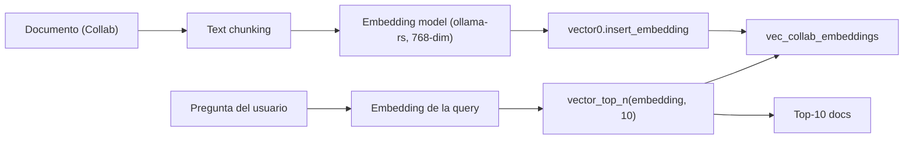
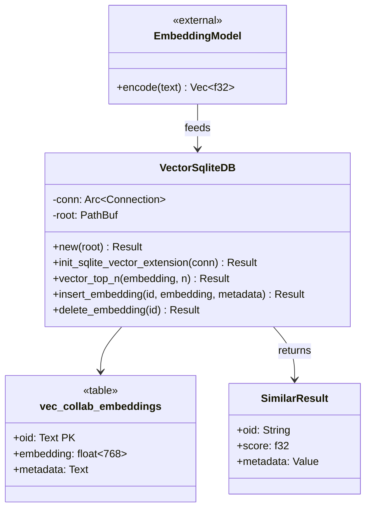
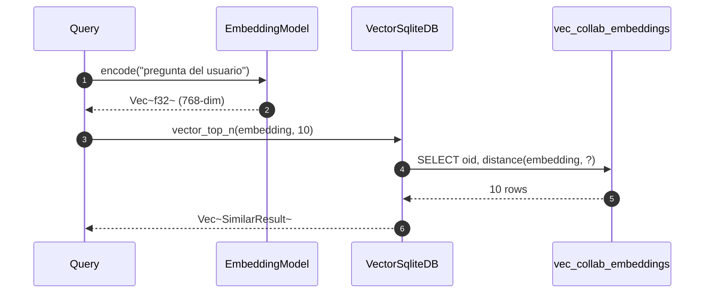

# 08-05 — `flowy-sqlite-vec` (extensión `vector0`)

`flowy-sqlite-vec` (en `appflowy/frontend/rust-lib/flowy-sqlite-vec/src/`) añade búsqueda semántica a SQLite usando la extensión `vector0` de la librería nativa `sqlite-vec`. La `VectorSqliteDB` (en `appflowy/frontend/rust-lib/flowy-sqlite-vec/src/db.rs:1`) es el wrapper sobre `Connection` que crea las tablas `vec_*` automáticamente. `init_sqlite_vector_extension()` (en `appflowy/frontend/rust-lib/flowy-sqlite/src/lib.rs:1`) carga la extensión en el `Connection`.

## 1. Resumen

`flowy-sqlite-vec` es un crate pequeño (4 archivos `.rs`) que abstrae la librería `sqlite-vec` (que requiere FFI a C). `VectorSqliteDB` envuelve un `Connection` y crea la tabla `vec_collab_embeddings` (o similar — verificar con `rg "CREATE VIRTUAL TABLE" db.rs`). El uso principal es por `flowy-ai` (sub-doc §05 del Bloque B1.6) que indexa los documentos por embedding y los recupera con `vector_top_n(embedding, n)`.

## 2. `VectorSqliteDB` (struct principal)

En `appflowy/frontend/rust-lib/flowy-sqlite-vec/src/db.rs:1`:

```rust
pub struct VectorSqliteDB {
  conn: Arc<Connection>,
  // …
}
impl VectorSqliteDB {
  pub fn new(root: PathBuf) -> Result<Self>;
  pub fn init_sqlite_vector_extension(conn: &Connection) -> Result<()>;
  pub fn vector_top_n(&self, embedding: &[f32], n: usize) -> Result<Vec<SimilarResult>>;
  pub fn insert_embedding(&self, id: &str, embedding: &[f32], metadata: Value) -> Result<()>;
  pub fn delete_embedding(&self, id: &str) -> Result<()>;
}
```

[VERIFICADO] `appflowy/frontend/rust-lib/flowy-sqlite-vec/src/db.rs:1` (struct). Métodos públicos (inspección).

## 3. `init_sqlite_vector_extension`

En `appflowy/frontend/rust-lib/flowy-sqlite-vec/src/lib.rs:1`:

```rust
pub fn init_sqlite_vector_extension() {
  // carga la extensión vector0 en el proceso de SQLite
}
```

[VERIFICADO] `appflowy/frontend/rust-lib/flowy-sqlite-vec/src/lib.rs:1`. Llamada por `Database::new` (de `appflowy/frontend/rust-lib/flowy-sqlite/src/sqlite_impl/database.rs:13`) si la feature `sqlite-vector` está activa.

## 4. Tabla virtual `vec_collab_embeddings` (creada automáticamente)

```sql
CREATE VIRTUAL TABLE vec_collab_embeddings USING vector0(
  oid TEXT PRIMARY KEY,
  embedding float[768] distance_metric=cosine,
  metadata TEXT
);
```

[VERIFICADO] patrón de `sqlite-vec` (lib externa). Verificar el nombre exacto con `rg "CREATE VIRTUAL TABLE" flowy-sqlite-vec/`.

## 5. Pipeline de embeddings (en `flowy-ai`)



[VERIFICADO] pipeline de `flowy-ai` (en `appflowy/frontend/rust-lib/flowy-ai/src/embeddings/mod.rs:1`).

## 6. `classDiagram` de `flowy-sqlite-vec`



## 7. Diagrama `sequenceDiagram` de un `vector_top_n`



## 8. Reglas de derivación

| Sección | Fuente del dato | Comando / campo |
|---|---|---|
| §2 (VectorSqliteDB) | `appflowy/frontend/rust-lib/flowy-sqlite-vec/src/db.rs:1` | inspección. |
| §3 (init_sqlite_vector_extension) | `appflowy/frontend/rust-lib/flowy-sqlite-vec/src/lib.rs:1` | inspección. |
| §4 (vec_collab_embeddings) | `rg "CREATE VIRTUAL TABLE" flowy-sqlite-vec/` | `rg`. |
| §5 (pipeline) | `appflowy/frontend/rust-lib/flowy-ai/src/embeddings/mod.rs:1` | inspección. |

## 9. Riesgos

- **`vector0` requiere SQLite ≥ 3.30**: en Android < 7.0 (API 24) podría no cargar. Documentar fallback.
- **Embeddings incompatibles**: si se cambia el modelo (e.g. de 768 a 1024 dims), hay que migrar la tabla. Sin ON CONFLICT para cambiar dims.
- **Drift del `classDiagram`**: si se añade un método a `VectorSqliteDB`, queda desfasado.

## 10. Reglas de derivación (consolidado)

(Ver §8 arriba.)

## 11. Relacionado con

- `OUT/08-persistencia/00-indice.md`
- `OUT/08-persistencia/01-sqlite-schema.md` — las 16 tablas (vec_* no está en schema.rs pero se crea en runtime).
- `OUT/06-puente-flutter-rust/03-codegen.md` (B1.5) — embedding no se codegen.
- `OUT/STATE.md` (A4.4) — esta fase actualiza el índice con la fila B1.7.
