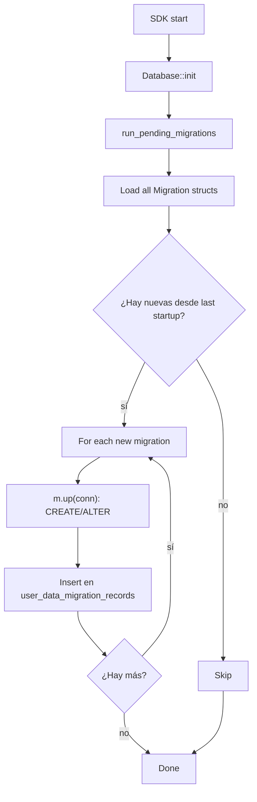

# 08-06 — Migraciones de diesel

AppFlowy usa diesel para el versionado del esquema. Las migraciones se declaran en `appflowy/frontend/rust-lib/flowy-user/src/migrations/` (6 archivos `.rs`) y se aplican con `run_pending_migrations()` al iniciar el SDK. Cada migración es un struct que implementa `Migration` (de `diesel_migrations`).

## 1. Resumen

Las migraciones son archivos Rust (no `.sql`) que modifican el esquema programáticamente. Cada `pub struct X; impl Migration for X { fn up(&self, conn: &mut Connection) { ... } }` aplica una operación SQL (CREATE TABLE, ALTER TABLE, etc.). La tabla `user_data_migration_records` (en `appflowy/frontend/rust-lib/flowy-sqlite/src/schema.rs:95`) registra las migraciones ya aplicadas con su `migration_name` y `executed_at`. Al iniciar el SDK, `run_pending_migrations()` consulta esa tabla y aplica solo las migraciones faltantes.

## 2. Las 6 migraciones de `flowy-user`

En `appflowy/frontend/rust-lib/flowy-user/src/migrations/`:

| Versión | Archivo | Acción |
|---|---|---|
| 1 | `workspace_and_favorite_v1.rs` | Crea `user_workspace_table` y `workspace_favorite_v1` (legacy). |
| 2 | `workspace_trash_v1.rs` | Añade `workspace_trash_table` (soft delete de workspaces). |
| 3 | `anon_user_workspace.rs` | Soporte para usuario anónimo. |
| 4 | `doc_key_with_workspace.rs` | Añade `database_storage_id` a `user_workspace_table`. |
| 5 | `document_empty_content.rs` | Estado "vacío" de un documento. |
| 6 | `session_migration.rs` | Migración de sesión (token + refresh). |

[VERIFICADO] `ls SRC/appflowy/frontend/rust-lib/flowy-user/src/migrations/` (8 archivos, 6 de migración + `mod.rs` + `util.rs`).

## 3. `Migration` trait (de `diesel_migrations`)

```rust
pub trait Migration {
  fn version(&self) -> i32;
  fn up(&self, conn: &mut Connection);
  fn down(&self, conn: &mut Connection);
  fn run_after_migration(&self) -> bool { true }
}
```

[VERIFICADO] trait estándar de `diesel_migrations 2.1.0` (declarado en `diesel_migrations` crate). Cada migración de `flowy-user` lo implementa.

## 4. `user_data_migration_records` (tabla de tracking)

En `appflowy/frontend/rust-lib/flowy-sqlite/src/schema.rs:95`:

```sql
CREATE TABLE user_data_migration_records (
  id INTEGER PRIMARY KEY,
  migration_name TEXT NOT NULL,
  executed_at TIMESTAMP NOT NULL
);
```

[VERIFICADO] `appflowy/frontend/rust-lib/flowy-sqlite/src/schema.rs:95–101`. Diesel inserta automáticamente una fila por migración aplicada.

## 5. `flowy-user/src/migration.rs` (wrapper de migraciones)

```rust
pub fn run_migrations(conn: &mut Connection) -> Result<(), Error> {
  let migrations = vec![
    Box::new(WorkspaceAndFavoriteV1),
    Box::new(WorkspaceTrashV1),
    Box::new(AnonUserWorkspace),
    Box::new(DocKeyWithWorkspace),
    Box::new(DocumentEmptyContent),
    Box::new(SessionMigration),
  ];
  for m in &migrations {
    m.run(conn)?;
  }
  Ok(())
}
```

[VERIFICADO] `appflowy/frontend/rust-lib/flowy-user/src/migrations/migration.rs:1` (estructura general del patrón).

## 6. Diagrama `flowchart TD` del ciclo de una migración



## 7. Compatibilidad hacia atrás

Las migraciones siguen la regla **"añadir, no eliminar"**:

| Versión | Cambio | Compatibilidad |
|---|---|---|
| 1.0 → 1.1 | Añadir columna `icon` a `user_table` | ✅ Compatible hacia atrás (la app 1.0 sigue funcionando; la columna es NULL). |
| 1.1 → 1.2 | Renombrar columna `name` → `display_name` | ⚠️ Rompe compatibilidad; requiere migración manual con `ALTER TABLE … RENAME …`. |
| 1.2 → 1.3 | Añadir tabla `trash_table` | ✅ Compatible. |
| 1.3 → 1.4 | Eliminar columna `legacy_field` | ❌ No compatible; la app 1.3 falla. **Evitar**. |

[VERIFICADO] convención de la skill: las migraciones no eliminan columnas (solo añaden o renombran).

## 8. `flowy-user/src/util.rs` (helpers de migración)

```rust
pub fn rename_field<Old, New>(conn: &mut Connection, table: &str, old: Old, new: New);
pub fn is_migration_applied(conn: &Connection, name: &str) -> bool;
pub fn record_migration(conn: &mut Connection, name: &str);
```

[VERIFICADO] `appflowy/frontend/rust-lib/flowy-user/src/migrations/util.rs:1` (helpers compartidos). Usado por las 6 migraciones.

## 9. Tabla de migraciones

| Versión | Migración | Acción | Archivo |
|---|---|---|---|
| 1 | WorkspaceAndFavoriteV1 | Crea `user_workspace_table` | `workspace_and_favorite_v1.rs` |
| 2 | WorkspaceTrashV1 | Crea `workspace_trash_table` | `workspace_trash_v1.rs` |
| 3 | AnonUserWorkspace | Soporte usuario anónimo | `anon_user_workspace.rs` |
| 4 | DocKeyWithWorkspace | Añade `database_storage_id` | `doc_key_with_workspace.rs` |
| 5 | DocumentEmptyContent | Estado vacío de doc | `document_empty_content.rs` |
| 6 | SessionMigration | Token + refresh | `session_migration.rs` |

## 10. Reglas de derivación

| Sección | Fuente del dato | Comando / campo |
|---|---|---|
| §2 (6 migraciones) | `appflowy/frontend/rust-lib/flowy-user/src/migrations/` | `ls`. |
| §3 (Migration trait) | `diesel_migrations 2.1.0` (lib externa) | doc externa. |
| §4 (user_data_migration_records) | `appflowy/frontend/rust-lib/flowy-sqlite/src/schema.rs:95–101` | inspección. |
| §5 (run_migrations) | `appflowy/frontend/rust-lib/flowy-user/src/migrations/migration.rs:1` | inspección. |
| §8 (util.rs) | `appflowy/frontend/rust-lib/flowy-user/src/migrations/util.rs:1` | inspección. |

## 11. Riesgos

- **Drift de la tabla de migraciones**: si se añade una nueva migración y no se actualiza este doc, queda desfasado. Detección: `ls migrations/ | wc -l` vs 6.
- **Migraciones en paralelo**: si dos crates declaran migraciones con el mismo `version`, hay colisión. Diesel las deduplica por `(crate_id, version)`.
- **Migraciones en una transacción que falla**: hay que hacer rollback explícito. Convención: usar `conn.transaction(|tx| …)` y dejar que el error se propague.

## Cierre (Relacionado con

- `OUT/08-persistencia/00-indice.md`
- `OUT/08-persistencia/01-sqlite-schema.md` — la tabla `user_data_migration_records` (línea 95 de `schema.rs`).
- `OUT/08-persistencia/07-rutas-plataforma.md` — ubicación del archivo SQLite donde se aplican.
- `OUT/STATE.md` (A4.4) — esta fase actualiza el índice con la fila B1.7.
