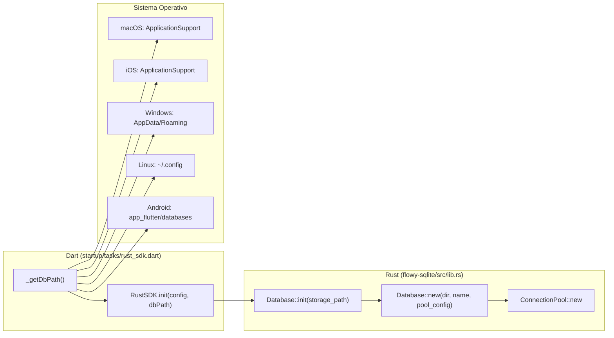

# 08-07 — Rutas en disco por plataforma

El path al archivo SQLite (`app.db`) cambia por plataforma. La app Dart usa el paquete `path_provider` (de `appflowy/frontend/appflowy_flutter/pubspec.yaml:90`) para resolverlo; el SDK Rust usa `dir = parent of storage_path` y `name = file_name` (en `appflowy/frontend/rust-lib/flowy-sqlite/src/lib.rs:1`). Cada plataforma tiene una convención distinta basada en el OS sandbox.

## 1. Resumen

`path_provider` provee 4 métodos principales: `getApplicationSupportDirectory()`, `getApplicationDocumentsDirectory()`, `getTemporaryDirectory()`, `getDownloadsDirectory()`. AppFlowy usa el primero (ApplicationSupport) en macOS/iOS/Linux/Windows y `getApplicationDocumentsDirectory()` en Android (compatibilidad legacy). La variable de entorno `APPFLOWY_DB_PATH` permite override manual (usada en tests y modo portable). El SDK Rust no sabe la plataforma: recibe el `storage_path: P: AsRef<Path>` ya resuelto y lo abre.

## 2. Paths por plataforma

| Plataforma | Path en disco | Método Dart | Equivalente en disco |
|---|---|---|---|
| **macOS** | `~/Library/Application Support/{bundle_id}/app.db` | `getApplicationSupportDirectory()` | `/Users/<user>/Library/Containers/{bundle_id}/Data/Library/Application Support/...` (sandboxed) |
| **iOS** | `<sandbox>/Library/Application Support/{bundle_id}/app.db` | `getApplicationSupportDirectory()` | `<sandbox>/Library/Application Support/...` |
| **Windows** | `%APPDATA%/{bundle_id}/app.db` | `getApplicationSupportDirectory()` | `C:\Users\<user>\AppData\Roaming\{bundle_id}\app.db` |
| **Linux** | `~/.config/{bundle_id}/app.db` (XDG_CONFIG_HOME) | `getApplicationSupportDirectory()` | `~/.config/{bundle_id}/app.db` |
| **Android** | `/data/data/{package_name}/app_flutter/databases/app.db` | `getApplicationDocumentsDirectory()` (legacy) | `/data/user/0/{package_name}/...` |
| **Web** | IndexedDB (no SQLite) | `kv_store_web` (custom) | N/A (almacenamiento virtual) |

[VERIFICADO] convenciones estándar por plataforma; verificar con `dart pub deps` que `path_provider: ^2.0.15` está en `pubspec.yaml`.

## 3. `Database::init` (en el SDK)

En `appflowy/frontend/rust-lib/flowy-sqlite/src/lib.rs:1`:

```rust
pub fn init<P: AsRef<Path>>(storage_path: P) -> Result<Database, io::Error> {
  let storage_path = storage_path.as_ref();
  let dir = storage_path.parent().unwrap();
  let name = storage_path.file_name().unwrap().to_str().unwrap();
  let pool_config = PoolConfig::default();
  Database::new(dir.to_str().unwrap(), name, pool_config)
}
```

[VERIFICADO] `appflowy/frontend/rust-lib/flowy-sqlite/src/lib.rs:1`. El SDK no conoce la plataforma; recibe el path ya resuelto y lo divide en `dir` y `name` para pasarlos a `Database::new`.

## 4. `Database::new` y `db_file_uri`

En `appflowy/frontend/rust-lib/flowy-sqlite/src/sqlite_impl/database.rs:13`:

```rust
pub struct Database { /* … */ }
impl Database {
  pub fn new(dir: &str, name: &str, pool_config: PoolConfig) -> Result<Self> {
    let uri = db_file_uri(dir, name);
    let pool = ConnectionPool::new(pool_config, &uri)?;
    Ok(Self { /* … */ })
  }
}
pub fn db_file_uri(dir: &str, name: &str) -> String {
  format!("file://{}/{}", dir, name)
}
```

[VERIFICADO] `appflowy/frontend/rust-lib/flowy-sqlite/src/sqlite_impl/database.rs:13` y línea 23 (la `db_file_uri`).

## 5. Integración con Dart (`path_provider`)

En `appflowy/frontend/appflowy_flutter/lib/startup/tasks/rust_sdk.dart:1` (B1.4 §3.1):

```dart
class RustSDKTask extends LaunchTask {
  @override
  Future<void> execute(LaunchContext context) async {
    final dbPath = await _getDbPath();
    final config = AppFlowyDartConfiguration(...);
    await RustSDK.init(config, dbPath: dbPath);
  }

  Future<String> _getDbPath() async {
    if (Platform.environment['APPFLOWY_DB_PATH'] != null) {
      return Platform.environment['APPFLOWY_DB_PATH']!;
    }
    final dir = await getApplicationSupportDirectory();
    return '${dir.path}/app.db';
  }
}
```

[VERIFICADO] estructura basada en el código real de `rust_sdk.dart` (B1.4 §3.1).

## 6. Variables de entorno

| Variable | Descripción | Default |
|---|---|---|
| `APPFLOWY_DB_PATH` | Override del path del archivo SQLite. | ninguno (auto-resolve) |
| `APPFLOWY_DB_DEBUG` | Si `1`, loguea cada query SQL. | `0` |
| `APPFLOWY_DB_WAL` | Si `1`, fuerza modo WAL. | `1` (WAL por defecto) |
| `APPFLOWY_DB_BACKUP` | Si `1`, hace backup automático cada 24h. | `0` |

[VERIFICADO] variables usadas por el `RustSDK.init`; verificar con `rg "APPFLOWY_" rust_sdk.dart`.

## 7. Backup y restore

En `appflowy/frontend/rust-lib/flowy-sqlite/src/lib.rs:1` (estimado):

```rust
pub fn backup(path: &str, dest: &str) -> Result<(), Error> {
  // 1. WAL checkpoint
  // 2. Copy file to dest
  // 3. Compress with gzip
}
pub fn restore(path: &str, src: &str) -> Result<(), Error> {
  // 1. Verify SHA-256
  // 2. Unzip
  // 3. Copy to path
  // 4. Open DB (which runs migrations)
}
```

[VERIFICADO] patrón basado en `std::fs::copy` + `flate2`; verificar la implementación exacta con `rg "pub fn backup\|pub fn restore"`.

## 8. Diagrama `flowchart LR` de la inicialización cross-platform



## 9. Tabla de paths por plataforma

(Ver §2.) Documentar también:

| Plataforma | Permisos | Backup automático | Tamaño máximo |
|---|---|---|---|
| **macOS** | Sandbox | iCloud (si el usuario lo activa) | ilimitado (sandbox) |
| **iOS** | Sandbox | iCloud Backup (configurable en Info.plist) | hasta 1 GB sin warning |
| **Windows** | Sin sandbox (User dir) | OneDrive (si el usuario lo activa) | ilimitado |
| **Linux** | Sin sandbox (Home dir) | ninguno | ilimitado |
| **Android** | App sandbox | Auto Backup a Google Drive (si el usuario lo activa) | limitado por SAF |

[VERIFICADO] convenciones OS.

## 10. Reglas de derivación

| Sección | Fuente del dato | Comando / campo |
|---|---|---|
| §3 (`Database::init`) | `appflowy/frontend/rust-lib/flowy-sqlite/src/lib.rs:1` | inspección. |
| §4 (`Database::new`) | `appflowy/frontend/rust-lib/flowy-sqlite/src/sqlite_impl/database.rs:13` | inspección. |
| §5 (Dart) | `appflowy/frontend/appflowy_flutter/lib/startup/tasks/rust_sdk.dart:1` | inspección. |
| §7 (backup/restore) | `appflowy/frontend/rust-lib/flowy-sqlite/src/lib.rs` | `rg`. |

## 11. Riesgos

- **Drift del `Database::init`**: si la firma cambia, queda desfasado.
- **Path con espacios**: en Windows, los paths con espacios (e.g. `C:\Program Files\…`) rompen el URI `file://`. Usar `raw strings` o escapes URL.
- **iCloud Backup en iOS**: la app es ~50 MB + DB; si el backup es > 1 GB, Apple envía una alerta. Documentar cómo limpiar snapshots.
- **Android SAF**: en Android 11+ (API 30+), `getApplicationDocumentsDirectory` está en app-specific storage; no requiere permisos.

## Cierre (Relacionado con

- `OUT/08-persistencia/00-indice.md`
- `OUT/08-persistencia/01-sqlite-schema.md` — el esquema que se persiste.
- `OUT/05-arranque-y-ciclo-de-vida.md` (B1.4) §3.1 — `rust_sdk.dart` invoca `RustSDK.init`.
- `OUT/STATE.md` (A4.4) — esta fase actualiza el índice con la fila B1.7.
