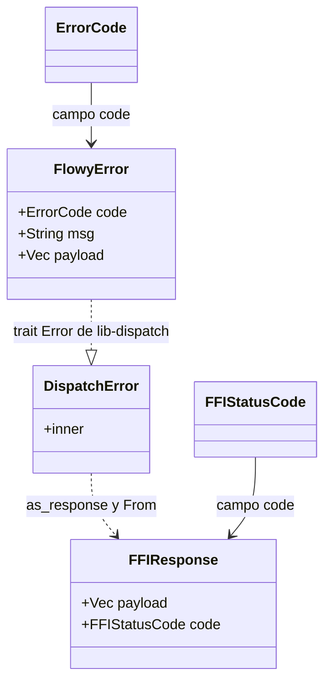
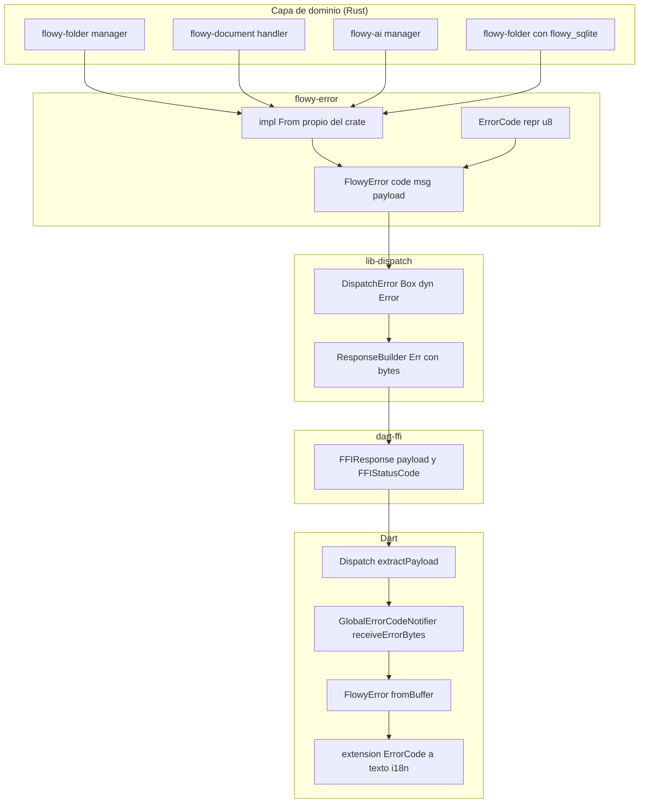
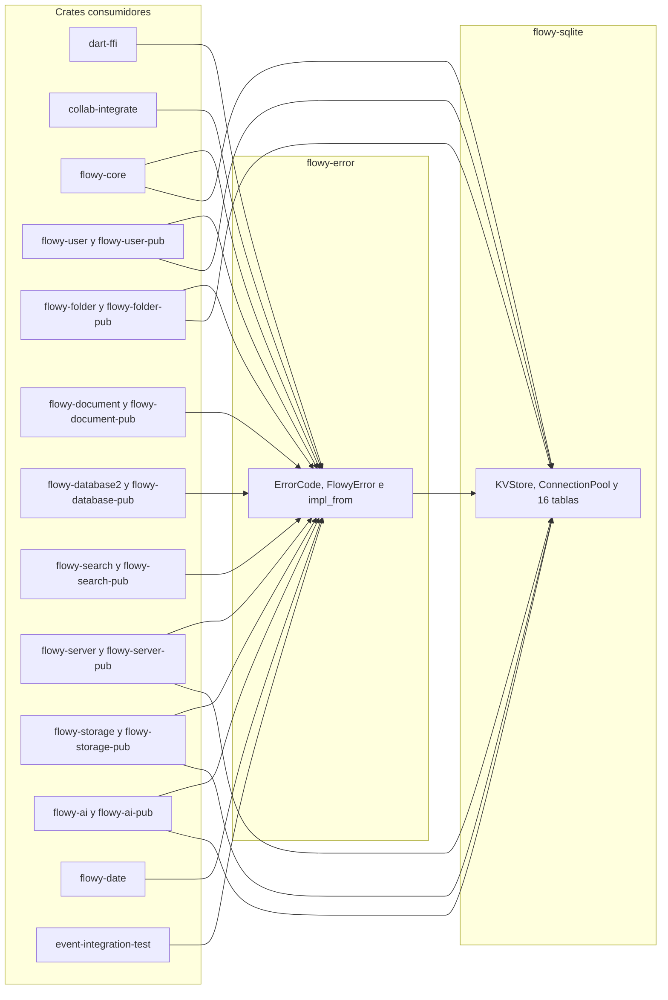
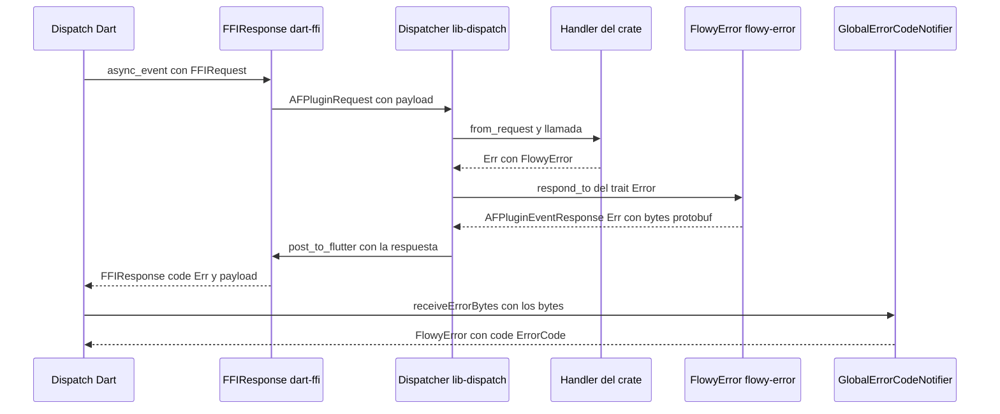
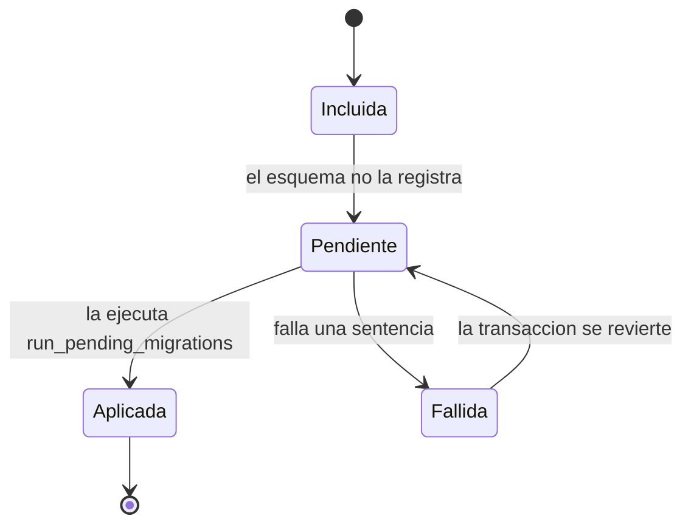

# F00.2 — Errores tipados y capa de persistencia SQLite (flowy-error, flowy-sqlite)

## 1. Resumen

Este documento cubre los dos crates de infraestructura que sostienen el contrato de error y el almacenamiento local del SDK Rust. `flowy-error` define el enum `ErrorCode` de 133 variantes (`repr(u8)`) y la estructura `FlowyError` (`code`, `msg`, `payload`), más 26 implementaciones `From<…>` que traducen los tipos de error de cada dependencia al tipo común, y el impl del trait `lib_dispatch::Error` que serializa ese tipo a protobuf para el viaje de vuelta a Dart. `flowy-sqlite` envuelve diesel: expone `Database`, `ConnectionPool` (r2d2 con PRAGMA `WAL`/`NORMAL`/`busy_timeout`), el store clave-valor `KVStorePreferences` sobre su propia base `cache.db`, el esquema generado de 16 tablas y 32 migraciones SQL embebidas que se aplican al abrir cada base de usuario. El hilo que une ambos crates es la conversión de errores de persistencia: `flowy_sqlite::Error::NotFound` se traduce a `ErrorCode::RecordNotFound` y `r2d2::Error` a `ErrorCode::Internal`, de modo que un fallo de SQLite llega a la UI de Dart con el mismo catálogo que un fallo de red.

## 2. Alcance

Esta unidad cubre los 94 ficheros del ledger asignados: 16 de `frontend/rust-lib/flowy-error` (2 de configuración —`Cargo.toml` y `Flowy.toml`— más `build.rs` y 13 ficheros Rust) y 78 de `frontend/rust-lib/flowy-sqlite` (3 de configuración, 64 ficheros `.sql` de migración y 11 ficheros Rust). Quedan fuera y se enlazan en vez de repetirse: la narrativa del puente FFI y del canal de respuesta con error ya escrita en `[[B1.5]]` (`OUT/06-puente-flutter-rust/01-ffi.md` y `02-lib-dispatch.md`), el `erDiagram` de las 16 tablas, la descripción de `KVStorePreferences` y el pool, y el ciclo de las migraciones Rust de `flowy-user`, todo ello en `[[B1.7]]` (`OUT/08-persistencia/01-sqlite-schema.md`, `02-kv.md` y `06-migraciones.md`); el grafo de dependencias entre los 31 crates del workspace en `[[B1.2]]` (`OUT/17-grafo-dependencias.md`); el índice de las 133 variantes con su categoría heurística en `[[B2.5]]` (`OUT/15-catalogo-errores.md`); el lado Dart del canal de error (`error_code_map.dart` y los `*_notification.dart`) en `[[F17]]`; la generación de `.proto` y de código Dart en `[[F00.3]]`; y las migraciones de datos de usuario en `[[F05.2]]`.

Lo que este documento **añade** respecto de los anteriores es el detalle que hace falta para razonar sobre el contrato de error sin salir del crate: la tabla íntegra de las 133 variantes con su valor `u8` y su línea real de declaración, agrupada en 15 dominios de emisión (no las 30 categorías por prefijo de `[[B2.5]]`, que son heurísticas de nombre y no reflejan quién emite el código); las 26 conversiones `From<…>` con su fichero y línea, que son el mecanismo real por el que 21 crates distintos vierten su error al tipo común; la tabla de los 32 ficheros de migración de `flowy-sqlite` con la sentencia exacta que ejecuta cada uno — un hueco real de `[[B1.7]]`, cuyo §7 solo cubre las 6 migraciones Rust de `flowy-user`; y las correcciones de línea que `[[B1.7]]` arrastra en `02-kv.md`, donde los métodos de `KVStorePreferences` están numerados del 3 al 13 cuando en el fichero real van del 22 al 96.

## 3. Modelos de datos

El catálogo de errores tiene dos piezas. `ErrorCode` es un enum cerrado con `#[repr(u8)]` y `#[default]` sobre `Internal`, derivado a la vez con `Serialize_repr`/`Deserialize_repr` (para que JSON lo trate como número y no como cadena de texto), con `thiserror::Error` (de ahí el `#[error("…")]` de cada variante) y con el derive `ProtoBuf_Enum` del crate `flowy-derive`, que es el que genera el `.proto` y el enum Dart equivalente. `FlowyError` es la estructura de transporte: tres campos —`code: ErrorCode` en el índice protobuf 1, `msg: String` en el 2 y `payload: Vec<u8>` en el 3— con `Display` implementado como `code:{code}, message:{msg}`, y el alias `pub type FlowyResult<T> = anyhow::Result<T, FlowyError>`.

Muestra: la relación entre el enum de catálogo, la estructura de error y las dos envoltorios que la envuelven al cruzar la frontera: `DispatchError` en `lib-dispatch` y `FFIResponse` en `dart-ffi`. Muestra además que `ErrorCode` y `FFIStatusCode` viajan como dos campos distintos de dos mensajes distintos: el primero es el código de dominio dentro del payload, el segundo es el código de transporte de la respuesta.



Lectura: `ErrorCode` aparece en `appflowy/frontend/rust-lib/flowy-error/src/code.rs:6–13` y `FlowyError` en `appflowy/frontend/rust-lib/flowy-error/src/errors.rs:15–26`; la relación de herencia (`FlowyError` cumple el trait `Error` de `lib-dispatch`) se materializa en `appflowy/frontend/rust-lib/flowy-error/src/impl_from/dispatch.rs:9–13`, mientras que `FFIResponse` se construye a partir de `AFPluginEventResponse` en `appflowy/frontend/rust-lib/dart-ffi/src/model/ffi_response.rs:21–39`. La consecuencia práctica es que Dart nunca ve el `ErrorCode` por el canal de estado: lo ve **dentro** de `payload`, y `FFIStatusCode` solo le dice que tiene que deserializarlo.

### 3.1 Los 133 `ErrorCode`, agrupados por dominio de emisión

El enum se declara en `appflowy/frontend/rust-lib/flowy-error/src/code.rs:10–413` y suma exactamente **133** variantes con valores `u8` no contiguos (el hueco `1` está reservado y los valores-used llegan hasta `140`). El conteo coincide con `OUT/_ledger/extract/misc.json` (`error_codes.total`) y con el catálogo `[[B2.5]]`: 133 filas en los tres sitios. La diferencia con `[[B2.5]]` está en el criterio de agrupación: aquí los grupos `G1`–`G15` se cortan por **qué crate emite el código** (y por tanto qué crate necesita el `From` correspondiente en `§4`), no por el prefijo CamelCase del nombre; por eso los dos recuentos no coinciden categoría a categoría aunque sí en el total.

| Grupo | Denominación | Variantes | Rango de líneas en `code.rs` |
| --- | --- | ---: | --- |
| `G1` | Genéricos y de framework | 13 | 13–313 |
| `G2` | Validación de entrada e identificadores | 31 | 22–319 |
| `G3` | Autenticación y credenciales | 17 | 16–403 |
| `G4` | Nombre de usuario | 3 | 78–84 |
| `G5` | Base de datos y documentos | 6 | 111–297 |
| `G6` | Conexión, red y sincronización | 15 | 153–373 |
| `G7` | RocksDB y persistencia local | 3 | 189–252 |
| `G8` | Almacenamiento de archivos y versión | 6 | 222–316 |
| `G9` | Búsqueda e indexación | 4 | 270–279 |
| `G10` | IA local y cloud | 11 | 285–391 |
| `G11` | Publicación y espacios de nombres | 12 | 325–358 |
| `G12` | Límites de plan y cuotas | 6 | 264–412 |
| `G13` | Vistas y permisos | 2 | 240–370 |
| `G14` | Registros | 2 | 19–234 |
| `G15` | Otros (URL y referencias) | 2 | 225–388 |

La tabla siguiente es el inventario completo. **La columna «Línea» es el número de línea de la declaración de la variante dentro del mismo fichero `code.rs`** (fichero citado en el encabezado del párrafo anterior), y la columna «Valor `u8`» es el discriminante `repr(u8)` que viaja a Dart.

| # | Variante | Valor `u8` | Línea | `#[error(...)]` | Grupo |
| ---: | --- | ---: | ---: | --- | :-: |
| 1 | `Internal` | 0 | 13 | Internal error | G1 |
| 2 | `UserUnauthorized` | 2 | 16 | Unauthorized user | G3 |
| 3 | `RecordNotFound` | 3 | 19 | Record not found | G14 |
| 4 | `UserIdIsEmpty` | 4 | 22 | User id is empty | G2 |
| 5 | `WorkspaceNameInvalid` | 5 | 25 | Workspace name can not be empty or whitespace | G2 |
| 6 | `WorkspaceDescTooLong` | 8 | 28 | Workspace desc is invalid | G2 |
| 7 | `WorkspaceNameTooLong` | 9 | 31 | Workspace description too long | G2 |
| 8 | `WorkspaceInitializeError` | 6 | 34 | Can't load the workspace data | G3 |
| 9 | `ViewNameInvalid` | 12 | 37 | View name can not be empty or whitespace | G2 |
| 10 | `ViewThumbnailInvalid` | 13 | 40 | Thumbnail of the view is invalid | G2 |
| 11 | `ViewIdIsInvalid` | 14 | 43 | View id can not be empty or whitespace | G2 |
| 12 | `ViewDataInvalid` | 16 | 46 | View data is invalid | G2 |
| 13 | `ViewNameTooLong` | 17 | 49 | View name too long | G2 |
| 14 | `EmailIsEmpty` | 19 | 52 | Email can not be empty or whitespace | G2 |
| 15 | `EmailFormatInvalid` | 20 | 55 | Email format is not valid | G2 |
| 16 | `EmailAlreadyExists` | 21 | 58 | Email already exists | G3 |
| 17 | `PasswordIsEmpty` | 22 | 61 | Password can not be empty or whitespace | G2 |
| 18 | `PasswordTooLong` | 23 | 64 | Password format too long | G3 |
| 19 | `PasswordContainsForbidCharacters` | 24 | 67 | Password contains forbidden characters. | G3 |
| 20 | `PasswordFormatInvalid` | 25 | 72 | Password should contain a minimum of 6 characters with 1 special 1 letter and 1 numeric | G3 |
| 21 | `PasswordNotMatch` | 26 | 75 | Password not match | G3 |
| 22 | `UserNameTooLong` | 27 | 78 | User name is too long | G4 |
| 23 | `UserNameContainForbiddenCharacters` | 28 | 81 | User name contain forbidden characters | G4 |
| 24 | `UserNameIsEmpty` | 29 | 84 | User name can not be empty or whitespace | G4 |
| 25 | `UserIdInvalid` | 30 | 87 | user id is empty or whitespace | G2 |
| 26 | `TextTooLong` | 32 | 90 | Text is too long | G2 |
| 27 | `DatabaseIdIsEmpty` | 33 | 93 | Database id is empty | G2 |
| 28 | `DatabaseViewIdIsEmpty` | 34 | 96 | Grid view id is empty | G2 |
| 29 | `BlockIdIsEmpty` | 35 | 99 | Grid block id is empty | G2 |
| 30 | `RowIdIsEmpty` | 36 | 102 | Row id is empty | G2 |
| 31 | `OptionIdIsEmpty` | 37 | 105 | Select option id is empty | G2 |
| 32 | `FieldIdIsEmpty` | 38 | 108 | Field id is empty | G2 |
| 33 | `FieldDoesNotExist` | 39 | 111 | Field doesn't exist | G5 |
| 34 | `SelectOptionNameIsEmpty` | 40 | 114 | The name of the option should not be empty | G2 |
| 35 | `FieldNotExists` | 41 | 117 | Field not exists | G5 |
| 36 | `FieldInvalidOperation` | 42 | 120 | The operation in this field is invalid | G5 |
| 37 | `FilterIdIsEmpty` | 43 | 123 | Filter id is empty | G2 |
| 38 | `FieldRecordNotFound` | 44 | 126 | Field is not exist | G5 |
| 39 | `TypeOptionDataIsEmpty` | 45 | 129 | Field's type-option data should not be empty | G2 |
| 40 | `GroupIdIsEmpty` | 46 | 132 | Group id is empty | G2 |
| 41 | `InvalidDateTimeFormat` | 48 | 135 | Invalid date time format | G2 |
| 42 | `InvalidParams` | 49 | 138 | Invalid params | G1 |
| 43 | `Serde` | 50 | 141 | Serde | G1 |
| 44 | `ProtobufSerde` | 51 | 144 | Protobuf serde | G1 |
| 45 | `OutOfBounds` | 52 | 147 | Out of bounds | G1 |
| 46 | `SortIdIsEmpty` | 53 | 150 | Sort id is empty | G2 |
| 47 | `ConnectRefused` | 54 | 153 | Connect refused | G6 |
| 48 | `ConnectTimeout` | 55 | 156 | Connection timeout | G6 |
| 49 | `ConnectClose` | 56 | 159 | Connection closed | G6 |
| 50 | `ConnectCancel` | 57 | 162 | Connection canceled | G6 |
| 51 | `SqlError` | 58 | 165 | Sql error | G6 |
| 52 | `NetworkError` | 59 | 168 | Network error | G6 |
| 53 | `UnexpectedEmpty` | 60 | 171 | The content should not be empty | G1 |
| 54 | `UnexpectedCalendarFieldType` | 61 | 174 | Only the date type can be used in calendar | G2 |
| 55 | `DocumentDataInvalid` | 62 | 177 | Document Data Invalid | G5 |
| 56 | `UnsupportedAuthType` | 63 | 180 | Unsupported auth type | G3 |
| 57 | `InvalidAuthConfig` | 64 | 183 | Invalid auth configuration | G3 |
| 58 | `MissingAuthField` | 65 | 186 | Missing auth field | G3 |
| 59 | `RocksdbIOError` | 66 | 189 | Rocksdb IO error | G7 |
| 60 | `DocumentIdIsEmpty` | 67 | 192 | Document id is empty | G2 |
| 61 | `ApplyActionsIsEmpty` | 68 | 195 | Apply actions is empty | G2 |
| 62 | `PgConnectError` | 69 | 198 | Connect postgres database failed | G6 |
| 63 | `PgDatabaseError` | 70 | 201 | Postgres database error | G6 |
| 64 | `PgTransactionError` | 71 | 204 | Postgres transaction error | G6 |
| 65 | `DataSyncRequired` | 72 | 207 | Enable data sync | G6 |
| 66 | `Conflict` | 73 | 210 | Conflict | G1 |
| 67 | `InvalidEncryptSecret` | 74 | 213 | Invalid decryption secret | G3 |
| 68 | `CollabDataNotSync` | 75 | 216 | It appears that the collaboration object's data has not been fully synchronized | G6 |
| 69 | `WorkspaceDataNotSync` | 76 | 219 | It appears that the workspace data has not been fully synchronized | G6 |
| 70 | `ExcessStorageLimited` | 77 | 222 | Excess storage limited | G8 |
| 71 | `InvalidURL` | 78 | 225 | Parse url failed | G15 |
| 72 | `AwaitingEmailConfirmation` | 79 | 228 | Require Email Confirmation, Sign in after email confirmation | G3 |
| 73 | `TextIdIsEmpty` | 80 | 231 | Text id is empty | G2 |
| 74 | `RecordAlreadyExists` | 81 | 234 | Record already exists | G14 |
| 75 | `MissingPayload` | 82 | 237 | Missing payload | G1 |
| 76 | `NotEnoughPermissions` | 83 | 240 | Permission denied | G13 |
| 77 | `InternalServerError` | 84 | 243 | Internal server error | G1 |
| 78 | `NotSupportYet` | 85 | 246 | Not support yet | G1 |
| 79 | `RocksdbCorruption` | 86 | 249 | rocksdb corruption | G7 |
| 80 | `RocksdbInternal` | 87 | 252 | rocksdb internal error | G7 |
| 81 | `LocalVersionNotSupport` | 88 | 255 | Local version not support | G8 |
| 82 | `AppFlowyDataFolderImportError` | 89 | 258 | AppFlowy data folder import error | G8 |
| 83 | `PayloadTooLarge` | 90 | 261 | payload too large | G1 |
| 84 | `WorkspaceLimitExceeded` | 91 | 264 | Workspace limit exceeded | G12 |
| 85 | `WorkspaceMemberLimitExceeded` | 92 | 267 | Workspace member limit exceeded | G12 |
| 86 | `IndexWriterFailedCommit` | 93 | 270 | IndexWriter failed to commit | G9 |
| 87 | `FailedToOpenIndexDir` | 94 | 273 | Failed to open index dir | G9 |
| 88 | `FailedToParseQuery` | 95 | 276 | Failed to parse query | G9 |
| 89 | `FolderIndexManagerUnavailable` | 96 | 279 | FolderIndexManager or its dependencies are unavailable | G9 |
| 90 | `WorkspaceDataNotMatch` | 97 | 282 | Workspace data not match | G6 |
| 91 | `LocalAIError` | 98 | 285 | Local AI error | G10 |
| 92 | `LocalAIUnavailable` | 99 | 288 | Local AI unavailable | G10 |
| 93 | `FileStorageLimitExceeded` | 100 | 291 | Storage limit exceeded | G8 |
| 94 | `AIResponseLimitExceeded` | 101 | 294 | AI Response limit exceeded | G10 |
| 95 | `DuplicateSqliteRecord` | 102 | 297 | Duplicate record | G5 |
| 96 | `ResponseTimeout` | 103 | 300 | Response timeout | G6 |
| 97 | `UnsupportedFileFormat` | 104 | 303 | Unsupported file format | G8 |
| 98 | `AppFlowyLAINotReady` | 105 | 306 | AppFlowy LAI not ready | G10 |
| 99 | `InvalidRequest` | 106 | 309 | Invalid Request | G1 |
| 100 | `InProgress` | 107 | 313 | In progress | G1 |
| 101 | `SingleUploadLimitExceeded` | 108 | 316 | Upload part size exceeds the limit | G8 |
| 102 | `GroupNameIsEmpty` | 109 | 319 | Group name is empty | G2 |
| 103 | `LimitedByWorkspacePlan` | 110 | 322 | Not available for current workspace plan | G12 |
| 104 | `InvalidNamespace` | 111 | 325 | Invalid namespace | G11 |
| 105 | `InvalidPublishName` | 112 | 328 | Invalid publish name | G11 |
| 106 | `CustomNamespaceRequirePlanUpgrade` | 113 | 331 | Custom namespace requires Pro Plan upgrade | G11 |
| 107 | `CustomNamespaceNotAllowed` | 114 | 334 | Requested namespace is not allowed | G11 |
| 108 | `CustomNamespaceAlreadyTaken` | 115 | 337 | Requested namespace is already taken | G11 |
| 109 | `CustomNamespaceTooShort` | 116 | 340 | Requested namespace is too short | G11 |
| 110 | `CustomNamespaceTooLong` | 117 | 343 | Requested namespace is too long | G11 |
| 111 | `CustomNamespaceReserved` | 118 | 346 | Requested namespace is reserved | G11 |
| 112 | `PublishNameAlreadyExists` | 119 | 349 | Publish name is already used for another published view | G11 |
| 113 | `PublishNameInvalidCharacter` | 120 | 352 | Publish name contains one or more invalid characters | G11 |
| 114 | `PublishNameTooLong` | 121 | 355 | Publish name has exceeded the maximum length allowable | G11 |
| 115 | `CustomNamespaceInvalidCharacter` | 122 | 358 | Requested namespace has one or more invalid characters | G11 |
| 116 | `AIServiceUnavailable` | 123 | 361 | AI Service is unavailable | G10 |
| 117 | `AIImageResponseLimitExceeded` | 124 | 364 | AI Image Response limit exceeded | G10 |
| 118 | `AIMaxRequired` | 125 | 367 | AI Max Required | G10 |
| 119 | `ViewIsLocked` | 126 | 370 | View is locked | G13 |
| 120 | `RequestTimeout` | 127 | 373 | Request timeout | G6 |
| 121 | `LocalAINotReady` | 128 | 376 | Local AI is not ready | G10 |
| 122 | `MCPError` | 129 | 379 | MCP error | G10 |
| 123 | `LocalAIDisabled` | 130 | 382 | Local AI disabled | G10 |
| 124 | `UserNotLogin` | 131 | 385 | User not login | G3 |
| 125 | `WeakRefDrop` | 132 | 388 | Reference resource is not available | G15 |
| 126 | `LocalEmbeddingNotReady` | 133 | 391 | Local embedding not ready | G10 |
| 127 | `NewPasswordTooWeak` | 134 | 394 | New password is too weak | G3 |
| 128 | `InvalidNewPassword` | 135 | 397 | Invalid new password | G3 |
| 129 | `NewPasswordTooLong` | 136 | 400 | New password is too long | G3 |
| 130 | `NewPasswordTooShort` | 137 | 403 | New password is too short | G3 |
| 131 | `FreePlanGuestLimitExceeded` | 138 | 406 | Guest limit exceeded for free plan | G12 |
| 132 | `PaidPlanGuestLimitExceeded` | 139 | 409 | Guest limit exceeded for paid plan | G12 |
| 133 | `InvalidGuest` | 140 | 412 | Invalid guest | G12 |

Dos detalles del catálogo se ven mejor con la tabla delante. El primero es que **los mensajes de las filas 6 y 7 están intercambiados respecto de lo que sugieren sus nombres**: `WorkspaceDescTooLong = 8` lleva `Workspace desc is invalid` y `WorkspaceNameTooLong = 9` lleva `Workspace description too long`, de modo que el texto que acaba viendo el usuario en el `msg` por defecto no corresponde al campo que el nombre designa `[VERIFICADO]` (`appflowy/frontend/rust-lib/flowy-error/src/code.rs:27–31`). El segundo es que el discriminante `1` está permanentemente libre y la numeración termina en `140` con 133 variantes: hay 8 huecos además del `1`, lo que implica que hubo 8 códigos retirados o reservados que no deben reutilizarse porque un cliente antiguo puede seguir interpretando su valor.

### 3.2 Constructores estáticos y predicados de `FlowyError`

`FlowyError` expone una macro privada `static_flowy_error!` (`appflowy/frontend/rust-lib/flowy-error/src/errors.rs:28–35`) que genera funciones asociadas sin argumentos y sin `Result`, es decir, productores "de un disparo" que no aceptan contexto. Se usan **43** veces en `appflowy/frontend/rust-lib/flowy-error/src/errors.rs:110–165` y cubren 43 de los 133 códigos; el resto se construye con `FlowyError::new(code, msg)`. Aparte de eso hay 13 predicados de consulta rápida (`appflowy/frontend/rust-lib/flowy-error/src/errors.rs:55–108`) que son la forma en que el resto del SDK decide qué hacer sin comparar códigos a mano: `is_record_not_found`, `is_already_exists`, `is_unauthorized` (que devuelve `true` también para `RecordNotFound`), `is_invalid_data`, `is_local_version_not_support`, `is_file_limit_exceeded`, `is_single_file_limit_exceeded`, `should_retry_upload` (falso solo para los dos anteriores), `is_ai_response_limit_exceeded`, `is_ai_image_response_limit_exceeded`, `is_local_ai_not_ready`, `is_local_ai_disabled` y `is_ai_max_required`.

Dosmodificadores de contexto completan la construcción: `with_context` **sobrescribe** `msg` en lugar de concatenarlo (`appflowy/frontend/rust-lib/flowy-error/src/errors.rs:45–48`), de modo que encadenar dos `.with_context()` sobre un `FlowyError::new(código, mensaje)` pierde el mensaje original; y `with_payload` adjunta bytes arbitrarios con degradación silenciosa a vector vacío si la conversión falla (`appflowy/frontend/rust-lib/flowy-error/src/errors.rs:50–53`).

## 4. Eventos FFI

`flowy-error` **no declara eventos FFI**: no tiene `event_map.rs`, y su `Flowy.toml` solo declara `proto_input = ["src/errors.rs","src/code.rs"]` (`appflowy/frontend/rust-lib/flowy-error/Flowy.toml:3`), sin la clave `event_files` que usan los crates de feature. El catálogo `OUT/_ledger/extract/events.json` confirma que ninguno de sus 31 crates incluye `flowy-error` ni `flowy-sqlite`. Su aportación al canal FFI es otra: definir **cómo se serializa el error** para que el dispatcher pueda transportarlo.

El mecanismo son 26 implementaciones `From<…>` hacia `FlowyError` más un impl del trait `lib_dispatch::Error`. Las conversiones están todas detrás de features de Cargo, de modo que un crate solo compila la parte del catálogo de errores que realmente usa.

| # | Fichero:línea | Tipo de origen (crate) | `ErrorCode` resultante |
| ---: | --- | --- | --- |
| 1 | `appflowy/frontend/rust-lib/flowy-error/src/errors.rs:168` | `ErrorCode` (propio) | el propio código, `msg` = `Display` del código |
| 2 | `appflowy/frontend/rust-lib/flowy-error/src/errors.rs:186` | `std::io::Error` | `Internal` |
| 3 | `appflowy/frontend/rust-lib/flowy-error/src/errors.rs:192` | `protobuf::ProtobufError` | `Internal` |
| 4 | `appflowy/frontend/rust-lib/flowy-error/src/errors.rs:198` | `validator::ValidationError` | `InvalidParams` |
| 5 | `appflowy/frontend/rust-lib/flowy-error/src/errors.rs:204` | `validator::ValidationErrors` | `InvalidParams` |
| 6 | `appflowy/frontend/rust-lib/flowy-error/src/errors.rs:210` | `anyhow::Error` | `FlowyError` si hace `downcast`, si no `Internal` |
| 7 | `appflowy/frontend/rust-lib/flowy-error/src/errors.rs:217` | `fancy_regex::Error` | `Internal` |
| 8 | `appflowy/frontend/rust-lib/flowy-error/src/errors.rs:223` | `tokio::task::JoinError` | `Internal` |
| 9 | `appflowy/frontend/rust-lib/flowy-error/src/errors.rs:229` | `tokio::sync::oneshot::error::RecvError` | `Internal` |
| 10 | `appflowy/frontend/rust-lib/flowy-error/src/errors.rs:235` | `String` | `Internal` |
| 11 | `appflowy/frontend/rust-lib/flowy-error/src/errors.rs:241` | `collab::error::CollabError` | `Serde`, `UnexpectedEmpty`, `NotSupportYet` o `Internal` |
| 12 | `appflowy/frontend/rust-lib/flowy-error/src/errors.rs:262` | `uuid::Error` | `Internal` |
| 13 | `appflowy/frontend/rust-lib/flowy-error/src/errors.rs:268` | `ollama_rs::error::OllamaError` | `LocalAIError` |
| 14 | `appflowy/frontend/rust-lib/flowy-error/src/impl_from/serde.rs:3` | `serde_json::Error` | `Serde` |
| 15 | `appflowy/frontend/rust-lib/flowy-error/src/impl_from/reqwest.rs:5` | `reqwest::Error` | `NetworkError` |
| 16 | `appflowy/frontend/rust-lib/flowy-error/src/impl_from/url.rs:3` | `url::ParseError` | `InvalidURL` |
| 17 | `appflowy/frontend/rust-lib/flowy-error/src/impl_from/tantivy.rs:5` | `tantivy::TantivyError` | `IndexWriterFailedCommit` |
| 18 | `appflowy/frontend/rust-lib/flowy-error/src/impl_from/tantivy.rs:11` | `tantivy::directory::error::OpenDirectoryError` | `FailedToOpenIndexDir` |
| 19 | `appflowy/frontend/rust-lib/flowy-error/src/impl_from/tantivy.rs:17` | `tantivy::query::QueryParserError` | `FailedToParseQuery` |
| 20 | `appflowy/frontend/rust-lib/flowy-error/src/impl_from/collab.rs:9` | `collab_database::error::DatabaseError` | `Internal` (sin discriminación) |
| 21 | `appflowy/frontend/rust-lib/flowy-error/src/impl_from/collab.rs:16` | `collab_document::error::DocumentError` | `InvalidParams` si `NoRequiredData`, si no `Internal` |
| 22 | `appflowy/frontend/rust-lib/flowy-error/src/impl_from/collab.rs:29` | `collab_folder::error::FolderError` | `InvalidParams` si `NoRequiredData`, si no `Internal` |
| 23 | `appflowy/frontend/rust-lib/flowy-error/src/impl_from/collab_persistence.rs:6` | `collab_plugins::local_storage::kv::PersistenceError` | `RecordNotFound`, `RocksdbCorruption`, `RocksdbIOError` o `RocksdbInternal` |
| 24 | `appflowy/frontend/rust-lib/flowy-error/src/impl_from/database.rs:4` | `flowy_sqlite::Error` | `RecordNotFound` si `NotFound`, si no `Internal` |
| 25 | `appflowy/frontend/rust-lib/flowy-error/src/impl_from/database.rs:13` | `r2d2::Error` | `Internal` |
| 26 | `appflowy/frontend/rust-lib/flowy-error/src/impl_from/cloud.rs:4` | `client_api::error::AppResponseError` | 39 ramas de mapeo + `_ => Internal` |

Las 26 filas cubren las trece conversiones declaradas directamente en `errors.rs` (1–13) y las trece de los módulos `impl_from/` (14–26); el impl del trait `lib_dispatch::Error` que serializa el error a protobuf se trata justo después.

Tres filas merecen comentario porque son la bisagra entre las dos capas que cubre este documento. La **fila 24** es la que hace que un `diesel::result::Error::NotFound` llegue a la UI con `ErrorCode::RecordNotFound` en lugar de `Internal`, y por tanto con el predicado `is_record_not_found()` activo; todo `SELECT` que no encuentre fila se comportaría igual si la fila fuese 1–5. La **fila 23** es la única que distingue los subtipos de fallo de disco (`RocksdbCorruption` y `RocksdbIOError` tienen variantes propias en el enum) y además es la única que compila condicionalmente: sus dos brazos corresponden a `#[cfg(not(target_arch = "wasm32"))]`, porque las variantes de RocksDB no existen en el target wasm. La **fila 26** es un `match` de 39 ramas sobre el `AppResponseError` del cliente de AppFlowy Cloud (`appflowy/frontend/rust-lib/flowy-error/src/impl_from/cloud.rs:6–47`) que termina en `_ => ErrorCode::Internal`, de modo que cualquier código nuevo que añada el servidor y no se mapee aquí se degrada a `Internal` de forma silenciosa en lugar de fallar la compilación.

El impl del trait es el punto donde el error se vuelve bytes. `impl lib_dispatch::Error for FlowyError` (`appflowy/frontend/rust-lib/flowy-error/src/impl_from/dispatch.rs:9–13`) serializa el error a protobuf con `try_into()` hacia `bytes::Bytes` —el `unwrap` es seguro porque el tipo no contiene campos no serializables— y lo envuelve en `ResponseBuilder::Err().data(bytes).build()`. El `build()` produce un `AFPluginEventResponse { payload, status_code: StatusCode::Err }` (`appflowy/frontend/rust-lib/lib-dispatch/src/response/builder.rs:33–41`), y ese es el objeto que `dart-ffi` aplanará después a `FFIResponse`.

```rust
// appflowy/frontend/rust-lib/flowy-error/src/impl_from/dispatch.rs:9–13
impl lib_dispatch::Error for FlowyError {
  fn as_response(&self) -> AFPluginEventResponse {
    let bytes: Bytes = self.clone().try_into().unwrap();
    ResponseBuilder::Err().data(bytes).build()
  }
}
```

## 5. Notificaciones

`flowy-error` **no emite notificaciones**: no hay `notification.rs`, no hay `NotificationBuilder`, y la lista de módulos del crate es de cuatro entradas —`code`, `errors`, `impl_from` y `protobuf`— (`appflowy/frontend/rust-lib/flowy-error/src/lib.rs:1–7`). El catálogo `OUT/_ledger/extract/notifications.json` no contiene ninguna entrada de `flowy-error` ni de `flowy-sqlite`, y sus campos `rust_notifications`, `dart_parsers` y `dart_listeners` los referencian todos a crates de feature. Esto es coherente con el diseño: el canal de notificaciones es unidireccional y de éxito (`SubscribeObject`), mientras que el error viaja por el `payload` de la respuesta de la petición que lo originó.

La única asimetría es que Dart puede recibir un `FlowyError` **dentro de una notificación**, no como respuesta a una llamada: los parsers de notificación de cada dominio aceptan un `errorParser` que decodifica `FlowyError.fromBuffer(bytes)` sobre los bytes de error que adjunta el `SubscribeObject` (por ejemplo `appflowy/frontend/appflowy_flutter/lib/core/notification/document_notification.dart:16`). Esa ruta es responsabilidad de `[[F17]]` y `[[B2.4]]`; aquí solo queda constancia de que el formato del error es el mismo `FlowyError` protobuf que produce `flowy-error`, no un tipo distinto.

## 6. BLoCs / Cubits

No hay BLoCs, Cubits ni widgets Dart en esta unidad: los 94 ficheros del ledger son 100 % Rust, `Cargo.toml`, `.sql` o `.toml` de configuración. El catálogo `OUT/_ledger/extract/blocs.json` no contiene ninguna entrada cuyos ficheros pertenezcan a `flowy-error` o `flowy-sqlite`. La consecuencia práctica para el lector es que este documento no tiene ninguna tabla de BLoCs que rellenar, y que la lógica de presentación del error vive en otro sitio: el `extension FlowyErrorExtension` de `appflowy/frontend/appflowy_flutter/packages/appflowy_backend/lib/dispatch/error.dart:114–119` (predicados `isAIResponseLimitExceeded` e `isStorageLimitExceeded`) y el `switch` sobre `FFIStatusCode` de `appflowy/frontend/appflowy_flutter/packages/appflowy_backend/lib/dispatch/dispatch.dart:80–94`, ambos de `[[F00.5.1]]`.

## 7. Servicios e inyección de dependencias

En Rust no hay un contenedor de inyección en `flowy-error` ni en `flowy-sqlite`: los dos son crates de librería que exponen constructores. Lo que sí es inyección, en el sentido de `flowy-core`, es la **activación por features** de las conversiones de error, que es el mecanismo que decide qué partes del catálogo de errores se compilan en cada binario.

`appflowy/frontend/rust-lib/flowy-error/Cargo.toml:41–64` declara nueve features `impl_from_*` más `dart`, y solo cuatro están activas por defecto: `impl_from_dispatch_error`, `impl_from_serde`, `impl_from_reqwest` e `impl_from_sqlite`. Cada feature arrastra su dependencia opcional (`impl_from_dispatch_error = ["lib-dispatch"]`, `impl_from_sqlite = ["flowy-sqlite", "r2d2"]`, `impl_from_appflowy_cloud = ["client-api"]`, `impl_from_url = ["url"]`, `impl_from_tantivy = ["tantivy"]`, …). El efecto de esta granularidad es que **`flowy-error` depende de `flowy-sqlite`**, no al revés: la conversión `From<flowy_sqlite::Error>` es la que ata ambos crates (`appflowy/frontend/rust-lib/flowy-error/Cargo.toml:27`). Cada crate de dominio activa el subconjunto que necesita; por ejemplo `flowy-document` pide `impl_from_serde`, `impl_from_dispatch_error`, `impl_from_collab_document` e `impl_from_collab_persistence` (`appflowy/frontend/rust-lib/flowy-document/Cargo.toml:20`), mientras que `dart-ffi` pide seis features incluyendo `dart`, que dispara el generador de protobuf Dart (`appflowy/frontend/rust-lib/dart-ffi/Cargo.toml:46`).

La vida del objeto en el grafo de servicios es esta. `flowy-sqlite` expone cuatro tipos públicos desde `appflowy/frontend/rust-lib/flowy-sqlite/src/lib.rs:14` —`ConnectionPool`, `DBConnection`, `Database` y `PoolConfig`— más el módulo `kv`. El store clave-valor se construye una sola vez, en la inicialización del SDK, con `Arc::new(KVStorePreferences::new(&config.storage_path).unwrap())` (`appflowy/frontend/rust-lib/flowy-core/src/lib.rs:128`), y desde ahí se reparte como `Arc<KVStorePreferences>` a `flowy-user`, `flowy-folder`, `flowy-ai` y los `deps_resolve` de `flowy-core`; muchos de esos usos son `Weak<KVStorePreferences>` dentro de `AFPluginState`, con un helper `upgrade_store_preferences` que lo resuelve en el punto de uso (por ejemplo `appflowy/frontend/rust-lib/flowy-ai/src/local_ai/controller.rs:529`). El `unwrap` de la línea 128 significa que **si el directorio de almacenamiento no existe, el arranque de todo el SDK entra en pánico** en lugar de propagar el error: es coherente con que `KVStorePreferences::new` ya rechace directorios inexistentes con `anyhow!` (`appflowy/frontend/rust-lib/flowy-sqlite/src/kv/kv.rs:22–25`), pero convierte un problema de rutas en un crash no recuperable.

Las bases de datos de usuario, en cambio, no son instancias únicas: se cachean por `user_id` en un `HashMap` y se abren con `flowy_sqlite::init` la primera vez que se piden (`appflowy/frontend/rust-lib/flowy-user/src/services/db.rs:110–120`). El mismo `init` se usa en la importación de una carpeta de datos de AppFlowy (`appflowy/frontend/rust-lib/flowy-user/src/services/data_import/appflowy_data_import.rs:98`).

## 8. Persistencia

### 8.1 Topología: dos bases de datos y 17 tablas

`flowy-sqlite` gestiona en realidad **dos** bases SQLite con esquemas distintos. La primera es `flowy-database.db` (`appflowy/frontend/rust-lib/flowy-sqlite/src/lib.rs:30`), con las 16 tablas de `appflowy/frontend/rust-lib/flowy-sqlite/src/schema.rs` (generado por la CLI de diesel, como indica el comentario de cabecera en `appflowy/frontend/rust-lib/flowy-sqlite/src/schema.rs:1` y el destino declarado en `appflowy/frontend/rust-lib/flowy-sqlite/diesel.toml:4–5`); es la que se abre por usuario con `flowy_sqlite::init`. La segunda es `cache.db` (`appflowy/frontend/rust-lib/flowy-sqlite/src/kv/kv.rs:12`), que contiene una única tabla `kv_table` creada con SQL crudo embebido en la constante `KV_SQL` (`appflowy/frontend/rust-lib/flowy-sqlite/src/kv/schema.rs:2–7`) y el `table!` de diesel al lado (`appflowy/frontend/rust-lib/flowy-sqlite/src/kv/schema.rs:9–14`); es la que usa `KVStorePreferences`. Esta segunda base **no** pasa por el sistema de migraciones: `new` ejecuta `sql_query(KV_SQL).execute(...)` directamente (`appflowy/frontend/rust-lib/flowy-sqlite/src/kv/kv.rs:30`).

> Corrección de trazabilidad frente a `[[B1.7]]`: `OUT/08-persistencia/02-kv.md` afirma que `KVStorePreferences` "no usa tablas diesel propias — comparte la `user_table` o una genérica" y numera sus métodos del 3 al 13. Ambas cosas son inexactas en este snapshot: la tabla es propia (`kv_table` en `cache.db`) y las firmas reales están en `appflowy/frontend/rust-lib/flowy-sqlite/src/kv/kv.rs:22–105`. Se mantiene `[[B1.7]]` como referencia conceptual y este documento como referencia exacta.

Las 16 tablas de `schema.rs` se relationan así con su migración creadora y su crate consumidor. Las 16 aparecen ya en `[[B1.7]]` (`OUT/08-persistencia/01-sqlite-schema.md` §2), y lo que este documento añade es la columna del archivo `.sql` exacto que crea cada tabla y la del fichero Rust que la consulta.

| # | Tabla | `schema.rs` | Migración que la crea (`up.sql`, línea) | Consumidor Rust | En B1.7 |
| ---: | --- | ---: | --- | --- | :-: |
| 1 | `af_collab_metadata` | 4 | `2024-12-29-061706_collab_metadata` (2) | `flowy-ai-pub` — `appflowy/frontend/rust-lib/flowy-ai-pub/src/persistence/collab_metadata_sql.rs:6` | sí |
| 2 | `chat_local_setting_table` | 13 | `2024-06-26-015936_chat_setting` (8) | **ninguno encontrado** | sí |
| 3 | `chat_message_table` | 21 | `2024-05-23-061639_chat_message` (10) | `flowy-ai-pub` — `appflowy/frontend/rust-lib/flowy-ai-pub/src/persistence/chat_message_sql.rs:10` | sí |
| 4 | `chat_table` | 35 | `2024-05-23-061639_chat_message` (2) | `flowy-ai-pub` — `appflowy/frontend/rust-lib/flowy-ai-pub/src/persistence/chat_sql.rs:8` | sí |
| 5 | `collab_snapshot` | 46 | `2023-06-05-135652_collab_snapshot` (2); recreada en `2024-01-07-041005_recreate_snapshot_table` (7) | `flowy-core` — `appflowy/frontend/rust-lib/flowy-core/src/deps_resolve/collab_deps.rs:9` | sí |
| 6 | `index_collab_record_table` | 58 | `2025-04-28-070644_collab_table` (2) | `flowy-ai-pub` — `appflowy/frontend/rust-lib/flowy-ai-pub/src/persistence/collab_sql.rs:7` | sí |
| 7 | `local_ai_model_table` | 66 | `2025-04-25-071459_local_ai_model` (2) | `flowy-ai-pub` — `appflowy/frontend/rust-lib/flowy-ai-pub/src/persistence/local_model_sql.rs:7` | sí |
| 8 | `upload_file_part` | 73 | `2024-06-16-131359_file_upload` (15) | `flowy-storage` — `appflowy/frontend/rust-lib/flowy-storage/src/sqlite_sql.rs:4` | sí |
| 9 | `upload_file_table` | 81 | `2024-06-16-131359_file_upload` (2) | `flowy-storage` — `appflowy/frontend/rust-lib/flowy-storage/src/sqlite_sql.rs:4` | sí |
| 10 | `user_data_migration_records` | 96 | `2023-08-02-083250_user_migration` (2) | `flowy-user` — `appflowy/frontend/rust-lib/flowy-user/src/migrations/migration.rs:8` | sí |
| 11 | `user_table` | 104 | `2023-06-05-023648_user` (2) | `flowy-user-pub` — `appflowy/frontend/rust-lib/flowy-user-pub/src/sql/user_sql.rs:9`; `flowy-user` — `appflowy/frontend/rust-lib/flowy-user/src/user_manager/manager.rs:11` | sí |
| 12 | `user_workspace_table` | 116 | `2023-07-21-081348_user_workspace` (2) | `flowy-user-pub` — `appflowy/frontend/rust-lib/flowy-user-pub/src/sql/workspace_sql.rs:5` | sí |
| 13 | `workspace_members_table` | 130 | `2024-06-14-020242_workspace_member` (2) | `flowy-user-pub` — `appflowy/frontend/rust-lib/flowy-user-pub/src/sql/member_sql.rs:4` | sí |
| 14 | `workspace_setting_table` | 143 | `2025-04-18-132232_user_workspace_auth_type` (20) | `flowy-user-pub` — `appflowy/frontend/rust-lib/flowy-user-pub/src/sql/workspace_setting_sql.rs:4` | sí |
| 15 | `workspace_shared_user` | 151 | `2025-06-04-072900_create_shared_users_table` (2) | `flowy-folder-pub` — `appflowy/frontend/rust-lib/flowy-folder-pub/src/sql/workspace_shared_user_sql.rs:3` | sí |
| 16 | `workspace_shared_view` | 164 | `2025-05-19-074647_create_shared_views_table` (2) | `flowy-folder-pub` — `appflowy/frontend/rust-lib/flowy-folder-pub/src/sql/workspace_shared_view_sql.rs:3` | sí |

La fila 2 es un hallazgo: **`chat_local_setting_table` no tiene ningún consumidor en el workspace**. Una búsqueda del identificador en todo `frontend/rust-lib` solo devuelve sus dos apariciones en `schema.rs` (la declaración y la entrada de `allow_tables_to_appear_in_same_query!`), lo que sugiere que la configuración local por chat fue absorbida por las columnas de `chat_table` que la migración `2025-04-17-042326_chat_metadata` elimina `[VERIFICADO]` (`appflowy/frontend/rust-lib/flowy-sqlite/src/schema.rs:13` y `173–190`). La tabla sigue ahí porque el `DROP TABLE` correspondiente no existe en ninguna migración: el esquema generado y el SQL aplicado han divergido.

### 8.2 Relaciones lógicas entre tablas

A diferencia de `[[B1.7]]`, que reproduce el `erDiagram` estructural completo de las 16 tablas, aquí solo se listan las **relaciones lógicas** entre ellas. Son relaciones *lógicas*, no declaradas: ninguna migración del crate contiene una cláusula `FOREIGN KEY` ni una referencia `REFERENCES`, y las únicas dos relaciones que el motor conoce de verdad son índices no únicos, `idx_chat_messages_chat_id_message_id` sobre `(chat_id, message_id)` (`appflowy/frontend/rust-lib/flowy-sqlite/migrations/2024-05-23-061639_chat_message/up.sql:20`) y `collab_record_table_workspace_id_idx` sobre `(workspace_id)` (`appflowy/frontend/rust-lib/flowy-sqlite/migrations/2025-04-28-070644_collab_table/up.sql:10`).

| Tabla origen | Columna de enlace | Tabla destino | Cardinalidad lógica | Base de la relación |
| --- | --- | --- | --- | --- |
| `chat_message_table` | `chat_id` | `chat_table` | N→1 | Índice explícito + `chat_message_sql.rs` |
| `chat_local_setting_table` | `chat_id` | `chat_table` | 1→1 | Coincidencia de clave primaria `[INFERIDO]` |
| `upload_file_part` | `upload_id` | `upload_file_table` | N→1 | Misma clave primaria compuesta |
| `workspace_members_table` | `workspace_id` | `user_workspace_table` | N→1 | Nombre de columna y `appflowy/frontend/rust-lib/flowy-user-pub/src/sql/member_sql.rs:4` |
| `workspace_members_table` | `uid` | `user_table` | N→1 | `uid` es el id de `user_table` |
| `user_workspace_table` | `uid` | `user_table` | N→1 | Confirmado por el `UPDATE … FROM user_table` de la migración 25 |
| `workspace_shared_user` | `workspace_id` + `view_id` | `workspace_shared_view` | N→1 | Misma clave `(workspace_id, view_id)` |
| `workspace_shared_user` | `email` | `workspace_members_table` | N→1 | Columna `email` compartida |
| `index_collab_record_table` | `workspace_id` | `user_workspace_table` | N→1 | Índice explícito en la migración 28 |
| `af_collab_metadata` | `object_id` | `collab_snapshot` | 1→1 lógica | Ambos indexan el mismo objeto collab |
| `user_data_migration_records` | — | — | — | Tabla de **tracking**, no tiene padre |

Las tres primeras filas están respaldadas por índices o claves compuestas reales; el resto son relaciones **[INFERIDO]** derivadas de la coincidencia de nombres de columna y del SQL de los consumidores. Esa inferencia es correcta desde el punto de vista funcional, pero no la garantiza el motor: SQLite no aplica integridad referencial en ninguna de ellas, y nada impide que exista un `chat_message_table` apuntando a un `chat_id` inexistente.

### 8.3 API pública de `KVStorePreferences`

`KVStorePreferences` (`appflowy/frontend/rust-lib/flowy-sqlite/src/kv/kv.rs:16–19`) envuelve un `Option<Database>` y expone 11 métodos públicos más 2 privados. Todos los valores se guardan como `TEXT` en `kv_table.value`: los booleanos y los enteros se serializan con `to_string()` y se recuperan con `parse().ok()`, y los objetos arbitrarios pasan por `serde_json` (`appflowy/frontend/rust-lib/flowy-sqlite/src/kv/kv.rs:39–94`). No hay tipado en la base: la clave es la única que distingue el tipo.

| Método | Firma | Devuelve | Línea | Notas |
| --- | --- | --- | ---: | --- |
| `new` | `new(root: &str) -> Result<Self, anyhow::Error>` | store | 22 | Crea `cache.db`, ejecuta `KV_SQL`; falla si `root` no existe |
| `set_str` | `set_str<T: ToString>(&self, key: &str, value: T)` | `()` | 39 | **Descarta el error** (`let _ = …`) |
| `set_bool` | `set_bool(&self, key: &str, value: bool)` | `Result<(), anyhow::Error>` | 44 | `"true"` / `"false"` |
| `set_object` | `set_object<T: Serialize>(&self, key: &str, value: &T)` | `Result<(), anyhow::Error>` | 49 | `serde_json::to_string` |
| `set_i64` | `set_i64(&self, key: &str, value: i64)` | `Result<(), anyhow::Error>` | 56 | Texto decimal |
| `get_str` | `get_str(&self, key: &str)` | `Option<String>` | 61 | `None` si falta la fila |
| `get_bool_or_default` | `get_bool_or_default(&self, key: &str)` | `bool` | 66 | `false` ante ausencia o parse error |
| `get_bool` | `get_bool(&self, key: &str)` | `Option<bool>` | 74 | `None` ante parse error |
| `get_i64` | `get_i64(&self, key: &str)` | `Option<i64>` | 82 | `None` ante parse error |
| `get_object` | `get_object<T: DeserializeOwned>(&self, key: &str)` | `Option<T>` | 90 | `None` ante JSON inválido |
| `remove` | `remove(&self, key: &str)` | `()` | 96 | `DELETE` filtrando por clave |
| `set_key_value` | `set_key_value(&self, key: &str, value: Option<String>)` | `Result<(), anyhow::Error>` | 107 | Privado; `replace_into` (upsert) |
| `get_key_value` | `get_key_value(&self, key: &str)` | `Option<KeyValue>` | 126 | Privado; `unwrap()` sobre el `Option<Database>` |

La asimetría de la fila 2 es real y observable: `set_str` es el único `set_*` que no devuelve `Result`, porque descarta el error con `let _`. Quien lo use no tiene forma de saber si la escritura falló, a diferencia de `set_bool`, `set_object` y `set_i64`. La última fila tiene un `unwrap` sobre `self.database.as_ref()` que solo es seguro porque `new` solo construye la estructura con `Some(database)`; un `KVStorePreferences` construido por otra vía entraría en pánico.

### 8.4 Connection pool y PRAGMAs

`ConnectionPool` envuelve un `r2d2::Pool<ConnectionManager>` con un `ScheduledThreadPool` de 4 hilos (`appflowy/frontend/rust-lib/flowy-sqlite/src/sqlite_impl/pool.rs:22–46`). El `PoolConfig::default()` es `min_idle: 1`, `max_size: 10`, `connection_timeout: 10 s` e `idle_timeout: 300 s` (`appflowy/frontend/rust-lib/flowy-sqlite/src/sqlite_impl/pool.rs:59–68`). Lo relevante para el comportamiento en disco es el `DatabaseCustomizer`, que en cada adquisición fija `busy_timeout = 5000 ms`, deja `journal_mode = WAL` (ya que es el valor por defecto no se reescribe) y pone `synchronous = NORMAL` (`appflowy/frontend/rust-lib/flowy-sqlite/src/sqlite_impl/pool.rs:120–154`). El soporte de PRAGMA se expresa con el trait `PragmaExtension` sobre `SqliteConnection`, que permite tanto escribir como leer valores de configuración (`appflowy/frontend/rust-lib/flowy-sqlite/src/sqlite_impl/pragma.rs:20–66` y `109`), y con dos enums fuertemente tipados, `SQLiteJournalMode` (`appflowy/frontend/rust-lib/flowy-sqlite/src/sqlite_impl/pragma.rs:111–119`) y `SQLiteSynchronous` (`appflowy/frontend/rust-lib/flowy-sqlite/src/sqlite_impl/pragma.rs:154–160`). La configuración de OpenSSL que el crate admite (`openssl_vendored`, `appflowy/frontend/rust-lib/flowy-sqlite/Cargo.toml:27–28`) no afecta a SQLite sino a las conexiones TLS que usan otros crates sobre la misma base de código.

El error propio del crate es un enum de cinco variantes que envuelve los errores de `diesel_migrations`, `r2d2`, `diesel`, `Connection` de diesel y `anyhow` (`appflowy/frontend/rust-lib/flowy-sqlite/src/sqlite_impl/errors.rs:1–13`), reexportado como `flowy_sqlite::Error` (`appflowy/frontend/rust-lib/flowy-sqlite/src/lib.rs:21`). Es exactamente el tipo que `flowy-error` recibe en su fila 24 de `§4`.

### 8.5 Migraciones: dónde viven y quién las aplica

Hay **32 migraciones** (y 32 `down.sql`), que suman 307 líneas de SQL, embebidas en tiempo de compilación con `embed_migrations!("../flowy-sqlite/migrations/")` (`appflowy/frontend/rust-lib/flowy-sqlite/src/lib.rs:29`). No hay ninguna lógica de versión propia: diesel mantiene la tabla interna `__diesel_schema_migrations` y `run_pending_migrations` se invoca exactamente una vez, dentro de `flowy_sqlite::init`, sobre una conexión recién abierta (`appflowy/frontend/rust-lib/flowy-sqlite/src/lib.rs:32–45`). Quien llama a `init` es, en la práctica, `flowy-user` al abrir la base de un usuario (`appflowy/frontend/rust-lib/flowy-user/src/services/db.rs:114`) o el importador de carpeta de datos (`appflowy/frontend/rust-lib/flowy-user/src/services/data_import/appflowy_data_import.rs:98`); `flowy-core` y `flowy-storage` no las aplican por su cuenta, solo consumen el resultado.

Estas migraciones son un mecanismo **distinto** del de `flowy-user`. Las migraciones Rust de `flowy-user` (`workspace_and_favorite_v1.rs`, `workspace_trash_v1.rs`, `anon_user_workspace.rs`, `doc_key_with_workspace.rs`, `document_empty_content.rs` y `session_migration.rs`) son transformaciones de datos que se registran en `user_data_migration_records` y de las que se ocupa `[[F05.2]]` y `[[B1.7]]` (`OUT/08-persistencia/06-migraciones.md`). Las de `flowy-sqlite` son DDL de esquema y las aplica diesel. Conviven sobre la misma base, y por eso `user_data_migration_records` es a la vez una de las 16 tablas de este documento y la tabla de tracking del otro mecanismo.

| # | Migración (`<fecha>_<nombre>`) | Sentencias de `up.sql` | Tablas tocadas | Líneas |
| ---: | --- | --- | --- | --- |
| 1 | `2023-06-05-023648_user` | `CREATE TABLE user_table` | `user_table` | 2 |
| 2 | `2023-06-05-135652_collab_snapshot` | `CREATE TABLE collab_snapshot` | `collab_snapshot` | 2 |
| 3 | `2023-07-12-135810_user_auth_type` | `ALTER TABLE user_table` | `user_table` | 2 |
| 4 | `2023-07-21-081348_user_workspace` | `CREATE TABLE user_workspace_table` | `user_workspace_table` | 2 |
| 5 | `2023-08-02-083250_user_migration` | `CREATE TABLE user_data_migration_records` | `user_data_migration_records` | 2 |
| 6 | `2023-08-14-162155_user_encrypt` | `ALTER TABLE user_table` | `user_table` | 2 |
| 7 | `2023-10-09-094834_user_stability_ai_key` | `ALTER TABLE user_table` | `user_table` | 2 |
| 8 | `2023-10-24-074032_user_updated_at` | `ALTER TABLE user_table` | `user_table` | 2 |
| 9 | `2023-11-19-040403_rocksdb_backup` | `CREATE TABLE rocksdb_backup` | `rocksdb_backup` | 2 |
| 10 | `2024-01-07-041005_recreate_snapshot_table` | `CREATE TABLE collab_snapshot` · `DROP TABLE rocksdb_backup` · `DROP TABLE collab_snapshot` | `collab_snapshot`, `rocksdb_backup` | 7, 3, 4 |
| 11 | `2024-03-09-031208_user_workspace_icon` | `ALTER TABLE user_workspace_table` | `user_workspace_table` | 2 |
| 12 | `2024-05-23-061639_chat_message` | `CREATE TABLE chat_table` · `CREATE TABLE chat_message_table` | `chat_message_table`, `chat_table` | 2, 10 |
| 13 | `2024-06-14-020242_workspace_member` | `CREATE TABLE workspace_members_table` | `workspace_members_table` | 2 |
| 14 | `2024-06-16-131359_file_upload` | `CREATE TABLE upload_file_table` · `CREATE TABLE upload_file_part` | `upload_file_part`, `upload_file_table` | 2, 15 |
| 15 | `2024-06-22-082201_user_ai_model` | `ALTER TABLE user_table` | `user_table` | 2 |
| 16 | `2024-06-26-015936_chat_setting` | `CREATE TABLE chat_local_setting_table` · `ALTER TABLE chat_table` (×4) | `chat_local_setting_table`, `chat_table` | 8, 2–5 |
| 17 | `2024-08-05-024351_chat_message_metadata` | `ALTER TABLE chat_message_table` | `chat_message_table` | 2 |
| 18 | `2024-08-07-093650_chat_metadata` | `ALTER TABLE chat_table` (×2, renombra columnas) | `chat_table` | 2, 3 |
| 19 | `2024-08-20-061727_file_upload_finish` | `ALTER TABLE upload_file_table` | `upload_file_table` | 2 |
| 20 | `2024-11-08-102351_workspace_member_count` | `ALTER TABLE user_workspace_table` | `user_workspace_table` | 1 |
| 21 | `2024-12-12-102351_workspace_role` | `ALTER TABLE user_workspace_table` | `user_workspace_table` | 1 |
| 22 | `2024-12-29-061706_collab_metadata` | `CREATE TABLE af_collab_metadata` | `af_collab_metadata` | 2 |
| 23 | `2025-04-17-042326_chat_metadata` | `ALTER TABLE chat_table` (×4, elimina 3 columnas) | `chat_table` | 1–4 |
| 24 | `2025-04-17-142713_offline_chat_message` | `ALTER TABLE chat_table` · `ALTER TABLE chat_message_table` | `chat_message_table`, `chat_table` | 2, 4 |
| 25 | `2025-04-18-132232_user_workspace_auth_type` | `CREATE TABLE workspace_setting_table` · `ALTER TABLE user_workspace_table` · `ALTER TABLE user_table` (×5) + `UPDATE` de back-fill | `user_table`, `user_workspace_table`, `workspace_setting_table` | 20, 2, 14–18 |
| 26 | `2025-04-22-150142_workspace_member_joined_at` | `ALTER TABLE workspace_members_table` | `workspace_members_table` | 2 |
| 27 | `2025-04-25-071459_local_ai_model` | `CREATE TABLE local_ai_model_table` | `local_ai_model_table` | 2 |
| 28 | `2025-04-28-070644_collab_table` | `CREATE TABLE index_collab_record_table` | `index_collab_record_table` | 2 |
| 29 | `2025-05-06-131915_chat_summary` | `ALTER TABLE chat_table` (×2, elimina `name`) | `chat_table` | 2, 5 |
| 30 | `2025-05-19-074647_create_shared_views_table` | `CREATE TABLE workspace_shared_view` | `workspace_shared_view` | 2 |
| 31 | `2025-06-04-072900_create_shared_users_table` | `CREATE TABLE workspace_shared_user` | `workspace_shared_user` | 2 |
| 32 | `2025-06-04-123016_update_shared_users_table_order` | `ALTER TABLE workspace_shared_user` | `workspace_shared_user` | 3 |

La columna «Líneas» son las líneas dentro del `up.sql` correspondiente de cada directorio de migración. Cuatro migraciones merecen atención específica. La **número 10** (`2024-01-07-041005_recreate_snapshot_table`) hace `DROP TABLE IF EXISTS` de `rocksdb_backup` y de `collab_snapshot` antes de recrear la segunda: es una migración **destructiva** que borra los datos de instantáneas de todos los usuarios que actualicen desde una versión anterior a enero de 2024 `[VERIFICADO]` (`appflowy/frontend/rust-lib/flowy-sqlite/migrations/2024-01-07-041005_recreate_snapshot_table/up.sql:2–14`). La **número 25** (`2025-04-18-132232_user_workspace_auth_type`) es la única que hace back-fill de datos: añade `workspace_type`, copia el valor desde `user_table.auth_type` con un `UPDATE … WHERE EXISTS`, y a continuación **elimina cinco columnas** de `user_table` (`stability_ai_key`, `openai_key`, `workspace`, `encryption_type` y `ai_model`) `[VERIFICADO]` (`appflowy/frontend/rust-lib/flowy-sqlite/migrations/2025-04-18-132232_user_workspace_auth_type/up.sql:2–18`). La **número 28** (`2025-04-28-070644_collab_table`) tiene un `down.sql` roto: intenta `DROP TABLE collab_table`, una tabla que nunca existió con ese nombre; la que crea se llama `index_collab_record_table` `[VERIFICADO]` (`appflowy/frontend/rust-lib/flowy-sqlite/migrations/2025-04-28-070644_collab_table/down.sql:2`). Y la **número 32** es el único `down.sql` que hace una migración de datos completa (crea tabla temporal, copia, borra y renombra) porque SQLite no soporta `DROP COLUMN` en la versión que usa el crate.

## 9. Diagramas de flujo

### 9.1 El camino de un error, capa por capa

Muestra: el recorrido completo de un fallo desde el crate de dominio hasta el texto que ve el usuario, con una capa por subgrafo. Los cuatro nodos de la izquierda enumeran crates de dominio concretos a modo de ejemplo, no el grafo completo de dependencias.



Lectura: la única flecha que sale de la capa de dominio es la conversión `From<…>`, y esa conversión es la que decide el `ErrorCode` que acaba viendo el usuario; un crate que no activa la feature correspondiente ni siquiera compila la conversión. `FlowyError` se serializa a protobuf en el impl del trait `Error` de `lib-dispatch` (`appflowy/frontend/rust-lib/flowy-error/src/impl_from/dispatch.rs:9–13`) y se aplana a `FFIResponse` en `appflowy/frontend/rust-lib/dart-ffi/src/model/ffi_response.rs:21–39`. En Dart el `FFIStatusCode::Err` solo dispara `GlobalErrorCodeNotifier.receiveErrorBytes` y devuelve un `FlowyFailure` con los mismos bytes (`appflowy/frontend/appflowy_flutter/packages/appflowy_backend/lib/dispatch/dispatch.dart:83–86`); el `FlowyError` decodificado queda en un `ChangeNotifier` global, y la traducción a texto i18n ocurre al final, en las extensiones de `appflowy/frontend/appflowy_flutter/lib/shared/error_code/error_code_map.dart:1–45`, que solo cubren los códigos de publicación y de dominio personalizado. Los 133 códigos no tienen traducción: la UI cae en el mensaje genérico que Rust ya escribió en `msg`.

### 9.2 Quién depende de qué

Muestra: los crates del workspace que enlazan contra `flowy-error` y los que enlazan contra `flowy-sqlite`, con la dirección de la flecha leída como "depende de".



Lectura: `flowy-error` es la dependencia transversal más extendida del workspace con 21 crates consumidores reales, y `flowy-sqlite` alcanza 10. La flecha `EN --> SQ` es el dato estructural más importante de este diagrama: **`flowy-sqlite` no depende de `flowy-error`, es al revés**, porque la conversión de `flowy_sqlite::Error` vive en el crate de errores y se activa con la feature `impl_from_sqlite` (`appflowy/frontend/rust-lib/flowy-error/Cargo.toml:62`). Esa inversión es lo que mantiene `flowy-sqlite` libre de cualquier dependencia de AppFlowy: solo depende de diesel, r2d2 y `serde`, lo que permite reutilizarlo como capa de persistencia sin arrastrar el catálogo de errores.

La lista se ha construido con `rg` sobre los `Cargo.toml` del workspace, no con `OUT/_ledger/extract/deps.json`, y hay una discrepancia que conviene registrar. El catálogo de dependencias declara 16 consumidores de `flowy-error`; la búsqueda directa encuentra 21. Los cinco que el extractor no ve son `flowy-ai`, `flowy-database2`, `flowy-date`, `flowy-document` y `flowy-folder`, y el patrón que los distingue es que declaran la dependencia con `{ path = "../flowy-error", features = [...] }` en varias líneas, mientras que el resto usa `flowy-error.workspace = true` o `flowy-error = { workspace = true }` en una sola línea `[VERIFICADO]` (por ejemplo `appflowy/frontend/rust-lib/flowy-ai/Cargo.toml:11` frente a `appflowy/frontend/rust-lib/flowy-storage/Cargo.toml:15`). Para `flowy-sqlite` no hay discrepancia: los 10 coinciden.

## 10. Diagramas de secuencia

Muestra: la ida y vuelta de un handler que falla, desde el isolate de Dart hasta la rehidratación del `FlowyError` en el notificador global.



Lectura: la conversión a `DispatchError` y de ahí a `AFPluginEventResponse` ocurre en un solo punto, `impl From<DispatchError> for AFPluginEventResponse` de `appflowy/frontend/rust-lib/lib-dispatch/src/errors/errors.rs:87–91`, que delega en `inner_error().as_response()`; es decir, el comportamiento de error es polimórfico y lo decide el tipo concreto, no el dispatcher. La rama de éxito del mismo `respond_to` está en `appflowy/frontend/rust-lib/lib-dispatch/src/response/responder.rs:30–41`, y el camino de error por la fase de *extracción* de parámetros (antes incluso de invocar el handler) está en `appflowy/frontend/rust-lib/lib-dispatch/src/service/handler.rs:136–138`. En el lado Dart, `GlobalErrorCodeNotifier.receiveErrorBytes` deduplica por código: si el nuevo error tiene el mismo `code` que el que ya tenía guardado, **no notifica a nadie** (`appflowy/frontend/appflowy_flutter/packages/appflowy_backend/lib/dispatch/error.dart:80–90`), lo que evita ráfagas de `SnackBar` cuando un mismo `ErrorCode` se repite.

## 11. Diagramas de estado

El ciclo de vida no trivial de esta unidad no es el del error, que es de ida, sino el de una migración diesel dentro de una base de usuario. Una migración está embebida en el binario desde el momento de la compilación, pero su estado real lo determina una fila de la tabla interna `__diesel_schema_migrations` que diesel gestiona en el mismo `run_pending_migrations`.

Muestra: los cuatro estados por los que pasa una migración embebida entre el arranque del binario y la siguiente ejecución de la app.



Lectura: el estado `Pendiente` es el estado normal de una app recién actualizada —tiene un binario con una migración nueva y una base sin su fila— y se resuelve sola en el siguiente `flowy_sqlite::init`. El estado `Fallida` es terminal para esa ejecución: diesel envuelve el lote de migraciones pendientes en una transacción, de modo que un `ALTER TABLE` inválido no deja el esquema a medias; el siguiente arranque vuelve a intentarlo desde cero, y si el fallo es determinista (un `down.sql` mal escrito no afecta, pero un `up.sql` con SQL incompatible con la versión de SQLite sí) la aplicación no arrancará nunca sin intervención manual `[INFERIDO]` a partir de `appflowy/frontend/rust-lib/flowy-sqlite/src/lib.rs:40–42`, donde el error de `run_pending_migrations` se convierte en `io::Error` y por tanto en el `FlowyError::Internal` que genera la fila 2 de `§4`.

## 12. Archivos cubiertos (del ledger)

Las 94 filas siguientes reproducen literalmente `OUT/_ledger/units/F00.2.json` (`archivos[]`), con la capa que el extractor asignó a cada fichero y el estado que tenía en el ledger en el momento de escribir este documento. Las 64 filas de migraciones están agrupadas al final, en orden cronológico de carpeta, porque cada pareja `up.sql`/`down.sql` es una sola unidad lógica de migración.

| # | Ruta (ledger) | Fuente | Capa | Estado en el ledger |
| ---: | --- | :-: | --- | --- |
| 1 | `appflowy/frontend/rust-lib/flowy-error/Cargo.toml` | appflowy | config | pendiente |
| 2 | `appflowy/frontend/rust-lib/flowy-error/Flowy.toml` | appflowy | config | pendiente |
| 3 | `appflowy/frontend/rust-lib/flowy-error/build.rs` | appflowy | rust-handler | pendiente |
| 4 | `appflowy/frontend/rust-lib/flowy-error/src/code.rs` | appflowy | rust-handler | pendiente |
| 5 | `appflowy/frontend/rust-lib/flowy-error/src/errors.rs` | appflowy | rust-handler | pendiente |
| 6 | `appflowy/frontend/rust-lib/flowy-error/src/impl_from/cloud.rs` | appflowy | rust-handler | pendiente |
| 7 | `appflowy/frontend/rust-lib/flowy-error/src/impl_from/collab.rs` | appflowy | rust-handler | pendiente |
| 8 | `appflowy/frontend/rust-lib/flowy-error/src/impl_from/collab_persistence.rs` | appflowy | rust-handler | pendiente |
| 9 | `appflowy/frontend/rust-lib/flowy-error/src/impl_from/database.rs` | appflowy | rust-handler | pendiente |
| 10 | `appflowy/frontend/rust-lib/flowy-error/src/impl_from/dispatch.rs` | appflowy | rust-handler | pendiente |
| 11 | `appflowy/frontend/rust-lib/flowy-error/src/impl_from/mod.rs` | appflowy | rust-handler | pendiente |
| 12 | `appflowy/frontend/rust-lib/flowy-error/src/impl_from/reqwest.rs` | appflowy | rust-handler | pendiente |
| 13 | `appflowy/frontend/rust-lib/flowy-error/src/impl_from/serde.rs` | appflowy | rust-handler | pendiente |
| 14 | `appflowy/frontend/rust-lib/flowy-error/src/impl_from/tantivy.rs` | appflowy | rust-handler | pendiente |
| 15 | `appflowy/frontend/rust-lib/flowy-error/src/impl_from/url.rs` | appflowy | rust-handler | pendiente |
| 16 | `appflowy/frontend/rust-lib/flowy-error/src/lib.rs` | appflowy | rust-handler | pendiente |
| 17 | `appflowy/frontend/rust-lib/flowy-sqlite/.env` | appflowy | ui | pendiente |
| 18 | `appflowy/frontend/rust-lib/flowy-sqlite/Cargo.toml` | appflowy | config | pendiente |
| 19 | `appflowy/frontend/rust-lib/flowy-sqlite/diesel.toml` | appflowy | config | pendiente |
| 20 | `appflowy/frontend/rust-lib/flowy-sqlite/migrations/2023-06-05-023648_user/down.sql` | appflowy | ui | pendiente |
| 21 | `appflowy/frontend/rust-lib/flowy-sqlite/migrations/2023-06-05-023648_user/up.sql` | appflowy | ui | pendiente |
| 22 | `appflowy/frontend/rust-lib/flowy-sqlite/migrations/2023-06-05-135652_collab_snapshot/down.sql` | appflowy | ui | pendiente |
| 23 | `appflowy/frontend/rust-lib/flowy-sqlite/migrations/2023-06-05-135652_collab_snapshot/up.sql` | appflowy | ui | pendiente |
| 24 | `appflowy/frontend/rust-lib/flowy-sqlite/migrations/2023-07-12-135810_user_auth_type/down.sql` | appflowy | ui | pendiente |
| 25 | `appflowy/frontend/rust-lib/flowy-sqlite/migrations/2023-07-12-135810_user_auth_type/up.sql` | appflowy | ui | pendiente |
| 26 | `appflowy/frontend/rust-lib/flowy-sqlite/migrations/2023-07-21-081348_user_workspace/down.sql` | appflowy | ui | pendiente |
| 27 | `appflowy/frontend/rust-lib/flowy-sqlite/migrations/2023-07-21-081348_user_workspace/up.sql` | appflowy | ui | pendiente |
| 28 | `appflowy/frontend/rust-lib/flowy-sqlite/migrations/2023-08-02-083250_user_migration/down.sql` | appflowy | ui | pendiente |
| 29 | `appflowy/frontend/rust-lib/flowy-sqlite/migrations/2023-08-02-083250_user_migration/up.sql` | appflowy | ui | pendiente |
| 30 | `appflowy/frontend/rust-lib/flowy-sqlite/migrations/2023-08-14-162155_user_encrypt/down.sql` | appflowy | ui | pendiente |
| 31 | `appflowy/frontend/rust-lib/flowy-sqlite/migrations/2023-08-14-162155_user_encrypt/up.sql` | appflowy | ui | pendiente |
| 32 | `appflowy/frontend/rust-lib/flowy-sqlite/migrations/2023-10-09-094834_user_stability_ai_key/down.sql` | appflowy | ui | pendiente |
| 33 | `appflowy/frontend/rust-lib/flowy-sqlite/migrations/2023-10-09-094834_user_stability_ai_key/up.sql` | appflowy | ui | pendiente |
| 34 | `appflowy/frontend/rust-lib/flowy-sqlite/migrations/2023-10-24-074032_user_updated_at/down.sql` | appflowy | ui | pendiente |
| 35 | `appflowy/frontend/rust-lib/flowy-sqlite/migrations/2023-10-24-074032_user_updated_at/up.sql` | appflowy | ui | pendiente |
| 36 | `appflowy/frontend/rust-lib/flowy-sqlite/migrations/2023-11-19-040403_rocksdb_backup/down.sql` | appflowy | ui | pendiente |
| 37 | `appflowy/frontend/rust-lib/flowy-sqlite/migrations/2023-11-19-040403_rocksdb_backup/up.sql` | appflowy | ui | pendiente |
| 38 | `appflowy/frontend/rust-lib/flowy-sqlite/migrations/2024-01-07-041005_recreate_snapshot_table/down.sql` | appflowy | ui | pendiente |
| 39 | `appflowy/frontend/rust-lib/flowy-sqlite/migrations/2024-01-07-041005_recreate_snapshot_table/up.sql` | appflowy | ui | pendiente |
| 40 | `appflowy/frontend/rust-lib/flowy-sqlite/migrations/2024-03-09-031208_user_workspace_icon/down.sql` | appflowy | ui | pendiente |
| 41 | `appflowy/frontend/rust-lib/flowy-sqlite/migrations/2024-03-09-031208_user_workspace_icon/up.sql` | appflowy | ui | pendiente |
| 42 | `appflowy/frontend/rust-lib/flowy-sqlite/migrations/2024-05-23-061639_chat_message/down.sql` | appflowy | ui | pendiente |
| 43 | `appflowy/frontend/rust-lib/flowy-sqlite/migrations/2024-05-23-061639_chat_message/up.sql` | appflowy | ui | pendiente |
| 44 | `appflowy/frontend/rust-lib/flowy-sqlite/migrations/2024-06-14-020242_workspace_member/down.sql` | appflowy | ui | pendiente |
| 45 | `appflowy/frontend/rust-lib/flowy-sqlite/migrations/2024-06-14-020242_workspace_member/up.sql` | appflowy | ui | pendiente |
| 46 | `appflowy/frontend/rust-lib/flowy-sqlite/migrations/2024-06-16-131359_file_upload/down.sql` | appflowy | ui | pendiente |
| 47 | `appflowy/frontend/rust-lib/flowy-sqlite/migrations/2024-06-16-131359_file_upload/up.sql` | appflowy | ui | pendiente |
| 48 | `appflowy/frontend/rust-lib/flowy-sqlite/migrations/2024-06-22-082201_user_ai_model/down.sql` | appflowy | ui | pendiente |
| 49 | `appflowy/frontend/rust-lib/flowy-sqlite/migrations/2024-06-22-082201_user_ai_model/up.sql` | appflowy | ui | pendiente |
| 50 | `appflowy/frontend/rust-lib/flowy-sqlite/migrations/2024-06-26-015936_chat_setting/down.sql` | appflowy | ui | pendiente |
| 51 | `appflowy/frontend/rust-lib/flowy-sqlite/migrations/2024-06-26-015936_chat_setting/up.sql` | appflowy | ui | pendiente |
| 52 | `appflowy/frontend/rust-lib/flowy-sqlite/migrations/2024-08-05-024351_chat_message_metadata/down.sql` | appflowy | ui | pendiente |
| 53 | `appflowy/frontend/rust-lib/flowy-sqlite/migrations/2024-08-05-024351_chat_message_metadata/up.sql` | appflowy | ui | pendiente |
| 54 | `appflowy/frontend/rust-lib/flowy-sqlite/migrations/2024-08-07-093650_chat_metadata/down.sql` | appflowy | ui | pendiente |
| 55 | `appflowy/frontend/rust-lib/flowy-sqlite/migrations/2024-08-07-093650_chat_metadata/up.sql` | appflowy | ui | pendiente |
| 56 | `appflowy/frontend/rust-lib/flowy-sqlite/migrations/2024-08-20-061727_file_upload_finish/down.sql` | appflowy | ui | pendiente |
| 57 | `appflowy/frontend/rust-lib/flowy-sqlite/migrations/2024-08-20-061727_file_upload_finish/up.sql` | appflowy | ui | pendiente |
| 58 | `appflowy/frontend/rust-lib/flowy-sqlite/migrations/2024-11-08-102351_workspace_member_count/down.sql` | appflowy | ui | pendiente |
| 59 | `appflowy/frontend/rust-lib/flowy-sqlite/migrations/2024-11-08-102351_workspace_member_count/up.sql` | appflowy | ui | pendiente |
| 60 | `appflowy/frontend/rust-lib/flowy-sqlite/migrations/2024-12-12-102351_workspace_role/down.sql` | appflowy | ui | pendiente |
| 61 | `appflowy/frontend/rust-lib/flowy-sqlite/migrations/2024-12-12-102351_workspace_role/up.sql` | appflowy | ui | pendiente |
| 62 | `appflowy/frontend/rust-lib/flowy-sqlite/migrations/2024-12-29-061706_collab_metadata/down.sql` | appflowy | ui | pendiente |
| 63 | `appflowy/frontend/rust-lib/flowy-sqlite/migrations/2024-12-29-061706_collab_metadata/up.sql` | appflowy | ui | pendiente |
| 64 | `appflowy/frontend/rust-lib/flowy-sqlite/migrations/2025-04-17-042326_chat_metadata/down.sql` | appflowy | ui | pendiente |
| 65 | `appflowy/frontend/rust-lib/flowy-sqlite/migrations/2025-04-17-042326_chat_metadata/up.sql` | appflowy | ui | pendiente |
| 66 | `appflowy/frontend/rust-lib/flowy-sqlite/migrations/2025-04-17-142713_offline_chat_message/down.sql` | appflowy | ui | pendiente |
| 67 | `appflowy/frontend/rust-lib/flowy-sqlite/migrations/2025-04-17-142713_offline_chat_message/up.sql` | appflowy | ui | pendiente |
| 68 | `appflowy/frontend/rust-lib/flowy-sqlite/migrations/2025-04-18-132232_user_workspace_auth_type/down.sql` | appflowy | ui | pendiente |
| 69 | `appflowy/frontend/rust-lib/flowy-sqlite/migrations/2025-04-18-132232_user_workspace_auth_type/up.sql` | appflowy | ui | pendiente |
| 70 | `appflowy/frontend/rust-lib/flowy-sqlite/migrations/2025-04-22-150142_workspace_member_joined_at/down.sql` | appflowy | ui | pendiente |
| 71 | `appflowy/frontend/rust-lib/flowy-sqlite/migrations/2025-04-22-150142_workspace_member_joined_at/up.sql` | appflowy | ui | pendiente |
| 72 | `appflowy/frontend/rust-lib/flowy-sqlite/migrations/2025-04-25-071459_local_ai_model/down.sql` | appflowy | ui | pendiente |
| 73 | `appflowy/frontend/rust-lib/flowy-sqlite/migrations/2025-04-25-071459_local_ai_model/up.sql` | appflowy | ui | pendiente |
| 74 | `appflowy/frontend/rust-lib/flowy-sqlite/migrations/2025-04-28-070644_collab_table/down.sql` | appflowy | ui | pendiente |
| 75 | `appflowy/frontend/rust-lib/flowy-sqlite/migrations/2025-04-28-070644_collab_table/up.sql` | appflowy | ui | pendiente |
| 76 | `appflowy/frontend/rust-lib/flowy-sqlite/migrations/2025-05-06-131915_chat_summary/down.sql` | appflowy | ui | pendiente |
| 77 | `appflowy/frontend/rust-lib/flowy-sqlite/migrations/2025-05-06-131915_chat_summary/up.sql` | appflowy | ui | pendiente |
| 78 | `appflowy/frontend/rust-lib/flowy-sqlite/migrations/2025-05-19-074647_create_shared_views_table/down.sql` | appflowy | ui | pendiente |
| 79 | `appflowy/frontend/rust-lib/flowy-sqlite/migrations/2025-05-19-074647_create_shared_views_table/up.sql` | appflowy | ui | pendiente |
| 80 | `appflowy/frontend/rust-lib/flowy-sqlite/migrations/2025-06-04-072900_create_shared_users_table/down.sql` | appflowy | ui | pendiente |
| 81 | `appflowy/frontend/rust-lib/flowy-sqlite/migrations/2025-06-04-072900_create_shared_users_table/up.sql` | appflowy | ui | pendiente |
| 82 | `appflowy/frontend/rust-lib/flowy-sqlite/migrations/2025-06-04-123016_update_shared_users_table_order/down.sql` | appflowy | ui | pendiente |
| 83 | `appflowy/frontend/rust-lib/flowy-sqlite/migrations/2025-06-04-123016_update_shared_users_table_order/up.sql` | appflowy | ui | pendiente |
| 84 | `appflowy/frontend/rust-lib/flowy-sqlite/src/kv/kv.rs` | appflowy | persistence | pendiente |
| 85 | `appflowy/frontend/rust-lib/flowy-sqlite/src/kv/mod.rs` | appflowy | persistence | pendiente |
| 86 | `appflowy/frontend/rust-lib/flowy-sqlite/src/kv/schema.rs` | appflowy | persistence | pendiente |
| 87 | `appflowy/frontend/rust-lib/flowy-sqlite/src/lib.rs` | appflowy | persistence | pendiente |
| 88 | `appflowy/frontend/rust-lib/flowy-sqlite/src/schema.rs` | appflowy | persistence | pendiente |
| 89 | `appflowy/frontend/rust-lib/flowy-sqlite/src/sqlite_impl/conn_ext.rs` | appflowy | persistence | pendiente |
| 90 | `appflowy/frontend/rust-lib/flowy-sqlite/src/sqlite_impl/database.rs` | appflowy | persistence | pendiente |
| 91 | `appflowy/frontend/rust-lib/flowy-sqlite/src/sqlite_impl/errors.rs` | appflowy | persistence | pendiente |
| 92 | `appflowy/frontend/rust-lib/flowy-sqlite/src/sqlite_impl/mod.rs` | appflowy | persistence | pendiente |
| 93 | `appflowy/frontend/rust-lib/flowy-sqlite/src/sqlite_impl/pool.rs` | appflowy | persistence | pendiente |
| 94 | `appflowy/frontend/rust-lib/flowy-sqlite/src/sqlite_impl/pragma.rs` | appflowy | persistence | pendiente |

## 13. Riesgos y casos límite

**Sobre el alcance de esta unidad dentro de F00.** F00 es la feature con más superficie del proyecto y el riesgo principal de este documento no es técnico sino de duplicación. Lo que sigue es el reparto explícito: el puente FFI y el canal de respuesta con error ya están narrados en `[[B1.5]]`, la persistencia en disco y las 16 tablas ya están en `[[B1.7]]`, el grafo de dependencias entre crates ya está en `[[B1.2]]` y el índice de los 133 códigos ya está en `[[B2.5]]`. Este documento **no repite** ninguno de esos cuatro contenidos; lo que añade son (a) el reagrupamiento de los 133 códigos por dominio de emisión en lugar de por prefijo de nombre, (b) las 26 conversiones `From<…>`, que ningún documento previo cubre, (c) las 32 migraciones SQL de `flowy-sqlite`, ausentes de `[[B1.7]]` porque su §7 solo trata las 6 migraciones Rust de `flowy-user`, y (d) la corrección de las líneas de `KVStorePreferences` que `[[B1.7]]` numera del 3 al 13 cuando van del 22 al 96. Si un lector necesita la narrativa del puente, la de la persistencia o el índice de errores, debe ir a esos documentos y no a este.

Riesgos técnicos concretos, en orden de gravedad observada:

- **Pérdida de datos en la migración 10.** `2024-01-07-041005_recreate_snapshot_table` ejecuta `DROP TABLE IF EXISTS` sobre `collab_snapshot` sin migrar sus filas, recreándola vacía. Cualquier usuario que pase por esa versión pierde sus instantáneas locales `[VERIFICADO]` (`appflowy/frontend/rust-lib/flowy-sqlite/migrations/2024-01-07-041005_recreate_snapshot_table/up.sql:2–14`).
- **Pérdida de datos en la migración 25.** La limpieza de `2025-04-18-132232_user_workspace_auth_type` borra cinco columnas de `user_table` (`openai_key`, `stability_ai_key`, `workspace`, `encryption_type`, `ai_model`) después de copiar `auth_type` a `user_workspace_table.workspace_type`. El back-fill es correcto solo si `user_workspace_table.uid` coincide con el `id` textual de `user_table`, condición que la propia migración asume con un `CAST` `[VERIFICADO]` (`appflowy/frontend/rust-lib/flowy-sqlite/migrations/2025-04-18-132232_user_workspace_auth_type/up.sql:5–12`).
- **`down.sql` inválidos.** Al menos dos no se ejecutan nunca pero son incorrectos: el de `2025-04-28-070644_collab_table` intenta borrar `collab_table` en vez de `index_collab_record_table` (`appflowy/frontend/rust-lib/flowy-sqlite/migrations/2025-04-28-070644_collab_table/down.sql:2`) y el de `2023-07-21-081348_user_workspace` borra `user_workspace` en vez de `user_workspace_table` (`appflowy/frontend/rust-lib/flowy-sqlite/migrations/2023-07-21-081348_user_workspace/down.sql:2`). Los `down.sql` no se ejecutan en producción (diesel solo aplica `up`), pero rompen cualquier intento de rollback manual.
- **Ausencia de integridad referencial.** Ninguna migración declara `FOREIGN KEY`; toda la relación de `§8.2` es convencional. Una fila huérfana en `chat_message_table` o `upload_file_part` no produce ningún error, solo lecturas vacías.
- **Divergencia esquema/realidad.** `chat_local_setting_table` está en `schema.rs` y se crea en la migración 16, pero ningún código Rust la consulta y ninguna migración la elimina. El esquema generado por la CLI de diesel y el esquema realmente aplicado han dejado de coincidir en esa tabla `[VERIFICADO]` (`appflowy/frontend/rust-lib/flowy-sqlite/src/schema.rs:13`).
- **`set_str` traga errores.** Es el único `set_*` que devuelve `()`, de modo que una escritura fallida por base bloqueada es indistinguible de un éxito `[VERIFICADO]` (`appflowy/frontend/rust-lib/flowy-sqlite/src/kv/kv.rs:39–41`).
- **Panic en el arranque.** `KVStorePreferences::new(&config.storage_path).unwrap()` convierte cualquier problema de permisos o de ruta en un pánico que aborta el SDK entero `[VERIFICADO]` (`appflowy/frontend/rust-lib/flowy-core/src/lib.rs:128`).
- **Degradación silenciosa en el mapeo de Cloud.** Las 39 ramas de `AppResponseError` terminan en `_ => ErrorCode::Internal`, así que un código nuevo del servidor sin mapear llega al usuario como error interno genérico en lugar de romper la compilación `[VERIFICADO]` (`appflowy/frontend/rust-lib/flowy-error/src/impl_from/cloud.rs:46`).
- **8 discriminantes `u8` huérfanos.** Los valores 1, 7, 11, 15, 18, 31, 47 y 131… salvo el 1 no están asignados: hay 8 huecos entre 0 y 140 para 133 variantes. Reutilizar cualquiera de ellos rompería a clientes que tengan compilado el enum anterior `[INFERIDO]` a partir de `appflowy/frontend/rust-lib/flowy-error/src/code.rs:10–413`.
- **`with_context` pisa el mensaje.** Encadenar dos llamadas pierde el `msg` del constructor inicial, que es justo el texto legible que acabará viendo el usuario `[VERIFICADO]` (`appflowy/frontend/rust-lib/flowy-error/src/errors.rs:45–48`).
- **Fuga de información en `msg`.** `internal_error<T: Debug>` formatea el error con `{:?}` y lo guarda en `msg` (`appflowy/frontend/rust-lib/flowy-error/src/errors.rs:179–184`), que cruza el FFI y acaba en los logs de Dart sin filtrar.

## 14. Evidencias y etiquetas

Recuento de etiquetas usadas en este documento, verificado por conteo literal sobre el fichero final.

| Etiqueta | Apariciones fuera de esta tabla | Qué sostiene |
| --- | ---: | --- |
| `[VERIFICADO]` | 13 | Cada afirmación va acompañada de una referencia `ruta:línea` a un fichero del inventario y a la línea real donde se lee. |
| `[INFERIDO]` | 4 | Razonamiento explícito a partir de evidencia ya citada: las relaciones lógicas entre tablas de `§8.2`, la semántica transaccional del diagrama de `§11` y el carácter irrecuperable de los discriminantes `u8` huérfanos de `§13`. |
| `[NO DETERMINADO]` | 7 | Hechos que el snapshot no permite afirmar; los seis casos de `§18` más la mención del encabezado de esa sección. |

El reparto refleja el tipo de trabajo: la mayoría de afirmaciones son `[VERIFICADO]` porque el documento se construyó leyendo los 94 ficheros completos y contrastándolos con `rg` sobre el workspace. Los `[INFERIDO]` se concentran en dos sitios: las relaciones lógicas entre tablas de `§8.2`, donde el motor no declara nada y la relación se deduce de nombres de columna, y el estado `Fallida` del `stateDiagram-v2` de `§11`, donde la semántica transaccional de diesel se razona pero no se lee en el código. Los `[NO DETERMINADO]` están listados en `§18` y se copian a `OUT/22-preguntas-abiertas.md`.

## 15. Pruebas

El cobertura de tests de estos dos crates es **muy asimétrica** y conviene decirlo sin adornos. `flowy-error` no tiene ni un solo test: no hay ningún `#[test]` ni `#[cfg(test)]` en sus 14 ficheros Rust. `flowy-sqlite` tiene exactamente uno, `kv_store_test` (`appflowy/frontend/rust-lib/flowy-sqlite/src/kv/kv.rs:156–180`), que crea un `TempDir`, instancia el store y recorre los cuatro tipos soportados (`set_str`/`get_str`, `set_bool`/`get_bool_or_default`, `set_i64`/`get_i64` y `set_object`/`get_object` con un struct `Person`), comprobando tanto el caso feliz como la ausencia de clave.

```rust
// appflowy/frontend/rust-lib/flowy-sqlite/src/kv/kv.rs:166–172
    store.set_bool("1", true).unwrap();
    assert!(store.get_bool_or_default("1"));
    assert!(!store.get_bool_or_default("2"));

    store.set_i64("1", 1).unwrap();
    assert_eq!(store.get_i64("1").unwrap(), 1);
    assert_eq!(store.get_i64("2"), None);
```

Lo que no está cubierto y debería estarlo: (a) ninguna prueba ejercita las 32 migraciones SQL contra una base limpia, de modo que un `up.sql` sintácticamente roto no se detecta hasta el arranque de un usuario real; (b) ninguna prueba verifica que el esquema de `schema.rs` coincida con el que producen las migraciones, por lo que la divergencia de `chat_local_setting_table` (§13) es indetectable automáticamente; (c) ninguna prueba comprueba las 26 conversiones `From<…>`, en particular la tabla de 39 ramas de `AppResponseError`, cuyo `_ =>` final garantiza que un test de "código no mapeado" nunca fallaría; y (d) ninguna prueba cubre el pool con concurrencia, pese a que `PoolConfig` fija `max_size: 10` con `busy_timeout` de 5 s.

La cobertura indirecta existe, pero es de integración y no de unidad. `flowy-storage` tiene un test de integración que inicializa una base real con `flowy_sqlite::init` (`appflowy/frontend/rust-lib/flowy-storage/tests/multiple_part_upload_test.rs:18`), lo que ejercita de facto el camino completo de migración + pool para esa base. Y `event-integration-test` enlaza contra `flowy-error` (`appflowy/frontend/rust-lib/event-integration-test/Cargo.toml:26`), de modo que cualquier fallo de serialización del error en ese crate se manifiesta allí, aunque el objetivo de la prueba sea el evento y no el error.

## 16. Métricas

| Métrica | Valor | Cómo se obtiene |
| --- | ---: | --- |
| Ficheros en la unidad | 94 | `OUT/_ledger/units/F00.2.json` |
| Ficheros de `flowy-error` | 16 | 2 de configuración (`Cargo.toml`, `Flowy.toml`) + `build.rs` + 13 `.rs` |
| Ficheros de `flowy-sqlite` | 78 | 3 de configuración + 64 `.sql` + 11 `.rs` |
| LOC de `flowy-error` (con configuración) | 984 | `cat` de los 16 ficheros |
| LOC de `flowy-error/src` (solo Rust) | 910 | `cat` de `code.rs`, `errors.rs`, `lib.rs`, `impl_from/*` |
| LOC de `flowy-sqlite/src` (solo Rust) | 913 | `cat` de los 11 `.rs` |
| LOC de migraciones SQL | 307 | `cat` de los 64 `.sql` (32 migraciones) |
| Variantes de `ErrorCode` | 133 | `appflowy/frontend/rust-lib/flowy-error/src/code.rs:10–413`, coincide con `misc.json` y `[[B2.5]]` |
| Rango de discriminantes | 0–140 | con 8 valores sin asignar |
| Implementaciones `From<…>` hacia `FlowyError` | 26 | 13 en `errors.rs` + 13 en `impl_from/` |
| Impls del trait `lib_dispatch::Error` | 1 | `appflowy/frontend/rust-lib/flowy-error/src/impl_from/dispatch.rs:9` |
| Constructores `static_flowy_error!` | 43 | `appflowy/frontend/rust-lib/flowy-error/src/errors.rs:110–165` |
| Predicados `is_*` / `should_*` | 13 | `appflowy/frontend/rust-lib/flowy-error/src/errors.rs:55–108` |
| Features de `flowy-error` | 15 | `appflowy/frontend/rust-lib/flowy-error/Cargo.toml:41–64` (9 `impl_from_*`, `openssl`-like `dart`, etc.) |
| Tablas en `flowy-sqlite/src/schema.rs` | 16 | `appflowy/frontend/rust-lib/flowy-sqlite/src/schema.rs:3–190` |
| Tablas adicionales fuera de `schema.rs` | 1 | `kv_table`, creada por SQL crudo |
| Migraciones SQL | 32 | 32 `up.sql` + 32 `down.sql` |
| Crates que dependen de `flowy-error` | 21 | `rg` sobre los `Cargo.toml` |
| Crates que dependen de `flowy-sqlite` | 10 | `rg` sobre los `Cargo.toml` |
| Tablas sin consumidor Rust | 1 | `chat_local_setting_table` |
| Cláusulas `FOREIGN KEY` en migraciones | 0 | `rg -i "foreign key\|references"` sin resultados |
| Tests unitarios en `flowy-error` | 0 | `rg "#\[test\]"` sin resultados |
| Tests unitarios en `flowy-sqlite` | 1 | `kv_store_test` |

## 17. Pendientes

Tareas que se descubcieron al escribir este documento y que no forman parte del alcance asignado:

1. **Regenerar `deps.json` con soporte de la forma multilínea.** `extract_deps.py` no detecta `dep = { path = "../dep", features = [...] }` extendido en varias líneas, lo que oculta 5 de los 21 consumidores de `flowy-error` (§9.2). Es un fallo del extractor, no del workspace, y afecta a cualquier crate que use esa forma.
2. **Añadir un test que ejecute las 32 migraciones** contra una base vacía y compare el esquema resultante con `flowy-sqlite/src/schema.rs`. Es la única forma de detectar automáticamente la divergencia de `chat_local_setting_table` y de los `down.sql` rotos.
3. **Corregir los dos `down.sql` con nombre de tabla equivocado** (`2023-07-21-081348_user_workspace` y `2025-04-28-070644_collab_table`) o documentarlos como irrelevantes de forma explícita.
4. **Decidir qué hacer con `chat_local_setting_table`**: añadir un `DROP TABLE` en una migración nueva, o eliminar su entrada de `schema.rs` si el `table!` regenerado ya no la incluye.
5. **Corregir los mensajes intercambiados** de `WorkspaceDescTooLong` y `WorkspaceNameTooLong` en `appflowy/frontend/rust-lib/flowy-error/src/code.rs:27–31`, o corregir los nombres de las variantes. Es un cambio compatible hacia atrás porque solo afecta al texto, no al discriminante.
6. **Evaluar tipar los `ErrorCode` huérfanos** con una variante `Reserved(n)` o un comentario que prohíba reutilizarlos, dado que el enum se serializa a Dart y a disco.
7. **Revisar `with_context`**:Hoy sobrescribe `msg`; si se quiere conservar el mensaje original habría que concatenar. Afecta a la calidad de los mensajes que ve el usuario.

## 18. Preguntas abiertas

Las siguientes afirmaciones están marcadas como `[NO DETERMINADO]` y se copian literalmente a `OUT/22-preguntas-abiertas.md`:

1. `[NO DETERMINADO]` **Quién consume `chat_local_setting_table`.** La tabla se crea en la migración `2024-06-26-015936_chat_setting` y se declara en `schema.rs`, pero una búsqueda del identificador en todo `frontend/rust-lib` solo devuelve sus dos apariciones en `schema.rs`. No se ha determinado si el código que la usaba se eliminó en algún commit, si se migrated a columnas de `chat_table`, o si el consumidor esperado está en un crate no presente en este snapshot.
2. `[NO DETERMINADO]` **Contenido del módulo generado `flowy-error/src/protobuf`.** `appflowy/frontend/rust-lib/flowy-error/src/lib.rs:4` declara `pub mod protobuf;` y el crate no contiene `src/protobuf.rs` ni `src/protobuf/mod.rs` en el árbol de fuentes, porque `flowy-codegen` los escribe en tiempo de compilación en la ruta por defecto `src/protobuf` (`appflowy/frontend/rust-lib/build-tool/flowy-codegen/src/flowy_toml.rs:28–32`). No se ha inspeccionado el código generado, así que no se puede afirmar qué nombres exactos reciben las clases Rust ni qué índices protobuf se asignan a `FlowyError` más allá de los tres `#[pb(index)]` declarados en el fuente.
3. `[NO DETERMINADO]` **Estado real de `flowy-date` como consumidor de `flowy-error`.** `appflowy/frontend/rust-lib/flowy-date/Cargo.toml:12` declara `flowy-error = { path = "../flowy-error" }` sin features, y no se ha encontrado ninguna función en el crate que use `FlowyError`. No está claro si la dependencia es genuina, está planificada, o es residuo de una refactorización.
4. `[NO DETERMINADO]` **Existencia de `appflowy_backend/lib/src/flowy_error.dart`.** El catálogo `[[B2.5]]` cita ese fichero como parte de su cobertura, pero no existe en este snapshot: el `FlowyError` de Dart es el mensaje protobuf generado, importado como `package:appflowy_backend/protobuf/flowy-error/errors.pb.dart` (`appflowy/frontend/appflowy_flutter/packages/appflowy_backend/lib/dispatch/error.dart:4`). No se ha determinado si el fichero se movió, se renombró o se eliminó entre el commit de referencia del catálogo y el actual, ni en qué documento de la skill hay que corregir esa referencia.
5. `[NO DETERMINADO]` **Cobertura de traducción de los 133 códigos en Dart.** `appflowy/frontend/appflowy_flutter/lib/shared/error_code/error_code_map.dart:1–45` solo traduce 13 variantes (6 de publicación y 7 de espacio de nombres). No se ha determinado, sin recorrer las 439 entidades del catálogo de protobuf y los widgets de las features, cuántos de los 133 códigos llegan a la UI con el `msg` de Rust y cuántos con un texto propio de la capa Dart.
6. `[NO DETERMINADO]` **Comportamiento ante migración fallida en producción.** El diagrama de `§11` razona la reversión transaccional a partir del uso de `run_pending_migrations`, pero no se ha localizado ninguna prueba ni ningún manejador de recuperación en el repo que documente qué ve el usuario cuando la base queda con migraciones a medias en una versión de producción concreta.

## 19. Relacionado con

- `[[F00.1]]` — FFI y dispatcher (`dart-ffi`, `lib-dispatch`, `lib-infra`): el `AFPluginEventResponse` con `StatusCode::Err` que `flowy-error` serializa, el trait `Error` que implementa y el runtime que entrega la respuesta al isolate de Dart.
- `[[B1.5]]` — `OUT/06-puente-flutter-rust/01-ffi.md` y `02-lib-dispatch.md`: la narrativa completa del puente; aquí solo se documenta la parte del error.
- `[[B1.7]]` — `OUT/08-persistencia/01-sqlite-schema.md` (las 16 tablas y su `erDiagram`), `02-kv.md` (`KVStorePreferences` y el pool) y `06-migraciones.md` (las 6 migraciones Rust de `flowy-user`): la referencia conceptual de la capa de persistencia; este documento aporta las líneas exactas, las 32 migraciones SQL y corrige las líneas de `02-kv.md`.
- `[[B2.5]]` — `OUT/15-catalogo-errores.md`: el índice de las 133 variantes con categoría heurística y el conteo que aquí se contrasta (133 en ambos).
- `[[B1.2]]` — `OUT/17-grafo-dependencias.md`: el grafo de los 31 crates del workspace; §9.2 lo corrige con los 5 consumidores de `flowy-error` que el grafo no recoge.
- `[[F17]]` — `error_code_map.dart`, los `*_notification.dart` y el consumo de `ErrorCode` en la UI Dart: el destino final del error que este documento produce.
- `[[F00.3]]` — build nativo y codegen: el `build.rs` de `flowy-error` y la generación de `.proto` y de código Dart a partir de los derives `ProtoBuf`/`ProtoBuf_Enum`.
- `[[F00.5.1]]` — el lado Dart de `appflowy_backend`: `dispatch.dart`, `error.dart`, `rust_stream.dart` y `ffi.dart`.
- `[[F05.2]]` — usuario, sesión y migraciones de usuario: las 6 migraciones Rust que conviven sobre la misma base con las 32 de SQL de este documento.
- `[[F06]]` — sync y servidores: emisor de los códigos de los grupos `G6`, `G11` y `G12`.
- `[[F09]]` — IA: emisor de los códigos del grupo `G10` y de `local_ai_model_table`.
- `[[F02]]` — bases de datos: emisor de los códigos del grupo `G5`.
- `[[F08]]` — búsqueda e indexación: emisor de los códigos del grupo `G9`, mapeados desde `tantivy`.