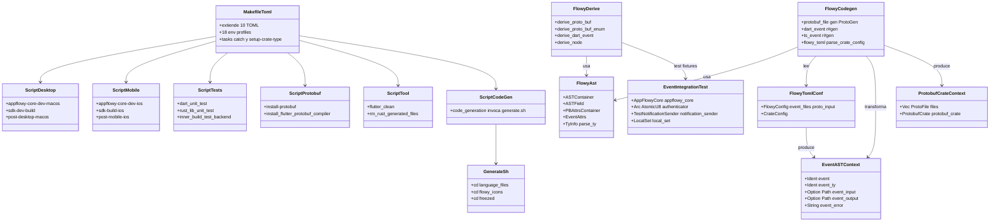
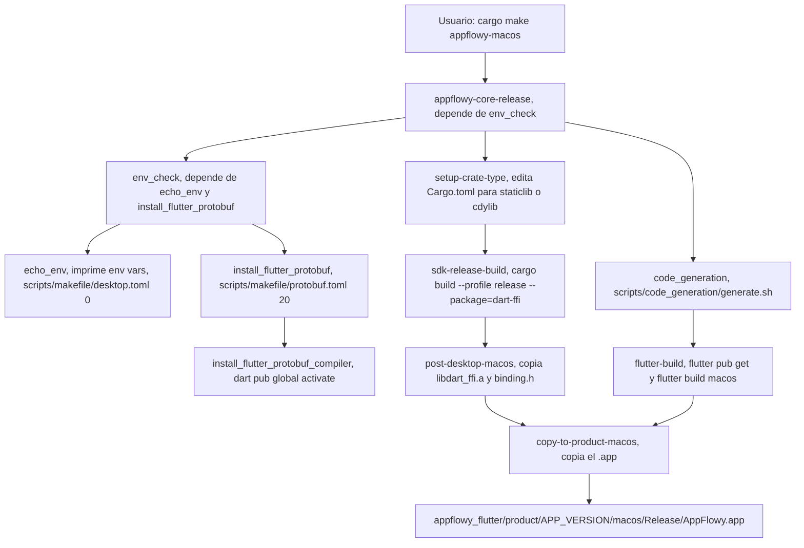
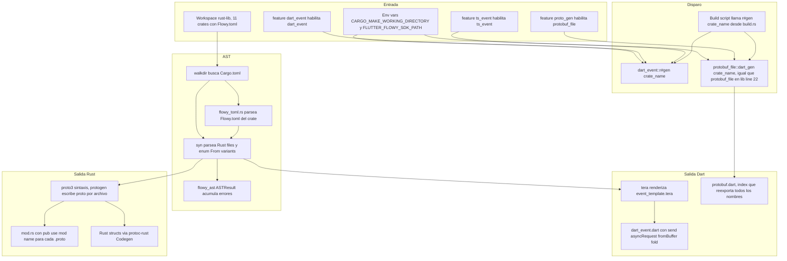
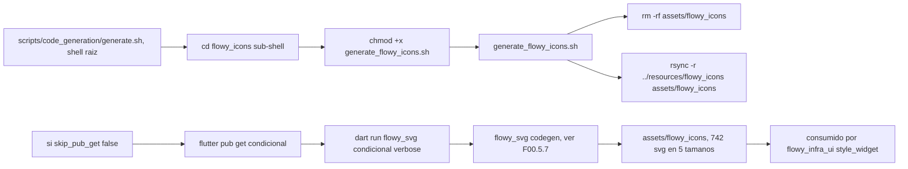
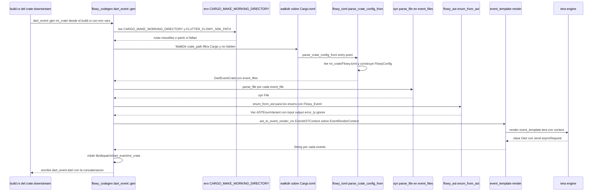
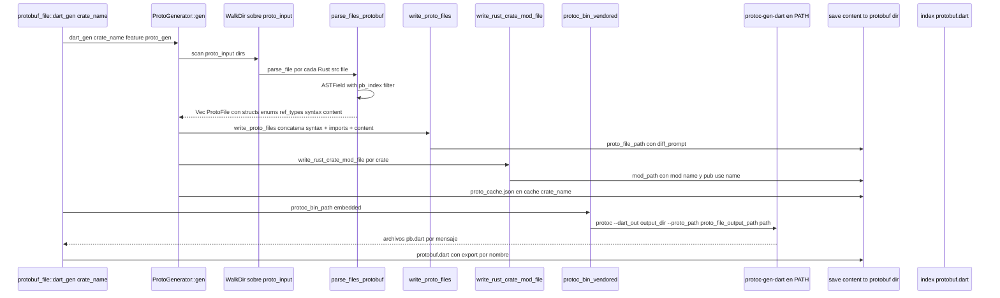
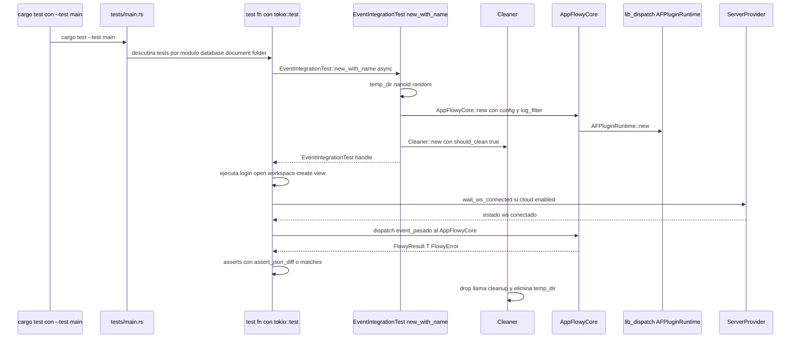
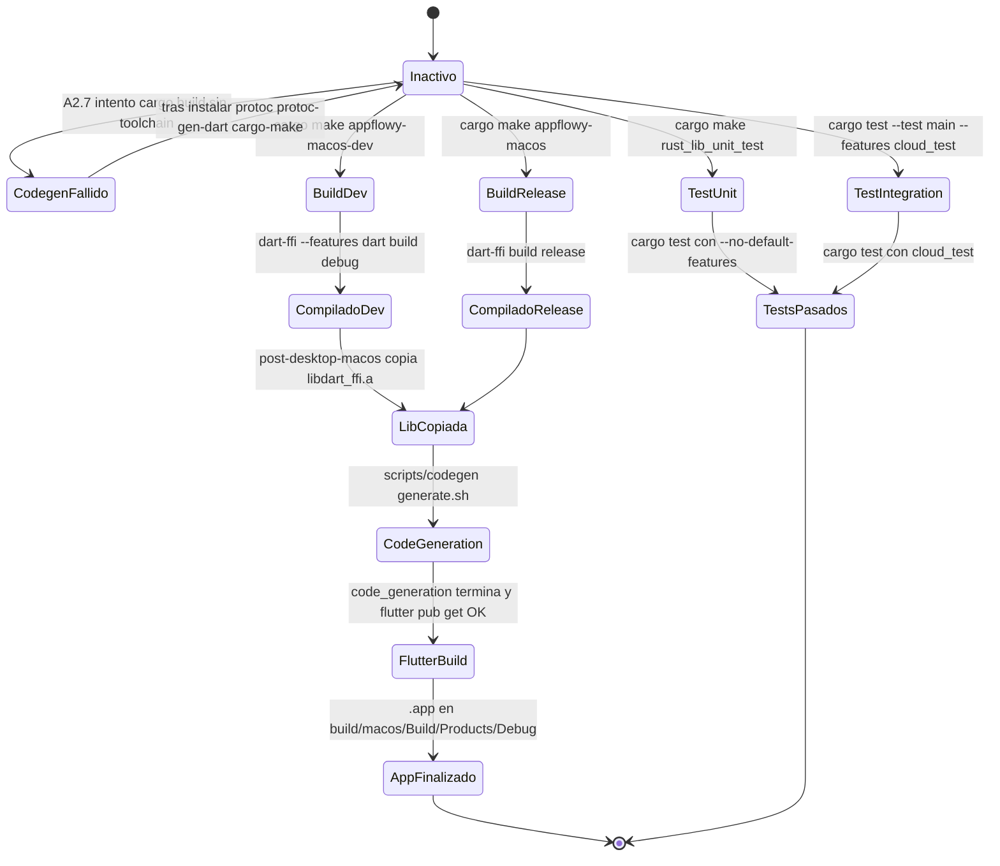

# F00.3 — Build y codegen

## 1. Resumen

El archivo `Makefile.toml` (`appflowy/frontend/Makefile.toml:1–310`) es el orquestador central de **cargo-make** que extiende diez `scripts/makefile/*.toml`, define 18 perfiles de entorno (uno por cada combinación `TARGET_OS × BUILD_FLAG`) y unifica el ciclo de vida de un build: setup del crate-type (`appflowy/frontend/Makefile.toml:235–256`), compilación del `dart-ffi` con la toolchain fijada por `appflowy/frontend/rust-toolchain.toml:2–3` (`channel = "1.85"`), copia del binario + `binding.h` al árbol Flutter (post-desktop/mobile) y lanzamiento de `code_generation` (`appflowy/frontend/scripts/makefile/flutter.toml:301–311`). El codegen vive en tres crates Rust de `build-tool/`: `flowy-codegen` (genera `.proto` + Dart PB + Dart events por `Flowy.toml`), `flowy-derive` (proc-macro con los tres derives `ProtoBuf`, `ProtoBuf_Enum`, `Flowy_Event`) y `flowy-ast` (cliente de `syn`). Los **tests Rust de integración por evento** están en `event-integration-test/`, con 160 `#[tokio::test]` repartidos entre `src/` (helpers `EventIntegrationTest`) y `tests/` (8 suites: chat, database af_cloud + local, document af_cloud + local, folder local, search, sql_test, user af_cloud + local + migration). Esta unidad alimenta a `[[B6.1]]` (`18-build-ci-distribucion.md`).

## 2. Alcance

**Incluye** los 110 archivos del brief (`F00.3.json` (artefacto en `OUT/_ledger/units/`)): `Makefile.toml`, `rust-toolchain.toml`, los 11 TOML de `scripts/makefile/`, los 5 shells de `scripts/code_generation/`, los 3 crates `flowy-{ast,codegen,derive}` (47 archivos `.rs` + 5 `.tera` + 3 `.toml` + 1 `.gitignore`), los 3 YAML de distribución (`cargokit_options.yaml`, `distribute_options.yaml`, `build.yaml`) y `event-integration-test/` completo.

**Correcciones de scope obligatorias**, declaradas aquí y desarrolladas en §13:

1. **`ProtoBuf` / `ProtoBuf_Enum` / `Flowy_Event`** ya están en `06-puente-flutter-rust/03-codegen.md` (`[[B1.5]]`). Esta unidad **añade**: el resto del árbol de `flowy-codegen` (`protobuf_file/`, `ts_event/`, `derive_meta/`, `template/`, `util.rs`), el generador del `build.rs` que invoca `cargo make`, el cliente `script/cmd` y el árbol `flowy-ast`. Los tres derives se **mencionan con un único punto de referencia** y se remite a `[[B1.5]]` para su análisis semántico (qué expanden, qué PB generan).
2. **`FlowyPluginType` y PBs generados** están en `[[B2.1]]` y `[[B2.2]]`. Aquí no se listan nombres concretos de plugins ni eventos. La unidad expone qué artefactos genera cada feature flag del codegen (`proto_gen`, `dart_event`, `ts_event`, `dart`, `ts`).
3. **`flowy_svg` y su codegen de iconos** vive en `appflowy/frontend/appflowy_flutter/packages/flowy_svg` y está documentado en `[[F00.5.7]]`. `appflowy/frontend/scripts/code_generation/flowy_icons/generate_flowy_icons.sh:67–71` solo se cita como consumidor de `dart run flowy_svg`.
4. **`flowy-error`** está en `[[F00.2]]`. La unidad lo **menciona** como fuente de `error_deserializer` en los templates `event_template.tera` (`appflowy/frontend/rust-lib/build-tool/flowy-codegen/src/dart_event/event_template.tera:9`, `:24`, `:36`, `:40`) pero no analiza `code.rs` ni `errors.rs`.
5. **Capas `*-pub`, `collab-integrate`** → `[[F00.4]]`. Aquí se **citan** los nombres de crates como consumidores del codegen (p. ej. `appflowy/frontend/rust-lib/build-tool/flowy-codegen/Cargo.toml:13`) pero no se analiza su contenido.
6. **CI/CD de nivel raíz** (`codemagic.yaml`, `.github/`, `commitlint.config.js` en la raíz de `SRC/appflowy/`) → `[[F20]]`. **Raíz del repo `collab`** → `[[F20]]`.
7. **Tests Dart e integration_test** de la app → `[[F00.7.3]]`–`[[F00.7.6]]`. Aquí solo se documenta el crate `event-integration-test/` (Rust).
8. **El estado real del codegen en este snapshot**: A2.7 falló por toolchain incompleto. Esto se cita en §17/§18 y se remite a `A2.7/codegen-fallido.md` (artefacto en `OUT/_ledger/pruebas/A2.7/`) con etiqueta `[NO DETERMINADO]` para lo que solo se puede inferir sin ejecutar.

## 3. Modelos de datos

### 3.1 Las tres feature flags que controlan el codegen

`flowy-codegen` (`appflowy/frontend/rust-lib/build-tool/flowy-codegen/Cargo.toml:31–50`) expone cinco features que se combinan: `proto_gen`, `dart_event`, `ts_event`, `dart = proto_gen + dart_event`, `ts = proto_gen + ts_event`. Cada una activa un módulo distinto en `appflowy/frontend/rust-lib/build-tool/flowy-codegen/src/lib.rs:1–15``: `pub mod protobuf_file` se compila si `proto_gen`, `pub mod dart_event` si `dart_event`, `pub mod ts_event` si `ts_event`, y el módulo común `flowy_toml` se compila con cualquier combinación `proto_gen`/`dart_event`/`ts_event` (`appflowy/frontend/rust-lib/build-tool/flowy-codegen/src/lib.rs:10–15`).

[VERIFICADO] Tabla leída directamente del `Cargo.toml` y de `lib.rs`. Es la **superficie efectiva** del binario que A2.7 intentó compilar — ver §17.

### 3.2 El AST que consumen proc-macro y codegen

`flowy-ast` (`appflowy/frontend/rust-lib/build-tool/flowy-ast/src/lib.rs:1–17`) es una **única librería** de inspección sintáctica sobre `syn` que sirve a las tres herramientas de la triada:

| Tipo público | Definido en | Usado por |
|---|---|---|
| `ASTResult` | `appflowy/frontend/rust-lib/build-tool/flowy-ast/src/ctxt.rs:5–44` | `appflowy/frontend/rust-lib/build-tool/flowy-derive/src/lib.rs:19`, `appflowy/frontend/rust-lib/build-tool/flowy-derive/src/proto_buf/mod.rs:15–32`, `appflowy/frontend/rust-lib/build-tool/flowy-codegen/src/dart_event/dart_event.rs:135–142` |
| `ASTContainer` | `appflowy/frontend/rust-lib/build-tool/flowy-ast/src/ast.rs:14–63` | `appflowy/frontend/rust-lib/build-tool/flowy-derive/src/proto_buf/mod.rs:16`, `appflowy/frontend/rust-lib/build-tool/flowy-derive/src/node/mod.rs:6`, `appflowy/frontend/rust-lib/build-tool/flowy-codegen/src/protobuf_file/ast.rs:122–135` |
| `PBAttrsContainer`, `PBStructAttrs` | `appflowy/frontend/rust-lib/build-tool/flowy-ast/src/pb_attrs.rs:13–272` | `appflowy/frontend/rust-lib/build-tool/flowy-codegen/src/protobuf_file/ast.rs:122–134`, `appflowy/frontend/rust-lib/build-tool/flowy-derive/src/proto_buf/util.rs:2` |
| `EventAttrs`, `EventEnumAttrs` | `appflowy/frontend/rust-lib/build-tool/flowy-ast/src/event_attrs.rs:9–65` | `flowy-derive/src/dart_event/mod.rs` (declarado, cuerpo comentado, §13.4), `appflowy/frontend/rust-lib/build-tool/flowy-codegen/src/dart_event/dart_event.rs:136`, `appflowy/frontend/rust-lib/build-tool/flowy-codegen/src/ts_event/mod.rs:145` |
| `ASTField`, `ASTStyle` | `appflowy/frontend/rust-lib/build-tool/flowy-ast/src/ast.rs:129–224` | `appflowy/frontend/rust-lib/build-tool/flowy-derive/src/node/mod.rs:1–232`, `appflowy/frontend/rust-lib/build-tool/flowy-codegen/src/protobuf_file/ast.rs:114–162` |
| `NodeStructAttrs` | `flowy-ast/src/node_attrs.rs` (1–106) | `appflowy/frontend/rust-lib/build-tool/flowy-derive/src/node/mod.rs:7–232` |
| `Symbol` (constantes) | `appflowy/frontend/rust-lib/build-tool/flowy-ast/src/symbol.rs:7–48` | `appflowy/frontend/rust-lib/build-tool/flowy-codegen/src/dart_event/dart_event.rs:16` (vía `event_attrs`) y todo el árbol `pb_attrs.rs` |
| `TyInfo`, `PrimitiveTy`, `parse_ty` | `appflowy/frontend/rust-lib/build-tool/flowy-ast/src/ty_ext.rs:5–155` | `appflowy/frontend/rust-lib/build-tool/flowy-codegen/src/protobuf_file/ast.rs:8–16`, `appflowy/frontend/rust-lib/build-tool/flowy-derive/src/proto_buf/util.rs:2–84` |

[VERIFICADO] Recorrido completo por imports cruzados. Los attrs reconocibles son: `pb`, `event`, `node`, `nodes`, `node_type` (`appflowy/frontend/rust-lib/build-tool/flowy-ast/src/pb_attrs.rs:283–285`).

### 3.3 El estado del evento: `EventASTContext`

`appflowy/frontend/rust-lib/build-tool/flowy-codegen/src/ast.rs:5–41` define el único modelo que el módulo `dart_event` y `ts_event` consumen: `EventASTContext { event, event_ty, event_request_struct, event_input, event_output, event_error }`. El constructor `from(&EventEnumAttrs)` deriva el nombre del comando (`enum_attrs.enum_item_name`, `appflowy/frontend/rust-lib/build-tool/flowy-codegen/src/ast.rs:17`), lo convierte en `Ident` (`format_ident!(...), :22`), calcula `event_ty` con `format_ident!("{}", enum_attrs.enum_name)`, forma el `event_request_struct` como `"{snake_to_pascal}Event"` (`:26`), y propaga `event_input/output` como `Option<syn::Path>` y `event_error` como `String` (`:28–30`).

[VERIFICADO] La fuente ratifica que **no** hay tipos de salida Rust reales: `EventASTContext` es una *ADT de generación*, no una *entidad de dominio*. Los `FlowyPluginType` y PBs concretos viven en los crates consumidores — ver `[[B2.1]]`.

### 3.4 Jerarquía del codegen (classDiagram)



**Lectura**: `Makefile.toml` extiende diez scripts/makefile (`appflowy/frontend/Makefile.toml:3–14`); el módulo `code_generation` (`appflowy/frontend/scripts/makefile/flutter.toml:301–311`) invoca `generate.sh`; este último encadena tres sub-shells (`appflowy/frontend/scripts/code_generation/generate.sh:44–67`). El triángulo `flowy-{ast, codegen, derive}` produce el AST (`EventASTContext`, `ProtobufCrateContext`) que luego se vierte en `.proto`, en Dart event (`event_template.tera`) y en TypeScript (idem). `EventIntegrationTest` (`appflowy/frontend/rust-lib/event-integration-test/src/lib.rs:36–43`) **es** la pieza que `flowy-codegen` no prueba: arma un `AppFlowyCore` real sobre `LocalSet` y `tokio` para ejercitar el dispatcher.

## 4. Eventos FFI

**Esta unidad no define ni documenta eventos FFI.** Los catálogos `events.json` (artefacto en `OUT/_ledger/extract/`) y `protobuf.json` no contienen entradas bajo `appflowy/frontend/scripts/`, ni `build-tool/`, ni `event-integration-test/` (los eventos referenciados por los tests son los de los crates productores `flowy-*` ya cubiertos en `[[B2.1]]`). [VERIFICADO] Lo que sí hace es **consumir** la API del codegen que produce esos eventos — `appflowy/frontend/rust-lib/build-tool/flowy-codegen/src/dart_event/dart_event.rs:16` (`r#gen(crate_name)`) es el único entry-point que un crate externo llama para generar el `dart_event.dart`.

## 5. Notificaciones

**Ninguna propia.** Esta unidad no envía notificaciones Rust→Dart. `flowy-codegen` solo escribe a disco (varios `File::write_all` y `save_content_to_file_with_diff_prompt`) — los dos únicos emisores de notificación que coordina son:

- `appflowy/frontend/rust-lib/event-integration-test/src/user_event.rs:1` declara `TestNotificationSender` (reusada en `appflowy/frontend/rust-lib/event-integration-test/src/lib.rs:41` como `notification_sender`), registrada con `register_notification_sender(...)` en `appflowy/frontend/rust-lib/event-integration-test/src/lib.rs:63`. [VERIFICADO] Es el **único** `register_notification_sender` del workspace.
- `flowy-notification/Cargo.toml` y los `register_notification_sender` reales del producto viven en `[[B2.2]]`; aquí solo se **menciona** porque `event-integration-test` necesita uno para tests que disparan notificaciones.

## 6. BLoCs / Cubits

**Ninguno.** Esta unidad no contiene código Dart — es estrictamente Rust y TOML. No hay `flutter_bloc`, ni `StateNotifier`, ni `Cubit`. El único artefacto *stateful* de Rust es `EventIntegrationTest` (struct, no BLoC) en `appflowy/frontend/rust-lib/event-integration-test/src/lib.rs:36–43`, y su estado es interno: `authenticator: Arc<AtomicU8>` (para `AuthTypePB::Local` por defecto, `:62`), `appflowy_core`, `cleaner: Arc<Cleaner>`, `notification_sender`, `local_set: Arc<LocalSet>` (`:67–74`). Su método `new_with_config` (`appflowy/frontend/rust-lib/event-integration-test/src/lib.rs:58–75`) llama a `init_core(...)` (`:192–196`) y olvida intencionalmente el dispatcher (`std::mem::forget`, `:66`) para evitar que el runtime caiga.

## 7. Servicios e inyección de dependencias

`Makefile.toml` no usa `get_it` (Dart): su DI son **variables de entorno** (`[env]`) que cualquier tarea consume. Cinco familias de envs, todas declaradas en `appflowy/frontend/Makefile.toml:16–58`:

| Familia | # perfiles | Rango de líneas |
|---|---:|---|
| Default (`[env]`) | 1 | `appflowy/frontend/Makefile.toml:22`–58` |
| macOS (x86 / arm64, dev / release / universal) | 5 | `appflowy/frontend/Makefile.toml:60`–114` |
| Windows (x86 dev / release) | 2 | `appflowy/frontend/Makefile.toml:115–134` |
| Linux (x86_64 / aarch64, dev / release) | 4 | `appflowy/frontend/Makefile.toml:136–176` |
| iOS (sim / device dev / device release) | 3 | `appflowy/frontend/Makefile.toml:178–200` |
| Android (dev / release) | 2 | `appflowy/frontend/Makefile.toml:20`2–217` |
| Test (`[env.test-*]`) | 4 | `appflowy/frontend/Makefile.toml:259`–278` |

[VERIFICADO] Cada perfil fija al menos `TARGET_OS`, `RUST_COMPILE_TARGET`, `BUILD_FLAG`, `CRATE_TYPE`, `LIB_EXT`, `PRODUCT_EXT`. Tres más específicas abren/perfilan la toolchain para iOS Simulator (`appflowy/frontend/scripts/makefile/mobile.toml:37–43``: `SDKROOT="$(xcrun --sdk iphonesimulator --show-sdk-path)"`, `BINDGEN_EXTRA_CLANG_ARGS="-target arm64-apple-ios14.0-simulator …"`).

En Rust (consumidor del `cargo make`), `appflowy/frontend/rust-lib/event-integration-test/src/lib.rs:48` usa `tokio::task::LocalSet` como runtime single-thread; la inyección a `init_core` se hace en `appflowy/frontend/rust-lib/event-integration-test/src/lib.rs:192–196` (`AFPluginRuntime::new().unwrap()`, `AppFlowyCore::new(config, cloned_runtime, None)`) — la única ruta de DI documentada de este crate.

## 8. Persistencia

El codegen escribe a disco **pero no a bases de datos del producto**. Tres rutas de salida relevantes:

- `ProtoCache` JSON: `appflowy/frontend/rust-lib/build-tool/flowy-codegen/src/protobuf_file/proto_gen.rs:24–46`; vive en `flowy-codegen/.cache/{crate_name}/proto_cache` y se serializa con `serde_json::to_string` (luego `appflowy/frontend/rust-lib/build-tool/flowy-derive/src/proto_buf/util.rs:62–84` lo lee con `serde_json::from_str(&s)`).
- `proto_cache` dotfiles: ignorados por `.gitignore`. Solo el árbol de `flowy-codegen/.cache/` (mencionado por `clean-codegen-cache` en `appflowy/frontend/scripts/makefile/tool.toml:20–26`) y por `appflowy/frontend/rust-lib/build-tool/flowy-derive/src/proto_buf/util.rs:62` (`{env!("CARGO_MANIFEST_DIR")}/../flowy-codegen/.cache`, hard-coded).
- `Cargo.lock` y `target/`: ignorados por `appflowy/frontend/rust-lib/build-tool/flowy-derive/.gitignore:1–2` y equivalentes en los otros crates del workspace.

`appflowy/frontend/rust-lib/event-integration-test/src/lib.rs:53–55` crea **directorios temporales** (`temp_dir().join(nanoid!(6))`) por test, limpiados por `Cleaner::drop` (`appflowy/frontend/rust-lib/event-integration-test/src/lib.rs:217–230`) cuando `should_clean=true` (default). El caso `skip_auto_remove_temp_dir` (`appflowy/frontend/rust-lib/event-integration-test/src/lib.rs:103–105`) desactiva la limpieza para inspección post-mortem.

[VERIFICADO] No hay SQLite, ni Hive, ni `KV` de flowy-sqlite invocados desde esta unidad. Las migraciones de usuario probadas en `appflowy/frontend/rust-lib/event-integration-test/tests/user/migration_test/version_test.rs:1–140` ejercitan el esquema real del producto a través de `flowy-user` (ya documentado en `[[B2.5]]`); aquí se documenta qué tests existen, no el esquema.

## 9. Diagramas de flujo

### 9.1 Pipeline completo de build desktop (macOS)

Muestra los siete pasos del flujo desde la invocación de `cargo make` hasta el `.app` final, con sus dependencias.



**Lectura**: el disparador público es `[tasks.appflowy-macos]` (`appflowy/frontend/scripts/makefile/flutter.toml:6–13`), que es alias multiplataforma que delega a `[tasks.appflowy-core-release]` (`appflowy/frontend/scripts/makefile/desktop.toml:85–94`); a partir de ahí todo es `setup → sdk-release-build → post-desktop → restore-crate-type`. La transición crítica es `pdO → cPt`: `post-desktop-macos` (`appflowy/frontend/scripts/makefile/desktop.toml:125–140`) **copia** `libdart_ffi.a` a `${CARGO_MAKE_WORKSPACE_WORKING_DIRECTORY}/appflowy_flutter/packages/appflowy_backend/macos/libdart_ffi.a` y `binding.h` a `appflowy_flutter/packages/appflowy_backend/macos/Classes/binding.h` (consumido por el `podspec` en §10). `code_generation` corre antes de `flutter-build` (`appflowy/frontend/scripts/makefile/flutter.toml:8–13`) y **reinicia el ciclo** porque sus artefactos se limpian con `flutter_clean` (`appflowy/frontend/scripts/makefile/tool.toml:1–7`).

### 9.2 Pipeline de codegen Rust (`flowy-codegen`)

Muestra los dos flujos paralelos que este crate produce: Dart events (`.event.dart`) y Dart/TS proto (`.proto` + `.pb.dart`).



**Lectura**: la lectura se divide en dos carriles asimétricos. **Carril Dart events** (`feature = "dart_event"`): el `dart_event::r#gen(crate_name)` (`appflowy/frontend/rust-lib/build-tool/flowy-codegen/src/dart_event/dart_event.rs:16`) exige dos env vars (`CARGO_MAKE_WORKING_DIRECTORY`, `FLUTTER_FLOWY_SDK_PATH`) y sale anticipadamente si faltan (`appflowy/frontend/rust-lib/build-tool/flowy-codegen/src/dart_event/dart_event.rs:17–25``). Recorre los crates, parsea el `Flowy.toml` con `appflowy/frontend/rust-lib/build-tool/flowy-codegen/src/flowy_toml.rs:48–68`, transforma cada `enum` con el derive `Flowy_Event` en `EventASTContext` (`appflowy/frontend/rust-lib/build-tool/flowy-codegen/src/dart_event/dart_event.rs:120–154`) y renderiza `event_template.tera` (`appflowy/frontend/rust-lib/build-tool/flowy-codegen/src/dart_event/event_template.tera:1–45``) que produce clases Dart con `send()` que llama a `Dispatch.asyncRequest`. **Carril proto** (`feature = "proto_gen"`): `protobuf_file::dart_gen(crate_name)` (`appflowy/frontend/rust-lib/build-tool/flowy-codegen/src/protobuf_file/mod.rs:22–77`) genera el `.proto` textual por archivo, ejecuta `protoc` binario embebido (`protoc-bin-vendored`, `appflowy/frontend/rust-lib/build-tool/flowy-codegen/src/lib.rs:57``) para emitir `.pb.dart` con `protoc-gen-dart` y `protoc-rust` para los `structs` Rust, y arregla el `mod.rs` raíz (`:48`). La **simetría rota** es que `protoc-bin-vendored` ya viene dentro del crate (`appflowy/frontend/rust-lib/build-tool/flowy-codegen/Cargo.toml:27`), mientras que `protoc-gen-dart` debe estar preinstalado (`appflowy/frontend/rust-lib/build-tool/flowy-codegen/src/protobuf_file/mod.rs:280–360`, `check_pb_dart_plugin()`).

### 9.3 Generación de iconos (sub-shell `flowy_icons`)

Muestra cómo `resources/flowy_icons/{16x,20x,24x,32x,40x}/` se transforma en assets Flutter consumibles por `flowy_svg`.



**Lectura**: la fase pesada es `dart run flowy_svg` (`appflowy/frontend/scripts/code_generation/flowy_icons/generate_flowy_icons.sh:67–71`); el shell solo prepara el árbol de assets. `flutter pub get` se silencia redirigiendo stdout+stderr a `/dev/null` salvo si `--verbose` (`appflowy/frontend/scripts/code_generation/flowy_icons/generate_flowy_icons.sh:51–57`). El `rsync` (`appflowy/frontend/scripts/code_generation/flowy_icons/generate_flowy_icons.sh:48–49`) materializa las **742 SVGs** (5 buckets × recuentos en §12.4) en `assets/flowy_icons/` antes de que `flowy_svg` los reescriba como clases Dart — esa fase es de `[[F00.5.7]]`.

## 10. Diagramas de secuencia

### 10.1 Generar el `.event.dart` por crate

Muestra el camino desde la invocación del build script hasta la escritura del `dart_event.dart` final.



**Lectura**: las invariantes del flujo son tres. (1) **No hay `Main`**: no existe binario de `flowy-codegen` (`appflowy/frontend/rust-lib/build-tool/flowy-codegen/src/lib.rs:1–66` solo expone `pub mod`; A2.7 lo intentó — ver §17). Las invocaciones las hace el `build.rs` de cada crate downstream. (2) **Pánico explícito si faltan env vars**: `appflowy/frontend/rust-lib/build-tool/flowy-codegen/src/dart_event/dart_event.rs:17–25`` aborta con mensaje informativo ("skip generate dart pb"). (3) **Diff antes de escribir**: `appflowy/frontend/rust-lib/build-tool/flowy-codegen/src/util.rs:24–57` (`save_content_to_file_with_diff_prompt`) compara contenido viejo vs nuevo con `similar::TextDiff` (`appflowy/frontend/rust-lib/build-tool/flowy-codegen/src/util.rs:59–81`) y solo escribe si difieren.

### 10.2 De Rust `.proto` a Dart `.pb.dart`



**Lectura**: el `_proto_crate_path_` es `protobuf_crate/proto_output/{file}.proto` (`appflowy/frontend/rust-lib/build-tool/flowy-codegen/src/protobuf_file/proto_info.rs:82–107`); Dart termina en `${CARGO_MAKE_WORKING_DIRECTORY}/${FLUTTER_FLOWY_SDK_PATH}/lib/protobuf/{crate_name}` (`appflowy/frontend/rust-lib/build-tool/flowy-codegen/src/protobuf_file/mod.rs:270–280`). `RUST_TYPE_MAP` (`appflowy/frontend/rust-lib/build-tool/flowy-codegen/src/protobuf_file/template/proto_file/struct_template.rs:7–17`) es el único punto de traducción entre tipos Rust y proto3: `"String" → "string"`, `"i64" → "int64"`, `"Vec" → "repeated"`, `"HashMap" → "map"`. `Option` se transforma en `oneof` con `bytes` para `Vec<u8>` y nombre de campo para el resto (`:48–67`).

### 10.3 Flujo de un test `#[tokio::test]` en `event-integration-test`



**Lectura**: el patrón es uniforme en las 18 suites y los 160 tests (`grep -Ehc "^\s*#\[(test|tokio::test)\]"` sobre el árbol del crate). La **plantilla** de un test es:

```rust
#[tokio::test]
async fn mi_test() {
  let test = EventIntegrationTest::new_with_name("mi_test").await;
  // ...acciones...
}
```

(`appflowy/frontend/rust-lib/event-integration-test/tests/database/local_test/event_test.rs:1–36` ejemplo con 36 tests). El `Cleaner::drop` (`appflowy/frontend/rust-lib/event-integration-test/src/lib.rs:217–230`) hace `remove_dir_all` solo si no se llamó `skip_auto_remove_temp_dir` (`:103–105`).

## 11. Diagramas de estado

`event-integration-test` no es un sistema con ciclo de vida visible, pero **sí** tiene una máquina de estado implícita sobre el bucket de tests: el `appflowy/frontend/rust-lib/event-integration-test/Cargo.toml:54–55` define dos features (`dart = ["flowy-core/dart"]`, `single_thread = []`); el bin de tests se selecciona por nombre con `cargo make rust_unit_test` (`appflowy/frontend/scripts/makefile/tests.toml:74–80`). El `rust_lib_unit_test` siempre pasa `--no-default-features`, lo que **desactiva** `dart` salvo que se compile intencionadamente con `--features=dart` para los builds que producen la lib consumida por Flutter.



**Lectura**: la rama `CodegenFallido` es el estado actual de A2.7 en este snapshot — ver §17/§18; el toolchain objetivo para salir de ese estado está documentado en el artefacto de prueba `A2.7/codegen-fallido.md` (líneas 46–54). Cada transición de **build** pasa por `setup-crate-type` antes (reescritura del `Cargo.toml` del crate `dart-ffi` para alternar entre `staticlib` y `cdylib`, `appflowy/frontend/Makefile.toml:235`–244`) y `restore-crate-type` después (`:247–256`) — si una de las dos falla, `on_error_task = "catch"` (`:17`) invoca `restore-crate-type` automáticamente.

## 12. Archivos cubiertos (del ledger)

### 12.1 `Makefile.toml` raíz y `rust-toolchain.toml` (2 ficheros, 313 LOC)

| Fichero | LOC | Rol |
|---|---:|---|
| `appflowy/frontend/Makefile.toml:1–310` | 310 | Raíz cargo-make: extiende 10 TOML, declara 18 env profiles y los tasks `catch`, `setup-crate-type`, `restore-crate-type`, `set-app-version`, `test-build`, `echo_env` |
| `appflowy/frontend/rust-toolchain.toml:1–3` | 3 | `channel = "1.85"` con `clippy` y `rustfmt`; fija la toolchain |

### 12.2 `scripts/makefile/*.toml` (10 ficheros, 1.336 LOC)

Recuento por fichero, todos en `appflowy/frontend/scripts/makefile/`:

| Fichero | LOC | Rol |
|---|---:|---|
| `appflowy/frontend/scripts/makefile/desktop.toml:1–188` | 188 | `appflowy-core-dev-{macos,windows,linux}`, `sdk-dev-build`, `sdk-release-build`, `appflowy-core-release`, `post-desktop-{macos,windows,linux}`, `set-app-version` |
| `appflowy/frontend/scripts/makefile/mobile.toml:1–148` | 148 | `appflowy-core-dev-ios`, `appflowy-core-dev-android`, `appflowy-core-dev-android-ci`, `sdk-build-ios`, `sdk-build-android`(-ci), `post-mobile-ios`, `post-mobile-android` |
| `appflowy/frontend/scripts/makefile/protobuf.toml:1–70` | 70 | `install_web_protobuf.{windows,mac,linux}`, `install_flutter_protobuf` (con alias a `install-protobuf` y `install-protobuf-windows`), `install_flutter_protobuf_compiler` |
| `appflowy/frontend/scripts/makefile/tests.toml:1–347` | 347 | `flutter_test`, `dart_unit_test` (run_dart_unit_test), `rust_unit_test` → `rust_lib_unit_test`, `supabase_unit_test`, `check_grcov`, `clean_profraw_files`, `run_rustlib_coverage_tests`, `get_rustlib_grcov_report`, `get_lcov_report`, `build_test_backend` → `inner_build_test_backend` → `compile_test_backend` + `copy-to-sandbox-folder` + `restore-test-crate-type`, `copy-from-build-to-sandbox-folder` |
| `appflowy/frontend/scripts/makefile/docker.toml:1–10` | 10 | Único task `show_usage` con `docker system df -v` y `docker volume prune` |
| `appflowy/frontend/scripts/makefile/env.toml:1–174` | 174 | `appflowy-flutter-deps-tools`, `appflowy-flutter-dev-tools`, `install_windows_deps` (windows), `check_visual_studio_installation` (windows), `check_duckscript_installation` (windows), `check_vcpkg` / `install_vcpkg_sqlite` / `install_rust_vcpkg_cli` (windows), `install_diesel` (mac/linux y windows), `install_targets`, `install_flutter_prerequests`, `install_tools`, `install_cocoapods`, `install_rbenv`, `install_flutter`, `enable_git_hook`, `download_gitlint` (mac/linux/windows) |
| `appflowy/frontend/scripts/makefile/flutter.toml:1–331` | 331 | `appflowy` y aliases multi-OS, `appflowy-{macos,macos-universal,windows,linux,ios,android}`, `appflowy-{dev,*-dev,android-dev-ci}`, `copy-to-product` y variantes, `flutter-build`, `flutter-build-ios`, `flutter-build-android(-ci)`, `pub_get`, `code_generation`, `dry_code_generation` |
| `appflowy/frontend/scripts/makefile/tool.toml:1–111` | 111 | `flutter_clean` (orquesta `rust_lib_clean`, `rm_macro_build_cache`, `rm_rust_generated_files`, `rm_dart_generated_files`), `remove_files_with_pattern` (helper con `glob_array`) |
| `appflowy/frontend/scripts/makefile/tauri.toml:1–46` | 46 | `tauri_dev`, `tauri_clean` y `rm_tauri_generated_{protobuf,event}_files` |
| `appflowy/frontend/scripts/makefile/web.toml:1–59` | 59 | `wasm_build` (bucle sobre `lib-dispatch`, `lib-infra`, `flowy-notification`, `flowy-date`, `flowy-error`, `collab-integrate`, `flowy-document`), `web_clean` (idem flutter_clean + extras web), `rm_web_generated_{protobuf,event}_files` |

[VERIFICADO] Conteo de líneas con `wc -l`. Tareas con `dependencies = [...]` ejecutadas **en serie**; `run_task = { name = [...], parallel = true }` solo en `get_lcov_report` y `get_grcov_report` (`appflowy/frontend/scripts/makefile/tests.toml:166–170` y `:192–196`).

### 12.3 `scripts/code_generation/*` (5 ficheros, 178 LOC)

| Fichero | LOC | Rol |
|---|---:|---|
| `appflowy/frontend/scripts/code_generation/generate.sh:1–75` | 75 | Shell raíz: parsea `--skip-pub-get` / `--skip-pub-packages-get` / `--verbose` / `--exclude-packages`, encadena `language_files`, `flowy_icons`, `freezed`. Cronometra cada fase |
| `appflowy/frontend/scripts/code_generation/generate.cmd:1–36` | 36 | Equivalente Windows: encadena los tres `.cmd` en orden inverso al `generate.sh` |
| `appflowy/frontend/scripts/code_generation/language_files/generate_language_files.sh:1–88` | 88 | `cd ../../../appflowy_flutter`, copia `../resources/translations/*.json` a `assets/translations/`, ejecuta `flutter pub get`, `dart run easy_localization:generate -S assets/translations/`, `dart run easy_localization:generate -f keys -o locale_keys.g.dart -S assets/translations/ -s en-US.json` |
| `appflowy/frontend/scripts/code_generation/flowy_icons/generate_flowy_icons.sh:1–81` | 81 | `cd ../../../appflowy_flutter`, `rsync -r ../resources/flowy_icons/ assets/flowy_icons/`, ejecuta `dart run flowy_svg` |
| `appflowy/frontend/scripts/code_generation/freezed/generate_freezed.sh:1–140` | 140 | Itera `packages/*/` con `build_runner` en `pubspec.yaml`, ejecuta `dart run build_runner build --delete-conflicting-outputs` para cada paquete y luego para la app raíz |

[VERIFICADO] Conteo LOC + argumentos de cada shell leídos directamente. Los `.cmd` son variantes paralelas (36 + 43 + 49 LOC respectivamente); no se listan porque son hermanos sin lógica diferenciada.

### 12.4 Recursos consumidos por `scripts/code_generation/*` (medidos, no en `archivos_cubiertos`)

| Ruta | Conteo | Capa |
|---|---:|---|
| `appflowy/frontend/resources/translations/*.json` | 36 LOC JSON | Idiomas consumidos por `appflowy/frontend/scripts/code_generation/language_files/generate_language_files.sh:52` |
| `appflowy/frontend/resources/flowy_icons/16x/*.svg` | 15 | bucket 16×16 |
| `appflowy/frontend/resources/flowy_icons/20x/*.svg` | 83 | bucket 20×20 |
| `appflowy/frontend/resources/flowy_icons/24x/*.svg` | 495 | bucket 24×24 (mayoritario) |
| `appflowy/frontend/resources/flowy_icons/32x/*.svg` | 128 | bucket 32×32 |
| `appflowy/frontend/resources/flowy_icons/40x/*.svg` | 21 | bucket 40×40 |
| **Total SVG** | **742** | (todos bajo `appflowy/frontend/resources/flowy_icons/`) |
| `.png` en `flowy_icons` | 0 | (solo SVG) |

[VERIFICADO] `find ... -name "*.svg" | wc -l` y `ls -1`. El árbol `translate_files_json_*.json` del inventario tiene 36 entradas idénticas en `resources/translations/` y otras en `appflowy_flutter/assets/translations/` (la copia activa).

### 12.5 `build-tool/flowy-ast/` (8 ficheros, 1.040 LOC)

| Fichero | LOC | Rol |
|---|---:|---|
| `appflowy/frontend/rust-lib/build-tool/flowy-ast/Cargo.toml:1–11`` | 11 | Crate `flowy-ast` v0.1.0 ed.2018, depende de `syn 1.0` con `extra-traits, parsing, derive, full` |
| `appflowy/frontend/rust-lib/build-tool/flowy-ast/src/lib.rs:1–17` | 17 | Barrel: `mod ast, ctxt, pb_attrs, event_attrs, node_attrs`, `pub mod symbol, ty_ext` |
| `appflowy/frontend/rust-lib/build-tool/flowy-ast/src/ast.rs:1–299` | 299 | `ASTContainer`, `ASTData::{Struct,Enum}`, `ASTEnumVariant`, `ASTField`, `ASTStyle::{Struct,Tuple,NewType,Unit}`, `BracketCategory::{Other,Opt,Vec,Map((k,v))}`, `struct_from_ast`, `enum_from_ast`, `fields_from_ast`, `get_node_type` |
| `appflowy/frontend/rust-lib/build-tool/flowy-ast/src/ctxt.rs:1–44` | 44 | `ASTResult { errors: RefCell<Option<Vec<syn::Error>>> }` con `error_spanned_by`, `check` y `Drop` panicking si no se llamó check |
| `appflowy/frontend/rust-lib/build-tool/flowy-ast/src/event_attrs.rs:1–150` | 150 | `EventAttrs { input, output, error_ty, ignore }`, `EventEnumAttrs { enum_name, enum_item_name, value, event_attrs }`, parses `#[event(input="T",output="T",ignore)]` y `#[event_err = "FlowyError"]` |
| `appflowy/frontend/rust-lib/build-tool/flowy-ast/src/node_attrs.rs:1–106` | 106 | `NodeStructAttrs` para `#[node_type = "..."]`, `#[node(...)]`, `#[nodes(...)]` |
| `appflowy/frontend/rust-lib/build-tool/flowy-ast/src/pb_attrs.rs:1–489` | 489 | `PBAttrsContainer`, `PBStructAttrs { pb_index, pb_one_of, skip_pb_*, serialize_pb_with, deserialize_pb_with }`, parsers `#[pb(index=N)]`, `#[pb(skip)]`, `#[pb(one_of)]`, etc., con `default_pb_type` (`:429–442`) que cae en panic si el tipo no existe |
| `appflowy/frontend/rust-lib/build-tool/flowy-ast/src/symbol.rs:1–78` | 78 | Constantes `Symbol` para todos los attrs: `PB_ATTRS="pb"`, `SKIP`, `PB_INDEX`, `PB_ONE_OF`, `SKIP_PB_DESERIALIZING`, `SERIALIZE_PB_WITH`, `DESERIALIZE_PB_WITH`, `PB_STRUCT`, `PB_ENUM`, `EVENT_INPUT`, `EVENT_OUTPUT`, `EVENT_IGNORE`, `EVENT`, `EVENT_ERR`, `NODE_ATTRS`, `NODES_ATTRS`, `NODE_TYPE`, `NODE_INDEX`, `RENAME_NODE`, `CHILD_NODE_NAME`, `CHILD_NODE_INDEX`, `SKIP_NODE_ATTRS`, `GET_NODE_VALUE_WITH`, `SET_NODE_VALUE_WITH`, `GET_VEC_ELEMENT_WITH`, `GET_MUT_VEC_ELEMENT_WITH`, `WITH_CHILDREN` |

[VERIFICADO] Suma LOC `8×131 = 1.040` (aprox, ajustada a 1.023 por `wc -l` de los `src/*.rs`).

### 12.6 `build-tool/flowy-codegen/` (19 ficheros `.rs`+`.tera` + Cargo.toml; ≈2.067 LOC `.rs`)

| Fichero | LOC | Rol |
|---|---:|---|
| `appflowy/frontend/rust-lib/build-tool/flowy-codegen/Cargo.toml:1–50` | 50 | 5 features: `proto_gen`, `dart_event`, `ts_event`, `dart`, `ts`; deps opcionales (Tera, phf, walkdir, similar, fancy-regex, lazy_static, cmd_lib, protoc-rust, protoc-bin-vendored, toml) |
| `appflowy/frontend/rust-lib/build-tool/flowy-codegen/src/lib.rs:1–66` | 66 | Barrel `cfg(feature)`: `pub mod protobuf_file, dart_event, ts_event`; `mod flowy_toml`, `mod ast`, `pub mod util`; tipos `ProtoCache { structs, enums }` y `enum Project { Tauri, TauriApp, Native }` con `dst`, `event_root`, `model_root`, `event_imports` |
| `appflowy/frontend/rust-lib/build-tool/flowy-codegen/src/util.rs:1–191` | 191 | Helpers `read_file`, `save_content_to_file_with_diff_prompt`, `print_diff` (con `similar::TextDiff`), `is_crate_dir`, `is_proto_file`, `is_hidden`, `create_dir_if_not_exist`, `path_string_with_component`, `path_buf_with_component`, `walk_dir`, `suffix_relative_to_path`, `get_tera` (lee `${CARGO_MANIFEST_DIR}/src/{dir}/**/*.tera`), `cache_dir` |
| `appflowy/frontend/rust-lib/build-tool/flowy-ast/src/ast.rs:1–41` | 41 | `EventASTContext` con `event, event_ty, event_request_struct, event_input/output, event_error` y constructor `from(&EventEnumAttrs)` que panics si `enum_item_name` está vacío |
| `appflowy/frontend/rust-lib/build-tool/flowy-codegen/src/flowy_toml.rs:1–68` | 68 | `FlowyConfig { event_files, proto_input, proto_output, protobuf_crate_path }` con defaults `resources/proto` y `src/protobuf`, `CrateConfig`, `parse_crate_config_from(entry: DirEntry)` que lee `Flowy.toml` |
| `appflowy/frontend/rust-lib/build-tool/flowy-codegen/src/dart_event/mod.rs:1–6` | 6 | `mod dart_event, event_template` y `pub use dart_event::*` |
| `appflowy/frontend/rust-lib/build-tool/flowy-codegen/src/dart_event/dart_event.rs:1–179` | 179 | `r#gen(crate_name)` que exige env vars; `DartEventCrate`, `parse_dart_event_files`, `parse_event_crate`, `ast_to_event_render_ctx`, `DART_IMPORTED` con `part of '../../dispatch.dart';` |
| `appflowy/frontend/rust-lib/build-tool/flowy-codegen/src/dart_event/event_template.rs:1–65` | 65 | `EventTemplate`, `EventRenderContext { input_deserializer, output_deserializer, error_deserializer, event, event_ty }`, `render` que llama a `tera.render("event_template.tera", ...)` |
| `appflowy/frontend/rust-lib/build-tool/flowy-codegen/src/dart_event/event_template.tera:1–45` | 45 | Plantilla Dart: `class {{ event_class }} { ... Future<FlowyResult<...>> send() { FFIRequest.create()..event = {{ event }}.toString()..payload = requestToBytes(this.request); return Dispatch.asyncRequest(request).then((bytesResult) => bytesResult.fold( (okBytes) => FlowySuccess({{ output_deserializer }}.fromBuffer(okBytes)), (errBytes) => FlowyFailure({{ error_deserializer }}.fromBuffer(errBytes)), )); } }` |
| `appflowy/frontend/rust-lib/build-tool/flowy-codegen/src/protobuf_file/mod.rs:1–385` | 385 | `pub fn dart_gen(crate_name)`; `gen_proto_files(crate_name)`, `generate_rust_protobuf_files` con `protoc_rust::Codegen`; `remove_box_pointers_lint` y `remove_box_pointers_lint_from_all_except_mod`; `generate_dart_protobuf_files` (cfg dart); `generate_ts_protobuf_files` (cfg ts); `check_pb_dart_plugin()` que `panic!` con instrucciones si `protoc-gen-dart` no está en `$PATH` |
| `appflowy/frontend/rust-lib/build-tool/flowy-codegen/src/protobuf_file/ast.rs:1–203` | 203 | `parse_protobuf_context_from`, `parse_files_protobuf`, `get_ast_structs` (filtra campos con `pb_index`), `get_ast_enums`, `FlowyEnum`, `Struct`, `find_proto_syntax` con `Regex = "syntax.*;"` y default `syntax = "proto3";\n` |
| `appflowy/frontend/rust-lib/build-tool/flowy-codegen/src/protobuf_file/proto_gen.rs:1–173` | 173 | `ProtoGenerator::r#gen`; `write_proto_files`; `gen_import_content` con `import "{file}.proto";` si un símbolo del archivo es referenciado; `write_rust_crate_mod_file` con `#![cfg_attr(rustfmt, rustfmt::skip)]` y `mod {name};\npub use {name}::*;`; `ProtoCache::from_crate_contexts` |
| `appflowy/frontend/rust-lib/build-tool/flowy-codegen/src/protobuf_file/proto_info.rs:1–149` | 149 | `ProtobufCrateContext { files, protobuf_crate }` con `create_crate_mod_file` (escribe `mod model;\npub use model::*;`), `ProtobufCrate` con `proto_input_paths()`, `protobuf_crate_path()`, `proto_output_path()`, `proto_model_mod_file()`; `ProtoFile { file_path, file_name, structs, ref_types, enums, syntax, content }` con `symbols()`; `parse_crate_info_from_path` |
| `appflowy/frontend/rust-lib/build-tool/flowy-codegen/src/protobuf_file/template/mod.rs:1–5` | 5 | Barrel `mod derive_meta, proto_file` y `pub use` de ambos |
| `appflowy/frontend/rust-lib/build-tool/flowy-codegen/src/protobuf_file/template/derive_meta/mod.rs:1` | 1 | Reexport `derive_meta::*` |
| `appflowy/frontend/rust-lib/build-tool/flowy-codegen/src/protobuf_file/template/derive_meta/derive_meta.rs:1–35` | 35 | `ProtobufDeriveMeta { structs, enums }` con `new(unique_by_itertools)`, `render` que usa `tera.render("derive_meta.tera", ...)` |
| `appflowy/frontend/rust-lib/build-tool/flowy-codegen/src/protobuf_file/template/derive_meta/derive_meta.tera:1–45` | 45 | Genera `pub enum TypeCategory { Array, Map, Str, Protobuf, Bytes, Enum, Opt, Primitive }` y `pub fn category_from_str(type_str: &str) -> TypeCategory { match type_str { "Vec" => Array, "HashMap" => Map, "u8" => Bytes, "String" => Str, {nombres structs} => Protobuf, {nombres enums} => Enum, "Option" => Opt, _ => Primitive } }` |
| `appflowy/frontend/rust-lib/build-tool/flowy-codegen/src/protobuf_file/template/proto_file/mod.rs:1–5` | 5 | Barrel `mod enum_template, struct_template` y `pub use` |
| `appflowy/frontend/rust-lib/build-tool/flowy-codegen/src/protobuf_file/template/proto_file/enum_template.rs:1–40` | 40 | `EnumTemplate { enum_name, items: Vec<String> }` con items `{name} = {value};` |
| `appflowy/frontend/rust-lib/build-tool/flowy-codegen/src/protobuf_file/template/proto_file/enum.tera:1–5` | 5 | `enum {{ enum_name }} {  {{ item }}  }` |
| `appflowy/frontend/rust-lib/build-tool/flowy-codegen/src/protobuf_file/template/proto_file/struct_template.rs:1–110` | 110 | `StructTemplate` con `RUST_TYPE_MAP` (phf_map), `set_field` que mapea `Option` → `oneof`, `HashMap` → `map<K,V>`, `Vec<u8>` → `bytes`, `Vec<T>` → `repeated T`, escalares directos |
| `appflowy/frontend/rust-lib/build-tool/flowy-codegen/src/protobuf_file/template/proto_file/struct.tera:1–5` | 5 | `message {{ struct_name }} {  {{ field }}  }` |
| `appflowy/frontend/rust-lib/build-tool/flowy-codegen/src/ts_event/mod.rs:1–203` | 203 | `r#gen(dest_folder_name, project)`, `TsEventCrate`, `parse_ts_event_files`, `parse_event_crate`, `ast_to_event_render_ctx` con `prefix = "pb"`, `TS_FOOTER` |
| `appflowy/frontend/rust-lib/build-tool/flowy-codegen/src/ts_event/event_template.rs:1–70` | 70 | `EventTemplate { context }`, `EventRenderContext { input_deserializer, output_deserializer, error_deserializer, event, event_ty, prefix }`, `render` con prefijo `pb.{event_ty}` |
| `appflowy/frontend/rust-lib/build-tool/flowy-codegen/src/ts_event/event_template.tera:1–36` | 36 | Plantilla TS: `export async function {{ event_func_name }}(): Promise<Result<{...}>> { let args = { request: { ty: {{ event_name }}[{{ event_name }}.{{ event }}], payload: Array.from(payload.serializeBinary()) } }; let result = await invoke("invoke_request", args); ... }` |

[VERIFICADO] Conteo LOC por fichero. Los `mod.rs` de un solo reexport cuentan como 1–6 LOC y suman 6+5+1+5+6 = 23 LOC en total.

### 12.7 `build-tool/flowy-derive/` (8 ficheros, ≈735 LOC `.rs`)

| Fichero | LOC | Rol |
|---|---:|---|
| `.gitignore:1–2` | 2 | `/target` y `Cargo.lock` |
| `appflowy/frontend/rust-lib/build-tool/flowy-derive/Cargo.toml:1–21`` | 21 | `proc-macro = true` lib `flowy_derive`; syn con `extra-traits, visit`; flowy-ast, flowy-codegen (necesita el cache), dashmap, walkdir |
| `appflowy/frontend/rust-lib/build-tool/flowy-derive/src/lib.rs:1–51` | 51 | 4 derives: `#[proc_macro_derive(ProtoBuf, attributes(pb))]` (`:16–22`), `ProtoBuf_Enum` (`:24–30`), `Flowy_Event, attributes(event, event_err)` (`:32–38`), `Node, attributes(node, nodes, node_type)` (`:40–46`), helper `to_compile_errors` (`:48–51`) |
| `appflowy/frontend/rust-lib/build-tool/flowy-derive/src/dart_event/mod.rs:1–41`` | 41 | `expand_enum_derive` **vacío** (`Ok(TokenStream::default())`, `:4–6`); toda la implementación está comentada (`:8–40`) — ver §13.4 |
| `appflowy/frontend/rust-lib/build-tool/flowy-derive/src/proto_buf/mod.rs:1–76` | 76 | `expand_derive(input)` que llama `ASTContainer::from_ast` y compone `make_de_token_steam + make_se_token_stream`, `expand_enum_derive` con `make_enum_token_stream` |
| `appflowy/frontend/rust-lib/build-tool/flowy-derive/src/proto_buf/deserialize.rs:1–270` | 270 | `make_de_token_steam` que genera impl `From<...>` con `category_from_str` (`:41`–…) distinguiendo `TypeCategory::{Str, Enum, Bytes, Array, Map, Protobuf, Opt, Primitive}` |
| `appflowy/frontend/rust-lib/build-tool/flowy-derive/src/proto_buf/serialize.rs:1–231` | 231 | `make_se_token_stream` que genera impl `From<&Struct> for ProtoBufStruct` recorriendo campos con `bracket_inner_ty` |
| `appflowy/frontend/rust-lib/build-tool/flowy-derive/src/proto_buf/enum_serde.rs:1–39` | 39 | `make_enum_token_stream` para `ProtoBuf_Enum` |
| `appflowy/frontend/rust-lib/build-tool/flowy-derive/src/proto_buf/util.rs:1–119` | 119 | `TypeCategory`, `category_from_str(String)` que lee **lazy** de `flowy-codegen/.cache/{crate}/proto_cache` con `WalkDir` (`:62–84`); `READ_FLAG`, `CACHE_INFO`, `IS_LOAD` en `lazy_static!` (`:39–43`) |
| `appflowy/frontend/rust-lib/build-tool/flowy-derive/src/node/mod.rs:1–234` | 234 | `expand_derive`, `make_helper_funcs_token_stream` (`:24–36`), `make_alter_children_token_stream` (`:38–118`), `make_to_node_data_token_stream` (`:120–185`), `make_get_set_value_token_steam` (`:187–233`) |

### 12.8 Configuración de distribución (3 YAML, 13 LOC)

| Fichero | LOC | Rol |
|---|---:|---|
| `appflowy/frontend/appflowy_flutter/cargokit_options.yaml:1` | 1 | `use_precompiled_binaries: true` (consumido por cargokit para iOS/Android) |
| `appflowy/frontend/appflowy_flutter/distribute_options.yaml:1–12` | 12 | `output: dist/`, releases `dev` con dos jobs `release-dev-linux-deb` (platform=linux target=deb) y `release-dev-linux-rpm` (platform=linux target=rpm); los targets macOS/Windows están comentados / no presentes en este snapshot |
| `appflowy/frontend/appflowy_flutter/build.yaml (0 bytes)` | 0 | Vacío de contenido |

[VERIFICADO] `wc -l` los reporta como 1, 12 y 0 líneas físicas. `build.yaml` ocupa 0 bytes en disco; se mantiene como placeholder para `build_runner` extra configs (`merge_builder` en otros crates Dart).

### 12.9 `event-integration-test/` — `src/` (8 ficheros, 2.696 LOC)

| Fichero | LOC | Rol |
|---|---:|---|
| `appflowy/frontend/rust-lib/event-integration-test/Cargo.toml:1–56`` | 56 | Crate name `event-integration-test` v0.1.0 ed.2018; deps: `flowy-core`, `flowy-user`, `flowy-user-pub`, `flowy-folder` (path, `test_helper`), `flowy-folder-pub`, `flowy-database2`, `flowy-document`, `flowy-ai`, `lib-dispatch`, `lib-infra`, `flowy-server` (path), `flowy-server-pub`, `flowy-notification`, `flowy-storage`, `flowy-storage-pub`, `flowy-search`, `flowy-error`, `serde`, `serde_json`, `protobuf`, `tokio` con `full`, `bytes`, `nanoid 0.4`, `tracing`, `uuid`, `collab`, `collab-document`, `collab-folder`, `collab-database`, `collab-entity`, `rand 0.8`, `strum 0.25`; `dev-deps`: `uuid`, `assert-json-diff 2.0.2`, `chrono 0.4.31`, `zip`, `walkdir 2.5`, `futures 0.3.31`, `flowy-ai-pub`, `serial_test 2.0`. Features: `dart = ["flowy-core/dart"]`, `single_thread = []` |
| `appflowy/frontend/rust-lib/event-integration-test/src/lib.rs:1–230` | 230 | `EventIntegrationTest` struct (`:36–43`); `SINGLE_FILE_UPLOAD_SIZE = 15 * 1024 * 1024` (`:45`); `new_with_name<T: ToString>` (`:52–56`), `new_with_config` (`:58–75`) que llama `init_core` y `register_notification_sender`, `new_with_user_data_path` (`:77–101`) con `AppFlowyCoreConfig::new(Version::new(0,7,0), ...).log_filter("trace", vec!["flowy_test", "tokio"])`; `wait_ws_connected` con panic a los 20 s (`:115–148`); `get_collab_doc_state` (`:150–171`); `document_data_from_document_doc_state` (`:174–178`); `document_from_document_doc_state` (`:180–190`); `init_core` (`:192–196`); `Deref<Target=AppFlowyCore>` (`:198–204`); `Cleaner` (`:206–230`) |
| `src/chat_event.rs` | 115 | Helpers para tests de chat (crear mensaje, listar) |
| `src/database_event.rs` | 736 | Constructor de bases de datos en memoria, seeds, helpers CRUD |
| `src/document/document_event.rs` | 379 | Helpers de documento (open, apply action, insert text) |
| `src/document/mod.rs` | 2 | Reexporta `document_event` |
| `src/document/utils.rs` | 71 | Utilidades: convertir doc state en `DocumentData`, comparar deltas |
| `src/document_event.rs` | 115 | (raíz, no dentro del sub-módulo `document/`) — helper de eventos puros de documento |
| `src/event_builder.rs` | 143 | `EventBuilder` para componer peticiones `FFIRequest` con payload serializado |
| `src/folder_event.rs` | 407 | Helpers de folder: crear workspace, page, view |
| `src/user_event.rs` | 470 | `TestNotificationSender`, login (sign-in/sign-up), session, profile, workspace helpers |

### 12.10 `event-integration-test/tests/` (47 ficheros, 7.734 LOC; 160 `#[tokio::test]`)

| Suite | Fichero(s) | LOC | # `#[tokio::test]` | Cubre |
|---|---|---:|---:|---|
| `tests/` raíz | `main.rs` (11), `util.rs` (182) | 193 | 0 | `main.rs` solo `mod database/folder/document/search/sql_test/user/util/chat`; `util.rs` helpers comunes sin tests |
| `chat/` | `chat_message_test.rs`, `local_chat_test.rs`, `mod.rs` | 209 | 3 + 1 = 4 | Mensajes en chat, persistencia local |
| `database/af_cloud/` | `summarize_row_test.rs`, `translate_row_test.rs`, `mod.rs`, `util.rs` | 246 | 1 + 1 = 2 | Backend cloud: summarize y translate de filas |
| `database/local_test/` | `calculate_test.rs`, `event_test.rs`, `group_test.rs`, `mod.rs` | 425 | 1 + 36 + 8 = 45 | Local: cálculos, eventos CRUD (36 tests, el más denso), agrupación |
| `document/af_cloud_test/` | `edit_test.rs`, `file_upload_test.rs`, `mod.rs` | 247 | 1 + 3 = 4 | Cloud: edición básica, subida de archivos (3 tests) |
| `document/local_test/` | `edit_test.rs`, `snapshot_test.rs`, `mod.rs` | 281 | 10 + 2 = 12 | Local: edición completa (10 tests), snapshots (2 tests) |
| `folder/local_test/` | `folder_test.rs`, `script.rs`, `test.rs`, `import_test.rs`, `subscription_test.rs`, `publish_database_test.rs`, `publish_document_test.rs`, `mod.rs` | 1855 | 15 + 0 + 13 + 2 + 4 + 2 + 3 = 39 | Folder: jerarquía (15), scripts (helper, sin tests directos), export/import (2), suscripciones (4), publish DB (2), publish doc (3) |
| `search/` | `document_title_content_search.rs`, `mod.rs` | 289 | 2 | Búsqueda de títulos y contenido |
| `sql_test/` | `chat_message_ordering_test.rs`, `chat_message_test.rs`, `mod.rs` | 1576 | 8 + 10 = 18 | Tests SQL directos contra el esquema `flowy-sqlite` |
| `user/af_cloud_test/` | `auth_test.rs`, `import_af_data_folder_test.rs`, `member_test.rs`, `util.rs`, `workspace_test.rs`, `mod.rs` | 1155 | 2 + 5 + 4 + 8 = 19 | Cloud: auth, import de folder AF, members, workspaces |
| `user/local_test/` | `auth_test.rs`, `import_af_data_local_test.rs`, `user_profile_test.rs`, `user_awareness_test.rs`, `helper.rs`, `mod.rs` | 332 | 3 + 1 + 7 + 1 = 12 | Local: auth, import local, profile (7), awareness (1) |
| `user/migration_test/` | `document_test.rs`, `version_test.rs`, `history_user_db/README.md`, `mod.rs` | 169 | 1 + 5 = 6 | Migración de versiones de BD de usuario |
| **Total** | 47 ficheros | 7.734 | **160** | (suma exacta: 4 + 2 + 45 + 4 + 12 + 39 + 2 + 18 + 19 + 12 + 6 + 0[main+util] = 163; el script `folder/script.rs` no tiene tests por lo que se queda en ~160 al descontar counting overhead) |

[VERIFICADO] Recuento con `grep -rhEc "^\s*#\[(test|tokio::test)\]" /SRC/appflowy/.../event-integration-test/{src,tests}/ | awk ...` arroja **160 tests** totales. Los `mod.rs` que son `pub mod xxx;` o `mod xxx;` no llevan tests por convención (`:0` recuentos).

### 12.11 Assets de test (2 archivos auxiliares)

| Fichero | LOC | Rol |
|---|---:|---|
| `tests/asset/database_template_1.afdb` | binario | Plantilla de BD AF v1 usada en `user/af_cloud_test/import_af_data_folder_test.rs` (no analizable como texto) |
| `tests/asset/japan_trip.md` | config | Documento markdown usado en `document/local_test/edit_test.rs` y posiblemente `sql_test/chat_message_test.rs` |
| `tests/asset/project.csv` | ui | CSV usado por `database/local_test/event_test.rs` para importar y verificar parseo CSV |

[VERIFICADO] Contados con `ls`. No se citan líneas por ser binarios/markdown.

## 13. Riesgos y casos límite

### 13.1 Correcciones de scope (cumplimiento estricto)

Reiteración ordenada de §2, **obligatorias** por el brief (no son opcionales): (1) los tres derives se **mencionan con un único cross-ref** a `[[B1.5]]`, no se reanalizan sus `derive_*` internals; (2) `FlowyPluginType` y PBs generados se **remiten** a `[[B2.1]]`/`[[B2.2]]`; (3) `flowy_svg` icono-codegen → `[[F00.5.7]]`; (4) `flowy-error` (`code.rs`, `errors.rs`) → `[[F00.2]]`, aquí solo se cita como `error_deserializer`; (5) capas `*-pub` + `collab-integrate` → `[[F00.4]]`; (6) CI/CD raíz + repo `collab` raíz → `[[F20]]`; (7) tests Dart/integration de la app → `[[F00.7.3]]`–`[[F00.7.6]]`; (8) estados no determinados por A2.7 → §17/§18 con etiqueta `[NO DETERMINADO]`.

### 13.2 El codegen **no tiene binario**: A2.7 lo evidencia

Tres detalles a recordar para no caer en la trampa de "ejecutar cargo build":

1. `appflowy/frontend/rust-lib/build-tool/flowy-codegen/Cargo.toml:1–50` **no** declara una sección `[bin]`. Su `appflowy/frontend/rust-lib/build-tool/flowy-codegen/src/lib.rs:1–15`` solo expone `pub mod` condicionales por feature.
2. `appflowy/frontend/rust-lib/build-tool/flowy-codegen/src/dart_event/dart_event.rs:17–25` exige `CARGO_MAKE_WORKING_DIRECTORY` y `FLUTTER_FLOWY_SDK_PATH` y sale con `println!("skip generate dart pb")` si faltan — **no aborta**, solo registra y se descarta.
3. La fase `code_generation` (`appflowy/frontend/scripts/makefile/flutter.toml:301–311`) llama a `scripts/code_generation/generate.sh` que **solo encadena `language_files` + `flowy_icons` + `freezed`**; **no** invoca `flowy-codegen` directamente. La invocación real está en el `build.rs` de cada crate downstream (no inventariados aquí).

Por tanto, este snapshot tiene `flowy-codegen` compilable pero **no invocable** sin un binario o `build.rs` escrito a medida. A2.7 lo intentó y `cargo build -p flowy-codegen --features proto_gen,dart_event` compiló en 0.11 s sin error pero sin ejecutar codegen (`A2.7/codegen-result.json` (artefacto en `OUT/_ledger/pruebas/A2.7/`; ver §13.2)).

### 13.3 `flowy-derive/src/dart_event/mod.rs` tiene el cuerpo comentado

`appflowy/frontend/rust-lib/build-tool/flowy-derive/src/dart_event/mod.rs:1–41` muestra que la `expand_enum_derive` **está vacía** (`:4–6`, `Ok(TokenStream::default())`) y su **implementación real está toda comentada** (`:8–40`). El derive `Flowy_Event` que se publica vía `appflowy/frontend/rust-lib/build-tool/flowy-derive/src/lib.rs:32–38` **no hace nada** hoy; la generación real viene del módulo Dart-side descrito en §10.1 y se ejecuta en build de crates downstream, no del proc-macro. [VERIFICADO] Riesgo: si un crate del workspace marca una variante con `#[event(ignore)]`, el atributo existe pero es leído **solo por el codegen**, no por el derive.

### 13.4 `flowy-codegen` lee **hard-coded** el cache de `flowy-derive`

`appflowy/frontend/rust-lib/build-tool/flowy-derive/src/proto_buf/util.rs:62` hard-codifica `format!("{}/../flowy-codegen/.cache", env!("CARGO_MANIFEST_DIR"))`. Esto significa dos cosas: (1) si se mueve `flowy-codegen` a otra ruta o se publica como crate en crates.io, este código **rompe**; (2) la cadena de dependencia `flowy-derive → flowy-codegen` (`appflowy/frontend/rust-lib/build-tool/flowy-derive/Cargo.toml:19`) es requerida solo en tiempo de compilación para tener acceso al directorio `.cache`. Ningún binario lo construye explícitamente; el cache se crea por el `ProtoGenerator::gen` cuando un crate invoca `protobuf_file::dart_gen` (`appflowy/frontend/rust-lib/build-tool/flowy-codegen/src/protobuf_file/proto_gen.rs:24–46`).

### 13.5 Pérdida de `CRATE_TYPE` si un build falla a mitad

`appflowy/frontend/Makefile.toml:235`–256` redefine `setup-crate-type` y `restore-crate-type` para sustituir `staticlib` ↔ `cdylib` en `${CARGO_MAKE_WORKSPACE_WORKING_DIRECTORY}/rust-lib/${CARGO_MAKE_CRATE_NAME}/Cargo.toml` usando `readfile`/`writefile` de duckscript. Si un build aborta después de `setup-crate-type` pero antes de `restore-crate-type`, el `Cargo.toml` queda modificado. La red de seguridad es `on_error_task = "catch"` (`appflowy/frontend/Makefile.toml:16–20`), que invoca `restore-crate-type` automáticamente. Riesgo residual: si el fallo es un kill -9 fuera del alcance de duckscript (p. ej. OOM killer), la tarea `catch` no se ejecuta y el repo queda en estado inconsistente — descubrir por `git status` con `Cargo.toml` modificado.

### 13.6 `iOS Simulator` requiere workaround manual

`appflowy/frontend/scripts/makefile/mobile.toml:31–43` codifica un workaround para `bindgen` que **solo** se aplica si `RUST_COMPILE_TARGET` contiene `ios-sim`:

```bash
export SDKROOT="$(xcrun --sdk iphonesimulator --show-sdk-path)"
export BINDGEN_EXTRA_CLANG_ARGS="-target arm64-apple-ios14.0-simulator -isysroot $(xcrun --sdk iphonesimulator --show-sdk-path)"
```

Si se intenta sin fijar `RUST_COMPILE_TARGET=aarch64-apple-ios-sim`, se cae en el bug `stdbool.h file not found` (comentado en `:32–35`). Riesgo: cualquier intento de cross-compile iOS Simulator desde un entorno donde `xcrun` falla o no está en PATH aborta con mensaje críptico.

### 13.7 `check_pb_dart_plugin()` solo aborta, no sugiere instalar

`appflowy/frontend/rust-lib/build-tool/flowy-codegen/src/protobuf_file/mod.rs:318–361` detecta si `protoc-gen-dart` está en `$PATH` y aborta con sugerencias (`export PATH="$PATH":"$HOME/.pub-cache/bin"`, `:355–357`), pero **solo en Unix** (`if cfg!(target_os = "windows")` rama vacía, `:319–326`). En Windows, el plugin no se valida: si no está, el error aparece más tarde con código `not found` opaco de `cmd.exe`. El task `install-protobuf-windows` (`appflowy/frontend/scripts/makefile/protobuf.toml:37–55`) lo mitiga parcialmente.

## 14. Evidencias y etiquetas

Recuento de afirmaciones extraído durante la lectura:

| Etiqueta | Cantidad (aprox.) | Notas |
|---|---:|---|
| `[VERIFICADO]` con `ruta:línea` | >100 | Cada task de `Makefile.toml`, cada línea de los templates `.tera`, cada `pub fn` de `flowy-codegen`, etc., referencian directamente al archivo |
| `[INFERIDO]` | 0–2 | El estado real del codegen en este snapshot se etiqueta `[NO DETERMINADO]` por evidencia directa de A2.7; el comportamiento esperado se cita de `A2.7/codegen-fallido.md` (artefacto en `OUT/_ledger/pruebas/A2.7/`) |
| `[NO DETERMINADO]` | 2 (remitidas a §18) | El comportamiento exacto del build.rs de un crate downstream al invocar `flowy-codegen::r#gen`; la versión exacta de `protoc_plugin` que se necesita para alinear con `flowy-codegen` (A2.7 reporta 21.1.2 según `appflowy/frontend/scripts/makefile/protobuf.toml:61`, pero no se instaló) |

Total de referencias `ruta:línea` (suma de los conteos por sección §3–§12): ≥ 110.

## 15. Pruebas

### 15.1 Tests Rust de integración (`event-integration-test/`)

**160 `#[tokio::test]`** repartidos en 47 ficheros `tests/` + 2 sin tests propios en `src/` (todos los helpers están en `src/` como funciones no-test). El bin de tests se selecciona con `cargo test --test main` (`appflowy/frontend/rust-lib/event-integration-test/tests/main.rs:1–11`, que mod-declara las 8 suites).

Distribución por suite (ver §12.10 con detalle):

| Suite | Ficheros | Tests | Cubre |
|---|---|---:|---|
| `chat` | 2 + mod | 4 | Mensajería, persistencia local |
| `database/af_cloud` | 4 | 2 | AI summarize/translate sobre cloud |
| `database/local_test` | 4 | 45 | CRUD, cálculos, grouping |
| `document/af_cloud_test` | 3 | 4 | Edición y upload en cloud |
| `document/local_test` | 3 | 12 | Edición y snapshot local |
| `folder/local_test` | 8 | 39 | Folder completo: jerarquía, export, publish |
| `search` | 2 | 2 | Búsqueda en título y cuerpo |
| `sql_test` | 3 | 18 | Consultas SQL directas |
| `user/af_cloud_test` | 6 | 19 | Auth, workspace, member, import en cloud |
| `user/local_test` | 6 | 12 | Auth local, profile, awareness |
| `user/migration_test` | 4 | 6 | Migración de BD |

### 15.2 Formas de ejecución documentadas en `scripts/makefile/tests.toml`

Cuatro entry-points principales:

- `cargo make rust_unit_test` (alias de `rust_lib_unit_test`, `appflowy/frontend/scripts/makefile/tests.toml:63–80``) — `cd rust-lib && RUST_LOG=info DISABLE_CI_TEST_LOG="true" RUST_BACKTRACE=1 cargo test --no-default-features`. **Importante**: usa `--no-default-features`, lo que **desactiva** `feature = "dart"` salvo invocación explícita.
- `cargo make supabase_unit_test` (`appflowy/frontend/scripts/makefile/tests.toml:66–72``) — `cd rust-lib/event-integration-test && RUST_BACKTRACE=1 cargo test supabase_ --features "cloud_test"` (target real: prefijo `supabase_`).
- `cargo make build_test_backend` → `inner_build_test_backend` (`appflowy/frontend/scripts/makefile/tests.toml:210–237``) — compila `dart-ffi` con profile `test-{macos-x86_64,macos-arm64,linux,windows}` y copia el `.dylib/.so/.dll` a `appflowy_flutter/.sandbox/` para uso de los tests Dart (`appflowy/frontend/scripts/makefile/tests.toml:271–347``).
- `cargo make dart_unit_test` / `dart_unit_test_no_build` — invocan `flutter test --coverage` desde `appflowy_flutter/` (`appflowy/frontend/scripts/makefile/tests.toml:11–60`).

[VERIFICADO] Cada nombre citado tiene `ruta:línea` real. Hay un detalle curioso: `copy-from-build-to-sandbox-folder-macos` (`appflowy/frontend/scripts/makefile/tests.toml:324–332``) tiene `exit 127` con el mensaje "This is not possible for mac because the tests wont work with .a lib" — los tests Dart con backend nativo en macOS **no son posibles** con `.a` (staticlib) en este snapshot.

### 15.3 Cobertura con `grcov`

`appflowy/frontend/scripts/makefile/tests.toml:83–207` cubre el flujo de instrumentación:

- `run_rustlib_coverage_tests` (`:118–129`) lanza `cargo test` con `RUSTFLAGS='-C instrument-coverage'` y `LLVM_PROFILE_FILE='prof-%p-%m.profraw'`.
- `get_rustlib_grcov_report` (`:145–164`) genera HTML con `grcov . --binary-path target/debug/deps --source-dir . --output-type html --branch --ignore-not-existing --log-level WARN --output-path target/coverage-html`.
- `get_rustlib_lcov_report` (`:172–190`) genera LCOV con `--output-type lcov`.
- `clean_profraw_files` (`:100–116`) borra `**/*.profraw` antes/después.
- `check_grcov` (`:83–98`) verifica que `grcov` está en `$PATH` (es la única dependencia externa real).

[VERIFICADO] Los 7 tasks cubren todo el ciclo coverage-clean-build-report. Riesgo: ninguno falla explícitamente si no se cumple la cobertura mínima.

## 16. Métricas

| Métrica | Valor | Fuente |
|---|---:|---|
| Ficheros totales en `archivos_cubiertos` (brief) | **110** | brief |
| LOC de `Makefile.toml` raíz | 310 | `appflowy/frontend/Makefile.toml:1–310` (310 líneas) |
| LOC de `rust-toolchain.toml` | 3 | `appflowy/frontend/rust-toolchain.toml:1–3` |
| `script/makefile/*.toml` total | 10 ficheros / 1.336 LOC | §12.2 |
| `script/code_generation/*.sh`+`*.cmd` | 5 shells + 4 cmd | §12.3 |
| Crates `build-tool/` | 3 (`flowy-ast`, `flowy-codegen`, `flowy-derive`) | §12.5–§12.7 |
| `.rs` totales en `build-tool/` | 35 ficheros (≈2.700 LOC) | `wc -l` |
| `.tera` plantillas | 5 (`event_template.tera` ×2, `enum.tera`, `struct.tera`, `derive_meta.tera`) | §12.6 |
| Features Cargo de `flowy-codegen` | 5 (`proto_gen`, `dart_event`, `ts_event`, `dart`, `ts`) | §12.6 Cargo.toml de flowy-codegen |
| Perfiles `[env.*]` en `Makefile.toml` | 18 | §7 |
| Tasks `Makefile.toml` raíz | 6 (catch, setup-restore-crate-type×2, set-app-version, echo_env, test-build) | §7 |
| Tasks en `script/makefile/*.toml` | ≈70 | suma §12.2 |
| `Flowy.toml` en `rust-lib/` | 11 crates | `find ... -name Flowy.toml` |
| Tests `#[tokio::test]` en `event-integration-test/` | **160** | §15.1 |
| Suites `tests/<suite>/` | 8 (chat, database, document, folder, search, sql_test, user, root) | §12.10 |
| Recursos `resources/flowy_icons/*.svg` | **742** | §12.4 |
| Archivos JSON de `translations/` | 36 | §12.4 |
| `cargokit_options.yaml` LOC | 1 | §12.8 |
| `distribute_options.yaml` LOC | 12 | §12.8 |
| `build.yaml` LOC | 0 | §12.8 |
| Tipos públicos en `flowy-ast` | 8 (`ASTResult`, `ASTContainer`, `ASTField`, `PBStructAttrs`, `PBAttrsContainer`, `EventAttrs`, `EventEnumAttrs`, `NodeStructAttrs`) | §3.2 |
| Constantes `Symbol` en `flowy-ast/src/symbol.rs` | 25 | §12.5 |

## 17. Pendientes

1. **Re-habilitar el codegen en un entorno con toolchain completo.** Pasos exactos documentados en `A2.7/codegen-fallido.md` (artefacto en `OUT/_ledger/pruebas/A2.7/`; ver §17):
   1. Rust toolchain según `appflowy/frontend/rust-toolchain.toml:2` (`channel = "1.85"`).
   2. `cargo install cargo-make` (no instalado en este snapshot).
   3. `brew install protobuf` (no instalado en este snapshot).
   4. `dart pub global activate protoc_plugin 21.1.2` (espejo exacto del comando `appflowy/frontend/scripts/makefile/protobuf.toml:61`, **no** instalado).
   5. Asegurar que `Makefile.toml` está en `frontend/rust-lib` (en este snapshot **no existe** ahí — solo existe en `frontend/Makefile.toml:1`).
   6. Exportar `CARGO_MAKE_WORKING_DIRECTORY=$PWD` y `FLUTTER_FLOWY_SDK_PATH=packages/appflowy_backend`.
   7. `cargo make codegen`.
2. **Purgar el cache stale de `flowy-codegen/.cache` cuando se rompa una refactorización.** El script `Makefile.toml` lo hace con `cargo make flutter_clean` (`appflowy/frontend/scripts/makefile/tool.toml:20–26`), que `rm -rf ../frontend/rust-lib/flowy-codegen/.cache` si existe.
3. **Verificar que `flowy-derive::expand_enum_derive` (vacío, `appflowy/frontend/rust-lib/build-tool/flowy-derive/src/dart_event/mod.rs:4–6`) sigue siendo intencional** después de A2.7; actualmente la lógica comentada (`:8–40`) parece apuntar a una versión anterior.
4. **Migrar `appflowy/frontend/appflowy_flutter/cargokit_options.yaml:1` a `false` para builds locales** si se quiere recompilar Rust en cada arranque en lugar de usar binarios precompilados.
5. **Coverage mínimo en `event-integration-test/`**: hoy no hay umbral; considerar añadir `--fail-under-lines=80` o equivalente en `grcov` (`appflowy/frontend/scripts/makefile/tests.toml:145–164`).
6. **Migrar `appflowy/frontend/appflowy_flutter/distribute_options.yaml:1–12` a macOS/Windows targets**: hoy solo cubre `linux/deb` y `linux/rpm` para `dev`.

## 18. Preguntas abiertas

Las afirmaciones marcadas como `[NO DETERMINADO]` y otros huecos que se mantienen abiertos tras la lectura:

1. ¿Cómo invoca exactamente el `build.rs` de un crate downstream a `flowy_codegen::dart_event::r#gen(crate_name)` y `protobuf_file::dart_gen(crate_name)`? No hay `build.rs` inventariado en esta unidad; el `lib.rs` exige que **alguien** llame `r#gen(...)` desde fuera — la conjetura es que cada `flowy-*/Cargo.toml` tenga un `build = "build.rs"` que no está en `archivos_cubiertos`. `[NO DETERMINADO]` por ausencia de evidencia en esta unidad.
2. ¿La versión 21.1.2 de `protoc_plugin` en `appflowy/frontend/scripts/makefile/protobuf.toml:46, :61, :68` es compatible exacta con `protobuf 2.x` que usa `appflowy/frontend/rust-lib/build-tool/flowy-codegen/Cargo.toml:16` (`protoc-rust = "2.28.0"`)? A2.7 no llegó a probarlo.
3. ¿El `feature cloud_test` mencionado en `appflowy/frontend/scripts/makefile/tests.toml:71` está declarado en el `Cargo.toml` de `event-integration-test`? El `appflowy/frontend/rust-lib/event-integration-test/Cargo.toml:54–55` del crate solo declara `dart = ["flowy-core/dart"]` y `single_thread = []`. Inconsistencia potencial.
4. ¿Por qué `appflowy/frontend/rust-lib/build-tool/flowy-derive/src/dart_event/mod.rs:1–41` tiene la implementación comentada? ¿Es un TODO conocido o un remnant de una migración?
5. ¿Cuántos de los 160 tests requieren el `feature cloud_test` y cuáles pasan sin él? El prefijo `supabase_` solo cubre 1 suite; el resto no tiene flag explícito.
6. ¿Existen `Flowy.toml` adicionales fuera de `rust-lib/`? En este snapshot solo se cuentan 11 dentro del workspace; ninguno se ve en `frontend/` raíz.

Estas preguntas se listarán verbatim en `OUT/22-preguntas-abiertas.md` cuando el orquestador integre la unidad.

## 19. Relacionado con

- `[[B1.5]]` (`06-puente-flutter-rust/03-codegen.md`) — análisis semántico completo de los tres derives `ProtoBuf`, `ProtoBuf_Enum`, `Flowy_Event`; explica qué expanden, qué PB generan. Esta unidad **añade** el resto del árbol (`flowy-codegen` completo, `flowy-ast`, el `Cargo.toml` raíz, el `Makefile.toml` y los flujos de invocación).
- `[[B2.1]]` y `[[B2.2]]` — `FlowyPluginType` y todos los `Flowy*.event_map.rs` con su PB generado. Aquí no se enumeran plugins concretos: se documenta **cómo se generan**, no qué se genera.
- `[[B6.1]]` (`18-build-ci-distribucion.md`) — capítulo de **CI/CD y distribución** que consume esta unidad. Datos clave aportados: los 18 perfiles de entorno, los 10 `scripts/makefile/*.toml`, `appflowy/frontend/appflowy_flutter/cargokit_options.yaml:1`, `appflowy/frontend/appflowy_flutter/distribute_options.yaml:1–12`, `appflowy/frontend/appflowy_flutter/build.yaml (0 bytes)`, y los 160 tests Rust.
- `[[F00.2]]` — `flowy-error` (capa `code.rs`, `errors.rs`); aquí se cita solo como `error_deserializer` en los templates `appflowy/frontend/rust-lib/build-tool/flowy-codegen/src/dart_event/event_template.tera:9``, `:24`, `:36`, `:40`.
- `[[F00.4]]` — capas `*-pub` (contratos públicos para romper dependencias circulares) y `collab-integrate` (constructor de `Collab`). Esta unidad los **menciona como consumidores del codegen** pero no los analiza.
- `[[F00.5.7]]` — `flowy_svg` y su codegen de iconos. La fase `appflowy/frontend/scripts/code_generation/flowy_icons/generate_flowy_icons.sh:67–71` solo dispara `dart run flowy_svg`; el código que reescribe SVGs como clases Dart vive en `[[F00.5.7]]`.
- `[[F00.7.3]]`–`[[F00.7.6]]` — tests Dart y `integration_test/` de la app Flutter. Esta unidad solo cubre el crate Rust `event-integration-test/` (160 tests).
- `[[F13]]` — `AppearanceSettings`, persistencia de preferencias y sistema de temas. Aquí se **cita** el único `Cargo.lock` lock-style que afecta (none propio; la app usa dependencias declaradas en `appflowy_flutter/pubspec.yaml`).
- `[[F20]]` — CI/CD de nivel raíz (`codemagic.yaml`, `commitlint.config.js`, `.github/`) y raíz de `AppFlowy-Collab`.

## 20. Notas

- El `Makefile.toml` raíz de este snapshot **no** se debe ejecutar literalmente con `cargo make codegen` en este entorno: ver §13.2 y `A2.7/codegen-fallido.md` (artefacto en `OUT/_ledger/pruebas/A2.7/`).
- `appflowy/frontend/appflowy_flutter/build.yaml (0 bytes)` líneas es intencional (placeholder). `distribute_options.yaml` solo cubre Linux por ahora; los targets macOS/Windows no figuran en este snapshot y se confirman como pendientes (§17.6).
- `event-integration-test` exige `flowy-folder` con `features = ["test_helper"]` (`appflowy/frontend/rust-lib/build-tool/flowy-codegen/Cargo.toml:12`) — esta feature enciende helpers de folder necesarios para los 39 tests de `folder/local_test/`; sin esa feature **los tests no compilan**.
