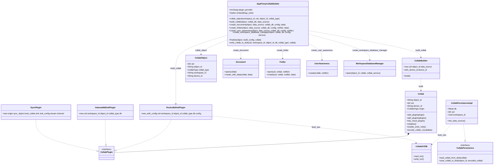
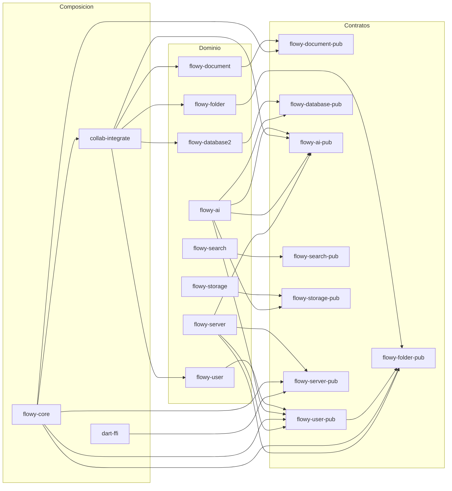
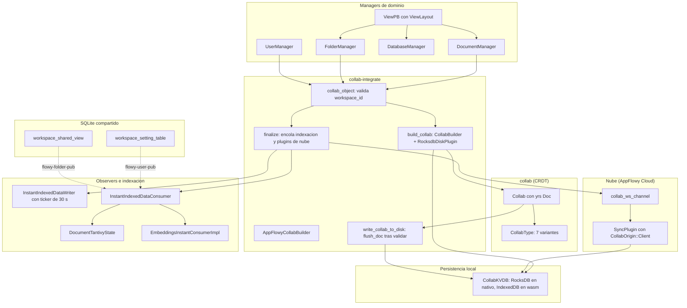
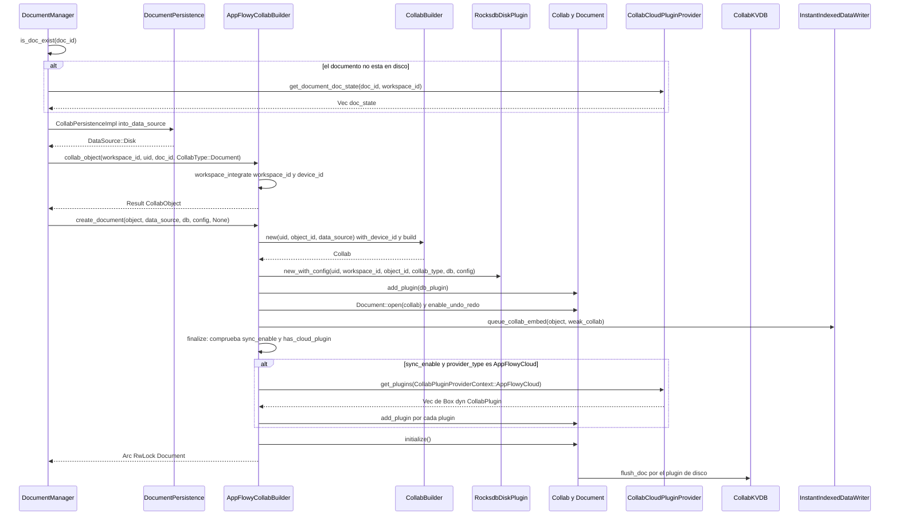
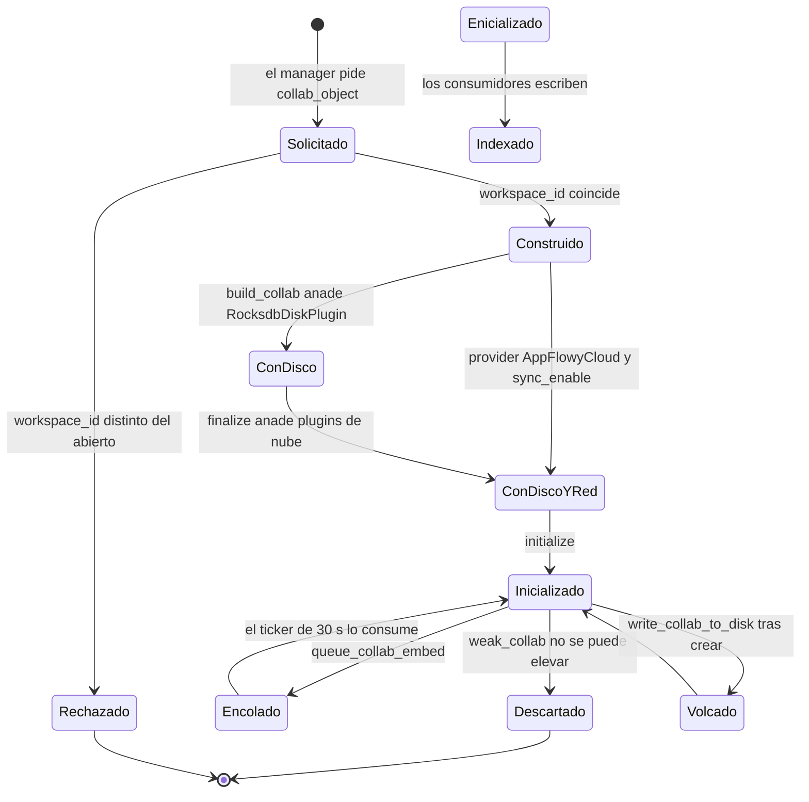

# F00.4 — `collab-integrate` y los crates de contrato `*-pub`

## 1. Resumen

Esta unidad documenta la capa que **fabrica** los objetos `Collab` del SDK y los traits públicos que rompen las dependencias circulares entre crates. `collab-integrate` aporta `AppFlowyCollabBuilder`, que convierte un `CollabObject` en un `Collab` de `yrs`, le engancha el plugin de persistencia local (`RocksdbDiskPlugin`) y, si hay nube y sync activo, los plugins de sincronización que devuelve el `CollabCloudPluginProvider`. Los ocho crates `*-pub` (`flowy-document-pub`, `flowy-folder-pub`, `flowy-user-pub`, `flowy-database-pub`, `flowy-ai-pub`, `flowy-search-pub`, `flowy-storage-pub`, `flowy-server-pub`) no tienen lógica propia: son contratos (`DocumentCloudService`, `FolderCloudService`, `UserCloudService`…), entidades compartidas y acceso Diesel a tablas que varios crates necesitan a la vez. Ninguno de los dos grupos registra eventos FFI ni emite notificaciones: son capas invisibles desde Dart.

## 2. Alcance

**Qué añade este documento.** Cubre 61 ficheros (5 877 líneas) repartidos en 9 crates: `collab-integrate` (6 ficheros) y los 8 crates `*-pub` (55 ficheros). La información que aquí se documenta **no está** en los tres documentos que ya cubren el mismo terreno desde otro ángulo, y el lector debe ir allí para el fondo:

| Documento previo | Qué cubre ya | Qué aporta F00.4 y **no** está allí |
|---|---|---|
| `[[B1.5]]` · `OUT/06-puente-flutter-rust/` | El puente FFI `dart-ffi` ↔ `lib-dispatch` y el ciclo de un evento | Que **quién** decide qué plugin se adjunta a un `Collab`, con qué condición y en qué orden; `CollabPluginProviderContext` y el trait `CollabCloudPluginProvider` |
| `[[B1.7]]` · `OUT/08-persistencia/` | Esquema SQLite, KV, `collab-db`, caché de ficheros, rutas | Que los crates `-pub` **escriben** en 11 tablas diesel (`chat_table`, `user_workspace_table`, `workspace_shared_view`…) y por qué esos módulos viven en un crate de contratos y no en el de dominio |
| `[[B1.2]]` · `OUT/17-grafo-dependencias.md` | El grafo completo del workspace Rust | Por qué existe la convención `*-pub`: la aritmética de aristas que rompe los ciclos `flowy-ai ↔ flowy-user`, `flowy-database2 ↔ flowy-ai` |

**Correcciones de scope que esta unidad debe declarar** (ROADMAP.md (linea 320), decisión D3 de ROADMAP.md (linea 318)):

1. `collab-integrate/src/plugin_provider.rs` estaba asignado por el ROADMAP a **F06** («proveedor de servidor»); el ledger lo asigna a **F00** y así se documenta aquí (ROADMAP.md (linea 330)). F06 seguirá documentando `flowy-core/src/server_layer.rs` y `flowy-core/src/deps_resolve/cloud_service_impl.rs`; la implementación real de `CollabCloudPluginProvider` que este fichero define está en `appflowy/frontend/rust-lib/flowy-core/src/deps_resolve/cloud_service_impl.rs:603`, es decir, en F06.
2. `flowy-storage-pub/src/{appflowy/frontend/rust-lib/flowy-storage-pub/src/chunked_byte.rs, cloud.rs, storage.rs}` estaban asignados por el ROADMAP a **F07** («chunking»); el ledger los asigna a **F00** (ROADMAP.md (linea 331)). Se documentan aquí como **contrato**, no como motor de subida: el `StorageServiceImpl` que las implementa (`appflowy/frontend/rust-lib/flowy-storage/src/manager.rs:271`) queda en F07.
3. El modelo de `CollabType` documentado en `[[B1.6]]` **coincide** con este rev (7 variantes, mismos discriminantes). Las discrepancias reales detectadas en esta unidad son de otro tipo (persistencia y sync, no el enum) y están en §18.

**Qué queda fuera.** La implementación de cada trait (F01, F02, F03, F05, F06, F07, F08, F14), el algoritmo de `SyncPlugin` y del `RemoteCollab` (`collab-plugins/src/cloud_storage/`, unidad F18 según ROADMAP.md (linea 329)), el esquema SQLite completo (F00.2 y `[[B1.7]]`) y el servidor AppFlowy-Cloud, que queda fuera de alcance por AGENTS.md §11: aquí solo se documenta el lado cliente del contrato.

## 3. Modelos de datos

### 3.1 `CollabType`: 7 variantes y quién las produce

El enum que decide qué tipo de objeto colaborativo se está construyendo está en el repo `collab`, no en el de AppFlowy: `collab:collab/collab-entity/src/collab_object.rs:16–31`. Sus siete variantes llevan discriminantes fijos (`Document = 0` … `Unknown = 6`) y `validate_require_data` comprueba que el `yrs::Doc` tenga los Map/Array obligatorios antes de dejar que el objeto se persista (`collab:collab/collab-entity/src/collab_object.rs:61–133`); esa misma función es la que usa `AppFlowyCollabBuilder::write_collab_to_disk` como filtro (`appflowy/frontend/rust-lib/collab-integrate/src/collab_builder.rs:382–383`).

La columna «ViewLayout que lo produce» solo tiene sentido para los tipos que nacen de una vista del árbol: el mapeo explícito está en la rutina de duplicado de vistas (`appflowy/frontend/rust-lib/flowy-folder/src/manager.rs:1252–1256`) y el enum `ViewLayout` tiene cinco variantes (`collab:collab/collab-folder/src/view.rs:834–840`).

| `CollabType` | Discriminante | `ViewLayout` que lo produce | Objeto que construye el builder | Entry point en `appflowy/frontend/rust-lib/collab-integrate/src/collab_builder.rs` |
|---|---|---|---|---|
| `Document` | 0 | `ViewLayout::Document` | `Document` (`collab-document`), que envuelve el `Collab` | `create_document` — `appflowy/frontend/rust-lib/collab-integrate/src/collab_builder.rs:158–193` |
| `Database` | 1 | `ViewLayout::Grid` \| `Board` \| `Calendar` | **Ninguno**: `flowy-database2` llama a `build_collab` directamente y sube el estado con una llamada única | `build_collab` directo — `appflowy/frontend/rust-lib/flowy-database2/src/manager.rs:929–934` |
| `WorkspaceDatabase` | 2 | — (uno por workspace) | `WorkspaceDatabaseManager` (`collab-database`) | `create_workspace_database_manager` — `appflowy/frontend/rust-lib/collab-integrate/src/collab_builder.rs:259–272` |
| `Folder` | 3 | — (es la raíz del árbol) | `Folder` (`collab-folder`) con su `FolderNotify` | `create_folder` — `appflowy/frontend/rust-lib/collab-integrate/src/collab_builder.rs:200–234` |
| `DatabaseRow` | 4 | — (depende de una database) | **Ninguno**: se construye dentro de `WorkspaceDatabaseManager` | `build_collab` directo — `appflowy/frontend/rust-lib/flowy-database2/src/manager.rs:929–934` |
| `UserAwareness` | 5 | — (uno por usuario y workspace) | `UserAwareness` (`collab-user`) con su `UserAwarenessNotifier` | `create_user_awareness` — `appflowy/frontend/rust-lib/collab-integrate/src/collab_builder.rs:241–255` |
| `Unknown` | 6 | `ViewLayout::Chat` | Ninguno: `validate_require_data` lo acepta siempre y el flujo de duplicado lo salta | `appflowy/frontend/rust-lib/collab-integrate/src/collab_builder.rs:367–370` (no discrimina) |

**Lectura de la tabla.** Solo tres de los siete tipos pasan por los `create_*` de alto nivel del builder, y esos tres son precisamente los que **sí** reciben plugins de nube. `Database` y `DatabaseRow` construyen su `Collab` llamando a `build_collab` sin pasar por `finalize`, de modo que obtienen el plugin de disco pero no el de sincronización; la subida a la nube se compensa con una llamada única `create_database_encode_collab` espoleada en un `tokio::spawn` (`appflowy/frontend/rust-lib/flowy-database2/src/manager.rs:907–923`), con un `TODO` explícito en el propio código. `Unknown` corresponde a las vistas de chat, que aún no tienen CRDT propio.

### 3.2 `Collab` y los plugins que se le enganchan

`AppFlowyCollabBuilder` es un struct de seis campos: alcanzabilidad de red, proveedor de plugins (en un `ArcSwap`, para poder cambiarlo en caliente), persistencia de snapshots, backup de RocksDB, el integrador de workspace y el escritor de indexación (`appflowy/frontend/rust-lib/collab-integrate/src/collab_builder.rs:76–84`). De esos seis, solo el proveedor de plugins y el escritor de indexación se **leen** dentro del crate; los otros tres se rellenan mediante *setters* y no se leen en ninguna línea posterior (`appflowy/frontend/rust-lib/collab-integrate/src/collab_builder.rs:103–124`), un caso de borde que se detalla en §13.

Muestra: el grafo de objetos tal como lo construyen `build_collab` y los cuatro `create_*`, con los plugins reales y sus firmas verificadas en `collab`:



Lectura: `build_collab` es el único punto donde nace el `Collab`; allí se ejecuta `CollabBuilder::build` (`collab:collab/collab/src/core/collab.rs:697`) y se le añade **siempre** un `RocksdbDiskPlugin`. `finalize` es la segunda fase: encola el collab en el escritor de indexación, y si `sync_enable` está activo y el proveedor declara `AppFlowyCloud`, pide los plugins de nube y los añade uno a uno bajo el mismo *write lock*, para que ninguno observe el collab a medio inicializar; después llama a `Collab::initialize()` (`collab:collab/collab/src/core/collab.rs:361`). Los cuatro `create_*` son envoltorios: construyen el `Collab`, lo envuelven en el tipo de dominio (`Document`, `Folder`, `UserAwareness`, `WorkspaceDatabaseManager`), opcionalmente lo vuelcan a disco y delegan en `finalize`. `CollabPersistenceImpl` es un segundo camino de entrada: implementa `CollabPersistence` para poderactsuar como `DataSource::Disk` y así leer el documento de RocksDB **antes** de que el `Collab` exista.

### 3.3 Tabla de plugins: qué se engancha, cuándo y desde dónde

| Plugin | Condición de enganche | Fichero:línea |
|---|---|---|
| `RocksdbDiskPlugin` | **Siempre**, sin condición, dentro de `build_collab`, sobre un `Collab` recién creado | `appflowy/frontend/rust-lib/collab-integrate/src/collab_builder.rs:287–296` |
| `IndexeddbDiskPlugin` | **Nunca**: se importa bajo `if_wasm!` pero no se referencia en ninguna línea del crate | import en `appflowy/frontend/rust-lib/collab-integrate/src/collab_builder.rs:25–27`; tipo en `collab:collab/collab-plugins/src/local_storage/indexeddb/indexeddb_plugin.rs:19` |
| `SyncPlugin` (+ `CollabOrigin::Client`) | `build_config.sync_enable == true` **y** `plugin_provider.provider_type() == AppFlowyCloud` **y** el collab aún no tiene plugin de nube (`has_cloud_plugin() == false`) | `appflowy/frontend/rust-lib/collab-integrate/src/collab_builder.rs:325–353`; construcción real en `appflowy/frontend/rust-lib/flowy-core/src/deps_resolve/cloud_service_impl.rs:635–659` |
| Sin plugin (rama `CollabPluginProviderType::Local`) | Usuario local: `finalize` no añade nada y solo llama a `initialize()` | `appflowy/frontend/rust-lib/collab-integrate/src/collab_builder.rs:352` |
| Dump manual a disco (`flush_doc`) | Solo en la rama `Some(data)` de `create_document` / `create_folder`, es decir, cuando se **crea** el objeto y no se reabre | `appflowy/frontend/rust-lib/collab-integrate/src/collab_builder.rs:175–187` y `219–228`; implementación en `363–397` |

**Orden real de enganche**, leído de `finalize`: (1) encolado en el escritor de indexación, en una tarea `tokio::spawn` aparte para no bloquear; (2) lectura de `has_cloud_plugin()` con retorno temprano si ya hay nube; (3) carga del proveedor y comparación de `provider_type`; (4) en el caso `AppFlowyCloud`, petición de los plugins al proveedor e inserción bajo el mismo *write lock*; (5) `initialize()`. El comentario del propio código explica el motivo del *write lock* sostenido: «at the moment when we get the lock, the collab object is not yet exposed outside» (`appflowy/frontend/rust-lib/collab-integrate/src/collab_builder.rs:347`).

## 4. Eventos FFI

Ninguno de los 9 crates de esta unidad registra eventos. Es un hecho verificado, no una omisión: el catálogo `OUT/_ledger/extract/events.json` cubre 8 crates con `event_map.rs` —`flowy-ai`, `flowy-database2`, `flowy-date`, `flowy-document`, `flowy-folder`, `flowy-search`, `flowy-storage`, `flowy-user`— y ninguno de ellos es `collab-integrate` ni un `*-pub`; el resumen del catálogo da 229 variantes y 224 registradas. Los crates `flowy-date` (que sí aparece) y `flowy-notification` son los únicos crates rust sin eventos del conjunto asignado a otras features.

| Evento | input PB | output PB | Handler | Fichero:línea |
|---|---|---|---|---|
| *(ninguno en esta unidad)* | — | — | — | — |

La consecuencia práctica es que **ningún método de estas 61 líneas es alcanzable desde Dart por la vía del dispatcher**. `AppFlowyCollabBuilder` se invoca siempre desde código Rust que ya está en ejecución (un manager de dominio o un `deps_resolve`), y los traits `*-pub` se resuelven por inyección de dependencias, no por evento. La frontera FFI de esta capa está en otro sitio: el resultado de una operación de collab viaja de vuelta como un `Notification` emitido por el crate de dominio, nunca por `collab-integrate`. Ver `[[B1.5]]` §02 y `[[F00.1]]` para ese camino.

## 5. Notificaciones

Igual que en §4, la verificación es negativa y catalogada: `OUT/_ledger/extract/notifications.json` lista 6 enums de notificación emitidos desde Rust (`flowy-ai`, `flowy-database2`, `flowy-document`, `flowy-folder`, `flowy-storage`, `flowy-user`, todos en `<crate>/src/notification.rs`). Ninguno vive en `collab-integrate` ni en un crate `-pub`. `flowy-server-pub` ni siquiera depende de `flowy-notification`.

| Notificación | Emisor | Listener Dart | Efecto UI | Fichero:línea |
|---|---|---|---|---|
| *(ninguna en esta unidad)* | — | — | — | — |

Lo que sí hay es un canal de progreso **interno a Rust** que no llega a Dart: `ProgressNotifier` emite `FileUploadState` (`NotStarted` / `Uploading` / `Finished`) por un `broadcast::channel(100)` de Tokio, y `FileProgressReceiver` implementa `Deref`/`DerefMut` sobre el `broadcast::Receiver` para que el consumidor lo use como si fuera el receiver (`appflowy/frontend/rust-lib/flowy-storage-pub/src/storage.rs:99–127` y `39–56`). Quien lo traduce a notificación Dart es `flowy-storage`, fuera de esta unidad.

## 6. BLoCs / Cubits

No hay BLoCs, Cubits ni ningún fichero Dart en esta unidad: los 61 ficheros son `.rs` o `Cargo.toml`. El catálogo `OUT/_ledger/extract/blocs.json` (142 entradas) no aporta ninguna aplicable. La lógica de presentación que consume lo que aquí se produce está repartida entre `DocumentBloc` y `DocumentSyncBloc` (F01), `WorkspaceBloc` (F03) y `SearchBloc` (F08); el punto de acoplamiento es que todos ellos reciben datos que antes pasaron por esta capa, pero ninguno la invoca.

## 7. Servicios e inyección de dependencias

### 7.1 Por qué existe el patrón `*-pub`

Rust no admite ciclos entre crates, y AppFlowy lo necesita en al menos dos bucles: `flowy-ai` habla con el usuario (`flowy-user-pub/src/user_service.rs` expone `AIUserService`) y el usuario necesita acceso a la IA; `flowy-database2` llama a la IA para resumir filas (`DatabaseAIService`) mientras la IA necesita leer databases. La solución adoptada es la convención AGENTS.md §5.6: un crate `-pub` por dominio, que solo contiene **traits, entidades y funciones Diesel compartidas**, y al que apuntan tanto el crate de dominio como sus consumidores.

La aritmética sale del grafo real del workspace. Tomando `OUT/_ledger/extract/deps.json` como fuente (derivado de los `Cargo.toml`), la lista de dependencias internas por crate de la unidad es:

| Crate | Dependencias internas (`[dependencies]` del `Cargo.toml`) | Evidencia |
|---|---|---|
| `collab-integrate` | `flowy-ai-pub`, `flowy-error`, `lib-infra` | `appflowy/frontend/rust-lib/collab-integrate/Cargo.toml:10–27` |
| `flowy-ai-pub` | `flowy-error`, `flowy-sqlite`, `flowy-user-pub`, `lib-infra` | `appflowy/frontend/rust-lib/flowy-ai-pub/Cargo.toml:8–20` |
| `flowy-database-pub` | `flowy-error`, `lib-infra` | `appflowy/frontend/rust-lib/flowy-database-pub/Cargo.toml:8–14` |
| `flowy-document-pub` | `flowy-error`, `lib-infra` | `appflowy/frontend/rust-lib/flowy-document-pub/Cargo.toml:8–13` |
| `flowy-folder-pub` | `flowy-error`, `flowy-sqlite`, `lib-infra` | `appflowy/frontend/rust-lib/flowy-folder-pub/Cargo.toml:8–21` |
| `flowy-search-pub` | `flowy-error`, `lib-infra` | `appflowy/frontend/rust-lib/flowy-search-pub/Cargo.toml:8–19` |
| `flowy-server-pub` | `flowy-error` | `appflowy/frontend/rust-lib/flowy-server-pub/Cargo.toml:8–12` |
| `flowy-storage-pub` | `flowy-error`, `lib-infra` | `appflowy/frontend/rust-lib/flowy-storage-pub/Cargo.toml:8–19` |
| `flowy-user-pub` | `flowy-error`, `flowy-folder-pub`, `flowy-sqlite`, `lib-infra` | `appflowy/frontend/rust-lib/flowy-user-pub/Cargo.toml:8–25` |

La clave es que **ningún crate `-pub` depende de su crate de dominio**: `flowy-user-pub` no depende de `flowy-user`, `flowy-folder-pub` no depende de `flowy-folder`. La única excepción es `flowy-user-pub → flowy-folder-pub`, y está justificada en el código: `UserWorkspaceService::import_views` recibe `Vec<ParentChildViews>`, un tipo de `collab-folder` (`appflowy/frontend/rust-lib/flowy-user-pub/src/workspace_service.rs:1–15`). Sigue siendo acíclico porque los dos cuelgan de `collab-folder`, que está por debajo.

Muestra: quién depende de cada crate de contrato, es decir, qué aristas del ciclo se rompen gracias a él.



Lectura: las flechas salen del crate de dominio hacia su crate de contrato y nunca al revés, que es la propiedad que rompe los ciclos. `flowy-ai` es el consumidor más cruzado —depende de `flowy-ai-pub`, `flowy-user-pub`, `flowy-database-pub` y `flowy-storage-pub` a la vez— y precisamente por eso ninguno de esos contratos lo nombra. `collab-integrate` solo depende de `flowy-ai-pub`, y lo hace por un motivo concreto: `InstantIndexedDataConsumer` trabaja con `UnindexedCollab` y `UnindexedData`, tipos definidos en ese crate (`appflowy/frontend/rust-lib/collab-integrate/src/instant_indexed_data_provider.rs:8`). `flowy-server-pub` es el único crate de la unidad cuya única dependencia interna es `flowy-error`: es un contrato puro de autenticación y configuración, sin acceso a datos.

### 7.2 Los ocho traits públicos y quién los implementa

Muestra: para cada crate `-pub`, el símbolo público principal y la implementación que realmente lo satisface.

| Crate `-pub` | Fichero | Símbolo público principal (fichero:línea) | Implementadores reales (fichero:línea) |
|---|---|---|---|
| `flowy-document-pub` | `src/cloud.rs` | `trait DocumentCloudService` — 4 métodos async (`get_document_doc_state`, `get_document_snapshots`, `get_document_data`, `create_document_collab`) — `appflowy/frontend/rust-lib/flowy-document-pub/src/cloud.rs:10–37` | `ServerProvider` (`af_cloud`) — `appflowy/frontend/rust-lib/flowy-core/src/deps_resolve/cloud_service_impl.rs:550`; `LocalServerDocumentCloudServiceImpl` — `appflowy/frontend/rust-lib/flowy-server/src/local_server/impls/document.rs:11` |
| `flowy-folder-pub` | `src/cloud.rs` | `trait FolderCloudService` — 19 métodos (snapshots, doc state, publish, compartir, importar zip) — `appflowy/frontend/rust-lib/flowy-folder-pub/src/cloud.rs:19–125` | `ServerProvider` — `appflowy/frontend/rust-lib/flowy-core/src/deps_resolve/cloud_service_impl.rs:240`; `LocalServerFolderCloudServiceImpl` — `appflowy/frontend/rust-lib/flowy-server/src/local_server/impls/folder.rs:33` |
| `flowy-folder-pub` | `src/query.rs` | `trait FolderService` = `FolderQueryService` + `FolderViewEdit` — `appflowy/frontend/rust-lib/flowy-folder-pub/src/query.rs:13–31` | `FolderServiceImpl` — `appflowy/frontend/rust-lib/flowy-core/src/deps_resolve/folder_deps/mod.rs:122` |
| `flowy-user-pub` | `src/cloud.rs` | `trait UserCloudServiceProvider` (10 métodos, entre ellos `set_token` y `get_user_service`) — `appflowy/frontend/rust-lib/flowy-user-pub/src/cloud.rs:62–118`; `trait UserCloudService` (≈45 métodos) — `124–347` | `ServerProvider` — `appflowy/frontend/rust-lib/flowy-core/src/deps_resolve/cloud_service_impl.rs:165`; `LocalServerUserServiceImpl` — `appflowy/frontend/rust-lib/flowy-server/src/local_server/impls/user.rs:46` |
| `flowy-user-pub` | `src/workspace_service.rs` | `trait UserWorkspaceService` (2 métodos de importación) — `appflowy/frontend/rust-lib/flowy-user-pub/src/workspace_service.rs:7–20` | `UserWorkspaceServiceImpl` — `appflowy/frontend/rust-lib/flowy-core/src/deps_resolve/user_deps.rs:47` |
| `flowy-database-pub` | `src/cloud.rs` | `trait DatabaseCloudService` (4 métodos) — `appflowy/frontend/rust-lib/flowy-database-pub/src/cloud.rs:41–70`; `trait DatabaseAIService` (2 métodos, ambos con cuerpo por defecto) — `13–32` | `ServerProvider` — `appflowy/frontend/rust-lib/flowy-core/src/deps_resolve/cloud_service_impl.rs:462` y `:519`; `DatabaseAIServiceMiddleware` — `appflowy/frontend/rust-lib/flowy-core/src/deps_resolve/database_deps.rs:47`; `LocalServerDatabaseCloudServiceImpl` — `appflowy/frontend/rust-lib/flowy-server/src/local_server/impls/database.rs:18` |
| `flowy-ai-pub` | `src/cloud.rs` | `trait ChatCloudService` (14 métodos) — `appflowy/frontend/rust-lib/flowy-ai-pub/src/cloud.rs:91–196` | `ServerProvider` — `appflowy/frontend/rust-lib/flowy-core/src/deps_resolve/cloud_service_impl.rs:690`; `ChatServiceMiddleware` — `appflowy/frontend/rust-lib/flowy-ai/src/middleware/chat_service_mw.rs:55`; `AutoSyncChatService` — `appflowy/frontend/rust-lib/flowy-ai/src/offline/offline_message_sync.rs:62`; `LocalChatServiceImpl` — `appflowy/frontend/rust-lib/flowy-server/src/local_server/impls/chat.rs:58` |
| `flowy-ai-pub` | `src/user_service.rs` | `trait AIUserService` (6 métodos: `user_id`, `is_local_model`, `workspace_id`, `workspace_type`, `sqlite_connection`, `application_root_dir`) — `appflowy/frontend/rust-lib/flowy-ai-pub/src/user_service.rs:8–18` | `ChatUserServiceImpl` — `appflowy/frontend/rust-lib/flowy-core/src/deps_resolve/chat_deps.rs:187`; `AIUserServiceImpl` — `appflowy/frontend/rust-lib/flowy-server/src/af_cloud/define.rs:46` |
| `flowy-search-pub` | `src/cloud.rs` | `trait SearchCloudService` (2 métodos) — `appflowy/frontend/rust-lib/flowy-search-pub/src/cloud.rs:8–22`; `trait FolderViewObserver` — `appflowy/frontend/rust-lib/flowy-search-pub/src/entities.rs:28–31` | `ServerProvider` — `appflowy/frontend/rust-lib/flowy-core/src/deps_resolve/cloud_service_impl.rs:889`; `LocalSearchServiceImpl` — `appflowy/frontend/rust-lib/flowy-server/src/local_server/impls/search.rs:23`; `FolderViewObserverImpl` — `appflowy/frontend/rust-lib/flowy-core/src/folder_view_observer.rs:22` |
| `flowy-storage-pub` | `src/cloud.rs` | `trait StorageCloudService` (8 métodos, con carga multipart) — `appflowy/frontend/rust-lib/flowy-storage-pub/src/cloud.rs:8–86` | `ServerProvider` — `appflowy/frontend/rust-lib/flowy-core/src/deps_resolve/cloud_service_impl.rs:56` |
| `flowy-storage-pub` | `src/storage.rs` | `trait StorageService` (6 métodos, incluido `subscribe_file_progress`) — `appflowy/frontend/rust-lib/flowy-storage-pub/src/storage.rs:10–37` | `StorageServiceImpl` — `appflowy/frontend/rust-lib/flowy-storage/src/manager.rs:271` |
| `flowy-server-pub` | `src/lib.rs` | `enum AuthenticatorType` (`Local = 0`, `AppFlowyCloud = 2`) con `write_env`/`from_env` sobre `APPFLOWY_CLOUD_ENV_CLOUD_TYPE` — `appflowy/frontend/rust-lib/flowy-server-pub/src/lib.rs:32–62` | — (es un valor, no un trait; lo consume `flowy-user` y `dart-ffi`) |

Lectura: cada `*-CloudService` tiene exactamente dos implementaciones de producción —`ServerProvider` (AppFlowy Cloud) y una `Local*ServiceImpl` en `flowy-server/src/local_server/impls/`— más las capas de *middleware* de `flowy-ai` que decoran sin cambiar de crate. Ese es el patrón: el crate de dominio siempre ve el mismo trait, y el servidor se elige una vez en `deps_resolve`. `flowy-storage-pub` es el único caso donde el trait de nube (`StorageCloudService`) y el de dominio (`StorageService`) viven separados, porque el segundo necesita `BoxAny` y canales de progreso de Tokio que el primero no conoce.

### 7.3 La inyección de dependencias en Rust

No hay `get_it` aquí: la DI se resuelve con `deps_resolve` en `flowy-core`. El objeto central se construye una sola vez, al arrancar el SDK (`appflowy/frontend/rust-lib/flowy-core/src/lib.rs:187–194`):

```rust
let collab_builder = Arc::new(AppFlowyCollabBuilder::new(
  server_provider.clone(),
  WorkspaceCollabIntegrateImpl(Arc::downgrade(&authenticate_user)),
  instant_indexed_data_writer.as_ref().map(Arc::downgrade),
));
collab_builder
  .set_snapshot_persistence(Arc::new(SnapshotDBImpl(Arc::downgrade(&authenticate_user))));
```

Los tres argumentos son las tres dependencias que el builder no puede inventar: de dónde sacar los plugins de nube (el `ServerProvider`, que también implementa `CollabCloudPluginProvider`), de dónde sacar `workspace_id` y `device_id` (el usuario autenticado, a través del trait `WorkspaceCollabIntegrate`, `appflowy/frontend/rust-lib/collab-integrate/src/collab_builder.rs:71–74`) y quién indexa el contenido. El `Arc::downgrade` es deliberado: el builder **nunca** es dueño de nada, solo observa. Las dependencias se pasan como `Weak<AppFlowyCollabBuilder>` a los managers (`appflowy/frontend/rust-lib/flowy-folder/src/manager.rs:76`, `appflowy/frontend/rust-lib/flowy-document/src/manager.rs:56`, `appflowy/frontend/rust-lib/flowy-core/src/deps_resolve/database_deps.rs:23`), de modo que el cierre del workspace no depende de que nadie suelte el builder.

El escritor de indexación entra por cuarta posición en la práctica: `InstantIndexedDataWriter` se registra como consumidor del `Collab` recién finalizado (`appflowy/frontend/rust-lib/collab-integrate/src/collab_builder.rs:315–322`) y, 30 segundos después de arrancar, un *ticker* recorre los collabs vivos y los entrega a todos los consumidores registrados (`appflowy/frontend/rust-lib/collab-integrate/src/instant_indexed_data_provider.rs:69–170`, intervalo en `:72`). Los cuatro `consumer_id` reales son `embedding_full_index_consumer`, `embedding_instant_index_consumer`, `search_full_index_consumer` y `search_instant_index_consumer` (`appflowy/frontend/rust-lib/flowy-core/src/indexed_data_consumer.rs:28`, `:68`, `:162`, `:290`).

## 8. Persistencia

Los crates `-pub` no inventan el esquema: usan las tablas que define `flowy-sqlite` (documentadas en `[[F00.2]]` y `[[B1.7]]`). Lo que aportan es el **acceso compartido**: funciones libres sobre `SqliteConnection` con los `QueryDsl` de Diesel, más los structs `Queryable`/`Insertable`/`AsChangeset` con sus claves primarias declaradas. Repartidas por crate, las 11 tablas que tocan son:

| Tabla | PK (`#[diesel(primary_key(...))]`) | Struct Rust | Fichero:línea |
|---|---|---|---|
| `chat_table` | `chat_id` | `ChatTable` | `appflowy/frontend/rust-lib/flowy-ai-pub/src/persistence/chat_sql.rs:15–25` |
| `chat_message_table` | `message_id` | `ChatMessageTable` | `appflowy/frontend/rust-lib/flowy-ai-pub/src/persistence/chat_message_sql.rs:13–26` |
| `local_ai_model_table` | `name` | `LocalAIModelTable` | `appflowy/frontend/rust-lib/flowy-ai-pub/src/persistence/local_model_sql.rs:10–16` |
| `index_collab_record_table` | `oid` | `IndexCollabRecordTable` | `appflowy/frontend/rust-lib/flowy-ai-pub/src/persistence/collab_sql.rs:10–17` |
| `af_collab_metadata` | `object_id` | `AFCollabMetadata` | `appflowy/frontend/rust-lib/flowy-ai-pub/src/persistence/collab_metadata_sql.rs:12–20` |
| `user_table` | `id` (implícito, por `Identifiable`) | `UserTable` | `appflowy/frontend/rust-lib/flowy-user-pub/src/sql/user_sql.rs:15–25` |
| `user_workspace_table` | `id` (implícito) | `UserWorkspaceTable` | `appflowy/frontend/rust-lib/flowy-user-pub/src/sql/workspace_sql.rs:11–23` |
| `workspace_members_table` | `email`, `workspace_id` | `WorkspaceMemberTable` | `appflowy/frontend/rust-lib/flowy-user-pub/src/sql/member_sql.rs:8–20` |
| `workspace_setting_table` | `id` (implícito) | `WorkspaceSettingsTable` | `appflowy/frontend/rust-lib/flowy-user-pub/src/sql/workspace_setting_sql.rs:9–15` |
| `workspace_shared_view` | `uid`, `workspace_id`, `view_id` | `WorkspaceSharedViewTable` | `appflowy/frontend/rust-lib/flowy-folder-pub/src/sql/workspace_shared_view_sql.rs:7–16` |
| `workspace_shared_user` | `workspace_id`, `view_id`, `email` | `WorkspaceSharedUserTable` | `appflowy/frontend/rust-lib/flowy-folder-pub/src/sql/workspace_shared_user_sql.rs:7–19` |

Dos patrones de escritura se repiten y merecen nombrarse. El primero es el **upsert con `on_conflict` sobre la PK compuesta**, que es la forma que permite dejar filas obsoletas sin borrarlas: `upsert_workspace_shared_user` (`appflowy/frontend/rust-lib/flowy-folder-pub/src/sql/workspace_shared_user_sql.rs:46–64`) y `upsert_workspace_shared_view` (`appflowy/frontend/rust-lib/flowy-folder-pub/src/sql/workspace_shared_view_sql.rs:18–36`). El segundo es la **sincronización por diff**, más elaborado: `sync_user_workspaces_with_diff` carga las filas existentes, calcula las que sobran, las borra, y para cada entrante decide entre `INSERT` o `UPDATE` comparando versión a versión, todo dentro de una `immediate_transaction` y devolviendo un `Vec<WorkspaceChange>` para que el llamante sepa qué notificar (`appflowy/frontend/rust-lib/flowy-user-pub/src/sql/workspace_sql.rs:218–276`).

El tercer almacenamiento, el que **no** es SQLite, es el RocksDB de los collabs. `CollabKVDB` no es un trait sino un alias de tipo que cambia según la plataforma: `KVTransactionDBRocksdbImpl` en nativo y `CollabIndexeddb` en wasm (`collab:collab/collab-plugins/src/lib.rs:22–29`). `CollabPersistenceImpl` lo usa con dos operaciones simétricas, `load_collab_from_disk` y `save_collab_to_disk`, ambas sobre `flush_doc(uid, workspace_id, object_id, state_vector, doc_state)` (`appflowy/frontend/rust-lib/collab-integrate/src/collab_builder.rs:437–493`). El esquema de esas tablas y la política de rotación de snapshots están en `[[B1.7]]` §03; aquí solo se documenta el punto de entrada.

## 9. Diagramas de flujo

Muestra: el recorrido completo desde que un manager de dominio pide un collab hasta que el contenido llega a los consumidores de indexación, con una capa por subgrafo.



Lectura: el flujo es un embudo de dos etapas. `collab_object` es la primera guardia: compara el `workspace_id` solicitado con el del workspace abierto y devuelve `anyhow!` si no coinciden, porque en código asíncrono el workspace puede haber cambiado entre la petición y la construcción (`appflowy/frontend/rust-lib/collab-integrate/src/collab_builder.rs:126–151`). `build_collab` es la única fábrica y siempre deja el collab persistido en disco. `finalize` es la bifurcación por proveedor: con `Local` no se añade nada; con `AppFlowyCloud` se piden plugins al `CollabCloudPluginProvider` y se insertan bajo el mismo *write lock*. En paralelo, `finalize` encola el collab en el `InstantIndexedDataWriter` sin esperar, y el *ticker* de 30 segundos hace el resto: recorre los collabs vivos, extrae párrafos y los reparte a los consumidores registrados, eliminando las entradas cuyo collab ya no se puede recuperar. El consumidor de búsqueda escribe en `DocumentTantivyState`; el de embeddings escribe en el índice vectorial. Las flechas punteadas son contratos, no llamadas: `flowy-user-pub` y `flowy-folder-pub` no participan en este camino, simplemente comparten tablas con crates que sí lo hacen.

## 10. Diagramas de secuencia

Muestra: la apertura de una vista de documento y la construcción de su `Collab`, con los participantes nombrados por la clase real.



Lectura: la apertura normal es una **ida y vuelta de cuatro pasos**. Primero el manager decide el `DataSource`: si el documento no está en disco pide el `doc_state` al servicio de nube y lo envuelve como `DataSource::DocStateV1`; si está, construye un `CollabPersistenceImpl` que actuará como `DataSource::Disk` y que, al inicializarse, volcará el estado guardado en el `yrs::Doc`. Segundo, `collab_object` valida que el workspace no haya cambiado y empaqueta `uid`, `object_id`, `collab_type`, `workspace_id` y `device_id` en un `CollabObject`. Tercero, `create_document` construye el `Collab` y le añade el plugin de disco; como el `data` es `None` en este camino, no hay `write_collab_to_disk` —el volcado lo hará el propio plugin cuando haya cambios—. Cuarto, `finalize` hace las dos cosas opcionales (indexación y nube) y cierra con `initialize()`.

Lo relevante para la auditoría es que la comparación de `workspace_id` ocurre **antes** de tocar disco, y que el *write lock* se mantiene durante toda la inserción de plugins de nube. El comentario del código en `appflowy/frontend/rust-lib/collab-integrate/src/collab_builder.rs:347` explica la segunda decisión: en ese instante el objeto todavía no ha sido expuesto fuera de la función, así que ningún otro hilo puede observar una configuración de plugins incompleta.

## 11. Diagramas de estado

Muestra: el ciclo de vida de un `Collab` tal como lo governa `AppFlowyCollabBuilder`, desde la solicitud del manager hasta su desaparición.



Lectura: el estado `ConDisco` es el estado de reposo para el usuario local —nadie más lo toca— y `ConDiscoYRed` el de un usuario de AppFlowy Cloud, que es el único que puede recibir actualizaciones remotas. La transición a `Descartado` no la inicia el builder: es el *ticker* de `InstantIndexedDataWriter` quien detecta que el `Weak<dyn CollabIndexedData>` guardado en el mapa ya no se puede elevar a un `Arc` y lo elimina del registro (`appflowy/frontend/rust-lib/collab-integrate/src/instant_indexed_data_provider.rs:150–163`). Es decir, la muerte del `Collab` es por conteo de referencias, y el indexador es quien se entera.

## 12. Archivos cubiertos (del ledger)

Los 61 ficheros de la unidad F00.4, con su capa según el ledger y sus líneas reales en este rev.

| Ruta | Capa | LOC |
|---|---|---|
| `appflowy/frontend/rust-lib/collab-integrate/Cargo.toml` | config | 33 |
| `appflowy/frontend/rust-lib/collab-integrate/src/collab_builder.rs` | rust-manager | 494 |
| `appflowy/frontend/rust-lib/collab-integrate/src/config.rs` | rust-manager | 72 |
| `appflowy/frontend/rust-lib/collab-integrate/src/instant_indexed_data_provider.rs` | rust-manager | 324 |
| `appflowy/frontend/rust-lib/collab-integrate/src/lib.rs` | rust-manager | 12 |
| `appflowy/frontend/rust-lib/collab-integrate/src/plugin_provider.rs` | rust-manager | 28 |
| `appflowy/frontend/rust-lib/flowy-ai-pub/Cargo.toml` | config | 20 |
| `appflowy/frontend/rust-lib/flowy-ai-pub/src/cloud.rs` | rust-handler | 196 |
| `appflowy/frontend/rust-lib/flowy-ai-pub/src/entities.rs` | rust-handler | 85 |
| `appflowy/frontend/rust-lib/flowy-ai-pub/src/lib.rs` | rust-handler | 4 |
| `appflowy/frontend/rust-lib/flowy-ai-pub/src/persistence/chat_message_sql.rs` | rust-handler | 237 |
| `appflowy/frontend/rust-lib/flowy-ai-pub/src/persistence/chat_sql.rs` | rust-handler | 216 |
| `appflowy/frontend/rust-lib/flowy-ai-pub/src/persistence/collab_metadata_sql.rs` | rust-handler | 61 |
| `appflowy/frontend/rust-lib/flowy-ai-pub/src/persistence/collab_sql.rs` | rust-handler | 96 |
| `appflowy/frontend/rust-lib/flowy-ai-pub/src/persistence/local_model_sql.rs` | rust-handler | 53 |
| `appflowy/frontend/rust-lib/flowy-ai-pub/src/persistence/mod.rs` | rust-handler | 11 |
| `appflowy/frontend/rust-lib/flowy-ai-pub/src/user_service.rs` | rust-handler | 18 |
| `appflowy/frontend/rust-lib/flowy-database-pub/Cargo.toml` | config | 14 |
| `appflowy/frontend/rust-lib/flowy-database-pub/src/cloud.rs` | rust-handler | 77 |
| `appflowy/frontend/rust-lib/flowy-database-pub/src/lib.rs` | rust-handler | 1 |
| `appflowy/frontend/rust-lib/flowy-document-pub/Cargo.toml` | config | 12 |
| `appflowy/frontend/rust-lib/flowy-document-pub/src/cloud.rs` | rust-handler | 44 |
| `appflowy/frontend/rust-lib/flowy-document-pub/src/lib.rs` | rust-handler | 1 |
| `appflowy/frontend/rust-lib/flowy-folder-pub/Cargo.toml` | config | 24 |
| `appflowy/frontend/rust-lib/flowy-folder-pub/src/cloud.rs` | rust-handler | 161 |
| `appflowy/frontend/rust-lib/flowy-folder-pub/src/entities.rs` | rust-handler | 118 |
| `appflowy/frontend/rust-lib/flowy-folder-pub/src/lib.rs` | rust-handler | 4 |
| `appflowy/frontend/rust-lib/flowy-folder-pub/src/query.rs` | rust-handler | 31 |
| `appflowy/frontend/rust-lib/flowy-folder-pub/src/sql/mod.rs` | rust-handler | 2 |
| `appflowy/frontend/rust-lib/flowy-folder-pub/src/sql/workspace_shared_user_sql.rs` | rust-handler | 174 |
| `appflowy/frontend/rust-lib/flowy-folder-pub/src/sql/workspace_shared_view_sql.rs` | rust-handler | 105 |
| `appflowy/frontend/rust-lib/flowy-search-pub/Cargo.toml` | config | 19 |
| `appflowy/frontend/rust-lib/flowy-search-pub/src/cloud.rs` | rust-handler | 22 |
| `appflowy/frontend/rust-lib/flowy-search-pub/src/entities.rs` | rust-handler | 47 |
| `appflowy/frontend/rust-lib/flowy-search-pub/src/lib.rs` | rust-handler | 6 |
| `appflowy/frontend/rust-lib/flowy-search-pub/src/schema.rs` | rust-handler | 29 |
| `appflowy/frontend/rust-lib/flowy-search-pub/src/tantivy_state.rs` | rust-handler | 450 |
| `appflowy/frontend/rust-lib/flowy-search-pub/src/tantivy_state_init.rs` | rust-handler | 52 |
| `appflowy/frontend/rust-lib/flowy-server-pub/Cargo.toml` | config | 12 |
| `appflowy/frontend/rust-lib/flowy-server-pub/src/af_cloud_config.rs` | rust-handler | 69 |
| `appflowy/frontend/rust-lib/flowy-server-pub/src/lib.rs` | rust-handler | 63 |
| `appflowy/frontend/rust-lib/flowy-server-pub/src/native/af_cloud_config.rs` | rust-handler | 90 |
| `appflowy/frontend/rust-lib/flowy-server-pub/src/native/mod.rs` | rust-handler | 1 |
| `appflowy/frontend/rust-lib/flowy-server-pub/src/wasm/af_cloud_config.rs` | rust-handler | 18 |
| `appflowy/frontend/rust-lib/flowy-server-pub/src/wasm/mod.rs` | rust-handler | 1 |
| `appflowy/frontend/rust-lib/flowy-storage-pub/Cargo.toml` | config | 19 |
| `appflowy/frontend/rust-lib/flowy-storage-pub/src/chunked_byte.rs` | rust-handler | 417 |
| `appflowy/frontend/rust-lib/flowy-storage-pub/src/cloud.rs` | rust-handler | 173 |
| `appflowy/frontend/rust-lib/flowy-storage-pub/src/lib.rs` | rust-handler | 3 |
| `appflowy/frontend/rust-lib/flowy-storage-pub/src/storage.rs` | rust-handler | 133 |
| `appflowy/frontend/rust-lib/flowy-user-pub/Cargo.toml` | config | 25 |
| `appflowy/frontend/rust-lib/flowy-user-pub/src/cloud.rs` | rust-handler | 372 |
| `appflowy/frontend/rust-lib/flowy-user-pub/src/entities.rs` | rust-handler | 447 |
| `appflowy/frontend/rust-lib/flowy-user-pub/src/lib.rs` | rust-handler | 7 |
| `appflowy/frontend/rust-lib/flowy-user-pub/src/session.rs` | rust-handler | 44 |
| `appflowy/frontend/rust-lib/flowy-user-pub/src/sql/member_sql.rs` | rust-handler | 64 |
| `appflowy/frontend/rust-lib/flowy-user-pub/src/sql/mod.rs` | rust-handler | 9 |
| `appflowy/frontend/rust-lib/flowy-user-pub/src/sql/user_sql.rs` | rust-handler | 188 |
| `appflowy/frontend/rust-lib/flowy-user-pub/src/sql/workspace_setting_sql.rs` | rust-handler | 72 |
| `appflowy/frontend/rust-lib/flowy-user-pub/src/sql/workspace_sql.rs` | rust-handler | 276 |
| `appflowy/frontend/rust-lib/flowy-user-pub/src/workspace_service.rs` | rust-handler | 20 |

Reparto: 9 ficheros de configuración (`Cargo.toml`), 5 de tipo `rust-manager` (todo `collab-integrate/src`) y 47 `rust-handler` (los módulos `src/` de los crates `-pub`). Total 5 877 líneas.

## 13. Riesgos y casos límite

**Correcciones de scope (deben leerse antes que nada).** Tal como se declara en §2, el ROADMAP asignaba `collab-integrate/src/plugin_provider.rs` a F06 (ROADMAP.md (linea 330)) y `flowy-storage-pub/src/{chunked_byte,cloud,storage}.rs` a F07 (ROADMAP.md (linea 331)); el ledger los asigna a F00 y este documento los cubre. El riesgo para el lector es de doble conteo: quien lea F06 o F07 buscando «el proveedor de plugins» o «el chunking» debe saber que el **contrato** está aquí y la **implementación** allí.

**Campos muertos en `AppFlowyCollabBuilder`.** Tres de los seis campos solo se escriben, nunca se leen, dentro del crate: `snapshot_persistence` (líneas `79`, `96`, `103–107`), `rocksdb_backup` (`81`, `98`, `109–112`) y `network_reachability` (`77`, `94`, `114–124`). Ninguno interviene en `build_collab` ni en `finalize`. El caso de `network_reachability` es el más llamativo: existe un `CollabConnectReachability` completo en `collab-plugins` (`collab:collab/collab-plugins/src/connect_state.rs:6`) y `update_network` lo mantiene al día, pero nada en `collab-integrate` lo consulta. `[INFERIDO]` La decisión de conectividad del plugin de sync debe tomarse dentro de `SyncPlugin`/`RemoteCollab`, no en el builder; sin embargo no se ha localizado dónde se lee realmente el estado en este rev (ver §18).

**Import `wasm` sin uso.** `IndexeddbDiskPlugin` se importa bajo `if_wasm!` (`appflowy/frontend/rust-lib/collab-integrate/src/collab_builder.rs:25–27`) pero `build_collab` instancia `RocksdbDiskPlugin` **sin condición de plataforma** (`appflowy/frontend/rust-lib/collab-integrate/src/collab_builder.rs:287–296`). Con `CollabKVDB` resueltos por alias según target (`collab:collab/collab-plugins/src/lib.rs:22–29`), el resultado es que en wasm el builder pediría un plugin de RocksDB sobre una base IndexedDB. `[INFERIDO]` es un residuo de una refactorización a medias y el build web no ejercita este camino; requiere confirmación del equipo (ver §18).

**`CollabType::Database` y `DatabaseRow` sin sync continuo.** `flowy-database2` llama a `build_collab` sin `finalize`, de modo que esos collabs nunca reciben `SyncPlugin`; la subida es una llamada única en background (`appflowy/frontend/rust-lib/flowy-database2/src/manager.rs:907–923`) y el propio código lleva un `TODO` reconociéndolo. Consecuencia práctica: dos dispositivos que editen la misma database no convergen por el canal push del `Collab`, sino por el mecanismo de carga periódica de `EncodedCollab`. `[INFERIDO]`.

**Fichero huérfano en `flowy-server-pub`.** `appflowy/frontend/rust-lib/flowy-server-pub/src/af_cloud_config.rs` (69 líneas) no está declarado como módulo en `src/lib.rs`, que solo declara `mod native` y `mod wasm` tras las macros `if_native!`/`if_wasm!` (`appflowy/frontend/rust-lib/flowy-server-pub/src/lib.rs:18–30`). El fichero está, por tanto, **fuera del grafo de compilación**. Las tres variantes de `AFCloudConfiguration` que sí compilan difieren: la nativa añade `enable_sync_trace` y `maximum_upload_file_size_in_bytes` (`appflowy/frontend/rust-lib/flowy-server-pub/src/native/af_cloud_config.rs:12–21`), la wasm no (`appflowy/frontend/rust-lib/flowy-server-pub/src/wasm/af_cloud_config.rs:4–9`) y la huérfana tiene solo las tres URLs (`appflowy/frontend/rust-lib/flowy-server-pub/src/af_cloud_config.rs:11–16`).

**Configuración por variables de entorno.** `flowy-server-pub` transporta la configuración de la nube **por `std::env`**, no por estructura: `AFCloudConfiguration::from_env` lee tres variables con prefijo `APPFLOWY_CLOUD_ENV_` y `write_env` las escribe; `AuthenticatorType::write_env` hace lo propio con `APPFLOWY_CLOUD_ENV_CLOUD_TYPE` (`appflowy/frontend/rust-lib/flowy-server-pub/src/lib.rs:41–47`). El mecanismo es bidireccional y `write_env` usa `std::env::set_var` en bloque `unsafe` en la variante nativa (`appflowy/frontend/rust-lib/flowy-server-pub/src/native/af_cloud_config.rs:75–89`), lo que en Rust 2024 es válido solo si el proceso es monohilo en ese punto. `AuthenticatorType::from_env` y `from_str` están marcados `#[allow(dead_code)]`: nadie los llama en el crate.

**Configuración AWS residual.** `collab-integrate/src/config.rs` declara `CollabDBPluginProvider { AWS, Supabase }`, `CollabPluginConfig` y `AWSDynamoDBConfig` con tres constantes de entorno (`appflowy/frontend/rust-lib/collab-integrate/src/config.rs:5–50`), pero nada del workspace las usa: la única aparición de `CollabPluginConfig` fuera del propio fichero es un comentario en `appflowy/frontend/rust-lib/flowy-core/src/lib.rs:186`. `CollabDBPluginProvider` no tiene ninguna referencia en absoluto. Es configuración muerta de una integración DynamoDB retirada.

**Interfaz de provider con un método sin consumidor.** `CollabCloudPluginProvider::is_sync_enabled` (`appflowy/frontend/rust-lib/collab-integrate/src/plugin_provider.rs:10`) está implementado por el blanket impl para `Arc` (`:25–27`) y por `ServerProvider`, pero en todo el workspace solo se llama a sí mismo a través de ese blanket impl: ninguna decisión de flujo lo consulta. La condición real de sync es `CollabBuilderConfig::sync_enable`, que es un flag del llamante (`appflowy/frontend/rust-lib/collab-integrate/src/collab_builder.rs:400–415`).

**Coste de indexación.** `InstantIndexedDataWriter` recorre **todos** los collabs registrados cada 30 segundos y, para cada uno, mantiene el `RwLock` de lectura y clona los datos para cada consumidor (`appflowy/frontend/rust-lib/collab-integrate/src/instant_indexed_data_provider.rs:97–157`). Con solo `CollabType::Document` admitido (`support_collab_type`, `:172–174`), el coste escala con el número de documentos abiertos en el workspace. `[INFERIDO]` no hay límite de lote ni control de flujo; el único freno es el salto de la tarea en `tokio::spawn`.

**Carga y borrado de `Tantivy`.** `DocumentTantivyState` usa un `IndexWriter` con búfer de 15 MB y hace `commit()` en **cada** `add_document` (`appflowy/frontend/rust-lib/flowy-search-pub/src/tantivy_state.rs:44`, `:190–191`), lo que serializa escrituras en disco por documento. El mapa global `SEARCH_INDEX` es un `DashMap` estático con arcos fuertes, y `close_document_tantivy_state` es la única vía de liberación (`appflowy/frontend/rust-lib/flowy-search-pub/src/tantivy_state_init.rs:12–43`).

**Paginación de mensajes.** `select_chat_messages` calcula `has_more` con cuatro ramas distintas según el `MessageCursor` y una de ellas (`AfterMessageId`) compara `message_id.lt(largest_id)` cuando el resultado viene ordenado en descendente (`appflowy/frontend/rust-lib/flowy-ai-pub/src/persistence/chat_message_sql.rs:164–180`), lo que sugiere una inversión de operador en el cálculo de "hay más". `[INFERIDO]` requiere prueba que lo confirme.

**Límite de chunking.** `ChunkedBytes::from_file` rechaza cualquier `chunk_size` menor de `MIN_CHUNK_SIZE` (5 MB) con un `anyhow!` (`appflowy/frontend/rust-lib/flowy-storage-pub/src/chunked_byte.rs:27–32`), lo que impide subir en una sola parte cualquier fichero pequeño. La constante está justificada por S3 multipart (`appflowy/frontend/rust-lib/flowy-storage-pub/src/chunked_byte.rs:10–12`), pero el contrato `StorageCloudService::create_upload` no expone el tamaño de parte elegido, así que la política queda en el implementador.

## 14. Evidencias y etiquetas

Recuento de etiquetas. En este documento `[VERIFICADO]` es la etiqueta **por defecto** y no se escribe de forma explícita en cada frase: lo que la hace verificable son las 133 referencias `ruta:línea` que el validador comprueba contra `OUT/_ledger/inventario.json`. Las etiquetas que sí se escriben de forma literal son las que matizan o delimitan.

| Etiqueta | Cantidad | Dónde pesa |
|---|---|---|
| `[VERIFICADO]` (por defecto, vía las 133 citas `ruta:línea` que resuelven) | 133 referencias | Todo §3 (tabla de `CollabType`, tabla de plugins, tabla de traits), §4 y §5 (verificaciones negativas por catálogo), §7 (aristas del grafo y tabla de implementadores), §8 (11 tablas con PK), §12 (61 filas con LOC reales) |
| `[INFERIDO]` explícitas | 7 | §13: campos muertos, import `wasm` sin uso, sync unidireccional en databases, ausencia de control de flujo en el indexador, inversión en la paginación de mensajes, selección del canal de sync; §18.6 |
| `[NO DETERMINADO]` explícitas | 6 | §18: cinco preguntas más una discrepancia agrupada con `[[B1.6]]`; todas se trasladan literalmente a `OUT/22-preguntas-abiertas.md` |

Además del recuento, la cobertura de la evidencia es del 100 % de las afirmaciones `[VERIFICADO]` por construcción: cada tabla y cada frase factual de este documento lleva al menos una cita `ruta:línea` o `ruta:inicio–fin` con ruta completa desde la raíz del repo, y ninguna cita se apoya en ficheros fuera del inventario. Las afirmaciones de §4 y §5 son verificaciones **negativas** apoyadas en catálogos (`OUT/_ledger/extract/events.json` y `notifications.json`), no en ausencia de búsqueda; la ausencia de eventos se comprobó además sobre el código, donde ninguno de los 9 crates contiene `event_map.rs` ni deriva `Flowy_Event`.

## 15. Pruebas

`appflowy/frontend/rust-lib/flowy-storage-pub/src/chunked_byte.rs` es el **único** fichero de la unidad con tests: un módulo `#[cfg(test)]` con 11 tests `#[tokio::test]` (fichero `:127–417`) que cubren fichero pequeño (1 MB → 1 chunk), fichero grande (15 MB → 3 chunks), `set_offset` a mitad, chunk parcial (6 MB → 5 + 1 MB), offset fuera de rango, múltiplo exacto de 5 MB, fichero menor que el chunk, 5,5 MB, 50 MB → 10 chunks, y fichero de exactamente 5 MB. Todos escriben en `std::env::temp_dir()` y borran al final, sin fixture externo.

El resto de los 60 ficheros no contiene ningún `#[test]` ni `#[tokio::test]`. Esto es coherente con su naturaleza: son contratos sin lógica algorítmica. La cobertura real de esta capa llega desde fuera, a través de `flowy-document/tests/document/util.rs`, que define `DefaultCollabStorageProvider` —una implementación de prueba de `CollabCloudPluginProvider` que devuelve `CollabPluginProviderType::Local` (`appflowy/frontend/rust-lib/flowy-document/tests/document/util.rs:237–238`)—, `LocalTestDocumentCloudServiceImpl` (`:151`) y `DocumentTestFileStorageService` (`:194`), y construye un `AppFlowyCollabBuilder` real en el test (`:40`). Ese es el patrón que cualquier test de integración de un crate de dominio debe seguir para ejercitar `finalize`.

Para los traits de nube, `event-integration-test` es el crate que los ejercita a través de eventos reales; su `Cargo.toml` depende de `flowy-user-pub`, `flowy-folder-pub`, `flowy-storage-pub` y `flowy-server-pub`, lo que confirma que los contratos son la superficie que los tests de evento necesitan.

## 16. Métricas

| Métrica | Valor |
|---|---|
| Ficheros en la unidad | 61 |
| Líneas totales | 5 877 |
| Crates cubiertos | 9 (1 `collab-integrate` + 8 `*-pub`) |
| Reparto por capa | 9 `config`, 5 `rust-manager`, 47 `rust-handler` |
| Ficheros `.rs` / `Cargo.toml` | 52 / 9 |
| Traits públicos definidos | 9 (`DocumentCloudService`, `FolderCloudService`, `FolderQueryService`+`FolderViewEdit`, `UserCloudServiceProvider`, `UserCloudService`, `UserWorkspaceService`, `DatabaseCloudService`, `DatabaseAIService`, `ChatCloudService`, `AIUserService`, `SearchCloudService`, `FolderViewObserver`, `StorageCloudService`, `StorageService`) |
| Implementaciones de traits `-pub` en producción | 16 |
| Tablas SQLite tocadas | 11 |
| Tablas/modelos de tipo en `CollabType` | 7 |
| Plugins enganchados por `collab_builder` | 2 (`RocksdbDiskPlugin`, `SyncPlugin`) + 1 importado sin usar (`IndexeddbDiskPlugin`) |
| Entry points de construcción (`create_*`) | 4 |
| Eventos FFI registrados | 0 |
| Notificaciones emitidas | 0 (1 canal de progreso interno a Rust) |
| Tests en la unidad | 11 (solo `appflowy/frontend/rust-lib/flowy-storage-pub/src/chunked_byte.rs`) |
| Diagramas Mermaid | 5 |
| Referencias a `AppFlowyCollabBuilder` fuera del crate | 6 ficheros consumidores (`flowy-document`, `flowy-folder`, `flowy-database2`, `flowy-user`, `flowy-core`, tests de `flowy-document`) |

## 17. Pendientes

- Documentar en F06 cómo `ServerProvider::get_plugins` decide qué plugins devolver según `collab_ws_channel` y qué hace con el `SinkConfig::new().send_timeout(8)`; aquí solo se cita el punto de entrada (`appflowy/frontend/rust-lib/flowy-core/src/deps_resolve/cloud_service_impl.rs:611–659`).
- Documentar en F08 el consumo efectivo de `InstantIndexedDataConsumer` por parte de los cuatro implementadores de `flowy-core/src/indexed_data_consumer.rs`, incluido por qué el intervalo de 30 s no es configurable.
- Documentar en F07 `StorageServiceImpl` y el consumo de `ChunkedBytes` en la subida multipart, incluido quién decide el `chunk_size` real.
- Localizar el lector de `CollabConnectReachability` (§13) para cerrar el caso del campo muerto, o confirmar que es residuo y proponer su eliminación.
- Resolver con el equipo si `appflowy/frontend/rust-lib/flowy-server-pub/src/af_cloud_config.rs` en `flowy-server-pub` debe borrarse o declararse como módulo (§13).
- Precisar en F00.1 o F06 la frontera real entre este contrato y el proveedor, para que la próxima subdivisión de F00 no vuelva a solapar `plugin_provider.rs`.

## 18. Preguntas abiertas

Todas estas entradas se copian literalmente a `OUT/22-preguntas-abiertas.md`.

1. `[NO DETERMINADO]` ¿Quién lee realmente `CollabConnectReachability`? `AppFlowyCollabBuilder::update_network` lo mantiene actualizado (`appflowy/frontend/rust-lib/collab-integrate/src/collab_builder.rs:114–124`) pero dentro de `collab-integrate` no hay ninguna lectura del campo. No se ha localizado el consumidor fuera del crate. Afecta a F06 (sync) y F18 (connect_state).
2. `[NO DETERMINADO]` ¿Es intencionado que `build_collab` use `RocksdbDiskPlugin` sin condición de plataforma? La importación `if_wasm!` de `IndexeddbDiskPlugin` (`appflowy/frontend/rust-lib/collab-integrate/src/collab_builder.rs:25–27`) no se referencia en ninguna línea posterior. Habría que comprobar si el build wasm de AppFlowy compila este crate.
3. `[NO DETERMINADO]` ¿Debe eliminarse `appflowy/frontend/rust-lib/flowy-server-pub/src/af_cloud_config.rs`? No está declarado como módulo en `appflowy/frontend/rust-lib/flowy-server-pub/src/lib.rs:18–30`, por lo que no compila, y su `AFCloudConfiguration` diverge de las variantes nativa y wasm. Es un residuo de la refactorización por plataforma.
4. `[NO DETERMINADO]` ¿Quién consume `CollabCloudPluginProvider::is_sync_enabled`? El método existe (`appflowy/frontend/rust-lib/collab-integrate/src/plugin_provider.rs:10`), tiene blanket impl y es implementado por `ServerProvider`, pero la decisión de sync usa `CollabBuilderConfig::sync_enable`, que es un flag del llamante.
5. `[NO DETERMINADO]` **Discrepancias con `[[B1.6]]`** que se Detectan al contrastar: (a) B1.6 (`OUT/07-motor-colaborativo-crdt/06-collab-plugins.md`) afirma que `LocalStorage` persiste el `yrs::Doc` en una tabla SQLite `kv_table` con clave `(object_id, collab_type)`; en este rev la persistencia va a RocksDB mediante `CollabKVDB`, que es un alias a `KVTransactionDBRocksdbImpl` (`collab:collab/collab-plugins/src/lib.rs:24`), y `build_collab` engancha `RocksdbDiskPlugin` (`appflowy/frontend/rust-lib/collab-integrate/src/collab_builder.rs:287–296`). (b) B1.6 describe el plugin de nube como `CloudStorage`/`RemoteCollabStorage`; el camino real desde AppFlowy es `SyncPlugin` construido en `appflowy/frontend/rust-lib/flowy-core/src/deps_resolve/cloud_service_impl.rs:652–659`. (c) El enum `CollabType` de B1.6 **sí** coincide con este rev (7 variantes, mismos discriminantes), a diferencia de lo que sugería el hallazgo 5 de ROADMAP.md (linea 341), que se refiere a `collab-folder`, no a `collab-entity`. Pendiente de resolver en C3.
6. `[INFERIDO]` `select_chat_messages` calcula `has_more` con `message_id.lt(largest_id)` en la rama `MessageCursor::AfterMessageId` (`appflowy/frontend/rust-lib/flowy-ai-pub/src/persistence/chat_message_sql.rs:174`) sobre un resultado ordenado en descendente (`appflowy/frontend/rust-lib/flowy-ai-pub/src/persistence/chat_message_sql.rs:133–136`); parece una inversión de operador. Confirmar con un test de paginación.

## 19. Relacionado con

- `[[F00.1]]` — FFI y dispatcher (`dart-ffi`, `lib-dispatch`, `lib-infra`): el camino por el que, en general, el Rust invoca estas capas; aquí no aplica porque ninguno de estos crates registra eventos.
- `[[F00.2]]` — Errores y SQLite: `FlowyError`, `ErrorCode` y el esquema de las 11 tablas que los crates `-pub` consultan desde aquí.
- `[[B1.5]]` — `OUT/06-puente-flutter-rust/`: frontera FFI completa, que este documento no repite.
- `[[B1.6]]` — `OUT/07-motor-colaborativo-crdt/01-modelo-collab.md`: modelo de `Collab`, `CollabBuilder` y `CollabType`. Las discrepancias detectadas están en §18.5.
- `[[B1.7]]` — `OUT/08-persistencia/`: KV de collabs, `collab-db`, caché de ficheros. El `flush_doc` que se documenta en §8 vive allí.
- `[[B1.2]]` — `OUT/17-grafo-dependencias.md`: el grafo completo del workspace; §7.1 explica el subgrafo de contratos que aquí se documenta.
- `[[F01]]` — `flowy-document`, principal consumidor de `AppFlowyCollabBuilder::create_document`.
- `[[F03]]` — `flowy-folder` y `FolderService`/`FolderCloudService`.
- `[[F05]]` — `flowy-user`, `AuthType`, `Role`, `UserCloudService`.
- `[[F06]]` — Sync y servidores: implementación real de `CollabCloudPluginProvider` y de todos los `*-CloudService` (`ServerProvider` y `flowy-server/src/local_server/impls/`).
- `[[F07]]` — Almacenamiento de archivos: `StorageServiceImpl` y el consumidor de `ChunkedBytes`.
- `[[F08]]` — Búsqueda e indexación: `DocumentTantivyState`, `FolderViewObserver` y los cuatro `InstantIndexedDataConsumer`.
- `[[F18]]` — Estado de sync de bajo nivel (`collab-plugins/src/{cloud_storage,connect_state.rs}`), reasignado desde F06 según ROADMAP.md (linea 329).