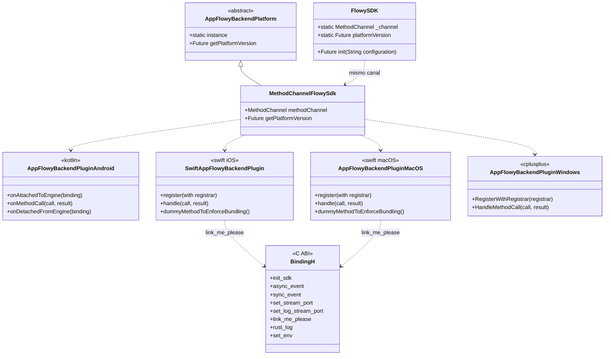
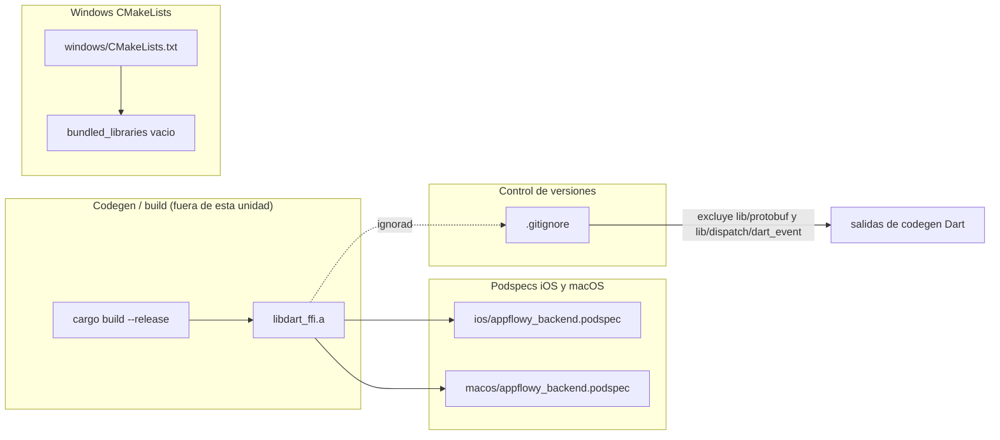
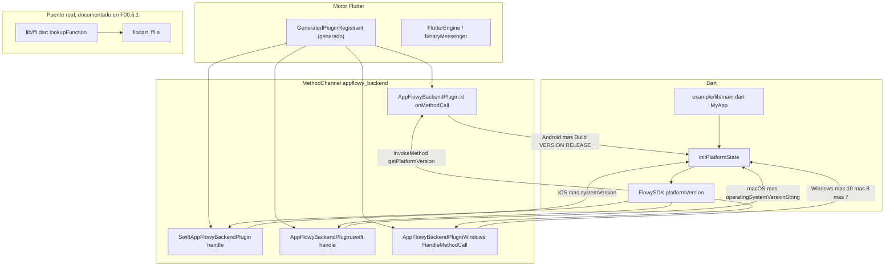
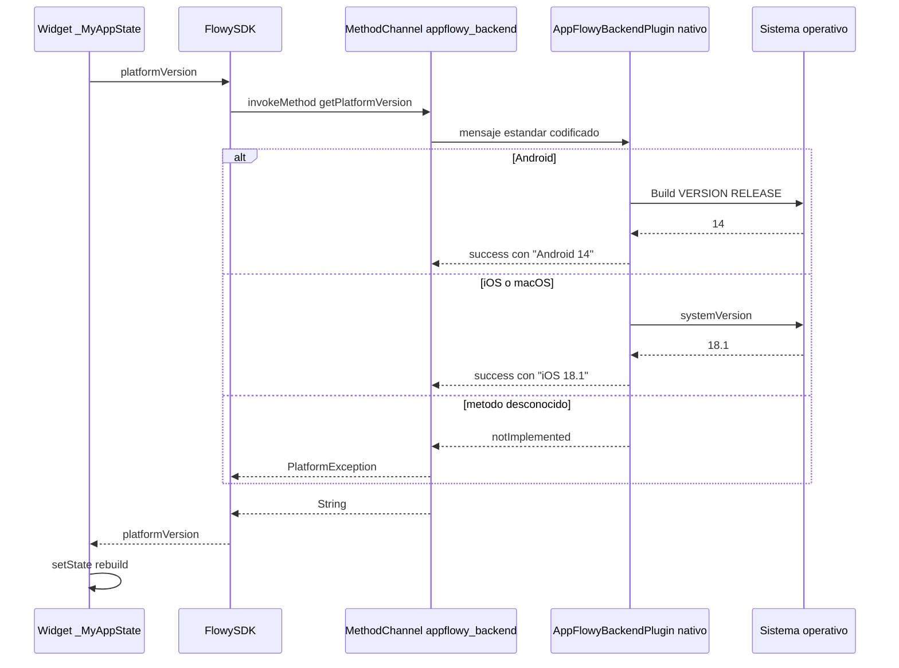
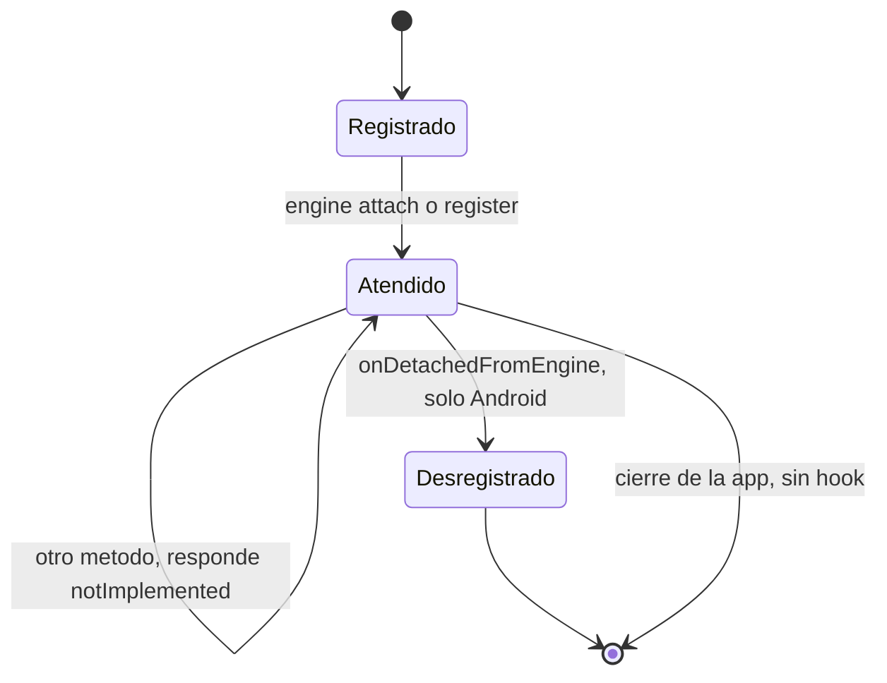

# F00.5.1.2 — Paquetes Dart internos: `appflowy_backend` (example, nativo, test, config)

## 1. Resumen

Esta unidad documenta todo lo que rodea al paquete `appflowy_backend` **sin** su `lib/`: el esqueleto de plugin Flutter por plataforma (Android en Kotlin, iOS/macOS en Swift+Objective-C, Windows en C++, y un `binding.h` huérfano en Linux), la app de ejemplo que `flutter create -t plugin` genera, los dos tests Dart del paquete y los ficheros de metadatos y build. Son **113 ficheros y 4.659 LOC**, de los cuales solo **6 son Dart** (2 de test + 4 de ejemplo); el resto son plantillas de Xcode/Gradle/CMake, JSON de assets y ficheros de texto. El hallazgo estructural es que la única API Dart↔nativa expuesta por el lado nativo es el `MethodChannel('appflowy_backend')` con el método `getPlatformVersion`, residuo del andamiaje de plugin: la aplicación real nunca lo invoca (`lib/` no contiene ninguna referencia a `platformVersion`). El puente de verdad es FFI y está documentado en `[[F00.5.1]]` y `OUT/06-puente-flutter-rust/`.

## 2. Alcance

**Incluye** los 113 ficheros listados en `archivos_cubiertos`: raíz del paquete (metadatos + `pubspec.yaml` + `analysis_options.yaml`), carpetas de plataforma del propio plugin (`android/`, `ios/`, `macos/`, `windows/`, `linux/`), `test/` con sus dos tests Dart, y el subárbol `example/` completo (79 ficheros).

**Queda fuera y se referencia como ya documentado** (no se duplica aquí, tal como exige el enunciado de la unidad):

- `appflowy/frontend/appflowy_flutter/packages/appflowy_backend/lib/**` (8 ficheros: `ffi.dart`, `dispatch/`, `rust_stream.dart`, `error.dart`, `log.dart`, `appflowy_backend*.dart`) → `[[F00.5.1]]` (mismo árbol, sub-unidad hermana) y `OUT/06-puente-flutter-rust/` (B1.5). Aquí solo se citan tres líneas concretas de esos ficheros como punto de contacto del MethodChannel.
- El motor de codegen Dart que emite `lib/dispatch/**` y `lib/protobuf/**` → `[[F00.3]]` (`OUT/09-features/F00-el doc de build/codegen de `[[F00.3]]``) y `OUT/06-puente-flutter-rust/03-codegen.md` (B1.5). Aquí solo se registra que `.gitignore` excluye sus salidas.
- El grafo de dependencias del paquete → `OUT/17-grafo-dependencias.md` (B1.2). Aquí no se recalcula ningún grafo; §7.1 solo enumera las dependencias declaradas que el ejemplo consume.
- El puente FFI completo (9 `lookupFunction`, `FFIRequest`/`FFIResponse`, `RustStreamReceiver`) → `[[F00.5.1]]` §9–§17 y B1.5.

## 3. Modelos de datos

### 3.1 El contrato MethodChannel, único en el lado nativo

Todo el código nativo de esta unidad implementa **un** método. Dart lo pide con `invokeMethod('getPlatformVersion')` en dos sitios distintos (`appflowy/frontend/appflowy_flutter/packages/appflowy_backend/lib/appflowy_backend.dart:27–31` y `appflowy/frontend/appflowy_flutter/packages/appflowy_backend/lib/appflowy_backend_method_channel.dart:10–17`), y el nativo responde con una cadena libre cuyo prefijo es el nombre de la plataforma. No hay `input`, ni `output` tipado, ni `FlutterError` con código de dominio: el valor de retorno es decorativo y existe solo para que el esqueleto del plugin compile y los tests tengan algo que afirmar.

```dart
// appflowy/frontend/appflowy_flutter/packages/appflowy_backend/example/lib/main.dart:27–41
Future<void> initPlatformState() async {
  String platformVersion;
  try {
    platformVersion = await FlowySDK.platformVersion;
  } on PlatformException {
    platformVersion = 'Failed to get platform version.';
  }

  if (!mounted) return;
  setState(() => _platformVersion = platformVersion);
}
```

[VERIFICADO] `appflowy/frontend/appflowy_flutter/packages/appflowy_backend/example/lib/main.dart:27–41`. Este es el **único** consumidor real de la API nativa del plugin fuera de los tests: la pantalla muestra `Running on: $platformVersion` (`appflowy/frontend/appflowy_flutter/packages/appflowy_backend/example/lib/main.dart:48`).

El diagrama muestra las tres rutas Dart que llegan al mismo canal y las cuatro implementaciones nativas que lo atienden, más el contrato C plano declarado en los `binding.h`.



**Lectura**: la mitad superior (tres clases Dart) pertenece a `lib/` y está documentada en `[[F00.5.1]]`; este documento solo la reintroduce para fijar el punto de contacto. La mitad inferior es el objeto de esta unidad: cuatro implementaciones del mismo canal que se registran por mecanismos distintos (§7) y que se diferencian en un detalle sustantivo —iOS **no** comprueba el nombre del método y responde a cualquier llamada, mientras que Android, macOS y Windows sí hacen `switch`/`if` y devuelven `notImplemented`. `BindingH` no participa del MethodChannel: es la declaración C del ABI de FFI (§4).

## 4. Eventos FFI

Ninguno. Los eventos FFI del paquete son los 229 `XEventFoo.send()` generados en `lib/dispatch/dart_event/**`, documentados en `[[F00.5.1]]` §4 y en `OUT/13-catalogo-eventos-ffi.md` (B2.1); su código fuente **no está en `SRC/`** y no lo reproduce ningún fichero de esta unidad.

Lo que sí aparece en esta unidad es el **ABI C declarado a mano** en tres cabeceras `binding.h`, que es el contrato que el linker debe resolver contra `libdart_ffi.a`. La tabla completa de correspondencia `binding.h` ↔ `lookupFunction` de `lib/ffi.dart` ↔ `extern "C"` de `dart-ffi/src/lib.rs` está en §17.

[VERIFICADO] Las tres cabeceras son idénticas byte a byte salvo `linux/`, que está desfasada. `appflowy/frontend/appflowy_flutter/packages/appflowy_backend/ios/Classes/binding.h:6–20` y `appflowy/frontend/appflowy_flutter/packages/appflowy_backend/macos/Classes/binding.h:6–20` declaran los mismos 8 símbolos; `appflowy/frontend/appflowy_flutter/packages/appflowy_backend/linux/Classes/binding.h:7–18` declara `int64_t init_sdk(char *path)` con **un** argumento (los otros dos lo declaran con dos), y renombra `async_event`/`sync_event` a `async_command`/`sync_command`. Además `linux` no aparece entre las plataformas declaradas en `appflowy/frontend/appflowy_flutter/packages/appflowy_backend/pubspec.yaml:37–47` (solo `android`, `ios`, `macos`, `windows`), luego esa carpeta es código muerto: no hay `CMakeLists.txt`, ni `.cc` de plugin, ni entrada en el podspec.

## 5. Notificaciones

Ninguna. El canal de notificaciones Rust→Dart es el puerto FFI registrado por `RustStreamReceiver`, no el `MethodChannel` (ver `[[F00.5.1]]` §5 y §10.2, y B1.5). Ninguna clase de `example/` ni ningún fichero nativo de esta unidad se suscribe a `SubscribeObject`. Confirmación cruzada: los catálogos `notifications.json` y `events.json` no contienen ni una entrada bajo `packages/appflowy_backend/example`, `/android`, `/ios`, `/windows` [VERIFICADO] (búsqueda exhaustiva sobre `OUT/_ledger/extract/`).

## 6. BLoCs / Cubits

Ninguno. `OUT/_ledger/extract/blocs.json:blocs[]` devuelve 0 coincidencias para cualquier ruta bajo `packages/appflowy_backend/` salvo `lib/` [VERIFICADO]. La única clase con estado mutable en los 113 ficheros es `_MyAppState`, un `StatefulWidget` del ejemplo que cachea la versión de plataforma en `String _platformVersion` (`appflowy/frontend/appflowy_flutter/packages/appflowy_backend/example/lib/main.dart:17–18`) y la actualiza en un único `setState` (`appflowy/frontend/appflowy_flutter/packages/appflowy_backend/example/lib/main.dart:40`). No hay Cubit, ni `ChangeNotifier`, ni `get_it`, ni BLoC: es un `StatefulWidget` puro de plantilla Flutter.

## 7. Servicios e inyección de dependencias

### 7.1 Registro del plugin (no hay `get_it`)

`appflowy_backend` no se inyecta por `get_it` (eso lo hace `lib/startup/deps_resolver.dart`, fuera de alcance). Se registra por el **mecanismo estándar de plugins de Flutter**: `pubspec.yaml` declara plataformas y clase de plugin, el `flutter` tool genera un registrant por plataforma, y cada implementación nativa se engancha al engine. El ejemplo completa la cadena con su propio registrant, invocado explícitamente en iOS y macOS.

| Plataforma | Declaración en `pubspec.yaml` | Punto de enganche nativo | Evidencia |
|---|---|---|---|
| Android | `package: com.plugin.appflowy_backend`, `pluginClass: AppFlowyBackendPlugin` | `onAttachedToEngine` crea el `MethodChannel` | `appflowy/frontend/appflowy_flutter/packages/appflowy_backend/pubspec.yaml:39–41`; `appflowy/frontend/appflowy_flutter/packages/appflowy_backend/android/src/main/kotlin/com/plugin/appflowy_backend/AppFlowyBackendPlugin.kt:20–23` |
| iOS | `pluginClass: AppFlowyBackendPlugin` | shim Objective-C que delega en la clase Swift | `appflowy/frontend/appflowy_flutter/packages/appflowy_backend/pubspec.yaml:42–43`; `appflowy/frontend/appflowy_flutter/packages/appflowy_backend/ios/Classes/AppFlowyBackendPlugin.m:12–14` |
| macOS | `pluginClass: AppFlowyBackendPlugin` | `register(with:)` directo en Swift | `appflowy/frontend/appflowy_flutter/packages/appflowy_backend/pubspec.yaml:44–45`; `appflowy/frontend/appflowy_flutter/packages/appflowy_backend/macos/Classes/AppFlowyBackendPlugin.swift:5–9` |
| Windows | `pluginClass: AppFlowyBackendPlugin` | `AppFlowyBackendPluginRegisterWithRegistrar` exportado en C | `appflowy/frontend/appflowy_flutter/packages/appflowy_backend/pubspec.yaml:46–47`; `appflowy/frontend/appflowy_flutter/packages/appflowy_backend/windows/include/appflowy_backend/app_flowy_backend_plugin.h:16–17` |

Todas las plataformas usan **el mismo nombre de canal**, `"appflowy_backend"`: Android en `appflowy/frontend/appflowy_flutter/packages/appflowy_backend/android/src/main/kotlin/com/plugin/appflowy_backend/AppFlowyBackendPlugin.kt:21`, iOS en `appflowy/frontend/appflowy_flutter/packages/appflowy_backend/ios/Classes/AppFlowyBackendPlugin.swift:6`, macOS en `appflowy/frontend/appflowy_flutter/packages/appflowy_backend/macos/Classes/AppFlowyBackendPlugin.swift:6` y Windows en `appflowy/frontend/appflowy_flutter/packages/appflowy_backend/windows/appflowy_backend_plugin.cpp:40–43` [VERIFICADO]. En el lado Dart el canal está declarado dos veces, una en `FlowySDK` (`appflowy/frontend/appflowy_flutter/packages/appflowy_backend/lib/appflowy_backend.dart:27`) y otra en `MethodChannelFlowySdk` (`appflowy/frontend/appflowy_flutter/packages/appflowy_backend/lib/appflowy_backend_method_channel.dart:10`, anotada `@visibleForTesting`), lo que significa que existen **dos rutas Dart independientes al mismo canal** y solo una está pensada para producción.

El ejemplo cierra el circuito con `GeneratedPluginRegistrant.register(with: self)` en iOS (`appflowy/frontend/appflowy_flutter/packages/appflowy_backend/example/ios/Runner/AppDelegate.swift:10`) y `RegisterGeneratedPlugins(registry:)` en macOS (`appflowy/frontend/appflowy_flutter/packages/appflowy_backend/example/macos/Runner/MainFlutterWindow.swift:11`), ambos generados por el `flutter` tool y por eso ignorados por `appflowy/frontend/appflowy_flutter/packages/appflowy_backend/.gitignore:68` [VERIFICADO].

### 7.2 Dependencias que consume el ejemplo

El `example` es un paquete Dart independiente (`name: flowy_sdk_example`, `appflowy/frontend/appflowy_flutter/packages/appflowy_backend/example/pubspec.yaml:1`) que consume el plugin por dependencia de ruta `path: ../` (`appflowy/frontend/appflowy_flutter/packages/appflowy_backend/example/pubspec.yaml:15–21`) y añade tres paquetes que el plugin no usa: `cupertino_icons`, `integration_test` y `flutter_lints` (`appflowy/frontend/appflowy_flutter/packages/appflowy_backend/example/pubspec.yaml:25–32`). Es la única diferencia de dependencias entre ambos `pubspec.yaml`; la lista completa de dependencias del paquete está en `[[F00.5.1]]` §7.1 y no se repite aquí.

## 8. Persistencia

Ninguna tabla, ningún `SharedPreferences`, ningún fichero. Lo persistente en esta unidad es de otra naturaleza: **el artefacto binario que transporta el SDK Rust**. Los dos podspec inyectan la biblioteca estática generada por Cargo en el bundle de la app con `s.vendored_libraries = "libdart_ffi.a"` (`appflowy/frontend/appflowy_flutter/packages/appflowy_backend/ios/appflowy_backend.podspec:24` y `appflowy/frontend/appflowy_flutter/packages/appflowy_backend/macos/appflowy_backend.podspec:24`), y esa misma biblioteca está explícitamente fuera del control de versiones junto a `.dylib`, `.lib`, `.dll` y `.so` (`appflowy/frontend/appflowy_flutter/packages/appflowy_backend/.gitignore:76–80`) [VERIFICADO]. En Windows el equivalente es una lista de bibliotecas "bundled" que hoy está **vacía**: `set(appflowy_backend_bundled_libraries "" PARENT_SCOPE)` (`appflowy/frontend/appflowy_flutter/packages/appflowy_backend/windows/CMakeLists.txt:21–24`), porque el SDK llega por otro camino (`cargokit`, fuera de esta unidad).

El siguiente diagrama muestra quién adjunta qué artefacto nativo y por qué el lado Windows está desconectado de esa cadena.



**Lectura**: tanto iOS como macOS declaran el `.a` como `vendored_libraries`, de modo que el pod lo empaqueta y el linker lo resuelve sin que el símbolo aparezca en ningún fuente; el `.gitignore` del paquete lo declara no versionable junto al resto de binarios. Windows no tiene equivalente efectivo. La última arista recuerda que el mismo `.gitignore` excluye las dos carpetas que el codegen Dart debe producir (`appflowy/frontend/appflowy_flutter/packages/appflowy_backend/.gitignore:82–83`), lo que explica por qué `[[F00.5.1]]` §12.1 lista 21 rutas huérfanas: están ignoradas a propósito, no perdidas.

## 9. Diagramas de flujo

Muestra el ciclo de vida de la app de ejemplo desde el arranque del engine hasta el único método que cruza el canal.



**Lectura**: las cuatro flechas desde `REG` son el mismo enlace con distinta sintaxis según plataforma (registro estático en Android/iOS/macOS, registro por export C en Windows). Las cuatro flechas de vuelta devuelven una cadena cuyo prefijo identifica la plataforma, lo que confirma que el único contrato interoplatable entre las cuatro implementaciones es una `String` cuyo formato nadie parsea. El subgrafo `Ffi` aparece punteado conceptualmente porque **no** lo activa este camino: es el camino que usa la app real y está fuera de esta unidad.

Los valores concretos que devuelve cada implementación son: `"Android ${android.os.Build.VERSION.RELEASE}"` (`appflowy/frontend/appflowy_flutter/packages/appflowy_backend/android/src/main/kotlin/com/plugin/appflowy_backend/AppFlowyBackendPlugin.kt:27`), `"iOS " + UIDevice.current.systemVersion` (`appflowy/frontend/appflowy_flutter/packages/appflowy_backend/ios/Classes/AppFlowyBackendPlugin.swift:12`), `"macOS " + ProcessInfo.processInfo.operatingSystemVersionString` (`appflowy/frontend/appflowy_flutter/packages/appflowy_backend/macos/Classes/AppFlowyBackendPlugin.swift:14`) y una composición por rangos `Windows 10+ / 8 / 7` según `IsWindows10OrGreater()`, `IsWindows8OrGreater()`, `IsWindows7OrGreater()` (`appflowy/frontend/appflowy_flutter/packages/appflowy_backend/windows/appflowy_backend_plugin.cpp:66–81`) [VERIFICADO].

## 10. Diagramas de secuencia

Muestra el ida y vuelta completo de la única llamada nativa que el ejemplo llega a ejecutar, incluyendo cómo los tests la sustituyen por un mock.



**Lectura**: el canal es un request/response estándar de Flutter con `StandardMethodCodec`; no hay streaming ni callbacks. La rama `notImplemented` solo existe en Android (`appflowy/frontend/appflowy_flutter/packages/appflowy_backend/android/src/main/kotlin/com/plugin/appflowy_backend/AppFlowyBackendPlugin.kt:29`), macOS (`appflowy/frontend/appflowy_flutter/packages/appflowy_backend/macos/Classes/AppFlowyBackendPlugin.swift:16`) y Windows (`appflowy/frontend/appflowy_flutter/packages/appflowy_backend/windows/appflowy_backend_plugin.cpp:84`): **iOS responde a cualquier método sin comprobar el nombre** (`appflowy/frontend/appflowy_flutter/packages/appflowy_backend/ios/Classes/AppFlowyBackendPlugin.swift:11–13`), de modo que un método desconocido devuelve la versión de iOS en lugar de fallar. Es una asimetría real entre plataformas, no un fallo de compilación.

En los tests, la flecha hacia `AppFlowyBackendPlugin nativo` se sustituye por un `setMockMethodCallHandler` que devuelve `'42'` y lo hace **independientemente del nombre del método recibido** (`appflowy/frontend/appflowy_flutter/packages/appflowy_backend/test/appflowy_backend_test.dart:12–14`), luego el test solo demuestra que la llamada se despacha y el valor se devuelve, no que exista una implementación nativa detrás.

## 11. Diagramas de estado

Muestra el ciclo de vida del plugin nativo tal como lo implementa cada plataforma, que difiere: Android tiene un hook de detach explícito, el resto no.



**Lectura**: el estado `Atendido` es estable en las cuatro plataformas. Solo Android implementa la transición a `Desregistrado` —`channel.setMethodCallHandler(null)` en `appflowy/frontend/appflowy_flutter/packages/appflowy_backend/android/src/main/kotlin/com/plugin/appflowy_backend/AppFlowyBackendPlugin.kt:33–35`—, mientras que iOS, macOS y Windows liberan el canal con el ciclo de vida del engine o del proceso [VERIFICADO]. En iOS el registro se hace en `register(with:)` (`appflowy/frontend/appflowy_flutter/packages/appflowy_backend/ios/Classes/AppFlowyBackendPlugin.swift:5–9`) sinDLEGADO correspondiente, igual que en macOS y Windows.

El ciclo de vida equivalente de los tests es `setUp` (instala el mock) → `test` (invoca) → `tearDown` (retira el mock): `appflowy/frontend/appflowy_flutter/packages/appflowy_backend/test/appflowy_backend_method_channel_test.dart:11–27` y `appflowy/frontend/appflowy_flutter/packages/appflowy_backend/test/appflowy_backend_test.dart:10–23`. La asimetría es que `MethodChannelFlowySdk` declara su canal como `@visibleForTesting final methodChannel` (`appflowy/frontend/appflowy_flutter/packages/appflowy_backend/lib/appflowy_backend_method_channel.dart:9–10`), mientras que `FlowySDK` lo declara `private static const` (`appflowy/frontend/appflowy_flutter/packages/appflowy_backend/lib/appflowy_backend.dart:27`): el primero es inyectable/mockeable, el segundo no, y por eso existen dos tests idénticos con dos APIs distintas.

## 12. Archivos cubiertos (del ledger)

Recuento real por categoría: **6 ficheros Dart** (2 de `test/` + 4 de `example/`), **107 ficheros no Dart** repartidos en 12 lenguajes detectados por `inventory.py` (`text` 55, `xml` 15, `objc-header` 12, `groovy` 5, `swift` 5, `markdown` 4, `yaml` 4, `json` 3, `kotlin` 2, `toml` 1, `objc` 1). Total **113 ficheros, 4.659 LOC** [VERIFICADO] `OUT/_ledger/inventario.json:files[]` filtrado por `appflowy/frontend/appflowy_flutter/packages/appflowy_backend/` y excluyendo `lib/` (las 8 rutas de `[[F00.5.1]]`).

### 12.1 Raíz del paquete — metadatos y configuración (7 ficheros, 226 LOC)

| Ruta | Lenguaje | LOC |
|---|---|---:|
| `appflowy/frontend/appflowy_flutter/packages/appflowy_backend/.gitignore` | text | 82 |
| `appflowy/frontend/appflowy_flutter/packages/appflowy_backend/.metadata` | text | 39 |
| `appflowy/frontend/appflowy_flutter/packages/appflowy_backend/CHANGELOG.md` | markdown | 3 |
| `appflowy/frontend/appflowy_flutter/packages/appflowy_backend/LICENSE` | text | 1 |
| `appflowy/frontend/appflowy_flutter/packages/appflowy_backend/README.md` | markdown | 18 |
| `appflowy/frontend/appflowy_flutter/packages/appflowy_backend/analysis_options.yaml` | yaml | 5 |
| `appflowy/frontend/appflowy_flutter/packages/appflowy_backend/pubspec.yaml` | yaml | 78 |

### 12.2 `test/` — tests Dart del paquete (2 ficheros, 60 LOC)

| Ruta | Lenguaje | LOC |
|---|---|---:|
| `appflowy/frontend/appflowy_flutter/packages/appflowy_backend/test/appflowy_backend_method_channel_test.dart` | dart | 32 |
| `appflowy/frontend/appflowy_flutter/packages/appflowy_backend/test/appflowy_backend_test.dart` | dart | 28 |

### 12.3 `android/` del plugin (7 ficheros, 106 LOC)

| Ruta | Lenguaje | LOC |
|---|---|---:|
| `appflowy/frontend/appflowy_flutter/packages/appflowy_backend/android/.gitignore` | text | 8 |
| `appflowy/frontend/appflowy_flutter/packages/appflowy_backend/android/build.gradle` | groovy | 50 |
| `appflowy/frontend/appflowy_flutter/packages/appflowy_backend/android/gradle.properties` | text | 3 |
| `appflowy/frontend/appflowy_flutter/packages/appflowy_backend/android/gradle/wrapper/gradle-wrapper.properties` | text | 5 |
| `appflowy/frontend/appflowy_flutter/packages/appflowy_backend/android/settings.gradle` | groovy | 1 |
| `appflowy/frontend/appflowy_flutter/packages/appflowy_backend/android/src/main/AndroidManifest.xml` | xml | 3 |
| `appflowy/frontend/appflowy_flutter/packages/appflowy_backend/android/src/main/kotlin/com/plugin/appflowy_backend/AppFlowyBackendPlugin.kt` | kotlin | 36 |

### 12.4 `ios/` del plugin (7 ficheros, 119 LOC)

| Ruta | Lenguaje | LOC |
|---|---|---:|
| `appflowy/frontend/appflowy_flutter/packages/appflowy_backend/ios/.gitignore` | text | 36 |
| `appflowy/frontend/appflowy_flutter/packages/appflowy_backend/ios/Assets/.gitkeep` | text | 0 |
| `appflowy/frontend/appflowy_flutter/packages/appflowy_backend/ios/Classes/AppFlowyBackendPlugin.h` | objc-header | 4 |
| `appflowy/frontend/appflowy_flutter/packages/appflowy_backend/ios/Classes/AppFlowyBackendPlugin.m` | objc | 15 |
| `appflowy/frontend/appflowy_flutter/packages/appflowy_backend/ios/Classes/AppFlowyBackendPlugin.swift` | swift | 18 |
| `appflowy/frontend/appflowy_flutter/packages/appflowy_backend/ios/Classes/binding.h` | objc-header | 20 |
| `appflowy/frontend/appflowy_flutter/packages/appflowy_backend/ios/appflowy_backend.podspec` | text | 26 |

### 12.5 `macos/` y `linux/` del plugin (4 ficheros, 87 LOC)

| Ruta | Lenguaje | LOC |
|---|---|---:|
| `appflowy/frontend/appflowy_flutter/packages/appflowy_backend/macos/Classes/AppFlowyBackendPlugin.swift` | swift | 23 |
| `appflowy/frontend/appflowy_flutter/packages/appflowy_backend/macos/Classes/binding.h` | objc-header | 20 |
| `appflowy/frontend/appflowy_flutter/packages/appflowy_backend/macos/appflowy_backend.podspec` | text | 25 |
| `appflowy/frontend/appflowy_flutter/packages/appflowy_backend/linux/Classes/binding.h` | objc-header | 19 |

### 12.6 `windows/` del plugin (7 ficheros, 230 LOC)

| Ruta | Lenguaje | LOC |
|---|---|---:|
| `appflowy/frontend/appflowy_flutter/packages/appflowy_backend/windows/.gitignore` | text | 17 |
| `appflowy/frontend/appflowy_flutter/packages/appflowy_backend/windows/CMakeLists.txt` | text | 27 |
| `appflowy/frontend/appflowy_flutter/packages/appflowy_backend/windows/app_flowy_backend_plugin.h` | objc-header | 32 |
| `appflowy/frontend/appflowy_flutter/packages/appflowy_backend/windows/appflowy_backend_plugin.cpp` | text | 95 |
| `appflowy/frontend/appflowy_flutter/packages/appflowy_backend/windows/appflowy_backend_plugin_c_api.cpp` | text | 13 |
| `appflowy/frontend/appflowy_flutter/packages/appflowy_backend/windows/include/appflowy_backend/app_flowy_backend_plugin.h` | objc-header | 23 |
| `appflowy/frontend/appflowy_flutter/packages/appflowy_backend/windows/include/appflowy_backend/appflowy_backend_plugin_c_api.h` | objc-header | 23 |

### 12.7 `example/` — raíz, tests Dart y Android (23 ficheros, 490 LOC)

| Ruta | Lenguaje | LOC |
|---|---|---:|
| `appflowy/frontend/appflowy_flutter/packages/appflowy_backend/example/.gitignore` | text | 46 |
| `appflowy/frontend/appflowy_flutter/packages/appflowy_backend/example/.metadata` | text | 10 |
| `appflowy/frontend/appflowy_flutter/packages/appflowy_backend/example/README.md` | markdown | 16 |
| `appflowy/frontend/appflowy_flutter/packages/appflowy_backend/example/analysis_options.yaml` | yaml | 5 |
| `appflowy/frontend/appflowy_flutter/packages/appflowy_backend/example/pubspec.yaml` | yaml | 74 |
| `appflowy/frontend/appflowy_flutter/packages/appflowy_backend/example/integration_test/app_test.dart` | dart | 33 |
| `appflowy/frontend/appflowy_flutter/packages/appflowy_backend/example/integration_test/driver.dart` | dart | 4 |
| `appflowy/frontend/appflowy_flutter/packages/appflowy_backend/example/lib/main.dart` | dart | 52 |
| `appflowy/frontend/appflowy_flutter/packages/appflowy_backend/example/test/widget_test.dart` | dart | 8 |
| `appflowy/frontend/appflowy_flutter/packages/appflowy_backend/example/android/.gitignore` | text | 11 |
| `appflowy/frontend/appflowy_flutter/packages/appflowy_backend/example/android/app/build.gradle` | groovy | 59 |
| `appflowy/frontend/appflowy_flutter/packages/appflowy_backend/example/android/app/src/debug/AndroidManifest.xml` | xml | 7 |
| `appflowy/frontend/appflowy_flutter/packages/appflowy_backend/example/android/app/src/main/AndroidManifest.xml` | xml | 41 |
| `appflowy/frontend/appflowy_flutter/packages/appflowy_backend/example/android/app/src/main/kotlin/com/plugin/flowy_sdk_example/MainActivity.kt` | kotlin | 6 |
| `appflowy/frontend/appflowy_flutter/packages/appflowy_backend/example/android/app/src/main/res/drawable-v21/launch_background.xml` | xml | 12 |
| `appflowy/frontend/appflowy_flutter/packages/appflowy_backend/example/android/app/src/main/res/drawable/launch_background.xml` | xml | 12 |
| `appflowy/frontend/appflowy_flutter/packages/appflowy_backend/example/android/app/src/main/res/values-night/styles.xml` | xml | 18 |
| `appflowy/frontend/appflowy_flutter/packages/appflowy_backend/example/android/app/src/main/res/values/styles.xml` | xml | 18 |
| `appflowy/frontend/appflowy_flutter/packages/appflowy_backend/example/android/app/src/profile/AndroidManifest.xml` | xml | 7 |
| `appflowy/frontend/appflowy_flutter/packages/appflowy_backend/example/android/build.gradle` | groovy | 31 |
| `appflowy/frontend/appflowy_flutter/packages/appflowy_backend/example/android/gradle.properties` | text | 3 |
| `appflowy/frontend/appflowy_flutter/packages/appflowy_backend/example/android/gradle/wrapper/gradle-wrapper.properties` | text | 6 |
| `appflowy/frontend/appflowy_flutter/packages/appflowy_backend/example/android/settings.gradle` | groovy | 11 |

*Nota de recuento:* las diez tablas de §12 suman exactamente **113 ficheros y 4.659 LOC** (226 + 60 + 106 + 119 + 87 + 230 + 490 + 982 + 1.407 + 952), sin solapes ni filas omitidas.

### 12.8 `example/ios/` (21 ficheros, 982 LOC)

| Ruta | Lenguaje | LOC |
|---|---|---:|
| `appflowy/frontend/appflowy_flutter/packages/appflowy_backend/example/ios/.gitignore` | text | 32 |
| `appflowy/frontend/appflowy_flutter/packages/appflowy_backend/example/ios/Flutter/AppFrameworkInfo.plist` | xml | 26 |
| `appflowy/frontend/appflowy_flutter/packages/appflowy_backend/example/ios/Flutter/Debug.xcconfig` | text | 2 |
| `appflowy/frontend/appflowy_flutter/packages/appflowy_backend/example/ios/Flutter/Release.xcconfig` | text | 2 |
| `appflowy/frontend/appflowy_flutter/packages/appflowy_backend/example/ios/Podfile` | text | 41 |
| `appflowy/frontend/appflowy_flutter/packages/appflowy_backend/example/ios/Runner.xcodeproj/project.pbxproj` | text | 471 |
| `appflowy/frontend/appflowy_flutter/packages/appflowy_backend/example/ios/Runner.xcodeproj/project.xcworkspace/contents.xcworkspacedata` | text | 7 |
| `appflowy/frontend/appflowy_flutter/packages/appflowy_backend/example/ios/Runner.xcodeproj/project.xcworkspace/xcshareddata/IDEWorkspaceChecks.plist` | xml | 8 |
| `appflowy/frontend/appflowy_flutter/packages/appflowy_backend/example/ios/Runner.xcodeproj/project.xcworkspace/xcshareddata/WorkspaceSettings.xcsettings` | text | 8 |
| `appflowy/frontend/appflowy_flutter/packages/appflowy_backend/example/ios/Runner.xcodeproj/xcshareddata/xcschemes/Runner.xcscheme` | text | 91 |
| `appflowy/frontend/appflowy_flutter/packages/appflowy_backend/example/ios/Runner.xcworkspace/contents.xcworkspacedata` | text | 7 |
| `appflowy/frontend/appflowy_flutter/packages/appflowy_backend/example/ios/Runner.xcworkspace/xcshareddata/IDEWorkspaceChecks.plist` | xml | 8 |
| `appflowy/frontend/appflowy_flutter/packages/appflowy_backend/example/ios/Runner.xcworkspace/xcshareddata/WorkspaceSettings.xcsettings` | text | 8 |
| `appflowy/frontend/appflowy_flutter/packages/appflowy_backend/example/ios/Runner/AppDelegate.swift` | swift | 13 |
| `appflowy/frontend/appflowy_flutter/packages/appflowy_backend/example/ios/Runner/Assets.xcassets/AppIcon.appiconset/Contents.json` | json | 122 |
| `appflowy/frontend/appflowy_flutter/packages/appflowy_backend/example/ios/Runner/Assets.xcassets/LaunchImage.imageset/Contents.json` | json | 23 |
| `appflowy/frontend/appflowy_flutter/packages/appflowy_backend/example/ios/Runner/Assets.xcassets/LaunchImage.imageset/README.md` | markdown | 4 |
| `appflowy/frontend/appflowy_flutter/packages/appflowy_backend/example/ios/Runner/Base.lproj/LaunchScreen.storyboard` | text | 37 |
| `appflowy/frontend/appflowy_flutter/packages/appflowy_backend/example/ios/Runner/Base.lproj/Main.storyboard` | text | 26 |
| `appflowy/frontend/appflowy_flutter/packages/appflowy_backend/example/ios/Runner/Info.plist` | xml | 45 |
| `appflowy/frontend/appflowy_flutter/packages/appflowy_backend/example/ios/Runner/Runner-Bridging-Header.h` | objc-header | 1 |

### 12.9 `example/macos/` (21 ficheros, 1.407 LOC)

| Ruta | Lenguaje | LOC |
|---|---|---:|
| `appflowy/frontend/appflowy_flutter/packages/appflowy_backend/example/macos/.gitignore` | text | 6 |
| `appflowy/frontend/appflowy_flutter/packages/appflowy_backend/example/macos/Flutter/Flutter-Debug.xcconfig` | text | 2 |
| `appflowy/frontend/appflowy_flutter/packages/appflowy_backend/example/macos/Flutter/Flutter-Release.xcconfig` | text | 2 |
| `appflowy/frontend/appflowy_flutter/packages/appflowy_backend/example/macos/Podfile` | text | 82 |
| `appflowy/frontend/appflowy_flutter/packages/appflowy_backend/example/macos/Podfile.lock` | toml | 39 |
| `appflowy/frontend/appflowy_flutter/packages/appflowy_backend/example/macos/Runner.xcodeproj/project.pbxproj` | text | 643 |
| `appflowy/frontend/appflowy_flutter/packages/appflowy_backend/example/macos/Runner.xcodeproj/project.xcworkspace/xcshareddata/IDEWorkspaceChecks.plist` | xml | 8 |
| `appflowy/frontend/appflowy_flutter/packages/appflowy_backend/example/macos/Runner.xcodeproj/xcshareddata/xcschemes/Runner.xcscheme` | text | 89 |
| `appflowy/frontend/appflowy_flutter/packages/appflowy_backend/example/macos/Runner.xcworkspace/contents.xcworkspacedata` | text | 10 |
| `appflowy/frontend/appflowy_flutter/packages/appflowy_backend/example/macos/Runner.xcworkspace/xcshareddata/IDEWorkspaceChecks.plist` | xml | 8 |
| `appflowy/frontend/appflowy_flutter/packages/appflowy_backend/example/macos/Runner/AppDelegate.swift` | swift | 13 |
| `appflowy/frontend/appflowy_flutter/packages/appflowy_backend/example/macos/Runner/Assets.xcassets/AppIcon.appiconset/Contents.json` | json | 68 |
| `appflowy/frontend/appflowy_flutter/packages/appflowy_backend/example/macos/Runner/Base.lproj/MainMenu.xib` | text | 339 |
| `appflowy/frontend/appflowy_flutter/packages/appflowy_backend/example/macos/Runner/Configs/AppInfo.xcconfig` | text | 14 |
| `appflowy/frontend/appflowy_flutter/packages/appflowy_backend/example/macos/Runner/Configs/Debug.xcconfig` | text | 2 |
| `appflowy/frontend/appflowy_flutter/packages/appflowy_backend/example/macos/Runner/Configs/Release.xcconfig` | text | 2 |
| `appflowy/frontend/appflowy_flutter/packages/appflowy_backend/example/macos/Runner/Configs/Warnings.xcconfig` | text | 13 |
| `appflowy/frontend/appflowy_flutter/packages/appflowy_backend/example/macos/Runner/DebugProfile.entitlements` | text | 12 |
| `appflowy/frontend/appflowy_flutter/packages/appflowy_backend/example/macos/Runner/Info.plist` | xml | 32 |
| `appflowy/frontend/appflowy_flutter/packages/appflowy_backend/example/macos/Runner/MainFlutterWindow.swift` | swift | 15 |
| `appflowy/frontend/appflowy_flutter/packages/appflowy_backend/example/macos/Runner/Release.entitlements` | text | 8 |

### 12.10 `example/windows/` (14 ficheros, 952 LOC)

| Ruta | Lenguaje | LOC |
|---|---|---:|
| `appflowy/frontend/appflowy_flutter/packages/appflowy_backend/example/windows/.gitignore` | text | 17 |
| `appflowy/frontend/appflowy_flutter/packages/appflowy_backend/example/windows/CMakeLists.txt` | text | 95 |
| `appflowy/frontend/appflowy_flutter/packages/appflowy_backend/example/windows/flutter/CMakeLists.txt` | text | 103 |
| `appflowy/frontend/appflowy_flutter/packages/appflowy_backend/example/windows/runner/CMakeLists.txt` | text | 17 |
| `appflowy/frontend/appflowy_flutter/packages/appflowy_backend/example/windows/runner/Runner.rc` | text | 121 |
| `appflowy/frontend/appflowy_flutter/packages/appflowy_backend/example/windows/runner/flutter_window.cpp` | text | 61 |
| `appflowy/frontend/appflowy_flutter/packages/appflowy_backend/example/windows/runner/flutter_window.h` | objc-header | 33 |
| `appflowy/frontend/appflowy_flutter/packages/appflowy_backend/example/windows/runner/main.cpp` | text | 43 |
| `appflowy/frontend/appflowy_flutter/packages/appflowy_backend/example/windows/runner/resource.h` | objc-header | 16 |
| `appflowy/frontend/appflowy_flutter/packages/appflowy_backend/example/windows/runner/runner.exe.manifest` | text | 20 |
| `appflowy/frontend/appflowy_flutter/packages/appflowy_backend/example/windows/runner/utils.cpp` | text | 64 |
| `appflowy/frontend/appflowy_flutter/packages/appflowy_backend/example/windows/runner/utils.h` | objc-header | 19 |
| `appflowy/frontend/appflowy_flutter/packages/appflowy_backend/example/windows/runner/win32_window.cpp` | text | 245 |
| `appflowy/frontend/appflowy_flutter/packages/appflowy_backend/example/windows/runner/win32_window.h` | objc-header | 98 |

## 13. Riesgos y casos límite

- **Corrección de scope (obligatoria).** El contenido de `packages/appflowy_backend/lib/**` —el puente FFI, `Dispatch`, `RustStreamReceiver`, `GlobalErrorCodeNotifier` y los 229 eventos generados— está ya documentado y verificado en `[[F00.5.1]]` y en `OUT/06-puente-flutter-rust/` (B1.5). Este documento **no lo duplica**: solo cita tres líneas de `lib/` (`appflowy/frontend/appflowy_flutter/packages/appflowy_backend/lib/appflowy_backend.dart:27`, `appflowy/frontend/appflowy_flutter/packages/appflowy_backend/lib/appflowy_backend_method_channel.dart:10`, `appflowy/frontend/appflowy_flutter/packages/appflowy_backend/lib/appflowy_backend_platform_interface.dart:26`) como punto de contacto entre el MethodChannel y el FFI. Del mismo modo, el codegen Dart vive en `[[F00.3]]` y el grafo de dependencias en `OUT/17-grafo-dependencias.md` (B1.2); ninguna de las dos se recalcula aquí.
- **El MethodChannel es deuda viva, no código muerto**: el canal `"appflowy_backend"` está abierto en cuatro plataformas y `FlowySDK.platformVersion` sigue siendo `public` en `appflowy/frontend/appflowy_flutter/packages/appflowy_backend/lib/appflowy_backend.dart:28–31`. Si alguien invoca `getPlatformVersion` desde la app real obtendrá la versión del SO en iOS/macOS/Android/Windows, sin ningún efecto sobre el SDK Rust, y creerá haber consultado el backend.
- **iOS responde a métodos inexistentes**: `handle(_:result:)` en `appflowy/frontend/appflowy_flutter/packages/appflowy_backend/ios/Classes/AppFlowyBackendPlugin.swift:11–13` ignora `call.method` y siempre devuelve la versión. Un `invokeMethod` con un nombre mal escrito no lanza `MissingPluginException` sino que aparenta funcionar en iOS y falla en el resto.
- **Capa Windows rota en dos puntos**: (a) `appflowy/frontend/appflowy_flutter/packages/appflowy_backend/windows/CMakeLists.txt:9–11` compila **solo** `appflowy_backend_plugin.cpp`, de modo que `appflowy_backend_plugin_c_api.cpp` no entra en la librería; (b) ese fichero incluye `"appflowy_flutter_backend_plugin.h"` (`appflowy/frontend/appflowy_flutter/packages/appflowy_backend/windows/appflowy_backend_plugin_c_api.cpp:5`), cabecera que **no existe** en el paquete (la real se llama `app_flowy_backend_plugin.h`). Además invoca `appflowy_backend::AppFlowyBackendPlugin::RegisterWithRegistrar` (`appflowy/frontend/appflowy_flutter/packages/appflowy_backend/windows/appflowy_backend_plugin_c_api.cpp:10`) sobre una clase declarada en un **namespace anónimo** (`appflowy/frontend/appflowy_flutter/packages/appflowy_backend/windows/appflowy_backend_plugin.cpp:17–18`), por lo que el símbolo enlazado no es el de la cabecera pública (`appflowy/frontend/appflowy_flutter/packages/appflowy_backend/windows/app_flowy_backend_plugin.h:11–28`). Consecuencia: si se añadiera el `.cpp` al `CMakeLists`, la compilación fallaría [VERIFICADO sobre el código; el fallo no se ha reproducido porque no se compila el paquete en esta skill].
- **ABI declarado a mano y desfasado**: `appflowy/frontend/appflowy_flutter/packages/appflowy_backend/linux/Classes/binding.h:7–18` declara `init_sdk(char *)` con un argumento y `async_command`/`sync_command`, nombres que ya no existen en `dart-ffi/src/lib.rs`. Como `linux` no figura en `appflowy/frontend/appflowy_flutter/packages/appflowy_backend/pubspec.yaml:37–47`, es inerte, pero cualquier intento de añadir soporte Linux partirá de una cabecera que no compila.
- **`binding.h` no incluye `store_dart_post_cobject`**: el resto de símbolos FFI de `lib/ffi.dart` están declarados (`appflowy/frontend/appflowy_flutter/packages/appflowy_backend/ios/Classes/binding.h:6–20`), pero la función que entrega `NativeApi.postCObject` a Rust no. [INFERIDO] No rompe nada porque `lib/ffi.dart` resuelve los símbolos con `lookupFunction` en tiempo de ejecución y no consume la cabecera C; la cabecera es informativa y quedó atrás en la migración desde el FFI vía `Swift`/`ObjC`.
- **`Podfile.lock` obsoleto**: `appflowy/frontend/appflowy_flutter/packages/appflowy_backend/example/macos/Podfile.lock:2–9` fija `flowy_sqlite (0.0.1)` y `appflowy_backend (0.0.1)`, y `:11–16` referencia rutas `Flutter/ephemeral/.symlinks/plugins/…`. El pod `flowy_sqlite` ya no existe en el árbol; el lockfile es una foto de un pasado en el que el SDK era SQLite en vez de CRDT.
- **Configuración Android incoherente entre plugin y ejemplo**: el plugin declara `minSdkVersion 23` (`appflowy/frontend/appflowy_flutter/packages/appflowy_backend/android/build.gradle:44`) y AGP 8.1.0 con Kotlin 1.8.0 (`appflowy/frontend/appflowy_flutter/packages/appflowy_backend/android/build.gradle:5,12`), pero su wrapper fija Gradle 6.7 (`appflowy/frontend/appflowy_flutter/packages/appflowy_backend/android/gradle/wrapper/gradle-wrapper.properties:5`), incompatible con AGP 8.x; el ejemplo va al revés: AGP 4.1.0 con Kotlin 1.6.10 (`appflowy/frontend/appflowy_flutter/packages/appflowy_backend/example/android/build.gradle:2,9`) y `minSdkVersion 33` (`appflowy/frontend/appflowy_flutter/packages/appflowy_backend/example/android/app/build.gradle:38`). Ambos `build.gradle` usan además `jcenter()`, repositorio descontinuado desde 2021 (`appflowy/frontend/appflowy_flutter/packages/appflowy_backend/android/build.gradle:8`).
- **Targets de despliegue antiguos**: el proyecto iOS del ejemplo fija `IPHONEOS_DEPLOYMENT_TARGET = 9.0` (`appflowy/frontend/appflowy_flutter/packages/appflowy_backend/example/ios/Runner.xcodeproj/project.pbxproj:275`) frente a los `8.0` del podspec (`appflowy/frontend/appflowy_flutter/packages/appflowy_backend/ios/appflowy_backend.podspec:18`), y macOS `10.14` (`appflowy/frontend/appflowy_flutter/packages/appflowy_backend/example/macos/Runner.xcodeproj/project.pbxproj:406`) frente a `10.13` del podspec (`appflowy/frontend/appflowy_flutter/packages/appflowy_backend/macos/appflowy_backend.podspec:20`).
- **Metadatos del paquete sin cerrar**: `LICENSE` sigue siendo `TODO: Add your license here.` (`appflowy/frontend/appflowy_flutter/packages/appflowy_backend/LICENSE:1`) y ambos podspec lo referencian (`appflowy/frontend/appflowy_flutter/packages/appflowy_backend/ios/appflowy_backend.podspec:13`), luego `pod lib lint` fallaría. El `CHANGELOG.md` conserva `## 0.0.1` / `* TODO: Describe initial release.` (`appflowy/frontend/appflowy_flutter/packages/appflowy_backend/CHANGELOG.md:1–3`) y el `README.md` afirma que el plugin se generó "without specifying the `--platforms` flag" (`appflowy/frontend/appflowy_flutter/packages/appflowy_backend/README.md:16–18`), afirmación ya contradicha por el `appflowy/frontend/appflowy_flutter/packages/appflowy_backend/pubspec.yaml:37–47`.
- **Dos `.metadata` con toolchains distintas**: el plugin registra la revisión `135454af…` en canal `stable` (`appflowy/frontend/appflowy_flutter/packages/appflowy_backend/.metadata:7–8`) y el ejemplo la revisión `63062a64…` en canal `dev` (`appflowy/frontend/appflowy_flutter/packages/appflowy_backend/example/.metadata:7–8`). Un `flutter migrate` future migraría ambos subárboles de forma diferente.
- **Los dos `analysis_options.yaml` se pisan**: el del ejemplo hace `include: ../analysis_options.yaml` y luego abre `exclude:` con lista vacía (`appflowy/frontend/appflowy_flutter/packages/appflowy_backend/example/analysis_options.yaml:1,3–5`), lo que anula las exclusiones del padre (`**/*.g.dart`, `**/*.pb.dart`, `**/*.freezed.dart`, `appflowy/frontend/appflowy_flutter/packages/appflowy_backend/analysis_options.yaml:1–5`) para el subárbol del ejemplo [INFERIDO].
- **Sin `appflowy_backend` en el registrant del ejemplo**: ni `example/macos/Runner.xcodeproj/project.pbxproj` ni `example/ios/Runner.xcodeproj/project.pbxproj` mencionan el plugin; llega por `Pods`/`generated_plugins.cmake` en tiempo de build (`appflowy/frontend/appflowy_flutter/packages/appflowy_backend/example/macos/Podfile:71–78`, `appflowy/frontend/appflowy_flutter/packages/appflowy_backend/example/windows/CMakeLists.txt:51`). Por eso el ejemplo no se puede abrir ni compilar sin `flutter pub get` previo.

## 14. Evidencias y etiquetas

- Referencias `ruta:línea` (o `ruta:inicio–fin`) verificadas por `validate_evidence.py`: **106, todas OK (0 errores)**. De ellas, 96 apuntan a ficheros de esta unidad y 10 a tres ficheros de `packages/appflowy_backend/lib/**` (`appflowy_backend.dart`, `appflowy_backend_method_channel.dart`, `appflowy_backend_platform_interface.dart`), inventariados y ya documentados en `[[F00.5.1]]`.
- `[VERIFICADO]`: **13** etiquetas explícitas en el cuerpo del texto; el resto de afirmaciones se apoyan en las 106 referencias ya validadas (todas dentro de los 113 ficheros del ledger, salvo las 10 de `lib/` indicadas).
- `[INFERIDO]`: **3** (la clave del `analysis_options.yaml` del ejemplo que anula las exclusiones del padre, §13; el carácter informativo —no funcional— de los `binding.h` frente al `lookupFunction` de `lib/ffi.dart`, §13; y la lectura de la lista vacía de exclusiones del ejemplo a partir del YAML, no del comportamiento observado del analizador).
- `[NO DETERMINADO]`: **4** entradas en §18, todas marcadas con su prefijo `F00.5.1.2-Qn`.

Diagramas Mermaid: **5** (1 `classDiagram` en §3, 1 `flowchart LR` en §8, 1 `flowchart TD` en §9, 1 `sequenceDiagram` en §10, 1 `stateDiagram-v2` en §11), los cinco validados por `validate_mermaid.sh` (5 OK / 0 fail).

## 15. Pruebas

De los 6 ficheros Dart de la unidad, **solo 2 contienen pruebas reales** y ambas son del mismo tipo:

| Test | Qué ejercita | Qué demuestra realmente |
|---|---|---|
| `appflowy/frontend/appflowy_flutter/packages/appflowy_backend/test/appflowy_backend_test.dart:25–27` | `FlowySDK.platformVersion` con canal privado `static const` mockeado por nombre | Que el mensaje sale por el canal `appflowy_backend` y el valor vuelve. No toca FFI |
| `appflowy/frontend/appflowy_flutter/packages/appflowy_backend/test/appflowy_backend_method_channel_test.dart:29–31` | `MethodChannelFlowySdk.getPlatformVersion()` con canal `@visibleForTesting` | Lo mismo por la segunda ruta Dart al mismo canal |
| `appflowy/frontend/appflowy_flutter/packages/appflowy_backend/example/test/widget_test.dart:8` | `void main() {}` | Nada: el cuerpo del test por defecto fue borrado |
| `appflowy/frontend/appflowy_flutter/packages/appflowy_backend/example/integration_test/app_test.dart:1–33` | Test de integración íntegramente comentado | Nada: ni siquiera compila como test |
| `appflowy/frontend/appflowy_flutter/packages/appflowy_backend/example/integration_test/driver.dart:1–4` | Comentario con la invocación de `flutter drive` | Documenta cómo se ejecutaría un test de integración que no existe |

Conclusiones relevantes para el resto de la documentación:

1. **Ningún test de la unidad toca el puente FFI.** No hay `init_sdk`, ni `async_event`, ni `Dispatch.asyncRequest`, ni `RustStreamReceiver` en los 6 ficheros Dart [VERIFICADO]. La cobertura real del FFI está aguas abajo, en `appflowy/frontend/rust-lib/event-integration-test/` y en `frontend/appflowy_flutter/test/unit_test/`, ambos fuera de esta unidad (`[[F00.1]]` y `[[F00.5.1]]` §15).
2. **Los dos tests son redundantes por diseño**: verifican la misma aserción (`'42'`) sobre dos clases distintas del mismo canal. Son la evidencia de que el andamiaje `plugin_platform_interface` (declarado en `appflowy/frontend/appflowy_flutter/packages/appflowy_backend/pubspec.yaml:18`) existe pero está desconectado de la app real.
3. **El mock no discrimina el método**: ambos `setMockMethodCallHandler` devuelven `'42'` sea cual sea el `MethodCall` recibido (`appflowy/frontend/appflowy_flutter/packages/appflowy_backend/test/appflowy_backend_test.dart:12–14`). Aunque el plugin nativo no existiera, los tests pasarían; no son un test de integración, son un test de cableado del canal.
4. **El sandbox del example es completamente ciego al SDK**: `example/lib/main.dart` solo llama a `platformVersion`; no llama a `FlowySDK.init`, de modo que la app de ejemplo **no arranca el SDK Rust** y muestra la versión del SO en lugar de información del backend. Cualquier documento futuro que cite el ejemplo como prueba de integración del SDK sería incorrecto.

## 16. Métricas

| Métrica | Valor | Fuente |
|---|---:|---|
| Ficheros cubiertos | 113 | `OUT/_ledger/inventario.json` (filtrado, sin `lib/`) |
| LOC totales | 4.659 | suma de `loc` del inventario |
| Ficheros Dart | 6 | §12.2 + §12.7 |
| Ficheros no Dart | 107 | 113 − 6 |
| Lenguajes distintos detectados | 12 | campo `lenguaje` del inventario |
| Ficheros de plantilla Xcode (`pbxproj`, `xcscheme`, `.xib`, `.storyboard`) | 7 | §12.8, §12.9 |
| Ficheros de assets JSON | 3 | `AppIcon` iOS, `LaunchImage`, `AppIcon` macOS |
| Plataformas declaradas en `pubspec.yaml` | 4 | `android`, `ios`, `macos`, `windows` (`appflowy/frontend/appflowy_flutter/packages/appflowy_backend/pubspec.yaml:37–47`) |
| Implementaciones nativas del MethodChannel | 4 | Kotlin, Swift iOS, Swift macOS, C++ Windows |
| Métodos implementados por código nativo | 1 | `getPlatformVersion` |
| Tests Dart con contenido ejecutable | 2 | §15 |
| Símbolos FFI declarados en `binding.h` (iOS/macOS) | 8 | `appflowy/frontend/appflowy_flutter/packages/appflowy_backend/ios/Classes/binding.h:6–20` |
| `lookupFunction` en `lib/ffi.dart` (referencia, `[[F00.5.1]]`) | 9 | incluye `store_dart_post_cobject`, ausente en `binding.h` |
| Carpetas de plataforma sin implementación | 1 | `linux/` (solo `binding.h`) |
| Entradas de `Podfile.lock` obsoletas | 1 pod | `flowy_sqlite` (`appflowy/frontend/appflowy_flutter/packages/appflowy_backend/example/macos/Podfile.lock:2–3`) |

## 17. Tabla `binding.h` ↔ `lib/ffi.dart` ↔ `dart-ffi`

| Símbolo en `binding.h` (iOS/macOS) | `lookupFunction` en `lib/ffi.dart` (`[[F00.5.1]]` §17) | Nota |
|---|---|---|
| `int64_t init_sdk(int64_t port, char *data)` (`appflowy/frontend/appflowy_flutter/packages/appflowy_backend/ios/Classes/binding.h:6`) | `init_sdk`, línea 80–85 | Coincide |
| `void async_event(int64_t, const uint8_t *, uintptr_t)` (`:8`) | `async_event`, 39–45 | Coincide |
| `const uint8_t *sync_event(const uint8_t *, uintptr_t)` (`:10`) | `sync_event`, 61–66 | Coincide; sin uso observado |
| `int32_t set_stream_port(int64_t)` (`:12`) | `set_stream_port`, 99–101 | Coincide |
| `int32_t set_log_stream_port(int64_t)` (`:14`) | `set_log_stream_port`, 115–117 | Solo iOS debug |
| `void link_me_please(void)` (`:16`) | `link_me_please`, 131–133 | Invocado por `dummyMethodToEnforceBundling()` en `appflowy/frontend/appflowy_flutter/packages/appflowy_backend/ios/Classes/AppFlowyBackendPlugin.swift:15–17` y `appflowy/frontend/appflowy_flutter/packages/appflowy_backend/macos/Classes/AppFlowyBackendPlugin.swift:20–22` |
| `void rust_log(int64_t, const char *)` (`:18`) | `rust_log`, 157–162 | Coincide |
| `void set_env(const char *)` (`:20`) | `set_env`, 176–180 | Coincide |
| *(ausente)* | `store_dart_post_cobject`, 141–145 | **La cabecera no lo declara** |
| `int64_t init_sdk(char *path)` (`appflowy/frontend/appflowy_flutter/packages/appflowy_backend/linux/Classes/binding.h:7`) | — | **Desfase**: firma de 1 argumento |
| `void async_command(...)` (`appflowy/frontend/appflowy_flutter/packages/appflowy_backend/linux/Classes/binding.h:9`) | — | **Desfase**: nombre inexistente en el SDK actual |
| `void sync_command(...)` (`appflowy/frontend/appflowy_flutter/packages/appflowy_backend/linux/Classes/binding.h:11`) | — | **Desfase**: nombre inexistente |

[VERIFICADO] Las 12 filas comparan las declaraciones de `appflowy/frontend/appflowy_flutter/packages/appflowy_backend/ios/Classes/binding.h:6–20` y `appflowy/frontend/appflowy_flutter/packages/appflowy_backend/linux/Classes/binding.h:7–18` con la tabla de `lookupFunction` verificada en `[[F00.5.1]]` §17 (la tabla de `lookupFunction` verificada en `[[F00.5.1]]` §17). La columna "Nota" no se revalida aquí porque el fichero citado pertenece a `lib/`, fuera de esta unidad.

## 18. Preguntas abiertas (a `22-preguntas-abiertas.md`)

- `[NO DETERMINADO] F00.5.1.2-Q1` — ¿Por qué `windows/appflowy_backend_plugin_c_api.cpp` sigue en el árbol si `appflowy/frontend/appflowy_flutter/packages/appflowy_backend/windows/CMakeLists.txt:9–11` no lo compila y su `#include` de la línea 5 apunta a una cabecera inexistente? ¿Desactivación deliberada tras un cambio de plantilla, o fichero olvidado? Requiere revisar el historial git de `packages/appflowy_backend/windows/`.
- `[NO DETERMINADO] F00.5.1.2-Q2` — ¿Existe intención de dar soporte Linux al plugin? `appflowy/frontend/appflowy_flutter/packages/appflowy_backend/pubspec.yaml:37–47` no declara `linux`, pero `linux/Classes/binding.h` existe con una ABI obsoleta. Sin `CMakeLists.txt` ni `.cc` de plugin, el soporte no es posible tal como está; hay que decidir entre borrar la carpeta o escribir la implementación.
- `[NO DETERMINADO] F00.5.1.2-Q3` — ¿Debe `binding.h` declarar `store_dart_post_cobject` para mantener el contrato C completo, o se considera definitivamente obsoleto y procede eliminar los tres `binding.h` (iOS, macOS, Linux) junto con `s.public_header_files` del podspec de macOS (`appflowy/frontend/appflowy_flutter/packages/appflowy_backend/macos/appflowy_backend.podspec:17`)?
- `[NO DETERMINADO] F00.5.1.2-Q4` — ¿Se regenera alguna vez `example/macos/Podfile.lock`? Su contenido (`flowy_sqlite`, `path_provider_macos`) no corresponde al árbol actual, así que el ejemplo de macOS no es reproducible tal como está versionado.

## 19. Relacionado con

- `[[F00.5.1]]` — sub-unidad hermana: `appflowy_backend/lib` completo (FFI, `rust_stream`, `dispatch` generado, errores, log). **No se duplica aquí**; es la referencia para §3.1, §4, §7.1 y §17.
- `[[F00.0]]` — índice de la feature F00 (infraestructura compartida).
- `[[F00.1]]` — `dart-ffi`, `lib-dispatch`, `lib-infra`: destino real de los símbolos declarados en los `binding.h` (§17).
- `[[F00.3]]` — build y codegen: emisor de `lib/dispatch/**` y `lib/protobuf/**`, rutas ignoradas en `appflowy/frontend/appflowy_flutter/packages/appflowy_backend/.gitignore:82–83`.
- `[[F00.5]]` — índice de "paquetes Dart internos" (`appflowy_result`, `appflowy_ui`, `flowy_infra`…).
- `OUT/06-puente-flutter-rust/` (B1.5) — puente Flutter↔Rust completo; **no se duplica**, solo se cita `03-codegen.md` para el origen de las rutas ausentes y `04-notificaciones.md` para el canal real de notificaciones (§5).
- `OUT/17-grafo-dependencias.md` (B1.2) — grafo de dependencias del paquete; **no se recalcula** aquí.
- `OUT/13-catalogo-eventos-ffi.md` (B2.1) — los 229 eventos FFI que este paquete consume y que ninguna implementación nativa de esta unidad toca.
- `OUT/20-colab-raiz-configuracion-ci-docs-manifests.md` (F20) — `frontend/appflowy_flutter/cargokit_options.yaml` y `distribute_options.yaml`, que son los ficheros que hoy sustituyen el `bundled_libraries` vacío de `appflowy/frontend/appflowy_flutter/packages/appflowy_backend/windows/CMakeLists.txt:21–24`.
- `OUT/22-preguntas-abiertas.md` — destino de las 4 preguntas de §18.