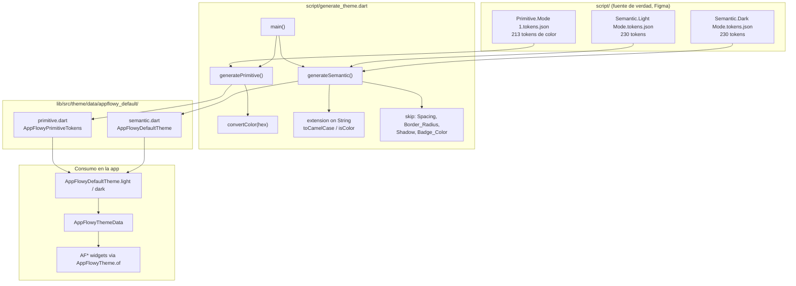
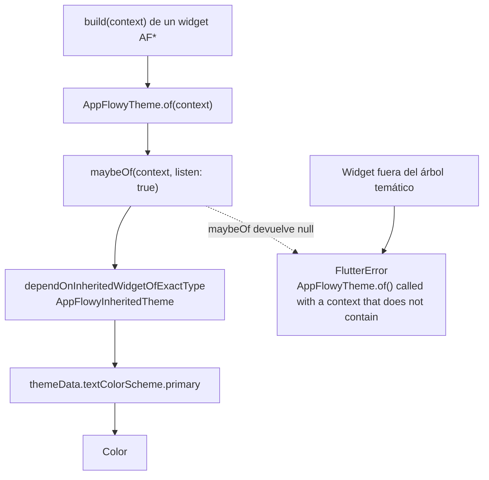
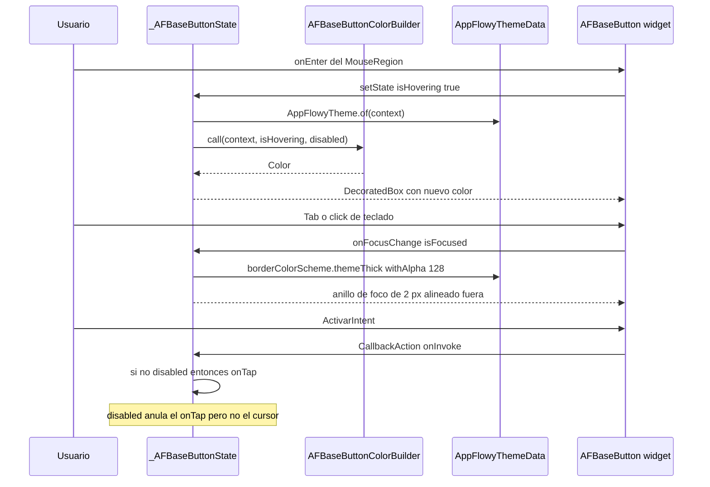
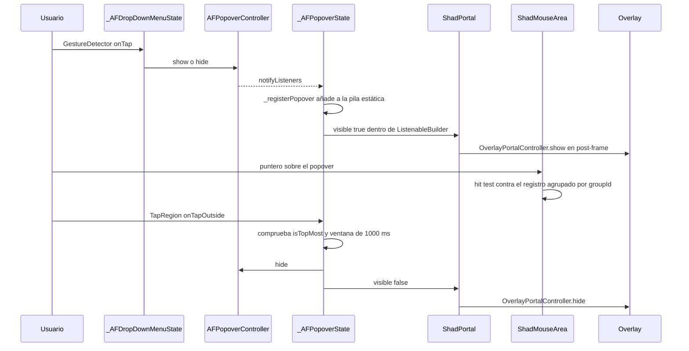
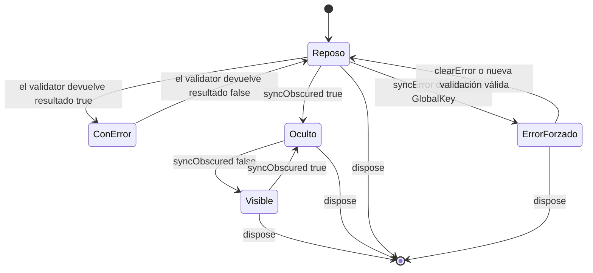

# F00.5.4 — Paquetes Dart internos: `appflowy_ui`

## 1. Resumen

`appflowy/frontend/appflowy_flutter/packages/appflowy_ui/` es el **sistema de diseño** del producto: una librería Flutter de 53 ficheros en `lib/` (8.368 líneas) que publica dos cosas y solo dos. La primera es el **modelo de tokens de tema** — `AppFlowyThemeData` y sus diez `ColorScheme`, más `spacing`, `borderRadius`, `shadow` y ocho estilos tipográficos— generados desde ficheros JSON de diseño mediante `script/generate_theme.dart`. La segunda es un **inventario de widgets base** (`AFBaseButton`, `AFTextField`, `AFPopover`, `AFMenu`, `AFAvatar`, `AFDivider`, `AFModal`, `AFDropDownMenu` y la familia de botones `AF*Filled/Ghost/Outlined`) que la app consume desde `lib/`. Este documento describe el **proveedor** de primitivas: qué expone, cómo se construye y desde dónde se monta. Los usos concretos de cada widget pertenecen a su feature (`[[F01]]`, `[[F02]]`, `[[F04]]`, `[[F12]]`, `[[F13]]`).

## 2. Alcance

**Incluye** los 100 ficheros del ledger asignados a esta unidad (53 Dart de `lib/`, 8 Dart de `example/`, 4 ficheros de `script/` —3 JSON de tokens y 1 generador Dart—, 22 de configuración, 9 de metadatos y 4 nativos Swift/XIB de la app de ejemplo `example/macos/`). Todos están agrupados por categoría en §12.

**Cuatro correcciones de scope obligatorias**, declaradas aquí y desarrolladas en §13:

1. **`appflowy_ui` es proveedor, no consumidor.** Ningún fichero de esta unidad importa `appflowy_backend`, ni habla con FFI, ni toca la BLoC de ninguna feature. Su única dependencia de runtime es `AppFlowyTheme.of(context)`. Los usos concretos (p. ej. quién usa `AFFilledTextButton.primary`) pertenecen a la feature que los usa y **no se reclaman aquí**: §13.1 lista los cinco puntos de montaje reales que sí se documentan, todos con `ruta:línea` del consumidor.
2. **Los tokens "no modificar porque se guardan en la base de datos" ya están documentados en `[[F01.7]]`.** Concretamente los `appflowy_them_color_tint*` y el resto del grupo `appflowy_them_color_*` que la app persiste vía `AppearanceSettings`. Este documento **cita** esos ficheros para marcar la frontera y **no duplica** su análisis: §3.6.
3. **Paquetes hermanos fuera de alcance.** `flowy_infra` (incluido el `AFThemeExtension` de `appflowy/frontend/appflowy_flutter/packages/flowy_infra/lib/theme_extension.dart:1`, con 265 usos en la app), `flowy_infra_ui` y `flowy_svg` son unidades sisters: `[[F00.5.5]]`, `[[F00.5.6]]`, `[[F00.5.7]]`. La coexistencia de dos sistemas de tema (`AppFlowyTheme` aquí y `AFThemeExtension`/`Theme.of`) se analiza en §13.2.
4. **El grafo de paquetes Dart no se repite.** Las aristas `appflowy → appflowy_ui` y `appflowy_ui → {}` (sin dependencias internas) ya están en `OUT/17-grafo-dependencias.md` (B1.2). Aquí solo se cita el dato como evidencia de aislamiento.

## 3. Modelos de datos

### 3.1 `AppFlowyThemeData`: raíz del tema

El tema no usa el `ThemeExtension` de Flutter ni `ColorScheme`/`TextTheme` nativos: define su propia estructura plana, con **catorce campos** required. Esto evita la dependencia de `Theme.of(context).colorScheme` y permite interpolar token a token:

```dart
// appflowy/frontend/appflowy_flutter/packages/appflowy_ui/lib/src/theme/definition/theme_data.dart:27–53
final AppFlowyTextColorScheme textColorScheme;
final AppFlowyBaseTextStyle textStyle;
final AppFlowyIconColorScheme iconColorScheme;
final AppFlowyBorderColorScheme borderColorScheme;
final AppFlowyBackgroundColorScheme backgroundColorScheme;
final AppFlowyFillColorScheme fillColorScheme;
final AppFlowySurfaceColorScheme surfaceColorScheme;
final AppFlowyBorderRadius borderRadius;
final AppFlowySpacing spacing;
final AppFlowyShadow shadow;
final AppFlowyBrandColorScheme brandColorScheme;
final AppFlowySurfaceContainerColorScheme surfaceContainerColorScheme;
final AppFlowyBadgeColorScheme badgeColorScheme;
final AppFlowyOtherColorsColorScheme otherColorsColorScheme;
```

[VERIFICADO] `appflowy/frontend/appflowy_flutter/packages/appflowy_ui/lib/src/theme/definition/theme_data.dart:27–53`. `AppFlowyThemeData.lerp` (mismo fichero, `:55–106`) interpola los **nueve** `ColorScheme` con `Color.lerp` pero **copia sin interpolar** `textStyle`, `borderRadius`, `spacing` y `shadow` (`begin.textStyle`/`end.textStyle`, `:65`, `:86–88`). [VERIFICADO] Consecuencia directa: al conmutar de tema claro a oscuro, tipografía y espaciado dan un salto en el primer frame de la animación en lugar de fundirse.

### 3.2 Los diez `ColorScheme`

Cada `AppFlowyThemeData` se ensambla a partir de diez clases, todas con el mismo patrón (`const`/`factory` constructor + `lerp(other, t)` que aplica `Color.lerp` campo a campo). El inventario real:

| Clase | Fichero | Campos `Color` | Línea del `lerp` |
|---|---|---:|---:|
| `AppFlowyTextColorScheme` | `appflowy/frontend/appflowy_flutter/packages/appflowy_ui/lib/src/theme/definition/color_scheme/text_color_scheme.dart:3` | 17 | `:42` |
| `AppFlowyIconColorScheme` | `appflowy/frontend/appflowy_flutter/packages/appflowy_ui/lib/src/theme/definition/color_scheme/icon_color_scheme.dart:3` | 15 | `:38` |
| `AppFlowyBorderColorScheme` | `appflowy/frontend/appflowy_flutter/packages/appflowy_ui/lib/src/theme/definition/color_scheme/border_color_scheme.dart:3` | 18 | `:44` |
| `AppFlowyFillColorScheme` | `appflowy/frontend/appflowy_flutter/packages/appflowy_ui/lib/src/theme/definition/color_scheme/fill_color_scheme.dart:3` | 33 | `:74` |
| `AppFlowySurfaceColorScheme` | `appflowy/frontend/appflowy_flutter/packages/appflowy_ui/lib/src/theme/definition/color_scheme/surface_color_scheme.dart:3` | 13 | `:34` |
| `AppFlowySurfaceContainerColorScheme` | `appflowy/frontend/appflowy_flutter/packages/appflowy_ui/lib/src/theme/definition/color_scheme/surface_container_color_scheme.dart:3` | 3 | `:14` |
| `AppFlowyBackgroundColorScheme` | `appflowy/frontend/appflowy_flutter/packages/appflowy_ui/lib/src/theme/definition/color_scheme/background_color_scheme.dart:3` | 1 | `:10` |
| `AppFlowyBadgeColorScheme` | `appflowy/frontend/appflowy_flutter/packages/appflowy_ui/lib/src/theme/definition/color_scheme/badge_color_scheme.dart:3` | **120** | `:248` |
| `AppFlowyBrandColorScheme` | `appflowy/frontend/appflowy_flutter/packages/appflowy_ui/lib/src/theme/definition/color_scheme/brand_color_scheme.dart:3` | 9 | `:26` |
| `AppFlowyOtherColorsColorScheme` | `appflowy/frontend/appflowy_flutter/packages/appflowy_ui/lib/src/theme/definition/color_scheme/other_color_scheme.dart:3` | 1 | `:10` |

[VERIFICADO] Recuento por `rg -c '^  final Color'` sobre cada fichero del inventario. El barraque se exporta en un único punto, `appflowy/frontend/appflowy_flutter/packages/appflowy_ui/lib/src/theme/definition/color_scheme/color_scheme.dart:1–10`, que a su vez se reexporta desde `appflowy/frontend/appflowy_flutter/packages/appflowy_ui/lib/src/theme/theme.dart:4` y desde la raíz pública `appflowy/frontend/appflowy_flutter/packages/appflowy_ui/lib/appflowy_ui.dart:3`.

`AppFlowyBadgeColorScheme` es el caso extremo: **120 campos** con nombre regular `color{N}Light{1..3}` y `color{N}Thick{1..3}` para `N` de 1 a 20, declarados en `appflowy/frontend/appflowy_flutter/packages/appflowy_ui/lib/src/theme/definition/color_scheme/badge_color_scheme.dart:127–246`. Es la paleta de avatares y etiquetas, y su cardinalidad no cabe en una jerarquía: por eso `AFAvatar` construye a mano dos `List<Color>` de 20 elementos para indexarlas (`appflowy/frontend/appflowy_flutter/packages/appflowy_ui/lib/src/component/avatar/avatar.dart:182–206` y `:209–233`).

### 3.3 Los tokens compartidos: spacing, borderRadius, shadow

Tres clases de valor, todas con seis niveles `xs|s|m|l|xl|xxl`, más un `shadow` con dos listas de `BoxShadow`:

- `AppFlowySpacing` — `appflowy/frontend/appflowy_flutter/packages/appflowy_ui/lib/src/theme/definition/spacing/spacing.dart:1–17`.
- `AppFlowyBorderRadius` — `appflowy/frontend/appflowy_flutter/packages/appflowy_ui/lib/src/theme/definition/border_radius/border_radius.dart:1–17`.
- `AppFlowyShadow { small, medium }` — `appflowy/frontend/appflowy_flutter/packages/appflowy_ui/lib/src/theme/definition/shadow/shadow.dart:3–11`.

Los **valores numéricos** viven en `appflowy/frontend/appflowy_flutter/packages/appflowy_ui/lib/src/theme/data/shared.dart`: `AppFlowySpacingConstant` (`:6–13`, escala 4/6/8/12/16/20) y `AppFlowyBorderRadiusConstant` (`:15–22`, misma escala). Las fábricas son `AppFlowySharedTokens.buildBorderRadius()` (`:27`), `.buildSpacing()` (`:38`) y `.buildShadow(Brightness)` (`:49–86`), que devuelve `Color(0x1F000000)` en claro y `Color(0x7A000000)` en oscuro. [VERIFICADO] `appflowy/frontend/appflowy_flutter/packages/appflowy_ui/lib/src/theme/data/shared.dart:52–85`.

### 3.4 La escala tipográfica

`AppFlowyBaseTextStyle` (`appflowy/frontend/appflowy_flutter/packages/appflowy_ui/lib/src/theme/definition/text_style/text_style.dart:3`) agrega ocho clases derivadas de `TextThemeType`, cada una con cuatro métodos: `standard` (w400), `enhanced` (w600), `prominent` (w700) y `underline`. La escala de cuerpo la fija el `_defaultTextStyle` estático de cada clase:

| Clase `TextThemeType` | `fontSize` / `height` | Fichero:línea |
|---|---|---|
| `TextThemeHeading1` | 36 / 40÷36 | `appflowy/frontend/appflowy_flutter/packages/appflowy_ui/lib/src/theme/definition/text_style/base/default_text_style.dart:35` (tamaño en `:48–49`) |
| `TextThemeHeading2` | 24 / 32÷24 | `appflowy/frontend/appflowy_flutter/packages/appflowy_ui/lib/src/theme/definition/text_style/base/default_text_style.dart:119` (`:159–160`) |
| `TextThemeHeading3` | 20 / 28÷20 | `appflowy/frontend/appflowy_flutter/packages/appflowy_ui/lib/src/theme/definition/text_style/base/default_text_style.dart:179` (`:219–220`) |
| `TextThemeHeading4` | 16 / 22÷16 | `appflowy/frontend/appflowy_flutter/packages/appflowy_ui/lib/src/theme/definition/text_style/base/default_text_style.dart:239` (`:279–280`) |
| `TextThemeHeadline` | 24 / 36÷24 | `appflowy/frontend/appflowy_flutter/packages/appflowy_ui/lib/src/theme/definition/text_style/base/default_text_style.dart:299` (`:339–340`) |
| `TextThemeTitle` | 20 / 28÷20 | `appflowy/frontend/appflowy_flutter/packages/appflowy_ui/lib/src/theme/definition/text_style/base/default_text_style.dart:359` (`:399–400`) |
| `TextThemeBody` | 14 / 20÷14 | `appflowy/frontend/appflowy_flutter/packages/appflowy_ui/lib/src/theme/definition/text_style/base/default_text_style.dart:419` (`:459–460`) |
| `TextThemeCaption` | 12 / 18÷12 | `appflowy/frontend/appflowy_flutter/packages/appflowy_ui/lib/src/theme/definition/text_style/base/default_text_style.dart:479` (`:519–520`) |

[VERIFICADO] Las ocho declaraciones de clase y los ocho pares `fontSize`/`height` se leen directamente del fichero. La factoría `AppFlowyBaseTextStyle.customFontFamily(fontFamily)` (`appflowy/frontend/appflowy_flutter/packages/appflowy_ui/lib/src/theme/definition/text_style/text_style.dart:4–14`) es el único punto por donde entra la tipografía elegida por el usuario; el resto de constructores usan `fontFamily: ''` como valor por defecto (`:16–25`).

### 3.5 Los datos generados: primitivos y semánticos

`appflowy/frontend/appflowy_flutter/packages/appflowy_ui/lib/src/theme/data/appflowy_default/primitive.dart` expone **213** constantes `Color` estáticas en la clase `AppFlowyPrimitiveTokens` (`:14`), organizadas en rampas: `neutral` (12), `blue`/`green`/`purple`/`magenta`/`red`/`orange`/`yellow` (10 cada una, pasos 100…1000), 20 familias `subtleColor*` de 6 pasos cada una (120 en total) y un puñado de alfa. [VERIFICADO] `appflowy/frontend/appflowy_flutter/packages/appflowy_ui/lib/src/theme/data/appflowy_default/primitive.dart:18` es el primero de la serie (`neutral100 = Color(0xFFF8FAFF)`).

`appflowy/frontend/appflowy_flutter/packages/appflowy_ui/lib/src/theme/data/appflowy_default/semantic.dart` es el **único tema concreto** del paquete: `AppFlowyDefaultTheme implements AppFlowyThemeBuilder` (`:17`) con los métodos `light()` (`:19`) y `dark()` (`:309`), que devuelven cada uno su `AppFlowyThemeData` (`:287` y `:574`). Ambos métodos comparten el mismo esqueleto: construyen `textStyle`, `borderRadius`, `spacing` y `shadow` con las fábricas de `shared.dart`, luego los diez `ColorScheme` a partir de `AppFlowyPrimitiveTokens`, y solo difieren en las constantes de primitivo elegidas (p. ej. `textColorScheme.primary` es `neutral1000` en claro, `neutral200` en oscuro). [VERIFICADO] `appflowy/frontend/appflowy_flutter/packages/appflowy_ui/lib/src/theme/data/appflowy_default/semantic.dart:22–25` y `:309–313`.

### 3.6 Frontera con `[[F01.7]]`: los tokens persistidos

Existe una segunda familia de tokens de color —los `appflowy_them_color_tint*` y compañía— que **no** viven en este paquete sino en el modelo de ajustes de apariencia y que se guardan en la base de datos, razón por la que el propio código los marca como inmutables. Este documento **no** los reanaliza: los cita para fijar la frontera entre el sistema de diseño en memoria (`appflowy_ui`) y el sistema de preferencias persistido. Análisis completo en `[[F01.7]]`; los usos de tema del ajuste de apariencia pertenecen a `[[F13]]`.

## 4. Eventos FFI

**Ninguno.** `appflowy_ui` no importa `appflowy_backend`, no llama a `Dispatch`, no genera ni consume eventos. El catálogo `OUT/_ledger/extract/events.json` (229 variantes en 8 crates) tiene **cero** coincidencias con rutas de este paquete, y lo mismo ocurre con `notifications.json` y `protobuf.json`. [VERIFICADO] Búsqueda exhaustiva sobre `OUT/_ledger/extract/events.json`, `notifications.json` y `protobuf.json` (0 menciones de `appflowy_ui` en los tres).

La dependencia se ve desde el lado contrario: el paquete declara **cero dependencias internas** en `appflowy/frontend/appflowy_flutter/packages/appflowy_ui/pubspec.yaml:10–15` (solo `cached_network_image`, `flutter`, `flutter_animate`, `flutter_lints`), frente a los **cuatro** paquetes hermanos que sí declaran dependencias internas. [VERIFICADO] `OUT/_ledger/extract/deps.json:dart.internal_packages[3]` — `{"name": "appflowy_ui", "version": "1.0.0", "internal_dependencies": []}`.

## 5. Notificaciones

**Ninguna.** No hay listeners, ni `ChangeNotifier` de datos, ni suscripciones a `RustStreamReceiver`. El paquete no importa `dart:async` en ningún fichero de `lib/` salvo a través de widgets asíncronos de Flutter.

La única clase con semántica de notificador es `AFPopoverController extends ChangeNotifier` (`appflowy/frontend/appflowy_flutter/packages/appflowy_ui/lib/src/component/popover/popover.dart:17`), que notifica exclusivamente su propia visibilidad (`show()`/`hide()`/`setOpen()`/`toggle()`, `:26–46`) y de la que se suscribe la propia jerarquía de popovers. No cruza ninguna frontera de proceso.

## 6. BLoCs / Cubits

**Ninguno.** El catálogo `OUT/_ledger/extract/blocs.json` no contiene ninguna entrada bajo `packages/appflowy_ui/`. [VERIFICADO] Búsqueda exhaustiva sobre `OUT/_ledger/extract/blocs.json:blocs[]` filtrando por el prefijo del paquete: 0 resultados.

Los widgets del paquete son `StatelessWidget` en su mayoría, con tres `StatefulWidget` que tienen estado puramente efímero de presentación y que **nunca** se inyectan desde una BLoC:

| Widget con estado | Estado interno | Fichero:línea |
|---|---|---|
| `_AFBaseButtonState` | `isHovering`, `isFocused`, `FocusNode` | `appflowy/frontend/appflowy_flutter/packages/appflowy_ui/lib/src/component/button/base_button/base_button.dart:54–58` |
| `_AFTextFieldState` | `hasError`, `errorText`, `isObscured`, `effectiveController` | `appflowy/frontend/appflowy_flutter/packages/appflowy_ui/lib/src/component/textfield/textfield.dart:98–104` |
| `_AFDropDownMenuState` | `isHovering`, `isOpen`, `controller` | `appflowy/frontend/appflowy_flutter/packages/appflowy_ui/lib/src/component/dropdown_menu/dropdown_menu.dart:45–49` |
| `_AFPopoverState` | `_openPopovers` (estático), `_lastPopoverClosedTimestamp` (estático), `animating` | `appflowy/frontend/appflowy_flutter/packages/appflowy_ui/lib/src/component/popover/popover.dart:161–172` |

## 7. Servicios e inyección de dependencias

### 7.1 Inyección Dart (`get_it`): ninguna

`appflowy_ui` **no se registra** en `get_it`. No hay `registerLazySingleton`, `registerFactory` ni `GetIt` en ningún fichero del paquete; la única referencia a `get_it` en el repo está en `lib/startup/deps_resolver.dart` y no alcanza este paquete. La resolución es puramente contextual: los widgets obtienen el tema con `AppFlowyTheme.of(context)` y `AppFlowyTheme.maybeOf(context)` (`appflowy/frontend/appflowy_flutter/packages/appflowy_ui/lib/src/theme/appflowy_theme.dart:15` y `:30`).

### 7.2 El punto de montaje: `AppFlowyTheme` / `AnimatedAppFlowyTheme`

`AppFlowyTheme` es un `StatelessWidget` que envuelve su hijo en un `AppFlowyInheritedTheme extends InheritedTheme` (`:46–52`, `:55–72`). El `InheritedTheme` solo notifica si la referencia del tema cambia (`updateShouldNotify` compara `themeData != oldWidget.themeData`, `:70–71`), y `AnimatedAppFlowyTheme` (`:92`) interpola entre el valor viejo y el nuevo mediante `AppFlowyThemeDataTween` (`:80–90`) y `_AnimatedThemeState` (`:118–151`). Ése es el mecanismo completo de conmutación claro↔oscuro del producto.

Los tres puntos de montaje reales, todos fuera de este paquete:

1. **Arranque de la app** — `appflowy/frontend/appflowy_flutter/lib/startup/tasks/app_widget.dart:150` instancia `AppFlowyDefaultTheme` y `appflowy/frontend/appflowy_flutter/lib/startup/tasks/app_widget.dart:254–258` monta `AnimatedAppFlowyTheme` dentro del `builder` de `MaterialApp`, eligiendo `light()`/`dark()` según `Theme.of(context).brightness` y pasando la fuente elegida por el usuario. Es **el único** montaje en producción.
2. **Wrapper de tests** — `appflowy/frontend/appflowy_flutter/test/widget_test/widget_test_wrapper.dart:12` y `:16` montan `AppFlowyTheme` (sin animación) para que los widget tests puedan llamar a `AppFlowyTheme.of`.
3. **App de ejemplo** — `appflowy/frontend/appflowy_flutter/packages/appflowy_ui/example/lib/main.dart:36–39` monta `AnimatedAppFlowyTheme` alternando con un `ValueNotifier<ThemeMode>` propio (`:16`).

### 7.3 El contrato `AppFlowyThemeBuilder`

`appflowy/frontend/appflowy_flutter/packages/appflowy_ui/lib/src/theme/definition/theme_data.dart:116–125` declara `abstract class AppFlowyThemeBuilder` con `light({String? fontFamily})` y `dark({String? fontFamily})`. Hay **dos** implementaciones: `AppFlowyDefaultTheme` (§3.5) y `CustomTheme`, **no funcional**: `appflowy/frontend/appflowy_flutter/packages/appflowy_ui/lib/src/theme/data/custom/custom_theme.dart:3` declara el constructor con `lightThemeJson`/`darkThemeJson`, pero ambos métodos lanzan `UnimplementedError` (`:16`, `:23`). [VERIFICADO] Lectura directa del fichero; ver §13.4 (riesgo).

### 7.4 Dependencias declaradas (`pubspec.yaml`)

| Paquete | Versión | Uso real en `lib/` |
|---|---|---|
| `flutter` | sdk | `material`, `widgets` en toda la librería |
| `cached_network_image` | `^3.4.1` | `CachedNetworkImage` en `AFAvatar` (`appflowy/frontend/appflowy_flutter/packages/appflowy_ui/lib/src/component/avatar/avatar.dart:3`, `:126`) |
| `flutter_animate` | `^4.5.2` | `Animate(effects: …)` en `AFPopover` (`appflowy/frontend/appflowy_flutter/packages/appflowy_ui/lib/src/component/popover/popover.dart:8`, `:268`) |
| `flutter_lints` | `^5.0.0` | solo en `dev_dependencies`; se activa vía `appflowy/frontend/appflowy_flutter/packages/appflowy_ui/analysis_options.yaml:1` |

[VERIFICADO] `appflowy/frontend/appflowy_flutter/packages/appflowy_ui/pubspec.yaml:10–19`. El paquete declara `environment: sdk ^3.6.2` y `flutter >=1.17.0` (`:6–8`), y se publica como `appflowy_ui` versión `1.0.0` (`:1`, `:3`).

## 8. Persistencia

**Ninguna en este paquete.** `appflowy_ui` no importa `hive`, `sqflite`, `shared_preferences` ni ninguna ruta de almacenamiento; su superficie de E/S se limita a `File` en el generador `appflowy/frontend/appflowy_flutter/packages/appflowy_ui/script/generate_theme.dart:16`, `:88`, `:90` (lectura de JSON) y `:54`, `:233` (escritura de los `.dart` generados).

La única "persistencia" real del sistema de diseño son los ficheros de tokens en disco —los tres JSON de `script/`— que son **entrada** del codegen, y los dos Dart generados que son su salida. Ese ciclo se describe en §9.1. La persistencia de la preferencia de tema (qué tema, qué fuente, qué factor de escala) no vive aquí: vive en `AppearanceSettings` y se documenta en `[[F13]]` y `[[F01.7]]`.

## 9. Diagramas de flujo

### 9.1 El ciclo de codegen del tema (JSON → Dart)

Muestra el pipeline completo que produce `primitive.dart` y `semantic.dart` a partir de los tres ficheros JSON de diseño.



**Lectura**: el paquete es **reproducible desde ficheros de diseño** que no se tocan a mano. `main()` (`appflowy/frontend/appflowy_flutter/packages/appflowy_ui/script/generate_theme.dart:8–11`) llama a las dos generadoras; `generatePrimitive()` (`:13`) recorre el JSON de primitivos, aplana cada hoja `{"$type":"color","$value":"#…"}` a un getter `static Color get neutral100` (`:59–83`) y escribe `primitive.dart` (`:53–54`); `generateSemantic()` (`:85`) hace lo propio con los dos JSON semánticos y escribe `semantic.dart` (`:112–113`). `convertColor` (`:275–284`) reordena el hex a ARGB: si tiene 6 dígitos antepone `FF`, si tiene 8 intercambia los bloques alfa/RGB. El resolutor `toCamelCase`/`isColor` (`:285–307`) decide si un valor semántico es un literal o una referencia `AppFlowyPrimitiveTokens.x` (`:133`, `:139`). La lista de categorías omitidas está en `:128–133` y `:182–187`.

### 9.2 Resolución del tema en un `build()`

Muestra el camino que recorre un widget del paquete para obtener un color.



**Lectura**: `AppFlowyTheme.of` (`appflowy/frontend/appflowy_flutter/packages/appflowy_ui/lib/src/theme/appflowy_theme.dart:15–28`) delega en `maybeOf` (`:30–44`), que busca el `InheritedTheme` ancestors con `dependOnInheritedWidgetOfExactType<AppFlowyInheritedTheme>()` si `listen == true` (dependencia real: el widget se reconstruye al cambiar el tema) o con `getElementForInheritedWidgetOfExactType` si `listen == false` (solo lectura, sin suscripción). Si no hay ancestro, `of` lanza un `FlutterError` con mensaje explícito (`:18–25`); `maybeOf` devuelve `null`. Todos los widgets del paquete usan la variante `of`, es decir, todos dependen del tema — ninguno admite un tema nulo (ver §13.3).

## 10. Diagramas de secuencia

### 10.1 Ciclo de vida de un `AFBaseButton` (hover, foco, teclado, disabled)

Muestra los tres estados que administra `_AFBaseButtonState` y cómo se combinan con el tema.



**Lectura**: `_AFBaseButtonState` (`appflowy/frontend/appflowy_flutter/packages/appflowy_ui/lib/src/component/button/base_button/base_button.dart:54–158`) mantiene exactamente tres cosas: `focusNode`, `isHovering` e `isFocused` (`:55–58`). El color nunca se calcula dentro del widget base: se pide a los typedefs `AFBaseButtonColorBuilder` (`:4–8`) y `AFBaseButtonBorderColorBuilder` (`:10–15`), que son `Color Function(BuildContext, bool isHovering, bool disabled)` y su variante con `isFocused`. Las fábricas concretas de `AFFilledButton.primary` (`:24–52`) capturan esa terna y la resuelven contra el tema. El anillo de foco se dibuja con `strokeAlign: BorderSide.strokeAlignOutside` para no desplazar el layout (`:102–108`), y el `ActivateIntent` (`:74–81`) respeta `disabled` — pero el `MouseRegion` solo cambia de cursor si `onTap == null` o `disabled` (`:90–94`).

### 10.2 Apertura y cierre de un `AFPopover` (drop-down, menú contextual)

Muestra cómo el `AFDropDownMenu` se apoya en `AFPopover` + `ShadPortal` para renderizar fuera del árbol local.



**Lectura**: `AFPopoverController` (`appflowy/frontend/appflowy_flutter/packages/appflowy_ui/lib/src/component/popover/popover.dart:17–47`) es un `ChangeNotifier` idempotente (`show()`/`hide()` retornan pronto si el estado no cambia, `:27`, `:34`). `_AFPopoverState` mantiene una **pila estática** `_openPopovers` (`:161`) para saber cuál es el popover superior (`:178–179`), y una marca temporal `_lastPopoverClosedTimestamp` con ventana de 1 s (`:163–168`, `:279–282`) que evita el clásico "el `onTapOutside` del popover recién cerrado vuelve a disparar". `ShadPortal` (`appflowy/frontend/appflowy_flutter/packages/appflowy_ui/lib/src/component/popover/shadcn/_portal.dart:122–138`) delega el posicionamiento en `OverlayPortalController` + `ShadPositionDelegate` (`:320–364`) y resuelve la geometría desde `LayerLink` (`:141–143`). El comportamiento hover del popover lo aporta `ShadMouseArea` (`appflowy/frontend/appflowy_flutter/packages/appflowy_ui/lib/src/component/popover/shadcn/_mouse_area.dart:207–326`), una reimplementación de `MouseRegion` que agrupa regiones por `groupId` y **no** participa en el sistema de desambiguación de gestos (`:496–515`).

## 11. Diagramas de estado

El paquete no tiene máquinas de estado de dominio, pero sí tres máquinas de presentación con estados discretos observables. La más representativa es la del `AFTextField`, porque su estado es **manipulable desde fuera** a través de la clase base pública `AFTextFieldState`.



**Lectura**: el estado observable es el par `(hasError, errorText, isObscured)` de `_AFTextFieldState` (`appflowy/frontend/appflowy_flutter/packages/appflowy_ui/lib/src/component/textfield/textfield.dart:101–104`). `initState` (`:107–120`) crea el `TextEditingController` efectivo (usa el del consumidor si lo pasó, si no uno propio que debe liberarse en `dispose`, `:125–127`), siembra `initialText` y engancha `_validate` como listener. `_validate` (`:234–243`) llama al `AFTextFieldValidator` —un record `(bool result, String errorText)` (`:5–7`)— y hace `setState` en **cada** pulsación, sin debounce. `AFTextFieldState` (`:9–16`) expone tres métodos para forzar el estado desde fuera (`syncError`, `clearError`, `syncObscured`), pensados para que un consumidor obtenga el `State` vía `GlobalKey<AFTextFieldState>`; si no se usa esa vía, la abstract class base simply no se instancia. En `build` (`:132–232`), `hasError` selecciona el color del borde entre `borderColorScheme.errorThick` y `primary` (`:138–146`) y añade una línea de error bajo el campo (`:215–229`).

## 12. Archivos cubiertos (del ledger)

**Recuento real de los 100 ficheros**: 53 Dart de `lib/` (8.368 líneas), 8 Dart de `example/` (1.098), 4 de `script/` (3.413), 22 de configuración, 9 de metadatos y 4 nativos Swift/XIB de `example/macos/`. Suma: 14.741 líneas. [VERIFICADO] `OUT/_ledger/inventario.json:files[]` filtrado por el prefijo `appflowy/frontend/appflowy_flutter/packages/appflowy_ui/`; el recuento por categoría sale de contar entradas por extensión y prefijo.

### 12.1 Barrels y tema: 26 ficheros Dart de `lib/` (4.003 líneas)

| Fichero | LOC | Rol |
|---|---:|---|
| `lib/appflowy_ui.dart` | 3 | barrel raíz: 3 `export` (`component.dart`, `primitive.dart`, `theme.dart`) |
| `lib/src/component/component.dart` | 8 | barrel de widgets: 8 `export` |
| `lib/src/theme/theme.dart` | 8 | barrel de tema: 8 `export` |
| `lib/src/theme/appflowy_theme.dart` | 152 | `AppFlowyTheme`, `AppFlowyInheritedTheme`, `AppFlowyThemeDataTween`, `AnimatedAppFlowyTheme` |
| `lib/src/theme/definition/theme_data.dart` | 126 | `AppFlowyThemeData` + `AppFlowyThemeBuilder` |
| `lib/src/theme/definition/color_scheme/color_scheme.dart` | 10 | barrel de los 10 `ColorScheme` |
| `lib/src/theme/definition/color_scheme/text_color_scheme.dart` | 134 | 17 campos |
| `lib/src/theme/definition/color_scheme/icon_color_scheme.dart` | 120 | 15 campos |
| `lib/src/theme/definition/color_scheme/border_color_scheme.dart` | 141 | 18 campos |
| `lib/src/theme/definition/color_scheme/fill_color_scheme.dart` | 246 | 33 campos |
| `lib/src/theme/definition/color_scheme/surface_color_scheme.dart` | 106 | 13 campos (`layer01`…`layer04`) |
| `lib/src/theme/definition/color_scheme/surface_container_color_scheme.dart` | 36 | 3 campos |
| `lib/src/theme/definition/color_scheme/background_color_scheme.dart` | 22 | 1 campo |
| `lib/src/theme/definition/color_scheme/badge_color_scheme.dart` | 855 | 120 campos (badges/avatares) |
| `lib/src/theme/definition/color_scheme/brand_color_scheme.dart` | 42 | 9 colores de marca |
| `lib/src/theme/definition/color_scheme/other_color_scheme.dart` | 18 | 1 campo (`textHighlight`) |
| `lib/src/theme/definition/spacing/spacing.dart` | 17 | escala de espaciado |
| `lib/src/theme/definition/border_radius/border_radius.dart` | 17 | escala de radio |
| `lib/src/theme/definition/shadow/shadow.dart` | 11 | `small` / `medium` |
| `lib/src/theme/definition/text_style/text_style.dart` | 35 | `AppFlowyBaseTextStyle` |
| `lib/src/theme/definition/text_style/base/default_text_style.dart` | 537 | 8 clases `TextThemeType` |
| `lib/src/theme/data/appflowy_default/primitive.dart` | 655 | **generado**: `AppFlowyPrimitiveTokens`, 213 constantes `Color` |
| `lib/src/theme/data/appflowy_default/semantic.dart` | 591 | **generado**: `AppFlowyDefaultTheme.light()` / `.dark()` |
| `lib/src/theme/data/shared.dart` | 87 | constantes numéricas y fábricas |
| `lib/src/theme/data/built_in_themes.dart` | 1 | barrel: exporta `appflowy_default/semantic.dart` |
| `lib/src/theme/data/custom/custom_theme.dart` | 25 | `CustomTheme` ( stubs que lanzan) |

### 12.2 Componentes: 27 ficheros Dart en `lib/src/component/` (4.365 líneas)

| Fichero | LOC | Clases/elementos públicos |
|---|---:|---|
| `button/button.dart` | 16 | barrel de 12 `export` |
| `button/base_button/base.dart` | 54 | `enum AFButtonSize {s,m,l,xl}` con `buildTextStyle`/`buildPadding`/`buildBorderRadius` |
| `button/base_button/base_button.dart` | 159 | 2 `typedef` de color + `AFBaseButton` (el botón con estado) |
| `button/base_button/base_text_button.dart` | 55 | `AFBaseTextButton` (clase abstracta de facto: `build` lanza) |
| `button/filled_button/filled_button.dart` | 127 | `AFFilledButton.primary` / `.destructive` / `.disabled` |
| `button/filled_button/filled_text_button.dart` | 164 | `AFFilledTextButton.primary` / `.destructive` / `.disabled` |
| `button/filled_button/filled_icon_text_button.dart` | 199 | `AFFilledIconTextButton.primary` / `.destructive` / `.disabled` / `.ghost` |
| `button/ghost_button/ghost_button.dart` | 96 | `AFGhostButton.normal` / `.disabled` |
| `button/ghost_button/ghost_text_button.dart` | 129 | `AFGhostTextButton.primary` / `.disabled` |
| `button/ghost_button/ghost_icon_text_button.dart` | 148 | `AFGhostIconTextButton.primary` / `.disabled` |
| `button/outlined_button/outlined_button.dart` | 168 | `AFOutlinedButton.normal` / `.destructive` / `.disabled` |
| `button/outlined_button/outlined_text_button.dart` | 221 | `AFOutlinedTextButton.normal` / `.destructive` / `.disabled` |
| `button/outlined_button/outlined_icon_text_button.dart` | 226 | `AFOutlinedIconTextButton.normal` / `.destructive` / `.disabled` |
| `textfield/textfield.dart` | 293 | `AFTextFieldState`, `AFTextField`, `enum AFTextFieldSize {m,l}` |
| `popover/popover.dart` | 328 | `AFPopoverController`, `AFPopover` |
| `popover/anchor.dart` | 33 | `AFAnchorAuto`, `AFAnchor`, `AFGlobalAnchor` |
| `popover/shadcn/_portal.dart` | 364 | `ShadAnchorBase` (sealed), `ShadAnchorAuto`, `ShadAnchor`, `ShadGlobalAnchor`, `ShadPortal`, `ShadPositionDelegate` |
| `popover/shadcn/_mouse_area.dart` | 515 | `MouseAreaRegistry`, `MouseAreaSurfaceRenderBox`, `ShadMouseArea`, `ShadMouseAreaRenderBox`, `ShadMouseAreaSurface` |
| `dropdown_menu/dropdown_menu.dart` | 360 | `mixin AFDropDownMenuMixin`, `AFDropDownMenu<T>` + 2 widgets privados |
| `menu/menu.dart` | 45 | `AFMenu` |
| `menu/menu_item.dart` | 102 | `AFMenuItem` |
| `menu/text_menu_item.dart` | 74 | `AFTextMenuItem` |
| `menu/section.dart` | 61 | `AFMenuSection` |
| `modal/modal.dart` | 132 | `AFModal`, `AFModalHeader`, `AFModalBody`, `AFModalFooter` |
| `modal/dimension.dart` | 9 | `AFModalDimension.S/M/L/dialogHeight` |
| `avatar/avatar.dart` | 234 | `enum AFAvatarSize`, `AFAvatar` |
| `separator/divider.dart` | 53 | `AFDivider` |

### 12.3 Codegen: 4 ficheros en `script/` (3.413 líneas)

| Fichero | LOC | Contenido |
|---|---:|---|
| `script/Primitive.Mode 1.tokens.json` | 980 | 213 tokens de color primitivos en 11 categorías raíz |
| `script/Semantic.Light Mode.tokens.json` | 1.063 | 230 tokens semánticos de tema claro |
| `script/Semantic.Dark Mode.tokens.json` | 1.063 | 230 tokens semánticos de tema oscuro |
| `script/generate_theme.dart` | 307 | el generador (`main`, dos generadoras, `convertColor`, extensión de `String`) |

### 12.4 Configuración: 22 ficheros

| Grupo | Ficheros | LOC |
|---|---|---:|
| `pubspec.yaml` y `analysis_options.yaml` del paquete y de `example/` | `appflowy/frontend/appflowy_flutter/packages/appflowy_ui/pubspec.yaml:1`, `appflowy/frontend/appflowy_flutter/packages/appflowy_ui/analysis_options.yaml:1`, `appflowy/frontend/appflowy_flutter/packages/appflowy_ui/example/pubspec.yaml:1`, `appflowy/frontend/appflowy_flutter/packages/appflowy_ui/example/analysis_options.yaml:1` | 106 |
| Configuración Xcode | `appflowy/frontend/appflowy_flutter/packages/appflowy_ui/example/macos/Flutter/Flutter-Debug.xcconfig:1`, `appflowy/frontend/appflowy_flutter/packages/appflowy_ui/example/macos/Flutter/Flutter-Release.xcconfig:1`, `appflowy/frontend/appflowy_flutter/packages/appflowy_ui/example/macos/Runner/Configs/AppInfo.xcconfig:8`, `appflowy/frontend/appflowy_flutter/packages/appflowy_ui/example/macos/Runner/Configs/Debug.xcconfig:1`, `appflowy/frontend/appflowy_flutter/packages/appflowy_ui/example/macos/Runner/Configs/Release.xcconfig:1`, `appflowy/frontend/appflowy_flutter/packages/appflowy_ui/example/macos/Runner/Configs/Warnings.xcconfig:1` | 35 |
| Proyecto Xcode | `appflowy/frontend/appflowy_flutter/packages/appflowy_ui/example/macos/Runner.xcodeproj/project.pbxproj:1`, `appflowy/frontend/appflowy_flutter/packages/appflowy_ui/example/macos/Runner.xcodeproj/project.xcworkspace/xcshareddata/IDEWorkspaceChecks.plist:1`, `appflowy/frontend/appflowy_flutter/packages/appflowy_ui/example/macos/Runner.xcodeproj/xcshareddata/xcschemes/Runner.xcscheme:1` | 913 |
| Workspace Xcode | `appflowy/frontend/appflowy_flutter/packages/appflowy_ui/example/macos/Runner.xcworkspace/contents.xcworkspacedata:1`, `appflowy/frontend/appflowy_flutter/packages/appflowy_ui/example/macos/Runner.xcworkspace/xcshareddata/IDEWorkspaceChecks.plist:1`, `appflowy/frontend/appflowy_flutter/packages/appflowy_ui/example/macos/Runner.xcworkspace/xcshareddata/WorkspaceSettings.xcsettings:1` | 23 |
| CocoaPods | `example/macos/Podfile:1`, `appflowy/frontend/appflowy_flutter/packages/appflowy_ui/example/macos/Podfile.lock:1` | 73 |
| Entitlements y `Info.plist` | `appflowy/frontend/appflowy_flutter/packages/appflowy_ui/example/macos/Runner/DebugProfile.entitlements:5`, `appflowy/frontend/appflowy_flutter/packages/appflowy_ui/example/macos/Runner/Release.entitlements:5`, `appflowy/frontend/appflowy_flutter/packages/appflowy_ui/example/macos/Runner/Info.plist:5` | 54 |
| Iconos | `appflowy/frontend/appflowy_flutter/packages/appflowy_ui/example/macos/Runner/Assets.xcassets/AppIcon.appiconset/Contents.json:1` | 68 |

Ningún fichero de configuración declara clases del paquete: son andamiaje de `flutter create -t plugin` para la app de ejemplo. [VERIFICADO] Lectura directa: `appflowy/frontend/appflowy_flutter/packages/appflowy_ui/example/macos/Podfile:1` fija `platform :osx, '10.14'` y `use_frameworks!` (`:30`); `appflowy/frontend/appflowy_flutter/packages/appflowy_ui/example/macos/Runner/Configs/AppInfo.xcconfig:11` lleva un bundle id de ejemplo (`com.example.appflowyUiExample`), señal inequívoca de que es plantilla sin publicar.

### 12.5 Metadatos: 9 ficheros

| Fichero | LOC | Contenido relevante |
|---|---:|---|
| `.gitignore` | 31 | excluye `/pubspec.lock` (`:26`) por ser librería, más `.dart_tool/`, `build/`, `.flutter-plugins` |
| `.metadata` | 10 | `project_type: package` (`:10`), revisión Flutter `d8a9f9a5…` (`:7`) |
| `CHANGELOG.md` | 3 | placeholder `## 0.0.1` + `* TODO: Describe initial release.` |
| `LICENSE` | 1 | `TODO: Add your license here.` — **sin licencia real** |
| `README.md` | 39 | checklist de componentes soportados (`:21–35`): solo `Button` y `TextField` marcados `[x]` |
| `example/.gitignore` | 45 | plantilla de app Flutter |
| `example/.metadata` | 30 | `project_type: app` (`:10`) + bloque de migración |
| `example/README.md` | 41 | descripción genérica de plantilla |
| `example/macos/.gitignore` | 7 | ignora `Pods/` y `xcuserdata/` |

[VERIFICADO] `appflowy/frontend/appflowy_flutter/packages/appflowy_ui/README.md:21–35` marca `[x]` solo en `Button` y `TextField` y `[ ]` en `Avatar`, `Popover`, `Menu` y el resto, **aunque el código sí los implemente y la app sí los use**. El README está desactualizado respecto al paquete; §13.5.

### 12.6 App de ejemplo: 8 ficheros Dart (1.098 líneas)

| Fichero | LOC | Qué demuestra |
|---|---:|---|
| `example/lib/main.dart` | 126 | montaje de `AnimatedAppFlowyTheme` (`:36–39`) + `TabBarView` con las 6 páginas (`:104–113`) |
| `example/lib/src/buttons/buttons_page.dart` | 287 | las 12 variantes de botón y los 4 `AFButtonSize` (`:241`, `:252`, `:258`) |
| `example/lib/src/menu/menu_page.dart` | 201 | `AFMenu` + `AFMenuSection` + `AFTextMenuItem` + `AFPopover` anidado (`:59`, `:62`, `:71`) |
| `example/lib/src/modal/modal_page.dart` | 153 | `AFGhostButton.normal` para cambiar `AFModalDimension` (`:30–62`) y `AFModal` con altura `dialogHeight` (`:88–91`) |
| `example/lib/src/dropdown_menu/dropdown_menu_page.dart` | 122 | `AFDropDownMenu` con un `AFDropDownMenuItem with AFDropDownMenuMixin` propio (`:4`, `:67`) |
| `example/lib/src/textfield/textfield_page.dart` | 90 | las 2 variantes de `AFTextFieldSize` (`:19`) |
| `example/lib/src/avatar/avatar_page.dart` | 89 | los 5 `AFAvatarSize` (`:18–22`) |
| `example/test/widget_test.dart` | 30 | test de plantilla sin relación con los widgets |

[VERIFICADO] `appflowy/frontend/appflowy_flutter/packages/appflowy_ui/example/test/widget_test.dart:14–28` es el test de contador por defecto de `flutter create` (busca `'0'` y `'1'` y hace `tap(find.byIcon(Icons.add))`); no ejercita ningún widget de `appflowy_ui` y **no compila** contra la app real, que no tiene contador. Ver §13.5.

### 12.7 Nativo de ejemplo: 4 ficheros Swift/XIB

| Fichero | LOC | Contenido |
|---|---:|---|
| `example/macos/Runner/AppDelegate.swift` | 13 | `@main class AppDelegate: FlutterAppDelegate` con `applicationShouldTerminateAfterLastWindowClosed` |
| `example/macos/Runner/MainFlutterWindow.swift` | 15 | `FlutterViewController` + `RegisterGeneratedPlugins` (`:11`) |
| `example/macos/RunnerTests/RunnerTests.swift` | 12 | `testExample()` vacío |
| `example/macos/Runner/Base.lproj/MainMenu.xib` | 343 | menú de macOS en Interfaz Builder |

[VERIFICADO] `appflowy/frontend/appflowy_flutter/packages/appflowy_ui/example/macos/Runner/MainFlutterWindow.swift:6–11`: el plugin no trae código nativo propio; se registra solo lo que Flutter genere.

## 13. Riesgos y casos límite

### 13.1 Frontera de scope: `appflowy_ui` provee, las features consumen

Este paquete no reclama ninguna pantalla. Los **cinco** puntos donde la app real consume sus primitivas, con referencia del consumidor:

| Consumidor | Ruta:línea | Qué usa |
|---|---|---|
| Arranque de la app | `appflowy/frontend/appflowy_flutter/lib/startup/tasks/app_widget.dart:254` | `AnimatedAppFlowyTheme` con `AppFlowyDefaultTheme` (`:150`) |
| `UserAvatar` | `appflowy/frontend/appflowy_flutter/lib/workspace/presentation/widgets/user_avatar.dart:39` | `AFAvatar(url:, name:, size:)` sobre `AppFlowyTheme.of` (`:25`) |
| `showConfirmDialog` | `appflowy/frontend/appflowy_flutter/lib/workspace/presentation/widgets/dialog_v2.dart:31` | `AFModal` + `AFModalDimension.S` (`:33`) + `AFModalHeader` (`:38`) |
| Menú de acciones de vista | `appflowy/frontend/appflowy_flutter/lib/features/shared_section/presentation/widgets/shared_page_actions_button.dart:65` | `AFPopover` con `AFAnchorAuto` (`:69`) y `AFMenu` (`:72`) |
| Selector de campo de BD en el prompt de IA | `appflowy/frontend/appflowy_flutter/lib/ai/widgets/ai_prompt_modal/ai_prompt_database_modal.dart:587` | `AFDropDownMenu<_FieldPBWrapper>` (`:537`) |
| Lista de niveles de acceso | `appflowy/frontend/appflowy_flutter/lib/features/share_tab/presentation/widgets/access_level_list_widget.dart:79` | `AFMenu` + `AFTextMenuItem` + `AFDivider` |

[VERIFICADO] Las seis rutas y líneas son del árbol de la app, fuera de esta unidad; se citan solo como prueba de consumo. El análisis funcional de cada una pertenece a su feature (`[[F12]]` para compartir, `[[F09]]` para IA, `[[F04]]` para sidebar/acciones, `[[F13]]` para apariencia). Volver a documentar esos widgets desde aquí duplicaría trabajo ya cerrado.

### 13.2 Dos sistemas de tema conviven

La app usa simultáneamente (a) `AppFlowyTheme.of(context)` en **131 ficheros** de `lib/` y (b) `Theme.of(context).colorScheme` / `Theme.of(context).textTheme` heredado de Flutter, además del `AFThemeExtension` de `flowy_infra` (265 referencias en `lib/`). [VERIFICADO] Recuento con `rg -l` sobre `lib/`; `AFThemeExtension` se define en `appflowy/frontend/appflowy_flutter/packages/flowy_infra/lib/theme_extension.dart:1`, fuera de esta unidad (`[[F00.5.5]]`).

Hay al menos un punto donde la frontera se atraviesa de forma explícita: `appflowy/frontend/appflowy_flutter/lib/features/shared_section/presentation/widgets/shared_page_actions_button.dart:75` fija `backgroundColor: Theme.of(context).cardColor` con el comentario *"to compatible with the old design"*, y `appflowy/frontend/appflowy_flutter/lib/workspace/presentation/widgets/dialog_v2.dart:85` usa `Theme.of(context).colorScheme.inversePrimary` para la `AppBar`. [VERIFICADO] Ambas líneas leídas directamente. [INFERIDO] Esto indica una migración **en curso** desde el tema antiguo al nuevo, no un estado estable: los tokens de `appflowy_ui` no cubren todavía todas las superficies. La magnitud exacta de la migración no se ha medido en esta unidad.

### 13.3 `AppFlowyTheme.of` no admite valor nulo

Todos los widgets del paquete llaman a `of()` y no a `maybeOf()`: `AppFlowyTheme.of` lanza `FlutterError` si no encuentra el `InheritedTheme` (`appflowy/frontend/appflowy_flutter/packages/appflowy_ui/lib/src/theme/appflowy_theme.dart:18–25`). Consecuencia práctica: **cualquier test de widget que renderice un `AF*` sin envolverlo en `AppFlowyTheme` revienta**, y el único wrapper disponible es `WidgetTestWrapper` (`appflowy/frontend/appflowy_flutter/test/widget_test/widget_test_wrapper.dart:16`), que es global del proyecto. Un consumidor externo del paquete (`appflowy_ui` se publica como `^1.0.0` en `appflowy/frontend/appflowy_flutter/packages/appflowy_ui/README.md:16`) que olvide el `AppFlowyTheme` ancestro obtendrá una excepción en vez de un tema por defecto. No hay ningún `Theme.of`/`Builder` que inyecte un tema de reserva.

### 13.4 `CustomTheme` es un stub y `AFBaseTextButton.build` lanza

Dos clases del paquete son explícitamente no implementadas, ambas con el patrón `throw UnimplementedError()`:

- `CustomTheme.light()` y `.dark()` — `appflowy/frontend/appflowy_flutter/packages/appflowy_ui/lib/src/theme/data/custom/custom_theme.dart:16` y `:23`. La clase acepta `lightThemeJson`/`darkThemeJson` (`:9–10`) y no los usa. [VERIFICADO]
- `AFBaseTextButton.build()` — `appflowy/frontend/appflowy_flutter/packages/appflowy_ui/lib/src/component/button/base_button/base_text_button.dart:51–54`. La clase **no** es `abstract` aunque lo sea de facto: se puede instanciar y falla en `build`. [VERIFICADO]

[VERIFICADO] El riesgo es de API pública engañosa más que de bug activo: `CustomTheme` no se instancia en ninguna parte de `lib/` ni de `test/`, y `AFBaseTextButton` solo se referencia desde sus tres subclases directas (`appflowy/frontend/appflowy_flutter/packages/appflowy_ui/lib/src/component/button/outlined_button/outlined_text_button.dart:5`, `appflowy/frontend/appflowy_flutter/packages/appflowy_ui/lib/src/component/button/ghost_button/ghost_text_button.dart:5`, `appflowy/frontend/appflowy_flutter/packages/appflowy_ui/lib/src/component/button/filled_button/filled_text_button.dart:5`, las tres con su propio `build`). Eso sí, ambas son **API pública**: `AFBaseTextButton` se exporta en `appflowy/frontend/appflowy_flutter/packages/appflowy_ui/lib/src/component/button/button.dart:4` y llega a la raíz del paquete, así que un consumidor externo puede instanciarla y obtener un `UnimplementedError` en el primer `build`; `CustomTheme` en cambio **no** se exporta desde ningún barrel (`appflowy/frontend/appflowy_flutter/packages/appflowy_ui/lib/src/theme/theme.dart:1–8` no incluye `data/custom/custom_theme.dart`), por lo que hoy es código muerto interno.

### 13.5 Metadatos desactualizados y de plantilla

- `LICENSE` es literalmente `TODO: Add your license here.` (`appflowy/frontend/appflowy_flutter/packages/appflowy_ui/LICENSE:1`). [VERIFICADO] Un paquete con versión `1.0.0` en `appflowy/frontend/appflowy_flutter/packages/appflowy_ui/pubspec.yaml:3` y publicado en `appflowy/frontend/appflowy_flutter/packages/appflowy_ui/README.md:16` sin licencia es un bloqueo real si alguien quiere consumirlo de pub.dev. Se documenta como hallazgo; la decisión de licencia corresponde al proyecto.
- `CHANGELOG.md` no registra ningún cambio (`appflowy/frontend/appflowy_flutter/packages/appflowy_ui/CHANGELOG.md:1`).
- `README.md` marca `[ ]` en `Avatar`, `Popover`, `Menu`, `Dropdown` (`appflowy/frontend/appflowy_flutter/packages/appflowy_ui/README.md:23`, `:28`, `:31`) pese a estar implementados y en uso.
- `example/test/widget_test.dart` es el test de plantilla del contador (`appflowy/frontend/appflowy_flutter/packages/appflowy_ui/example/test/widget_test.dart:19`) y no compila contra la app de ejemplo real, cuyo `home` es `MyHomePage` sin contador (`appflowy/frontend/appflowy_flutter/packages/appflowy_ui/example/lib/main.dart:46`). [VERIFICADO]

### 13.6 El codegen depende de un skill no declarado

`script/generate_theme.dart` importa `package:collection` (`:6`) y usa `mapIndexed` (`:288`) — un método de la extensión `IterableIndexed` de `collection`. Pero `collection` **no está** en `dependencies` ni en `dev_dependencies` de `appflowy/frontend/appflowy_flutter/packages/appflowy_ui/pubspec.yaml:10–19`. [VERIFICADO] Lectura del `pubspec.yaml` completo (19 líneas) y del import. [INFERIDO] El script solo funciona porque `collection` llega como dependencia transitiva de `flutter_test` o del SDK de herramientas; `dart run script/generate_theme.dart` desde el paquete aislado puede fallar con `Error: Couldn't resolve package:collection`. No se ha ejecutado el script para confirmarlo (no se ejecutan los fuentes del repo analizado, AGENTS.md §11).

### 13.7 La lista de categorías omitidas está desalineada

`generateSemantic()` salta `['Spacing', 'Border_Radius', 'Shadow', 'Badge_Color']` (`appflowy/frontend/appflowy_flutter/packages/appflowy_ui/script/generate_theme.dart:128–133` y `:182–187`). Pero los JSON semánticos declaran la categoría **`Badge`**, no `Badge_Color` (`Semantic.Light Mode.tokens.json`, clave raíz junto a `Text`, `Icon`, `Border`, `Fill`, `Surface`, `Surface_Container`, `Background`, `Other_Colors`). [VERIFICADO] Lectura de las claves raíz de los dos JSON. Consecuencia: `Badge` **no** se omite y sí se genera, que es el comportamiento deseado (existe `AppFlowyBadgeColorScheme`), pero la entrada `Badge_Color` de la lista de omisión es **código muerto**. [INFERIDO] Indica que en algún momento el nombre de la categoría cambió de `Badge_Color` a `Badge` en el JSON y la lista no se actualizó; si alguien renombra de vuelta, los 120 tokens de badge desaparecen silenciosamente del tema generado.

### 13.8 Interpolación parcial del tema

`AppFlowyThemeData.lerp` interpola los nueve `ColorScheme` pero **copia** `textStyle`, `borderRadius`, `spacing` y `shadow` del valor final (`appflowy/frontend/appflowy_flutter/packages/appflowy_ui/lib/src/theme/definition/theme_data.dart:65`, `:86–88`). [VERIFICADO] Consecuencia visible: durante la animación claro↔oscuro el color funde suavemente mientras la tipografía y el espaciado saltan en el frame inicial. No es un bug de lógica sino una decisión (esos tokens no son continuos de forma útil), pero conviene saberlo al reproducir el comportamiento.

### 13.9 Detalles de implementación que no encajan en el sistema de tokens

`AFButtonSize.l` usa un `vertical: 10` literal y `AFButtonSize.xl` un `vertical: 14`, ambos con el comentario `// why?` del autor (`appflowy/frontend/appflowy_flutter/packages/appflowy_ui/lib/src/component/button/base_button/base.dart:35`, `:39`), y `AFButtonSize.l` devuelve un `borderRadius` de `10` literal en lugar de `theme.borderRadius.*` (`:50`). `AFTextFieldSize.l` repite el patrón: `vertical: 10.0` (`:279`) y radio `10.0` (`:289`) en lugar de los tokens de `spacing`/`borderRadius`. [VERIFICADO] Lectura directa. [INFERIDO] Los tamaños `s`/`m` sí salen de los tokens; `l`/`xl` se calibraron a ojo y no responden a cambios de la escala de diseño.

## 14. Evidencias y etiquetas

`validate_evidence.py` encuentra **131 referencias** `ruta:línea` en el documento (**121 únicas** tras deduplicar), y las **131** resuelven contra `OUT/_ledger/inventario.json` y contra el fichero real: 0 errores. De las 121 únicas, **102** apuntan a ficheros de esta unidad y **19** a ficheros externos a ella —18 de la app consumidora (`lib/…`, `test/…`) y 1 de `flowy_infra` (§13.2)—, todos igualmente inventariados.

Distribución de etiquetas, contando las marcas explícitas en el texto:

- `[VERIFICADO]` — **31 marcas explícitas**. Aplicada solo donde la afirmación necesita standout (recuentos, inventario de clases, líneas concretas). El resto de afirmaciones técnicas del documento son `[VERIFICADO]` **por defecto** (AGENTS.md §6: "por defecto, con evidencia"), es decir, todas las que van acompañadas de una de las 131 referencias y ninguna marca `[INFERIDO]` ni `[NO DETERMINADO]`.
- `[INFERIDO]` — **5**: la dirección de la migración de tema (§13.2), la fragilidad de `collection` como dependencia transitiva (§13.6), el cambio histórico `Badge_Color`→`Badge` (§13.7), la calibración a ojo de los tamaños `l`/`xl` (§13.9) y la lectura de `AFBaseTextButton` como clase abstracta de facto (§13.4).
- `[NO DETERMINADO]` — **5 marcas, 3 Issues distintos**: §18 (`F00.5.4-Q1`, `-Q2`, `-Q3`), cada uno marcado dos veces (en su enunciado y en la nota de cierre).

Diagramas Mermaid: **5** (2 `flowchart TD`, 2 `sequenceDiagram`, 1 `stateDiagram-v2`), todos validados por `validate_mermaid.sh`.

## 15. Pruebas

El paquete **no tiene tests propios**: no existe `packages/appflowy_ui/test/` en el árbol. [VERIFICADO] El único fichero de test es `appflowy/frontend/appflowy_flutter/packages/appflowy_ui/example/test/widget_test.dart:1`, que es la plantilla del contador y no ejercita ningún widget del paquete (§13.5). El `pubspec.yaml` del paquete declara `flutter_test` en `dev_dependencies` (`appflowy/frontend/appflowy_flutter/packages/appflowy_ui/pubspec.yaml:17–19`) pero no hay harness que lo use.

La cobertura real es **indirecta**, desde el árbol de la app:

- `appflowy/frontend/appflowy_flutter/test/widget_test/widget_test_wrapper.dart:5` — `WidgetTestWrapper` monta `AppFlowyTheme` (`:16`) para todos los widget tests. Cualquier test que renderice un `AF*` depende de este wrapper; sin él, la excepción de §13.3.
- Los widget tests de las features (`test/widget_test/`) renderizan `AFModal`, `AFMenu`, `AFTextField`, `AFPopover` de forma indirecta al montar los widgets de sus propias features. El detalle de cada test pertenece a su feature.
- `appflowy/frontend/appflowy_flutter/example/test/widget_test.dart` (plantilla, no ejecutable) y `appflowy/frontend/appflowy_flutter/packages/appflowy_ui/example/macos/RunnerTests/RunnerTests.swift:7` (`testExample()` vacío) son los dos únicos "tests" del árbol del paquete.

Brechas concretas que heredarían un `test/` propio: el `lerp` de los diez `ColorScheme` (§3.1), la geometría de `ShadPositionDelegate` (`:320`) y la pila estática `_openPopovers` con su ventana de 1 s (`appflowy/frontend/appflowy_flutter/packages/appflowy_ui/lib/src/component/popover/popover.dart:161`, `:279`) son los tres puntos con más superficie de regresión y cero cobertura.

## 16. Métricas

| Métrica | Valor | Fuente |
|---|---:|---|
| Ficheros cubiertos | 100 | `OUT/_ledger/inventario.json` (filtrado) |
| LOC totales | 14.741 | suma de `loc` del inventario |
| Ficheros Dart en `lib/` | 53 (8.368 LOC = 4.003 + 4.365) | §12.1 + §12.2 |
| Ficheros Dart en `example/` | 8 (1.098 LOC) | §12.6 |
| Ficheros de codegen | 4 (3.413 LOC) | §12.3 |
| Ficheros de configuración / metadatos / nativos | 22 / 9 / 4 | §12.4, §12.5, §12.7 |
| Barrels `export` en la raíz | 3 | `appflowy/frontend/appflowy_flutter/packages/appflowy_ui/lib/appflowy_ui.dart:1–3` |
| `ColorScheme` definidos | 10 | §3.2 |
| Campos `Color` en total (suma de los 10) | **230** | 17+15+18+33+13+3+1+120+9+1 (§3.2) |
| Tokens primitivos generados | 213 | `primitive.dart`, `rg -c 'static Color get'` |
| Tokens semánticos por modo | 230 | §12.3 (JSON) |
| Estilos tipográficos | 8 clases × 4 variantes = 32 | §3.4 |
| Tipos públicos con prefijo `AF` | 34 | conteo sobre `lib/` (24 widgets + 10 auxiliares) |
| Widgets de estado local | 4 | §6 |
| Dependencias externas | 4 | `appflowy/frontend/appflowy_flutter/packages/appflowy_ui/pubspec.yaml:10–15` |
| Dependencias internas | **0** | `OUT/_ledger/extract/deps.json:dart.internal_packages[3]` |
| Eventos FFI / notificaciones / BLoCs | 0 / 0 / 0 | §4, §5, §6 |
| Ficheros de `lib/` que usan el paquete en la app | 131 | `rg -l 'AppFlowyTheme.of' lib/` |
| Referencias `ruta:línea` en el documento | 131 (121 únicas) | `validate_evidence.py` |

## 17. Pendientes

- **Testear el codegen** (§13.6): confirmar si `dart run script/generate_theme.dart` funciona desde el paquete aislado sin declarar `collection`, y si su salida es byte-idéntica a los `primitive.dart`/`semantic.dart` versionados (nótese que el generador inyecta `Generation time: …` en la cabecera, por lo que **nunca** será idéntica: el timestamp cambia en cada ejecución).
- **Limpiar la lista de omisión** (§13.7): eliminar la entrada `Badge_Color` muerta o renombrarla a `Badge` según la intención, y documentar por qué `Spacing`, `Border_Radius` y `Shadow` sí se omiten (los cubre `AppFlowySharedTokens`).
- **Decidir el futuro de `CustomTheme`** (§13.4): o se implementa el parser de los JSON de tema personalizado (que es lo que el `workspace/presentation/settings/widgets/theme_upload` de `[[F13]]` sugiere que hace falta), o se elimina la clase y `AppFlowyThemeBuilder` se reduce a `AppFlowyDefaultTheme`.
- **Medir la migración de tema** (§13.2): el número de ficheros de `lib/` que aún dependen de `Theme.of(context).colorScheme` frente a `AppFlowyTheme.of(context)` es el indicador que falta para dimensionar el trabajo restante. [NO DETERMINADO] fuera del alcance de esta unidad.
- **Convertir los valores literales de `AFButtonSize.l/xl` y `AFTextFieldSize.l` a tokens** (§13.9) o documentar por qué quedan fuera de la escala.
- **Corregir `LICENSE`, `CHANGELOG.md` y el checklist del `README.md`** (§13.5) antes de publicar `appflowy_ui` como paquete público.
- **Dar `test/` al paquete**: como mínimo, tests de `lerp` de los `ColorScheme` y de la pila de popovers (§15).

## 18. Preguntas abiertas (a `22-preguntas-abiertas.md`)

- `[NO DETERMINADO] F00.5.4-Q1` — **Volumen real de la migración de tema.** No se ha contado cuántos de los ~1.800 ficheros Dart de `lib/` siguen resolviendo color por `Theme.of(context).colorScheme` / `AFThemeExtension` en lugar de `AppFlowyTheme.of(context)`. Se sabe que 131 ficheros usan `AppFlowyTheme.of` y que `AFThemeExtension` tiene 265 referencias, pero falta el denominador clasificado por feature. Bloquea la planificación de `[[F13]]` y de `[[F00.5.5]]`.
- `[NO DETERMINADO] F00.5.4-Q2` — **Integridad del codegen.** No se ha ejecutado `script/generate_theme.dart` (AGENTS.md §11 prohíbe ejecutar los fuentes del repo analizado) y por tanto no se puede afirmar que los `primitive.dart` y `semantic.dart` versionados estén sincronizados con los tres JSON de `script/`. El único indicio es el timestamp de cabecera `2025-05-15T16:35:45.557032` (`appflowy/frontend/appflowy_flutter/packages/appflowy_ui/lib/src/theme/data/appflowy_default/primitive.dart:6`) frente a `…572178` (`appflowy/frontend/appflowy_flutter/packages/appflowy_ui/lib/src/theme/data/appflowy_default/semantic.dart:6`). Requiere un entorno con `dart run` y la dependencia `collection` resuelta (§13.6).
- `[NO DETERMINADO] F00.5.4-Q3` — **Estado legal del paquete.** `LICENSE` contiene un placeholder y `appflowy/frontend/appflowy_flutter/packages/appflowy_ui/pubspec.yaml:3` declara `version: 1.0.0` con `homepage` apuntando al repo. No se ha determinado la licencia real que aplicar ni si el paquete tiene intención de publicarse en pub.dev o de quedarse interno. Asignar a la coordinación de `F00`.

## 19. Relacionado con

- `[[F00.5.1]]` — `appflowy_backend/lib`: el otro paquete interno; contraste de modelo (puente FFI con estado vs. librería de diseño sin estado). No hay dependencia entre ambos paquetes.
- `[[F00.5.5]]` — `flowy_infra`: contiene `AFThemeExtension` (`appflowy/frontend/appflowy_flutter/packages/flowy_infra/lib/theme_extension.dart:1`), el sistema de tema legado con 265 referencias en la app. Cross-ref de §13.2.
- `[[F00.5.6]]` — `flowy_infra_ui`: widgets de UI del sistema de tema legado; conviven con los `AF*` de este paquete sin colisión de nombres.
- `[[F00.5.7]]` — `flowy_svg` y `appflowy_popover`: los otros dos paquetes hermanos. `appflowy_popover` es el popover legacy que `appflowy_ui/popover` reemplaza.
- `OUT/17-grafo-dependencias.md` (B1.2) — el grafo completo de paquetes Dart. Ya recoge las aristas `appflowy → appflowy_ui` y `appflowy_ui → {}`; no se repiten aquí (§2, corrección 4).
- `[[F13]]` — Ajustes, apariencia, temas y fuentes: el `AppearanceSettingsCubit` que decide el `fontFamily` y el modo que se pasa a `themeBuilder.light()/dark()` en `appflowy/frontend/appflowy_flutter/lib/startup/tasks/app_widget.dart:254`. Es el consumidor funcional del tema que este paquete produce.
- `[[F01.7]]` — Tokens de color persistidos en base de datos (`appflowy_them_color_tint*` y compañía): la frontera entre el tema en memoria y el tema guardado. Citado en §3.6, no duplicado (§2, corrección 2).
- `[[F04]]` — Sidebar, favoritos, recientes, papelera, tabs y command palette: consume `AFBaseButton`, `AFDivider` y `AFAvatar` de forma intensiva (`appflowy/frontend/appflowy_flutter/lib/workspace/presentation/command_palette/widgets/search_summary_cell.dart:263`, `appflowy/frontend/appflowy_flutter/lib/workspace/presentation/command_palette/widgets/page_preview.dart:322`).
- `[[F12]]` — Compartir, publicar y niveles de acceso: consumidor denso de `AFPopover` + `AFMenu` + `AFTextMenuItem` (`appflowy/frontend/appflowy_flutter/lib/features/share_tab/presentation/widgets/access_level_list_widget.dart:79`, `appflowy/frontend/appflowy_flutter/lib/features/share_tab/presentation/widgets/edit_access_level_widget.dart:51`).
- `[[F09]]` — IA: `ai_prompt_database_modal.dart` es el único consumidor de `AFDropDownMenu` de la app (`appflowy/frontend/appflowy_flutter/lib/ai/widgets/ai_prompt_modal/ai_prompt_database_modal.dart:587`).
- `[[F05]]` — Usuario, auth y sesión: las pantallas de sign-in usan la familia completa de botones (`appflowy/frontend/appflowy_flutter/lib/user/presentation/screens/sign_in_screen/widgets/continue_with/continue_with_email.dart:16`, `appflowy/frontend/appflowy_flutter/lib/user/presentation/screens/sign_in_screen/widgets/third_party_sign_in_button/third_party_sign_in_button.dart:113`).
- `OUT/_ledger/extract/deps.json` — B2.6: confirmación de `appflowy_ui` como paquete interno sin dependencias internas.
- `OUT/22-preguntas-abiertas.md` — el global con las tres preguntas de §18.
