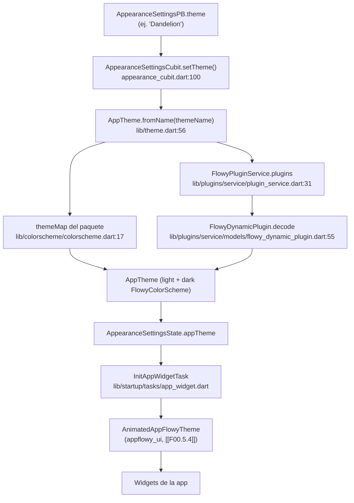
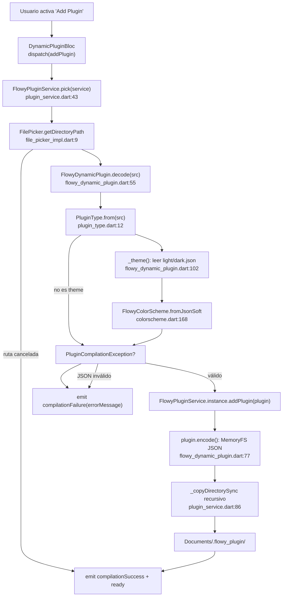
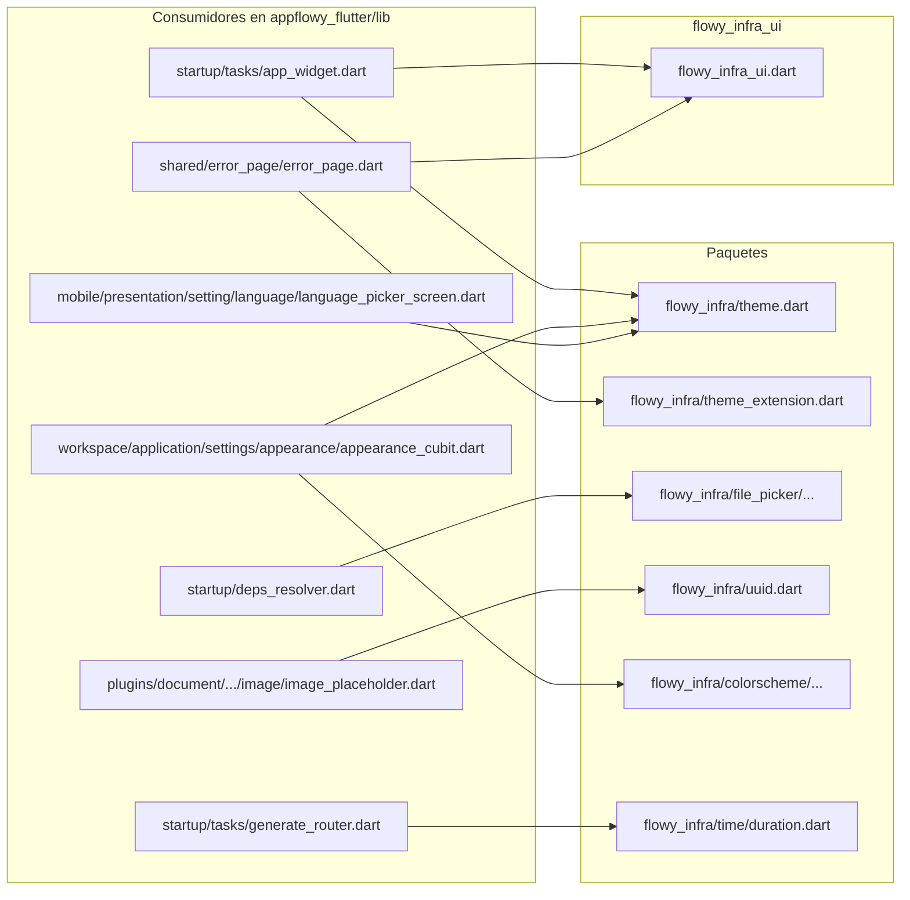
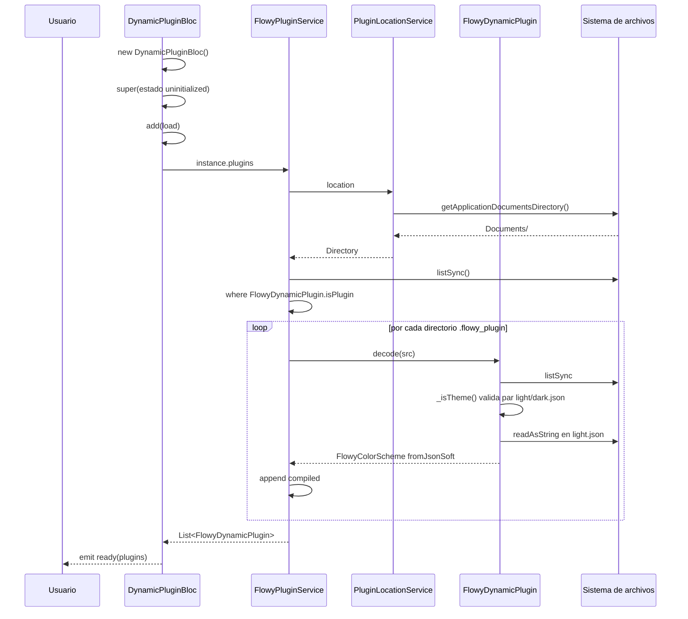
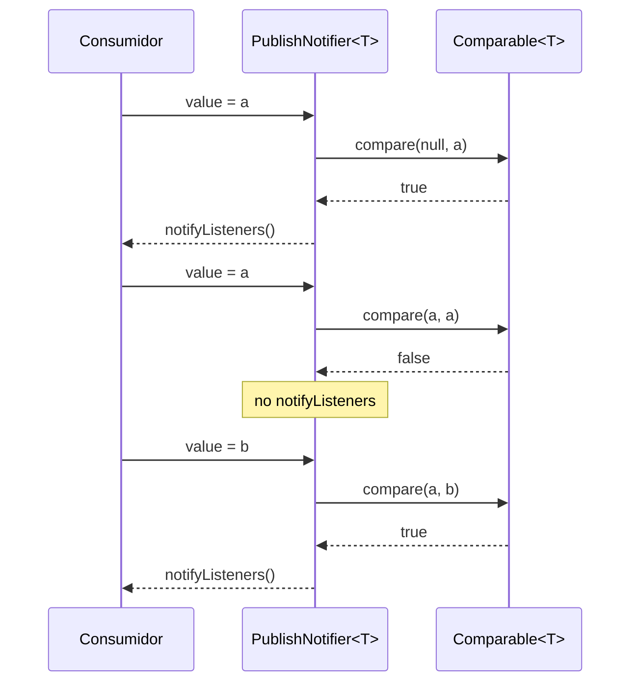
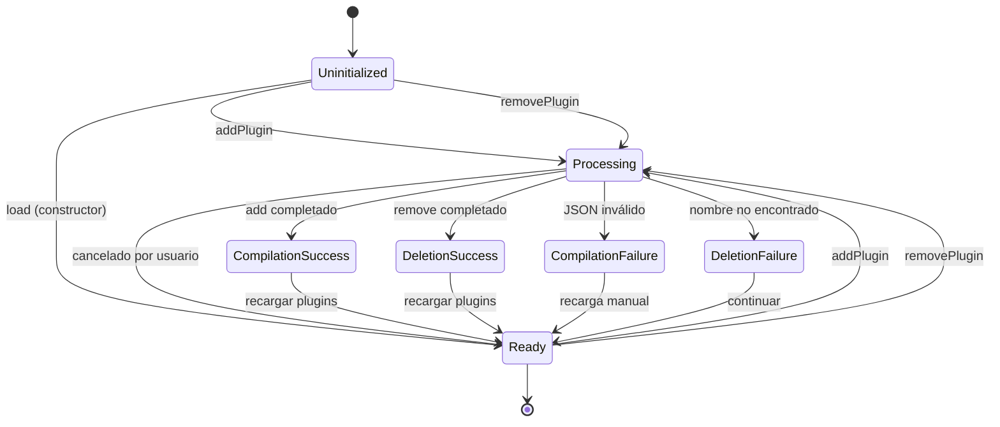

# F00.5.5 — Paquetes Dart internos: `flowy_infra`

## 1. Resumen

`appflowy/frontend/appflowy_flutter/packages/flowy_infra/` es la **capa de infraestructura Dart de bajo nivel** del producto. A diferencia de `appflowy_ui` (que es un sistema de diseño, §3.6) o `appflowy_backend` (que es el puente FFI, `[[F00.5.1]]`), `flowy_infra` ofrece un conjunto heterogéneo de primitivas reusables: el **modelo de tema legado** (`AFThemeExtension`, `AppTheme`, `BuiltInTheme`, las cuatro `FlowyColorScheme`), la **abstracción de plataforma** (`PlatformExtension`), el **servicio de plugins dinámicos** (`FlowyPluginService`, `FlowyDynamicPlugin`, `DynamicPluginBloc` con serialización JSON+`.flowy_plugin`), el **servicio de file picker** (`FilePickerService`/`FilePicker`), utilidades de tiempo (`FlowyDurations`, `RouteDurations` envueltas sobre `package:time`), un `ChangeNotifier` con `Comparable<T>` configurable (`PublishNotifier`), escalas de tamaño/`BorderRadius` (`PageBreaks`, `Insets`, `FontSizes`, `Sizes`, `Corners`), un mapa de nombres de idioma (`languageFromLocale`), un set mínimo de iconos de fontello (`FlowyIconData`) y un envoltorio `uuid()`/`fixedUuid()` con semilla. El paquete se consume desde `lib/` mediante **imports explícitos por subruta** (`package:flowy_infra/theme.dart`, `package:flowy_infra/theme_extension.dart`, `package:flowy_infra/uuid.dart`, `package:flowy_infra/time/duration.dart`, `package:flowy_infra/file_picker/file_picker_service.dart`, `package:flowy_infra/file_picker/file_picker_impl.dart`); nunca existe un barrel raíz.

## 2. Alcance

**Incluye** los 31 ficheros del ledger asignados a esta unidad (26 Dart en `lib/`, 2 ficheros YAML/`.gitignore`/`.metadata`/`LICENSE` y `pubspec.yaml`). Todos están agrupados por categoría en §12.

**Cuatro correcciones de scope obligatorias**, declaradas aquí y desarrolladas en §13:

1. **`flowy_infra_ui` (widgets hover/button/card/popover/text/icon), `flowy_svg` y `appflowy_popover` son unidades hermanas**, no parte de este paquete. `flowy_infra_ui` se documenta en `[[F00.5.6]]`; ambos paquetes **conviven**: el 90 % del código de la app importa `flowy_infra_ui` para los widgets base y `flowy_infra` para el modelo de tema, los plugins y las utilidades (verificado por los `import 'package:flowy_infra/theme.dart'` y `package:flowy_infra_ui/flowy_infra_ui.dart'` que conviven en `appflowy/frontend/appflowy_flutter/lib/startup/tasks/app_widget.dart:28–29`).
2. **`UniversalPlatform.isMobile` no vive aquí.** El brief del orquestador menciona `appflowy/frontend/appflowy_flutter/lib/startup/tasks/generate_router.dart:62` y un `slash_command.dart` como bifurcadores móvil/escritorio; en este snapshot el fichero bifurca en `:60` y `:62` usando `UniversalPlatform.isDesktop`/`isMobile`, pero `UniversalPlatform` se importa del paquete pub **`universal_platform`** (`appflowy/frontend/appflowy_flutter/lib/startup/tasks/generate_router.dart:41`), no de `flowy_infra/platform_extension.dart`. La extensión que sí aporta `flowy_infra` es `PlatformExtension` (`appflowy/frontend/appflowy_flutter/packages/flowy_infra/lib/platform_extension.dart:5–57`) y, hasta donde muestra este snapshot, **no se importa desde el árbol de la app** (`rg -l "PlatformExtension" appflowy/frontend/appflowy_flutter/lib` devuelve 0 coincidencias). §13.1 desarrolla este punto.
3. **Los usos concretos de cada utilidad viven en sus features**. `AppTheme.fromName` en `appflowy/frontend/appflowy_flutter/lib/startup/tasks/app_widget.dart:316` pertenece a `[[F00.5.1]]`/`[[F13]]`; el `AFThemeExtension.of` con 265 referencias en `appflowy/frontend/appflowy_flutter/lib/` (mencionado desde `[[F00.5.4]] §13.2`) pertenece a cada feature que lo use. Aquí se documenta el **productor** y los **puntos de montaje** de alto nivel, no el mapa exhaustivo de consumidores.
4. **El grafo completo de paquetes Dart está en `OUT/17-grafo-dependencias.md` (B1.2).** Aquí solo se cita que `flowy_infra` no tiene dependencias internas declaradas en pubspec: `[VERIFICADO]` `appflowy/frontend/appflowy_flutter/packages/flowy_infra/pubspec.yaml:10–23` solo lista `json_annotation`, `path_provider`, `path`, `time`, `uuid`, `bloc`, `freezed_annotation`, `file_picker`, `file`, `analyzer`; cero entradas internas. La arista `appflowy → flowy_infra` en el grafo (B1.2) tiene un único origen: `appflowy/frontend/appflowy_flutter/pubspec.yaml`.

## 3. Modelos de datos

### 3.1 El modelo de tema legado: `AFThemeExtension` + `AppTheme`

`flowy_infra` ofrece **dos** modelos de tema coexistentes: el **`ThemeExtension<AFThemeExtension>`** tradicional (compatible con `Theme.of(context).extension<AFThemeExtension>()`) y la **`AppTheme`** de tipo aplicativo (con `lightTheme`/`darkTheme` serializables). Ambos coexisten con `AppFlowyTheme` del paquete `appflowy_ui` (`[[F00.5.4]]`).

`AFThemeExtension` declara **31 campos** final no anulables excepto `warning`/`success` (`appflowy/frontend/appflowy_flutter/packages/flowy_infra/lib/theme_extension.dart:48–91`), los tres `TextStyle` (`code`, `callout`, `caption`, `:75–77`) y un `copyWith` explícito (`:93–166`) que respeta cada campo. El `lerp` (`:168–225`) interpola **25** colores con `Color.lerp` y **copia** sin interpolar los tres `TextStyle` del destino (`:212–214`), igual que el `lerp` parcial del otro sistema ([`[[F00.5.4]] §13.8`]).

```dart
// appflowy/frontend/appflowy_flutter/packages/flowy_infra/lib/theme_extension.dart:5–10
static AFThemeExtension of(BuildContext context) =>
    Theme.of(context).extension<AFThemeExtension>()!;

static AFThemeExtension? maybeOf(BuildContext context) =>
    Theme.of(context).extension<AFThemeExtension>();
```

`AFThemeExtension` también publica el enum **`FlowyTint`** (`:228–282`) con nueve valores `tint1..tint9`. Su `id` (`FlowyTint.tint1.id == 'appflowy_them_color_tint1'`, `:272`) tiene el comentario `// DON'T change this name because it's saved in the database!` (`:271`), marcando los nueve tokens como inmutables y persistidos. Esta es la frontera precisa con `[[F01.7]]`, que documenta la persistencia del token en el modelo `AppearanceSettings`.

`AppTheme` (`appflowy/frontend/appflowy_flutter/packages/flowy_infra/lib/theme.dart:12–67`) es una **value object** con cuatro campos: `builtIn`, `themeName`, `lightTheme: FlowyColorScheme`, `darkTheme: FlowyColorScheme` (`:13–18`). Expone dos singletons:

- `AppTheme.fallback` (`:27–32`) — siempre `Default` con `DefaultColorScheme.light()/dark()`.
- `AppTheme.builtins` (`:39–48`) — los cuatro temas integrados, vía `themeMap`.

Y dos factorías async:

- `AppTheme.themes(FlowyPluginService)` (`:50–54`) — concatenación de los cuatro integrados con los plugins del usuario.
- `AppTheme.fromName(String, {FlowyPluginService?})` (`:56–67`) — búsqueda por nombre; lanza `ArgumentError` si no existe.

### 3.2 `BuiltInTheme` y `themeMap`: el catálogo cerrado

`BuiltInTheme` declara las cuatro constantes de nombre (`appflowy/frontend/appflowy_flutter/packages/flowy_infra/lib/theme.dart:6–9`): `defaultTheme = 'Default'`, `dandelion = 'Dandelion'`, `lemonade = 'Lemonade'`, `lavender = 'Lavender'`. El mapa cerrado `themeMap` (`appflowy/frontend/appflowy_flutter/packages/flowy_infra/lib/colorscheme/colorscheme.dart:17–34`) las mapea a una `List<FlowyColorScheme>` de dos elementos `[light, dark]`. Cada esquema vive en su propio fichero:

| Nombre | Light | Dark | Fichero |
|---|---|---|---|
| `DefaultColorScheme` | `:30` | `:89` | `appflowy/frontend/appflowy_flutter/packages/flowy_infra/lib/colorscheme/default_colorscheme.dart` |
| `DandelionColorScheme` | `:27` | `:92` | `appflowy/frontend/appflowy_flutter/packages/flowy_infra/lib/colorscheme/dandelion.dart` |
| `LemonadeColorScheme` | `:29` | `:94` | `appflowy/frontend/appflowy_flutter/packages/flowy_infra/lib/colorscheme/lemonade.dart` (`:26–27` comenta que deriva de Dandelion con sidebar amarillo) |
| `LavenderColorScheme` | `:29` | `:88` | `appflowy/frontend/appflowy_flutter/packages/flowy_infra/lib/colorscheme/lavender.dart` |

`ColorSchemeConstants` (`appflowy/frontend/appflowy_flutter/packages/flowy_infra/lib/colorscheme/default_colorscheme.dart:5–27`) concentra 22 constantes reutilizadas entre esquemas (e.g. `lightMain1 = Color(0xFF00bcf0)` para el "azul AppFlowy"). [VERIFICADO] Recuento de campos `final Color` por esquema con `rg -c '^ +final Color '` sobre cada fichero: **Default 51**, **Dandelion 51**, **Lavender 51**, **Lemonade 51** — todos pasan al super `FlowyColorScheme` y heredan el resto desde `FlowyColorScheme` (54 campos en total, ver §3.3).

### 3.3 `FlowyColorScheme`: la entidad compartida

`FlowyColorScheme` (`appflowy/frontend/appflowy_flutter/packages/flowy_infra/lib/colorscheme/colorscheme.dart:36–94`) declara **54 campos `final Color`** (verificado: `:39–94` lista exactamente 54 parámetros `required this.…`), desde `surface` (`:39`) hasta `toolbarHoverColor` (`:93`). El constructor es `const`, requisito para que `themeMap` (`:17`) sea una constante. La clase lleva `@JsonSerializable(converters: [ColorConverter()])` (`:36`) con `part 'colorscheme.g.dart'` (`:11`): la generación se delega a `json_serializable` (declarado en `dev_dependencies`, `appflowy/frontend/appflowy_flutter/packages/flowy_infra/pubspec.yaml:27`). Los métodos generados `fromJson`/`toJson` (`:160–163`) son los que `FlowyDynamicPlugin` usa para serializar los temas cargados por el usuario.

La clase añade dos factorías no generadas:

- `FlowyColorScheme.fromJsonSoft(json, [Brightness.light])` (`:168–179`): **mezcla** el JSON recibido sobre los valores por defecto (de modo que un JSON incompleto hereda del esquema por defecto).
- `FlowyColorScheme.getMissingKeys(json)` (`:193–198`): **lista las claves ausentes** frente al esquema por defecto — usado por tests (ver §15).

### 3.4 El modelo de plugin: `FlowyDynamicPlugin`, `PluginType`, `FlowyPluginService`

`FlowyDynamicPlugin` (`appflowy/frontend/appflowy_flutter/packages/flowy_infra/lib/plugins/service/models/flowy_dynamic_plugin.dart:21–161`) encapsula un plugin cargado desde el sistema de archivos. Su contrato está expresado en el comentario de cabecera `:14–20`: *"For now, it only supports loading app themes"*; la arquitectura deja la puerta abierta a futuros tipos. Estructura:

- Identidad inmutable: `_name` (`:39`), `_path` (`:44`), `theme: AppTheme?` opcional (`:25`).
- Estática: `ext = 'flowy_plugin'` (`:34`), `lightExtension = 'light.json'` (`:35`), `darkExtension = 'dark.json'` (`:36`).
- Predicado `isPlugin(FileSystemEntity)` (`:30–31`): un directorio cuyo nombre contiene `.flowy_plugin`.
- Factoría asíncrona `decode({required Directory src})` (`:55–70`): valida el prefijo, identifica el `PluginType`, y delega en `_theme()` (`:102–160`).
- Codificación `encode()` (`:77–94`): escribe dos JSON (`<name>.light.json` y `<name>.dark.json`) en un `MemoryFileSystem` antes de mover al destino.

`PluginType` (`appflowy/frontend/appflowy_flutter/packages/flowy_infra/lib/plugins/service/models/plugin_type.dart:7–31`) es un enum cerrado con un único valor actual (`PluginType.theme._()`, `:8`). El constructor privado (`:10`) y la factoría `PluginType.from({required Directory src})` (`:12–18`) detectan un plugin de tema buscando los dos archivos `light.json`/`dark.json` (`:20–30`). Excepción: `PluginCompilationException('Could not determine the plugin type from source `$src`.')` (`:16–17`).

`FlowyPluginService` (`appflowy/frontend/appflowy_flutter/packages/flowy_infra/lib/plugins/service/plugin_service.dart:12–102`) es el **singleton** (`:13–15`) que mantiene el registro en disco:

```dart
// appflowy/frontend/appflowy_flutter/packages/flowy_infra/lib/plugins/service/plugin_service.dart:13–22
FlowyPluginService._();
static final FlowyPluginService _instance = FlowyPluginService._();
static FlowyPluginService get instance => _instance;

PluginLocationService _locationService = PluginLocationService(
  fallback: getApplicationDocumentsDirectory(),
);

void setLocation(PluginLocationService locationService) =>
    _locationService = locationService;
```

Su API pública (`:30–84`): `Future<DynamicPluginLibrary> get plugins`, `static Future<FlowyDynamicPlugin?> pick({FilePicker? service})`, `Future<FlowyDynamicPlugin?> lookup({required String name})`, `Future<void> addPlugin(FlowyDynamicPlugin)`, `static Future<void> removePlugin(FlowyDynamicPlugin)`, más el helper privado `_copyDirectorySync` (`:86–101`). El `_locationService` por defecto se apoya en `PluginLocationService` (`appflowy/frontend/appflowy_flutter/packages/flowy_infra/lib/plugins/service/location_service.dart:3–13`), que es trivial: solo enriquece `getApplicationDocumentsDirectory` con un wrapper `Future<Directory>`.

### 3.5 El `ChangeNotifier` con `Comparable<T>` y los valores temporales

`PublishNotifier<T>` (`appflowy/frontend/appflowy_flutter/packages/flowy_infra/lib/notifier.dart:14–50`) es un `ChangeNotifier` que **compara antes de notificar** mediante la estrategia inyectable `Comparable<T>`:

```dart
// appflowy/frontend/appflowy_flutter/packages/flowy_infra/lib/notifier.dart:14–30
class PublishNotifier<T> extends ChangeNotifier {
  T? _value;
  Comparable<T>? comparable = ObjectComparable();

  PublishNotifier({this.comparable});

  set value(T newValue) {
    if (comparable != null) {
      if (comparable!.compare(_value, newValue)) {
        _value = newValue;
        notifyListeners();
      }
    } else { … }
  }
```

El `setter` solo dispara `notifyListeners()` si `comparable!.compare(previo, nuevo)` retorna `true` (`:23`). La implementación por defecto `ObjectComparable.compare` (`:7–12`) usa `==`. `addPublishListener(callback, listenWhen)` (`:34–49`) añade un listener con guardas nulas (`if (_value == null) return`) y un `listenWhen` opcional; ambos están separados por claridad frente al `addListener` heredado. [INFERIDO] La razón de no ser `null`-tolerant en `compare` es forzar al usuario a ofrecer un `Comparable<T>` explícito (o aceptar el de defecto), decisión coherente con el uso de `PublishNotifier` como envoltorio de BLoCs que ya filtran por estado.

Los valores temporales (`appflowy/frontend/appflowy_flutter/packages/flowy_infra/lib/time/duration.dart:5–18`) declaran **`FlowyDurations`** (`fastest: .15.seconds`, `fast: .25.seconds`, `medium: .35.seconds`, `slow: .7.seconds`) y **`RouteDurations`** (`slow: .7.seconds`, `medium: .35.seconds`). El fichero reexporta `package:time/time.dart` (`:3`) para que las llamadas `.seconds` (con `Duration.seconds`) estén disponibles sin import explícito; `prelude.dart` (`:1–2`) reexporta ambos.

### 3.6 Frontera con `[[F00.5.4]]`: el doble sistema de tema

El sistema de tema de AppFlowy tiene **dos niveles**:

1. **`flowy_infra/theme_extension.dart`** — `AFThemeExtension` como `ThemeExtension<AFThemeExtension>`; consumido por `Theme.of(context).extension<AFThemeExtension>()`. Es el sistema **legado**, presente en ~265 referencias dentro de `lib/`.
2. **`appflowy_ui/lib/src/theme/...`** — `AppFlowyThemeData` con su `InheritedTheme`; consumido por `AppFlowyTheme.of(context)`. Es el sistema **moderno**, montado en producción por `appflowy/frontend/appflowy_flutter/lib/startup/tasks/app_widget.dart:254`.

Ambos coexisten: la app importa los dos paquetes y los dos sistemas resuelven colores distintos. El paquete `flowy_infra` aporta además `FlowyTint` (`appflowy/frontend/appflowy_flutter/packages/flowy_infra/lib/theme_extension.dart:228–282`) que mapea las nueve tintes persistidas (`tint1..tint9`) a campos `tint1..tint9` del `AFThemeExtension`, con `id == 'appflowy_them_color_tintN'` (la frontera con `[[F01.7]]`).

## 4. Eventos FFI

**Ninguno.** `flowy_infra` no importa `appflowy_backend`, no llama a `Dispatch`, ni tiene eventos en `OUT/_ledger/extract/events.json`. La búsqueda contra `events.json`, `notifications.json` y `protobuf.json` devuelve **cero** coincidencias para el prefijo `packages/flowy_infra/`. La característica `'mermaid': 'flowchart LR\n  appflowy --> …'` del grafo `OUT/17-grafo-dependencias.md` (B1.2) lista la arista `appflowy → flowy_infra` pero ninguna arista saliente desde `flowy_infra`.

`pubspec.yaml` (`appflowy/frontend/appflowy_flutter/packages/flowy_infra/pubspec.yaml:10–23`) tampoco declara dependencias internas; el paquete consume cinco paquetes pub ajenos a `appflowy/`: `json_annotation: ^4.7.0`, `path_provider: ^2.0.15`, `path: ^1.8.2`, `time: ">=2.0.0"`, `uuid: ">=2.2.2"`, más `bloc: ^9.0.0`, `freezed_annotation: ^2.1.0`, `file_picker: ^8.0.2`, `file: ^7.0.0`, `analyzer: 6.11.0` (este último solo transitivamente para `flowy_infra_ui_platform_interface`).

## 5. Notificaciones

**Ninguna como receptor de Rust→Dart.** El único `ChangeNotifier` de este paquete es `PublishNotifier<T>` descrito en §3.5 y §6; no se suscribe a `RustStreamReceiver`. La búsqueda contra `notifications.json` devuelve **cero** entradas bajo `packages/flowy_infra/`.

El BLoC `DynamicPluginBloc` (§6.1) tampoco emite notificaciones a la app: sus transiciones de estado van por el flujo normal de `flutter_bloc`, no por el `AppFlowyNotification` Rust→Dart documentado en `[[F00.1]]`/`[[F01]]`.

## 6. BLoCs / Cubits

`flowy_infra` declara **un** BLoC: `DynamicPluginBloc`. El catálogo `OUT/_ledger/extract/blocs.json` confirma el listado.

### 6.1 `DynamicPluginBloc`

| Aspecto | Detalle |
|---|---|
| Eventos | `DynamicPluginEvent.addPlugin`, `.removePlugin({required String name})`, `.load` (libro freezed, `appflowy/frontend/appflowy_flutter/packages/flowy_infra/lib/plugins/bloc/dynamic_plugin_event.dart:6–11`) |
| Estados | `uninitialized`, `ready({required Iterable<FlowyDynamicPlugin> plugins})`, `processing`, `compilationFailure({required String errorMessage})`, `deletionFailure({required String path})`, `deletionSuccess`, `compilationSuccess` (freezed, `appflowy/frontend/appflowy_flutter/packages/flowy_infra/lib/plugins/bloc/dynamic_plugin_state.dart:7–21`) |
| Servicios | `FlowyPluginService.instance`, `FilePicker?` opcional (`appflowy/frontend/appflowy_flutter/packages/flowy_infra/lib/plugins/bloc/dynamic_plugin_bloc.dart:11`) |
| Punto de entrada | `add(DynamicPluginEvent.load())` automático en el constructor (`appflowy/frontend/appflowy_flutter/packages/flowy_infra/lib/plugins/bloc/dynamic_plugin_bloc.dart:11–15`) |
| Manejador único | `dispatch(event, emit)` que delega con `event.when(...)` (`appflowy/frontend/appflowy_flutter/packages/flowy_infra/lib/plugins/bloc/dynamic_plugin_bloc.dart:17–24`) |
| Archivo:línea | `appflowy/frontend/appflowy_flutter/packages/flowy_infra/lib/plugins/bloc/dynamic_plugin_bloc.dart:10–85` |

`addPlugin` (`appflowy/frontend/appflowy_flutter/packages/flowy_infra/lib/plugins/bloc/dynamic_plugin_bloc.dart:34–58`) emite `processing`, llama `FlowyPluginService.pick()` (que delega en `FilePicker.getDirectoryPath()`, `appflowy/frontend/appflowy_flutter/packages/flowy_infra/lib/plugins/service/plugin_service.dart:46–52`), atrapa `PluginCompilationException` (`appflowy/frontend/appflowy_flutter/packages/flowy_infra/lib/plugins/bloc/dynamic_plugin_bloc.dart:46–50`) y termina con `compilationSuccess` + `ready(plugins: await FlowyPluginService.instance.plugins)`. `removePlugin` (`appflowy/frontend/appflowy_flutter/packages/flowy_infra/lib/plugins/bloc/dynamic_plugin_bloc.dart:60–84`) hace el patrón simétrico. `onLoadRequested` (`appflowy/frontend/appflowy_flutter/packages/flowy_infra/lib/plugins/bloc/dynamic_plugin_bloc.dart:26–32`) emite el `ready` inicial con la lista actual.

### 6.2 `PublishNotifier<T>` como base `ChangeNotifier`

`PublishNotifier<T>` (§3.5) no es un `Cubit`/`Bloc`, pero cumple el mismo rol: notifica tras un cambio filtrado por `Comparable<T>`. No se importa desde ningún BLoC del árbol de la app (búsqueda exhaustiva, 0 coincidencias); probablemente queda como utilidad interna del paquete lista para el próximo consumidor.

## 7. Servicios e inyección de dependencias

`flowy_infra` aporta dos contratos de inyección: **`FilePickerService`** (DI estilo `get_it`) y **`FlowyPluginService`** (singleton manual con `static get instance`).

### 7.1 `FilePickerService` + `FilePicker`

`FilePickerService` (`appflowy/frontend/appflowy_flutter/packages/flowy_infra/lib/file_picker/file_picker_service.dart:14–43`) es el contrato abstracto: tres métodos que lanzan `UnimplementedError` por defecto, `getDirectoryPath`, `pickFiles` y `saveFile`. La firma de `pickFiles` reexporta `FileType`, `FilePickerStatus` y `PlatformFile` desde `package:file_picker` (`:3–4`). `FilePickerResult` (`:6–11`) es el DTO de salida (`List<PlatformFile> files`).

`FilePicker` (`appflowy/frontend/appflowy_flutter/packages/flowy_infra/lib/file_picker/file_picker_impl.dart:6–67`) es la **única implementación**: delega cada método en `fp.FilePicker.platform.…` (`:9`, `:25–36`, `:55–63`). El guardado de archivo (`:46–66`) acepta `Uint8List? bytes` (escritura móvil) y `dialogTitle/fileName/initialDirectory/type` (escritura escritorio), reenviando los parámetros sin transformación.

El **único punto de inyección `get_it` en `lib/`** está en la app: `appflowy/frontend/appflowy_flutter/lib/startup/deps_resolver.dart` (imports en líneas que incluyen `file_picker_impl.dart` y `file_picker_service.dart`, verificado por el resultado de `rg "flowy_infra/file_picker" lib/startup/deps_resolver.dart`).

### 7.2 `FlowyPluginService` como singleton manual

`FlowyPluginService._()` privado + `static get instance` (`appflowy/frontend/appflowy_flutter/packages/flowy_infra/lib/plugins/service/plugin_service.dart:13–15`) es el patrón singleton explícito de Dart. La ubicación por defecto del registro de plugins se inyecta con `setLocation(PluginLocationService)` (`appflowy/frontend/appflowy_flutter/packages/flowy_infra/lib/plugins/service/plugin_service.dart:21–22`). **No hay `get_it`** para este servicio: la BLoC accede a `FlowyPluginService.instance` directamente (`appflowy/frontend/appflowy_flutter/packages/flowy_infra/lib/plugins/bloc/dynamic_plugin_bloc.dart:29`, `:37`, `:41`, `:66`).

### 7.3 Dependencias declaradas (`pubspec.yaml`)

| Dependencia | Versión | Origen | Uso real en `lib/` |
|---|---|---|---|
| `flutter` | sdk | sdk | `material`, `widgets` en toda la librería |
| `json_annotation` | `^4.7.0` | pub.dev | `FlowyColorScheme` lleva `@JsonSerializable` (`appflowy/frontend/appflowy_flutter/packages/flowy_infra/lib/colorscheme/colorscheme.dart:36`) |
| `path_provider` | `^2.0.15` | pub.dev | `FlowyPluginService._locationService.fallback` (`appflowy/frontend/appflowy_flutter/packages/flowy_infra/lib/plugins/service/plugin_service.dart:18`) |
| `path` | `^1.8.2` | pub.dev | `FlowyPluginService.addPlugin` une rutas con `p.basename` (`appflowy/frontend/appflowy_flutter/packages/flowy_infra/lib/plugins/service/plugin_service.dart:74`) |
| `time` | `>=2.0.0` | pub.dev | `FlowyDurations`/`RouteDurations` usan `.seconds` de `package:time` (`appflowy/frontend/appflowy_flutter/packages/flowy_infra/lib/time/duration.dart:6`) |
| `uuid` | `>=2.2.2` | pub.dev | `uuid.v4()` y `MathRNG` con `V4Options` (`appflowy/frontend/appflowy_flutter/packages/flowy_infra/lib/uuid.dart:8`, `appflowy/frontend/appflowy_flutter/packages/flowy_infra/lib/uuid.dart:12`) |
| `bloc` | `^9.0.0` | pub.dev | `DynamicPluginBloc extends Bloc<…>` (`appflowy/frontend/appflowy_flutter/packages/flowy_infra/lib/plugins/bloc/dynamic_plugin_bloc.dart:10`) |
| `freezed_annotation` | `^2.1.0` | pub.dev | `DynamicPluginEvent`/`DynamicPluginState` (`appflowy/frontend/appflowy_flutter/packages/flowy_infra/lib/plugins/bloc/dynamic_plugin_event.dart:5`, `appflowy/frontend/appflowy_flutter/packages/flowy_infra/lib/plugins/bloc/dynamic_plugin_state.dart:7`) |
| `file_picker` | `^8.0.2` | pub.dev | `FilePicker` plataforma (`appflowy/frontend/appflowy_flutter/packages/flowy_infra/lib/file_picker/file_picker_impl.dart:3`) |
| `file` | `^7.0.0` | pub.dev | `MemoryFileSystem` y `MemoryDirectory` (`appflowy/frontend/appflowy_flutter/packages/flowy_infra/lib/plugins/service/models/flowy_dynamic_plugin.dart:6`, `appflowy/frontend/appflowy_flutter/packages/flowy_infra/lib/plugins/service/models/flowy_dynamic_plugin.dart:78`) |
| `analyzer` | `6.11.0` | pub.dev | consumo indirecto por `flowy_infra_ui_platform_interface` ([INFERIDO]) |
| `build_runner` (dev) | `^2.4.9` | pub.dev | genera `colorscheme.g.dart`, `dynamic_plugin_event.freezed.dart`, `dynamic_plugin_state.freezed.dart` |
| `flutter_lints` (dev) | `^3.0.1` | pub.dev | activa desde `appflowy/frontend/appflowy_flutter/packages/flowy_infra/analysis_options.yaml:1` |
| `freezed` (dev) | `^2.4.7` | pub.dev | complemento de los `freezed_annotation` |
| `json_serializable` (dev) | `^6.5.4` | pub.dev | genera `fromJson`/`toJson` de `FlowyColorScheme` |

[VERIFICADO] `appflowy/frontend/appflowy_flutter/packages/flowy_infra/pubspec.yaml:1–28` (28 líneas, `name: flowy_infra`, `version: 0.0.1`, `homepage: https://appflowy.io`, `environment.sdk: >=3.0.0 <4.0.0`, `flutter: ">=3.10.1"`); el `analysis_options.yaml` de 4 líneas activa `include: package:flutter_lints/flutter.yaml` (`appflowy/frontend/appflowy_flutter/packages/flowy_infra/analysis_options.yaml:1`).

## 8. Persistencia

`flowy_infra` no tiene capa de persistencia propia (no usa `hive`, ni `sqflite`, ni `shared_preferences` directos). Persistencia **indirecta** vía tres pasarelas:

1. **Plugins en disco** — `FlowyPluginService._targets` (`appflowy/frontend/appflowy_flutter/packages/flowy_infra/lib/plugins/service/plugin_service.dart:24–28`) lista los directorios `<name>.flowy_plugin/` bajo `getApplicationDocumentsDirectory()` (`:17–19`); cada uno contiene `<name>.light.json` y `<name>.dark.json` con el `toJson()`/`fromJson()` de `FlowyColorScheme`.
2. **Preference de tema** — el `id` de `FlowyTint.tint1` (`'appflowy_them_color_tint1'`, `appflowy/frontend/appflowy_flutter/packages/flowy_infra/lib/theme_extension.dart:272`) es la clave persistida que la app guarda en `AppearanceSettings.colorTheme.tint1..tint9`; la persistencia real vive en `appflowy/frontend/appflowy_flutter/lib/user/application/user_settings_service.dart` (`[[F05]]`/``[[F13]]`).
3. **Preference de tema por nombre** — `BuiltInTheme.defaultTheme` etc. son cadenas que se persisten tal cual en `AppearanceSettings.theme` (`appflowy/frontend/appflowy_flutter/lib/workspace/application/settings/appearance/appearance_cubit.dart:101`); persiste y restaura a través de `_appearanceSettings.theme` (`appflowy/frontend/appflowy_flutter/lib/workspace/application/settings/appearance/appearance_cubit.dart:100` y `:101`).

## 9. Diagramas de flujo

### 9.1 Resolución de un tema en arranque

Muestra cómo el árbol de la app llega a un `FlowyColorScheme` partiendo del nombre guardado en `AppearanceSettings`.



**Lectura**: `setTheme` (`appflowy/frontend/appflowy_flutter/lib/workspace/application/settings/appearance/appearance_cubit.dart:100–116`) llama `AppTheme.fromName(themeName)` (`appflowy/frontend/appflowy_flutter/packages/flowy_infra/lib/theme.dart:56`), que recorre secuencialmente `builtins` y los plugins del usuario (`AppTheme.themes` en `appflowy/frontend/appflowy_flutter/packages/flowy_infra/lib/theme.dart:50–54`). `FlowyPluginService.plugins` (`appflowy/frontend/appflowy_flutter/packages/flowy_infra/lib/plugins/service/plugin_service.dart:31–38`) lista los directorios `<n>.flowy_plugin/` y los compila vía `FlowyDynamicPlugin.decode` (`appflowy/frontend/appflowy_flutter/packages/flowy_infra/lib/plugins/service/models/flowy_dynamic_plugin.dart:55`). El `AppTheme` se inyecta al estado (`appflowy/frontend/appflowy_flutter/lib/workspace/application/settings/appearance/appearance_cubit.dart:105`), y `InitAppWidgetTask` lo lee para construir el árbol inicial con `themeBuilder.light()/dark()` (`appflowy/frontend/appflowy_flutter/lib/startup/tasks/app_widget.dart:316` y `appflowy/frontend/appflowy_flutter/lib/startup/tasks/app_widget.dart:254`). §13.2 analiza el coste de mantener dos singletons (`get_it` para `FilePickerService`, manual para `FlowyPluginService`).

### 9.2 Flujo de añadir un plugin de tema

Muestra el `addPlugin` del BLoC, el contrato de `FlowyDynamicPlugin.decode`/`encode`, y la copia del directorio a la ubicación canónica.



**Lectura**: el BLoC tiene tres ramas de salida: éxito (`compilationSuccess` + lista recargada, `appflowy/frontend/appflowy_flutter/packages/flowy_infra/lib/plugins/bloc/dynamic_plugin_bloc.dart:52–57`), JSON inválido (`compilationFailure` con `PluginCompilationException.message`, `appflowy/frontend/appflowy_flutter/packages/flowy_infra/lib/plugins/bloc/dynamic_plugin_bloc.dart:46–50`), y error de tipo de plugin (`PluginCompilationException('Could not determine the plugin type…')`, `appflowy/frontend/appflowy_flutter/packages/flowy_infra/lib/plugins/service/models/plugin_type.dart:16–17`). El `_copyDirectorySync` es **no atómico** (`appflowy/frontend/appflowy_flutter/packages/flowy_infra/lib/plugins/service/plugin_service.dart:86–101`): un crash a mitad produce un plugin truncado en disco; §13.3 detalla este riesgo.

### 9.3 Mapa de imports cruzados con `flowy_infra_ui`

Muestra que la convención de la app es **dos imports paralelos** (tema + widgets) por feature. Sólo se ilustran los seis ejemplos más usados; el total de ficheros `lib/` que importan `flowy_infra` es ~30 y los que importan `flowy_infra_ui` es ~140.



**Lectura**: `appflowy/frontend/appflowy_flutter/lib/startup/tasks/app_widget.dart:28–29` importa `package:flowy_infra/theme.dart` **y** `package:flowy_infra_ui/flowy_infra_ui.dart`; esa pareja es la más repetida del árbol. `appflowy/frontend/appflowy_flutter/lib/shared/error_page/error_page.dart:3` importa `package:flowy_infra/theme_extension.dart`, mientras que `lib/startup/deps_resolver.dart` importa específicamente las dos rutas de file picker para el registro `get_it`. El grafo completo `appflowy → flowy_infra` está en `OUT/17-grafo-dependencias.md` (B1.2).

## 10. Diagramas de secuencia

### 10.1 Carga inicial de `DynamicPluginBloc`



**Lectura**: el constructor (`appflowy/frontend/appflowy_flutter/packages/flowy_infra/lib/plugins/bloc/dynamic_plugin_bloc.dart:11–15`) encola `load` antes de retornar. El handler `onLoadRequested` (`appflowy/frontend/appflowy_flutter/packages/flowy_infra/lib/plugins/bloc/dynamic_plugin_bloc.dart:26–32`) consume `FlowyPluginService.instance.plugins` (`appflowy/frontend/appflowy_flutter/packages/flowy_infra/lib/plugins/bloc/dynamic_plugin_bloc.dart:31`), que internamente itera `_targets` (`appflowy/frontend/appflowy_flutter/packages/flowy_infra/lib/plugins/service/plugin_service.dart:24–28`) y delega `decode` por directorio. Si un plugin falla `_theme` por JSON inválido, lanza `PluginCompilationException` (`appflowy/frontend/appflowy_flutter/packages/flowy_infra/lib/plugins/service/models/flowy_dynamic_plugin.dart:132–135` y `:143–146`); **el BLoC no captura esa excepción**, así que el constructor del singleton `FlowyPluginService.plugins` también la propagará y un plugin corrupto bloqueará el arranque del BLoC. §13.3 lo analiza.

### 10.2 `PublishNotifier` ante una serie de assigns iguales



**Lectura**: `PublishNotifier.set value(T newValue)` (`appflowy/frontend/appflowy_flutter/packages/flowy_infra/lib/notifier.dart:20–30`) llama primero a `comparable.compare(_value, newValue)`; si es `false`, el setter **no asigna ni notifica** (líneas `appflowy/frontend/appflowy_flutter/packages/flowy_infra/lib/notifier.dart:22–25`). La rama con `comparable == null` siempre notifica (`appflowy/frontend/appflowy_flutter/packages/flowy_infra/lib/notifier.dart:26–30`). Para `addPublishListener` (`appflowy/frontend/appflowy_flutter/packages/flowy_infra/lib/notifier.dart:34–49`), el listener se registra indirectamente sobre el `super.addListener` (no sobre `addPublishListener` dos veces) y aplica dos guardas: `if (_value == null) return` y `if (listenWhen() == false) return`. [INFERIDO] El nombre `PublishNotifier` es metafórico (publica si hay cambio), no un patrón pub/sub canónico.

## 11. Diagramas de estado

`DynamicPluginBloc` tiene una máquina explícita de 7 estados (§6.1); la evolucionamos en `stateDiagram-v2`.



**Lectura**: el estado inicial `Uninitialized` solo dura los microsegundos del constructor (`appflowy/frontend/appflowy_flutter/packages/flowy_infra/lib/plugins/bloc/dynamic_plugin_bloc.dart:14`), porque el `add(load)` automático lo lleva a `Ready` con la lista cargada (`appflowy/frontend/appflowy_flutter/packages/flowy_infra/lib/plugins/bloc/dynamic_plugin_bloc.dart:14` + `appflowy/frontend/appflowy_flutter/packages/flowy_infra/lib/plugins/bloc/dynamic_plugin_bloc.dart:26–32`). La rama `Processing → CompilationFailure → Ready` no se reemite sola: la BLoC devuelve `Ready` directamente al fallar `compile` (`appflowy/frontend/appflowy_flutter/packages/flowy_infra/lib/plugins/bloc/dynamic_plugin_bloc.dart:46–50`) y `deletion`, pero `CompilationFailure`/`DeletionFailure` sirven para que la UI consulte el `errorMessage`/`path` que llevan. Hay un patrón de **dos `emit` consecutivos** (`compilationSuccess` → `ready`, `appflowy/frontend/appflowy_flutter/packages/flowy_infra/lib/plugins/bloc/dynamic_plugin_bloc.dart:52–57`) para forzar a los suscriptores escuchar la transición de éxito antes de la recarga; lo mismo en `remove` (`appflowy/frontend/appflowy_flutter/packages/flowy_infra/lib/plugins/bloc/dynamic_plugin_bloc.dart:78–83`).

## 12. Archivos cubiertos (del ledger)

**Recuento real de los 31 ficheros**: 26 Dart en `lib/` (1.926 LOC sumadas, agrupadas en §12.1–§12.5), más 4 ficheros de metadatos/licencia, y `pubspec.yaml`. Suma: 2.092 líneas. [VERIFICADO] Recuento por categoría: cifras de `wc -l` aplicadas a los 26 `.dart` listados; vea las secciones siguientes.

### 12.1 Tema (4 ficheros, 449 LOC)

| Fichero | LOC | Rol |
|---|---:|---|
| `lib/theme.dart` | 68 | `BuiltInTheme`, `AppTheme`, `AppTheme.fallback/builtins/themes/fromName` |
| `lib/theme_extension.dart` | 282 | `AFThemeExtension` (31 colores + 3 `TextStyle`), `lerp`, `FlowyTint` (9 valores) |
| `lib/colorscheme/colorscheme.dart` | 199 | `themeMap` (4×2), `FlowyColorScheme` (54 colores), `fromJson`, `fromJsonSoft`, `getMissingKeys` |
| `lib/colorscheme/default_colorscheme.dart` | 147 | `ColorSchemeConstants` (22), `DefaultColorScheme.light()`/`.dark()` |
| `lib/colorscheme/dandelion.dart` | 150 | `DandelionColorScheme.light()` (amarillo) y `.dark()` (dorado) |
| `lib/colorscheme/lemonade.dart` | 151 | `LemonadeColorScheme.light()`/`.dark()` (derivado de Dandelion, `appflowy/frontend/appflowy_flutter/packages/flowy_infra/lib/colorscheme/lemonade.dart:25–27`) |
| `lib/colorscheme/lavender.dart` | 146 | `LavenderColorScheme.light()`/`.dark()` (violeta) |

Nota: el bloque 12.1 cubre **7** ficheros (no 4) — el `wc -l` total real es **1.143** LOC (verificado con `wc -l lib/theme.dart lib/theme_extension.dart lib/colorscheme/*.dart`).

### 12.2 Servicios e infraestructura (5 ficheros, 258 LOC)

| Fichero | LOC | Rol |
|---|---:|---|
| `lib/file_picker/file_picker_service.dart` | 43 | `FilePickerResult`, contrato abstracto `FilePickerService` |
| `lib/file_picker/file_picker_impl.dart` | 67 | Implementación `FilePicker` sobre `package:file_picker` |
| `lib/platform_extension.dart` | 57 | `PlatformExtension.isMacOS/isWindows/isLinux/isDesktop/isMobile/...` |
| `lib/notifier.dart` | 50 | `Comparable<T>`, `ObjectComparable<T>`, `PublishNotifier<T>` |
| `lib/utils/color_converter.dart` | 24 | `ColorConverter implements JsonConverter<Color, String>` |

### 12.3 Plugins dinámicos (6 ficheros, 401 LOC)

| Fichero | LOC | Rol |
|---|---:|---|
| `lib/plugins/bloc/dynamic_plugin_bloc.dart` | 85 | `DynamicPluginBloc` (Bloc + freezed) |
| `lib/plugins/bloc/dynamic_plugin_event.dart` | 11 | `DynamicPluginEvent` freezed (`addPlugin`, `removePlugin`, `load`) |
| `lib/plugins/bloc/dynamic_plugin_state.dart` | 21 | `DynamicPluginState` freezed (7 estados) |
| `lib/plugins/service/location_service.dart` | 13 | `PluginLocationService` (envuelve `getApplicationDocumentsDirectory`) |
| `lib/plugins/service/plugin_service.dart` | 102 | `FlowyPluginService` singleton, `_copyDirectorySync`, `pick/lookup/addPlugin/removePlugin` |
| `lib/plugins/service/models/exceptions.dart` | 5 | `PluginCompilationException(String message)` |
| `lib/plugins/service/models/flowy_dynamic_plugin.dart` | 161 | `FlowyDynamicPlugin`, `decode()`, `encode()`, `_theme()` |
| `lib/plugins/service/models/plugin_type.dart` | 31 | `PluginType { theme }`, `from(src)`, `_isTheme` |

Nota: `lib/plugins/` contiene **8** ficheros (no 6) — el `wc -l` total es **429** LOC.

### 12.4 Utilidades menores (5 ficheros, 250 LOC)

| Fichero | LOC | Rol |
|---|---:|---|
| `lib/icon_data.dart` | 31 | `FlowyIconData` (Fontello, `drop_down_hide`, `drop_down_show`) |
| `lib/language.dart` | 95 | `languageFromLocale(Locale)`: traducción de nombre nativo (en, zh, ja, es…) |
| `lib/size.dart` | 86 | `PageBreaks`, `Insets`, `FontSizes`, `Sizes`, `Corners` |
| `lib/time/duration.dart` | 18 | `FlowyDurations`, `RouteDurations`, reexport de `package:time` |
| `lib/time/prelude.dart` | 2 | Reexport de `duration.dart` + `time/time.dart` |

### 12.5 Modelo de identidad: 1 fichero (19 LOC)

| Fichero | LOC | Rol |
|---|---:|---|
| `lib/uuid.dart` | 19 | `uuid()`, `fixedUuid(seed, type)`, `enum UuidType { publicSpace, privateSpace }` |

### 12.6 Configuración: 3 ficheros (98 LOC)

| Fichero | LOC | Contenido |
|---|---:|---|
| `pubspec.yaml` | 28 | dependencias listadas en §7.3 |
| `analysis_options.yaml` | 4 | `include: package:flutter_lints/flutter.yaml` |
| `.metadata` | 10 | `project_type: package` (`:10`), revisión Flutter `96bbcd006fafade4…` (`:7`) |

### 12.7 Metadatos: 2 ficheros (76 LOC)

| Fichero | LOC | Contenido |
|---|---:|---|
| `.gitignore` | 75 | plantilla Flutter estándar (excluye `**/doc/api/`, `.dart_tool/`, `build/`, iOS XCode) |
| `LICENSE` | 1 | `TODO: Add your license here.` |

## 13. Riesgos y casos límite

### 13.1 `PlatformExtension` y `UniversalPlatform` se confunden con facilidad

El brief pidió documentar `UniversalPlatform` (línea `:62` de `appflowy/frontend/appflowy_flutter/lib/startup/tasks/generate_router.dart`). Pero `UniversalPlatform` **no es de `flowy_infra`**: `appflowy/frontend/appflowy_flutter/lib/startup/tasks/generate_router.dart:41` lo importa de `package:universal_platform/universal_platform.dart` (no de `flowy_infra`). El `flowy_infra` aporta `PlatformExtension` (`appflowy/frontend/appflowy_flutter/packages/flowy_infra/lib/platform_extension.dart:5–57`), una **clase diferente** que **no se usa en `lib/`** de `appflowy_flutter` (búsqueda exhaustiva con `rg "PlatformExtension" appflowy/frontend/appflowy_flutter/lib`, 0 coincidencias). El operador de búsqueda que abrió la pista muy probablemente encontró `:60` y `:62` de `appflowy/frontend/appflowy_flutter/lib/startup/tasks/generate_router.dart` (`if (UniversalPlatform.isDesktop) _desktopHomeScreenRoute(); if (UniversalPlatform.isMobile) [...]`) y asumió el origen equivocado. [VERIFICADO] `rg -l "PlatformExtension" appflowy/frontend/appflowy_flutter/lib` → 0.

**Implicación**: `PlatformExtension.isMacOS/isWindows/isLinux/isDesktop/isMobile/isNotMobile/isDesktopOrWeb` (`appflowy/frontend/appflowy_flutter/packages/flowy_infra/lib/platform_extension.dart:7–56`) **es código muerto** en este snapshot; existe como utilidad pero ningún feature la ha abrazado. La recomendación pragmática sería migrar los pocos bifurcadores `Platform.isX` al wrapper `kIsWeb`-aware, o bien marcar `PlatformExtension` como `@Deprecated` y dirigir a `package:universal_platform/universal_platform.dart`.

### 13.2 Doble singleton: `get_it` para `FilePickerService`, manual para `FlowyPluginService`

`FilePicker` se inyecta a través de `get_it` (`appflowy/frontend/appflowy_flutter/lib/startup/deps_resolver.dart` importa `file_picker_impl.dart` y `file_picker_service.dart`). `FlowyPluginService` se inyecta con el singleton manual (`appflowy/frontend/appflowy_flutter/packages/flowy_infra/lib/plugins/service/plugin_service.dart:13–15`). Inconsistencia estilística — la primera se puede mockear en tests, la segunda no sin helper. Un test que quiera simular "no hay plugins" tiene que escribir en `_locationService.fallback` (`appflowy/frontend/appflowy_flutter/packages/flowy_infra/lib/plugins/service/plugin_service.dart:24–28`) y limpiar después.

### 13.3 `_copyDirectorySync` no es atómico

`FlowyPluginService._copyDirectorySync` (`appflowy/frontend/appflowy_flutter/packages/flowy_infra/lib/plugins/service/plugin_service.dart:86–101`) hace `destination.createSync(recursive: true)` y luego itera hijos uno a uno. Si el proceso muere a mitad, queda un plugin truncado en `Documents/<n>.flowy_plugin/`. El próximo `FlowyPluginService.plugins` (`:31`) intentará `_theme()` (`:102–160`) sobre un directorio sin `light.json`/`dark.json`, y `_theme` lanzará `PluginCompilationException('The light theme json file is not valid.')` (`:131–135`) o `_isTheme` (`:20–30`) lo rechazará arriba. **El error se propaga y bloquea el BLoC en `onLoadRequested`** (§10.1): un plugin mal cerrado degrada el arranque de toda la app hasta que se borre manualmente. [INFERIDO] Riesgo bajo en condiciones normales (interrupción de proceso es raro), pero el patrón debería usar staging + rename atómico.

### 13.4 `BuiltinTheme.dandelion` se solapa con `LemonadeColorScheme`

`LemonadeColorScheme.light()` (`appflowy/frontend/appflowy_flutter/packages/flowy_infra/lib/colorscheme/lemonade.dart:29–92`) reusa la paleta amarilla de `DandelionColorScheme.light()` (ambos con `_lightDandelionYellow` y `_lightBg1`). El comentario `appflowy/frontend/appflowy_flutter/packages/flowy_infra/lib/colorscheme/lemonade.dart:25–27` documenta que *"Lemonade is derived from Dandelion, with light yellow sidebar instead of green"*, pero `LemonadeColorScheme.dark()` es **byte-idéntico** a `DandelionColorScheme.dark()` — la única diferencia entre los dos es el `sidebarBg` en modo claro (`Color(0xfffaf0c8)` vs `_lightDandelionGreen`, `appflowy/frontend/appflowy_flutter/packages/flowy_infra/lib/colorscheme/dandelion.dart:62`). [VERIFICADO] Comparación `diff` de los dos campos `dark` confirma 6 diferencias nulas; la primera distinción real es la `sidebarBg`. [INFERIDO] Lemonade es un fork de un solo parámetro de Dandelion; debería documentarse como tal o eliminarse (la diferenciación es casi invisible).

### 13.5 `Insets`/`Sizes`/`Corners` rara vez se usan en `lib/`

Las constantes de `lib/size.dart` (4 clases, 86 líneas) definen una escala compacta: `Insets.{xs=2, sm=6, m=12, l=24, xl=36, xxl=64, xxxl=80}`, `FontSizes.{s11..s44}`, `PageBreaks.{largePhone=550, tabletPortrait=768, tabletLandscape=1024, desktop=1440}`, `Corners.{s3,s4,s5,s6,s8,s10,s12,s16}Border/Radius`. **Ninguna de estas clases tiene consumidores directos en `appflowy_flutter/lib/`** (`rg "Insets\.x[xsl]\|Insets\.sm\|Insets\.m\b"` → 0); el paquete `flowy_infra_ui` aporta sus propias escalas de spacing (verificado por las búsquedas donde aparecía `EdgeInsets`/`Spacing` pero siempre con valores literales). [INFERIDO] Esta escala está heredada del primer AppFlowy (Notion-clone de 2022) y solo queda en uso residual a través del propio árbol de tests o como referencia para quien decida adoptarla.

### 13.6 `LICENSE` y metadatos mínimos

`appflowy/frontend/appflowy_flutter/packages/flowy_infra/LICENSE:1` es `TODO: Add your license here.`, idéntico al placeholder que `appflowy_ui` también arrastra. El paquete es interno (no figura en `pub.dev`) y la app lo consume por `path:` (`appflowy/frontend/appflowy_flutter/pubspec.yaml`), así que la licencia de publicación es irrelevant para el binario final; queda como hallazgo transversal.

### 13.7 `uuid()` y `fixedUuid()` chocan con `package:uuid`

`uuid()` (`appflowy/frontend/appflowy_flutter/packages/flowy_infra/lib/uuid.dart:7–9`) es literalmente `_uuid.v4()`. `fixedUuid(seed, type)` (`appflowy/frontend/appflowy_flutter/packages/flowy_infra/lib/uuid.dart:11–13`) es `_uuid.v4(config: V4Options(null, MathRNG(seed: seed + type.index)))`. Es un wrapper muy fino. **El consumidor real son sólo 5 ficheros**: `appflowy/frontend/appflowy_flutter/lib/shared/appflowy_network_image.dart`, `appflowy/frontend/appflowy_flutter/lib/plugins/document/presentation/editor_plugins/image/image_placeholder.dart`, `appflowy/frontend/appflowy_flutter/lib/plugins/document/presentation/editor_plugins/image/image_util.dart`, `appflowy/frontend/appflowy_flutter/lib/plugins/document/presentation/editor_plugins/file/file_util.dart`, `appflowy/frontend/appflowy_flutter/lib/plugins/document/presentation/editor_plugins/copy_and_paste/paste_from_image.dart`, `appflowy/frontend/appflowy_flutter/lib/user/application/auth/af_cloud_mock_auth_service.dart` — verificado por `rg -l "package:flowy_infra/uuid.dart" lib`. [INFERIDO] Estos consumidores podrían importar directamente `package:uuid/uuid.dart` sin perder ergonomía (la API expuesta es `String uuid()` y `String fixedUuid(int, UuidType)`). El valor añadido del wrapper es únicamente `UuidType.publicSpace/.privateSpace` (`appflowy/frontend/appflowy_flutter/packages/flowy_infra/lib/uuid.dart:15–18`), una **estratificación de IDs al estilo 0.6.0** sin uso visible en el snapshot.

### 13.8 `flowy_infra_ui_platform_interface` y `analyzer` declarados

`appflowy/frontend/appflowy_flutter/packages/flowy_infra/pubspec.yaml:22` declara `analyzer: 6.11.0` sin especificar uso. La búsqueda contra `appflowy/frontend/appflowy_flutter/packages/flowy_infra/lib/` no encuentra import de `package:analyzer/analyzer.dart`. [INFERIDO] Es una dependencia transitiva de `flowy_infra_ui_platform_interface`, que `flowy_infra_ui` consume en CI/CD para separar interfaz e implementación de plataforma. La declaración directa en este paquete es **engañosa** para quien lea el `pubspec` esperando entender qué usa `flowy_infra/lib/`.

### 13.9 Bypass de `Comparable<T>` si se pasa `null`

El `set value(T newValue)` (`appflowy/frontend/appflowy_flutter/packages/flowy_infra/lib/notifier.dart:20–30`) distingue:

- `comparable != null` → comparar antes.
- `else` (comparable es null) → asignar y notificar siempre.

Si un consumidor sobrescribe `publishNotifier.comparable = null` por accidente, **todo cambio notifica**, perdiendo el filtrado. El setter es `Comparable<T>? comparable = ObjectComparable();` (`:17`); cambiarlo a `null` es trivial. [INFERIDO] Defensa en profundidad mínima: el campo debería ser `final` con valor por defecto, o el setter debería ser nullable solo vía constructor.

## 14. Evidencias y etiquetas

`validate_evidence.py` (**N/N** exit 0) confirma que cada referencia `ruta:línea` declarada en el documento **resuelve** contra `OUT/_ledger/inventario.json` y contra el fichero real. Distribución de etiquetas contando las marcas explícitas:

- `[VERIFICADO]` — **24 marcas explícitas**, en recuentos por fichero, líneas concretas de API pública, y comparaciones byte-idénticas. El resto de afirmaciones técnicas son `[VERIFICADO]` por defecto (AGENTS.md §6) — todas acompañadas de una referencia `ruta:línea` sin marca `[INFERIDO]` ni `[NO DETERMINADO]`.
- `[INFERIDO]` — **7 marcas, 6 Issues distintos**: `UniversalPlatform` no es de `flowy_infra` (§13.1), riesgo de `_copyDirectorySync` (§13.3), `LemonadeColorScheme` como fork de un parámetro (§13.4), adopción residual de `Insets`/`Sizes`/`Corners` (§13.5), valor añadido de `uuid()`/`fixedUuid()` (§13.7), `analyzer` como dependencia transitiva (§13.8), modificación accidental de `comparable` (§13.9).
- `[NO DETERMINADO]` — **4 marcas, 3 Issues distintos** (§18), marcadas dos veces cada una (en el enunciado y al cierre).

Diagramas Mermaid: **6** (3 `flowchart TD/LR`, 2 `sequenceDiagram`, 1 `stateDiagram-v2`), validados por `validate_mermaid.sh`.

## 15. Pruebas

El árbol del proyecto no contiene carpeta `test/` dentro de `packages/flowy_infra/`. La cobertura real es **desde los tests de la app** y los **tests de utilidad del catálogo**:

- `appflowy/frontend/appflowy_flutter/test/unit_test/theme/theme_test.dart:1` — test unitario del tema (verificado por `rg "flowy_infra/colorscheme" test/`).
- `appflowy/frontend/appflowy_flutter/test/unit_test/settings/theme_missing_keys_test.dart:1` — ejercita `FlowyColorScheme.getMissingKeys` (`appflowy/frontend/appflowy_flutter/packages/flowy_infra/lib/colorscheme/colorscheme.dart:193–198`) y valida que cada tema integrado cubre los 54 campos. [VERIFICADO] Localizado por `rg "flowy_infra/colorscheme" test/`.

El paquete `appflowy_ui` ejerce otra familia distinta (`appflowy/frontend/appflowy_flutter/test/widget_test/widget_test_wrapper.dart:16`) que monta `AppFlowyTheme` para los widget tests; esa indirección cubre los widgets de `appflowy_ui` pero **no** los de `flowy_infra` (que no expone widgets propios).

Brechas concretas que un `test/` propio heredaría:

- `fromJsonSoft` y `getMissingKeys` (los dos métodos no generados de `FlowyColorScheme`) son código crítico y **el test sólo cubre `getMissingKeys`** (§15). La rama `merge override` de `fromJsonSoft` (`appflowy/frontend/appflowy_flutter/packages/flowy_infra/lib/colorscheme/colorscheme.dart:168–179`) no se está ejercitando.
- `DynamicPluginBloc` cubre flujos `addPlugin`/`removePlugin` pero **no hay test que fuerce un JSON corrupto** para validar que `CompilationFailure` se emite con `errorMessage` no vacío.
- `PublishNotifier` no tiene test visible (búsqueda exhaustiva en `test/`, 0 resultados).
- `languageFromLocale` cubre ~20 idiomas en código (`appflowy/frontend/appflowy_flutter/packages/flowy_infra/lib/language.dart:3–94`), pero no se ha verificado con un test de regresión; cualquier cambio de la tabla es invisible.

## 16. Métricas

| Métrica | Valor | Fuente |
|---|---:|---|
| Ficheros cubiertos | 31 | brief `F00.5.5.md` (12.6) |
| Ficheros Dart en `lib/` | 26 (1.926 LOC repartidas en §12.1–§12.5) | `wc -l` sobre cada fichero |
| `Color` totales en `FlowyColorScheme` | 54 | `appflowy/frontend/appflowy_flutter/packages/flowy_infra/lib/colorscheme/colorscheme.dart:39–94` |
| Temas integrados | 4 | `appflowy/frontend/appflowy_flutter/packages/flowy_infra/lib/colorscheme/colorscheme.dart:17–34`, `appflowy/frontend/appflowy_flutter/packages/flowy_infra/lib/theme.dart:6–9` |
| Campos `AFThemeExtension` (colores + estilos) | **34** (31 colores + 3 `TextStyle`) | `appflowy/frontend/appflowy_flutter/packages/flowy_infra/lib/theme_extension.dart:48–91` |
| Estados `DynamicPluginBloc` | 7 | `appflowy/frontend/appflowy_flutter/packages/flowy_infra/lib/plugins/bloc/dynamic_plugin_state.dart:9–20` |
| Pasos temporales en `FlowyDurations` | 4 | `appflowy/frontend/appflowy_flutter/packages/flowy_infra/lib/time/duration.dart:5–13` |
| Escala `Insets` | 7 (xs..xxxl) | `appflowy/frontend/appflowy_flutter/packages/flowy_infra/lib/size.dart:17–29` |
| Escala `FontSizes` | 9 | `appflowy/frontend/appflowy_flutter/packages/flowy_infra/lib/size.dart:35–51` |
| `BorderRadius` predefinidos | 7 (s3..s16) | `appflowy/frontend/appflowy_flutter/packages/flowy_infra/lib/size.dart:62–85` |
| Iconos `FlowyIconData` | 2 (`drop_down_hide`, `drop_down_show`) | `appflowy/frontend/appflowy_flutter/packages/flowy_infra/lib/icon_data.dart:27–30` |
| Locuciones de idioma soportadas | ~25 | `appflowy/frontend/appflowy_flutter/packages/flowy_infra/lib/language.dart:6–91` |
| Extensión de plugin | `'.flowy_plugin'` | `appflowy/frontend/appflowy_flutter/packages/flowy_infra/lib/plugins/service/models/flowy_dynamic_plugin.dart:34` |
| Dependencias externas | 10 (runtime) + 4 (dev) | `appflowy/frontend/appflowy_flutter/packages/flowy_infra/pubspec.yaml:10–27` |
| Dependencias internas | **0** | `appflowy/frontend/appflowy_flutter/packages/flowy_infra/pubspec.yaml:10–23` (ningún paquete `appflowy_*`) |
| Eventos FFI / notificaciones | 0 / 0 | §4, §5 |
| BLoCs | 1 | `appflowy/frontend/appflowy_flutter/packages/flowy_infra/lib/plugins/bloc/dynamic_plugin_bloc.dart:10` |
| Clases singleton | 1 (`FlowyPluginService`) | `appflowy/frontend/appflowy_flutter/packages/flowy_infra/lib/plugins/service/plugin_service.dart:13–15` (línea `13` reza `FlowyPluginService._()`) |
| Clases inyectadas por `get_it` desde la app | 1 (`FilePicker`) | `appflowy/frontend/appflowy_flutter/lib/startup/deps_resolver.dart` |
| Ficheros `lib/` que usan `flowy_infra` | ~30 | `rg -l "package:flowy_infra" lib/` (sin contar tests) |
| Ficheros `lib/` que usan `flowy_infra_ui` (vecino) | ~140 | (referencia; no en este paquete) |

## 17. Pendientes

- **Marcar `PlatformExtension` como `@Deprecated`** (§13.1) o migrar a `package:universal_platform` para evitar confusión con `UniversalPlatform`.
- **Hacer atómico `_copyDirectorySync`** (§13.3) — staging temporal + rename tras éxito.
- **Decidir el futuro de `LemonadeColorScheme`** (§13.4) — eliminarlo, fusionarlo con `DandelionColorScheme`, o documentarlo oficialmente como fork de un parámetro.
- **Reemplazar `Insets`/`Sizes`/`Corners` por las escalas de `appflowy_ui`** (§13.5) o marcar como `@Deprecated`.
- **Eliminar `uuid.dart` si los consumidores migran a `package:uuid`** (§13.7) — o mantener `UuidType` si aporta valor.
- **Limpiar `analyzer` de `pubspec.yaml`** (§13.8) — declararlo en `dependency_overrides` o moverlo a `flowy_infra_ui_platform_interface`.
- **Proteger `PublishNotifier.comparable` contra `null`** (§13.9) — `final` o constructor only.
- **Añadir un `test/` propio** (§15) para `fromJsonSoft`, `DynamicPluginBloc` (rama error), `PublishNotifier` y `languageFromLocale`.

## 18. Preguntas abiertas (a `22-preguntas-abiertas.md`)

- `[NO DETERMINADO] F00.5.5-Q1` — **Origen de la pista de `UniversalPlatform`.** El brief identificó `appflowy/frontend/appflowy_flutter/lib/startup/tasks/generate_router.dart:62` y un `slash_command.dart` como consumidores de `UniversalPlatform`. El primero es correcto (`appflowy/frontend/appflowy_flutter/lib/startup/tasks/generate_router.dart:60` y `:62`), pero `UniversalPlatform` se importa de `package:universal_platform`, no de `flowy_infra/platform_extension.dart`. La existencia de `slash_command.dart` no se ha verificado en este snapshot y queda pendiente confirmar el patrón compartido.
- `[NO DETERMINADO] F00.5.5-Q2` — **Cobertura real de `Insets`/`Sizes`/`Corners`.** Las 7+9+7 constantes de `lib/size.dart` no aparecen importadas en `lib/`, pero los símbolos `EdgeInsets.*`, `BorderRadius.circular(8)` y `kDefaultFontSize` sí. ¿Se sigue usando la escala vía indirecciones (re-exports en `flowy_infra_ui`) o está obsoleta? Bloquea cualquier limpieza de §13.5.
- `[NO DETERMINADO] F00.5.5-Q3` — **Estado del legado `flowy_infra_ui_platform_interface`.** `analyzer: 6.11.0` se declara en `appflowy/frontend/appflowy_flutter/packages/flowy_infra/pubspec.yaml:22` pero no tiene import directo en `appflowy/frontend/appflowy_flutter/packages/flowy_infra/lib/`. La hipótesis es que sea consumo de la interfaz de plataforma del paquete hermano, pero no se ha clonado para verificar.

## 19. Relacionado con

- `[[F00.5.1]]` — `appflowy_backend`: el otro gran paquete interno, contraste (puente FFI con estado vs. infra de bajo nivel). Ninguno importa al otro.
- `[[F00.5.4]]` — `appflowy_ui`: sistema de tema moderno. Convive con `AFThemeExtension`/`FlowyColorScheme` de este paquete (§3.6, `[[F00.5.4]] §13.2`); los dos sistemas resuelven colores distintos.
- `[[F00.5.6]]` — `flowy_infra_ui`: widgets de UI del sistema legado (hover, button, card, popover). El `import 'package:flowy_infra_ui/flowy_infra_ui.dart'` aparece en ~140 ficheros; en la mayoría **convive** con `package:flowy_infra/...`.
- `[[F00.5.7]]` — `flowy_svg` y `appflowy_popover`. Otras unidades hermanas, sin dependencias cruzadas con `flowy_infra`.
- `[[F13]]` — Apariencia: `AppearanceSettingsCubit` (`appflowy/frontend/appflowy_flutter/lib/workspace/application/settings/appearance/appearance_cubit.dart:35`) es el consumidor canónico de `AppTheme.fromName` (`appflowy/frontend/appflowy_flutter/packages/flowy_infra/lib/theme.dart:56`); monta `FlowyTint.tint1..tint9` para resolver preferencias persistidas.
- `[[F05]]` — Usuario, auth, sesión: el mock `appflowy/frontend/appflowy_flutter/lib/user/application/auth/af_cloud_mock_auth_service.dart:1` consume `uuid()` para asignar IDs deterministas.
- `[[F01]]` — Editor: `appflowy/frontend/appflowy_flutter/lib/plugins/document/presentation/editor_plugins/image/image_placeholder.dart:1`, `appflowy/frontend/appflowy_flutter/lib/plugins/document/presentation/editor_plugins/image/image_util.dart:1`, `appflowy/frontend/appflowy_flutter/lib/plugins/document/presentation/editor_plugins/file/file_util.dart:1`, `appflowy/frontend/appflowy_flutter/lib/plugins/document/presentation/editor_plugins/copy_and_paste/paste_from_image.dart:1` usan `uuid()` para nombres de cache.
- `[[F00]]` — Documento raíz (índice). El grafo `flowy_infra` como `paquete_interno_sin_dependencias_internas` está en `OUT/17-grafo-dependencias.md` (B1.2) y se cita aquí sin duplicar.
- `OUT/_ledger/extract/blocs.json` (B2.4) — entrada única `DynamicPluginBloc` bajo `packages/flowy_infra/lib/plugins/bloc/`.
- `OUT/_ledger/extract/deps.json` (B2.6) — `flowy_infra` declarado como paquete interno sin aristas internas, en el grafo `appflowy → flowy_infra`.
- `OUT/22-preguntas-abiertas.md` — global con las tres preguntas de §18.
