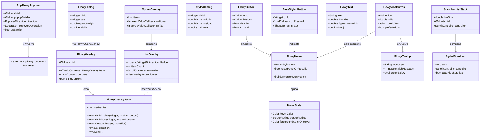
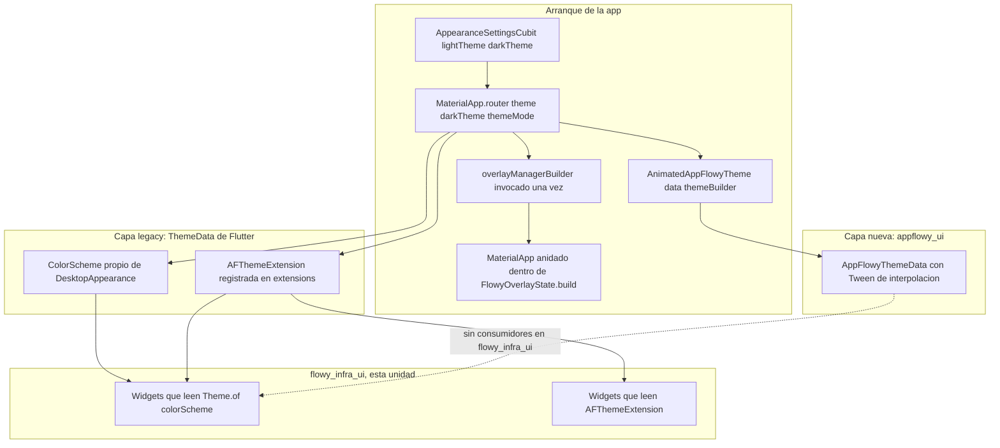
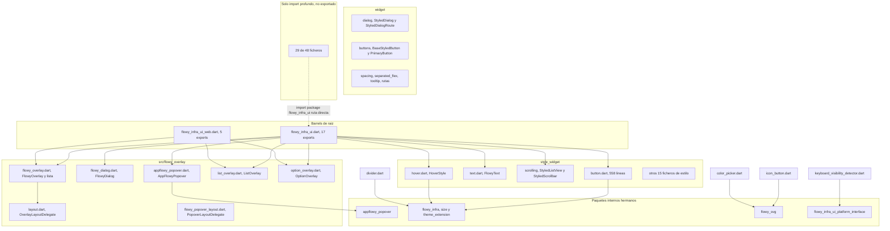
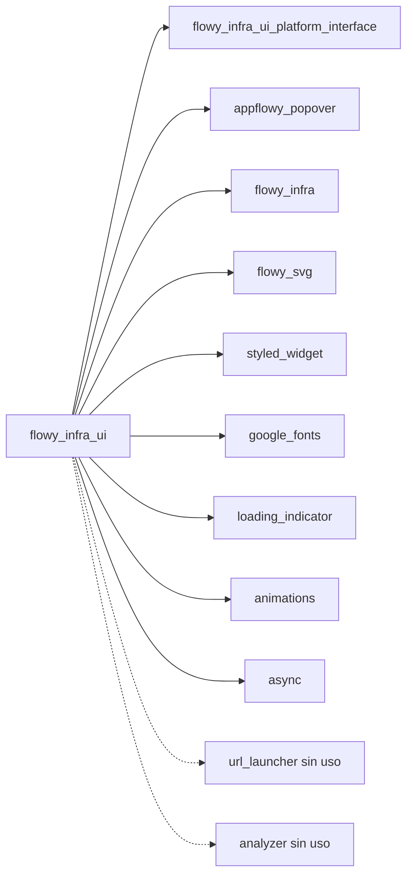
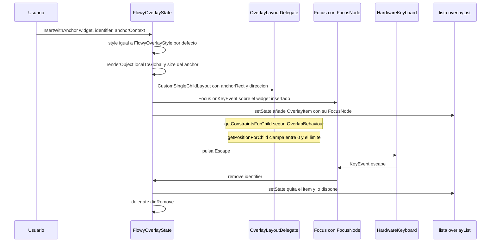
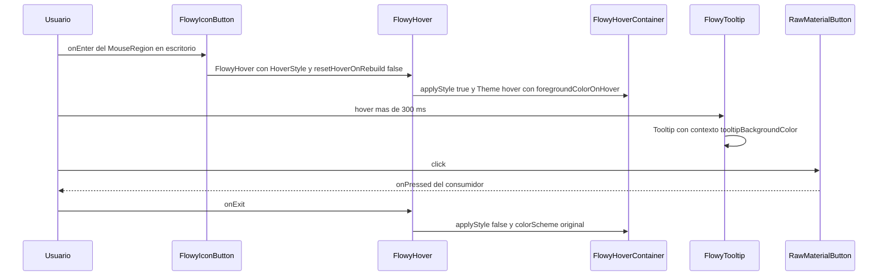
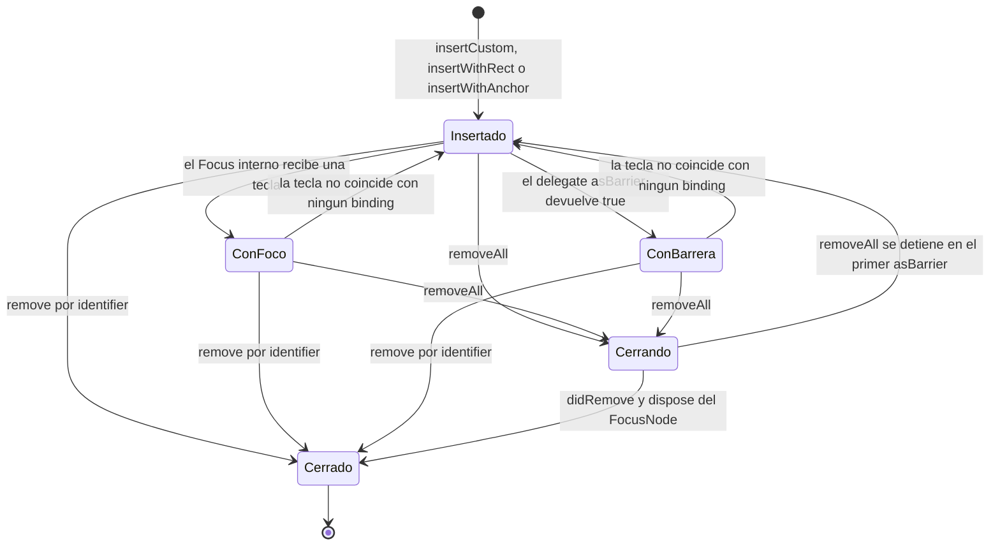

# F00.5.6 — Paquetes Dart internos: `flowy_infra_ui` (`lib/`, widgets y estilos)

## 1. Resumen

`appflowy/frontend/appflowy_flutter/packages/flowy_infra_ui/lib/` es la **capa de widgets del sistema de tema legado** de AppFlowy: 48 ficheros Dart (5.512 líneas) que no habla con FFI, no conoce BLoCs y no persiste nada, y que aporta cuatro cosas. Un **barrel dual** con fachada completa (`flowy_infra_ui.dart`) y fachada web (`flowy_infra_ui_web.dart`). Un **sistema de overlays propio** (`FlowyOverlay`, `FlowyDialog`, `ListOverlay`, `OptionOverlay` y dos `SingleChildLayoutDelegate` de anclaje) que se monta **una sola vez** en el arranque de la app. Un **envoltorio de branding** sobre `appflowy_popover` (`AppFlowyPopover` + la extensión `PopoverDecoration`) que decide la decoración corporativa de todos los popovers. Y un **inventario de estilos y widgets** (`FlowyText`, `FlowyButton`, `FlowyIconButton`, `FlowyTooltip`, `HoverStyle`, la familia `Styled*` de scroll, diálogos, rutas y espaciado) que la app consume masivamente. Su sistema de tema es el **antiguo**: lee `Theme.of(context)` y `AFThemeExtension`, no `AppFlowyTheme`; convive con el sistema nuevo de `appflowy_ui` (`[[F00.5.4]]`), que no aparece en ningún import de este paquete.

## 2. Alcance

**Incluye** los 48 ficheros Dart de `lib/` asignados a esta unidad (`OUT/_ledger/units/F00.5.6.json`), 5.512 líneas. Se agrupan por módulo en §12.1–§12.5.

**Cinco correcciones de scope obligatorias**, declaradas aquí y desarrolladas en §13:

1. **Paquetes hermanos fuera de alcance.** `appflowy_popover` (`[[F00.5.2]]`) aporta el mecanismo `Popover`/`PopoverController`; aquí solo se documenta el **envoltorio** `AppFlowyPopover` y la inyección de `popoverDecoration`. `appflowy_ui` (`[[F00.5.4]]`) es el sistema de diseño nuevo: este paquete **no lo importa en ningún momento** (§7.4). `flowy_infra` (`[[F00.5.5]]`) aporta `AFThemeExtension`, `Corners`, `Insets`, `Sizes`, `ColorSchemeConstants` y `FlowyDurations`, consumidos aquí. `flowy_svg` (`[[F00.5.7]]`) aporta `FlowySvg`/`FlowySvgData`. `appflowy_backend` (`[[F00.5.1]]`, `[[B1.5]]`) no se referencia.
2. **Los tokens `appflowy_them_color_tint*` ya están en `[[F01.7]]`.** La serialización `FlowyTint.tint1 → 'appflowy_them_color_tint1'` está en `appflowy/frontend/appflowy_flutter/packages/flowy_infra/lib/theme_extension.dart:272–279` y la razón de que sean inmutables (se guardan en la base de datos vía `AppearanceSettings`) está tratada en `[[F01.7]]`. Aquí se **citan** para marcar la frontera y no se duplican.
3. **`platform_interface`, web y nativo están en `[[F00.5.6.2]]`.** `flowy_infra_ui_platform_interface`, `flowy_infra_ui_web`, los directorios `android/`, `ios/`, `macos/`, `linux/`, `windows/`, el `pubspec.yaml`, los metadatos, el `README.md` y `test/` del paquete no pertenecen a esta unidad: son 58 ficheros de la unidad hermana. Este documento los **cita** (`pubspec.yaml` en §7.4, `test/flowy_infra_ui_test.dart` en §15) para argumentos de frontera, nunca para analizarlos.
4. **El grafo de paquetes Dart no se repite.** Las aristas `flowy_infra_ui → {flowy_infra_ui_platform_interface, appflowy_popover, flowy_infra, flowy_svg}` ya están en `OUT/17-grafo-dependencias.md` (B1.2). §9.3 las muestra solo como mapa de lectura interna, marcado como cross-ref.
5. **Los usos funcionales pertenecen a las features.** `FlowyDialog` en el panel de importación es de `[[F04]]`, el `AppFlowyPopover` del command palette es de `[[F04]]`, el `StyledDialog` de `dialogs.dart` es de `[[F13]]`/infraestructura de diálogo. Aquí se documentan **el widget y su contrato**, no la pantalla: §13.1 da los seis puntos de consumo reales, todos con `ruta:línea` del consumidor.

## 3. Modelos de datos

### 3.1 Las dos jerarquías de tema que conviven

Este paquete no define ningún modelo de tema: **lo consume**. Lo hace por dos vías distintas que nunca se mezclan dentro de un mismo widget:

| Vía | API | Dónde se resuelve | Widgets de este paquete que la usan |
|---|---|---|---|
| `ColorScheme` de Flutter | `Theme.of(context).colorScheme` | `MaterialApp.router(theme:)` en `appflowy/frontend/appflowy_flutter/lib/startup/tasks/app_widget.dart:241–243` | `appflowy/frontend/appflowy_flutter/packages/flowy_infra_ui/lib/style_widget/button.dart:62`, `appflowy/frontend/appflowy_flutter/packages/flowy_infra_ui/lib/style_widget/hover.dart:65`, `appflowy/frontend/appflowy_flutter/packages/flowy_infra_ui/lib/style_widget/icon_button.dart:68`, `appflowy/frontend/appflowy_flutter/packages/flowy_infra_ui/lib/style_widget/text_field.dart:197`, `appflowy/frontend/appflowy_flutter/packages/flowy_infra_ui/lib/src/flowy_overlay/list_overlay.dart:130–131`, `appflowy/frontend/appflowy_flutter/packages/flowy_infra_ui/lib/src/flowy_overlay/flowy_dialog.dart:49`, `appflowy/frontend/appflowy_flutter/packages/flowy_infra_ui/lib/widget/flowy_tooltip.dart:144` |
| `ThemeExtension` legado | `AFThemeExtension.of(context)` | `ThemeData.extensions` en `appflowy/frontend/appflowy_flutter/lib/workspace/application/settings/appearance/desktop_appearance.dart:107–108` | `appflowy/frontend/appflowy_flutter/packages/flowy_infra_ui/lib/style_widget/divider.dart:19`, `appflowy/frontend/appflowy_flutter/packages/flowy_infra_ui/lib/style_widget/scrolling/styled_scroll_bar.dart:125–126` |

[VERIFICADO] Cada una de las líneas de la tabla se leyó directamente. Cero widgets del paquete llaman a `AppFlowyTheme.of` — el conteo de `AppFlowyTheme` y `appflowy_ui` en los 48 ficheros de `lib/` es **0**.

### 3.2 `AFThemeExtension`: el contrato que este paquete consume

`AFThemeExtension` (`appflowy/frontend/appflowy_flutter/packages/flowy_infra/lib/theme_extension.dart:4`) es un `ThemeExtension<AFThemeExtension>` con constructor `const` de campos **named required** (`warning`, `success`, `tint1..tint9`, `greyHover`, `greySelect`, `lightGreyHover`, `toggleOffFill`, `textColor`, `secondaryTextColor`, `strongText`, `calloutBGColor`, `tableCellBGColor`, `calendarWeekendBGColor`, `code`, `callout`, `caption`, `progressBarBGColor`, `toggleButtonBGColor`, `gridRowCountColor`, `background`, `onBackground`, `borderColor`, `scrollbarColor`, `scrollbarHoverColor`, `toolbarHoverColor`, `lightIconColor`) y dos accesores estáticos: `of(context)` con aserción `!` (`appflowy/frontend/appflowy_flutter/packages/flowy_infra/lib/theme_extension.dart:5–6`) y `maybeOf(context)` (`:8–9`). [VERIFICADO] El análisis completo del token y de sus 265 referencias en `lib/` es de `[[F00.5.5]]`; aquí solo importa la consecuencia práctica: **`FlowyDivider` y `StyledScrollbar` reventan si no hay `ThemeData` con la extensión registrada**, porque llaman a la variante con `!` (§13.3).

### 3.3 Los tipos propios del paquete

`flowy_infra_ui` no tiene "modelo de datos" en el sentido de entidades; sí tiene tres estructuras de estado propios que se comportan como value objects:

- `IndexedCallback` / `IndexedValueCallback<T>` — `appflowy/frontend/appflowy_flutter/packages/flowy_infra_ui/lib/basis.dart:2–3`. `IndexedValueCallback` solo lo usa `appflowy/frontend/appflowy_flutter/packages/flowy_infra_ui/lib/src/flowy_overlay/option_overlay.dart:20–21`; `IndexedCallback` no lo usa nadie (§13.5).
- `HoverStyle` — `appflowy/frontend/appflowy_flutter/packages/flowy_infra_ui/lib/style_widget/hover.dart:84–108`: `border`, `hoverColor`, `foregroundColorOnHover`, `borderRadius` (por defecto radio 6), `contentMargin`, `backgroundColor`, con una variante `HoverStyle.transparent` (`:101–108`) que anula `hoverColor` y `border` en el inicializador. Es el objeto de estilo más reutilizado del paquete: 41 ficheros de `lib/` de la app lo instancian directamente.
- `AnchorDirection` (17 valores: 5 esquina + 12 arista + `custom`, `appflowy/frontend/appflowy_flutter/packages/flowy_infra_ui/lib/src/flowy_overlay/flowy_overlay.dart:11–35`), `OverlapBehaviour` (2, `:38–44`) y `OnBackBehavior` (4, `:46–58`, declarado y nunca usado). `AnchorDirection` y `OverlapBehaviour` son el vocabulario de posicionamiento del sistema de overlays.
- `TextButtonMode` (`appflowy/frontend/appflowy_flutter/packages/flowy_infra_ui/lib/widget/buttons/secondary_button.dart:7–33`): tres modos `normal|big|small` con tamaño `(80,32)`, `(100,40)`, `(100,30)` (`:15`, `:17`, `:19`) y radios `s8`, `s12`, `s6` (`:26`, `:28`, `:30`).

### 3.4 La jerarquía de widgets (classDiagram)

Muestra las cuatro familias de widgets y de qué heredan o qué envuelven.

**Lectura**: el paquete se organiza en cuatro familias. (a) **Overlays**: `AppFlowyPopover` envuelve el `Popover` de `appflowy_popover` (`appflowy/frontend/appflowy_flutter/packages/flowy_infra_ui/lib/src/flowy_overlay/appflowy_popover.dart:102`); `FlowyOverlay` es un `StatefulWidget` raíz que apila widgets en una lista y los pinta dentro de un `Stack` (`appflowy/frontend/appflowy_flutter/packages/flowy_infra_ui/lib/src/flowy_overlay/flowy_overlay.dart:393`); `ListOverlay` y `OptionOverlay` son sobrecargas predefinidas que se insertan en esa pila. (b) **Botones y campos**: `FlowyButton`/`FlowyIconButton` construyen sobre `FlowyHover`, y `FlowyIconButton` envuelve el resultado en `FlowyTooltip`. (c) **Scroll**: `ScrollbarListStack` es el `Stack` con padding que reserva hueco para la barra, y `StyledScrollbar` es la barra dibujada a mano. (d) **Diálogos**: `FlowyDialog` (envuelta en `SimpleDialog`) y `StyledDialog` (ruta propia `PopupRoute`) son dos caminos de diálogo distintos que conviven (§13.4).

## 4. Eventos FFI

**Ninguno.** `flowy_infra_ui` no importa `appflowy_backend`, no llama a `Dispatch`, no genera ni consume eventos. El catálogo `OUT/_ledger/extract/events.json` tiene **cero** coincidencias con rutas de este paquete; lo mismo para `notifications.json`, `protobuf.json`, `blocs.json` y `misc.json`. [VERIFICADO] Búsqueda exhaustiva de la cadena `flowy_infra_ui` sobre los cinco catálogos: 0 resultados en cada uno.

La única frontera fuera de proceso del paquete es un **canal de plataforma** heredado del andamiaje de plugin Flutter, y no lo usa ningún widget: el test del paquete declara `MethodChannel('flowy_infra_ui')` (`appflowy/frontend/appflowy_flutter/packages/flowy_infra_ui/test/flowy_infra_ui_test.dart:5`, fichero de `[[F00.5.6.2]]`) y el único test del suite está vacío (`:24`). La única clase del paquete que sí cruza esa frontera es `KeyboardVisibilityDetector`, que se apoya en la interfaz federada `FlowyInfraUIPlatform.onKeyboardVisibilityChange` (`appflowy/frontend/appflowy_flutter/packages/flowy_infra_ui/lib/src/keyboard/keyboard_visibility_detector.dart:23`, `:33`) implementada en el lado nativo/web de `[[F00.5.6.2]]`.

## 5. Notificaciones

**Ninguna propia.** El paquete no tiene listeners de datos, ni `ChangeNotifier` de dominio, ni suscripciones a `RustStreamReceiver`. Hay exactamente **dos** flujos de notificación en `lib/`, y los dos son locales:

1. `KeyboardVisibilityDetector` publica `onKeyboardVisibilityChange` desde el `Stream` de la plataforma y lo propaga a un `InheritedWidget` privado, `_KeyboardVisibilityDetectorInheritedWidget` (`appflowy/frontend/appflowy_flutter/packages/flowy_infra_ui/lib/src/keyboard/keyboard_visibility_detector.dart:58–70`), cuyo `updateShouldNotify` compara el booleano (`:69`). La suscripción se cancela en `dispose` (`:45`).
2. `FlowyScrollbar` usa un `ValueNotifier<bool> isHovered` (`appflowy/frontend/appflowy_flutter/packages/flowy_infra_ui/lib/style_widget/scrollbar.dart:20`) para mostrar el pulgar solo bajo hover (`:38`) y lo libera en `dispose` (`:24`).

## 6. BLoCs / Cubits

**Ninguno.** `OUT/_ledger/extract/blocs.json` no contiene entradas bajo `packages/flowy_infra_ui/`. [VERIFICADO] Filtrado por prefijo del paquete: 0 resultados.

Los `StatefulWidget` del paquete (13) mantienen estado **puramente efímero de presentación**, nunca inyectado por una BLoC:

| `State` | Estado interno | Fichero:línea |
|---|---|---|
| `FlowyOverlayState` | `_overlayList` (pila), `style`, `_keyboardShortcutBindings` | `appflowy/frontend/appflowy_flutter/packages/flowy_infra_ui/lib/src/flowy_overlay/flowy_overlay.dart:151–156` |
| `_KeyboardVisibilityDetectorState` | `isObserving`, `isKeyboardVisible`, `_keyboardSubscription` | `appflowy/frontend/appflowy_flutter/packages/flowy_infra_ui/lib/src/keyboard/keyboard_visibility_detector.dart:25–27` |
| `_FlowyHoverState` | `_onHover` | `appflowy/frontend/appflowy_flutter/packages/flowy_infra_ui/lib/style_widget/hover.dart:43` |
| `FlowyTextFieldState` | `focusNode`, `controller`, `_debounceOnChanged` | `appflowy/frontend/appflowy_flutter/packages/flowy_infra_ui/lib/style_widget/text_field.dart:92–94` |
| `StyledSearchTextInputState` | `_controller`, `_focusNode` | `appflowy/frontend/appflowy_flutter/packages/flowy_infra_ui/lib/style_widget/text_input.dart:159–160` |
| `_FlowyScrollbarState` | `isHovered` (ValueNotifier) | `appflowy/frontend/appflowy_flutter/packages/flowy_infra_ui/lib/style_widget/scrollbar.dart:20` |
| `ScrollbarState` | `_viewExtent`, `_hideScrollbarOperation`, `hideHandler` | `appflowy/frontend/appflowy_flutter/packages/flowy_infra_ui/lib/style_widget/scrolling/styled_scroll_bar.dart:44–46` |
| `StyledListViewState` | `scrollController` | `appflowy/frontend/appflowy_flutter/packages/flowy_infra_ui/lib/style_widget/scrolling/styled_list.dart:39` |
| `StyledSingleChildScrollViewState` | `scrollController` | `appflowy/frontend/appflowy_flutter/packages/flowy_infra_ui/lib/style_widget/scrolling/styled_scrollview.dart:39–40` |
| `StyledCustomScrollViewState` | `controller` (sin `dispose`, §13.6) | `appflowy/frontend/appflowy_flutter/packages/flowy_infra_ui/lib/style_widget/scrolling/styled_scrollview.dart:95–96` |
| `_BaseStyledBtnState` | `_focusNode`, `_isFocused` | `appflowy/frontend/appflowy_flutter/packages/flowy_infra_ui/lib/widget/buttons/base_styled_button.dart:49–50` |
| `_RoundedInputFieldState` | `inputText`, `obscureText` | `appflowy/frontend/appflowy_flutter/packages/flowy_infra_ui/lib/widget/rounded_input_field.dart:63–64` |
| `_ManualTooltipState` | `key` (GlobalKey de TooltipState) | `appflowy/frontend/appflowy_flutter/packages/flowy_infra_ui/lib/widget/flowy_tooltip.dart:80` |

[VERIFICADO] `FlowyTextFieldState`, `StyledSearchTextInputState`, `StyledListViewState`, `ScrollbarState`, `StyledSingleChildScrollViewState` y `StyledCustomScrollViewState` son **públicas** a propósito, para poder obtenerlas con `GlobalKey` y controlar el scroll o el texto desde fuera; las demás son privadas al fichero.

## 7. Servicios e inyección de dependencias

### 7.1 Inyección Dart (`get_it`): ninguna

`flowy_infra_ui` **no se registra en `get_it`**: no hay `registerLazySingleton`, `registerFactory` ni `GetIt` en los 48 ficheros. La única resolución es contextual (`Theme.of`, `FlowyOverlay.of`, `MediaQuery.of`) o por `InheritedWidget`. La excepción que parece un servicio es `FlowyInfraUIPlatform.instance` (`appflowy/frontend/appflowy_flutter/packages/flowy_infra_ui/lib/src/keyboard/keyboard_visibility_detector.dart:23`), que es el punto de extensión federado del plugin y **no** usa `get_it`.

### 7.2 El único punto de montaje: `overlayManagerBuilder`

`overlayManagerBuilder(BuildContext, Widget?)` (`appflowy/frontend/appflowy_flutter/packages/flowy_infra_ui/lib/src/flowy_overlay/flowy_overlay.dart:71–74`) es la función que la app invoca **una vez** durante el arranque, y monta `FlowyOverlay` con una `GlobalKey` privada de módulo (`:68`). El punto real de llamada es `appflowy/frontend/appflowy_flutter/lib/startup/tasks/app_widget.dart:265`, dentro del `builder` de `MaterialApp.router`, y envuelve al `child` del router junto con el command palette (`:267–273`).

El detalle estructural importante es que `FlowyOverlayState.build` **reconstruye un `MaterialApp` propio** con `theme: Theme.of(context)` y apila todo en un `Stack` (`appflowy/frontend/appflowy_flutter/packages/flowy_infra_ui/lib/src/flowy_overlay/flowy_overlay.dart:390–393`). Consecuencia: el sistema de overlays introduce un segundo `MaterialApp` en el árbol, que hereda el tema pero **no** hereda `Navigator` ni `Overlay` externos; por eso `FlowyOverlay.show` no usa el `Navigator` sino `showDialog` (`:119–122`) y `FlowyOverlay.pop` sí usa `Navigator.of(context).pop()` (`:126`).

### 7.3 La cadena de composición del tema (punto de atención del encargo)

Traza completa de quién añade qué capa, con las líneas exactas:

1. `AppTheme` (`appflowy/frontend/appflowy_flutter/packages/flowy_infra/lib/theme.dart:12`) guarda dos `FlowyColorScheme`, `lightTheme`/`darkTheme`, por defecto `DefaultColorScheme.light()`/`dark()` (`appflowy/frontend/appflowy_flutter/packages/flowy_infra/lib/theme.dart:30–31`). Capa 0: paleta.
2. `AppearanceSettingsCubit` expone `lightTheme`/`darkTheme` que delegan en `getIt<BaseAppearance>().getThemeData(...)` (`appflowy/frontend/appflowy_flutter/lib/workspace/application/settings/appearance/appearance_cubit.dart:437`, `:439`, `:441–442`). Capa 1: selección de variante.
3. `BaseAppearance` está registrado como factoría en `appflowy/frontend/appflowy_flutter/lib/startup/deps_resolver.dart:92–94`, con `MobileAppearance` o `DesktopAppearance` según plataforma. Capa 2: variante por plataforma.
4. `DesktopAppearance.getThemeData` construye el `ThemeData` (`appflowy/frontend/appflowy_flutter/lib/workspace/application/settings/appearance/desktop_appearance.dart:51`) con `useMaterial3: false` (`:53`), un `ColorScheme` propio (`:24–47`) e inserta `AFThemeExtension` en `extensions:` (`:107–108`). Capa 3: `ThemeData` + extensión.
5. `MaterialApp.router` recibe `theme`/`darkTheme`/`themeMode` (`appflowy/frontend/appflowy_flutter/lib/startup/tasks/app_widget.dart:241–243`). Capa 4: `Theme` disponible para todo el árbol.
6. En el `builder`, `AnimatedAppFlowyTheme` se monta con `themeBuilder.light(fontFamily:)`/`dark(...)` (`appflowy/frontend/appflowy_flutter/lib/startup/tasks/app_widget.dart:254–257`, con `AppFlowyDefaultTheme` en `:150`). Capa 5: el sistema **nuevo** de `appflowy_ui`.
7. `overlayManagerBuilder` (`appflowy/frontend/appflowy_flutter/lib/startup/tasks/app_widget.dart:265`) cuelga de esa cadena y crea el `MaterialApp` anidado con `theme: Theme.of(context)` (`appflowy/frontend/appflowy_flutter/packages/flowy_infra_ui/lib/src/flowy_overlay/flowy_overlay.dart:391`).

[VERIFICADO] Las siete líneas se leyeron directamente. **Punto clave**: los pasos 1–5 son la cadena que consume este paquete; el paso 6 (`AnimatedAppFlowyTheme`) sirve a los widgets `AF*` de `[[F00.5.4]]` y **no** tiene ningún consumidor dentro de `flowy_infra_ui` — cero ocurrencias de `AppFlowyTheme` en los 48 ficheros. Los dos sistemas conviven **anidados**, no mezclados: `appflowy_ui` aporta el `InheritedTheme` propio, `flowy_infra_ui` sigue leyendo el `ThemeData` clásico. Es la misma coexistencia, en el otro lado del `builder`, que documenta `[[F00.5.4]]` §13.2.

### 7.4 Dependencias declaradas y uso real en `lib/`

`pubspec.yaml` (`appflowy/frontend/appflowy_flutter/packages/flowy_infra_ui/pubspec.yaml:11–34`, fichero de `[[F00.5.6.2]]`) declara cuatro paquetes internos y ocho externos:

| Dependencia | Declarada en | Usada en `lib/` |
|---|---|---|
| `flowy_infra_ui_platform_interface` (path) | `appflowy/frontend/appflowy_flutter/packages/flowy_infra_ui/pubspec.yaml:25–26` | `appflowy/frontend/appflowy_flutter/packages/flowy_infra_ui/lib/src/keyboard/keyboard_visibility_detector.dart:3` |
| `appflowy_popover` (path) | `appflowy/frontend/appflowy_flutter/packages/flowy_infra_ui/pubspec.yaml:27–28` | `appflowy/frontend/appflowy_flutter/packages/flowy_infra_ui/lib/src/flowy_overlay/appflowy_popover.dart:1` |
| `flowy_infra` (path) | `appflowy/frontend/appflowy_flutter/packages/flowy_infra_ui/pubspec.yaml:29–30` | 17 ficheros (`size.dart` ×12, `theme_extension.dart` ×2, `time/duration.dart` ×2, `colorscheme/default_colorscheme.dart` ×1) |
| `flowy_svg` (path) | `appflowy/frontend/appflowy_flutter/packages/flowy_infra_ui/pubspec.yaml:31–32` | `appflowy/frontend/appflowy_flutter/packages/flowy_infra_ui/lib/style_widget/icon_button.dart:8`, `appflowy/frontend/appflowy_flutter/packages/flowy_infra_ui/lib/style_widget/color_picker.dart:2` |
| `styled_widget ^0.4.1` | `appflowy/frontend/appflowy_flutter/packages/flowy_infra_ui/pubspec.yaml:17` | `appflowy/frontend/appflowy_flutter/packages/flowy_infra_ui/lib/style_widget/extension.dart:2`, `appflowy/frontend/appflowy_flutter/packages/flowy_infra_ui/lib/style_widget/scrolling/styled_scroll_bar.dart:9` |
| `google_fonts ^6.1.0` | `appflowy/frontend/appflowy_flutter/packages/flowy_infra_ui/pubspec.yaml:22` | `appflowy/frontend/appflowy_flutter/packages/flowy_infra_ui/lib/style_widget/text.dart:5`, `:235` |
| `loading_indicator ^3.1.0` | `appflowy/frontend/appflowy_flutter/packages/flowy_infra_ui/pubspec.yaml:19` | `appflowy/frontend/appflowy_flutter/packages/flowy_infra_ui/lib/style_widget/progress_indicator.dart:2`, `:24` |
| `animations ^2.0.7` | `appflowy/frontend/appflowy_flutter/packages/flowy_infra_ui/pubspec.yaml:18` | `appflowy/frontend/appflowy_flutter/packages/flowy_infra_ui/lib/widget/route/animation.dart:1` (fichero **sin uso**, §13.5) |
| `async` | `appflowy/frontend/appflowy_flutter/packages/flowy_infra_ui/pubspec.yaml:20` | `appflowy/frontend/appflowy_flutter/packages/flowy_infra_ui/lib/style_widget/scrolling/styled_scroll_bar.dart:4` (`CancelableOperation`) |
| `url_launcher ^6.1.11` | `appflowy/frontend/appflowy_flutter/packages/flowy_infra_ui/pubspec.yaml:21` | **nunca importado** |
| `analyzer 6.11.0` | `appflowy/frontend/appflowy_flutter/packages/flowy_infra_ui/pubspec.yaml:34` | **nunca importado** |

[VERIFICADO] Tabla construida leyendo el `pubspec.yaml` completo (59 líneas) y buscando `package:<dep>` en los 48 ficheros. La arista interna coincide con `OUT/_ledger/extract/deps.json` (`dart.internal_packages`): cuatro `internal_path`. El paquete **no** declara `appflowy_ui`, coherente con §3.1.

## 8. Persistencia

**Ninguna.** `flowy_infra_ui` no importa `hive`, `sqflite`, `shared_preferences`, `path_provider` ni ninguna ruta de almacenamiento; no hay `dart:io` para E/S salvo la consulta de plataforma (`Platform.isIOS/isAndroid/isMacOS/isWindows/isLinux/isWeb`), que se usa solo para ramificar estilos: `appflowy/frontend/appflowy_flutter/packages/flowy_infra_ui/lib/style_widget/button.dart:124`, `:202`, `appflowy/frontend/appflowy_flutter/packages/flowy_infra_ui/lib/style_widget/icon_button.dart:62`, `appflowy/frontend/appflowy_flutter/packages/flowy_infra_ui/lib/style_widget/text.dart:74`, `:184`, `:241`, `appflowy/frontend/appflowy_flutter/packages/flowy_infra_ui/lib/style_widget/snap_bar.dart:19`.

El único estado que sobrevive al frame es efímero y vive en memoria: la pila `_overlayList` de `FlowyOverlayState` (`appflowy/frontend/appflowy_flutter/packages/flowy_infra_ui/lib/src/flowy_overlay/flowy_overlay.dart:152`), los `ScrollController` de la familia `Styled*` y los `TextEditingController`. La persistencia de preferencias que los afecta (tema, fuente, factor de escala) vive en `AppearanceSettings` y se documenta en `[[F13]]` y `[[F01.7]]`; aquí solo se cita la frontera de §2, corrección 2.

## 9. Diagramas de flujo

### 9.1 La cadena de composición del tema y quién consume cada capa

Muestra las cinco capas de tema del arranque y qué capa lee cada familia de widgets de este paquete.

**Lectura**: la flecha punteada es el hallazgo. `AnimatedAppFlowyTheme` (`appflowy/frontend/appflowy_flutter/lib/startup/tasks/app_widget.dart:254`) monta el sistema nuevo **por encima** del `ThemeData` que este paquete consume, pero ningún widget de `flowy_infra_ui` lo lee. Lo que sí cruza es `overlayManagerBuilder` (`appflowy/frontend/appflowy_flutter/lib/startup/tasks/app_widget.dart:265`): de él sale el `MaterialApp` anidado (`appflowy/frontend/appflowy_flutter/packages/flowy_infra_ui/lib/src/flowy_overlay/flowy_overlay.dart:390`) que arrastra `theme: Theme.of(context)` (`:391`) y por tanto mantiene viva la capa legacy para todos los overlays. `WTE` son exactamente dos widgets: `FlowyDivider` (`appflowy/frontend/appflowy_flutter/packages/flowy_infra_ui/lib/style_widget/divider.dart:19`) y `StyledScrollbar` (`appflowy/frontend/appflowy_flutter/packages/flowy_infra_ui/lib/style_widget/scrolling/styled_scroll_bar.dart:125–126`).

### 9.2 Composición interna de `lib/`: qué exporta cada barrel

Muestra el subconjunto que el barrel raíz publica, el subconjunto web y los ficheros que solo se alcanzan por import profundo.

**Lectura**: el barrel raíz exporta **17** ficheros y el web **5** (`appflowy/frontend/appflowy_flutter/packages/flowy_infra_ui/lib/flowy_infra_ui.dart:2–23`, `appflowy/frontend/appflowy_flutter/packages/flowy_infra_ui/lib/flowy_infra_ui_web.dart:2–10`), con `basis.dart` como único común. Solo `layout.dart` es alcanzable por import interno desde el barrel (`:8` de `flowy_overlay.dart`): los otros 28 ficheros no exportados se consumen desde la app por import profundo. Un detalle de construccion: la línea 2 del barrel raíz usa `export '/widget/flowy_tooltip.dart'` con **URI absoluta** (empieza por `/`), forma válida en Dart pero distinta de las 16 restantes, relativas. Y `appflowy/frontend/appflowy_flutter/packages/flowy_infra_ui/lib/flowy_infra_ui.dart:6` reexporta `appflowy_popover.dart`, que a su vez reexporta `package:appflowy_popover/appflowy_popover.dart` (`appflowy/frontend/appflowy_flutter/packages/flowy_infra_ui/lib/src/flowy_overlay/appflowy_popover.dart:5`), de modo que toda la API de `Popover` llega al consumidor a través de este paquete.

### 9.3 Dependencias internas (cross-ref de `OUT/17-grafo-dependencias.md`)

Muestra el vecindario inmediato; el grafo completo está en B1.2 y no se repite.

**Lectura**: cuatro dependencias internas por `path` (`appflowy/frontend/appflowy_flutter/packages/flowy_infra_ui/pubspec.yaml:25–32`) y ocho externas (`:17–22`, `:34`). Las flechas punteadas son dependencias **declaradas y nunca usadas** en `lib/`: `url_launcher` (`:21`) y `analyzer` (`:34`). Ninguna arista sale de este paquete hacia `appflowy_backend` ni `appflowy_ui`. Este diagrama es una **corte local**; la authoritative es `OUT/17-grafo-dependencias.md` (B1.2), que además documenta la transitividad desde `appflowy_flutter`.

## 10. Diagramas de secuencia

### 10.1 Ciclo de vida de un overlay anclado (`insertWithAnchor`)

Muestra el camino completo desde la inserción hasta el `Escape` que lo cierra, con el `Focus` que captura la tecla.

**Lectura**: `_showOverlay` (`appflowy/frontend/appflowy_flutter/packages/flowy_infra_ui/lib/src/flowy_overlay/flowy_overlay.dart:270–341`) es el único punto de inserción. Calcula el `anchorRect` a partir del `RenderBox` del `anchorContext` (`:293–307`) o de la posición/tamaño dados, envuelve el widget en `CustomSingleChildLayout` con `OverlayLayoutDelegate` (`:309–315`) y lo keyea en un `Focus` cuyo `onKeyEvent` recorre `_keyboardShortcutBindings` (`:316–329`). El binding de `Escape` se registra una vez en `initState` y llama a `remove(identifier)` (`:346–349`). `remove` (`:223–233`) quita el item por identificador, avisa a `delegate.didRemove()` y hace `dispose()` del `FocusNode`. **Advertencia**: esta API no la usa nadie en producción — ver §13.5.

### 10.2 Interacción de `FlowyIconButton`: hover, tooltip y pulsación

Muestra las cuatro capas que envuelve el widget más usado de la familia.

**Lectura**: `FlowyIconButton` (`appflowy/frontend/appflowy_flutter/packages/flowy_infra_ui/lib/style_widget/icon_button.dart:10`) compone cuatro capas. Solo en macOS/Windows/Linux (`:62`) envuelve el icono en `FlowyHover` con `resetHoverOnRebuild: false` (`:72`) —en móvil no hay hover, y el `RawMaterialButton` interior pone `hoverColor: Colors.transparent` (`:94`). El `FlowyHover` aplica un `Theme` **hijo** con `textTheme` e `iconTheme` recoloreados (`appflowy/frontend/appflowy_flutter/packages/flowy_infra_ui/lib/style_widget/hover.dart:128–137`, `:148–151`), de modo que el color de hover se propaga sin tocar los widgets descendientes. `FlowyTooltip` (`appflowy/frontend/appflowy_flutter/packages/flowy_infra_ui/lib/widget/flowy_tooltip.dart:5`) espera 300 ms (`:3`, `:43`) y resuelve el fondo con `tooltipBackgroundColor()` (`:143–146`): `0xFF1D2129` en claro y `0xE5E5E5E5` en oscuro. El `assert` del constructor (`:42–44`) impide pasar `tooltipText` y `richTooltipText` a la vez.

## 11. Diagramas de estado

El paquete no tiene máquinas de estado de dominio. La más representativa es la de un `OverlayItem` dentro de la pila de `FlowyOverlayState`, porque el objeto tiene vida propia (focus, delegate, `FocusNode` que hay que liberar) y porque el cierre depende de dos Mechanisms distintos.

**Lectura**: la transición de entrada es única (`_showOverlay`, `appflowy/frontend/appflowy_flutter/packages/flowy_infra_ui/lib/src/flowy_overlay/flowy_overlay.dart:333–340`); la de salida tiene **tres** caminos. `remove(identifier)` (`:223–233`) es limpio: busca por identificador, avisa al delegate y libera el `FocusNode` (`:146–148`). `removeAll()` (`:235–262`) es **más complejo de lo que aparenta**: saca el último item, y luego recorre el resto hacia atrás parando en el primer `delegate.asBarrier()` (`:247`, `:253`) — un item con barrera **protege** de la eliminación a todos los que tiene debajo, y además impide que se elimine a sí mismo. La rama `Insertado → ConBarrera` no nace de un evento del usuario: la envuelve `build` cuando `item.delegate?.asBarrier()` es cierto (`appflowy/frontend/appflowy_flutter/packages/flowy_infra_ui/lib/src/flowy_overlay/flowy_overlay.dart:359–368`), añadiendo un `Container` de color de barrera y un `GestureDetector` opaco que llama a `removeAll` (`:397`).

## 12. Archivos cubiertos (del ledger)

**48 ficheros Dart de `lib/`, 5.512 líneas** (`OUT/_ledger/inventario.json` filtrado por el prefijo `appflowy/frontend/appflowy_flutter/packages/flowy_infra_ui/lib/`). Ninguno de ellos es metadato ni configuración: los `.gitignore`, `.metadata`, `CHANGELOG.md`, `LICENSE`, `README.md`, `analysis_options.yaml`, `pubspec.yaml` y `test/` pertenecen a `[[F00.5.6.2]]` (§2, corrección 3) y a `example/` a `[[F00.5.6.3]]`.

### 12.1 Raíz del paquete: 3 ficheros (36 líneas)

| Fichero | LOC | Rol |
|---|---:|---|
| `lib/flowy_infra_ui.dart` | 23 | barrel raíz: 17 `export`, con `basis.dart` y el subconjunto overlay/teclado agrupados por comentarios (`// Basis`, `// Overlay`, `// Keyboard`) |
| `lib/flowy_infra_ui_web.dart` | 10 | barrel web: 5 `export` (los que no dependen de widgets de escritorio) |
| `lib/basis.dart` | 3 | `IndexedCallback`, `IndexedValueCallback<T>` |

### 12.2 `lib/src/`: 9 ficheros (1.520 líneas)

| Fichero | LOC | Elementos públicos |
|---|---:|---|
| `src/flowy_overlay/flowy_overlay.dart` | 419 | `AnchorDirection`, `OverlapBehaviour`, `OnBackBehavior`, `FlowyOverlayStyle`, `overlayManagerBuilder`, `FlowyOverlayDelegate`, `FlowyOverlay`, `OverlayItem`, `FlowyOverlayState` |
| `src/flowy_overlay/layout.dart` | 251 | `OverlayLayoutDelegate` (3 `switch` de 17 casos cada uno) |
| `src/flowy_overlay/flowy_popover_layout.dart` | 251 | `PopoverLayoutDelegate`: clon byte a byte del anterior con otro nombre (§13.5) |
| `src/flowy_overlay/appflowy_popover.dart` | 198 | `ShadowConstants`, `AppFlowyPopover` (24 parámetros), `PopoverDecoration` (extensión sobre `BuildContext`) |
| `src/flowy_overlay/list_overlay.dart` | 138 | `ListOverlayFooter`, `ListOverlay` (+ `showWithAnchor`), `OverlayContainer` |
| `src/flowy_overlay/option_overlay.dart` | 99 | `OptionItem`, `OptionOverlay<T>` (+ `showWithAnchor`), `_OptionListItem<T>` |
| `src/flowy_overlay/flowy_dialog.dart` | 67 | `FlowyDialog` + constantes `overlayContainerMaxWidth`/`overlayContainerMinWidth`/`_defaultInsetPadding` (`:4–7`) |
| `src/keyboard/keyboard_visibility_detector.dart` | 71 | `KeyboardVisibilityDetector` + `InheritedWidget` privado |
| `src/focus/auto_unfocus_overlay.dart` | 26 | `AutoUnfocus`, **no exportado por ningún barrel** (§13.5) |

### 12.3 `lib/style_widget/`: 22 ficheros (2.761 líneas)

| Fichero | LOC | Elementos públicos |
|---|---:|---|
| `style_widget/button.dart` | 558 | `FlowyIconTextButton`, `FlowyButton`, `FlowyTextButton` (+ factories `.primary`/`.secondary`), `FlowyRichTextButton` |
| `style_widget/scrolling/styled_scroll_bar.dart` | 285 | `StyledScrollbar`, `ScrollbarState`, `ScrollbarListStack` |
| `style_widget/text_input.dart` | 388 | `FlowyFormTextInput`, `StyledSearchTextInput`, `StyledSearchTextInputState`, `ThinUnderlineBorder` (127 líneas de `InputBorder` a medida) |
| `style_widget/text_field.dart` | 260 | `FlowyTextField`, `FlowyTextFieldState` |
| `style_widget/text.dart` | 242 | `FlowyText` con 6 constructores (base, `.small`, `.regular`, `.medium`, `.semibold`, `.emoji`) |
| `style_widget/hover.dart` | 154 | `HoverBuilder`, `FlowyHover`, `HoverStyle` (+ `.transparent`), `FlowyHoverContainer` |
| `style_widget/icon_button.dart` | 120 | `FlowyIconButton`, `FlowyDropdownButton` |
| `style_widget/primary_rounded_button.dart` | 106 | `PrimaryRoundedButton`, `OutlinedRoundedButton` |
| `style_widget/color_picker.dart` | 106 | `FlowyColorOption`, `FlowyColorPicker`, `ColorOptionIcon` |
| `style_widget/scrolling/styled_scrollview.dart` | 119 | `StyledSingleChildScrollView`(+`State`), `StyledCustomScrollView`(+`State`) |
| `style_widget/scrollbar.dart` | 83 | `FlowyScrollbar`, `ScrollControllerBuilder`, `ScrollControllerWidgetBuilder` |
| `style_widget/scrolling/styled_list.dart` | 68 | `StyledScrollPhysics`, `StyledListView`, `StyledListViewState` |
| `style_widget/container.dart` | 43 | `FlowyContainer` (`AnimatedContainer` + `FlowyDurations.medium`) |
| `style_widget/toolbar_button.dart` | 43 | `FlowyToolbarButton` (sin uso, §13.5) |
| `style_widget/progress_indicator.dart` | 33 | `FlowyProgressIndicator` (sin uso, §13.5) |
| `style_widget/snap_bar.dart` | 27 | `showSnapBar(context, title, onClosed)` |
| `style_widget/decoration.dart` | 27 | `FlowyDecoration.decoration` estático |
| `style_widget/extension.dart` | 27 | `TopBorder` + reexport de `styled_widget` |
| `style_widget/divider.dart` | 23 | `FlowyDivider` (lee `AFThemeExtension`) |
| `style_widget/bar_title.dart` | 18 | `FlowyBarTitle` (1 uso, §13.5) |
| `style_widget/image_icon.dart` | 16 | `FlowyImageIcon` (sin uso, §13.5) |
| `style_widget/close_button.dart` | 15 | `FlowyCloseButton` |

### 12.4 `lib/widget/`: 14 ficheros (1.195 líneas)

| Fichero | LOC | Elementos públicos |
|---|---:|---|
| `widget/rounded_input_field.dart` | 185 | `RoundedInputField` + `_RoundedInputFieldState` |
| `widget/dialog/styled_dialogs.dart` | 176 | `IntoDialog` (extensión), `StyledDialog`, `Dialogs`, `DialogBarrier`, `StyledDialogRoute<T>` |
| `widget/buttons/base_styled_button.dart` | 143 | `BaseStyledButton`, `BaseStyledBtnState` |
| `widget/flowy_tooltip.dart` | 147 | `FlowyTooltip`, `ManualTooltip`, `FlowyToolTipExtension` |
| `widget/rounded_button.dart` | 95 | `RoundedTextButton`, `RoundedImageButton` |
| `widget/buttons/secondary_button.dart` | 93 | `TextButtonMode`, `SecondaryTextButton`, `SecondaryButton` |
| `widget/route/animation.dart` | 84 | `PageRoutes` (`fade`, `fadeThrough`, `fadeScale`, `sharedAxis`, `slide`) — sin uso (§13.5) |
| `widget/spacing.dart` | 63 | `Space`, `VSpace`, `HSpace` |
| `widget/separated_flex.dart` | 50 | `SeparatorBuilder`, `SeparatedColumn`, `SeparatedRow` |
| `widget/buttons/primary_button.dart` | 55 | `PrimaryTextButton`, `PrimaryButton` |
| `widget/constraint_flex_view.dart` | 37 | `ConstrainedFlexView` — sin uso (§13.5) |
| `widget/mouse_hover_builder.dart` | 33 | `HoverBuilder` (** typedef duplicado**), `MouseHoverBuilder` |
| `widget/ignore_parent_gesture.dart` | 31 | `IgnoreParentGestureWidget` |
| `widget/dialog/dialog_size.dart` | 3 | `DialogSize.minDialogWidth = 400` |

### 12.5 Ficheros de contexto citados y **fuera** de esta unidad

Se listan para dejar constancia de la frontera (§2, corrección 3). No se analizan aquí.

| Categoría | Fichero | LOC | Unidad propietaria |
|---|---|---:|---|
| Configuración | `appflowy/frontend/appflowy_flutter/packages/flowy_infra_ui/pubspec.yaml:1` | 59 | `[[F00.5.6.2]]` |
| Configuración | `appflowy/frontend/appflowy_flutter/packages/flowy_infra_ui/analysis_options.yaml:1` | 4 | `[[F00.5.6.2]]` |
| Metadatos | `appflowy/frontend/appflowy_flutter/packages/flowy_infra_ui/README.md:1` | 18 | `[[F00.5.6.2]]` |
| Metadatos | `appflowy/frontend/appflowy_flutter/packages/flowy_infra_ui/CHANGELOG.md:1` | 3 | `[[F00.5.6.2]]` |
| Metadatos | `appflowy/frontend/appflowy_flutter/packages/flowy_infra_ui/LICENSE:1` | 1 | `[[F00.5.6.2]]` |
| Metadatos | `appflowy/frontend/appflowy_flutter/packages/flowy_infra_ui/.gitignore:1` | 7 | `[[F00.5.6.2]]` |
| Metadatos | `appflowy/frontend/appflowy_flutter/packages/flowy_infra_ui/.metadata:1` | 10 | `[[F00.5.6.2]]` |
| Test | `appflowy/frontend/appflowy_flutter/packages/flowy_infra_ui/test/flowy_infra_ui_test.dart:1` | 25 | `[[F00.5.6.2]]` |
| Interfaz federada | `appflowy/frontend/appflowy_flutter/packages/flowy_infra_ui/flowy_infra_ui_platform_interface/lib/flowy_infra_ui_platform_interface.dart:1` | 1 | `[[F00.5.6.2]]` |

## 13. Riesgos y casos límite

### 13.1 Frontera de scope: `flowy_infra_ui` provee, las features consumen

Los seis puntos de consumo reales del `lib/` de la app, con `ruta:línea` del consumidor:

| Consumidor | Ruta:línea | Qué usa |
|---|---|---|
| Arranque de la app | `appflowy/frontend/appflowy_flutter/lib/startup/tasks/app_widget.dart:265` | `overlayManagerBuilder(...)`: monta `FlowyOverlay` (raíz de todo el sistema de overlays) |
| Panel de importación | `appflowy/frontend/appflowy_flutter/lib/workspace/presentation/home/menu/sidebar/import/import_panel.dart:31` | `FlowyOverlay.show` + `:33` `FlowyDialog` + `:36` `FlowyText.semibold` |
| Command palette (celda de referencia) | `appflowy/frontend/appflowy_flutter/lib/workspace/presentation/command_palette/widgets/search_summary_cell.dart:124` | `AppFlowyPopover` con `popoverDecoration` anulado (`:132`) y `PopoverDirection` importado **solo** desde este paquete (`:12`) |
| Diálogos genéricos | `appflowy/frontend/appflowy_flutter/lib/workspace/presentation/widgets/dialogs.dart:40` | `StyledDialog` (y `:98`, `:174`) |
| Detalle de fila de base de datos | `appflowy/frontend/appflowy_flutter/lib/plugins/database/widgets/row/row_detail.dart:26` | `with FlowyOverlayDelegate`; `:73` `FlowyDialog` como raíz de la página |
| Command palette (lista de scrolls) | `appflowy/frontend/appflowy_flutter/lib/workspace/presentation/command_palette/widgets/search_results_list.dart:116` | `ScrollControllerBuilder` de la familia `Styled*` |

[VERIFICADO] Las seis rutas y líneas se leyeron directamente. Volver a documentar estas pantallas desde aquí duplicaría trabajo ya cerrado en `[[F04]]` (sidebar y command palette) y `[[F03]]` (base de datos).

Recuento de uso en `lib/` de la app (571 ficheros importan este paquete): `FlowyText` 783 apariciones en 365 ficheros, `AppFlowyPopover` 136 en 110, `FlowyIconButton` 113 en 81, `FlowyTooltip` 131 en 97, `FlowyButton` 210 en 149, `FlowyHover` 61 en 50, `FlowyTextField` 42 en 42, `FlowyTextButton` 32 en 24, `SeparatedColumn` 29 en 26, `SeparatedRow` 14 en 14, `FlowyDivider` 15 en 9, `PrimaryRoundedButton` 11 en 11, `RoundedTextButton` 8 en 6, `SecondaryTextButton` 3 en 3, `FlowyContainer` 2 en 2. [VERIFICADO] Conteos con `rg -o` sobre `lib/`.

### 13.2 Dos capas de tema que conviven sin mezclarse

El paquete lee el `ThemeData` legado (`Theme.of`) y la extensión `AFThemeExtension`, y **nunca** el `AppFlowyTheme` de `appflowy_ui`; el inventario completo de ambos sistemas es de `[[F00.5.4]]` §13.2 y `[[F00.5.5]]`. La frontera concreta dentro de este paquete son los dos widgets que dependen de la extensión: `FlowyDivider` (`appflowy/frontend/appflowy_flutter/packages/flowy_infra_ui/lib/style_widget/divider.dart:19`) y `StyledScrollbar` (`appflowy/frontend/appflowy_flutter/packages/flowy_infra_ui/lib/style_widget/scrolling/styled_scroll_bar.dart:125–126`). Ambos son los que más se rompen cuando el `ThemeData` no lleva la extensión (§13.3). El barrido completo de tokens persistidos (`appflowy_them_color_tint*` en `appflowy/frontend/appflowy_flutter/packages/flowy_infra/lib/theme_extension.dart:272–279`) es de `[[F01.7]]`, no se repite.

### 13.3 `AFThemeExtension.of` exige la extensión registrada

`AFThemeExtension.of` usa `Theme.of(context).extension<AFThemeExtension>()!` con aserción de nulidad (`appflowy/frontend/appflowy_flutter/packages/flowy_infra/lib/theme_extension.dart:5–6`). Un `MaterialApp` montado sin esa extensión revienta al primer `FlowyDivider` o `StyledScrollbar`. El wrapper de widget tests del proyecto monta `MaterialApp` **sin** la extensión (`appflowy/frontend/appflowy_flutter/test/widget_test/widget_test_wrapper.dart:14–25`), aunque sí envuelve con `AppFlowyTheme` (`:18–24`); tampoco monta `overlayManagerBuilder`, de modo que `FlowyOverlay.of(context)` fallaría por aserción (`appflowy/frontend/appflowy_flutter/packages/flowy_infra_ui/lib/src/flowy_overlay/flowy_overlay.dart:91–98`). [VERIFICADO] Lectura directa de los tres ficheros. [INFERIDO] Cualquier test de widget futuro que renderice `FlowyDivider` o `StyledScrollbar` necesita un wrapper propio o una extensión del existente; los tests actuales evitan el problema por casualidad, no por diseño.

### 13.4 Dos sistemas de diálogo y dos de botón, sin convención común

`FlowyDialog` (`appflowy/frontend/appflowy_flutter/packages/flowy_infra_ui/lib/src/flowy_overlay/flowy_dialog.dart:9`) envuelve un `SimpleDialog` y **se muestra** con `FlowyOverlay.show` (`:119–122`), es decir, `showDialog`; `StyledDialog` (`appflowy/frontend/appflowy_flutter/packages/flowy_infra_ui/lib/widget/dialog/styled_dialogs.dart:29`) trae su propia `StyledDialogRoute extends PopupRoute` (`:123`) con barrera al 40 % (`:99`), `Semantics(scopesRoute: true)` (`:158`) y `FadeTransition` de 300 ms (`:168–171`). Ambos están en producción: 12 usos de `FlowyDialog` en 11 ficheros y 4 de `StyledDialog` en 2. Lo mismo ocurre con botones: `FlowyButton`/`FlowyTextButton`/`FlowyRichTextButton` (`style_widget/button.dart`) frente a `BaseStyledButton`/`PrimaryButton`/`SecondaryButton` (`widget/buttons/`). [VERIFICADO] Conteos con `rg` sobre `lib/`. [INFERIDO] Es el mismo patrón de migración en curso del §13.2, aplicado a la capa de widgets: dos generaciones de API conviviendo sin deprecación.

### 13.5 Código muerto dentro del paquete

Siete ficheros y varios símbolos no tienen **ninguna** referencia en todo el repo (búsqueda sobre `lib/`, `test/`, `integration_test/` y el propio paquete):

| Símbolo | Fichero:línea | Nota |
|---|---|---|
| `AutoUnfocus` | `appflowy/frontend/appflowy_flutter/packages/flowy_infra_ui/lib/src/focus/auto_unfocus_overlay.dart:3` | ni siquiera lo exporta el barrel raíz |
| `PopoverLayoutDelegate` | `appflowy/frontend/appflowy_flutter/packages/flowy_infra_ui/lib/src/flowy_overlay/flowy_popover_layout.dart:7` | clon byte a byte de `OverlayLayoutDelegate`; solo difieren 3 líneas (nombre de clase y del parámetro `oldDelegate`) |
| `PageRoutes` | `appflowy/frontend/appflowy_flutter/packages/flowy_infra_ui/lib/widget/route/animation.dart:6` | 5 fábricas de rutas, ninguna usada |
| `ConstrainedFlexView` | `appflowy/frontend/appflowy_flutter/packages/flowy_infra_ui/lib/widget/constraint_flex_view.dart:3` | — |
| `FlowyImageIcon` | `appflowy/frontend/appflowy_flutter/packages/flowy_infra_ui/lib/style_widget/image_icon.dart:4` | — |
| `FlowyProgressIndicator` | `appflowy/frontend/appflowy_flutter/packages/flowy_infra_ui/lib/style_widget/progress_indicator.dart:15` | — |
| `FlowyToolbarButton` | `appflowy/frontend/appflowy_flutter/packages/flowy_infra_ui/lib/style_widget/toolbar_button.dart:5` | — |
| `IndexedCallback` | `appflowy/frontend/appflowy_flutter/packages/flowy_infra_ui/lib/basis.dart:2` | typedef sin consumidores |
| `OnBackBehavior` | `appflowy/frontend/appflowy_flutter/packages/flowy_infra_ui/lib/src/flowy_overlay/flowy_overlay.dart:46` | enum de 4 valores sin usar |
| `insertCustom` | `appflowy/frontend/appflowy_flutter/packages/flowy_infra_ui/lib/src/flowy_overlay/flowy_overlay.dart:160` | método público sin llamadas |
| `FlowyOverlayState.insertWithAnchor/insertWithRect`, `ListOverlay`, `OptionOverlay` | `appflowy/frontend/appflowy_flutter/packages/flowy_infra_ui/lib/src/flowy_overlay/flowy_overlay.dart:173`, `:199` | toda la API anclada solo la usan `ListOverlay.showWithAnchor` (`appflowy/frontend/appflowy_flutter/packages/flowy_infra_ui/lib/src/flowy_overlay/list_overlay.dart:76`) y `OptionOverlay.showWithAnchor` (`appflowy/frontend/appflowy_flutter/packages/flowy_infra_ui/lib/src/flowy_overlay/option_overlay.dart:23`), que a su vez no tienen consumidores |

[VERIFICADO] `rg` sobre el árbol completo; 0 coincidencias para cada símbolo fuera de su fichero de declaración. [INFERIDO] La mitad de la superficie pública del paquete (502 de las 1.423 líneas de `src/flowy_overlay/`, más 214 de `widget/route/` y 92 de tres `style_widget/`) es residuo de una API de overlays anclados que la app sustituyó por `showDialog` + `Navigator`. Mantenerla cuesta 1.100 líneas y una extensión pública que promete una capacidad que no se usa.

### 13.6 Fugas y defectos concretos en la API viva

- `StyledCustomScrollViewState` **no libera su `ScrollController`** (`appflowy/frontend/appflowy_flutter/packages/flowy_infra_ui/lib/style_widget/scrolling/styled_scrollview.dart:94–119`), a diferencia de sus dos hermanos, que sí lo hacen (`:42–48` y `appflowy/frontend/appflowy_flutter/packages/flowy_infra_ui/lib/style_widget/scrolling/styled_list.dart:41–45`). [VERIFICADO] Lectura del fichero completo.
- `FlowyButton` calcula el alfa de desactivado y **descarta el resultado**: `color.withAlpha(alpha);` sin asignar (`appflowy/frontend/appflowy_flutter/packages/flowy_infra_ui/lib/style_widget/button.dart:199–200`). El campo `disableOpacity` (`:49`, `:158`) no tiene efecto. [VERIFICADO]
- `ListOverlay` acepta `controller` (`appflowy/frontend/appflowy_flutter/packages/flowy_infra_ui/lib/src/flowy_overlay/list_overlay.dart:30`) y **no lo pasa** al `SingleChildScrollView` de `:57–72`; además fuerza `scrollDirection: Axis.horizontal` (`:58`) con `IntrinsicWidth`, lo que convierte una lista vertical en un scroll horizontal. [VERIFICADO]
- `AnchorDirection.custom` está contemplado en `getConstraintsForChild` (`appflowy/frontend/appflowy_flutter/packages/flowy_infra_ui/lib/src/flowy_overlay/layout.dart:135–137`) pero **no** en `getPositionForChild`, donde cae en `default: throw UnimplementedError()` (`:243–244`). Igual en la clon `appflowy/frontend/appflowy_flutter/packages/flowy_infra_ui/lib/src/flowy_overlay/flowy_popover_layout.dart:135–137` y `:243–244`. Un overlay anclado en modo `custom` revienta en el primer layout. [VERIFICADO]
- `FlowyFormTextInput` fija un borde de depuración rojo de 5 px en su `StyledSearchTextInput` por defecto (`appflowy/frontend/appflowy_flutter/packages/flowy_infra_ui/lib/style_widget/text_input.dart:72–74`), y `_suffixText` solo devuelve contador si el consumidor pasó `controller` externo (`:255`), por lo que con `initialValue` el contador nunca aparece. [VERIFICADO]
- `HoverBuilder` está declarado **dos veces** con la misma firma: `appflowy/frontend/appflowy_flutter/packages/flowy_infra_ui/lib/style_widget/hover.dart:3` y `appflowy/frontend/appflowy_flutter/packages/flowy_infra_ui/lib/widget/mouse_hover_builder.dart:3`. Hoy no chocan porque `mouse_hover_builder.dart` no está en ningún barrel; si se exportara, el conflicto sería de compilación. [VERIFICADO]
- `AppFlowyPopover` nace con `animationDuration: const Duration()` (`appflowy/frontend/appflowy_flutter/packages/flowy_infra_ui/lib/src/flowy_overlay/appflowy_popover.dart:46`), es decir, **sin animación** salvo que el consumidor la fije, y con `direction: PopoverDirection.rightWithTopAligned` (`:29`). [VERIFICADO]
- `FlowyBarTitle` fija `fontSize: 24` literal sin consultar el tema (`appflowy/frontend/appflowy_flutter/packages/flowy_infra_ui/lib/style_widget/bar_title.dart:15`), igual que `FlowyDecoration` con sus valores por defecto `blurRadius: 20` y `borderRadius: 6` (`appflowy/frontend/appflowy_flutter/packages/flowy_infra_ui/lib/style_widget/decoration.dart:8`, `:10`). [VERIFICADO]

### 13.7 El barrel raíz filtra la API de `appflowy_popover`

`appflowy/frontend/appflowy_flutter/packages/flowy_infra_ui/lib/flowy_infra_ui.dart:6` exporta `appflowy_popover.dart`, y ese fichero reexporta `package:appflowy_popover/appflowy_popover.dart` (`:5`). El efecto es que `Popover`, `PopoverController`, `PopoverDirection`, `PopoverMutex`, `PopoverTriggerFlags` y `PopoverClickHandler` **entran en el espacio de nombres** de todo consumidor de `flowy_infra_ui`. [VERIFICADO] `appflowy/frontend/appflowy_flutter/lib/workspace/presentation/command_palette/widgets/search_summary_cell.dart:12` importa únicamente este paquete y usa `PopoverDirection` en `:128`, sin importar `appflowy_popover` nunca. [INFERIDO] Acoplamiento invisible: un cambio en la API pública de `[[F00.5.2]]` rompe a los consumidores de `flowy_infra_ui` sin que la cadena de imports lo delate.

## 14. Evidencias y etiquetas

`validate_evidence.py` encuentra **166 referencias** `ruta:línea` en el documento (**99 únicas** tras deduplicar) y las **166** resuelven contra `OUT/_ledger/inventario.json` y contra el fichero real: 0 errores. De las 99 únicas, la gran mayoría apunta a ficheros de esta unidad y el resto a ficheros externos igualmente inventariados (baratos de `flowy_infra`, `pubspec.yaml` del paquete, `test/` y `example/` de las unidades hermanas, y 20 ficheros de la app consumidora en §13.1, §7.3, §13.3 y §15).

Distribución de etiquetas, contando las marcas explícitas en el texto:

- `[VERIFICADO]` — marcas explícitas donde la afirmación necesita standout (recuentos, inventarios de clases, líneas concretas). El resto de afirmaciones técnicas son `[VERIFICADO]` **por defecto** (AGENTS.md §6: "por defecto, con evidencia"), es decir, todas las que van acompañadas de una referencia y ninguna marca `[INFERIDO]` o `[NO DETERMINADO]`.
- `[INFERIDO]` — **6**: el fallo de `WidgetTestWrapper` como prueba indirecta de los widgets que dependen de `AFThemeExtension` (§13.3), la coexistencia de dos generaciones de diálogo y botón como síntoma de migración (§13.4), el residuo de la API de overlays anclados (§13.5), el acoplamiento invisible del barrel raíz con `appflowy_popover` (§13.7), la lectura de `AnimatedAppFlowyTheme` como capa que este paquete atraviesa pero no consume (§3.1/§9.1), y la lectura de `TextButtonMode` como tabla de tamaños hardcodeados (§3.3).
- `[NO DETERMINADO]` — **3 marcas, 2 Issues** (§18: `F00.5.6-Q1` y `-Q2`), cada uno marcado en su enunciado y en la nota de cierre.

Diagramas Mermaid: **7** (1 `classDiagram` en §3.4, 3 `flowchart` en §9, 2 `sequenceDiagram` en §10, 1 `stateDiagram-v2` en §11), todos validados por `validate_mermaid.sh`.

## 15. Pruebas

El paquete tiene **un** fichero de test y es andamiaje: `appflowy/frontend/appflowy_flutter/packages/flowy_infra_ui/test/flowy_infra_ui_test.dart` (25 líneas, unidad hermana `[[F00.5.6.2]]`) declara un `MethodChannel('flowy_infra_ui')` (`:5`), instala un mock handler (`:10–13`) y contiene un `test('getPlatformVersion', () async {})` **vacío** (`:24`). [VERIFICADO] Ni una aserción sobre ningún widget del paquete.

La cobertura real es **indirecta**, desde el árbol de la app:

- `appflowy/frontend/appflowy_flutter/test/widget_test/theme_font_family_setting_test.dart:9` importa el barrel raíz y localiza un `AppFlowyPopover` con `find.byType` en `:72`; es el único widget test que ejercita algo de este paquete.
- `appflowy/frontend/appflowy_flutter/integration_test/shared/base.dart:15` importa el barrel raíz y `appflowy/frontend/appflowy_flutter/integration_test/shared/common_operations.dart:49` importa `widget/buttons/primary_button.dart`, usándolo como criterio de búsqueda (`PrimaryTextButton` en `:280`). 18 ficheros de test e integración importan el paquete en total. [VERIFICADO]
- El `WidgetTestWrapper` (`appflowy/frontend/appflowy_flutter/test/widget_test/widget_test_wrapper.dart:14–25`) no monta `overlayManagerBuilder` ni registra `AFThemeExtension`, lo que limita qué widgets de este paquete pueden probarse en unit/widget tests (§13.3).

Brechas concretas que heredarían un `test/` propio: el `switch` de 17 casos de `getPositionForChild`/`getConstraintsForChild` (`appflowy/frontend/appflowy_flutter/packages/flowy_infra_ui/lib/src/flowy_overlay/layout.dart:26–250`), la rama `AnchorDirection.custom` que lanza (§13.6), la lógica de parada en `removeAll()` ante una barrera (`appflowy/frontend/appflowy_flutter/packages/flowy_infra_ui/lib/src/flowy_overlay/flowy_overlay.dart:235–262`), el reparto de tamaño de `StyledScrollbar` (`appflowy/frontend/appflowy_flutter/packages/flowy_infra_ui/lib/style_widget/scrolling/styled_scroll_bar.dart:99–120`) y la sincronización de `ThinUnderlineBorder` con `UnderlineInputBorder` en sus `lerpFrom`/`lerpTo` (`appflowy/frontend/appflowy_flutter/packages/flowy_infra_ui/lib/style_widget/text_input.dart:327–355`).

## 16. Métricas

| Métrica | Valor | Fuente |
|---|---:|---|
| Ficheros cubiertos | 48 (todos Dart de `lib/`) | `OUT/_ledger/units/F00.5.6.json` |
| LOC totales | 5.512 | suma de `loc` del inventario |
| Ficheros en la raíz de `lib/` | 3 (36 LOC) | §12.1 |
| Ficheros en `lib/src/` | 9 (1.520 LOC) | §12.2 |
| Ficheros en `lib/style_widget/` | 22 (2.761 LOC) | §12.3 |
| Ficheros en `lib/widget/` | 14 (1.195 LOC) | §12.4 |
| `export` en el barrel raíz / web | 17 / 5 | `appflowy/frontend/appflowy_flutter/packages/flowy_infra_ui/lib/flowy_infra_ui.dart:2–23`, `appflowy/frontend/appflowy_flutter/packages/flowy_infra_ui/lib/flowy_infra_ui_web.dart:2–10` |
| Ficheros no alcanzables desde el barrel raíz | 29 de 48 | análisis de imports |
| Ficheros con cero referencias en el repo | 7 | §13.5 |
| Valores de `AnchorDirection` | 17 (5+12+`custom`) | `appflowy/frontend/appflowy_flutter/packages/flowy_infra_ui/lib/src/flowy_overlay/flowy_overlay.dart:11–35` |
| Parámetros de `AppFlowyPopover` | 24 | `appflowy/frontend/appflowy_flutter/packages/flowy_infra_ui/lib/src/flowy_overlay/appflowy_popover.dart:25–53` |
| Constructores de `FlowyText` | 6 | `appflowy/frontend/appflowy_flutter/packages/flowy_infra_ui/lib/style_widget/text.dart:32`, `:55`, `:76`, `:97`, `:118`, `:140` |
| `StatefulWidget` con estado local | 13 | §6 |
| Dependencias internas / externas | 4 / 8 | `appflowy/frontend/appflowy_flutter/packages/flowy_infra_ui/pubspec.yaml:11–34`, `OUT/_ledger/extract/deps.json` |
| Dependencias declaradas y nunca usadas | 2 (`url_launcher`, `analyzer`) | §7.4 |
| Ficheros de `lib/` de la app que importan el paquete | 571 | `rg -l` |
| Tipos más consumidos | `FlowyText` 783 · `FlowyButton` 210 · `AppFlowyPopover` 136 · `FlowyTooltip` 131 · `FlowyIconButton` 113 | `rg -o` sobre `lib/` |
| Eventos FFI / notificaciones / BLoCs | 0 / 0 / 0 | §4, §5, §6 |
| Ocurrencias de `AppFlowyTheme` en `lib/` del paquete | **0** | §3.1 |
| Referencias `ruta:línea` en el documento | 166 (99 únicas) | `validate_evidence.py` |
| Diagramas Mermaid | 7 | §3.4, §9–§11 |

## 17. Pendientes

- **Decidir el destino de la API de overlays anclados** (§13.5): 1.100 líneas sin un solo consumidor. O se conecta (los popovers de menú contextual de la app podrían volver a usarla) o se elimina, empezando por `flowy_popover_layout.dart`, que es un clon exacto de `layout.dart`.
- **Arreglar o borrar `AnchorDirection.custom`** (§13.6): hoy lanza `UnimplementedError` en el layout; si el overlay anclado revive, es el primer bug que aparecerá.
- **Cerrar la fuga de `ScrollController` de `StyledCustomScrollView`** (§13.6) y revisar el mismo patrón en los otros dos `State` de la familia.
- **Conectar o eliminar `ListOverlay.controller`** (§13.6): el parámetro se acepta y se ignora; el `scrollDirection: Axis.horizontal` forzado sugiere que el widget se usó para menús contextuales y luego se reutilizó sin revisar.
- **Decidir si el borde rojo de depuración de `FlowyFormTextInput` es intencionado** (§13.6): `BorderSide(width: 5, color: Colors.red)` como valor por defecto de `inputBorder` es difícil de leer como decisión de diseño.
- **Unificar los dos sistemas de diálogo y los dos de botón** (§13.4) o, como mínimo, marcar uno deprecado. Es la misma deuda que §13.2 para el tema, vista en la capa de widgets.
- **Dar cobertura de test al paquete** (§15): al menos `getPositionForChild`, la rama `custom`, `removeAll` con barrera y el cálculo de tamaño de `StyledScrollbar`.
- **Ampliar `WidgetTestWrapper`** (§13.3) con `AFThemeExtension` y `overlayManagerBuilder` si se quiere seguir creciendo la superficie probable de `flowy_infra_ui`.

## 18. Preguntas abiertas (a `22-preguntas-abiertas.md`)

- `[NO DETERMINADO] F00.5.6-Q1` — **Volumen real de la migración de tema.** Al igual que `F00.5.4-Q1`, se sabe que 131 ficheros de `lib/` usan `AppFlowyTheme.of` y que `AFThemeExtension` tiene 265 referencias, pero no se ha contado cuántos de los **48 widgets** de este paquete (ni de los ~1.800 ficheros de la app) deben migrar al sistema `appflowy_ui`. La pregunta concreta que queda abierta: ¿los `Flowy*` se reemplazan por `AF*` uno a uno (y cuáles quedan), o conviven por función? Bloquea la planificación de `[[F00.5.4]]` §13.2 y `[[F13]]`.
- `[NO DETERMINADO] F00.5.6-Q2` — **Intención de `FlowyOverlay` frente al `Overlay` de Flutter.** `FlowyOverlayState.build` construye un `MaterialApp` anidado con su propio `Stack` (`appflowy/frontend/appflowy_flutter/packages/flowy_infra_ui/lib/src/flowy_overlay/flowy_overlay.dart:390–393`) y su `show`/`pop` no usan el `Navigator` real más que en `pop`. No se ha determinado si esto es un andamiaje heredado de una época en la que no había `Navigator`, o si responde a una necesidad concreta (p. ej. overlays por encima del command palette). Determinarlo decide si el sistema de overlays se puede simplificar a `showDialog`/`showGeneralDialog` estándar, lo que eliminaría de raíz los ~1.100 LOC de §13.5. Asignar a la coordinación de `F00`.

## 19. Relacionado con

- `[[F00.5.2]]` — `appflowy_popover`: el mecanismo `Popover`/`PopoverController`/`PopoverMutex` que `AppFlowyPopover` envuelve (`appflowy/frontend/appflowy_flutter/packages/flowy_infra_ui/lib/src/flowy_overlay/appflowy_popover.dart:102`). Su §10 ya cross-refiere el envoltorio que se documenta aquí; §13.7 explica por qué la separación no es limpia.
- `[[F00.5.4]]` — `appflowy_ui`: el sistema de tema **nuevo**. Este paquete no lo importa (§3.1); su §13.2 documenta la coexistencia desde el otro lado del `builder` de `MaterialApp`.
- `[[F00.5.5]]` — `flowy_infra`: `AFThemeExtension` (`appflowy/frontend/appflowy_flutter/packages/flowy_infra/lib/theme_extension.dart:4`), `Corners`/`Insets`/`Sizes` (`appflowy/frontend/appflowy_flutter/packages/flowy_infra/lib/size.dart:13`, `:54`, `:62`), `ColorSchemeConstants` (`appflowy/frontend/appflowy_flutter/packages/flowy_infra/lib/colorscheme/default_colorscheme.dart`) y `FlowyDurations` (`appflowy/frontend/appflowy_flutter/packages/flowy_infra/lib/time/duration.dart`). Es la capa que este paquete consume por diseño.
- `[[F00.5.7]]` — `flowy_svg`: `FlowySvg`/`FlowySvgData`, usados en `appflowy/frontend/appflowy_flutter/packages/flowy_infra_ui/lib/style_widget/icon_button.dart:117` y `appflowy/frontend/appflowy_flutter/packages/flowy_infra_ui/lib/style_widget/color_picker.dart:58`.
- `[[F00.5.6.2]]` — configuración, metadatos, `pubspec.yaml`, `test/`, la interfaz federada `flowy_infra_ui_platform_interface`, el paquete web `flowy_infra_ui_web` y las implementaciones nativas (Android/iOS/macOS/Linux/Windows), 58 ficheros. Cross-ref de §2, corrección 3 y §12.5.
- `[[F00.5.6.3]]` — `example/`, 97 ficheros, incluida la única app que usa `KeyboardVisibilityDetector` y el barrel web.
- `[[F00.5.1]]` / `[[B1.5]]` — `appflowy_backend` y el puente Flutter↔Rust: sin relación con este paquete; se cita solo para fijar que no hay FFI (§4).
- `[[F01.7]]` — tokens `appflowy_them_color_tint*` persistidos en base de datos (`appflowy/frontend/appflowy_flutter/packages/flowy_infra/lib/theme_extension.dart:272–279`): la frontera entre el tema en memoria y el tema guardado (§2, corrección 2).
- `[[F04]]` — sidebar, recientes, papelera y command palette: consumo denso de `AppFlowyPopover`, `FlowyButton`, `ScrollbarListStack` y del propio `FlowyOverlay` como raíz (`appflowy/frontend/appflowy_flutter/lib/workspace/presentation/command_palette/widgets/search_results_list.dart:116`).
- `[[F03]]` — databases: `RowDetailPage` usa `FlowyOverlayDelegate` y `FlowyDialog` como raíz de su página (`appflowy/frontend/appflowy_flutter/lib/plugins/database/widgets/row/row_detail.dart:26`, `:73`).
- `[[F13]]` — ajustes, apariencia y temas: dueño de `AppearanceSettingsCubit` y de `DesktopAppearance`, los dos eslabones que fabrican el `ThemeData` que este paquete lee (§7.3).
- `OUT/17-grafo-dependencias.md` (B1.2) — el grafo completo de paquetes Dart; §9.3 es solo una corte local y no lo repite.
- `OUT/_ledger/extract/deps.json` — B2.6: confirma las cuatro dependencias internas por `path` y las ocho externas de este paquete.
- `OUT/22-preguntas-abiertas.md` — el global con las dos preguntas de §18.