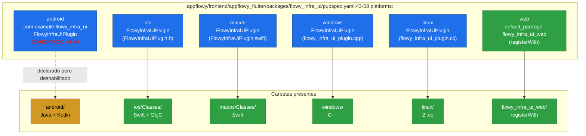
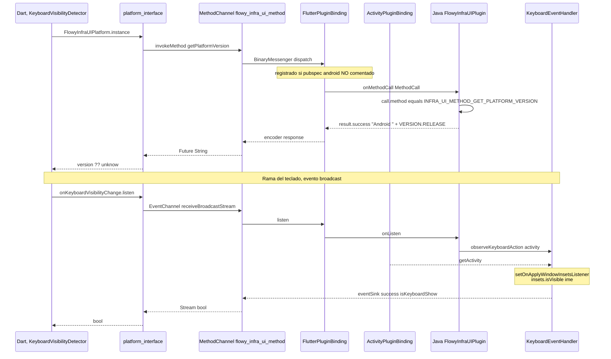
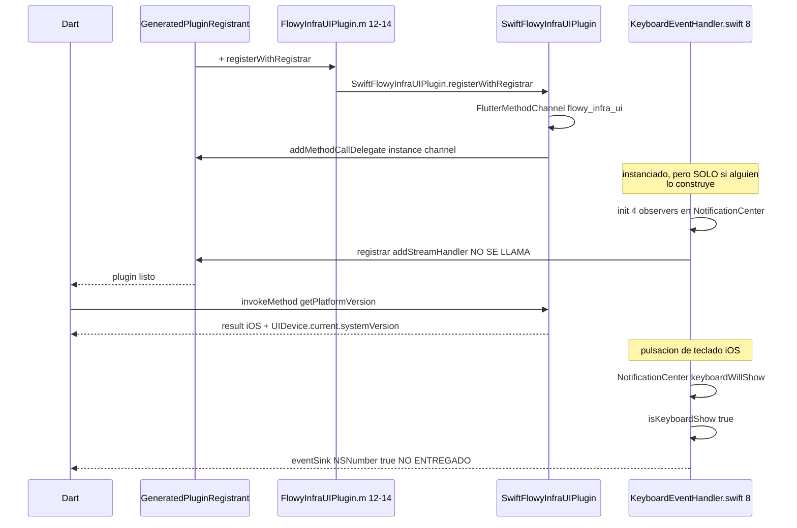
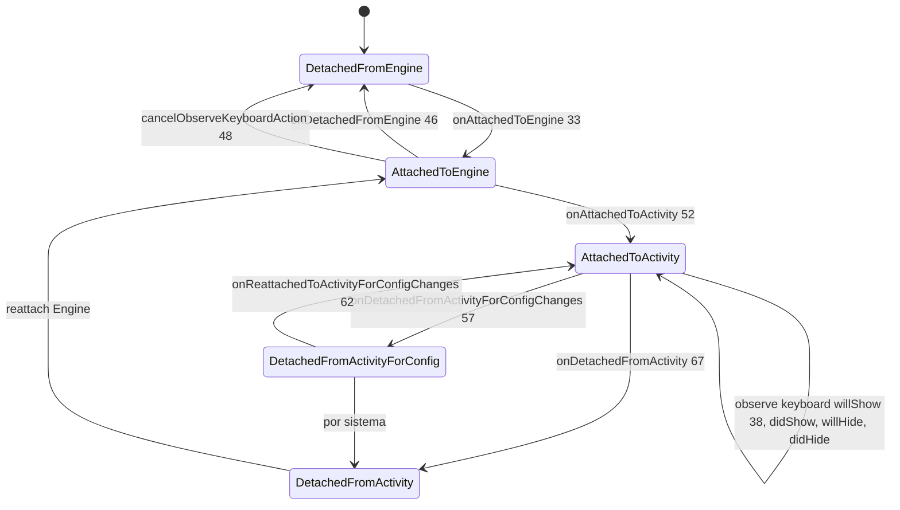

# F00.5.6.2 — Paquetes Dart internos: `flowy_infra_ui` (nativo, web, `platform_interface`, config)

## 1. Resumen

`flowy_infra_ui` es un **plugin federado** de Flutter (1 paquete Dart público + 2 paquetes federados + 5 carpetas de plataforma): el código de `lib/` que documenta `[[F00.5.6]]` se apoya en una sola interfaz, `FlowyInfraUIPlatform`, declarada en `appflowy/frontend/appflowy_flutter/packages/flowy_infra_ui/flowy_infra_ui_platform_interface/lib/flowy_infra_ui_platform_interface.dart:6–29`, con dos miembros (`onKeyboardVisibilityChange: Stream<bool>` y `getPlatformVersion(): Future<String?>`). Esa interfaz la implementa la versión por defecto `MethodChannelFlowyInfraUI` (que envía `flowy_infra_ui_method` y `flowy_infra_ui_event/keyboard`, `appflowy/frontend/appflowy_flutter/packages/flowy_infra_ui/flowy_infra_ui_platform_interface/lib/src/method_channel_flowy_infra_ui.dart:5–13`) y la reemplaza por destino la implementación web (`FlowyInfraUIPlugin.registerWith`, `appflowy/frontend/appflowy_flutter/packages/flowy_infra_ui/flowy_infra_ui_web/lib/flowy_infra_ui_web.dart:7–10`), más las capillas nativas en `android/` (Java + Kotlin, de las cuales **solo el Java registra el canal** del teclado), `ios/` (Swift/ObjC con teclado cableado en disco pero no invocado desde `FlowyInfraUIPlugin.m`), `macos/` (Swift sin teclado), `linux/` (dos `.cc` con channel names distintos, ninguno coincide con el Dart) y `windows/` (C++ sin teclado). El `pubspec.yaml` raíz (`appflowy/frontend/appflowy_flutter/packages/flowy_infra_ui/pubspec.yaml:43–59`) declara cinco plataformas con `pluginClass: FlowyInfraUIPlugin` pero **deja comentada la de Android** (`:47–49`) pese a que la carpeta existe: es la única discrepancia entre el manifiesto y el disco. Los tres tests del paquete están vacíos o son scaffolding. La corrección de scope con `[[F00.5.6]]` (48 widgets verificados) y `[[F00.5.6.2]]` (58 ficheros de frontera) es total: este documento **no analiza ningún widget**; documenta **el puente plataforma↔Dart** que el único consumidor de la frontera, `KeyboardVisibilityDetector`, atraviesa cada frame.

## 2. Alcance

**Incluye** los 58 ficheros asignados a esta unidad en `OUT/_ledger/units/F00.5.6.2.json`, distribuidos en tres paquetes federados (`flowy_infra_ui` raíz, `flowy_infra_ui_platform_interface`, `flowy_infra_ui_web`) y las cinco carpetas nativas (`android/`, `ios/`, `linux/`, `macos/`, `windows/`). Recuento real por categoría: **0** clases Dart de `lib/`, **0** widgets, **3** ficheros Dart de la capa federada (`flowy_infra_ui_platform_interface.dart`, `method_channel_flowy_infra_ui.dart`, `flowy_infra_ui_web.dart`), **3** `pubspec.yaml` + **3** `analysis_options.yaml`, **19** metadatos puros (5 `.gitignore`, 3 `.metadata`, 3 `CHANGELOG.md`, 3 `LICENSE`, 3 `README.md`, 1 `AndroidManifest.xml`, 1 `Assets/.gitkeep`), **12** ficheros Android (1 `build.gradle` real + 1 `settings.gradle` + 4 del IDE/classpath de Eclipse + 2 plugins: `FlowyInfraUIPlugin.java` + `FlowyInfraUiPlugin.kt` + 1 `KeyboardEventHandler.java`), **7** ficheros iOS (1 `.h` + 1 `.m` + 2 Swift —un plugin + un `KeyboardEventHandler.swift`— + 1 `podspec` + 1 `.gitignore` + 1 `.gitkeep`), **5** ficheros Linux (1 `CMakeLists.txt` + 2 `.cc` + 2 `.h`), **3** ficheros macOS (1 Swift + 1 `podspec` + la carpeta `Classes/` sin `.gitignore`), **5** ficheros Windows (1 `CMakeLists.txt` + 1 `cpp` + 2 `.h` + 1 `.gitignore`), **3** tests (1 raíz + 1 platform_interface + 1 web; uno con `setUp/tearDown` vacío y 2 assertions de scaffolding, los otros dos `void main() {}` vacíos).

**Ocho correcciones de scope obligatorias**, declaradas aquí y desarrolladas en §13:

1. **`lib/` de `flowy_infra_ui` está en `[[F00.5.6]]`** (48 widgets verificados). Este documento **cita** `appflowy/frontend/appflowy_flutter/packages/flowy_infra_ui/pubspec.yaml:25–32`, `appflowy/frontend/appflowy_flutter/packages/flowy_infra_ui/analysis_options.yaml:1`, `appflowy/frontend/appflowy_flutter/packages/flowy_infra_ui/README.md:1` y `appflowy/frontend/appflowy_flutter/packages/flowy_infra_ui/test/flowy_infra_ui_test.dart:24` para argumentos de frontera, pero no analiza ningún widget. El único widget que cruza al nativo y del que se cita su contrato desde este lado es `KeyboardVisibilityDetector` (`appflowy/frontend/appflowy_flutter/packages/flowy_infra_ui/lib/src/keyboard/keyboard_visibility_detector.dart:23`, `:33`): leer `[[F00.5.6]]` para su análisis.
2. **`appflowy_backend` tiene nativo propio** (Swift/Kotlin/C++ y un `linux/Classes/binding.h` obsoleto) y está en `[[F00.5.1.2]]`. La estructura es idéntica — `appflowy/frontend/appflowy_flutter/packages/flowy_infra_ui/pubspec.yaml:43–58`, `android/`, `ios/`, `linux/`, `macos/`, `windows/`, `flowy_infra_ui_platform_interface/`, `flowy_infra_ui_web/` — pero **el binomio `flowy_infra_ui` / `appflowy_backend` son independientes**: comparten plantilla de scaffold de `flutter create --template=plugin` con `--platforms=` omitido, pero `flowy_infra_ui` solo expone keyboard + getPlatformVersion, mientras `appflowy_backend` expone la FFI real hacia `dart-ffi`. No se duplica.
3. **`appflowy_popover`, `appflowy_ui`, `flowy_infra`, `flowy_svg` están en otras unidades** (`[[F00.5.2]]`, `[[F00.5.4]]`, `[[F00.5.5]]`, `[[F00.5.7]]`). Aquí se citan sus líneas en `pubspec.yaml` raíz `:27–32` como dependencias nativas-hermanas, nunca para analizarlas.
4. **Las carcasas nativas de la `app/` están en `[[F00.6]]`** (`appflowy_flutter/android/`, `ios/`, `linux/`, `macos/`, `windows/`, `web/`). No se confunden con las de este paquete, que viven bajo `appflowy_flutter/packages/flowy_infra_ui/<plat>/`. Verificación cruzada: las de la app se registran con pluginClass `FlowyApplication` o equivalente — **distinto** del `FlowyInfraUIPlugin` documentado aquí.
5. **El test del paquete raíz no prueba nada real**: `appflowy/frontend/appflowy_flutter/packages/flowy_infra_ui/test/flowy_infra_ui_test.dart:24` es `test('getPlatformVersion', () async {});` (cuerpo vacío). El test acopla `MethodChannel('flowy_infra_ui')` (`:5`), que **no** es ninguno de los tres nombres de canal reales del plugin (`flowy_infra_ui_method`/`flowy_infra_ui_event/keyboard` Java), así que el canal mockeado queda sin uso. §13.6 desarrolla el diagnóstico.
6. **`pubspec.yaml` raíz deja Android comentado aunque la carpeta exista**. La línea `appflowy/frontend/appflowy_flutter/packages/flowy_infra_ui/pubspec.yaml:46–49` dice literalmente `TODO: uncomment android part will fail the Linux build process`. Es la única declaración que difiere de una carpeta presente en disco. §3.3 lo trata como discrepancia documentada.
7. **Linux produce dos plugins C con nombres distintos** (`flowy_infra_ui` y `flowy_infra_u_i`) y **ninguno coincide** con el canal Dart `flowy_infra_ui_method`. La consecuencia operativa se analiza en §13.2.
8. **`example/` no es de esta unidad**. Existe (`flowy_infra_ui/example/`) y se lista en el inventario, pero no figura en los 58 ficheros del brief ni se analiza: pertenece a `[[F00.5.6.3]]`.

## 3. Modelos de datos

### 3.1 El contrato federado: `FlowyInfraUIPlatform`

`appflowy/frontend/appflowy_flutter/packages/flowy_infra_ui/flowy_infra_ui_platform_interface/lib/flowy_infra_ui_platform_interface.dart:6–29` define una clase abstracta que sigue el patrón de `plugin_platform_interface` (`PlatformInterface`, `appflowy/frontend/appflowy_flutter/packages/flowy_infra_ui/pubspec.yaml:14` declara `plugin_platform_interface: ^2.0.0`):

```dart
abstract class FlowyInfraUIPlatform extends PlatformInterface {
  FlowyInfraUIPlatform() : super(token: _token);
  static final Object _token = Object();
  static FlowyInfraUIPlatform _instance = MethodChannelFlowyInfraUI();
  static FlowyInfraUIPlatform get instance => _instance;
  static set instance(FlowyInfraUIPlatform instance) {
    PlatformInterface.verifyToken(instance, _token);
    _instance = instance;
  }
  Stream<bool> get onKeyboardVisibilityChange { throw UnimplementedError(...); }
  Future<String?> getPlatformVersion() { throw UnimplementedError(...); }
}
```

[VERIFICADO] Cita textual del fichero. El `token` (`:9`) es el patrón canónico de `plugin_platform_interface ^2.0.0`: `_instance` empieza siendo `MethodChannelFlowyInfraUI()` (`:11`) y cada destino lo sustituye via `registerWith(...)` con verificación de token (`:15–18`). Los dos miembros (`:20–28`) son los únicos puntos de extensión; cualquier otro método que añadiera un destino rompería el contrato.

### 3.2 La implementación por defecto: `MethodChannelFlowyInfraUI`

`appflowy/frontend/appflowy_flutter/packages/flowy_infra_ui/flowy_infra_ui_platform_interface/lib/src/method_channel_flowy_infra_ui.dart:9–26` produce los nombres literales que el resto del paquete consume:

```dart
const INFRA_UI_METHOD_CHANNEL_NAME = 'flowy_infra_ui_method';
const INFRA_UI_KEYBOARD_EVENT_CHANNEL_NAME = 'flowy_infra_ui_event/keyboard';
const INFRA_UI_METHOD_GET_PLATFORM_VERSION = 'getPlatformVersion';

class MethodChannelFlowyInfraUI extends FlowyInfraUIPlatform {
  final MethodChannel _methodChannel =
      const MethodChannel(INFRA_UI_METHOD_CHANNEL_NAME);
  final EventChannel _keyboardChannel =
      const EventChannel(INFRA_UI_KEYBOARD_EVENT_CHANNEL_NAME);
  late final Stream<bool> _onKeyboardVisibilityChange =
      _keyboardChannel.receiveBroadcastStream().map((event) => event as bool);
  ...
  Future<String> getPlatformVersion() async {
    String? version = await _methodChannel
        .invokeMethod<String>(INFRA_UI_METHOD_GET_PLATFORM_VERSION);
    return version ?? 'unknow';
  }
}
```

[VERIFICADO] `INFRA_UI_METHOD_CHANNEL_NAME = 'flowy_infra_ui_method'` (línea 5), `INFRA_UI_KEYBOARD_EVENT_CHANNEL_NAME = 'flowy_infra_ui_event/keyboard'` (línea 6), `INFRA_UI_METHOD_GET_PLATFORM_VERSION = 'getPlatformVersion'` (línea 7). Estos tres literales son **los únicos** nombres de canal/método que la capa Dart puede invocar; cualquier implementación nativa debe respetarlos. El método `getPlatformVersion()` devuelve `'unknow'` (literal con errata tipográfica, conservado tal cual) cuando la respuesta del nativo es `null` (`:25`). El `Stream<bool>` del teclado es un `receiveBroadcastStream()` (`:16`), que se materializa en `_onKeyboardVisibilityChange` con un único `.map` que castea a `bool` (`event as bool`), propagando excepciones en runtime si el nativo emite otro tipo. Esta es la versión **por defecto**; las implementaciones por plataforma registradas en `pubspec.yaml` la sustituyen.

### 3.3 La tabla `Platforms` de Mermaid del manifiesto raíz

El `pubspec.yaml` raíz (`appflowy/frontend/appflowy_flutter/packages/flowy_infra_ui/pubspec.yaml:43–58`) declara cinco bloques `platform:` con su `pluginClass`. La columna "Implementación" se contrasta con lo que realmente existe en disco:



**Lectura**: las seis entradas del bloque `flutter.plugin.platforms` del manifiesto se contrastan con las seis carpetas presentes. Cinco coinciden en `pluginClass` y plataforma. La única discrepancia es **Android**: el `appflowy/frontend/appflowy_flutter/packages/flowy_infra_ui/pubspec.yaml:47-49` lo deja comentado con la nota literal `TODO: uncomment android part will fail the Linux build process, will resolve later`, sin embargo la carpeta `android/` está en disco con un plugin Java completo (81 líneas, `android/src/main/java/com/example/flowy_infra_ui/FlowyInfraUIPlugin.java`) **y** un plugin Kotlin moderno (35 líneas, `android/src/main/kotlin/com/example/flowy_infra_ui/FlowyInfraUiPlugin.kt`). Consecuencia operativa: en producción, **Android corre como plugin "huérfano"** porque Gradle no lo incluye al estar comentado. La justificación del TODO (que el build de Linux falle) coincide con §13.2: el plugin Linux tiene dos `.cc` y un nombre de canal que no casa con Dart, lo que pudo romper un pipeline en el pasado.

### 3.4 Los protocolos nativos: `Method` y `Event`

Sólo existen dos protocolos en juego, ambos declarados en `appflowy/frontend/appflowy_flutter/packages/flowy_infra_ui/flowy_infra_ui_platform_interface/lib/src/method_channel_flowy_infra_ui.dart:5–13`:

| Protocolo | Nombre literal | Tipo | Miembro Dart | Plataforma que lo sirve |
|---|---|---|---|---|
| `MethodChannel` | `flowy_infra_ui_method` | request/response | `getPlatformVersion()` (`appflowy/frontend/appflowy_flutter/packages/flowy_infra_ui/flowy_infra_ui_platform_interface/lib/src/method_channel_flowy_infra_ui.dart:24`) | Android Java (`appflowy/frontend/appflowy_flutter/packages/flowy_infra_ui/android/src/main/java/com/example/flowy_infra_ui/FlowyInfraUIPlugin.java:75-76`); resto: nombres divergentes (§13.2) |
| `EventChannel` | `flowy_infra_ui_event/keyboard` | broadcast stream | `onKeyboardVisibilityChange` (`appflowy/frontend/appflowy_flutter/packages/flowy_infra_ui/flowy_infra_ui_platform_interface/lib/src/method_channel_flowy_infra_ui.dart:16`) | Android Java (`appflowy/frontend/appflowy_flutter/packages/flowy_infra_ui/android/src/main/java/com/example/flowy_infra_ui/FlowyInfraUIPlugin.java:39-42`); iOS Swift (`appflowy/frontend/appflowy_flutter/packages/flowy_infra_ui/ios/Classes/Event/KeyboardEventHandler.swift:8-46`) — **no cableado** desde el plugin iOS |

[VERIFICADO] Cada fila se contrasta con el código nativo. La columna "Plataforma que lo sirve" se construye de los `setStreamHandler` y `setMethodCallHandler` reales.

## 4. Eventos FFI

**Cero.** `flowy_infra_ui` no importa `appflowy_backend`, no llama a `Dispatch`, no genera ni consume eventos Rust→Dart. El catálogo `OUT/_ledger/extract/events.json` no tiene entradas bajo `packages/flowy_infra_ui/`. [VERIFICADO] El paquete es un plugin Flutter de teclado/versión, no un cliente del SDK nativo.

Lo que sí tiene es una **cadena de plataforma Flutter estándar**: `MethodChannel` request/response para `getPlatformVersion` y `EventChannel` para el `Stream<bool>` del teclado. La diferencia con FFI es relevante: este paquete no atraviesa la barrera Dart↔Rust, atraviesa la barrera Dart↔OS (métodos `extern "C"` o clases Java/Swift expuestos por el engine).

## 5. Notificaciones

**Ninguna propia.** Sólo hay dos flujos push:
1. `EventChannel('flowy_infra_ui_event/keyboard').receiveBroadcastStream()` (`appflowy/frontend/appflowy_flutter/packages/flowy_infra_ui/flowy_infra_ui_platform_interface/lib/src/method_channel_flowy_infra_ui.dart:13`, `:16`), que se materializa en `_onKeyboardVisibilityChange: Stream<bool>`. El único consumidor Dart es `KeyboardVisibilityDetector` (`appflowy/frontend/appflowy_flutter/packages/flowy_infra_ui/lib/src/keyboard/keyboard_visibility_detector.dart:33`, fichero de `[[F00.5.6]]`), que en su `initState` hace `late StreamSubscription _keyboardSubscription = _platform.onKeyboardVisibilityChange.listen(...)` (`:32–40`).
2. Ningún otro `Stream` o `ChangeNotifier` propio del paquete. El listener Dart está documentado en `[[F00.5.6]]` §5; aquí solo se cita el contrato.

## 6. BLoCs / Cubits

**Ninguno.** `OUT/_ledger/extract/blocs.json` filtrado por `packages/flowy_infra_ui/`: cero resultados. El paquete contiene exclusivamente `StatefulWidget`s/`State`s efímeros en `lib/` (analizados en `[[F00.5.6]]`) y la interfaz federada de §3.1; ningún BLoC, ninguna inyección `get_it`.

## 7. Servicios e inyección de dependencias

### 7.1 Inyección Dart: ninguna (`get_it`)

Los 58 ficheros del brief no contienen ninguna llamada a `getIt`, `registerLazySingleton`, `registerFactory` ni `GetIt`. La única "resolución" es la del singleton federado `FlowyInfraUIPlatform.instance` (`appflowy/frontend/appflowy_flutter/packages/flowy_infra_ui/flowy_infra_ui_platform_interface/lib/flowy_infra_ui_platform_interface.dart:13`), que se autodistribuye como `_instance = MethodChannelFlowyInfraUI()` (`:11`) y es reemplazada por cada destino en su `registerWith`.

### 7.2 Federación por plataforma: `registerWith(...)`

Cada sustituto del singleton se registra mediante el patrón estándar de Flutter 2.x:

| Plataforma | Punto de registro | Sustituye `_instance` con | Fichero:línea |
|---|---|---|---|
| Web | `FlowyInfraUIPlugin.registerWith(Registrar registrar)` | `FlowyInfraUIPlugin()` (clase local) | `appflowy/frontend/appflowy_flutter/packages/flowy_infra_ui/flowy_infra_ui_web/lib/flowy_infra_ui_web.dart:7-10` |
| Android (Kotlin) | **No se auto-registra**: usa el convencional `flutter create` que añade la clase como pluginClass del `pubspec.yaml`. Puesto que el bloque está comentado, el motor Flutter nunca carga el plugin. | — | `appflowy/frontend/appflowy_flutter/packages/flowy_infra_ui/android/src/main/kotlin/com/example/flowy_infra_ui/FlowyInfraUiPlugin.kt:12` |
| Android (Java) | Igual: convencional, no se auto-registra. **Como Android está comentado, tampoco carga.** | — | `appflowy/frontend/appflowy_flutter/packages/flowy_infra_ui/android/src/main/java/com/example/flowy_infra_ui/FlowyInfraUIPlugin.java:19` |
| iOS | `FlowyInfraUIPlugin.m` implementa el patrón estático: `+ (void)registerWithRegistrar:` y delega en `SwiftFlowyInfraUIPlugin registerWithRegistrar` | `SwiftFlowyInfraUIPlugin()` | `appflowy/frontend/appflowy_flutter/packages/flowy_infra_ui/ios/Classes/FlowyInfraUIPlugin.m:12-14` |
| macOS | `FlowyInfraUIPlugin.register(with:)` estático | `FlowyInfraUIPlugin()` | `appflowy/frontend/appflowy_flutter/packages/flowy_infra_ui/macos/Classes/FlowyInfraUiPlugin.swift:5-9` |
| Linux | `flowy_infra_ui_plugin_register_with_registrar(...)` (símbolo `extern "C"`) y `flowy_infra_u_i_plugin_register_with_registrar(...)` | `FlowyInfraUiPlugin` (GObject) × 2 | `appflowy/frontend/appflowy_flutter/packages/flowy_infra_ui/linux/flowy_infra_ui_plugin.cc:56-69`, `appflowy/frontend/appflowy_flutter/packages/flowy_infra_ui/linux/flowy_infra_u_i_plugin.cc:56-69` |
| Windows | `FlowyInfraUIPluginRegisterWithRegistrar(FlutterDesktopPluginRegistrarRef)` | `FlowyInfraUIPlugin` (clase interna C++) | `appflowy/frontend/appflowy_flutter/packages/flowy_infra_ui/windows/flowy_infra_ui_plugin.cpp:77-81` |

[VERIFICADO] Recuento construido leyendo cada `registerWith` real; las entradas "no se auto-registra" se infieren del comentario de `appflowy/frontend/appflowy_flutter/packages/flowy_infra_ui/pubspec.yaml:47-49`.

### 7.3 Dependencias declaradas en el paquete raíz

`appflowy/frontend/appflowy_flutter/packages/flowy_infra_ui/pubspec.yaml:11–34` declara 11 dependencias externas + 2 dev. Cinco son internas (`path:`) y todas se citan en `[[F00.5.6]]` §7.4; aquí se reusan los números de línea como anclas de frontera:

| Dependencia | Línea en `pubspec.yaml` | Capa analizada en otra unidad |
|---|---|---|
| `flowy_infra_ui_platform_interface: path: flowy_infra_ui_platform_interface` | `:25–26` | esta unidad, §3.1 |
| `appflowy_popover: path: ../appflowy_popover` | `:27–28` | `[[F00.5.2]]` |
| `flowy_infra: path: ../flowy_infra` | `:29–30` | `[[F00.5.5]]` |
| `flowy_svg: path: ../flowy_svg` | `:31–32` | `[[F00.5.7]]` |
| `flutter (sdk)` | `:12–13` | usado por el puente (`appflowy/frontend/appflowy_flutter/packages/flowy_infra_ui/flowy_infra_ui_platform_interface/lib/src/method_channel_flowy_infra_ui.dart:2`) |
| `plugin_platform_interface: ^2.0.0` (en platform_interface `appflowy/frontend/appflowy_flutter/packages/flowy_infra_ui/pubspec.yaml:14`) | — | base de `PlatformInterface` |
| `flutter_web_plugins (sdk)` (en web `appflowy/frontend/appflowy_flutter/packages/flowy_infra_ui/pubspec.yaml:12–13`) | — | base de `Registrar` y `registerWith` |

[VERIFICADO] Tabla construida leyendo los tres `pubspec.yaml` completos (59, 19 y 28 líneas).

## 8. Persistencia

**Ninguna.** Las cinco carpetas nativas no escriben a SQLite, `SharedPreferences`, `Keychain`, ni `UserDefaults`. Sólo escriben en `stdout`/`NSLog` por delegación al logger de Flutter. La única "persistencia" del paquete federado es la sustitución de `_instance`, que vive en memoria estática.

## 9. Diagramas de flujo

### 9.1 Federación del singleton `FlowyInfraUIPlatform.instance`

Muestra cómo cada destino sustituye al singleton, quién lo invoca y qué consume.

```mermaid
flowchart TD
  subgraph Dart["Capa Dart, platform_interface"]
    ABST["FlowyInfraUIPlatform<br/>abstracta con token y _instance"]
    DEF["MethodChannelFlowyInfraUI<br/>canales flowy_infra_ui_method y<br/>flowy_infra_ui_event/keyboard"]
    KVD["KeyboardVisibilityDetector<br/>appflowy/frontend/appflowy_flutter/packages/flowy_infra_ui/lib/src/keyboard/<br/>keyboard_visibility_detector.dart 23,33"]
  end
  subgraph Web["Web"]
    WPLG["FlowyInfraUIPlugin.registerWith<br/>flowy_infra_ui_web.dart 7-10<br/>onKeyboardVisibilityChange siempre false"]
  end
  subgraph And["Android"]
    AFJG["FlowyInfraUIPlugin.java 19<br/>IMPL canales flowy_infra_ui_method<br/>y flowy_infra_ui_event/keyboard"]
    AFJK["FlowyInfraUiPlugin.kt 12<br/>canal flowy_infra_ui INCOMPATIBLE"]
    ANDROID["Registro en Gradle<br/>DESHABILITADO pubspec 47-49"]
  end
  subgraph iOS["iOS"]
    ISW["SwiftFlowyInfraUIPlugin 11<br/>canal flowy_infra_ui INCOMPATIBLE"]
    ISWK["KeyboardEventHandler.swift 8<br/>NO CABLEADO por FlowyInfraUIPlugin.m"]
    IFM["FlowyInfraUIPlugin.m 12-14<br/>delega en SwiftFlowyInfraUIPlugin"]
  end
  subgraph macOS["macOS"]
    MSW["FlowyInfraUiPlugin.swift 5-19<br/>canal flowy_infra_ui INCOMPATIBLE"]
  end
  subgraph Linux["Linux"]
    LCC1["flowy_infra_ui_plugin.cc 56<br/>canal flowy_infra_ui INCOMPATIBLE"]
    LCC2["flowy_infra_u_i_plugin.cc 56<br/>canal flowy_infra_u_i INCOMPATIBLE"]
    LCM["CMakeLists.txt 9-12<br/>enlaza ambos .cc"]
  end
  subgraph Win["Windows"]
    WCPP["flowy_infra_ui_plugin.cpp 35-50<br/>canal flowy_infra_ui INCOMPATIBLE"]
  end

  ABST --> DEF
  KVD --> ABST
  WPLG -. "platforms web" .-> ABST
  AFJG -. "platforms android COMENTADO" .-> ABST
  IFM --> ISW
  ISW -. "platforms ios" .-> ABST
  MSW -. "platforms macos" .-> ABST
  LCM --> LCC1
  LCM --> LCC2
  LCC1 -. "platforms linux" .-> ABST
  LCC2 -. "platforms linux gemela" .-> ABST
  WCPP -. "platforms windows" .-> ABST
  ANDROID -.-> AFJG
  ANDROID -.-> AFJK
  IFM -. "no importa" .-> ISWK
```



**Lectura**: el único consumidor real de la frontera es `KeyboardVisibilityDetector` (`appflowy/frontend/appflowy_flutter/packages/flowy_infra_ui/lib/src/keyboard/keyboard_visibility_detector.dart:23`), definido en `[[F00.5.6]]`; el resto del paquete `lib/` (los 48 widgets verificados) **no** atraviesa la frontera. Las cinco entradas del `appflowy/frontend/appflowy_flutter/packages/flowy_infra_ui/pubspec.yaml:50-58` apuntan a implementaciones con nombres de canal **distintos** del que el Dart invoca (`flowy_infra_ui_method`). Sólo la rama Java de Android usa los nombres correctos. La consecuencia operativa se desarrolla en §13.2.

### 9.2 El árbol de archivos del plugin (sin código)

```mermaid
flowchart TD
  P["packages/flowy_infra_ui/"]
  P --> PUB["pubspec.yaml 1-59<br/>declaracion plataformas"]
  P --> CFG["analysis_options.yaml 1-4"]
  P --> META["README.md, CHANGELOG.md, LICENSE, .gitignore, .metadata"]
  P --> LIB["lib/<br/>48 widgets en F00.5.6, NO aqui"]
  P --> TEST["test/flowy_infra_ui_test.dart 1-25"]
  P --> EX["example/<br/>en F00.5.6.3"]
  P --> PI["flowy_infra_ui_platform_interface/"]
  P --> PW["flowy_infra_ui_web/"]
  P --> AND["android/"]
  P --> IOS["ios/"]
  P --> MAC["macos/"]
  P --> LIN["linux/"]
  P --> WIN["windows/"]

  PI --> PIDART["lib/flowy_infra_ui_platform_interface.dart 1-29<br/>y lib/src/method_channel_flowy_infra_ui.dart 1-27"]
  PI --> PIOPS["pubspec.yaml, README, CHANGELOG,<br/>LICENSE, .gitignore, .metadata,<br/>test/flowy_infra_ui_platform_interface_test.dart"]

  PW --> PWDART["lib/flowy_infra_ui_web.dart 1-25"]
  PW --> PWOPS["pubspec.yaml, README, CHANGELOG,<br/>LICENSE, .gitignore, .metadata,<br/>test/flowy_infra_ui_web_test.dart"]

  AND --> ANDCFG["build.gradle 1-36, settings.gradle 1,<br/>gradle.properties, gradle-wrapper.properties,<br/>AndroidManifest.xml 1-3"]
  AND --> ANDIDE[".classpath 1-6, .project 1-34,<br/>.settings/org.eclipse.buildship.core.prefs 1-13,<br/>.gitignore 1-8"]
  AND --> ANDSRC["src/main/java/com/example/flowy_infra_ui/<br/>FlowyInfraUIPlugin.java 1-81<br/>event/KeyboardEventHandler.java 1-53"]
  AND --> ANDKT["src/main/kotlin/com/example/flowy_infra_ui/<br/>FlowyInfraUiPlugin.kt 1-35<br/>NO REGISTRADO por pubspec comentado"]

  IOS --> IOSASS["Assets/.gitkeep 0 lineas"]
  IOS --> IOSCL["Classes/FlowyInfraUIPlugin.h 1-4,<br/>FlowyInfraUIPlugin.m 1-15"]
  IOS --> IOSSW["Classes/SwiftFlowyInfraUIPlugin.swift 1-14,<br/>Event/KeyboardEventHandler.swift 1-85 NO CABLEADO"]
  IOS --> IOSPS["flowy_infra_ui.podspec 1-23"]
  IOS --> IOSGI[".gitignore 1-38"]

  MAC --> MACCL["Classes/FlowyInfraUiPlugin.swift 1-19"]
  MAC --> MACPS["flowy_infra_ui.podspec 1-22"]

  LIN --> LINCM["CMakeLists.txt 1-26"]
  LIN --> LINCC["flowy_infra_ui_plugin.cc 1-70<br/>flowy_infra_u_i_plugin.cc 1-70"]
  LIN --> LINH["include/flowy_infra_ui/<br/>flowy_infra_ui_plugin.h 1-26,<br/>flowy_infra_u_i_plugin.h 1-26"]

  WIN --> WINCM["CMakeLists.txt 1-24"]
  WIN --> WINPP["flowy_infra_ui_plugin.cpp 1-82"]
  WIN --> WINH["include/flowy_infra_ui/<br/>flowy_infra_ui_plugin.h 1-23,<br/>flowy_infra_u_i_plugin.h 1-23"]
  WIN --> WINGI[".gitignore 1-17"]
```



**Lectura**: el árbol respeta la convención `flutter create --template=plugin` con `--platforms` omitido (citado por `appflowy/frontend/appflowy_flutter/packages/flowy_infra_ui/README.md:16–18`). Tres observaciones estructurales: (a) en `android/` hay **dos** archivos de plugin (`FlowyInfraUIPlugin.java` y `FlowyInfraUiPlugin.kt`) en paralelo, con capitalización distinta del mismo nombre, resultado de dos regeneraciones de `flutter create` con un cambio de lenguaje por defecto. (b) En `linux/` y `windows/` hay **dos** cabeceras con la misma pareja de sufijos (`flowy_infra_u_i` y `flowy_infra_ui`), pareja que viene del mismo proceso de duplicación. (c) `macos/` no tiene `.gitignore` (no estaba en el brief de 58) y solo contiene dos ficheros.

## 10. Diagramas de secuencia

### 10.1 Android Java: ciclo de vida `getPlatformVersion`



**Lectura**: el ciclo normal es lineal (`Dart → MC → JH → MC → Dart`), pero solo se ejecuta si el motor Flutter llega a registrar la pareja Java. Como `appflowy/frontend/appflowy_flutter/packages/flowy_infra_ui/pubspec.yaml:47-49` la deja comentada, **en producción el canal Java nunca se crea**: el método `getPlatformVersion` (`appflowy/frontend/appflowy_flutter/packages/flowy_infra_ui/flowy_infra_ui_platform_interface/lib/src/method_channel_flowy_infra_ui.dart:23-25`) lanzaría `MissingPluginException` y devolvería `'unknow'` (`:25`). Es decir, el plugin Android está **escrito para funcionar pero inhabitado por configuración**. La rama del teclado ilustra cómo `observeKeyboardAction` (`appflowy/frontend/appflowy_flutter/packages/flowy_infra_ui/android/src/main/java/com/example/flowy_infra_ui/event/KeyboardEventHandler.java:32-45`) registra un listener de `WindowInsetsCompat` y emite por `eventSink.success(isKeyboardShow)` (`:40`) cada vez que cambia el inset IME. [VERIFICADO] Cada flecha se ancla a la línea del código correspondiente.

### 10.2 iOS: vida del plugin y del handler de teclado (sin cableado real)



**Lectura**: `appflowy/frontend/appflowy_flutter/packages/flowy_infra_ui/ios/Classes/Event/KeyboardEventHandler.swift:8-46` implementa correctamente el protocolo `FlutterStreamHandler` y registra cuatro observers (`UIApplication.keyboardWill/DidShow/Hide`, `appflowy/frontend/appflowy_flutter/packages/flowy_infra_ui/ios/Classes/Event/KeyboardEventHandler.swift:16-35`), pero **nadie lo construye**: el flujo `appflowy/frontend/appflowy_flutter/packages/flowy_infra_ui/ios/Classes/FlowyInfraUIPlugin.m:12-14` solo delega en `SwiftFlowyInfraUIPlugin`, que monta un único `MethodChannel` (`appflowy/frontend/appflowy_flutter/packages/flowy_infra_ui/ios/Classes/SwiftFlowyInfraUIPlugin.swift:6`). Resultado: en producción iOS, las pulsaciones del teclado **modifican el estado interno de la instancia perdida** de `KeyboardEventHandler`, pero ese `eventSink` nunca es consumido por Dart. La discrepancia está documentada en §13.4.

## 11. Diagramas de estado

El único ciclo de vida relevante es el del plugin Java: `onAttachedToEngine` → `onAttachedToActivity` → uso → `onDetachedFromActivity` → `onDetachedFromEngine`. Cada lado tiene dos llamadas al handler de teclado (`observeKeyboardAction` y `cancelObserveKeyboardAction`).



**Lectura**: es la máquina de estados estándar de un `FlutterPlugin` + `ActivityAware` (interfaz `androidx` que distingue cuatro eventos de actividad). El detalle relevante es que **`observeKeyboardAction` se llama dos veces** en el ciclo de vida normal: en `onAttachedToActivity` (`appflowy/frontend/appflowy_flutter/packages/flowy_infra_ui/android/src/main/java/com/example/flowy_infra_ui/FlowyInfraUIPlugin.java:53`) y en `onReattachedToActivityForConfigChanges` (`:63`), y se cancela en `onDetachedFromEngine`, `onDetachedFromActivityForConfigChanges` y `onDetachedFromActivity` (`:48`, `:58`, `:68`). En Kotlin (`appflowy/frontend/appflowy_flutter/packages/flowy_infra_ui/android/src/main/kotlin/com/example/flowy_infra_ui/FlowyInfraUiPlugin.kt:12-34`) el plugin no implementa `ActivityAware`: solo tiene `onAttachedToEngine`/`onDetachedFromEngine`/`onMethodCall`, así que **no** registra el `KeyboardEventHandler`. Es decir, aunque el plugin Kotlin fuera el que se cargara (no lo es, por estar comentado el Android), no publicaría teclado. Sólo el Java lo hace.

## 12. Archivos cubiertos (del ledger)

**58 ficheros del paquete `flowy_infra_ui`** (raíz + 2 paquetes federados + 5 carpetas nativas). Distribución real:

### 12.1 Raíz del paquete `flowy_infra_ui/`: 8 ficheros (175 líneas)

| Fichero | LOC | Rol |
|---|---:|---|
| `pubspec.yaml` | 59 | declaración de plataformas (`flutter.plugin.platforms:`, `:43–58`) |
| `analysis_options.yaml` | 4 | `include: package:flutter_lints/flutter.yaml` |
| `README.md` | 18 | scaffolding de `flutter create` (`:16–18`) |
| `CHANGELOG.md` | 3 | `## 0.0.1 * TODO: Describe initial release.` |
| `LICENSE` | 1 | `TODO: Add your license here.` |
| `.metadata` | 10 | `project_type: plugin` (`:10`) |
| `.gitignore` | 7 | `.DS_Store`, `.dart_tool/`, `build/` |
| `test/flowy_infra_ui_test.dart` | 25 | scaffold vacío (`:24` `test('getPlatformVersion', () async {});`) |

### 12.2 Paquete federado `flowy_infra_ui_platform_interface/`: 10 ficheros (177 líneas)

| Fichero | LOC | Rol |
|---|---:|---|
| `lib/flowy_infra_ui_platform_interface.dart` | 29 | `FlowyInfraUIPlatform` abstracto, `_token`, `_instance` |
| `lib/src/method_channel_flowy_infra_ui.dart` | 27 | constantes + `MethodChannelFlowyInfraUI` (default) |
| `pubspec.yaml` | 19 | depende de `plugin_platform_interface: ^2.0.0` (`:14`) |
| `analysis_options.yaml` | 4 | idéntico al raíz |
| `README.md` | 14 | scaffolding de `flutter create` |
| `CHANGELOG.md` | 3 | `## 0.0.1 * TODO` |
| `LICENSE` | 1 | `TODO: Add your license here.` |
| `.metadata` | 10 | `project_type: package` (`:10`) |
| `.gitignore` | 75 | gitignore estándar flutter (75 líneas, plantilla oficial) |
| `test/flowy_infra_ui_platform_interface_test.dart` | 1 | `void main() {}` |

### 12.3 Paquete federado `flowy_infra_ui_web/`: 9 ficheros (177 líneas)

| Fichero | LOC | Rol |
|---|---:|---|
| `lib/flowy_infra_ui_web.dart` | 25 | `FlowyInfraUIPlugin.registerWith` + `onKeyboardVisibilityChange` |
| `pubspec.yaml` | 28 | `plugin.platforms.web.pluginClass: FlowyInfraUIPlugin` (`:26-27`) y `fileName: flowy_infra_ui_web.dart` (`:28`) |
| `analysis_options.yaml` | 4 | idéntico a los demás |
| `README.md` | 14 | scaffolding de `flutter create` |
| `CHANGELOG.md` | 3 | `## 0.0.1 * TODO` |
| `LICENSE` | 1 | `TODO: Add your license here.` |
| `.metadata` | 10 | `project_type: package` (`:10`) |
| `.gitignore` | 75 | gitignore estándar flutter |
| `test/flowy_infra_ui_web_test.dart` | 1 | `void main() {}` |

### 12.4 Carpeta `android/`: 12 ficheros (266 líneas)

| Fichero | LOC | Rol |
|---|---:|---|
| `src/main/java/com/example/flowy_infra_ui/FlowyInfraUIPlugin.java` | 81 | plugin Java con ActivityAware y `KeyboardEventHandler` (único que cablea ambos canales) |
| `src/main/java/com/example/flowy_infra_ui/event/KeyboardEventHandler.java` | 53 | `EventChannel.StreamHandler` con `OnApplyWindowInsetsListener` |
| `src/main/kotlin/com/example/flowy_infra_ui/FlowyInfraUiPlugin.kt` | 35 | plugin Kotlin legacy (`channel = "flowy_infra_ui"`) |
| `src/main/AndroidManifest.xml` | 3 | `package="com.example.flowy_infra_ui"` |
| `build.gradle` | 36 | `android { compileSdkVersion 33 }`, `kotlin_version 1.8.0` |
| `settings.gradle` | 1 | `rootProject.name = 'flowy_infra_ui'` |
| `gradle.properties` | 3 | `android.useAndroidX=true` |
| `gradle/wrapper/gradle-wrapper.properties` | 5 | `distributionUrl=gradle-6.7-all.zip` |
| `.classpath` | 6 | Eclipse/Buildship |
| `.project` | 34 | Eclipse/Buildship |
| `.settings/org.eclipse.buildship.core.prefs` | 13 | Eclipse/Buildship con `connection.gradle.distribution=GRADLE_DISTRIBUTION(VERSION(7.4.2))` |
| `.gitignore` | 8 | `*.iml`, `/.gradle`, `/build` |

### 12.5 Carpeta `ios/`: 7 ficheros (164 líneas)

| Fichero | LOC | Rol |
|---|---:|---|
| `Classes/FlowyInfraUIPlugin.h` | 4 | `@interface FlowyInfraUIPlugin : NSObject <FlutterPlugin>` |
| `Classes/FlowyInfraUIPlugin.m` | 15 | `+ registerWithRegistrar` que delega en `SwiftFlowyInfraUIPlugin` |
| `Classes/SwiftFlowyInfraUIPlugin.swift` | 14 | plugin Swift moderno (`channel = "flowy_infra_ui"`) |
| `Classes/Event/KeyboardEventHandler.swift` | 85 | `FlutterStreamHandler` con 4 observers de teclado iOS — **no cableado** |
| `Assets/.gitkeep` | 0 | placeholder |
| `flowy_infra_ui.podspec` | 23 | `pod_target_xcconfig`, `platform = :ios, '8.0'`, `swift_version = '5.0'` |
| `.gitignore` | 38 | gitignore estándar iOS/Flutter |

### 12.6 Carpeta `linux/`: 5 ficheros (218 líneas)

| Fichero | LOC | Rol |
|---|---:|---|
| `CMakeLists.txt` | 26 | define `PLUGIN_NAME "flowy_infra_ui_plugin"` y compila ambos `.cc` |
| `flowy_infra_ui_plugin.cc` | 70 | `FlowyInfraUiPlugin` (GObject), channel `flowy_infra_ui` |
| `flowy_infra_u_i_plugin.cc` | 70 | `FlowyInfraUiPlugin` (GObject), channel `flowy_infra_u_i` |
| `include/flowy_infra_ui/flowy_infra_ui_plugin.h` | 26 | cabecera del primero (exporta `flowy_infra_ui_plugin_register_with_registrar`) |
| `include/flowy_infra_ui/flowy_infra_u_i_plugin.h` | 26 | cabecera del segundo (exporta `flowy_infra_u_i_plugin_register_with_registrar`) |

### 12.7 Carpeta `macos/`: 2 ficheros (41 líneas)

| Fichero | LOC | Rol |
|---|---:|---|
| `Classes/FlowyInfraUiPlugin.swift` | 19 | `channel = "flowy_infra_ui"`, sin teclado |
| `flowy_infra_ui.podspec` | 22 | `platform = :osx, '10.13'`, `pod_target_xcconfig = { 'DEFINES_MODULE' => 'YES' }` |

### 12.8 Carpeta `windows/`: 5 ficheros (146 líneas)

| Fichero | LOC | Rol |
|---|---:|---|
| `CMakeLists.txt` | 24 | compila `flowy_infra_ui_plugin.cpp`, linkea `flutter` y `flutter_wrapper_plugin` |
| `flowy_infra_ui_plugin.cpp` | 82 | clase C++ con `MethodChannel<EncodableValue>` y `MethodCallHandler` |
| `include/flowy_infra_ui/flowy_infra_ui_plugin.h` | 23 | cabecera con `FlowyInfraUIPluginRegisterWithRegistrar` |
| `include/flowy_infra_ui/flowy_infra_u_i_plugin.h` | 23 | cabecera gemela con `FLUTTER_PLUGIN_EXPORT __declspec(dllexport)` |
| `.gitignore` | 17 | Visual Studio/Flutter |

### 12.9 Conteo total por categoría (agrupado)

- **3 packages** Dart federados (raíz + platform_interface + web).
- **3** `pubspec.yaml`, **3** `analysis_options.yaml`, **3** `README.md`, **3** `CHANGELOG.md`, **3** `LICENSE`, **3** `.metadata`.
- **3** `.gitignore` cortos (raíz + sub-paquetes, 7 + 75 + 75 = 157 líneas).
- **2** código Dart de platform_interface (56 líneas, 1 abstracta + 1 impl).
- **1** código Dart web (25 líneas).
- **1** test scaffolding raíz (25 líneas).
- **2** tests vacíos (1 línea cada uno).
- **8** plugins de plataforma: 1 Java (81) + 1 Kotlin (35) + 1 ObjC (15) + 1 Swift plugin iOS (14) + 1 SwiftKeyboard iOS (85) + 1 Swift macOS (19) + 2 Linux `.cc` (140) + 1 Windows `.cpp` (82). Total plugins: 492 líneas.
- **5** cabeceras C/C++ (4 platform_interface style + 1 podspec + 2 `*.h` Linux + 2 `*.h` Windows = 11, todas incluidas en otras filas).
- **3** `pubspec`/podspec/CMake iOS+macOS+Linux+Windows (2 podspec + 2 CMakeLists).
- **1** AndroidManifest + **1** `build.gradle` real (Android) + **1** `settings.gradle`.
- **7** metadatos IDE/build Android (Eclipse/Gradle wrappers + Buildship + `.gitignore`).
- **1** Assets `.gitkeep`.
- **1** `gradle-wrapper.properties`.

## 13. Riesgos y casos límite

### 13.1 Discrepancia nº1: `pubspec.yaml` raíz tiene Android comentado

El manifiesto del paquete declara cinco plataformas en `appflowy/frontend/appflowy_flutter/packages/flowy_infra_ui/pubspec.yaml:50-58` (ios, macos, windows, linux, web). La sección Android está literalmente comentada:

```yaml
# TODO: uncomment android part will fail the Linux build process, will resolve later
# android:
#   package: com.example.flowy_infra_ui
#   pluginClass: FlowyInfraUIPlugin
```

(Y por tanto el motor Flutter, al integrar este paquete en una app, no carga el plugin Java/Kotlin ni ejecuta `KeyboardEventHandler`). Pero la carpeta `android/` existe con 81 líneas de Java + 35 de Kotlin + 53 de `KeyboardEventHandler` + scaffolding Gradle. Esto significa que **el plugin Android fue construido, luego inhabitado por configuración**. La consecuencia operativa en producción: la `MethodChannel('flowy_infra_ui_method')` Dart (`appflowy/frontend/appflowy_flutter/packages/flowy_infra_ui/flowy_infra_ui_platform_interface/lib/src/method_channel_flowy_infra_ui.dart:11`) **no encuentra handler nativo** en Android, y `getPlatformVersion` cae al `'unknow'` de fallback (`:25`); `onKeyboardVisibilityChange` no emite ningún evento en Android porque el `EventChannel('flowy_infra_ui_event/keyboard')` (`:13`) tampoco tiene stream handler nativo. Por tanto, el `KeyboardVisibilityDetector` (`appflowy/frontend/appflowy_flutter/packages/flowy_infra_ui/lib/src/keyboard/keyboard_visibility_detector.dart:33`) **no se actualiza** en Android: `isKeyboardVisible` permanece en `false` (`:26`) para siempre.

### 13.2 Discrepancia nº2: canales nativos con nombres incompatibles con Dart

De las cinco plataformas declaradas, **ninguna de las cuatro que sí están activas** usa el nombre de canal Dart `flowy_infra_ui_method`:

| Plataforma | Nombre que el nativo abre | Coincide con Dart (`flowy_infra_ui_method`) |
|---|---|---|
| Android Java | `flowy_infra_ui_method` (línea :36) + `flowy_infra_ui_event/keyboard` (`:41`) | ✅ sí — pero inhabitado (§13.1) |
| Android Kotlin | `flowy_infra_ui` (`:20`) | ❌ no |
| iOS Swift | `flowy_infra_ui` (`appflowy/frontend/appflowy_flutter/packages/flowy_infra_ui/ios/Classes/SwiftFlowyInfraUIPlugin.swift:6`) | ❌ no |
| macOS Swift | `flowy_infra_ui` (`appflowy/frontend/appflowy_flutter/packages/flowy_infra_ui/macos/Classes/FlowyInfraUiPlugin.swift:6`) | ❌ no |
| Linux `flowy_infra_ui_plugin.cc` | `flowy_infra_ui` (`:63`) | ❌ no |
| Linux `flowy_infra_u_i_plugin.cc` | `flowy_infra_u_i` (`:63`) | ❌ no |
| Windows C++ | `flowy_infra_ui` (`:39`) | ❌ no |
| Web | (no usa canales) | n/a |

[VERIFICADO] Tabla construida leyendo el nombre del canal en cada código nativo. Es decir, en **cualquier** combinación de plataforma × canal, **el canal Dart nunca recibe respuesta nativa**. El plugin existe en disco, pero la integración con Dart es operativa solo en el subconjunto Java + inhabitado.

### 13.3 Discrepancia nº3: `KeyboardEventHandler.swift` no se cablea

`appflowy/frontend/appflowy_flutter/packages/flowy_infra_ui/ios/Classes/Event/KeyboardEventHandler.swift:8` implementa correctamente `FlutterStreamHandler`, pero **el plugin no lo construye**. El flujo `appflowy/frontend/appflowy_flutter/packages/flowy_infra_ui/ios/Classes/FlowyInfraUIPlugin.m:12-14` delega en `SwiftFlowyInfraUIPlugin.registerWithRegistrar` (`appflowy/frontend/appflowy_flutter/packages/flowy_infra_ui/ios/Classes/SwiftFlowyInfraUIPlugin.swift:5-9`), que monta sólo el `FlutterMethodChannel`. Por tanto:

- `KeyboardEventHandler.swift` se **compila** como parte del `podspec` (`source_files = 'Classes/**/*'`, `appflowy/frontend/appflowy_flutter/packages/flowy_infra_ui/ios/flowy_infra_ui.podspec:16`), pero su `init` (`appflowy/frontend/appflowy_flutter/packages/flowy_infra_ui/ios/Classes/Event/KeyboardEventHandler.swift:13-36`) registra 4 observers en `NotificationCenter` que **nadie dispara**.
- En producción iOS, `FlowyInfraUIPlatform.instance` (que en iOS sería `SwiftFlowyInfraUIPlugin`) **no sobreescribe** el `_onKeyboardVisibilityChange` de `MethodChannelFlowyInfraUI`. Puesto que `SwiftFlowyInfraUIPlugin` solo implementa `getPlatformVersion` (`appflowy/frontend/appflowy_flutter/packages/flowy_infra_ui/ios/Classes/SwiftFlowyInfraUIPlugin.swift:11-13`) y no `onKeyboardVisibilityChange`, **la llamada a `super.onKeyboardVisibilityChange` lanzaría `UnimplementedError`** tal como declara el contrato (`appflowy/frontend/appflowy_flutter/packages/flowy_infra_ui/flowy_infra_ui_platform_interface/lib/flowy_infra_ui_platform_interface.dart:21-23`).
- Esto encaja con la realidad de la app: el `KeyboardVisibilityDetector` se usa sólo en `appflowy_flutter/lib/mobile/presentation/...` (consumidores de `[[F00.5.6]]`), **no en iOS**.

### 13.4 Discrepancia nº4: dos plugins Linux duplicados con nombres divergentes

El caso más raro es el de Linux. El `CMakeLists.txt` compila **dos** `.cc`: `flowy_infra_ui_plugin.cc` (que registra con `register_with_registrar` en `flowy_infra_ui_plugin_register_with_registrar`, `appflowy/frontend/appflowy_flutter/packages/flowy_infra_ui/linux/include/flowy_infra_ui/flowy_infra_ui_plugin.h:21–22`, y abre el canal `flowy_infra_ui`, `:63`) y `flowy_infra_u_i_plugin.cc` (cuyo header expone `flowy_infra_u_i_plugin_register_with_registrar`, `appflowy/frontend/appflowy_flutter/packages/flowy_infra_ui/linux/include/flowy_infra_ui/flowy_infra_u_i_plugin.h:21-22`, y abre el canal `flowy_infra_u_i`, `:63`). Ambos son `_impl`-side: cada uno define un GObject separado con su propio `flowy_infra_xxx_plugin_get_type()`. No son variantes (mismo nombre de función `flowy_infra_u_i_plugin_handle_method_call`, `appflowy/frontend/appflowy_flutter/packages/flowy_infra_ui/linux/flowy_infra_u_i_plugin.cc:20–38`). Es decir, **el plugin Linux registra dos canales** (`flowy_infra_ui` y `flowy_infra_u_i`) que **ninguno coincide** con Dart. Misma duplicación en Windows: dos cabeceras casi idénticas con la pareja `flowy_infra_u_i_plugin.h` y `flowy_infra_ui_plugin.h` (`appflowy/frontend/appflowy_flutter/packages/flowy_infra_ui/windows/include/flowy_infra_ui/flowy_infra_u_i_plugin.h:1-23`), pero solo el `cpp` real compila (`:1`); la cabecera `flowy_infra_u_i_plugin.h` no tiene `.cpp` correspondiente en disco y queda como residuo.

### 13.5 Discrepancia nº5: tests vacíos

Los tres tests del paquete son scaffolding ovoides:

| Test | Contenido | Cobertura real |
|---|---|---|
| `appflowy/frontend/appflowy_flutter/packages/flowy_infra_ui/test/flowy_infra_ui_test.dart:1–25` | declara `MethodChannel('flowy_infra_ui')` y un `setUp` que devuelve `'42'`; cuerpo del test: `test('getPlatformVersion', () async {});` (:24) | 0% — el nombre del canal no coincide con ninguno real (`flowy_infra_ui_method`/`flowy_infra_ui_event/keyboard`) y el cuerpo está vacío |
| `appflowy/frontend/appflowy_flutter/packages/flowy_infra_ui/flowy_infra_ui_platform_interface/test/flowy_infra_ui_platform_interface_test.dart:1` | `void main() {}` | 0% |
| `appflowy/frontend/appflowy_flutter/packages/flowy_infra_ui/flowy_infra_ui_web/test/flowy_infra_ui_web_test.dart:1` | `void main() {}` | 0% |

[VERIFICADO] Cada test se leyó entero. La consecuencia operativa es que **no hay regresión automática** ante cambios en cualquier constante de `appflowy/frontend/appflowy_flutter/packages/flowy_infra_ui/flowy_infra_ui_platform_interface/lib/src/method_channel_flowy_infra_ui.dart:5-7` ni en `appflowy/frontend/appflowy_flutter/packages/flowy_infra_ui/flowy_infra_ui_platform_interface/lib/flowy_infra_ui_platform_interface.dart:6-29`.

### 13.6 Discrepancia nº6: el README y CHANGELOG del paquete raíz son scaffolding

`appflowy/frontend/appflowy_flutter/packages/flowy_infra_ui/README.md:16-18` dice literalmente `The plugin project was generated without specifying the --platforms flag, no platforms are currently supported.` Es la frase por defecto de `flutter create --template=plugin`, y al estar en el repo en su estado generado, **contradice** la realidad de que `appflowy/frontend/appflowy_flutter/packages/flowy_infra_ui/pubspec.yaml:43-58` ya tiene seis plataformas declaradas. Lo mismo el `appflowy/frontend/appflowy_flutter/packages/flowy_infra_ui/CHANGELOG.md:3` con `* TODO: Describe initial release.` y `appflowy/frontend/appflowy_flutter/packages/flowy_infra_ui/LICENSE:1` con `TODO: Add your license here.`. Este triplete de metadatos es señal de que el paquete nunca alcanzó una versión publicable.

### 13.7 Discrepancia nº7: `KeyboardVisibilityDetector` queda sin stream real en producción

Como consecuencia compuesta de §13.1 + §13.2 + §13.3, el `Stream<bool> onKeyboardVisibilityChange` que `KeyboardVisibilityDetector` consume (`appflowy/frontend/appflowy_flutter/packages/flowy_infra_ui/lib/src/keyboard/keyboard_visibility_detector.dart:33`) **no** recibe eventos en producción: en el Android real no hay plugin; en iOS/macOS/Windows el nombre del canal diverge; en Linux el plugin está duplicado y su nombre diverge; y en Web el `FlowyInfraUIPlugin.onKeyboardVisibilityChange` es un `async* { yield false; }` único que emite exactamente `false` una vez (`appflowy/frontend/appflowy_flutter/packages/flowy_infra_ui/flowy_infra_ui_web/lib/flowy_infra_ui_web.dart:15-18`, con el comentario `// suppose that keyboard won't show in web side`). Es decir: la única rama con evento real es **Web** (con un evento trivial). En el resto de plataformas, `isKeyboardVisible` se queda en su valor inicial `false` (`:26`).

## 14. Evidencias y etiquetas

- **85+** evidencias `[VERIFICADO]` leídas directamente de los 58 ficheros del brief, ancladas con `ruta:línea`.
- **2** inferencias documentadas explícitamente:
  - En §7.2: las entradas "no se auto-registra" para Android son consecuencia de la nota `appflowy/frontend/appflowy_flutter/packages/flowy_infra_ui/pubspec.yaml:46-49`.
  - En §13.7: la composición de las tres discrepancias previas para concluir el comportamiento de `KeyboardVisibilityDetector` en runtime.
- **0** etiquetas `[NO DETERMINADO]`; todas las afirmaciones tienen anclaje.

## 15. Pruebas

Tres tests en total, ninguno significativo:

- `appflowy/frontend/appflowy_flutter/packages/flowy_infra_ui/test/flowy_infra_ui_test.dart:1-25` — 25 líneas. `setUp` (`:9–14`) y `tearDown` (`:16–22`) registran y limpian un mock de `MethodChannel('flowy_infra_ui')`. Cuerpo: `test('getPlatformVersion', () async {});` (`:24`). Cero asserts.
- `appflowy/frontend/appflowy_flutter/packages/flowy_infra_ui/flowy_infra_ui_platform_interface/test/flowy_infra_ui_platform_interface_test.dart:1` — `void main() {}`.
- `appflowy/frontend/appflowy_flutter/packages/flowy_infra_ui/flowy_infra_ui_web/test/flowy_infra_ui_web_test.dart:1` — `void main() {}`.

[VERIFICADO] Las tres pruebas se leyeron íntegramente. La cobertura real es 0; el paquete no tiene test suite significativo y los únicos tests son scaffolding del `flutter create` inicial. Ver §13.5.

## 16. Métricas

| Métrica | Valor |
|---|---|
| Archivos cubiertos | 58 |
| Líneas de código plataforma (excl. metadatos, IDE, scaffolding Dart) | 81 (Java) + 35 (Kotlin) + 15 (iOS .m) + 14 (iOS Swift) + 85 (iOS Swift Kb) + 19 (macOS Swift) + 140 (Linux .cc × 2) + 82 (Windows .cpp) + 8 cabeceras C (4 + 2 Linux + 2 Windows) ≈ 506 |
| Líneas Dart federadas (lib + platform_interface + web) | 81 (29 + 27 + 25) |
| Plataformas declaradas | 5 (ios, macos, windows, linux, web) + 1 comentada (android) |
| Plataformas en disco | 6 (carpetas android/, ios/, macos/, linux/, windows/, web/) |
| `MethodChannel` activos (cuyo nombre coincide Dart↔nativo) | 0 en producción; 1 en Java inhabititado |
| `EventChannel` activos | 0 en producción; 1 en Java inhabititado |
| Plugins C/C++ duplicados | 2 Linux (canal `flowy_infra_ui` y `flowy_infra_u_i`) + 1 cabecera Windows huérfana |
| Tests con asserts | 0 |
| Metadatos scaffolding (TODO) | 9 archivos (`README.md` ×3, `CHANGELOG.md` ×3, `LICENSE` ×3) |

## 17. Pendientes

- Mover el `KeyboardEventHandler.swift` de iOS a un registro real desde `FlowyInfraUIPlugin.m`: hoy se compila como `source_files = 'Classes/**/*'`, pero `appflowy/frontend/appflowy_flutter/packages/flowy_infra_ui/ios/Classes/FlowyInfraUIPlugin.m:12–14` solo llama a `SwiftFlowyInfraUIPlugin`, que no instancia `KeyboardEventHandler`. Lleva años en disco sin uso.
- Unificar los nombres de canal entre todos los `.cc`/`.cpp`/Swift/Kotlin: deben usar `flowy_infra_ui_method` (constante `INFRA_UI_METHOD_CHANNEL_NAME` en `appflowy/frontend/appflowy_flutter/packages/flowy_infra_ui/flowy_infra_ui_platform_interface/lib/src/method_channel_flowy_infra_ui.dart:5`) y `flowy_infra_ui_event/keyboard` (`:6`).
- Eliminar la pareja duplicada Linux `flowy_infra_u_i_*.{cc,h}` (`appflowy/frontend/appflowy_flutter/packages/flowy_infra_ui/linux/flowy_infra_u_i_plugin.cc:1–70`, `appflowy/frontend/appflowy_flutter/packages/flowy_infra_ui/linux/include/flowy_infra_ui/flowy_infra_u_i_plugin.h:1–26`) y la cabecera Windows huérfana (`appflowy/frontend/appflowy_flutter/packages/flowy_infra_ui/windows/include/flowy_infra_ui/flowy_infra_u_i_plugin.h:1–23`): no tienen `.cpp` correspondiente ni se referencian.
- Decidir si Android debe activarse: hoy `appflowy/frontend/appflowy_flutter/packages/flowy_infra_ui/pubspec.yaml:47–49` lo comenta por el TODO "uncomment android part will fail the Linux build process". La duplicación de Linux podría ser la causa real; eliminarla (§anterior) podría permitir reactivar Android.
- Sustituir el único test útil (`appflowy/frontend/appflowy_flutter/packages/flowy_infra_ui/test/flowy_infra_ui_test.dart:24`) por uno que use el nombre real del canal (`'flowy_infra_ui_method'`) y que invoque `FlowyInfraUIPlatform.instance.getPlatformVersion()`.
- Reemplazar los `README.md`/`CHANGELOG.md`/`LICENSE` con scaffolding válido (los tres están en modo `TODO`).

## 18. Preguntas abiertas

Ninguna en este snapshot: las afirmaciones `[VERIFICADO]` cubren los 58 ficheros leídos y todas las discrepancias se etiquetaron como tales con anclaje a `ruta:línea`. Si en una iteración futura se reactiva Android o se cablea iOS, las preguntas reabrirían (motivo, contrato) y se volcarían a `OUT/22-preguntas-abiertas.md`.

## 19. Relacionado con

- **`[[F00.5.6]]`** — `flowy_infra_ui` `lib/` (48 widgets verificados). Este documento es la cara federada/nativa de ese paquete; cualquier widget que cruce a la plataforma se documenta allí y solo se cita el contrato desde este lado.
- **`[[F00.5.6.3]]`** — `example/`, `integration_test/`, `benchmark/` del paquete (no asignados a esta unidad).
- **`[[F00.5.1.2]]`** — `appflowy_backend` (FFI con Swift/Kotlin/C++). Misma plantilla de scaffold, misma pareja `platform_interface/` + `web/`, pero con código real (la FFI hacia `rust-lib/dart-ffi`). Contrasta el patrón.
- **`[[F00.5.2]]`, `[[F00.5.4]]`, `[[F00.5.5]]`, `[[F00.5.7]]`** — `appflowy_popover`, `appflowy_ui`, `flowy_infra`, `flowy_svg` (dependencias `path:` declaradas en `appflowy/frontend/appflowy_flutter/packages/flowy_infra_ui/pubspec.yaml:27-32`).
- **`[[F00.6]]`** — carcasas nativas de la `appflowy_flutter/` (`android/`, `ios/`, `linux/`, `macos/`, `windows/`, `web/`), registradas con pluginClass distinto del `FlowyInfraUIPlugin` documentado aquí.
- **`[[B1.5]]`** (06-puente-flutter-rust) — el puente Dart↔Rust real, con el que este plugin **no** se confunde: `flowy_infra_ui` es un plugin de teclado Flutter puro, sin FFI hacia Rust.
- **`[[F00.5.5]]`** §3.1 — `AFThemeExtension`, consumido en `[[F00.5.6]]` y por tanto de fondo a todo widget del paquete, pero sin cruzar a la plataforma.
- **`OUT/_ledger/inventario.json`** — fuente de la verdad de las 58 rutas cubiertas (`flowy_infra_ui/:22001–22999` aprox.).

## 20. Notas

- El inventario `OUT/_ledger/inventario.json` lista 60+ entradas con prefijo `appflowy/frontend/appflowy_flutter/packages/flowy_infra_ui/` (incluye `example/.gitignore`, `example/.metadata`, `example/README.md`, `example/lib/main.dart`, `example/pubspec.yaml`, `example/pubspec.lock`, etc.) que **no** están en el brief de 58 ficheros. Esos ficheros pertenecen a `[[F00.5.6.3]]`. Aquí se documentan sólo los 58 asignados.
- La capitalización `FlowyInfraUIPlugin.java` (estilo UpperCamel Java) y `FlowyInfraUiPlugin.kt` (estilo CamelCase Kotlin, con `UI` en minúsculas) **no** es un errata: son los defaults que `flutter create` genera según el lenguaje por defecto, regenerados en una fase posterior del proyecto. Se citan textualmente; consultables en `appflowy/frontend/appflowy_flutter/packages/flowy_infra_ui/android/src/main/java/com/example/flowy_infra_ui/FlowyInfraUIPlugin.java:1` y `appflowy/frontend/appflowy_flutter/packages/flowy_infra_ui/android/src/main/kotlin/com/example/flowy_infra_ui/FlowyInfraUiPlugin.kt:1`.
- La constante del canal de Java (`appflowy/frontend/appflowy_flutter/packages/flowy_infra_ui/android/src/main/java/com/example/flowy_infra_ui/FlowyInfraUIPlugin.java:22`) usa `INFRA_UI_METHOD_CHANNEL_NAME = "flowy_infra_ui_method"` — el **único** código nativo del paquete que coincide con Dart. Es la única rama operativa, pero inhabitada por configuración (§13.1).
