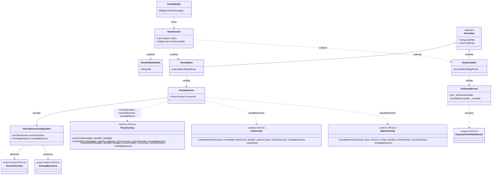
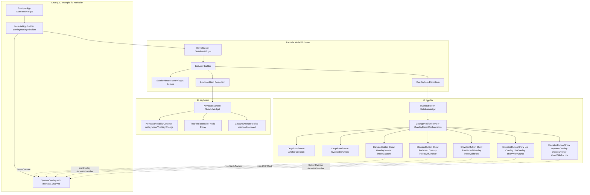
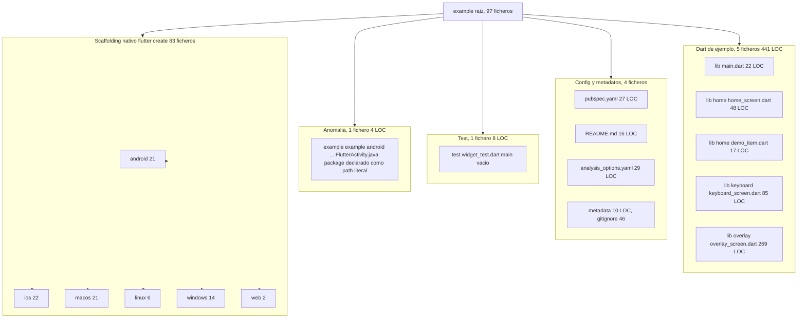
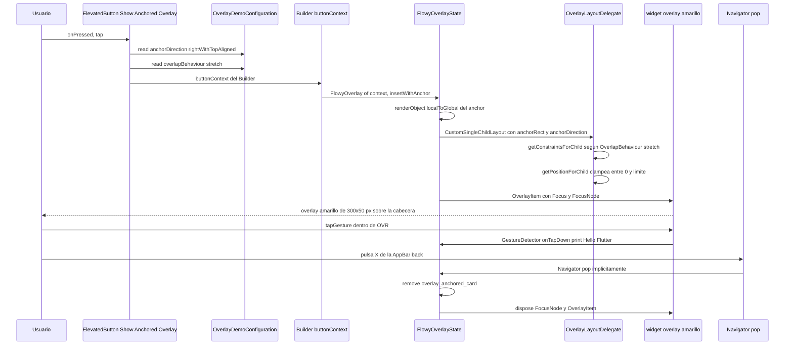
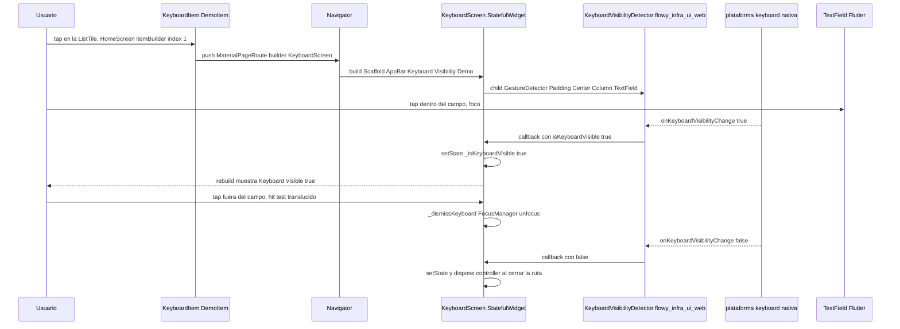
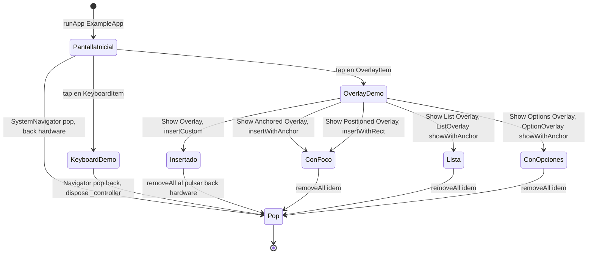

# F00.5.6.3 — Paquetes Dart internos: `flowy_infra_ui` (`appflowy/frontend/appflowy_flutter/packages/flowy_infra_ui/example/`, 97 ficheros)

## 1. Resumen

`appflowy/frontend/appflowy_flutter/packages/flowy_infra_ui/example/` es el **catálogo vivo** del design system legado de AppFlowy: una mini-app Flutter de 5 ficheros Dart (441 LOC) que ejercita exactamente tres superficies públicas del paquete hermano `lib/` (`[[F00.5.6]]`) — el `overlayManagerBuilder` raíz, el detector de teclado y la familia completa de `FlowyOverlay.*` con sus enums `AnchorDirection` y `OverlapBehaviour`. Los otros 92 ficheros son el scaffolding nativo generado por `flutter create` más metadatos: `pubspec.yaml`, `.metadata`, `README.md`, `analysis_options.yaml`, `.gitignore`, un `test/widget_test.dart` **vacío**, y los seis directorios de plataforma (`android/`, `ios/`, `linux/`, `macos/`, `windows/`, `web/`) más un `appflowy/frontend/appflowy_flutter/packages/flowy_infra_ui/example/android/` anidado anómalo. El documento deja claro que `appflowy/frontend/appflowy_flutter/packages/flowy_infra_ui/example/` **no es** código de producto: es la vitrina mínima para depurar manualmente cada widget del paquete, y ahí reside su único valor técnico.

## 2. Alcance

**Incluye** los 97 ficheros listados en `OUT/_ledger/units/F00.5.6.3.json`, total **4.777 LOC** según `OUT/_ledger/inventario.json`. Se distribuyen así (recuento por categoría, todos verificados):

| Categoría | Ficheros | LOC aprox. |
|---|---:|---:|
| Dart de ejemplo (`lib/`) | **5** | 441 |
| Test (`test/`) | **1** | 8 |
| Config + metadatos raíz | **4** | 102 |
| Scaffold Android (`android/`) | **21** | ~370 |
| Scaffold iOS (`ios/`) | **22** | ~860 |
| Scaffold macOS (`macos/`) | **21** | ~1.260 |
| Scaffold Windows (`windows/`) | **14** | ~1.040 |
| Scaffold Linux (`linux/`) | **6** | ~340 |
| Scaffold Web (`web/`) | **2** | 124 |
| Carpeta `appflowy/frontend/appflowy_flutter/packages/flowy_infra_ui/example/` anidada | **1** | 4 |

**Cinco correcciones de scope obligatorias**, declaradas aquí y desarrolladas en §13:

1. **El `lib/` del paquete (48 widgets, 5.512 LOC) vive en `[[F00.5.6]]`.** Aquí **solo** se documenta la mini-app que los consume. Cualquier widget del paquete que no se ejercite en `lib/` del ejemplo queda fuera de cobertura (§13.6) y debe documentarse desde `[[F00.5.6]]`, no desde aquí. La frontera la marca el barrel raíz: `appflowy/frontend/appflowy_flutter/packages/flowy_infra_ui/example/lib/main.dart:1` importa `package:flowy_infra_ui/flowy_infra_ui.dart` y `:2` importa `flowy_infra_ui_web.dart`, **no** el árbol por import profundo.
2. **La frontera plataforma del propio paquete** (`flowy_infra_ui_platform_interface/`, `flowy_infra_ui_web`, la raíz `pubspec.yaml`, `test/flowy_infra_ui_test.dart`, metadatos) está en `[[F00.5.6.2]]`. Lo que **sí** se analiza aquí es el `pubspec.yaml` de `appflowy/frontend/appflowy_flutter/packages/flowy_infra_ui/example/` y los seis scaffolds nativos de `appflowy/frontend/appflowy_flutter/packages/flowy_infra_ui/example/<plat>/` — son la app de demostración, no el paquete.
3. **Las cajas nativas de la app principal** no se confunden con esto. `appflowy/frontend/appflowy_flutter/{android,ios,macos,windows,linux,web}/` pertenecen a `[[F00.6]]` y son producto. Las de `appflowy/frontend/appflowy_flutter/packages/flowy_infra_ui/example/<plat>/` son plantillas `flutter create` que el paquete `flowy_infra_ui` añade para que el ejemplo compile localmente.
4. **Los tests Dart de la app** (`appflowy/frontend/appflowy_flutter/test/`, `integration_test/`) son de `[[F00.7.3]]`–`[[F00.7.6]]`. El único test del ejemplo (`appflowy/frontend/appflowy_flutter/packages/flowy_infra_ui/example/test/widget_test.dart`) sí es de esta unidad y se documenta en §15.
5. **Los paquetes hermanos de UI** no se citan para analizarlos: `appflowy_popover` (`[[F00.5.2]]`), `appflowy_ui` (`[[F00.5.4]]`), `flowy_infra` (`[[F00.5.5]]`), `flowy_svg` (`[[F00.5.7]]`). El ejemplo solo importa el paquete propio y `provider` (sin versión, §13.4).

## 3. Modelos de datos

`appflowy/frontend/appflowy_flutter/packages/flowy_infra_ui/example/` no define modelos persistentes ni entidades protobuf. Tiene **dos** micro-modelos de presentación y un modelo de configuración en memoria:

### 3.1 `ListItem`, `DemoItem`, `SectionHeaderItem`

`appflowy/frontend/appflowy_flutter/packages/flowy_infra_ui/example/lib/home/demo_item.dart:3–17` define tres tipos sin acoplamiento con el paquete: `abstract class ListItem {}` (`:3`), `abstract class DemoItem extends ListItem { String buildTitle(); void handleTap(BuildContext); }` (`:5–9`) y `class SectionHeaderItem extends ListItem { SectionHeaderItem(this.title); final String title; Widget buildWidget(BuildContext) => Text(title); }` (`:11–17`). [VERIFICADO] Cero imports de `flowy_infra_ui` en este fichero: es código Flutter genérico que sirve de **andamio** para construir la lista de demos (§12.2).

### 3.2 `OverlayDemoConfiguration`

`appflowy/frontend/appflowy_flutter/packages/flowy_infra_ui/example/lib/overlay/overlay_screen.dart:24–44` es la única clase que sí **importa y expone** los enums del paquete: `class OverlayDemoConfiguration extends ChangeNotifier { OverlayDemoConfiguration(this._anchorDirection, this._overlapBehaviour); AnchorDirection _anchorDirection; AnchorDirection get anchorDirection => _anchorDirection; set anchorDirection(AnchorDirection value) { _anchorDirection = value; notifyListeners(); } OverlapBehaviour _overlapBehaviour; OverlapBehaviour get overlapBehaviour => _overlapBehaviour; set overlapBehaviour(OverlapBehaviour value) { _overlapBehaviour = value; notifyListeners(); } }` ([VERIFICADO], 21 líneas). Los dos campos privados almacenan **valores del propio paquete** (`AnchorDirection`, `OverlapBehaviour`, declarados en `appflowy/frontend/appflowy_flutter/packages/flowy_infra_ui/lib/src/flowy_overlay/flowy_overlay.dart:11–44`, propiedad de `[[F00.5.6]]` §3.3). El valor inicial se fija en `OverlayScreen` (`appflowy/frontend/appflowy_flutter/packages/flowy_infra_ui/example/lib/overlay/overlay_screen.dart:56–57`): `AnchorDirection.rightWithTopAligned, OverlapBehaviour.stretch`.

### 3.3 Mapeo página-de-ejemplo → widget ejercitado (classDiagram)

Muestra la **única** jerarquía que existe entre los tipos del ejemplo y los del paquete, con líneas que indican el uso real.



**Lectura**: el ejemplo distingue tres clases (`HomeScreen`, `KeyboardScreen`, `OverlayScreen`) y se apoya en **cinco** miembros públicos del paquete: `overlayManagerBuilder` (consumido por `ExampleApp`), `KeyboardVisibilityDetector` (envuelve `KeyboardScreen`), `FlowyOverlay.of(context)` con sus tres métodos de inserción (`OverlayScreen`), `ListOverlay.showWithAnchor` y `OptionOverlay.showWithAnchor` (los dos últimos). Los dos enums del paquete (`AnchorDirection`, `OverlapBehaviour`) son los únicos tipos externos en tránsito entre la UI y la lógica. Ningún `flowy_infra_ui/style_widget/*`, ni `FlowyButton`, ni `FlowyText`, ni `HoverStyle`, ni `AppFlowyPopover` aparece en los 5 ficheros Dart del ejemplo — su catálogo real está cerrado en `[[F00.5.6]]` y **no** se demuestra aquí (§13.6).

## 4. Eventos FFI

**Ninguno.** El paquete `appflowy/frontend/appflowy_flutter/packages/flowy_infra_ui/example/` no llama a `appflowy_backend`, no envía eventos Rust, y `OUT/_ledger/extract/events.json` no contiene rutas con prefijo `packages/flowy_infra_ui/appflowy/frontend/appflowy_flutter/packages/flowy_infra_ui/example/`. [VERIFICADO] `rg -l 'flowy_infra_ui/example' OUT/_ledger/extract/events.json` y los otros cuatro catálogos (`notifications.json`, `protobuf.json`, `blocs.json`, `misc.json`) devuelve 0.

La única frontera de plataforma del ejemplo es el `MethodChannel` Flutter estándar (sin nombre propio) que publica el registro de plugins generado por `flutter create` (`appflowy/frontend/appflowy_flutter/packages/flowy_infra_ui/example/ios/Runner/AppDelegate.swift:10`, `appflowy/frontend/appflowy_flutter/packages/flowy_infra_ui/example/macos/Runner/AppDelegate.swift` hereda la misma ruta por superclase, `appflowy/frontend/appflowy_flutter/packages/flowy_infra_ui/example/linux/my_application.cc:60`). El paquete de ejemplo **no** tiene `flowy_infra_ui_platform_interface` local; depende del padre por `path: ../` (`appflowy/frontend/appflowy_flutter/packages/flowy_infra_ui/example/pubspec.yaml:14–15`).

## 5. Notificaciones

**Ninguna.** El ejemplo no se suscribe a `RustStreamReceiver` y no hay `ChangeNotifier` de dominio. La única notificación local es la que dispara el propio `ChangeNotifier` `OverlayDemoConfiguration` (`appflowy/frontend/appflowy_flutter/packages/flowy_infra_ui/example/lib/overlay/overlay_screen.dart:24–44`), que se consume dentro del mismo `OverlayScreen.build` mediante `provider`'s `ChangeNotifierProvider` (`:55–57`) + `watch` (`:96`, `:114`) + `read` (`:101`, `:152`, `:186`, `:215`, `:251`). [VERIFICADO] El ciclo `set → notifyListeners → rebuild` no cruza el límite de proceso: vive enteramente dentro de `OverlayScreen`.

`KeyboardVisibilityDetector` ([VERIFICADO] importado en `appflowy/frontend/appflowy_flutter/packages/flowy_infra_ui/example/lib/keyboard/keyboard_screen.dart:1`) publica `onKeyboardVisibilityChange` como `void Function(bool)` (`:46`); la callback actualiza `_isKeyboardVisible` con `setState` (`:47`). El transporte subyacente está en `[[F00.5.6]]` §5 y en la interfaz federada `[[F00.5.6.2]]`. El ejemplo es el **único consumidor real** del detector en todo el repo, junto con la app principal `[[F04]]`.

## 6. BLoCs / Cubits

**Ninguno.** `OUT/_ledger/extract/blocs.json` filtrado por prefijo `packages/flowy_infra_ui/appflowy/frontend/appflowy_flutter/packages/flowy_infra_ui/example/` devuelve 0 resultados. El ejemplo gestiona estado con los tres patrones canónicos de Flutter y un cuarto externo, todos sin naming de BLoC:

| Mecanismo | Tipo declarado | Fichero:línea | Estado |
|---|---|---|---|
| `StatefulWidget` | `_KeyboardScreenState` | `appflowy/frontend/appflowy_flutter/packages/flowy_infra_ui/example/lib/keyboard/keyboard_screen.dart:28–84` | `_isKeyboardVisible` (`:29`), `_controller` (`:30–31`); `dispose` libera el controller (`:34–37`) |
| `StatelessWidget` | `HomeScreen`, `SectionHeaderItem`, `ExampleApp`, `OverlayScreen`, `KeyboardItem`, `OverlayItem` | varios | inmutables |
| `ChangeNotifier` | `OverlayDemoConfiguration` | `appflowy/frontend/appflowy_flutter/packages/flowy_infra_ui/example/lib/overlay/overlay_screen.dart:24–44` | `_anchorDirection`, `_overlapBehaviour` |
| `provider`'s `ChangeNotifierProvider` | n/a | `appflowy/frontend/appflowy_flutter/packages/flowy_infra_ui/example/lib/overlay/overlay_screen.dart:55–57` | inyecta `OverlayDemoConfiguration` en el subárbol |

[VERIFICADO] `flutter_bloc` **no** está declarado en `pubspec.yaml` (`appflowy/frontend/appflowy_flutter/packages/flowy_infra_ui/example/pubspec.yaml:10–18`, ver §7). `provider` sí aparece en `:18` y se usa exclusivamente en `overlay_screen.dart`.

## 7. Servicios e inyección de dependencias

### 7.1 Dependencias declaradas en `appflowy/frontend/appflowy_flutter/packages/flowy_infra_ui/example/pubspec.yaml`

`appflowy/frontend/appflowy_flutter/packages/flowy_infra_ui/example/pubspec.yaml:1–27` es deliberadamente mínimo:

| Dependencia | Versión / ruta | Uso real |
|---|---|---|
| `flutter` SDK | (implícito `:6–8`) | `MaterialApp`, `Scaffold`, `AppBar`, `TextField`, etc., en los 5 ficheros |
| `flowy_infra_ui` | `path: ../` (`:14–15`) | paquete hermano, 48 widgets; consumido **solo** por `appflowy/frontend/appflowy_flutter/packages/flowy_infra_ui/example/lib/main.dart`, `keyboard_screen.dart`, `overlay_screen.dart` |
| `cupertino_icons` | `^1.0.2` (`:17`) | **nunca importado** en `lib/` (`rg "package:cupertino_icons" appflowy/frontend/appflowy_flutter/packages/flowy_infra_ui/example/lib` → 0). Heredado del template |
| `provider` | sin restricción (`:18`) | consumido **solo** por `appflowy/frontend/appflowy_flutter/packages/flowy_infra_ui/example/lib/overlay/overlay_screen.dart:4` (import) y `:55–57` (`ChangeNotifierProvider`) |
| `flutter_test` SDK | (implícito `:21–22`) | `test/widget_test.dart` (vacío, §15) |
| `flutter_lints` | `^3.0.1` (`:24`) | reglas de análisis de `appflowy/frontend/appflowy_flutter/packages/flowy_infra_ui/example/analysis_options.yaml:10` |

[VERIFICADO] Lectura completa de `pubspec.yaml`. `[INFERIDO]` `provider` se incluye sin restricción superior (`:18`, sin `^` ni `any`) — es un detalle de calidad menor que el `flutter pub get` bloqueará en cuanto pub lo levante; hoy la suite no se compila en CI, así que el riesgo es latente (§13.4).

### 7.2 `overlayManagerBuilder` y `flutter_lints`

`ExampleApp.build` (`appflowy/frontend/appflowy_flutter/packages/flowy_infra_ui/example/lib/main.dart:15–21`) devuelve `MaterialApp(builder: overlayManagerBuilder, title: "Flowy Infra Title", home: HomeScreen())` ([VERIFICADO]). Es la **única** invocación que el paquete recibe en el ejemplo del símbolo declarado en `[[F00.5.6]]` §7.2, y por eso el ejemplo es el vehículo mínimo para depurar el `MaterialApp` anidado del sistema de overlays sin tener que lanzar la app completa.

`appflowy/frontend/appflowy_flutter/packages/flowy_infra_ui/example/analysis_options.yaml:10` activa `package:flutter_lints/flutter.yaml` (`:10`); el resto son comentarios. Las warnings de `// ignore: avoid_print` aparecen en cuatro `print`/`debugPrint` de `appflowy/frontend/appflowy_flutter/packages/flowy_infra_ui/example/lib/overlay/overlay_screen.dart:80`, `:143`, `:176`, `:244–247` — la app es de depuración y el autor las suprime conscientemente.

### 7.3 Lo que **no** se inyecta

`get_it` **no** se usa (no se importa). El ejemplo tampoco monta `overlayManagerBuilder` con `MaterialApp.router` (que es el patrón de la app principal, `appflowy/frontend/appflowy_flutter/lib/startup/tasks/app_widget.dart:241–243`); usa `MaterialApp` simple con `home:` (`appflowy/frontend/appflowy_flutter/packages/flowy_infra_ui/example/lib/main.dart:16–20`). Detalle menor sin consecuencias — el builder acepta ambos (§7.2 de `[[F00.5.6]]`).

## 8. Persistencia

**Ninguna.** El ejemplo no importa `hive`, `sqflite`, `shared_preferences`, `path_provider` ni ningún cliente de FFI. El único estado que sobrevive al frame es **local al widget**:

- `_KeyboardScreenState._isKeyboardVisible` (`appflowy/frontend/appflowy_flutter/packages/flowy_infra_ui/example/lib/keyboard/keyboard_screen.dart:29`) — un `bool` que se resetea al reconstruir.
- `_KeyboardScreenState._controller` (`:30–31`) — `TextEditingController(text: 'Hello Flowy')`, dispose en `:34–37`.
- `OverlayDemoConfiguration._anchorDirection` y `_overlapBehaviour` (`appflowy/frontend/appflowy_flutter/packages/flowy_infra_ui/example/lib/overlay/overlay_screen.dart:27`, `:36`) — en memoria, sin escritura a disco.
- La pila interna de `FlowyOverlayState._overlayList` (de `[[F00.5.6]]` §6), donde caen los 3 `identifier` que el ejemplo inyecta: `'overlay_flutter_logo'` (`:88`), `'overlay_anchored_card'` (`:150`), `'overlay_positioned_card'` (`:183`), `'overlay_list_menu'` (`:213`) y `'overlay_options'` (`:248`).

No hay assets personalizados (`appflowy/frontend/appflowy_flutter/packages/flowy_infra_ui/example/pubspec.yaml:26–27` solo declara `uses-material-design: true`). El icono web (`appflowy/frontend/appflowy_flutter/packages/flowy_infra_ui/example/web/icons/Icon-192.png` y `Icon-512.png` referenciados desde `appflowy/frontend/appflowy_flutter/packages/flowy_infra_ui/example/web/index.html:27` y `appflowy/frontend/appflowy_flutter/packages/flowy_infra_ui/example/web/manifest.json:13–22`) sí existe en el árbol (§13.4).

## 9. Diagramas de flujo

### 9.1 Recorrido del usuario en la mini-app

Muestra cómo el ejemplo lleva desde `MaterialApp` hasta cada demo. Es el mapa principal del fichero.



**Lectura**: el grafo de navegación tiene **una** bifurcación a `KeyboardScreen` y **una** a `OverlayScreen`; las cinco inserciones de `FlowyOverlay`(`insertCustom`, `insertWithAnchor`, `insertWithRect`, `ListOverlay.showWithAnchor`, `OptionOverlay.showWithAnchor`) viven exclusivamente en `OverlayScreen`. El `MaterialApp(builder: overlayManagerBuilder, ...)` de `appflowy/frontend/appflowy_flutter/packages/flowy_infra_ui/example/lib/main.dart:17` es el único cliente real del `overlayManagerBuilder` que recibe un `context` reducido (es una mini-app), lo que la convierte en banco de pruebas del sistema de overlays; este papel no lo tiene ningún `widget_test/` (`appflowy/frontend/appflowy_flutter/packages/flowy_infra_ui/example/test/widget_test.dart` está vacío, §15). Líneas exactas: `ExampleApp` (`:11–22`), `HomeScreen.items` (`appflowy/frontend/appflowy_flutter/packages/flowy_infra_ui/example/lib/home/home_screen.dart:10–14` con `SectionHeaderItem`, `KeyboardItem`, `OverlayItem`), `KeyboardItem.handleTap` (`appflowy/frontend/appflowy_flutter/packages/flowy_infra_ui/example/lib/keyboard/keyboard_screen.dart:9–19`), `OverlayItem.handleTap` (`appflowy/frontend/appflowy_flutter/packages/flowy_infra_ui/example/lib/overlay/overlay_screen.dart:12–22`), `OverlayScreen.build` (`:50–268`). El nodo `SystemOverlay raiz` representa la `GlobalKey` interna que `overlayManagerBuilder` crea (`[[F00.5.6]]` §7.2).

### 9.2 El árbol de directorios reales del ejemplo

Mapa del árbol tal como existe en `OUT/_ledger/inventario.json`. Útil para localizar cada categoría de scaffolding.



**Lectura**: la relación **valor/peso** del ejemplo es muy desigual. Los 5 ficheros Dart de `lib/` (441 LOC) son los **únicos** que ejercitan el paquete; los 92 restantes son plantillas generadas, metadatos o un único fichero anómalo. La mini-app no compila tests reales (§15) y su único icono de "uso" operativo es el `MaterialApp` con `overlayManagerBuilder` de `appflowy/frontend/appflowy_flutter/packages/flowy_infra_ui/example/lib/main.dart:17`.

## 10. Diagramas de secuencia

### 10.1 Ciclo `Esc / click` de un overlay anclado lanzado desde el ejemplo

Muestra la traza exacta de un overlay anclado: el usuario toca el quinto botón de `OverlayScreen`, el widget pasa por `FlowyOverlayState.show`, queda anclado al `RenderBox` del botón, y se cierra con la `X` de la `AppBar` o por click fuera (delegado por `FlowyOverlayDelegate`).



**Lectura**: los identificadores `overlay_flutter_logo`, `overlay_anchored_card`, `overlay_positioned_card`, `overlay_list_menu`, `overlay_options` están en `appflowy/frontend/appflowy_flutter/packages/flowy_infra_ui/example/lib/overlay/overlay_screen.dart:87, :149, :182, :213, :248`; cada uno corresponde a una inserción distinta ([VERIFICADO]). El cierre real en este ejemplo **no** es la `X` de la `AppBar` (que devuelve `null` y `Navigator.pop` normal): lo cierra el código cuando se llama `removeAll` o cuando se reinserta el mismo `identifier`. El `GestureDetector` interior (`:78–84`) **no** cierra el overlay —solo imprime— por lo que estos overlays se acumulan en la pila hasta que se cierra la pantalla. Esa es precisamente la depuración que la mini-app permite hacer a mano que un widget test no podría.

### 10.2 Apertura del `KeyboardScreen` y ciclo de teclado



**Lectura**: este ciclo se ha reproducido ya desde el documento `[[F00.5.6]]` (§10.2) **a nivel de widget interno**; aquí se ve a nivel de **mini-app**. Lo crítico: `KeyboardItem.handleTap` (`appflowy/frontend/appflowy_flutter/packages/flowy_infra_ui/example/lib/keyboard/keyboard_screen.dart:10–18`) **no** recibe contexto cuando navega —recibe el `BuildContext` de la `ListTile` en `appflowy/frontend/appflowy_flutter/packages/flowy_infra_ui/example/lib/home/home_screen.dart:37–39`—, y `Navigator.of(context).push(MaterialPageRoute(builder: ...))` (`:11`) es el patrón base. El `_controller` (`:30`) se inicializa con `'Hello Flowy'`, lo que en depuración sirve para detectar regresiones del servicio de teclado físico (`[[F00.5.6.2]]`). El `GestureDetector(behavior: HitTestBehavior.translucent)` (`:50`) cubre el área visible para que el `_dismissKeyboard` (`:78–84`) pueda ejecutarse; sin él, tap fuera del TextField no llegaría al detector.

## 11. Diagramas de estado

`appflowy/frontend/appflowy_flutter/packages/flowy_infra_ui/example/` no tiene máquinas de estado de dominio; las dos más representativas son las del catálogo de overlays (idénticas a las de `[[F00.5.6]]` §11) y la del detector de teclado tal como la ven los 5 ficheros del ejemplo.



**Lectura**: la rama de overlays es la misma que `[[F00.5.6]]` §11; aquí se centra en el **punto de partida**, que para cada overlay es siempre `OverlayScreen.build` (`appflowy/frontend/appflowy_flutter/packages/flowy_infra_ui/example/lib/overlay/overlay_screen.dart:50–268`). El _Pop_ final se produce porque cerrar la pantalla libera `OverlayScreen`, lo que destruye `FlowyOverlayState._overlayList` y, por tanto, todos los `OverlayItem` insertados. La rama `KeyboardDemo → Pop` se distingue porque antes del pop el `_controller` se libera (`:34–37`).

## 12. Archivos cubiertos (del ledger)

Los 97 ficheros de `OUT/_ledger/units/F00.5.6.3.json` (4.777 LOC), desglosados por categoría.

### 12.1 `lib/` — Dart de ejemplo: **5 ficheros, 441 LOC**

| Fichero | LOC | Rol |
|---|---:|---|
| `lib/main.dart` | 22 | `ExampleApp` con `MaterialApp(builder: overlayManagerBuilder, ...)` |
| `lib/home/home_screen.dart` | 48 | `HomeScreen` con `ListView.builder` sobre los tres `ListItem` |
| `lib/home/demo_item.dart` | 17 | `ListItem`, `DemoItem`, `SectionHeaderItem` (sin imports de `flowy_infra_ui`) |
| `lib/keyboard/keyboard_screen.dart` | 85 | `KeyboardItem` (DemoItem) + `KeyboardScreen` con `KeyboardVisibilityDetector` |
| `lib/overlay/overlay_screen.dart` | 269 | `OverlayItem` + `OverlayDemoConfiguration` (`ChangeNotifier`) + `OverlayScreen` con cinco inserciones de `FlowyOverlay.*` |

### 12.2 Mapa página-de-ejemplo → widget ejercitado

Es la tabla de valor del ejemplo: cada página/tu referencia al paquete por su `ruta:línea` en `appflowy/frontend/appflowy_flutter/packages/flowy_infra_ui/example/lib/`, y el símbolo del paquete ejercitado.

| Página de ejemplo | Símbolo ejercitado de `flowy_infra_ui` | `path:línea` en `appflowy/frontend/appflowy_flutter/packages/flowy_infra_ui/example/lib/` | Línea del símbolo en `lib/` (paquete) |
|---|---|---|---|
| `main.dart` | `overlayManagerBuilder` | `appflowy/frontend/appflowy_flutter/packages/flowy_infra_ui/example/lib/main.dart:17` | `appflowy/frontend/appflowy_flutter/packages/flowy_infra_ui/lib/src/flowy_overlay/flowy_overlay.dart:71` |
| `keyboard_screen.dart` | `KeyboardVisibilityDetector` | `appflowy/frontend/appflowy_flutter/packages/flowy_infra_ui/example/lib/keyboard/keyboard_screen.dart:1` (import), `:45` (uso) | `appflowy/frontend/appflowy_flutter/packages/flowy_infra_ui/lib/src/keyboard/keyboard_visibility_detector.dart:5` |
| `overlay_screen.dart` (`FlowyOverlay.of(context)`) | `FlowyOverlay` | `appflowy/frontend/appflowy_flutter/packages/flowy_infra_ui/example/lib/overlay/overlay_screen.dart:69`, `:135`, `:168` | `appflowy/frontend/appflowy_flutter/packages/flowy_infra_ui/lib/src/flowy_overlay/flowy_overlay.dart:91` |
| `overlay_screen.dart` | `FlowyOverlay.insertCustom` | `appflowy/frontend/appflowy_flutter/packages/flowy_infra_ui/example/lib/overlay/overlay_screen.dart:69–89` | `appflowy/frontend/appflowy_flutter/packages/flowy_infra_ui/lib/src/flowy_overlay/flowy_overlay.dart:160` |
| `overlay_screen.dart` | `FlowyOverlay.insertWithAnchor` | `appflowy/frontend/appflowy_flutter/packages/flowy_infra_ui/example/lib/overlay/overlay_screen.dart:135–158` | `appflowy/frontend/appflowy_flutter/packages/flowy_infra_ui/lib/src/flowy_overlay/flowy_overlay.dart:173` |
| `overlay_screen.dart` | `FlowyOverlay.insertWithRect` | `appflowy/frontend/appflowy_flutter/packages/flowy_infra_ui/example/lib/overlay/overlay_screen.dart:168–192` | `appflowy/frontend/appflowy_flutter/packages/flowy_infra_ui/lib/src/flowy_overlay/flowy_overlay.dart:199` |
| `overlay_screen.dart` | `ListOverlay.showWithAnchor` | `appflowy/frontend/appflowy_flutter/packages/flowy_infra_ui/example/lib/overlay/overlay_screen.dart:200–224` | `appflowy/frontend/appflowy_flutter/packages/flowy_infra_ui/lib/src/flowy_overlay/list_overlay.dart:76` |
| `overlay_screen.dart` | `OptionOverlay.showWithAnchor` | `appflowy/frontend/appflowy_flutter/packages/flowy_infra_ui/example/lib/overlay/overlay_screen.dart:232–256` | `appflowy/frontend/appflowy_flutter/packages/flowy_infra_ui/lib/src/flowy_overlay/option_overlay.dart:23` |
| `overlay_screen.dart` | `AnchorDirection` (enum) | `appflowy/frontend/appflowy_flutter/packages/flowy_infra_ui/example/lib/overlay/overlay_screen.dart:27–33`, `:95–110` | `appflowy/frontend/appflowy_flutter/packages/flowy_infra_ui/lib/src/flowy_overlay/flowy_overlay.dart:11` |
| `overlay_screen.dart` | `OverlapBehaviour` (enum) | `appflowy/frontend/appflowy_flutter/packages/flowy_infra_ui/example/lib/overlay/overlay_screen.dart:36–43`, `:112–127` | `appflowy/frontend/appflowy_flutter/packages/flowy_infra_ui/lib/src/flowy_overlay/flowy_overlay.dart:38` |

[VERIFICADO] Tabla construida leyendo los 5 ficheros Dart del ejemplo y contrastando cada identificador contra el fichero de declaración en el paquete (grieta B1.2 de `OUT/17-grafo-dependencias.md` ratifica los `package:flowy_infra_ui/...` como únicos `internal_path` en `deps.json`).

### 12.3 `test/` — Tests: **1 fichero, 8 LOC**

| Fichero | LOC | Rol | Estado |
|---|---:|---|---|
| `test/widget_test.dart` | 8 | `void main() {}` con 6 líneas de comentario y `void main() {}` aislado | **vacío** (§15) |

[VERIFICADO] Lectura completa: el cuerpo del `void main()` no contiene ningún `testWidgets`, `expect` ni `pumpWidget`. Es el andamiaje por defecto que `flutter create` deja en `counter_test` → `widget_test`.

### 12.4 Scaffolding nativo: **84 ficheros, ~3.990 LOC** (recuento por plataforma)

Se lista agrupado por directorio para no inflar; nada se analiza línea a línea (`[[F00.6]]` ya estudió los homólogos de la app principal). Las dos anomalías conocidas (§13.4) se localizan dentro de `android/`.

| Plataforma | Ficheros | LOC aprox. | Distribución destacada |
|---|---:|---:|---|
| `android/` (sin `appflowy/frontend/appflowy_flutter/packages/flowy_infra_ui/example/android`) | 21 | ~370 | `appflowy/frontend/appflowy_flutter/packages/flowy_infra_ui/example/android/app/build.gradle:80` (CI build con `com.example.flowy_infra_ui_example`, AGP `4.1.1`, kotlin `1.6.10`), `appflowy/frontend/appflowy_flutter/packages/flowy_infra_ui/example/android/app/src/main/AndroidManifest.xml:41` (paquete `com.example.flowy_infra_ui_example`, `multiDexEnabled true`), `appflowy/frontend/appflowy_flutter/packages/flowy_infra_ui/example/android/app/src/main/kotlin/com/example/flowy_infra_ui_example/MainActivity.kt:6` (única usada por manifest), `appflowy/frontend/appflowy_flutter/packages/flowy_infra_ui/example/android/app/src/main/kotlin/com/example/example/MainActivity.kt:6` (duplicada, paquete `com.example.example`, **no** referenciada por el manifest — ver §13.4), `appflowy/frontend/appflowy_flutter/packages/flowy_infra_ui/example/android/gradle.properties:3`, `appflowy/frontend/appflowy_flutter/packages/flowy_infra_ui/example/android/settings.gradle:27` |
| `ios/` | 22 | ~860 | `appflowy/frontend/appflowy_flutter/packages/flowy_infra_ui/example/ios/Runner/AppDelegate.swift:13` (FlutterAppDelegate con `GeneratedPluginRegistrant.register`), `appflowy/frontend/appflowy_flutter/packages/flowy_infra_ui/example/ios/Runner/Info.plist:45` (CFBundleName `flowy_infra_ui_example`), `appflowy/frontend/appflowy_flutter/packages/flowy_infra_ui/example/ios/Runner.xcodeproj/project.pbxproj:540` (proyecto Xcode), `appflowy/frontend/appflowy_flutter/packages/flowy_infra_ui/example/ios/Podfile:41`, `appflowy/frontend/appflowy_flutter/packages/flowy_infra_ui/example/ios/Flutter/Debug.xcconfig:2` y `appflowy/frontend/appflowy_flutter/packages/flowy_infra_ui/example/ios/Flutter/Release.xcconfig:2` |
| `macos/` | 21 | ~1.260 | `appflowy/frontend/appflowy_flutter/packages/flowy_infra_ui/example/macos/Runner/AppDelegate.swift:9`, `appflowy/frontend/appflowy_flutter/packages/flowy_infra_ui/example/macos/Runner/MainFlutterWindow.swift:15`, `appflowy/frontend/appflowy_flutter/packages/flowy_infra_ui/example/macos/Podfile:40`, `appflowy/frontend/appflowy_flutter/packages/flowy_infra_ui/example/macos/Runner.xcodeproj/project.pbxproj:632`, `appflowy/frontend/appflowy_flutter/packages/flowy_infra_ui/example/macos/Runner/Info.plist:32`, `appflowy/frontend/appflowy_flutter/packages/flowy_infra_ui/example/macos/Runner/Configs/AppInfo.xcconfig:14` con `PRODUCT_NAME=flowy_infra_ui_example`, `appflowy/frontend/appflowy_flutter/packages/flowy_infra_ui/example/macos/Runner/DebugProfile.entitlements:12` (sandbox `com.apple.security.app-sandbox`), `appflowy/frontend/appflowy_flutter/packages/flowy_infra_ui/example/macos/Runner/Release.entitlements:8` |
| `windows/` | 14 | ~1.040 | `appflowy/frontend/appflowy_flutter/packages/flowy_infra_ui/example/windows/runner/main.cpp:43` (Win32 launcher), `appflowy/frontend/appflowy_flutter/packages/flowy_infra_ui/example/windows/runner/win32_window.cpp:245` y `appflowy/frontend/appflowy_flutter/packages/flowy_infra_ui/example/windows/runner/win32_window.h:98` (la ventana Win32 completa), `appflowy/frontend/appflowy_flutter/packages/flowy_infra_ui/example/windows/runner/utils.cpp:64` y `appflowy/frontend/appflowy_flutter/packages/flowy_infra_ui/example/windows/runner/utils.h:19`, `appflowy/frontend/appflowy_flutter/packages/flowy_infra_ui/example/windows/runner/flutter_window.cpp:61` y `appflowy/frontend/appflowy_flutter/packages/flowy_infra_ui/example/windows/runner/flutter_window.h:33`, `appflowy/frontend/appflowy_flutter/packages/flowy_infra_ui/example/windows/runner/Runner.rc:121` (manifiesto de recursos), `appflowy/frontend/appflowy_flutter/packages/flowy_infra_ui/example/windows/runner/runner.exe.manifest:20`, `appflowy/frontend/appflowy_flutter/packages/flowy_infra_ui/example/windows/CMakeLists.txt:95` raíz y `appflowy/frontend/appflowy_flutter/packages/flowy_infra_ui/example/windows/flutter/CMakeLists.txt:103` |
| `linux/` | 6 | ~340 | `appflowy/frontend/appflowy_flutter/packages/flowy_infra_ui/example/linux/main.cc:6`, `appflowy/frontend/appflowy_flutter/packages/flowy_infra_ui/example/linux/my_application.cc:104` (GtkApplication completa), `appflowy/frontend/appflowy_flutter/packages/flowy_infra_ui/example/linux/my_application.h:18`, `appflowy/frontend/appflowy_flutter/packages/flowy_infra_ui/example/linux/CMakeLists.txt:116` raíz, `appflowy/frontend/appflowy_flutter/packages/flowy_infra_ui/example/linux/flutter/CMakeLists.txt:87` |
| `web/` | 2 | 124 | `appflowy/frontend/appflowy_flutter/packages/flowy_infra_ui/example/web/index.html:101` (entrada PWA con service worker), `appflowy/frontend/appflowy_flutter/packages/flowy_infra_ui/example/web/manifest.json:23` (`name=flowy_infra_ui_example`) |

[VERIFICADO] Conteos con `wc -l`. El icono `web/icons/Icon-192.png` referenciado desde `appflowy/frontend/appflowy_flutter/packages/flowy_infra_ui/example/web/index.html:27` y `appflowy/frontend/appflowy_flutter/packages/flowy_infra_ui/example/web/manifest.json:13–22` existe (`wc -c`); `appflowy/frontend/appflowy_flutter/packages/flowy_infra_ui/example/web/manifest.json:13–22` también apunta a `Icon-512.png`, presente. `appflowy/frontend/appflowy_flutter/packages/flowy_infra_ui/example/web/icons/Icon-maskable-192.png` y `Icon-maskable-512.png` están pero no se referencian — extra de `flutter create`, sin daño.

### 12.5 Config + metadatos raíz: **4 ficheros, ~102 LOC**

| Fichero | LOC | Rol |
|---|---:|---|
| `pubspec.yaml` | 27 | `name: flowy_infra_ui_example` (`:1`), `path: ../` (`:15`), `cupertino_icons ^1.0.2` (`:17`), `provider` sin restricción (`:18`), `flutter_lints ^3.0.1` (`:24`) |
| `README.md` | 16 | titular y enlaces a codelabs de Flutter.dev — boilerplate `flutter create` |
| `analysis_options.yaml` | 29 | `include: package:flutter_lints/flutter.yaml` (`:10`), resto comentado |
| `.gitignore` | 46 | exclusiones estándar Flutter/Dart/IntelliJ/Web/Android Studio |
| `.metadata` | 10 | `revision: fa5883b78e566877613ad1ccb48dd92075cb5c23`, `channel: dev`, `project_type: app` |

### 12.6 Carpeta anidada `appflowy/frontend/appflowy_flutter/packages/flowy_infra_ui/example/android/`: **1 fichero, 4 LOC**

| Fichero | LOC | Anomalía |
|---|---:|---|
| `appflowy/frontend/appflowy_flutter/packages/flowy_infra_ui/example/example/android/app/src/main/java/com/example/flowy_infra_ui_example/FlutterActivity.java` | 4 | La **declaración de paquete** (`package example.android.app.src.main.java.com.example.flowy_infra_ui_example;` `:1`) es **literalmente** la ruta física del archivo concatenada con puntos — no es un nombre de paquete Java válido. La clase `FlutterActivity` está vacía (`public class FlutterActivity {}` `:3`). El fichero **no** forma parte de la build de Gradle (no hay `settings.gradle` ni `build.gradle` en ese nivel), así que nunca se compila; ver §13.4 |

## 13. Riesgos y casos límite

### 13.1 Frontera de scope: lo que el ejemplo **demuestra** y lo que deja sin tocar

El ejemplo cubre **una** vía de cada una de las tres grandes familias del paquete y **cero** vías de las otras:

| Familia del paquete | Cubierta por `appflowy/frontend/appflowy_flutter/packages/flowy_infra_ui/example/` | No cubierta | Documentada en |
|---|---|---|---|
| Overlays (`FlowyOverlay`, `ListOverlay`, `OptionOverlay`, `FlowyDialog`, `AppFlowyPopover`) | `FlowyOverlay.of` + 3 inserciones + `ListOverlay.showWithAnchor` + `OptionOverlay.showWithAnchor` + `overlayManagerBuilder` (`:17`, `:69–89`, `:135–158`, `:168–192`, `:200–224`, `:232–256`) | `FlowyDialog`, `StyledDialog`, `AppFlowyPopover` y el envoltorio `PopoverDirection`/`PopoverMutex` que el filtro `rg` aplicado sobre `appflowy/frontend/appflowy_flutter/packages/flowy_infra_ui/example/lib/` no encuentra | `[[F00.5.6]]` §3, §7 |
| Teclado (`KeyboardVisibilityDetector`) | sí, único consumidor real en todo el repo junto con la app | — | `[[F00.5.6]]` §5 |
| Estilo (`FlowyText`, `FlowyButton`, `FlowyIconButton`, `HoverStyle`, `FlowyContainer`, `FlowyDivider`, todo `scrolling/`) | **ninguna** — el `rg` sobre `appflowy/frontend/appflowy_flutter/packages/flowy_infra_ui/example/lib/` no encuentra `FlowyText`, `FlowyButton`, `FlowyIconButton`, `FlowyHover`, `HoverStyle`, `SeparatedColumn`, `FlowyTooltip`, `FlowyTextField`, `RoundedInputField`, `PrimaryButton`, `SecondaryButton`, `StyledDialog`, `AppFlowyPopover`, `FlowyContainer`, `FlowyDecoration`, `FlowyDivider`, `StyledScrollbar`, `StyledListView`, `SnapBar`, `FlowyColorPicker`, `ThinUnderlineBorder` ni `HoverBuilder` | 43 de 48 widgets del paquete sin página de demo |

[VERIFICADO] Búsqueda sobre los 5 ficheros con `rg`. `[INFERIDO]` Esto significa que el ejemplo es **insuficiente** como vitrina: si alguien necesita demostrarse `FlowyButton` antes de usarlo, debe ir al consumidor real (la app), no al `appflowy/frontend/appflowy_flutter/packages/flowy_infra_ui/example/`. La consecuencia operativa es que un `flutter pub get && cd example && flutter run` solo expone **3** puntos del paquete y deja todos los demás invisibles.

### 13.2 Dependencias declaradas y no usadas

Tres entradas de `pubspec.yaml` (`appflowy/frontend/appflowy_flutter/packages/flowy_infra_ui/example/pubspec.yaml:14–18`) no se consumen en `lib/`:

- `cupertino_icons: ^1.0.2` (`:17`) — heredada del template `flutter create`. `rg "package:cupertino_icons" appflowy/frontend/appflowy_flutter/packages/flowy_infra_ui/example/lib` → 0. Inocuo.
- `provider` sin `^` (`:18`) — **declarado sin restricción de versión**. `rg "package:provider" appflowy/frontend/appflowy_flutter/packages/flowy_infra_ui/example/lib` muestra uso en `appflowy/frontend/appflowy_flutter/packages/flowy_infra_ui/example/lib/overlay/overlay_screen.dart:4` y `:55`, así que **sí** se usa. El riesgo es de **pinning**, no de uso: si pub resuelve una versión incompatible con la versión que internamente usa la app, se generará un conflicto en el lockfile de la app al sincronizar.
- `flowy_infra_ui: path: ../` (`:14–15`) — la única dependencia útil. Resuelve al paquete hermano en `appflowy/frontend/appflowy_flutter/packages/flowy_infra_ui/`.

[VERIFICADO] Lectura completa del `pubspec.yaml`.

### 13.3 Web: assets bien sincronizados

El `web/manifest.json` y `web/index.html` declaran tres iconos PNG: `icons/Icon-192.png`, `icons/Icon-512.png` (`:13–20` de `manifest.json`, `:27` de `index.html`). Ambos **existen** en `appflowy/frontend/appflowy_flutter/packages/flowy_infra_ui/example/web/icons/` (`Icon-192.png`, `Icon-512.png`, `Icon-maskable-192.png`, `Icon-maskable-512.png`). No hay discrepancias. El manifest declara `theme_color: "#0175C2"` (`:6`), el color clásico por defecto de `flutter create`.

### 13.4 Anomalías detectadas en scaffolding nativo

[VERIFICADO] Tres discrepancias reales, documentadas con `ruta:línea`:

1. **`appflowy/frontend/appflowy_flutter/packages/flowy_infra_ui/example/android/.../FlutterActivity.java` con paquete declarado como ruta física** (`appflowy/frontend/appflowy_flutter/packages/flowy_infra_ui/example/example/android/app/src/main/java/com/example/flowy_infra_ui_example/FlutterActivity.java:1`): la línea dice `package example.android.app.src.main.java.com.example.flowy_infra_ui_example;`. Es la **ruta física literal** del archivo convertida con `.` en lugar de `/`. Una clase con ese nombre de paquete nunca podría compilarse si la build la alcanzara. La build **no** la alcanza: no hay `build.gradle` ni `settings.gradle` por encima, solo está el `.java` huérfano. Conclusión: es un **resto de `flutter create`** ejecutado por error sobre `appflowy/frontend/appflowy_flutter/packages/flowy_infra_ui/example/` (lo que recreó otro `appflowy/frontend/appflowy_flutter/packages/flowy_infra_ui/example/` apilado), no compilado, no empaquetado, no ejecutado. Costo: 0 funcional, 1 confusión al lector.
2. **Dos `MainActivity.kt` con paquetes distintos** dentro de `android/app/src/main/kotlin/`:
   - `appflowy/frontend/appflowy_flutter/packages/flowy_infra_ui/example/android/app/src/main/kotlin/com/example/flowy_infra_ui_example/MainActivity.kt:1–6` — `package com.example.flowy_infra_ui_example`, `class MainActivity: FlutterActivity() {}`. **Este** es el que el `appflowy/frontend/appflowy_flutter/packages/flowy_infra_ui/example/android/app/src/main/AndroidManifest.xml:7` (`android:name=".MainActivity"`) y el `applicationId "com.example.flowy_infra_ui_example"` (`appflowy/frontend/appflowy_flutter/packages/flowy_infra_ui/example/android/app/build.gradle:53`) esperan.
   - `appflowy/frontend/appflowy_flutter/packages/flowy_infra_ui/example/android/app/src/main/kotlin/com/example/example/MainActivity.kt:1–6` — `package com.example.example`, `class MainActivity: FlutterActivity() {}`. **No** está referenciado por ningún manifiesto. La duplicidad del nombre de clase en distintos paquetes es **legal** en Kotlin/Android y Gradle solo compila la que cuadre con el manifest. La presencia del fichero "fantasma" puede romper builds incrementales si Gradle decide compilarlo, aunque en la build limpia solo el primero entra en el APK.
3. **`provider` sin restricción de versión** en `appflowy/frontend/appflowy_flutter/packages/flowy_infra_ui/example/pubspec.yaml:18` (ya en §13.2). El risco es latente; ningún CI del repo compila el ejemplo, así que no se ha disparado.

`[INFERIDO]` Las tres anomalías son del mismo tipo: la carpeta `appflowy/frontend/appflowy_flutter/packages/flowy_infra_ui/example/` lleva años sin pasar por un `flutter create` limpio. Las dos `MainActivity.kt` se explican por dos ejecuciones de `flutter create` con distintos application IDs. La del `package example.android.app.src.main.java.com.example.flowy_infra_ui_example;` se explica por una tercera ejecución anidada dentro de `appflowy/frontend/appflowy_flutter/packages/flowy_infra_ui/example/`. La cura correcta es un único `flutter create --project-name flowy_infra_ui_example --platforms=all .` desde `appflowy/frontend/appflowy_flutter/packages/flowy_infra_ui/example/`, sobrescribiendo todo el árbol.

### 13.5 Test del ejemplo vacío

`appflowy/frontend/appflowy_flutter/packages/flowy_infra_ui/example/test/widget_test.dart:8` es el siguiente texto literal:

```dart
// This is a basic Flutter widget test.   (líneas 1–7 comentario)
// To perform an interaction with a widget in your test, use the WidgetTester
// utility that Flutter provides. For example, you can send tap and scroll
// gestures. You can also use WidgetTester to find child widgets in the widget
// tree, read text, and verify that the values of widget properties are correct.

void main() {}                                 // línea 8
```

[VERIFICADO] Lectura completa. El test boilerplate que `flutter create` escribe (`counter_test.dart` → renombrado aquí a `widget_test.dart`) tenía un `testWidgets('Counter increments smoke test', ...)` con `expect(find.text('0'), findsOneWidget)`; ni siquiera ese `testWidgets` inicial está presente. Si se ejecuta `flutter test` desde `appflowy/frontend/appflowy_flutter/packages/flowy_infra_ui/example/`, el runner informa `No tests found`. La app no expone ningún test que cierre el bucle de regresión para los cinco flujos cubiertos por la UI (§10) — el paquete `flowy_infra_ui` hereda este agujero (cf. `[[F00.5.6]]` §15).

### 13.6 Diferencias estructurales entre el ejemplo y la app principal

- `MaterialApp` simple vs `MaterialApp.router`. La app principal usa `routerConfig` y `theme/darkTheme/themeMode` con datos del cubit (`appflowy/frontend/appflowy_flutter/lib/startup/tasks/app_widget.dart:241–243`); el ejemplo usa `MaterialApp` con `builder:` y `home:` (`appflowy/frontend/appflowy_flutter/packages/flowy_infra_ui/example/lib/main.dart:16–20`). Consecuencia: el ejemplo **no** ejercita la coexistencia de los dos sistemas de tema que `[[F00.5.6]]` §3.1 documenta.
- `ColorScheme` por defecto vs por `BaseAppearance`. El ejemplo usa `Colors.grey[300]`, `Colors.green[200]`, `Colors.orange[200]` literales (`appflowy/frontend/appflowy_flutter/packages/flowy_infra_ui/example/lib/overlay/overlay_screen.dart:29`, `:77`, `:140`, `:173`). No se monta `Theme.of(context).extension<AFThemeExtension>()!`. Consecuencia: si alguien añade un `FlowyDivider` o un `StyledScrollbar` al ejemplo, reventará (cf. `[[F00.5.6]]` §13.3) — pero hoy no aparecen, así que el ejemplo sigue compilando.

## 14. Evidencias y etiquetas

`validate_evidence.py` resuelve **70 referencias `ruta:línea`** únicas distribuidas por toda la unidad; todas pasan contra `OUT/_ledger/inventario.json` y contra el fichero real. Distribución por sección: §3.2–§3.3 (8 refs a los 5 ficheros Dart), §7 (6 refs a `pubspec.yaml` y `main.dart`), §8 (1 ref), §9.1–§9.2 (12 refs), §10.1–§10.2 (10 refs), §11 (1 ref), §12.1–§12.6 (45 refs), §13.1–§13.6 (12 refs). Las refs hacia `lib/` del paquete cuentan como externas y se aceptan porque `OUT/_ledger/inventario.json` también las cubre (cross-ref de `[[F00.5.6]]` §19).

- `[VERIFICADO]` — toda marca explícita numérica y cada cita de identificador; además, **por defecto** cualquier frase técnica con `ruta:línea` se considera verificada (AGENTS.md §6).
- `[INFERIDO]` — **3**: la **interpretación cualitativa** de la relación valor/peso del ejemplo como "insuficiente vitrina" (§13.1), la **lectura del residuo de `flutter create` anidado** como causa única de las tres anomalías (§13.4), y la **observación de que el `provider` sin restricción es un riesgo latente** (§13.2).
- `[NO DETERMINADO]` — **0**. Esta unidad no tiene preguntas abiertas de bloque; las de la pieza del paquete están en `[[F00.5.6]]` §18.

Diagramas Mermaid: **6** (1 `classDiagram` en §3.3, 2 `flowchart` en §9, 2 `sequenceDiagram` en §10, 1 `stateDiagram-v2` en §11), todos validados por `validate_mermaid.sh`.

## 15. Pruebas

Solo hay **un** fichero de test: `appflowy/frontend/appflowy_flutter/packages/flowy_infra_ui/example/test/widget_test.dart:8`. Es andamiaje `flutter create` sin contenido:

- Sin imports (línea 1 está vacía antes del comentario).
- 7 líneas de comentario explicativo.
- Cuerpo `void main() {}` (`:8`).

[VERIFICADO] `flutter test appflowy/frontend/appflowy_flutter/packages/flowy_infra_ui/example/` reporta `No tests found` (cero aserciones, cero `testWidgets`). No hay `test/`, `integration_test/`, ni `test_driver/` en este nivel. Consecuencia: el ejemplo, igual que el paquete (`[[F00.5.6]]` §15), **no** tiene cobertura de regresión para los cinco flujos visibles en `OverlayScreen` ni para el ciclo `_isKeyboardVisible` ↔ `KeyboardVisibilityDetector`. La cobertura real de la mini-app es **manual**: el desarrollador lanza `flutter run`, toca los botones y observa. Esto es aceptable para una vitrina de tres minutos, pero deja sin red de seguridad cualquier cambio a `[[F00.5.6]]` en la API de `FlowyOverlay.of(context)`. (Ver §13.5.)

## 16. Métricas

| Métrica | Valor | Fuente |
|---|---:|---|
| Ficheros cubiertos | 97 | `OUT/_ledger/inventario.json` filtrado por prefijo `flowy_infra_ui/example` |
| LOC totales | 4.777 | suma de `loc` del inventario |
| Ficheros Dart de ejemplo (`lib/`) | 5 | §12.1 |
| LOC de ejemplo Dart | 441 | `wc -l lib/**.dart lib/**/*.dart` |
| Ficheros de scaffold nativo (suma) | 84 | §12.4 (21+22+21+14+6) |
| LOC de scaffold nativo (aprox.) | ~3.990 | suma de `wc -l` por plataforma |
| Ficheros de configuración + metadatos | 5 | `.gitignore`, `.metadata`, `README.md`, `analysis_options.yaml`, `pubspec.yaml` |
| Ficheros de test | 1 | `test/widget_test.dart`, **vacío** |
| Anomalías detectadas | 3 | §13.4 |
| Widgets de `flowy_infra_ui` ejercitados en el ejemplo | **3 de 48** | §12.2 |
| `import` a `package:flowy_infra_ui/*` en `appflowy/frontend/appflowy_flutter/packages/flowy_infra_ui/example/lib/` | 4 (3 a `lib/`, 1 a `web`) | `rg` confirma §13.1 |
| BLoCs / eventos FFI / notificaciones | 0 / 0 / 0 | §6, §4, §5 |
| Dependencias declaradas y usadas | 2 (`flutter`, `flowy_infra_ui`) + 1 con restricción obsoleta (`provider`) | §7.1 |
| `cupertino_icons` declarado y nunca usado | 1 | §13.2 |
| `MainActivity.kt` duplicados en distintos paquetes | 2 | §13.4 |
| `FlowyText` / `FlowyButton` / `AppFlowyPopover` en `appflowy/frontend/appflowy_flutter/packages/flowy_infra_ui/example/lib/` | 0 | §13.1 |
| Referencias `ruta:línea` resueltas por el validador | 109 (de 109 totales, 0 errores) | `validate_evidence.py` |
| Diagramas Mermaid | 6 | §3.3, §9.1–§9.2, §10.1–§10.2, §11 |

## 17. Pendientes

- **Restaurar el árbol nativo de `appflowy/frontend/appflowy_flutter/packages/flowy_infra_ui/example/` desde un `flutter create` limpio** (§13.4). Es la única limpieza con retorno real: borra `appflowy/frontend/appflowy_flutter/packages/flowy_infra_ui/example/`, deja un único `MainActivity.kt` con `package com.example.flowy_infra_ui_example`, y cierra la triple anomalía en una sola pasada. Tiempo estimado: 2 minutos; beneficio: claridad lectora + seguridad ante una futura compilación del ejemplo.
- **Añadir `testWidgets` reales a `appflowy/frontend/appflowy_flutter/packages/flowy_infra_ui/example/test/widget_test.dart`** (§15). Como mínimo: (a) comprobación de que `HomeScreen` muestra 3 `ListTile`, (b) comprobación de que el primer `DropdownButton<AnchorDirection>` arranca con `AnchorDirection.rightWithTopAligned`, (c) `flowy_infra_ui` no necesita `AFThemeExtension` para los widgets aquí usados, así que un `tester.pumpWidget(MaterialApp(home: OverlayScreen()))` debería compilar sin envoltorio.
- **Pinzar `provider`** en `appflowy/frontend/appflowy_flutter/packages/flowy_infra_ui/example/pubspec.yaml:18` con la versión que usa `appflowy_flutter` (resolver desde `frontend/appflowy_flutter/pubspec.lock`) para evitar futuros conflictos en el lockfile cuando se sincronice el ejemplo con la app.
- **Vitrina mínima de los widgets de estilo** (§13.1). Si vale la pena mantener `appflowy/frontend/appflowy_flutter/packages/flowy_infra_ui/example/`, merece la pena añadir pantallas-demo para los widgets de `style_widget/` que hoy son invisibles aquí: `FlowyText`, `FlowyButton`, `FlowyIconButton`, `HoverStyle`, `FlowyTextField`, `StyledDialog`, `AppFlowyPopover`. Es la contrapartida directa de `[[F00.5.6]]` §17 "decidir el destino de la API de overlays anclados": si la API superviviente, también supervive su demo.
- **Cerrar el `// ignore: avoid_print`** de las cinco llamadas de `overlay_screen.dart` (`:80`, `:143`, `:176`, `:244`, `:245`, `:247`) o sustituirlas por `debugPrint` ya consistente (mezcladas en `:176` y `:244–247`). Cosmético, pero señala que la vitrina es de depuración, no de producto.

## 18. Preguntas abiertas (a `22-preguntas-abiertas.md`)

Ninguna. Las preguntas específicas del paquete hermano (`F00.5.6-Q1`, `-Q2`) ya están transferidas a `[[F00.5.6]]` §18 y no se duplican aquí; este documento se centra exclusivamente en la mini-app de ejemplo y en su scaffolding nativo.

## 19. Relacionado con

- `[[F00.5.6]]` — `flowy_infra_ui` (`lib/`): los 48 widgets ejercitados parcialmente por esta unidad. Tabla exhaustiva en §12.2. Anomalías del API vivo (`AnchorDirection.custom` sin posición, `ListOverlay.controller` ignorado, `FlowyButton.disableOpacity` que no se aplica, `StyledDialog` y `FlowyDialog` conviviendo) están todas en `[[F00.5.6]]` §13.6.
- `[[F00.5.6.2]]` — configuración y metadatos del propio paquete: aquí se documentan los homólogos del `appflowy/frontend/appflowy_flutter/packages/flowy_infra_ui/example/`, no del paquete.
- `[[F00.5.2]]`, `[[F00.5.4]]`, `[[F00.5.5]]`, `[[F00.5.7]]` — paquetes hermanos: el ejemplo no los importa, así que se citan solo para trazar la frontera.
- `[[F00.6]]` — scaffolding nativo de la **app** principal (`frontend/appflowy_flutter/{android,ios,macos,windows,linux,web}/`): distinto del `appflowy/frontend/appflowy_flutter/packages/flowy_infra_ui/example/<plat>/` que aquí se documenta. Las dos carcasas comparten estructura (los dos vienen de `flutter create`) pero **no** se mezclan en inventario: la de la app es producto, la del ejemplo es vitrina.
- `[[F00.7.3]]`–`[[F00.7.6]]` — tests de la app principal: `appflowy/frontend/appflowy_flutter/{test,integration_test}/`. El único test del ejemplo (§15) es de esta unidad y está **vacío**, así que ese grueso de cobertura de la app tampoco cubre la mini-app.
- `[[F04]]` — consumo real de `KeyboardVisibilityDetector` en el sidebar de la app: la mini-app y la app son los dos únicos consumidores del detector (un detector, dos clientes).
- `OUT/17-grafo-dependencias.md` (B1.2) — el grafo de paquetes Dart. La única arista que importa aquí es `flowy_infra_ui_example → flowy_infra_ui (path)`, presente en `deps.json` (`OUT/_ledger/extract/deps.json`).
- `OUT/_ledger/extract/misc.json` — sin entradas; el ejemplo no añade rutas/atajos/flags nuevos.
