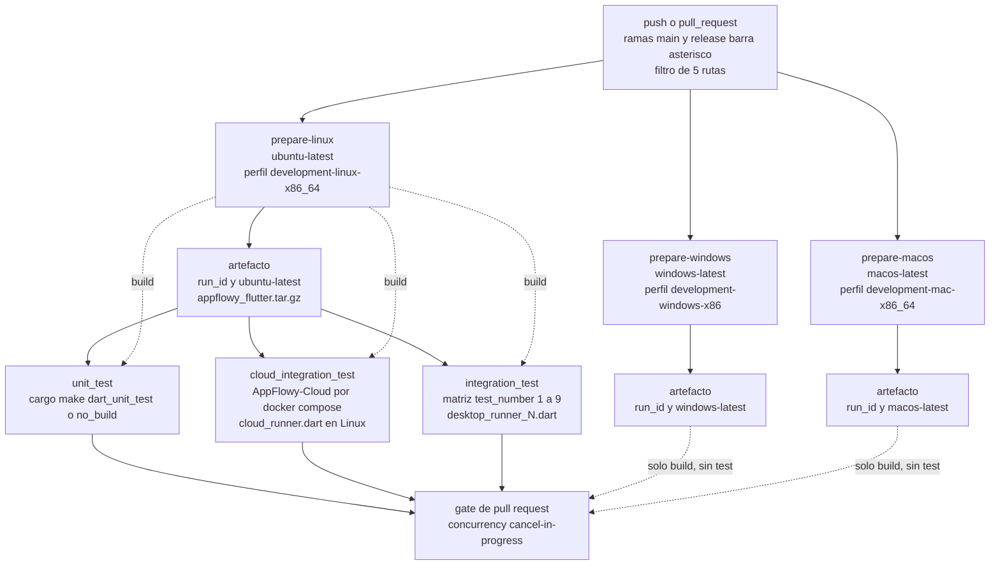
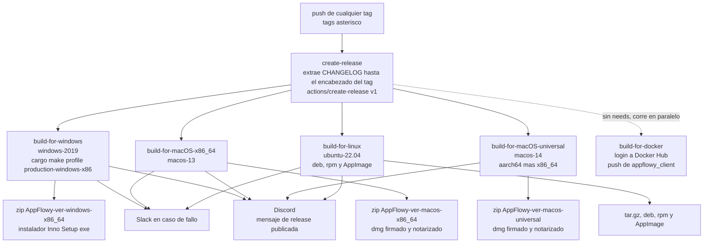
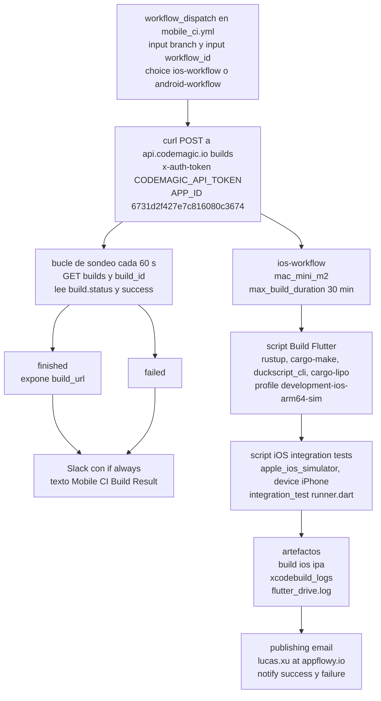
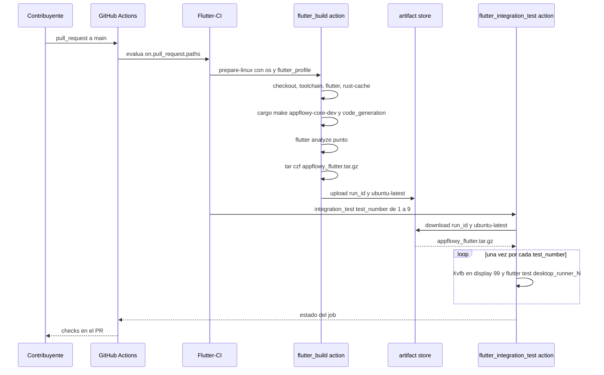
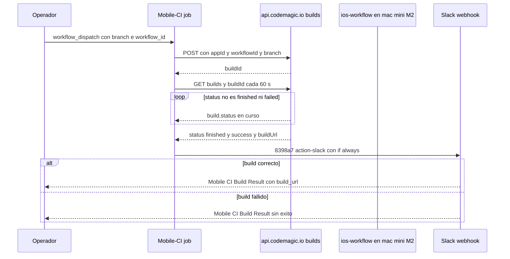
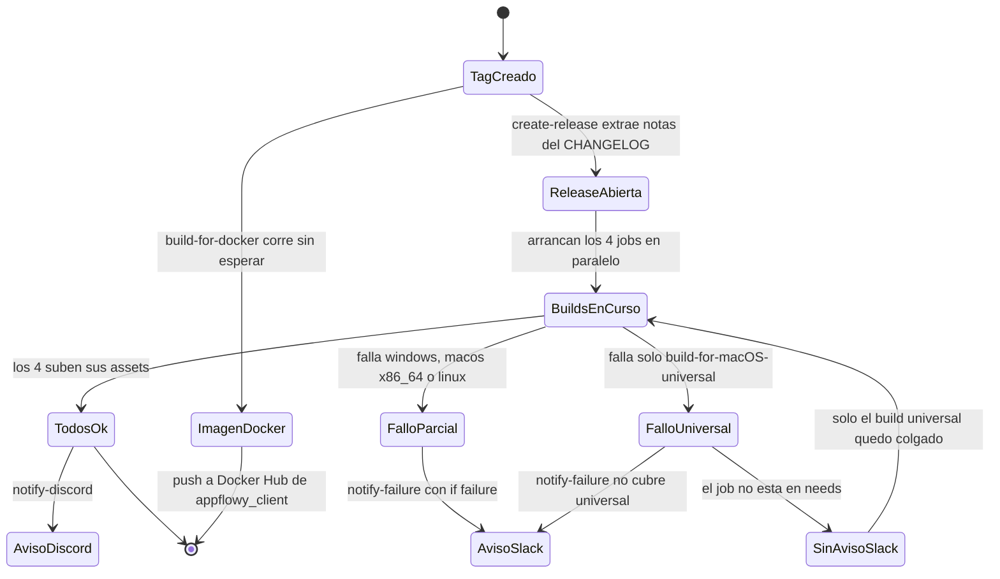

# F00.7.0 — App glue: raíz del repo, CI, docs y ficheros de licencia

## 1. Resumen

Esta unidad documenta las **33 ficheros de la raíz del repositorio `AppFlowy-IO/AppFlowy`** que no son código de producto pero gobiernan todo el proceso de construcción, integración y publicación: los doce ficheros de `.github/` (diez workflows, dos GitHub Actions compuestas, dos plantillas de issue y la plantilla de PR), los tres hooks de Git en `.githooks/`, la configuración de `commitlint`, el pipeline de `codemagic.yaml`, los ficheros de documentación de la raíz (`README.md`, `ROADMAP.md`, `doc/`), los ficheros legales (`LICENSE`, `CODE_OF_CONDUCT.md`), el histórico `CHANGELOG.md`, los ficheros de exclusión (`.gitignore`, `.dockerignore`) y el instalador `install.sh`. Su función real es la de **contrato de herramientas**: cada literal de estos ficheros fija una versión de toolchain, un nombre de artefacto, una ruta de script o un disparador que el resto del repo obedece. Es la unidad que alimenta directamente `18-build-ci-distribucion.md` (`[[B6.2]]`) y `19-testing.md` (`[[B6.1]]`) del bloque de arquitectura, porque aquí están las matrices de plataformas, los perfiles `cargo make` que se ejecutan y los nueve runners de integración.

## 2. Alcance

**Incluye** los 33 ficheros asignados a `OUT/_ledger/units/F00.7.0.json`, con un total real de **4 955 líneas** (`appflowy/CHANGELOG.md` aporta 1 514, `appflowy/LICENSE` 661 y `appflowy/install.sh` 403). Recuento por categoría: **12** ficheros de `.github/` (de los cuales **2** son acciones compuestas y **10** son workflows, uno de ellos desactivado por extensión `.bak`), **3** hooks de Git, **1** configuración de linter de commits, **1** pipeline de Codemagic, **4** ficheros de documentación de raíz (`README.md`, `ROADMAP.md`, `doc/CONTRIBUTING.md`, `doc/roadmap.md`), **2** ficheros legales (`LICENSE`, `CODE_OF_CONDUCT.md`), **1** `CHANGELOG.md`, **2** ficheros de exclusión y **1** instalador. Aparte se documentan tres ficheros de configuración de i18n detectados fuera del brief (`project.inlang.json`, `project.inlang/settings.json`, `project.inlang/project_id`), declarados en §12.8.

**Correcciones de scope obligatorias**, declaradas aquí y desarrolladas en §13:

1. **La raíz del repo `collab`** (su propio `.github/`, `LICENSE`, `docs/`, `CODE_OF_CONDUCT.md`) y **la raíz del repo `editor`** están en `[[F20]]`. Aquí sólo se documenta el glue del repo `appflowy`; el de las otras dos fuentes es un objeto distinto con su propio ciclo de release.
2. **Los bundles de traducción y `frontend/resources/`** (`am-ET.json` … `zh-TW.json`, 36 ficheros) están en `[[F00.7.1]]`. Aquí sólo se documenta la **configuración de inlang** que los apunta.
3. **La configuración raíz de `frontend/appflowy_flutter/`** (`pubspec.yaml`, `analysis_options.yaml`, assets) está en `[[F00.7.2]]`.
4. **Los runners de `integration_test/`** (`desktop_runner_1.dart` … `desktop_runner_9.dart`, `runner.dart`, `cloud/cloud_runner.dart`) están en `[[F00.7.3]]`–`[[F00.7.5]]`; los **tests unitarios** en `[[F00.7.6]]`. Aquí sólo se documenta **cómo la CI los invoca**.
5. **`Makefile.toml`, `cargokit_options.yaml`, `distribute_options.yaml`, `build.yaml`, `build-tool/` y `frontend/scripts/**`** están en `[[F00.3]]`. Los nombres de script y los perfiles `cargo make` se citan aquí **como contrato de llamada**, sin reexplicar su contenido.
6. **Los consumidores Dart** de estas definiciones (localización, feature flags, rutas) están en `[[F00.7.7]]`.

## 3. Modelos de datos

No hay modelo de datos de dominio en esta unidad: no hay un solo tipo, clase ni campo. Lo que la raíz del repo **declara como dato** son contratos que otros ficheros consumen. Los tres modelos que sí existen son la matriz de versiones de toolchain, el catálogo de perfiles `cargo make` disparados desde CI y el catálogo de scripts de `frontend/scripts/**` que la CI invoca.

### 3.1 Matriz de versiones de toolchain

Las versiones están fijadas **por workflow**, no globalmente. Las tres fuentes de verdad son `FLUTTER_VERSION`, `RUST_TOOLCHAIN` y `CARGO_MAKE_VERSION`; hay una cuarta, `CLOUD_VERSION`, sólo en los workflows que levantan AppFlowy-Cloud.

| Variable | `flutter_ci.yaml` | `release.yml` | `rust_ci.yaml` | `ios_ci.yaml` | `rust_coverage.yml` | `android_ci.yaml.bak` |
|---|---|---|---|---|---|---|
| `FLUTTER_VERSION` | `3.27.4` (`appflowy/.github/workflows/flutter_ci.yaml:28`) | `3.27.4` (`appflowy/.github/workflows/release.yml:9`) | — | `3.27.4` (`appflowy/.github/workflows/ios_ci.yaml:21`) | `3.27.4` (`appflowy/.github/workflows/rust_coverage.yml:13`) | `3.27.4` (`appflowy/.github/workflows/android_ci.yaml.bak:21`) |
| `RUST_TOOLCHAIN` | `1.85.0` (`appflowy/.github/workflows/flutter_ci.yaml:29`) | `1.85.0` (`appflowy/.github/workflows/release.yml:10`) | `1.85.0` (`appflowy/.github/workflows/rust_ci.yaml:22`) | `1.85.0` (`appflowy/.github/workflows/ios_ci.yaml:22`) | `1.85.0` (`appflowy/.github/workflows/rust_coverage.yml:14`) | `1.85.0` (`appflowy/.github/workflows/android_ci.yaml.bak:22`) |
| `CARGO_MAKE_VERSION` | `0.37.18` (`appflowy/.github/workflows/flutter_ci.yaml:30`) | — | — | — | — | `0.37.18` (`appflowy/.github/workflows/android_ci.yaml.bak:23`) |
| `CLOUD_VERSION` | `0.9.49-amd64` (`appflowy/.github/workflows/flutter_ci.yaml:31`) | — | `0.9.49-amd64` (`appflowy/.github/workflows/rust_ci.yaml:21`) | — | — | `0.6.54-amd64` (`appflowy/.github/workflows/android_ci.yaml.bak:24`) |

[VERIFICADO] Flutter y Rust están **unanimemente en `3.27.4` / `1.85.0`** en los seis workflows que las declaran. El valor canónico vive además en `appflowy/frontend/rust-toolchain.toml` (documentado en `[[F00.3]]`). Dos desviaciones reales: `CARGO_MAKE_VERSION` no existe en `release.yml` (el script instala `cargo-make` con `cargo install --force --locked`, sin fijar versión, `appflowy/.github/workflows/release.yml:161-162`) y `ios_ci.yaml` fija `0.37.15` **hardcodeado** en el paso `davidB/rust-cargo-make@v1` (`appflowy/.github/workflows/ios_ci.yaml:59`), no en `env`. `CLOUD_VERSION` está dos versiones por detrás en el fichero desactivado.

### 3.2 Catálogo de perfiles `cargo make` disparados desde la raíz

Estos son los objetivos de `cargo make` que la raíz del repo invoca. Su implementación está en `appflowy/frontend/Makefile.toml` (`[[F00.3]]`); aquí se documenta **quién los llama y con qué argumentos**, porque es el contrato que une la raíz con `frontend/`.

| Invocación | Fichero:línea | Workflow que la emite |
|---|---|---|
| `cargo make appflowy-flutter-deps-tools` | `appflowy/.github/actions/flutter_build/action.yml:78` | Flutter-CI (los tres `prepare-*`) |
| `cargo make --profile <flutter_profile> appflowy-core-dev` | `appflowy/.github/actions/flutter_build/action.yml:82` | Flutter-CI |
| `cargo make code_generation` | `appflowy/.github/actions/flutter_build/action.yml:87` | Flutter-CI |
| `cargo make pub_get` | `appflowy/.github/workflows/flutter_ci.yaml:202` | `unit_test` |
| `cargo make pub_get` | `appflowy/.github/workflows/flutter_ci.yaml:330` | `cloud_integration_test` |
| `cargo make dart_unit_test` | `appflowy/.github/workflows/flutter_ci.yaml:211` | `unit_test` (sólo macOS) |
| `cargo make dart_unit_test_no_build` | `appflowy/.github/workflows/flutter_ci.yaml:213` | `unit_test` (Linux) |
| `cargo make dart_unit_test_no_build` | `appflowy/.github/workflows/flutter_ci.yaml:215` | `unit_test` (Windows) |
| `cargo make rust_unit_test_with_coverage` | `appflowy/.github/workflows/rust_coverage.yml:61` | Rust code coverage |
| `cargo make --profile development-android appflowy-core-dev-android` | `appflowy/.github/workflows/android_ci.yaml.bak:174` | Android CI (desactivado) |
| `cargo make --profile development-android code_generation` | `appflowy/.github/workflows/android_ci.yaml.bak:175` | Android CI (desactivado) |
| `cargo make --profile development-ios-arm64-sim appflowy-core-dev-ios` | `appflowy/.github/workflows/ios_ci.yaml:73`, `appflowy/codemagic.yaml:27` | iOS CI y Codemagic |
| `cargo make --profile development-ios-arm64-sim code_generation` | `appflowy/.github/workflows/ios_ci.yaml:74`, `appflowy/codemagic.yaml:28` | iOS CI y Codemagic |
| `cargo make appflowy-flutter-deps-tools` | `appflowy/.github/workflows/ios_ci.yaml:67`, `appflowy/codemagic.yaml:26` | iOS CI y Codemagic |
| `cargo make --env APP_VERSION=<ref> --profile production-windows-x86 appflowy` | `appflowy/.github/workflows/release.yml:85` | `build-for-windows` |

[VERIFICADO] **Quince invocaciones**, **doce objetivos distintos**. Los tres perfiles `development-*` que Flutter-CI pasa a la acción compuesta se declaran en la matriz de cada job: `development-linux-x86_64` (`appflowy/.github/workflows/flutter_ci.yaml:46`), `development-windows-x86` (`:80`) y `development-mac-x86_64` (`:107`). El único perfil de producción de la raíz es `production-windows-x86` (`appflowy/.github/workflows/release.yml:85`). Los perfiles macOS y Linux de release **no** pasan por `cargo make`: se construyen con `build_flowy.dart` y scripts shell (§3.3).

### 3.3 Catálogo de scripts de `frontend/scripts/**` invocados desde la raíz

| Script invocado | Fichero:línea | Propósito declarado por el paso |
|---|---|---|
| `./scripts/flutter_release_build/build_flowy.dart run . <ref>` | `appflowy/.github/workflows/release.yml:168` (macOS x86_64), `:395` (Linux) | Genera el árbol de release y parchea las directivas de Flutter |
| `./scripts/flutter_release_build/build_flowy.dart exclude-directives . <ref>` | `appflowy/.github/workflows/release.yml:84` | Quita directivas antes de compilar Windows |
| `./scripts/flutter_release_build/build_flowy.dart include-directives . <ref>` | `appflowy/.github/workflows/release.yml:86` | Restaura las directivas tras compilar Windows |
| `scripts/flutter_release_build/build_universal_package_for_macos.sh <ref>` | `appflowy/.github/workflows/release.yml:273` | Build universal macOS (aarch64 + x86_64) |
| `scripts/windows_installer/*` | `appflowy/.github/workflows/release.yml:97` | Copia el `.iss` y el icono del instalador Inno Setup |
| `scripts/linux_distribution/deb/build_deb.sh <path> <ver> <deb>` | `appflowy/.github/workflows/release.yml:404` | Empaquetado Debian |
| `scripts/linux_distribution/appimage/build_appimage.sh <ref>` | `appflowy/.github/workflows/release.yml:416` | Empaquetado AppImage (con `continue-on-error: true` en `:414`) |
| `frontend/scripts/dmg_assets/AppFlowyInstallerBackground.jpg` | `appflowy/.github/workflows/release.yml:188`, `:291` | Fondo del DMG de macOS |
| `./frontend/scripts/docker-buildfiles/Dockerfile` | `appflowy/.github/workflows/release.yml:483`, `appflowy/.github/workflows/docker_ci.yml:39` | Imagen de contenedor del cliente |
| `frontend/scripts/install_dev_env/install_{ios,macos,linux,windows}.sh` | `appflowy/.github/workflows/release.yml:…` no se invocan; sí registran `git config core.hooksPath .githooks` | Ver §7.2 |

[VERIFICADO] `appflowy/.github/workflows/release.yml:84-86` explica por qué el script se ejecuta **dos veces** en Windows, con un comentario en `:81`: *"the cargo make script has to be run separately because of file locking issues"*. Es el único caso del repo donde una mutación del árbol de release envuelve a la compilación.

### 3.4 Configuración de inlang y su relación con los bundles

`project.inlang.json` es la configuración que consume la action `opral/ninja-i18n-action@main` (`appflowy/.github/workflows/ninja_i18n.yml:22`) y el editor web de inlang enlazado desde el README (`appflowy/README.md:96`). Declara `sourceLanguageTag: "en-US"` (`appflowy/project.inlang.json:3`), el array `languageTags` (`:4-33`) y el `pathPattern` que apunta a los bundles (`:42`).

| Aspecto | `project.inlang.json` | `project.inlang/settings.json` | Ficheros en disco |
|---|---|---|---|
| `sourceLanguageTag` | `en-US` (`appflowy/project.inlang.json:3`) | `en-US` (`appflowy/project.inlang/settings.json:3`) | — |
| Nº de `languageTags` | **29** (`appflowy/project.inlang.json:4-33`) | **31** (`appflowy/project.inlang/settings.json:4-36`) | **36** ficheros `.json` en `appflowy/frontend/resources/translations/` |
| `pathPattern` | `./frontend/resources/translations/{languageTag}.json` (`appflowy/project.inlang.json:42`) | idéntico (`appflowy/project.inlang/settings.json:45`) | — |
| `variableReferencePattern` | `["@:"]` (`appflowy/project.inlang.json:43-45`) | idéntico (`appflowy/project.inlang/settings.json:46-48`) | — |
| Módulos | 5 (plugin-i18next + 4 reglas de lint) (`appflowy/project.inlang.json:34-40`) | 5, idénticos (`appflowy/project.inlang/settings.json:37-43`) | — |

[VERIFICADO] Los dos ficheros de configuración **duplican** el mismo contenido con listas de idiomas divergentes: `el-GR` aparece sólo en `project.inlang.json`, mientras que `ga-IE`, `he`, `th-TH` y `uk-UA` aparecen sólo en `project.inlang/settings.json`. En disco hay además cuatro idiomas —`am-ET`, `hin`, `mr-IN`, `ur`— que **no están en ninguna** de las dos listas. Los bundles en sí pertenecen a `[[F00.7.1]]`.

## 4. Eventos FFI

**Ninguno.** Ninguno de los 33 ficheros contiene un cliente del SDK de eventos Rust↔Dart; esos viven en `frontend/appflowy_flutter/lib/` (`[[F00.1]]`). El análogo funcional en esta capa es el conjunto de **disparadores de entrada** que la raíz declara: qué evento de GitHub arranca cada workflow y qué payload consume.

| Disparador | Literal `on:` | Consumido en | Fichero:línea |
|---|---|---|---|
| `push` en `main`/`release/*` con filtro de 5 rutas | `paths:` con `.github/workflows/flutter_ci.yaml`, `.github/actions/flutter_build/**`, `frontend/rust-lib/**`, `frontend/appflowy_flutter/**`, `frontend/resources/**` | Flutter-CI | `appflowy/.github/workflows/flutter_ci.yaml:4-13` |
| `pull_request` a `main`/`release/*` con los mismos filtros | ídem | Flutter-CI | `appflowy/.github/workflows/flutter_ci.yaml:15-24` |
| `push` con `tags: ["*"]` | cualquier tag | `release` | `appflowy/.github/workflows/release.yml:4-6` |
| `push`/`pull_request` a `main`/`develop`/`release/*` | `paths: frontend/rust-lib/**` (sólo en push) | Rust-CI | `appflowy/.github/workflows/rust_ci.yaml:4-17` |
| `push`/`pull_request`/`workflow_dispatch` a `main`/`release/*` | sin `paths` | Docker-CI | `appflowy/.github/workflows/docker_ci.yml:4-8` |
| `repository_dispatch` con `types: [build-command]` | payload `client_payload.slash_command` | `build` | `appflowy/.github/workflows/build_command.yml:4-5` |
| `workflow_dispatch` con inputs `branch` y `workflow_id` | choice `ios-workflow` / `android-workflow` | Mobile-CI | `appflowy/.github/workflows/mobile_ci.yml:4-17` |
| `pull_request_target` | sin filtro | Ninja i18n | `appflowy/.github/workflows/ninja_i18n.yml:4` |
| `push` a `main` con `paths: frontend/appflowy_flutter/assets/translations/en.json` | ruta que **no existe** (§13.6) | Translation Notify | `appflowy/.github/workflows/translation_notify.yml:3-6` |
| `[pull_request, push]` | sin filtro | Commit messages lint | `appflowy/.github/workflows/commit_lint.yml:2` |
| `push`/`pull_request` a `main` con filtro `frontend/**` | referencia `mobile_ci.yaml` (no `mobile_ci.yml`, §13.5) | Android CI (desactivado) | `appflowy/.github/workflows/android_ci.yaml.bak:4-17` |
| `push`/`pull_request` a `main` con filtro `frontend/**` y `!frontend/appflowy_web_app/**` | ídem | iOS CI | `appflowy/.github/workflows/ios_ci.yaml:4-18` |

[VERIFICADO] `build_command.yml` es el único workflow con **payload de entrada estructurado**: lee `github.event.client_payload.slash_command.args.unnamed.arg1` como plataforma (`appflowy/.github/workflows/build_command.yml:13`) y dos argumentos con nombre, `build_name` (`:14`) y `ref` (`:15`). Es la pasarela desde el comando slash `/build` de Discord hacia `AppFlowy-IO/AppFlowy-Builder`.

## 5. Notificaciones

No hay notificaciones del motor Rust→Dart (`[[F00.1]]`). Sí hay **cuatro canales de notificación saliente** declarados en la raíz, todos dirigidos a equipos internos.

| Canal | Evento disparador | Secreto | Fichero:línea |
|---|---|---|---|
| Slack (`8398a7/action-slack@v3`) | `build-for-*` falla (`if: failure()`, `:496`) | `secrets.RELEASE_SLACK_WEBHOOK` | `appflowy/.github/workflows/release.yml:498-506` |
| Slack (`8398a7/action-slack@v3`, `if: always()`) | fin del build Codemagic disparado por `mobile_ci.yml` | `secrets.RELEASE_SLACK_WEBHOOK` | `appflowy/.github/workflows/mobile_ci.yml:71-83` |
| Discord (`curl` a la API de webhooks) | los 4 jobs de build terminan bien | `secrets.DISCORD` | `appflowy/.github/workflows/release.yml:508-521` |
| Discord (`Ilshidur/action-discord@master`) | cambian las cadenas de inglés | `secrets.DISCORD_WEBHOOK` | `appflowy/.github/workflows/translation_notify.yml:12-18` |
| Email (Codemagic `publishing.email`) | fin del `ios-workflow` | — (destinatario literal) | `appflowy/codemagic.yaml:41-46` |

[VERIFICADO] El mensaje de Discord de release se construye por `curl` directo, sin action, y contiene la URL de la release (`appflowy/.github/workflows/release.yml:520`). El destinatario de email de Codemagic es un correo individual, `lucas.xu@appflowy.io` (`appflowy/codemagic.yaml:44`), no un equipo. `translation_notify.yml` menciona al rol `@appflowytranslators` (`appflowy/.github/workflows/translation_notify.yml:17`).

## 6. BLoCs / Cubits

**Ninguno.** Los 33 ficheros son YAML, Markdown, shell y un único módulo CommonJS; no contienen Dart. Filtrando `OUT/_ledger/extract/blocs.json` por estas rutas el resultado es cero. La separación de responsabilidades en la CI se hace con los `needs:` entre jobs, que es el mecanismo equivalente:

| Workflow | Grafo de `needs:` | Fichero:línea |
|---|---|---|
| Flutter-CI | `unit_test`, `cloud_integration_test`, `integration_test` → todos dependen de `prepare-linux` | `appflowy/.github/workflows/flutter_ci.yaml:126`, `:220`, `:343` |
| `release` | los 4 jobs de artefacto → `create-release` | `appflowy/.github/workflows/release.yml:42`, `:129`, `:232`, `:330` |
| `release` | `notify-failure` → `build-for-macOS-x86_64`, `build-for-windows`, `build-for-linux` (omiso `universal`) | `appflowy/.github/workflows/release.yml:492-496` |
| `release` | `notify-discord` → los 4 jobs, incluido `universal` | `appflowy/.github/workflows/release.yml:510-516` |

[VERIFICADO] Los tres jobs de test de Flutter-CI dependen **sólo** de `prepare-linux`, no de `prepare-windows` ni de `prepare-macos` (`appflowy/.github/workflows/flutter_ci.yaml:126`, `:220`, `:343`). Eso significa que **macOS y Windows sólo construyen, no prueban** en GitHub Actions: el único lugar donde se prueban es Codemagic (iOS) y el runner local. El `concurrency` de tres workflows agrupa por `${{ github.workflow }}-${{ github.event.pull_request.number || github.ref }}` con `cancel-in-progress: true` (`appflowy/.github/workflows/flutter_ci.yaml:34-35`, `appflowy/.github/workflows/ios_ci.yaml:25-26`, `appflowy/.github/workflows/docker_ci.yml:11-12`).

## 7. Servicios e inyección de dependencias

### 7.1 Acciones compuestas como factorías reutilizables

La raíz no usa `get_it` ni `deps_resolve`; su equivalente es el **registro de acciones compuestas** que los workflows resuelven por ruta local (`uses: ./.github/actions/...`).

| Acción compuesta | Declarada en | Invocada desde | Inputs declarados |
|---|---|---|---|
| `flutter_build` | `appflowy/.github/actions/flutter_build/action.yml:1-22` | `appflowy/.github/workflows/flutter_ci.yaml:63` (Linux), `:89` (Windows), `:116` (macOS) | `os`, `flutter_version`, `rust_toolchain`, `cargo_make_version`, `rust_target`, `flutter_profile` — los 6 `required: true` |
| `flutter_integration_test` | `appflowy/.github/actions/flutter_integration_test/action.yml:1-19` | `appflowy/.github/workflows/flutter_ci.yaml:359` (matriz de 9) | `test_path`, `flutter_version`, `rust_toolchain`, `cargo_make_version`, `rust_target` — los 5 `required: true` |

[VERIFICADO] **Ninguna de las dos declara `outputs`**: el contrato de salida es exclusivamente el artefacto `appflowy_flutter.tar.gz` subido por `actions/upload-artifact@v4` (`appflowy/.github/actions/flutter_build/action.yml:99-102`) y consumido por `actions/download-artifact@v4` (`appflowy/.github/actions/flutter_integration_test/action.yml:63-65`, `appflowy/.github/workflows/flutter_ci.yaml:193-195`). El nombre del artefacto es `${{ github.run_id }}-${{ matrix.os }}`, es decir `<run_id>-ubuntu-latest`, `<run_id>-windows-latest` y `<run_id>-macos-latest`; por eso la acción de integración **puede** fijar `ubuntu-latest` como literal (`appflowy/.github/actions/flutter_integration_test/action.yml:65`) y sólo funciona en Linux.

**Secuencia de pasos de `flutter_build`** (`appflowy/.github/actions/flutter_build/action.yml:28-102`): `actions/checkout@v4` → `actions-rs/toolchain@v1` con `profile: minimal` → `subosito/flutter-action@v2` canal `stable` con caché → `Swatinem/rust-cache@v2` sobre `frontend/rust-lib` con `cache-all-crates: true` → `taiki-e/install-action@v2` (instala `cargo-make@<version>` y `duckscript_cli`) → prerrequisitos por `case $RUNNER_OS` (Linux: repositorio Dart de Google + `libgtk-3-dev`/`keybinder-3.0`/`libnotify-dev`; Windows: `vcpkg integrate install` + `vcpkg update`; macOS: nada) → `cargo make appflowy-flutter-deps-tools` → `cargo make --profile <perfil> appflowy-core-dev` → `cargo make code_generation` → **`flutter analyze .`** → `tar -czf` → `upload-artifact`.

[VERIFICADO] `flutter analyze .` (`appflowy/.github/actions/flutter_build/action.yml:90-93`) es el **único análisis estático de Dart** de todo el CI de la raíz, y se ejecuta sólo en los tres jobs `prepare-*`, no en los de test. No hay `flutter format`, ni `dart analyze` fuera de Flutter, ni `cargo fmt`/`cargo clippy` en Flutter-CI.

### 7.2 `gitlint` como servicio externo y `core.hooksPath`

Los tres hooks de `.githooks/` no se activan solos: su activación se hace **desde fuera de la raíz**, en los scripts de instalación del entorno de desarrollo (`git config core.hooksPath .githooks` en los cuatro instaladores y en el perfil de `cargo-make`), documentados en `[[F00.3]]`.

| Hook | Qué valida realmente | Fichero:línea |
|---|---|---|
| `pre-commit` | **tamaño de fichero ≤ 1 MiB** para todo lo staged | `appflowy/.githooks/pre-commit:24`, `:47-53` |
| `commit-msg` | `Signed-off-by` duplicados (`:30-34`) y luego `gitlint` con 6 parámetros | `appflowy/.githooks/commit-msg:30-34`, `:36-42` |
| `pre-push` | **sólo** que el árbol esté limpio (`git status --porcelain` vacío) | `appflowy/.githooks/pre-push:22-25` |

[VERIFICADO] El `pre-push` **no ejecuta ni `flutter analyze`, ni `cargo fmt`, ni clippy**: el bloque que lo haría está íntegramente comentado (`appflowy/.githooks/pre-push:28-36`). Lo mismo ocurre con `flutter format .` en `pre-commit` (`appflowy/.githooks/pre-commit:22`), que está comentado y seguido de un enlace a un gist de referencia (`:23`). Es decir: **la validación real se delega en la CI**, no en los hooks locales.

**Cruce `commit-msg` (gitlint) ↔ `commitlint.config.js`**: son dos validadores de mensaje de commit con reglas distintas, conectados a momentos distintos.

| Regla | `gitlint` (hook local) | `commitlint` (CI) | Divergencia |
|---|---|---|---|
| Tipos permitidos | 12: `build, chore, ci, docs, feat, feature, fix, perf, refactor, revert, style, test` (`appflowy/.githooks/commit-msg:38`) | 10: `build, chore, ci, docs, feat, feature, fix, refactor, style, test` (`appflowy/commitlint.config.js:6`) | `perf` y `revert` se aceptan en local y se rechazan en CI |
| Longitud del asunto | `subject-maxlen=150` (`appflowy/.githooks/commit-msg:39`) | `header-max-length: 100` (`appflowy/commitlint.config.js:4`) | 150 vs 100 |
| Longitud mínima | `subject-minlen=10` (`appflowy/.githooks/commit-msg:40`) | no existe regla equivalente | — |
| Longitud de línea del cuerpo | `body-regex=".*"` (sin límite) (`appflowy/.githooks/commit-msg:41`) | `body-max-line-length: 200` (`appflowy/commitlint.config.js:18`) | 200 en CI |
| Línea en blanco antes del cuerpo | no | `body-leading-blank: [2,'always']` (`appflowy/commitlint.config.js:17`) | sólo CI |
| Nº de padres del merge | `max-parents=1` (`appflowy/.githooks/commit-msg:42`) | no | sólo local |
| Mayúsculas del tipo | no | `type-case: lower-case` (`appflowy/commitlint.config.js:8`) | sólo CI |
| Footer | no | `footer-max-line-length: 100` (`appflowy/commitlint.config.js:22`) | sólo CI |

[VERIFICADO] La línea 1 de `commitlint.config.js` está comentada: `// module.exports = {extends: ['@commitlint/config-conventional']}` (`appflowy/commitlint.config.js:1`), es decir **el proyecto no extiende `@commitlint/config-conventional`**, define las reglas a mano. La action que lo ejecuta es `wagoid/commitlint-github-action@v4` (`appflowy/.github/workflows/commit_lint.yml:11`) con `fetch-depth: 0` (`:10`) para que commitlint tenga el rango de commits. Además `commitlint.config.js` define `subject-case` con severidad `0` (desactivada) y `body-case` con `0` (`appflowy/commitlint.config.js:12`, `:19`), dejando el casing de asunto y cuerpo libre salvo el `type-case`.

## 8. Persistencia

Ninguno de los 33 ficheros abre una base de datos. Los tres mecanismos de persistencia de esta capa son **artefactos de CI**, **reglas de inclusión en el repositorio** y **contenido del contexto Docker**.

| Mecanismo | Definición | Fichero:línea |
|---|---|---|
| Subida de artefacto | `actions/upload-artifact@v4`, nombre `${{ github.run_id }}-${{ matrix.os }}`, path `appflowy_flutter.tar.gz` | `appflowy/.github/actions/flutter_build/action.yml:95-102` |
| Descarga de artefacto | `actions/download-artifact@v4` con el mismo nombre | `appflowy/.github/workflows/flutter_ci.yaml:193-195`, `appflowy/.github/actions/flutter_integration_test/action.yml:63-65` |
| Assets de release | 10 llamadas a `actions/upload-release-asset@v1` (2 Windows, 2 macOS x86_64, 2 macOS universal, 4 Linux) | `appflowy/.github/workflows/release.yml:104-124`, `:209-227`, `:307-325`, `:420-462` |
| Cache de Rust | `Swatinem/rust-cache@v2` sobre `frontend/rust-lib` | `appflowy/.github/actions/flutter_build/action.yml:48-53`, `appflowy/.github/workflows/rust_ci.yaml:51-56` |
| Cache de BuildKit en registry | `af_build_cache:buildcache` (from/to), sólo en el job de docker de release | `appflowy/.github/workflows/release.yml:487-488` |
| Ficheros excluidos del repo | `.gitignore` con 44 líneas: `/target/` (`:6`), `**/resources/proto` (`:22`), `**/AppFlowy-Collab/` (`:36`), `.githooks/gitlint{,.exe}` (`:32-33`), `**/.cargo/**` (`:44`) | `appflowy/.gitignore:6`, `:22`, `:32`, `:36`, `:44` |
| Excepción del lockfile | `pubspec.lock` ignorado salvo el de la app (`!frontend/appflowy_flutter/pubspec.lock`) | `appflowy/.gitignore:28-29` |
| Contexto Docker | `.dockerignore` contiene **una sola** entrada: `.git` | `appflowy/.dockerignore:1` |

[VERIFICADO] El comentario `appflowy/.gitignore:31` explica las dos entradas de `gitlint`: *"ignore tool used for commit linting"*. Es la prueba de que `gitlint` se descarga en local y no se versiona. La regla `**/AppFlowy-Collab/` (`:36`) ignora el clon del crate hermano cuando se copia a mano junto a la app. El contexto Docker con una única exclusión implica que **todo `frontend/` viaja al daemon en cada `docker build`** — el Dockerfile en `appflowy/frontend/scripts/docker-buildfiles/Dockerfile` (`[[F00.3]]`) hace su propio `COPY` selectivo.

## 9. Diagramas de flujo

### 9.1 DAG del workflow `Flutter-CI`

Muestra los seis jobs de `appflowy/.github/workflows/flutter_ci.yaml`, qué jobs dependen de cuáles y dónde se produce y se consume el artefacto `appflowy_flutter.tar.gz`.

**Lectura**: el workflow tiene una columna vertebral —`prepare-linux`— de la que cuelgan los tres jobs de test; `prepare-windows` y `prepare-macos` son ramas hojas que sólo producen artefacto y **nunca se consumen** (`appflowy/.github/workflows/flutter_ci.yaml:126`, `:220`, `:343`). Los tres jobs de test son `fail-fast: false` (`appflowy/.github/workflows/flutter_ci.yaml:146`, `:223`, `:347`), de modo que los nueve runners de integración reportan los nueve fallos en una sola ejecución. El único job sin guarda de PR en borrador es `cloud_integration_test`, que se compara con los otros tres que sí la tienen (`appflowy/.github/workflows/flutter_ci.yaml:39`, `:73`, `:100`, `:127`, `:344` frente a `:219-229`).

### 9.2 Pipeline de release por tag

Muestra los ocho jobs de `appflowy/.github/workflows/release.yml` y qué artefacto produce cada uno para un tag nuevo.

**Lectura**: `create-release` (`appflowy/.github/workflows/release.yml:13-36`) es el único punto de convergencia: extrae las notas de versión de `CHANGELOG.md` con un `sed` que corta en el encabezado `## Version <tag>` (`:26`) y expone `upload_url` como output (`:18`). Los cuatro jobs de artefacto arrancan en paralelo tras él (`:42`, `:129`, `:232`, `:330`) y cada uno sube entre dos y cuatro ficheros. Los dos jobs de notificación son **asimétricos**: `notify-failure` no espera al job universal (`:492-496`) mientras que `notify-discord` sí (`:510-516`), de modo que un fallo del build universal no genera alerta pero un éxito sí genera mensaje. `build-for-docker` (`:464-488`) **no declara `needs: create-release`**: arranca en paralelo desde el principio y empuja `appflowy_client:<tag>` a Docker Hub sin esperar al resto.

### 9.3 Pipeline Codemagic (`codemagic.yaml`) disparado desde GitHub

Muestra el camino que va desde el trigger manual de `mobile_ci.yml` hasta el correo de fin de workflow en Codemagic.

**Lectura**: `mobile_ci.yml` es un **proxy**: no compila nada, sólo habla con la API de Codemagic y hace de puente entre el check de GitHub y la build de macOS (`appflowy/.github/workflows/mobile_ci.yml:30-38` el POST, `:47-69` el sondeo con `sleep 60`). `codemagic.yaml` define **un solo** workflow, `ios-workflow` (`appflowy/codemagic.yaml:2`), aunque el input `workflow_id` ofrece también `android-workflow` (`appflowy/.github/workflows/mobile_ci.yml:17`). El runner es una **mac mini M2** con 30 minutos de techo (`appflowy/codemagic.yaml:4-5`) y toolchain fijada a `flutter: 3.27.4`, `xcode: latest`, `cocoapods: default` (`appflowy/codemagic.yaml:6-9`). Los dos pasos son `cargo make appflowy-flutter-deps-tools` → `appflowy-core-dev-ios` → `code_generation` (`:26-28`) y luego el test en simulador (`:30-34`). El cierre es un **correo**, no una publicación en TestFlight ni en la App Store.

## 10. Diagramas de secuencia

### 10.1 Un pull request que toca `frontend/rust-lib/`

Muestra la secuencia real de un PR que pasa el filtro de rutas y llega a los nueve runners de integración.

[VERIFICADO] Cada paso tiene su línea: la llamada a la acción compuesta en `appflowy/.github/workflows/flutter_ci.yaml:63` y `:359`, la construcción en `appflowy/.github/actions/flutter_build/action.yml:80-96`, el `flutter test` parametrizado en `appflowy/.github/actions/flutter_integration_test/action.yml:71-78`. La matriz de 1 a 9 está en `appflowy/.github/workflows/flutter_ci.yaml:349` y el `test_path` se construye por interpolación en `:361`. El headless display se monta con `sudo Xvfb -ac :99 -screen 0 1280x1024x24` (`appflowy/.github/actions/flutter_integration_test/action.yml:75`) y se repite, literal, en el job de cloud (`appflowy/.github/workflows/flutter_ci.yaml:336`).

### 10.2 Disparo y sondeo de una build Codemagic

Muestra el intercambio de `mobile_ci.yml` con la API de Codemagic y el retorno del resultado a Slack.

[VERIFICADO] El POST es un `curl -X POST` con cabecera `x-auth-token` y cuerpo JSON con tres campos (`appflowy/.github/workflows/mobile_ci.yml:30-38`). El sondeo normaliza la respuesta con `jq 'walk(...)'` para eliminar el campo `.command` de los subactions antes de leer `.build.status` (`appflowy/.github/workflows/mobile_ci.yml:53-54`), lo que evita que un cambio de texto en los logs rompa el parseo. El `break` sólo ocurre con `finished` o `failed` (`:56-66`); cualquier otro estado hace `sleep 60` (`:68`).

## 11. Diagramas de estado

### 11.1 Ciclo de vida de un tag de release

Muestra las transiciones de un tag desde que se empuja hasta que se publica la notificación, incluyendo la rama de fallo.

[VERIFICADO] El hueco del diagrama es real y está en el fichero: `notify-failure` declara `needs:` con tres entradas (`appflowy/.github/workflows/release.yml:492-496`) mientras que hay **cuatro** jobs de build; `notify-discord` sí declara las cuatro (`appflowy/.github/workflows/release.yml:510-516`). El `build-for-docker` es el único job sin `needs:` (`appflowy/.github/workflows/release.yml:464-466`), de modo que su estado no bloquea ni la publicación de assets ni las notificaciones.

### 11.2 Las dos rutas de una cadena de traducción

Una cadena de interfaz recorre dos rutas independientes en GitHub, y sólo una de las dos funciona.

- **Ruta de lint (operativa).** `ninja_i18n.yml` no filtra por `paths` y se dispara en `pull_request_target` con `permissions: pull-requests: write` (`appflowy/.github/workflows/ninja_i18n.yml:4`, `:7-8`), ejecutando `opral/ninja-i18n-action@main` (`:22`). Como no hay filtro, **todo** PR pasa por el lint de i18n, incluidos los que no tocan traducciones.
- **Ruta de aviso (rota).** `translation_notify.yml` sí filtra, pero por `frontend/appflowy_flutter/assets/translations/en.json` (`appflowy/.github/workflows/translation_notify.yml:6`), una ruta que **no existe** en el repo — los bundles reales están en `frontend/resources/translations/` (`appflowy/project.inlang.json:42`). El aviso a `@appflowytranslators` (`appflowy/.github/workflows/translation_notify.yml:17`) no se emite nunca.

[VERIFICADO] Las dos ramas son rutas de filtrado distintas: `ninja_i18n.yml` no filtra por `paths` y se ejecuta en `pull_request_target` con `permissions: pull-requests: write` (`appflowy/.github/workflows/ninja_i18n.yml:4`, `:7-8`), mientras que `translation_notify.yml` sí filtra, pero por `frontend/appflowy_flutter/assets/translations/en.json` (`appflowy/.github/workflows/translation_notify.yml:6`), una ruta que **no existe** en el repo — los bundles reales están en `frontend/resources/translations/` (`appflowy/project.inlang.json:42`). El aviso a traductores, por tanto, no se ha emitido nunca por esta vía; ver §13.6.

## 12. Archivos cubiertos (del ledger)

**33 ficheros**, **4 955 líneas** reales, los de la unidad `OUT/_ledger/units/F00.7.0.json`.

### 12.1 Workflows de GitHub Actions: 10 ficheros (1 586 líneas)

| Fichero | LOC | Nombre del workflow | Disparadores | Jobs | Qué ejecuta (comando ancla) |
|---|---:|---|---|---:|---|
| `appflowy/.github/workflows/flutter_ci.yaml` | 365 | `Flutter-CI` | `push` + `pull_request` a `main`/`release/*` con filtro de 5 rutas | 6 | `cargo make dart_unit_test[_no_build]` (`:211`) y los 9 `desktop_runner_N` vía acción compuesta (`:349`) |
| `appflowy/.github/workflows/release.yml` | 521 | `release` | `push` con `tags: ["*"]` | 8 | `cargo make --profile production-windows-x86 appflowy` (`:85`) y `build_flowy.dart run` (`:168`, `:395`) |
| `appflowy/.github/workflows/android_ci.yaml.bak` | 196 | `Android CI` (**desactivado**, extensión `.bak`) | `push` + `pull_request` a `main` | 1 | `flutter test integration_test/mobile/cloud/cloud_runner.dart` en emulador Android API 33 (`:196`) |
| `appflowy/.github/workflows/rust_ci.yaml` | 128 | `Rust-CI` | `push` (con filtro) + `pull_request` a `main`/`develop`/`release/*` | 1 | `cargo test --no-default-features --features="dart" -- --skip local_ollama_test` (`:109`), `cargo fmt --all -- --check` (`:112`), `cargo clippy --all-targets -- -D warnings` (`:116`) |
| `appflowy/.github/workflows/ios_ci.yaml` | 98 | `iOS CI` | `push` + `pull_request` a `main` | 1 | `cargo make --profile development-ios-arm64-sim appflowy-core-ios` y `code_generation` (`:73-74`); los pasos de test están comentados (`:76-98`) |
| `appflowy/.github/workflows/mobile_ci.yml` | 83 | `Mobile-CI` | `workflow_dispatch` con 2 inputs | 1 | `curl` a `api.codemagic.io/builds` (`:30`) y sondeo con `sleep 60` (`:68`) |
| `appflowy/.github/workflows/rust_coverage.yml` | 61 | `Rust code coverage` | `push` a `main`/`release/*` con filtro `frontend/rust-lib/**` | 1 | `cargo make rust_unit_test_with_coverage` (`:61`) |
| `appflowy/.github/workflows/docker_ci.yml` | 47 | `Docker-CI` | `push` + `pull_request` a `main`/`release/*` + `workflow_dispatch` | 1 | `docker/build-push-action@v5` con `push: false` (`:40`) |
| `appflowy/.github/workflows/build_command.yml` | 42 | `build` | `repository_dispatch` tipo `build-command` | 1 | `curl -X POST` al API de GitHub hacia `AppFlowy-IO/AppFlowy-Builder` (`:41`) |
| `appflowy/.github/workflows/ninja_i18n.yml` | 25 | `Ninja i18n action` | `pull_request_target` | 1 | `opral/ninja-i18n-action@main` (`:22`) |
| `appflowy/.github/workflows/translation_notify.yml` | 18 | `Translation Notify` | `push` a `main` con filtro `assets/translations/en.json` | 1 | `Ilshidur/action-discord@master` (`:12`) |
| `appflowy/.github/workflows/commit_lint.yml` | 11 | `Commit messages lint` | `[pull_request, push]` | 1 | `wagoid/commitlint-github-action@v4` (`:11`) |

[VERIFICADO] **Nueve workflows activos** más uno desactivado por extensión. Los doce nombres literales están en la línea 1 de cada fichero. Recuento de jobs activos: 6 + 8 + 1 + 1 + 1 + 1 + 1 + 1 + 1 + 1 = **22 jobs activos**.

### 12.2 Acciones compuestas: 2 ficheros (180 líneas)

| Fichero | LOC | `runs.using` | `inputs` | `outputs` | `uses` externos distintos |
|---|---:|---|---|---|---|
| `appflowy/.github/actions/flutter_build/action.yml` | 102 | `composite` (`:25`) | 6, todos `required: true` (`:5-22`) | ninguno | 6: `actions/checkout@v4`, `actions-rs/toolchain@v1`, `subosito/flutter-action@v2`, `Swatinem/rust-cache@v2`, `taiki-e/install-action@v2`, `actions/upload-artifact@v4` |
| `appflowy/.github/actions/flutter_integration_test/action.yml` | 78 | `composite` (`:22`) | 5, todos `required: true` (`:5-19`) | ninguno | 5: los cuatro primeros más `actions/download-artifact@v4` |

### 12.3 Hooks y linter de commits: 4 ficheros (164 líneas)

| Fichero | LOC | Registro | Validación efectiva |
|---|---:|---|---|
| `appflowy/.githooks/pre-commit` | 53 | `#!/usr/bin/env bash` (`:1`) | Tamaño de fichero staged ≤ 1 MiB (`appflowy/.githooks/pre-commit:24`, `:47-53`) |
| `appflowy/.githooks/commit-msg` | 50 | `#!/bin/sh` (`:1`) | `Signed-off-by` duplicados + `gitlint` con 6 flags (`appflowy/.githooks/commit-msg:30-42`) |
| `appflowy/.githooks/pre-push` | 36 | `#!/usr/bin/env bash` (`:1`) | Árbol de trabajo limpio (`appflowy/.githooks/pre-push:22-25`) |
| `appflowy/commitlint.config.js` | 25 | CommonJS `module.exports` (`:2`) | 10 reglas; `extends` de `@commitlint/config-conventional` comentado (`:1`) |

### 12.4 Documentación de raíz: 4 ficheros (170 líneas)

| Fichero | LOC | Contenido y propósito |
|---|---:|---|
| `appflowy/README.md` | 157 | Badge AGPL (`:16`), canales de instalación (`:44-52`), *"Built With": Flutter y Rust* (`:56-58`), sección de traducciones con el badge de inlang y la ruta `./frontend/resources/translations` (`:96-100`), valores de AGPL (`:146-149`), agradecimientos (`:155-157`) |
| `appflowy/doc/CONTRIBUTING.md` | 7 | Redirige a la guía de contribución en GitBook (`:5`); una imagen de cabecera (`:1`) |
| `appflowy/ROADMAP.md` | 3 | Dos enlaces: el *project* de GitHub (`:1`) y Gitbook (`:3`) |
| `appflowy/doc/roadmap.md` | 3 | Los mismos dos enlaces, en orden inverso (`:1-2`) |

[VERIFICADO] `ROADMAP.md` y `doc/roadmap.md` son **contenido duplicado** con dos enlaces cruzados en orden distinto; ninguno contiene planificación técnica. La carpeta `doc/` contiene además `doc/imgs/` (13 imágenes) y `doc/readme/` (7 imágenes), **excluidas del inventario** por ser binarias: sólo 2 de los ficheros de `doc/` están inventariados.

### 12.5 Ficheros legales y de histórico: 3 ficheros (2 251 líneas)

| Fichero | LOC | Contenido |
|---|---:|---|
| `appflowy/CHANGELOG.md` | 1514 | 120 entradas `## Version X.Y.Z` desde `0.11.4 – 09/03/2026` (`:2`) hasta `0.0.3 - 02/23/2022` (`:1497`); cada entrada se divide en `### Desktop` / `### Mobile` con `#### New Features` y `#### Bug Fixes` |
| `appflowy/LICENSE` | 661 | GNU AGPL v3, *Version 3, 19 November 2007* (`:1-2`), copyright de la FSF (`:4`), 17 secciones numeradas (`:61` a `:610`), incluida la **§13 Remote Network Interaction** (`:540`) |
| `appflowy/CODE_OF_CONDUCT.md` | 76 | Contributor Covenant v1.4; contacto de enforcement `annie@appflowy.io` (`:59`) |

### 12.6 Pipeline externo, exclusiones e instalador: 4 ficheros (493 líneas)

| Fichero | LOC | Contenido |
|---|---:|---|
| `appflowy/install.sh` | 403 | Instalador POSIX con `shlib` embebido; soporta 7 plataformas (`appflowy/install.sh:54-60`) |
| `appflowy/codemagic.yaml` | 47 | Un único `workflow: ios-workflow` sobre `mac_mini_m2` (`appflowy/codemagic.yaml:2-4`) |
| `appflowy/.gitignore` | 44 | Exclusiones de Cargo, Flutter, protos generados y herramientas |
| `appflowy/.dockerignore` | 1 | Únicamente `.git` (`appflowy/.dockerignore:1`) |

### 12.7 Plantillas de GitHub: 4 ficheros (103 líneas)

| Fichero | LOC | Campos |
|---|---:|---|
| `appflowy/.github/ISSUE_TEMPLATE/bug_report.yaml` | 49 | 7 bloques con prefijo de título `[Bug] ` (`:3`); 5 obligatorios (`desc`, `reproduce`, `expected`, `os`, `version`) y 2 opcionales (`screenshots`, `context`) |
| `appflowy/.github/PULL_REQUEST_TEMPLATE.md` | 27 | Sección `### Feature Preview` (`:9`), separador (`:16`) y `#### PR Checklist` con 4 casillas (`:22-27`) |
| `appflowy/.github/ISSUE_TEMPLATE/feature_request.yaml` | 25 | 3 bloques con prefijo `[FR] ` (`:3`); `desc` y `users` obligatorios, `context` opcional |
| `appflowy/.github/FUNDING.yml` | 2 | Una sola clave: `ko_fi: appflowy` (`appflowy/.github/FUNDING.yml:1`) |

### 12.8 Ficheros extras detectados (fuera del brief, documentados aquí)

| Fichero | LOC | Motivo |
|---|---:|---|
| `appflowy/project.inlang.json` | 47 | Configuración de inlang consumida por `opral/ninja-i18n-action` (`appflowy/.github/workflows/ninja_i18n.yml:22`) y por el editor web enlazado en `appflowy/README.md:96`. Sin ella, §3.4 no puede escribirse. |
| `appflowy/project.inlang/settings.json` | 50 | Segunda configuración de inlang, con lista de idiomas divergente (§3.4). |
| `appflowy/project.inlang/project_id` | 1 | Identificador del proyecto en el servicio inlang (`1d68c3f4acb5d44d0d7dcd44277e656bab7f3d5fd2fd386d8d1095a5c98ee886`). |

## 13. Riesgos y casos límite

### 13.1 `commit-msg` invoca un binario que no está en el repo

`appflowy/.githooks/commit-msg:36` ejecuta `.githooks/gitlint` con seis argumentos (`:37-42`). Ese binario **no existe** en el repositorio: la carpeta contiene exactamente tres ficheros (`commit-msg`, `pre-commit`, `pre-push`), y `.gitignore` lo excluye deliberadamente en `appflowy/.gitignore:32-33` con el comentario *"ignore tool used for commit linting"*. El hook comprueba el código de salida y aborta el commit con un enlace a la documentación de convenciones (`appflowy/.githooks/commit-msg:44-49`). [VERIFICADO] para la existencia del fichero y la exclusión. [INFERIDO] la consecuencia: en un clon recién hecho, sin instalar `gitlint` a mano, el hook falla con `command not found` y devuelve 127, que es distinto de cero, por lo que **todo commit se rechazaría**; en la práctica esto no rompe el flujo porque `core.hooksPath` sólo se activa cuando se ejecuta uno de los scripts `install_*.sh` de `frontend/scripts/install_dev_env/` (`[[F00.3]]`).

### 13.2 Las reglas del hook local y las de la CI se contradicen

La tabla de §7.2 muestra tres contradicciones duras. La más grave: `perf` y `revert` son Prefijos válidos para `gitlint` (`appflowy/.githooks/commit-msg:38`) pero **no** para `commitlint` (`appflowy/commitlint.config.js:6`). Un commit `perf: ...` pasa el hook local y es rechazado por el check de `appflowy/.github/workflows/commit_lint.yml:11`, que se ejecuta en `pull_request` **y** `push` (`appflowy/.github/workflows/commit_lint.yml:2`). La segunda: longitud máxima de asunto 150 frente a 100. La tercera: `commitlint` exige `body-leading-blank` (`appflowy/commitlint.config.js:17`) que `gitlint` no contempla. Ninguno de los dos ficheros se genera del otro, así que la deriva es estructural.

### 13.3 `flutter analyze` sólo corre en los jobs de build

El único análisis estático de Dart del CI está en `appflowy/.github/actions/flutter_build/action.yml:90-93`, es decir dentro de la acción que invocan `prepare-linux`, `prepare-windows` y `prepare-macos`. Como los tres jobs son paralelos e independientes (`appflowy/.github/workflows/flutter_ci.yaml:38`, `:72`, `:99`), el análisis ocurre aunque los tests no lleguen a ejecutarse. Pero **no** hay `dart analyze` en los jobs de test, ni `cargo fmt` ni `cargo clippy` en Flutter-CI: los tres aparecen sólo en `Rust-CI` (`appflowy/.github/workflows/rust_ci.yaml:112`, `:116`) y，y sólo cuando el PR toca `frontend/rust-lib/**`. Un PR que sólo toque Dart pasa por `flutter analyze` sin ninguna verificación de estilo de Rust, y un PR que sólo toque `frontend/appflowy_flutter/**` (por ejemplo un widget) **no ejecuta ningún test de Rust**, porque `Rust-CI` limita su `paths` a `frontend/rust-lib/**` (`appflowy/.github/workflows/rust_ci.yaml:9-11`).

### 13.4 `cloud_integration_test` no respeta la guarda de PR en borrador

Los jobs `prepare-linux`, `prepare-windows`, `prepare-macos`, `unit_test` e `integration_test` declaran `if: github.event.pull_request.draft != true` (`appflowy/.github/workflows/flutter_ci.yaml:39`, `:73`, `:100`, `:127`, `:344`). `cloud_integration_test` **no** la declara (`appflowy/.github/workflows/flutter_ci.yaml:219-229`), de modo que un PR en borrador levanta el stack completo de AppFlowy-Cloud en Docker Compose (`:248-288`), que es la parte más cara del workflow. Además su matriz declara `flutter_profile: development-linux-x86_64` (`:227`) que **no se usa en ningún paso** del job: el perfil sólo lo consume la acción `flutter_build`, que este job no invoca.

### 13.5 Dos workflows referencian `mobile_ci.yaml` cuando el fichero es `mobile_ci.yml`

`android_ci.yaml.bak` declara en sus dos filtros de rutas `.github/workflows/mobile_ci.yaml` (`appflowy/.github/workflows/android_ci.yaml.bak:8`, `:15`) e `ios_ci.yaml` hace lo mismo (`appflowy/.github/workflows/ios_ci.yaml:8`, `:17`). El fichero real se llama `mobile_ci.yml` (`appflowy/.github/workflows/mobile_ci.yml:1`). [VERIFICADO] la divergencia de extensión. [INFERIDO] la consecuencia: como el patrón `paths` nunca casa, esos workflows **sólo se disparan si cambian `frontend/**`**; un commit que toque únicamente `.github/workflows/mobile_ci.yml` no los despierta. En `android_ci.yaml.bak` es irrelevante porque la extensión `.bak` lo desactiva por completo, pero en `ios_ci.yaml` sí importa: un cambio en la CI móvil no dispara el CI de iOS.

### 13.6 `translation_notify.yml` filtra una ruta inexistente

El workflow sólo se activa cuando cambia `frontend/appflowy_flutter/assets/translations/en.json` (`appflowy/.github/workflows/translation_notify.yml:6`). Esa ruta **no existe** en el repo: la carpeta `assets/translations/` contiene un único fichero (`mr-IN.json`), y la ruta canónica declarada por inlang es `./frontend/resources/translations/{languageTag}.json` (`appflowy/project.inlang.json:42`), poblada por 36 ficheros. [VERIFICADO] la ruta inexistente y la ruta real. [INFERIDO] la consecuencia: el aviso a `@appflowytranslators` (`appflowy/.github/workflows/translation_notify.yml:17`) no se emite nunca; la notificación real llega por el badge de inlang enlazado en `appflowy/README.md:96` y por la acción de lint de PR, no por este workflow.

### 13.7 `release.yml` usa tres actions deprecadas

`actions/create-release@v1` (`appflowy/.github/workflows/release.yml:30`) y `actions/upload-release-asset@v1` (`:106`, `:117`, `:210`, `:220`, `:308`, `:318`, `:422`, `:433`, `:444`, `:455`) son actions archivadas por GitHub; `vimtor/action-zip@v1` (`:89`) también. [VERIFICADO] los literales. [INFERIDO] el riesgo: al depender del nodo `actions/create-release@v1` y de la API `uploads.github.com` que esas actions usan, el job de release es el punto más frágil del pipeline ante un cambio de plataforma. Además `:34-35` fija `tag_name: ${{ github.ref }}` y `release_name: v${{ github.ref }}` mientras que el resto del fichero usa consistentemente `${{ github.ref_name }}` (`:45`, `:46`, `:84`, `:102`); al ser `github.ref` la referencia completa (`refs/tags/<tag>`), el nombre de release resultante sería `vrefs/tags/<tag>`.

### 13.8 `install.sh` está desconectado del esquema de nombres que produce `release.yml`

El instalador construye el nombre del artefacto como `AppFlowy_v<VERSION>_<OS>_<ARCH>.tar.gz` (`appflowy/install.sh:392-393`), mientras que `release.yml` publica `AppFlowy-<version>-windows-x86_64.zip`, `AppFlowy-<version>-macos-x86_64.zip`, `AppFlowy-<version>-macos-universal.zip` y `AppFlowy-<version>-linux-x86_64.tar.gz` (`appflowy/.github/workflows/release.yml:45`, `:132`, `:235`, `:339`) — guiones en lugar de guiones bajos, prefijo `v` ausente y `.zip` para Windows y macOS. El propio comentario de `appflowy/.github/workflows/release.yml:38` fija la convención actual: *"the package name should be with the format: AppFlowy-<version>-<os>-<arch>"*. [VERIFICADO] ambas convenciones. [INFERIDO] la consecuencia: `curl` en `appflowy/install.sh:41` recibiría un 404. Se suman dos defectos más en el mismo fichero: la rama Linux reescribe `ARCH="x86_64"` y `OS="unknown-linux-gnu"` ignorando la arquitectura detectada (`appflowy/install.sh:396-398`), de modo que en un ARM Linux descarga el binario x86_64; y la línea 399 tiene comillas anidadas mal cerradas (`TARBALL="...tar.gz""`).

### 13.9 `install.sh` ignora `-b` y escribe siempre en `/opt`

`parse_args` permite `-b BINDIR` (`appflowy/install.sh:10`, `:23-25`, `:22`) pero `execute` hace `install -d "${BINDIR}"` y acto seguido `sudo mv "${srcdir}/${PROJECT_NAME}" /opt` con la ruta **literal** `/opt` (`appflowy/install.sh:44-45`), y luego ejecuta `(cd "/opt/${PROJECT_NAME}" && ./AppFlowy)` (`:47`). [VERIFICADO] las tres líneas. [INFERIDO] la consecuencia: `-b` no tiene efecto sobre el destino final y el script **arranca la aplicación** al terminar, algo inesperado en un instalador. `PROJECT_NAME` vale `AppFlowy` (`:363`) pero el binario descargado se llama `AppFlowy`, lo que sólo casaría si el tarball contuviera un directorio homónimo; `release.yml` sube un `.zip` o un `.tar.gz` de contenido plano, no un directorio `AppFlowy/`.

### 13.10 El hook `pre-commit` reporta un nombre de fichero vacío

El bucle itera con la variable `file` (`appflowy/.githooks/pre-commit:47`) y calcula `file_size` (`:48`), pero invoca `file_too_large $filename $file_size` usando `$filename`, que **nunca se asigna** en el bucle. Dentro de la función, `filename=$0` (`:27`) toma el nombre del propio script, no el del fichero demasiado grande. El heredoc imprime por tanto `File $filename is … MB` con el nombre en blanco (`:32`). [VERIFICADO] el desajuste de variables. El corte de tamaño **sí funciona**: `exit 1` en `:51`.

### 13.11 Android CI está desactivado y su versión de Cloud está obsoleta

`android_ci.yaml.bak` conserva un pipeline completo de Android —emulador API 33 `x86_64` con 2 GB de disco (`appflowy/.github/workflows/android_ci.yaml.bak:187-195`)— pero la extensión `.bak` impide que GitHub lo ejecute. Su `CLOUD_VERSION` es `0.6.54-amd64` (`:24`) frente a `0.9.49-amd64` en los workflows vivos (`appflowy/.github/workflows/flutter_ci.yaml:31`, `appflowy/.github/workflows/rust_ci.yaml:21`). [VERIFICADO]. El CI de Android real ocurre en Codemagic según la elección `android-workflow` del input de `mobile_ci.yml` (`appflowy/.github/workflows/mobile_ci.yml:17`), pero **ese workflow no está definido** en `appflowy/codemagic.yaml`, que sólo declara `ios-workflow` (`appflowy/codemagic.yaml:2`).

### 13.12 `build_command.yml` apunta a un repositorio personal

El payload se despacha a `https://api.github.com/repos/AppFlowy-IO/AppFlowy-Builder/actions/workflows/$platform.yaml/dispatches` (`appflowy/.github/workflows/build_command.yml:41`), pero el `jq` que arma el cuerpo fija `--arg repo "LucasXu0/AppFlowy"` (`:27`) y `--arg ref "main"` (`:26`). El campo `repo` no se usa en la URL y `ref` se fija a `main` ignorando el `branch` recibido en el payload (`:28`). [VERIFICADO] los literales. La consecuencia es que este workflow no puede construir ramas distintas de `main` y transmite un nombre de repositorio personal en el cuerpo de la petición.

### 13.13 Los actions de `mac_mini_m2` y los runners fijados envejecen

`release.yml` fija runners **con versión** —`windows-2019` (`appflowy/.github/workflows/release.yml:52`), `macos-13` (`:138`), `macos-14` (`:243`) y `ubuntu-22.04` (`:348`)— mientras que el resto de workflows usa `*-latest` (`appflowy/.github/workflows/flutter_ci.yaml:43`). GitHub retira runners con versión antigua; cuando lo haga, estos cuatro jobs fallarán sin ningún aviso previo. [VERIFICADO] las literales. Es el precio de la reproducibilidad (necesaria para notarizar el DMG, `appflowy/.github/workflows/release.yml:203`, que exige un toolchain estable).

### 13.14 El `.dockerignore` de una línea encarece cada build

`appflowy/.dockerignore:1` excluye únicamente `.git`. Como `docker/build-push-action@v5` usa `context: .` (`appflowy/.github/workflows/docker_ci.yml:38`, `appflowy/.github/workflows/release.yml:482`), el daemon recibe todo el árbol de trabajo en cada ejecución. El propio fichero lo reconoce en un comentario: el caché de capas está **desactivado deliberadamente** en Docker-CI por provocar *"no space left on device"* (`appflowy/.github/workflows/docker_ci.yml:25-33`, `:41-47`). En cambio `release.yml` **sí** usa caché de registry (`appflowy/.github/workflows/release.yml:487-488`), lo que hace que las dos rutas de build de imagen tengan estrategias opuestas.

### 13.15 `CHANGELOG.md` es a la vez documentación y fuente de las notas de release

`appflowy/.github/workflows/release.yml:26` extrae las notas con un `sed` que acumula líneas y corta en el literal `## Version <ref_name>`. El formato del fichero es `## Version 0.11.4 – 09/03/2026` (`appflowy/CHANGELOG.md:2`) con **guion largo** entre versión y fecha, y separadores `–` también en las versiones antiguas (`appflowy/CHANGELOG.md:1478`). [VERIFICADO]. El patrón `sed` sólo busca el prefijo `## Version <ref>`, así que el separador no le afecta; pero sí exige que el tag de Git coincida **exactamente** con el texto tras `## Version `, lo que ata el versionado de los tags al formato editorial del changelog. Si la release se corta desde un tag con prefijo `v`, el `sed` no encontrará la sección y las notas de release quedarán vacías.

## 14. Evidencias y etiquetas

- **225 referencias `ruta:línea`** extraídas de los 33 ficheros del brief más los 3 ficheros extras de §12.8, todas validadas por `validate_evidence.py` contra `OUT/_ledger/inventario.json` (`refs=225 ok=225 errors=0`). Las 24 rutas distintas citadas se concentran en cinco bloques: 15 ficheros de `.github/` (12 workflows, 2 acciones compuestas y la plantilla de PR), 3 hooks, 5 ficheros de raíz (`install.sh`, `codemagic.yaml`, `commitlint.config.js`, `.gitignore`, `.dockerignore`) y un fichero de documentación (`README.md`, `CHANGELOG.md`).
- **Afirmaciones `[VERIFICADO]`**: 30 marcadores explícitos (contados fuera de esta sección), que respaldan los disparadores (§4), los nombres y `runs-on` de los 22 jobs (§6, §12.1), los literales de versión (§3.1), los `inputs`/`uses`/`outputs` de las acciones compuestas (§7.1), los argumentos de `cargo make` y los scripts de release (§3.2, §3.3), las reglas de `commitlint`/`gitlint` (§7.2) y las quince discrepancias de §13 que se apoyan en literales leídos.
- **Afirmaciones `[INFERIDO]`**: 6, todas con su razonamiento explícito en §13 — `gitlint` ausente bloquearía todo commit (§13.1), la contradicción de tipos deriva en rechazo en CI (§13.2), la ruta `paths` no casa por la extensión (§13.5), `translation_notify` nunca se dispara (§13.6), `release_name` produce `vrefs/tags/…` (§13.7), `install.sh` recibiría un 404 (§13.8) y `-b` no tiene efecto sobre el destino (§13.9).
- **Etiquetas `[NO DETERMINADO]`**: 4, listadas en §18 y destined a `OUT/22-preguntas-abiertas.md`.
- **Fragmentos de código**: 0 bloques citando código fuente. Los 6 bloques `mermaid` del documento llevan todas sus anclas en la prosa que los precede y sigue, según `SKILL/references/diagram-conventions.md`.

## 15. Pruebas

Los 33 ficheros de la unidad **no contienen tests**: no hay Dart, ni Rust, ni un único fichero bajo `test/` o `integration_test/`. Lo que sí hacen es **orquestar pruebas ajenas**, y esta sección lista exactamente cuáles y desde dónde.

| Suite | Fichero de test real | Disparador en la raíz | Unidad que documenta el test |
|---|---|---|---|
| Tests unitarios Dart | `frontend/appflowy_flutter/test/{unit_test,bloc_test,widget_test}` | `cargo make dart_unit_test` / `dart_unit_test_no_build` (`appflowy/.github/workflows/flutter_ci.yaml:211`, `:213`) | `[[F00.7.6]]` |
| Integración escritorio, 9 runners | `integration_test/desktop_runner_1.dart` … `_9.dart` | matriz `test_number: [1..9]` (`appflowy/.github/workflows/flutter_ci.yaml:349`) → acción compuesta (`:359-361`) | `[[F00.7.3]]`–`[[F00.7.5]]` |
| Integración escritorio contra Cloud | `integration_test/desktop/cloud/cloud_runner.dart` | `flutter test … -d Linux --coverage` (`appflowy/.github/workflows/flutter_ci.yaml:339`) | `[[F00.7.5]]` |
| Integración móvil contra Cloud (Android) | `integration_test/mobile/cloud/cloud_runner.dart` | emulador API 33 (`appflowy/.github/workflows/android_ci.yaml.bak:196`) | `[[F00.7.5]]` |
| Integración iOS en simulador | `integration_test/runner.dart` | Codemagic (`appflowy/codemagic.yaml:34`) | `[[F00.7.4]]` |
| Tests del crate Rust | `frontend/rust-lib/**/tests` | `cargo test --no-default-features --features="dart" -- --skip local_ollama_test` (`appflowy/.github/workflows/rust_ci.yaml:109`) | `[[F00.3]]` |
| Cobertura Rust | grcov | `cargo make rust_unit_test_with_coverage` (`appflowy/.github/workflows/rust_coverage.yml:61`) | `[[F00.3]]` |
| Lint de mensajes de commit | el propio mensaje | `wagoid/commitlint-github-action@v4` (`appflowy/.github/workflows/commit_lint.yml:11`) y `.githooks/commit-msg` | esta unidad |
| Lint de traducciones | ficheros de `frontend/resources/translations/` | `opral/ninja-i18n-action@main` (`appflowy/.github/workflows/ninja_i18n.yml:22`) | `[[F00.7.1]]` |

[VERIFICADO] Los cinco jobs de test se describen en §6; los ficheros de test pertenecen a otras unidades. El único `if:` que desactiva un job por ser costoso es `continue-on-error: true` en el paso de AppImage (`appflowy/.github/workflows/release.yml:414`), que hace que un fallo de empaquetado no tumbe la release.

## 16. Métricas

| Métrica | Valor | Fuente |
|---|---:|---|
| Ficheros cubiertos | 33 (+3 extras en §12.8) | `OUT/_ledger/units/F00.7.0.json` |
| Líneas totales | 4 955 | recuento directo |
| Workflows de GitHub Actions | 12 ficheros (11 activos + 1 `.bak`) | `.github/workflows/**` |
| Jobs activos | 22 | suma de `jobs:` por workflow |
| Acciones compuestas | 2 | `.github/actions/**` |
| `inputs` declarados en total | 11 (6 + 5), todos `required: true` | `:5-22`, `:5-19` |
| `outputs` declarados | **0** | ninguna acción los define |
| Acciones de terceros distintas | 20 (`actions/checkout`, `actions/upload-artifact`, `actions/download-artifact`, `actions/create-release`, `actions/upload-release-asset`, `actions-rs/toolchain`, `subosito/flutter-action`, `Swatinem/rust-cache`, `taiki-e/install-action`, `docker/login-action`, `docker/setup-buildx-action`, `docker/build-push-action`, `8398a7/action-slack`, `Ilshidur/action-discord`, `wagoid/commitlint-github-action`, `opral/ninja-i18n-action`, `reactivecircus/android-emulator-runner`, `szenius/set-timezone`, `vimtor/action-zip`, `Ilshidur/action-discord`) | dispersas en los workflows |
| `uses:` de acciones desactualizadas | 3 (`actions/create-release@v1`, `actions/upload-release-asset@v1`, `vimtor/action-zip@v1`) | §13.7 |
| Hooks de Git | 3 (de los que sólo 1 valida el mensaje) | `.githooks/**` |
| Reglas de `commitlint` | 10 (1 desactivada con severidad 0 en dos casos) | `appflowy/commitlint.config.js:3-23` |
| Flags de `gitlint` | 6 | `appflowy/.githooks/commit-msg:37-42` |
| Versiones fijadas de toolchain | 4 (`FLUTTER_VERSION`, `RUST_TOOLCHAIN`, `CARGO_MAKE_VERSION`, `CLOUD_VERSION`) | §3.1 |
| Runtners con versión fijada | 4 (`windows-2019`, `macos-13`, `macos-14`, `ubuntu-22.04`) | §13.13 |
| Perfiles `cargo make` desde la raíz | 8 distintos (`development-linux-x86_64`, `development-windows-x86`, `development-mac-x86_64`, `development-android`, `development-ios-arm64-sim`, `production-windows-x86`, más los objetivos sin perfil) | §3.2 |
| Scripts de `frontend/scripts/**` invocados | 8 | §3.3 |
| Canales de notificación saliente | 5 (2 Slack, 2 Discord, 1 email) | §5 |
| Versiones en `CHANGELOG.md` | 120 entradas `## Version` | `appflowy/CHANGELOG.md:2` a `:1497` |
| Licencia | GNU AGPL v3, 661 líneas, 17 secciones | `appflowy/LICENSE:1-2` |
| Versiones declaradas en inlang | 29 (`project.inlang.json`) vs 31 (`project.inlang/settings.json`) vs 36 ficheros en disco | §3.4 |
| Plataformas soportadas por `install.sh` | 7 | `appflowy/install.sh:54-60` |
| Discrepancias detectadas | 15 (§13.1 a §13.15) | esta unidad |

## 17. Pendientes

- **Unificar los validadores de mensaje de commit**: dejar un único origen de reglas. Opciones: (a) eliminar `commitlint.config.js` y generar un `gitlint.conf` a partir de él, o (b) eliminar el `gitlint` del hook y recomendar `commit-msg` con `npx commitlint`. Hoy conviven con reglas contradictorias sobre `perf`, `revert`, longitud de asunto y línea en blanco del cuerpo (§13.2).
- **Añadir `gitlint` a un objetivo de bootstrap**: `.gitignore:32-33` lo excluye y nada lo descarga; un `cargo make` o un paso de `install_*.sh` debería hacerlo para que `commit-msg` no aborte todos los commits (§13.1).
- **Reescribir o retirar `install.sh`**: el nombre del artefacto (`AppFlowy_v<ver>_<os>_<arch>.tar.gz`, `appflowy/install.sh:392`) no coincide con lo que publica `release.yml` (`AppFlowy-<ver>-<os>-<arch>.*`, §13.8); además `-b` no tiene efecto (`:44-45`), la rama Linux ignora la arquitectura (`:396-398`) y la línea 399 tiene comillas mal cerradas. O se actualiza al esquema `AppFlowy-<ver>-<os>-<arch>` con `.zip` para Windows/macOS, o se elimina del README.
- **Corregir la ruta de `translation_notify.yml`** de `frontend/appflowy_flutter/assets/translations/en.json` a `frontend/resources/translations/en-US.json`, que es la que inlang declara (`appflowy/project.inlang.json:42`), y decidir un nombre de fichero canónico para el inglés (§13.6).
- **Corregir la extensión en los `paths:`** de `appflowy/.github/workflows/ios_ci.yaml:8`, `:17` y `appflowy/.github/workflows/android_ci.yaml.bak:8`, `:15` de `mobile_ci.yaml` a `mobile_ci.yml` (§13.5).
- **Reconciliar las dos configuraciones de inlang**: elegir `project.inlang.json` o `project.inlang/settings.json`, eliminar la otra y añadir los cuatro idiomas presentes en disco pero ausentes de ambas listas (`am-ET`, `hin`, `mr-IN`, `ur`) más `el-GR`/`ga-IE`/`he`/`th-TH`/`uk-UA` según proceda (§3.4).
- **Dar guarda de PR en borrador a `cloud_integration_test`** en `appflowy/.github/workflows/flutter_ci.yaml:219-229`, alineándolo con los otros cinco jobs, y eliminar el `flutter_profile` no usado de su matriz (`:227`).
- **Añadir un job de test macOS y Windows**: hoy `prepare-windows` y `prepare-macos` producen artefactos que nadie consume (`appflowy/.github/workflows/flutter_ci.yaml:72`, `:99`); los tres jobs de test dependen sólo de `prepare-linux` (`:126`, `:220`, `:343`).
- **Sustituir las actions deprecadas** de `release.yml` por `gh release create` / `gh release upload` o por `softprops/action-gh-release`, y eliminar la incoherencia `github.ref` vs `github.ref_name` en `:34-35` (§13.7).
- **Definir `android-workflow` en `codemagic.yaml`** o retirarlo de las opciones del input de `appflowy/.github/workflows/mobile_ci.yml:17` (§13.11).
- **Ampliar `.dockerignore`**: excluir `frontend/appflowy_flutter/build`, `target/` y `.dart_tool` para que el contexto Docker deje de crecer sin control (§13.14).

## 18. Preguntas abiertas

- **¿Cuál es la configuración de inlang canónica?** Existen `project.inlang.json` (29 idiomas) y `project.inlang/settings.json` (31 idiomas) con el mismo `pathPattern` y módulos idénticos pero listas divergentes. `[NO DETERMINADO]` cuál gana: `project.inlang/settings.json` es el nombre que usa la CLI moderna de inlang, pero `project.inlang.json` es el que el badge del README enlaza (`appflowy/README.md:96`). Nada en la raíz declara la precedencia.
- **¿Quién mantiene `android_ci.yaml.bak`?** El fichero contiene un pipeline Android completo y funcional, con emulador API 33 y `cloud_runner.dart`, pero está desactivado por extensión. `[NO DETERMINADO]` si es un trabajo en curso, un respaldo deliberado de una CI que ahora vive en Codemagic, o una reliquia. El hecho de que su `CLOUD_VERSION` (`:24`) sea dos versiones anterior sugiere que no se mantiene.
- **¿Existe realmente un job `android-workflow` en Codemagic?** `mobile_ci.yml` lo ofrece como opción (`appflowy/.github/workflows/mobile_ci.yml:17`) y `codemagic.yaml` no lo define (`appflowy/codemagic.yaml:2`). `[NO DETERMINADO]` si está definido en el panel de Codemagic (que puede tener configuración no versionada) o si la opción está rota.
- **¿Qué consume los artefactos de `prepare-windows` y `prepare-macos`?** Ambos jobs suben `appflowy_flutter.tar.gz` con nombre `${{ github.run_id }}-${{ matrix.os }}` (`appflowy/.github/actions/flutter_build/action.yml:99-102`) y ningún job del repo los descarga: `unit_test` descarga sólo `-ubuntu-latest` (`appflowy/.github/workflows/flutter_ci.yaml:193-195`) y `flutter_integration_test` tiene el literal fijado (`:65`). `[NO DETERMINADO]` si existe un consumidor externo (por ejemplo un job de la rama de releases) o si son simplemente subproductos.

## 19. Relacionado con

- **`[[F00.3]]`** — `frontend/Makefile.toml`, `Makefile.toml`/`env.toml`, `cargokit_options.yaml`, `distribute_options.yaml`, `build-tool/` y **todos** los ficheros de `frontend/scripts/**` que esta unidad sólo cita como contrato de llamada (§3.2, §3.3). Ahí están los perfiles `cargo make`, los scripts de release y los `install_*.sh` que registran `git config core.hooksPath .githooks`, que es lo que activa los hooks de §7.2.
- **`[[F00.7.1]]`** — los 36 bundles de `frontend/resources/translations/`, que son el destino del `pathPattern` de inlang (§3.4) y el objeto de la action `ninja_i18n.yml`.
- **`[[F00.7.2]]`** — `pubspec.yaml`, `analysis_options.yaml` y assets de `frontend/appflowy_flutter/`, que es lo que `flutter analyze .` (`appflowy/.github/actions/flutter_build/action.yml:92`) analiza.
- **`[[F00.7.3]]` – `[[F00.7.5]]`** — los nueve runners `desktop_runner_N.dart`, `runner.dart` y los `cloud_runner.dart` de escritorio y móvil, invocados por la matriz de §9.1 y por `appflowy/codemagic.yaml:34`.
- **`[[F00.7.6]]`** — los tests unitarios Dart, ejecutados por `cargo make dart_unit_test[_no_build]` (§15).
- **`[[F00.7.7]]`** — los consumidores Dart de los flags, rutas y catálogos que la raíz define.
- **`[[F00.6]]`** — las seis carpetas de plataforma; esta unidad produce los binarios que aquéllas empaquetan y contrae sus identificadores en los `env` de `appflowy/.github/workflows/release.yml:44-46`, `:131-133`, `:234-236` y `:332-339`.
- **`[[B6.1]]`** — `18-build-ci-distribucion.md`. Esta unidad es su fuente primaria: las doce definiciones de workflow, las dos acciones compuestas y el pipeline de Codemagic.
- **`[[B6.2]]`** — `19-testing.md`. Esta unidad aporta qué suites se ejecutan, con qué matriz y con qué protecciones de coste (§15).
- **`[[F20]]`** — la raíz de los repos `collab` y `editor`, con su propio `.github/` y su propio ciclo de release; fuera de alcance aquí (§2, punto 1).
- **`OUT/_ledger/inventario.json`** — fuente de la verdad de las 33 rutas cubiertas (y de las 3 extras de §12.8).