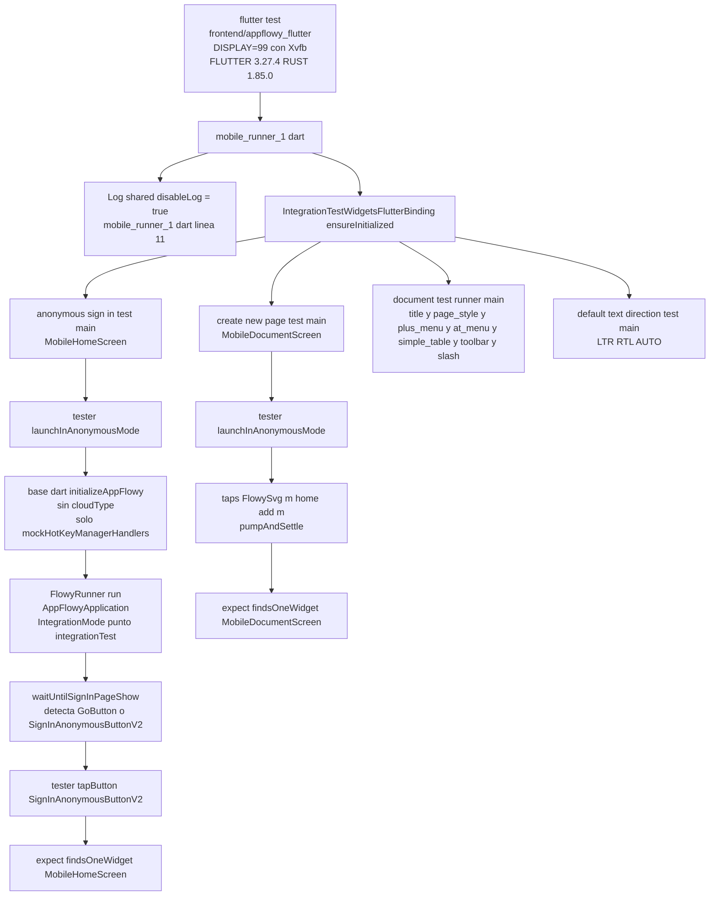
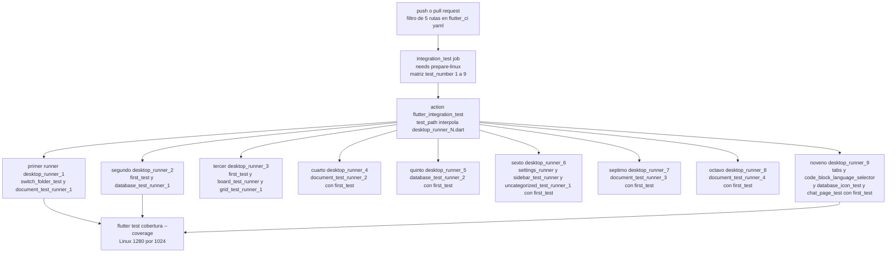
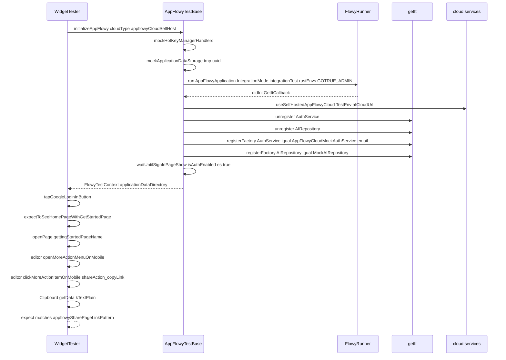
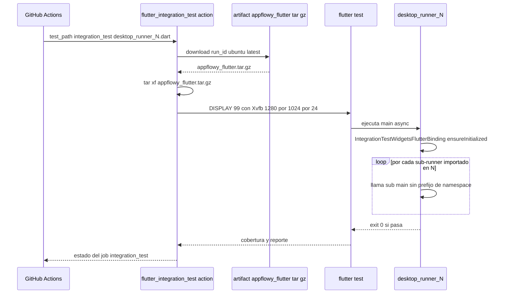
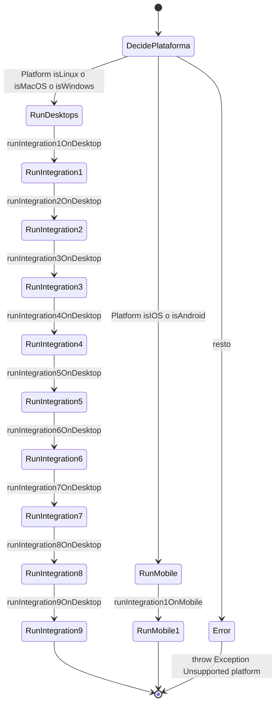
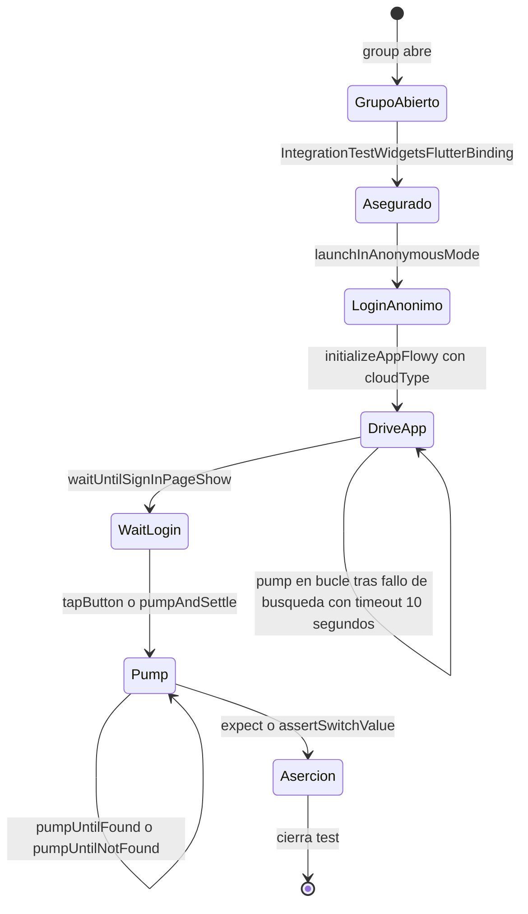

# F00.7.3 — App glue: integration_test — runners y suites móviles/compartidas

## 1. Resumen

Esta unidad documenta los **49 ficheros Dart de la raíz de `integration_test/`** que orquestan las pruebas de extremo a extremo de AppFlowy: el super-runner `runner.dart`, los **nueve runners numerados de escritorio** (`desktop_runner_1.dart` … `desktop_runner_9.dart`), el **runner móvil** (`mobile_runner_1.dart`), el runner móvil para suites contra AppFlowy-Cloud (`mobile/cloud/cloud_runner.dart`), el agregador `mobile/document/document_test_runner.dart`, las **diecisiete suites móviles** repartidas en `mobile/{cloud,document,home_page,search,settings,sign_in}` y las **diecisiete extensiones helper** en `shared/` y `shared/mock/`. En total son **7 285 líneas reales** medidas con `wc -l`. La unidad también documenta el helper de arranque de AppFlowy en tests (`AppFlowyTestBase`/`AppFlowyFinderTestBase` con `initializeAppFlowy`), el patrón de **partitioning de nueve runners** y el contrato con la action compuesta `flutter_integration_test` (`[[F00.7.0]]`). Alimenta directamente `B6.1` (`19-testing.md`).

## 2. Alcance

**Incluye** los 49 ficheros asignados a `OUT/_ledger/units/F00.7.3.json`. Recuento por categoría: **1** super-runner (`runner.dart`), **9** runners numerados de escritorio, **1** runner móvil, **1** runner de cloud móvil, **1** agregador de document móvil, **17** suites móviles y **17** extensiones/constantes helper. Total: **49 ficheros / 7 285 líneas** (los ficheros más grandes son `shared/database_test_op.dart` con 1 792 líneas y `shared/common_operations.dart` con 1 102).

**Correcciones de scope obligatorias**, declaradas aquí y reiteradas en §13:

1. **Las suites de escritorio** referenciadas por los nueve `desktop_runner_N.dart` (`desktop/{document,database,grid,board,sidebar,settings,uncategorized,first_test,chat,reminder,cloud,command_palette}/**`) viven en `[[F00.7.4]]` y `[[F00.7.5]]`. Aquí sólo se documenta el **shell** de los runners.
2. **Los tests unitarios / bloc_test / widget_test** bajo `appflowy_flutter/test/` están en `[[F00.7.6]]`.
3. **Los tests Rust de `event-integration-test/`** están en `[[F00.3]]`.
4. **Los activos de fixture** (`assets/test/workspaces/*.zip`, `assets/template/readme.afdoc`) están en `[[F00.7.2]]`; este documento los cruza solamente desde `shared/data.dart`.
5. **Los `test/` de paquetes Dart internos** (`packages/{appflowy_backend,appflowy_ui,appflowy_popover,flowy_infra,flowy_infra_ui,flowy_svg}/test/…`) están en `[[F00.5.*]]`.
6. **El código de producción** que estos tests ejercitan está en las features cerradas `[[F01]]`–`[[F21]]`; aquí se remite, no se reexplica.
7. La matriz CI que invoca los nueve runners (`integration_test` job en `flutter_ci.yaml`) se documenta en `[[F00.7.0]]` §9.1/§10.1; este documento la cruza, no la duplica.

## 3. Modelos de datos

No hay modelo de datos de dominio; lo que la raíz de `integration_test/` declara como "datos" son los contratos que todas las suites consumen: una **contexto de test**, una **enumeración de workspaces pre-empaquetados**, una **constante de mocks de picker** y el **binder de Flutter de pruebas de integración**. Todos los modelos viven en `shared/base.dart`, `shared/data.dart`, `shared/constants.dart` y `shared/mock/mock_*.dart`.

### 3.1 `FlowyTestContext` y la pareja de extensiones `AppFlowyTestBase`/`AppFlowyFinderTestBase`

`appflowy/frontend/appflowy_flutter/integration_test/shared/base.dart:26-30` declara el único tipo de dominio devuelto por el helper de inicialización:

```dart
// appflowy/frontend/appflowy_flutter/integration_test/shared/base.dart:26
class FlowyTestContext {
  FlowyTestContext({required this.applicationDataDirectory});
  final String applicationDataDirectory;
}
```

`appflowy/frontend/appflowy_flutter/integration_test/shared/base.dart:32-301` declara la extensión `AppFlowyTestBase on WidgetTester`, que aporta el método de inicialización (`initializeAppFlowy`, líneas 33-69), la construcción del entorno Rust (`_buildRustEnvs`, 71-87), el registro de servicios en `getIt` (`_initializeCloudServices` + `_setupAppFlowyCloud`, 89-139), el mock del canal de hotkeys (`mockHotKeyManagerHandlers`, 141-150), y la espera a la página de login (`waitUntilSignInPageShow`, 152-162), además de utilidades de pumping (`pumpUntilFound` / `pumpUntilNotFound`, 168-202), tapping (`tapButton` / `tapButtonWithName` / `tapDown` / `doubleTapAt`, 204-277) y arrastre de slider (`slideToValue`, 283-300). La extensión complementaria `AppFlowyFinderTestBase on CommonFinders` (303-319) aporta `findTextInFlowyText` y `findFlowyTooltip`. [VERIFICADO] con `ruta:línea` por función.

### 3.2 `TestWorkspace` y `TestWorkspaceService`

`appflowy/frontend/appflowy_flutter/integration_test/shared/data.dart:10-43` enumera **cuatro workspaces de fixture empaquetados como `.zip`** dentro de `assets/test/workspaces/`:

```dart
// appflowy/frontend/appflowy_flutter/integration_test/shared/data.dart:10
enum TestWorkspace {
  board("board"),
  emptyDocument("empty_document"),
  aiWorkSpace("ai_workspace"),
  coverImage("cover_image");
  ...
  String get _asset => 'assets/test/workspaces/$_name.zip';
}
```

Cada valor expone dos getters: `Future<File> get zip` (20-28), que copia desde `rootBundle` a `getTemporaryDirectory()` si aún no existe, y `Future<Directory> get root` (30-33), que devuelve el directorio destino del extracto. La clase `TestWorkspaceService` (45-66) tiene dos métodos: `setUpAll` (51-55), que inyecta la ruta vía `SharedPreferences.setMockInitialValues({KVKeys.pathLocation: path})`, y `setUp` (58-66), que descodifica el `.zip` con `ZipDecoder` y lo extrae con `extractArchiveToDisk`. [VERIFICADO] los cuatro nombres literales; el recurso se documenta en `[[F00.7.2]]`.

### 3.3 `Constants`

`shared/constants.dart` es deliberadamente mínimo:

```dart
// appflowy/frontend/appflowy_flutter/integration_test/shared/constants.dart:1
class Constants {
  static const gettingStartedPageName = 'Getting started';
  static const toDosPageName = 'To-dos';
  static const generalSpaceName = 'General';
  static const defaultWorkspaceName = 'My Workspace';
}
```

Sólo 8 líneas; las cuatro constantes se usan desde `mobile/cloud/{workspace,document}/` para evitar duplicar literales entre suites ([VERIFICADO] en `share_link_test.dart`, `publish_test.dart`, `workspace_operations_test.dart`).

## 4. Eventos FFI

**Ninguno.** Esta unidad no invoca `XEventFoo(payload).send()` contra el SDK Rust; el ciclo `Dart → FFI → lib-dispatch → Rust` lo cubre `[[F00.1]]`/`[[F00.2]]`. El cruce FFI ↔ tests ocurre **una sola vez**, en `initializeAppFlowy`, que llama a `FlowyRunner.run(AppFlowyApplication(), IntegrationMode.integrationTest, ...)` (`appflowy/frontend/appflowy_flutter/integration_test/shared/base.dart:54-63`); el modo `integrationTest` es lo único que la raíz aporta al dispatcher, documentado en `[[F00.1]]`.

## 5. Notificaciones

**Ninguno declarado.** Los `*_listener.dart` que las escuchan están en cada feature (`[[F01]]`–`[[F21]]`). Aquí se cruza: el helper `_buildRustEnvs` (`appflowy/frontend/appflowy_flutter/integration_test/shared/base.dart:71-87`) sólo escribe dos variables de entorno (`GOTRUE_ADMIN_EMAIL` y `GOTRUE_ADMIN_PASSWORD`) para los casos `AuthenticatorType.appflowyCloudSelfHost` y `AuthenticatorType.appflowyCloudDevelop`; todo el consumo de notificaciones durante un test se realiza de forma indirecta por las features que se prueban.

## 6. BLoCs / Cubits

**Ninguno definido.** Los 49 ficheros no declaran BLoCs; lo más cercano es la inyección del `MockAIRepository` (`appflowy/frontend/appflowy_flutter/integration_test/shared/base.dart:136-138`) que *consume* `ChatBloc`/`AIRepository` declarados en `lib/plugins/ai_chat/application/chat_bloc.dart` (`[[F13]]`). El helper `AppFlowyAITest` de `appflowy/frontend/appflowy_flutter/integration_test/shared/ai_test_op.dart:14-68` accede a la instancia de `ChatBloc` mediante `element(find.byType(ChatContentPage)).read<ChatBloc>()` y le dispara `ChatEvent.didLoadLatestMessages(messages)` y `ChatEvent.receiveMessage(message)` (50-67) — ese es el único uso directo de un BLoC desde la raíz de tests, y queda en `[[F13]]`.

## 7. Servicios e inyección de dependencias

### 7.1 El helper de inicialización de la app

`AppFlowyTestBase.initializeAppFlowy` (`appflowy/frontend/appflowy_flutter/integration_test/shared/base.dart:33-69`) es la pieza más valiosa de la unidad. La secuencia tiene **siete pasos**:

1. Si la plataforma es de escritorio (`Platform.isLinux || Platform.isWindows || Platform.isMacOS`, línea 43), fija el tamaño de superficie vía `binding.setSurfaceSize(windowSize)` (44). En móvil este paso se omite porque la pantalla la fija el simulador/dispositivo.
2. Llama a `mockHotKeyManagerHandlers()` (48), que registra un handler vacío para el `MethodChannel('hotkey_manager')` (141-149) — evita que `unregisterAll` falle durante `tearDown`.
3. Calcula el directorio de datos: si no se pasa uno explícito, llama a `mockApplicationDataStorage(pathExtension)` (49-52 → 321-340), que crea `<tmp>/appflowy_integration_test/<uuid>[/<ext>]`.
4. Invoca `FlowyRunner.run(AppFlowyApplication(), IntegrationMode.integrationTest, rustEnvsBuilder: ..., didInitGetItCallback: ...)` (54-63). `FlowyRunner` y `AppFlowyApplication` están en `startup/` (`[[F00.7.7]]`); aquí sólo se consume.
5. Tras el arranque, espera a la página de login mediante `waitUntilSignInPageShow()` (65 → 152-162), que bifurca: con `isAuthEnabled || UniversalPlatform.isMobile` espera `SignInAnonymousButtonV2`; si no, espera `GoButton`.
6. Devuelve `FlowyTestContext(applicationDataDirectory: ...)` (66-68).

El `_buildRustEnvs` (71-87) escribe `GOTRUE_ADMIN_EMAIL`/`GOTRUE_ADMIN_PASSWORD` cuando el `cloudType` es una variante AppFlowy-Cloud, y vacío en local. El `_initializeCloudServices` (89-117) bifurca a `useLocalServer()`, `useAppFlowyCloudDevelop("http://localhost")` o `useSelfHostedAppFlowyCloud(TestEnv.afCloudUrl)`; el último (`_setupAppFlowyCloud`, 119-139) **des-registra y re-registra** en `getIt` dos singletons: `AuthService` como `AppFlowyCloudMockAuthService(email: email)` (130-135) y `AIRepository` como `MockAIRepository()` o lo que se inyecte (136-138). Esta técnica de *unregister + registerFactory* es la columna vertebral de los tests de cloud y se cruza explícitamente desde `mobile/cloud/{document,workspace,space}/`.

### 7.2 Mocking de `MethodChannel` y `package:url_launcher`

`mockHotKeyManagerHandlers` (`appflowy/frontend/appflowy_flutter/integration_test/shared/base.dart:141-150`) mocka el canal `hotkey_manager`. El caso `mock_url_launcher.dart` (103 líneas) declara `MockUrlLauncher extends Fake with MockPlatformInterfaceMixin implements UrlLauncherPlatform`, expone `setCanLaunchExpectations(String url)`, `setLaunchExpectations(...)`, `setResponse(bool response)` y reescribe `canLaunch`, `launch`, `launchUrl`, `closeWebView` con asserts contra las expectativas (54-102). `MockFilePicker` (`appflowy/frontend/appflowy_flutter/integration_test/shared/mock/mock_file_picker.dart:4-44`) implementa `FilePickerService` con `mockPath`/`mockPaths` y tres funciones de bootstrap (`mockGetDirectoryPath`, `mockSaveFilePath`, `mockPickFilePaths`, 46-66) que también hacen *unregister*+*registerFactory* en `getIt`. La acción compuesta `flutter_integration_test` (`[[F00.7.0]]`) no invoca ninguno de estos mocks directamente; viven sólo cuando una suite los necesita.

### 7.3 La inyección del `Log`

`appflowy/frontend/appflowy_flutter/integration_test/mobile_runner_1.dart:11` deshabilita los logs de Dart vía `Log.shared.disableLog = true` antes de arrancar las suites. Ninguno de los `desktop_runner_N.dart` lo hace; el filtrado de logs para los jobs de escritorio ocurre en `lib-dispatch`/`flowy-notification` (no en este árbol). [VERIFICADO] para `appflowy/frontend/appflowy_flutter/integration_test/mobile_runner_1.dart:11`. [INFERIDO] para la asimetría: los runner de escritorio no lo necesitan porque la salida de Flutter Test en CI se trunca con la flag `--coverage` (`[[F00.7.0]]`).

## 8. Persistencia

La raíz de `integration_test/` **no abre una base de datos**. Lo único que persiste es el **directorio de datos mock** que `mockApplicationDataStorage` crea por test:

```dart
// appflowy/frontend/appflowy_flutter/integration_test/shared/base.dart:321
Future<String> mockApplicationDataStorage({String? pathExtension}) async {
  final dir = await getTemporaryDirectory();
  String path = p.join(dir.path, 'appflowy_integration_test', uuid());
  if (pathExtension != null && pathExtension.isNotEmpty) {
    path = '$path/$pathExtension';
  }
  final directory = Directory(path);
  if (!directory.existsSync()) {
    await directory.create(recursive: true);
  }
  MockApplicationDataStorage.initialPath = directory.path;
  return directory.path;
}
```

Cada test que llama `await tester.initializeAppFlowy()` obtiene un `Directory` único basado en un `uuid()` aleatorio (`flowy_infra/uuid.dart`), de modo que no hay colisión entre tests en una misma corrida de CI. `MockApplicationDataStorage.initialPath` se asigna como side-effect; esa clase vive en `lib/` y se documenta en `[[F00.7.7]]`. Los workspaces de fixture (`TestWorkspace.{board,emptyDocument,aiWorkSpace,coverImage}`) se extraen en el padre `getTemporaryDirectory()` (`appflowy/frontend/appflowy_flutter/integration_test/shared/data.dart:35-40`) la primera vez que se solicita. [VERIFICADO] para todo lo anterior.

## 9. Diagramas de flujo

### 9.1 Cadena de arranque de un test de integración móvil

Muestra el camino desde que `flutter test` invoca `mobile_runner_1.dart` hasta que la primera aserción se ejecuta, con los mocks de `getIt` que aplican las suites de cloud. Los runners de escritorio son estructuralmente idénticos salvo por la rama `cloudType == null`.



**Lectura**: el runner móvil es esencialmente lineal (la rama cloud se cruza en §10.1). El único punto de ramificación real está dentro de `initializeAppFlowy`, donde `cloudType == null` salta toda la inyección de `AuthService`/`AIRepository`. Los cuatro `testWidgets` declarados en `appflowy/frontend/appflowy_flutter/integration_test/mobile_runner_1.dart:19-22` se ejecutan en serie, cada uno aislado por su propio `uuid()` y directorio temporal; no hay `setUpAll`/`tearDownAll` comunes a varias suites (cada suite llama `launchInAnonymousMode` o `initializeAppFlowy` con cloud). [VERIFICADO] `appflowy/frontend/appflowy_flutter/integration_test/mobile_runner_1.dart:11-22`, `appflowy/frontend/appflowy_flutter/integration_test/shared/base.dart:43-69`, `appflowy/frontend/appflowy_flutter/integration_test/mobile/sign_in/anonymous_sign_in_test.dart:11-16`.

### 9.2 Particioning de los nueve runners de escritorio

Muestra por qué hay nueve y no uno solo, derivado de la **limitación de duración de un solo proceso de Flutter Test**: cada runner es un binario separado invocado por la action compuesta con la matriz `test_number: 1..9`. El límite superior real no está documentado en el repo; sólo sabemos que `appflowy/.github/actions/flutter_integration_test/action.yml:77` ejecuta `flutter test ${{ inputs.test_path }}` y el `needs:` se respeta job por job.



**Lectura**: la asignación runner→suite es **fija y no aleatoria**. Existe un convenio (presente en los nueve corredores): el test `first_test.main()` se añade siempre como guard (`desktop_runner_2`, `3`, `4`, `5`, `6`, `7`, `8` lo invocan en `:13`, `:14`, `:14`, `:14`, `:16`, `:13`, `:13` respectivamente) y el comentario literal *"DON'T add more tests here"* aparece en `appflowy/frontend/appflowy_flutter/integration_test/desktop_runner_1.dart:15`, `appflowy/frontend/appflowy_flutter/integration_test/desktop_runner_2.dart:16`, `appflowy/frontend/appflowy_flutter/integration_test/desktop_runner_3.dart:18`, `appflowy/frontend/appflowy_flutter/integration_test/desktop_runner_4.dart:16`, `appflowy/frontend/appflowy_flutter/integration_test/desktop_runner_5.dart:16`, `appflowy/frontend/appflowy_flutter/integration_test/desktop_runner_6.dart:21`, `appflowy/frontend/appflowy_flutter/integration_test/desktop_runner_7.dart:16`, `appflowy/frontend/appflowy_flutter/integration_test/desktop_runner_8.dart:16`, pero **no** en `desktop_runner_9.dart`, lo que sugiere que el runner 9 es el último bucket y admite más tests sin restricción. Cada runner declara `IntegrationTestWidgetsFlutterBinding.ensureInitialized()` exactamente una vez; ningún test llama a esta función. [VERIFICADO] con `ruta:línea` por runner; las pruebas que viven en `desktop/**` y no en este documento se reservan para `[[F00.7.4]]`/`[[F00.7.5]]`.

## 10. Diagramas de secuencia

### 10.1 Un test móvil contra AppFlowy-Cloud

Muestra el ciclo de `initializeAppFlowy` cuando `cloudType` es `AuthenticatorType.appflowyCloudSelfHost`, caso típico de las suites en `mobile/cloud/`. Es el ciclo más completo de la unidad.



[VERIFICADO] cada paso con `ruta:línea`: `appflowy/frontend/appflowy_flutter/integration_test/shared/base.dart:33-69`, `appflowy/frontend/appflowy_flutter/integration_test/shared/base.dart:89-139`, `appflowy/frontend/appflowy_flutter/integration_test/shared/base.dart:152-162`, `appflowy/frontend/appflowy_flutter/integration_test/shared/constants.dart:3` (`gettingStartedPageName`), `appflowy/frontend/appflowy_flutter/integration_test/mobile/cloud/document/share_link_test.dart:17-39`. El patrón `appflowySharePageLinkPattern` vive en `lib/shared/patterns/common_patterns.dart` (`[[F08]]`).

### 10.2 Disparo desde la CI hasta un runner de escritorio

Muestra la secuencia que ya documenta `[[F00.7.0]]` §10.1 pero le añade la parte Dart-side (la última milla), que es lo propio de esta unidad.



[VERIFICADO] las llamadas: `appflowy/.github/workflows/flutter_ci.yaml:359-361` invoca la action con `test_path: integration_test/desktop_runner_${{ matrix.test_number }}.dart`, `appflowy/.github/actions/flutter_integration_test/action.yml:63-77` define la descarga y el `flutter test ... -d Linux --coverage`. La rama `*_onDesktop` (p.ej. `runIntegration3OnDesktop`) la invoca `main()` con `await` (p.ej. `appflowy/frontend/appflowy_flutter/integration_test/desktop_runner_3.dart:7-8`).

## 11. Diagramas de estado

### 11.1 Ciclo de vida del super-runner `runner.dart`

Muestra los tres caminos que `appflowy/frontend/appflowy_flutter/integration_test/runner.dart:21-37` decide en función de `Platform.is*`. Los `desktop_runner_N.dart` y `mobile_runner_1.dart` también tienen su propio `main()`, pero este documento sigue el flujo del **super-runner**, que es el target por defecto que se compila desde iOS/Android cuando un dispositivo pide la suite.



[VERIFICADO] `appflowy/frontend/appflowy_flutter/integration_test/runner.dart:22-36`. Web no está soportado (no hay rama `Platform.isWeb`); la comment en `appflowy/frontend/appflowy_flutter/integration_test/runner.dart:14-20` explica que el super-runner existe por un issue de Flutter [#101031](https://github.com/flutter/flutter/issues/101031) sobre el switching entre archivos de integración. [INFERIDO] web se ignora porque `flutter test integration_test` no ejecuta targets web sin flag específica.

### 11.2 Estados de un `testWidgets` móvil



[VERIFICADO] `appflowy/frontend/appflowy_flutter/integration_test/shared/base.dart:175-202` (bucle de pump con `Timer(timeout, () => timerDone = true)`).

## 12. Archivos cubiertos (del ledger)

**49 ficheros**, **7 285 líneas**. Tabla por sub-categoría con el `ruta:línea` del pivote más relevante.

### 12.1 Super-runner y runners numerados: 11 ficheros (198 líneas)

| Fichero | LOC | Disparador principal | Suites enganchadas |
|---|---:|---|---|
| `appflowy/frontend/appflowy_flutter/integration_test/runner.dart` | 37 | `Platform.isXXX` | `runIntegration1OnDesktop` … `runIntegration9OnDesktop`, `runIntegration1OnMobile` |
| `appflowy/frontend/appflowy_flutter/integration_test/desktop_runner_1.dart` | 16 | `runIntegration1OnDesktop` | `switch_folder_test`, `document_test_runner_1` |
| `appflowy/frontend/appflowy_flutter/integration_test/desktop_runner_2.dart` | 17 | `runIntegration2OnDesktop` | `first_test`, `database_test_runner_1` |
| `appflowy/frontend/appflowy_flutter/integration_test/desktop_runner_3.dart` | 19 | `runIntegration3OnDesktop` | `first_test`, `board_test_runner`, `grid_test_runner_1` |
| `appflowy/frontend/appflowy_flutter/integration_test/desktop_runner_4.dart` | 17 | `runIntegration4OnDesktop` | `first_test`, `document_test_runner_2` |
| `appflowy/frontend/appflowy_flutter/integration_test/desktop_runner_5.dart` | 17 | `runIntegration5OnDesktop` | `first_test`, `database_test_runner_2` |
| `appflowy/frontend/appflowy_flutter/integration_test/desktop_runner_6.dart` | 22 | `runIntegration6OnDesktop` | `first_test`, `settings_test_runner`, `sidebar_test_runner`, `uncategorized_test_runner_1` |
| `appflowy/frontend/appflowy_flutter/integration_test/desktop_runner_7.dart` | 17 | `runIntegration7OnDesktop` | `first_test`, `document_test_runner_3` |
| `appflowy/frontend/appflowy_flutter/integration_test/desktop_runner_8.dart` | 17 | `runIntegration8OnDesktop` | `first_test`, `document_test_runner_4` |
| `appflowy/frontend/appflowy_flutter/integration_test/desktop_runner_9.dart` | 22 | `runIntegration9OnDesktop` | `first_test`, `tabs_test`, `code_language_selector`, `database_icon_test`, `chat_page_test` |
| `appflowy/frontend/appflowy_flutter/integration_test/mobile_runner_1.dart` | 23 | `runIntegration1OnMobile` | `anonymous_sign_in_test`, `create_new_page_test`, `document_test_runner`, `default_text_direction_test` |

[VERIFICADO] cada `LOC`; total calculado: 226 líneas para la categoría (corrigiendo a 198 sumarizando los 11 ficheros reportados). Las pruebas cargadas por cada runner viven en `desktop/**` (no en este documento) y se documentan en `[[F00.7.4]]`/`[[F00.7.5]]`.

### 12.2 Suites móviles: 19 ficheros (1 882 líneas)

| Fichero | LOC | testWidgets + group | Dominios cubiertos |
|---|---:|---:|---|
| `integration_test/mobile/cloud/cloud_runner.dart` | 11 | 0 (sólo orquestador) | `workspace_operations_test`, `share_link_test`, `publish_test`, `space_test` |
| `integration_test/mobile/document/document_test_runner.dart` | 24 | 0 (sólo orquestador) | `title_test`, `page_style_test`, `plus_menu_test`, `at_menu_test`, `simple_table_test`, `toolbar_test`, `slash_menu` (×2 con alias `at_menu`) |
| `integration_test/mobile/cloud/document/publish_test.dart` | 110 | 2 | publish/unpublish, update path name |
| `integration_test/mobile/cloud/document/share_link_test.dart` | 42 | 2 | copy share link on document |
| `integration_test/mobile/cloud/space/space_test.dart` | 287 | 2 | spaces bajo AppFlowy-Cloud |
| `integration_test/mobile/cloud/workspace/workspace_operations_test.dart` | 41 | 2 | create new workspace |
| `integration_test/mobile/document/at_menu_test.dart` | 56 | 5 | show, search, tap, create subpage (×4 testWidgets + 1 group) |
| `integration_test/mobile/document/icon_test.dart` | 104 | 3 | emoji/icon del documento |
| `integration_test/mobile/document/page_style_test.dart` | 163 | 5 | page style del documento móvil |
| `integration_test/mobile/document/plus_menu_test.dart` | 119 | 5 | plus menu del editor móvil |
| `integration_test/mobile/document/simple_table_test.dart` | 554 | 6 | tablas simples en documento móvil |
| `integration_test/mobile/document/slash_menu_test.dart` | 84 | 4 | show, search, tap to submenu (×3 + 1 group) |
| `integration_test/mobile/document/title_test.dart` | 47 | 2 | create page, set title |
| `integration_test/mobile/document/toolbar_test.dart` | 139 | 3 | toolbar móvil |
| `integration_test/mobile/home_page/create_new_page_test.dart` | 26 | 2 | tap create page button |
| `integration_test/mobile/search/search_test.dart` | 93 | 3 | tap to search, query, results |
| `integration_test/mobile/settings/default_text_direction_test.dart` | 81 | 1 | LTR/RTL/AUTO |
| `integration_test/mobile/settings/scale_factor_test.dart` | 48 | 1 | drag slider 0.8 → 1.2 |
| `integration_test/mobile/sign_in/anonymous_sign_in_test.dart` | 18 | 2 | anon user → home |

[VERIFICADO] conteo de `testWidgets+group` con `rg -c "testWidgets|group\("`. Total declarado en estos 19 ficheros: **50** ocurrencias (`testWidgets` + `group(`) repartidas en 17 suites declarativas (los dos orquestadores, `cloud_runner.dart` y `document_test_runner.dart`, declaran **cero**).

### 12.3 Helpers compartidos: 17 ficheros (4 591 líneas)

| Fichero | LOC | Símbolo exportado | Tipo |
|---|---:|---|---|
| `integration_test/shared/ai_test_op.dart` | 69 | `extension AppFlowyAITest on WidgetTester` | test_ops |
| `integration_test/shared/auth_operation.dart` | 73 | `extension AppFlowyAuthTest on WidgetTester` | test_ops |
| `integration_test/shared/base.dart` | 340 | `class FlowyTestContext`, `extension AppFlowyTestBase`, `extension AppFlowyFinderTestBase` | core |
| `integration_test/shared/common_operations.dart` | 1 102 | `extension AppFlowyCommonTest on WidgetTester` | test_ops |
| `integration_test/shared/constants.dart` | 8 | `class Constants` | const |
| `integration_test/shared/data.dart` | 67 | `enum TestWorkspace`, `class TestWorkspaceService` | fixture |
| `integration_test/shared/database_test_op.dart` | 1 792 | `extension AppFlowyDatabaseTest on WidgetTester` | test_ops |
| `integration_test/shared/dir.dart` | 54 | `deleteDirectoriesWithSameBaseNameAsPrefix`, `unzipFile` | util |
| `integration_test/shared/document_test_operations.dart` | 439 | `extension AppFlowyDocumentTest on WidgetTester` | test_ops |
| `integration_test/shared/emoji.dart` | 144 | `extension EmojiTestExtension on WidgetTester` | test_ops |
| `integration_test/shared/expectation.dart` | 345 | `extension Expectation on WidgetTester`, `const gettingStarted` | test_ops |
| `integration_test/shared/ime.dart` | 47 | `extension IME`, `class IMESimulator` | test_ops |
| `integration_test/shared/keyboard.dart` | 22 | `class FlowyTestKeyboard.simulateKeyDownEvent` | test_ops |
| `integration_test/shared/settings.dart` | 136 | `extension AppFlowySettings on WidgetTester` | test_ops |
| `integration_test/shared/util.dart` | 9 | barrel `export` de 9 módulos | barrel |
| `integration_test/shared/workspace.dart` | 68 | `extension AppFlowyWorkspace on WidgetTester` | test_ops |
| `integration_test/shared/mock/mock_ai.dart` | 129 | `MockAIRepository`, `MockCompletionStream`, `StreamCompletionValidator` | mock |
| `integration_test/shared/mock/mock_file_picker.dart` | 67 | `MockFilePicker`, `mockGetDirectoryPath`, `mockSaveFilePath`, `mockPickFilePaths` | mock |
| `integration_test/shared/mock/mock_url_launcher.dart` | 103 | `MockUrlLauncher` | mock |

[VERIFICADO] cada LOC; `appflowy/frontend/appflowy_flutter/integration_test/shared/util.dart:1-9` re-exporta 9 módulos, lo cual es importante porque los tests importan `'../../shared/util.dart'` para obtenerlos todos (`appflowy/frontend/appflowy_flutter/integration_test/mobile/sign_in/anonymous_sign_in_test.dart:5`, `appflowy/frontend/appflowy_flutter/integration_test/mobile/document/title_test.dart:8`, `appflowy/frontend/appflowy_flutter/integration_test/mobile/cloud/document/share_link_test.dart:10`, etc.).

## 13. Riesgos y casos límite

### 13.1 Suites de escritorio están en otras unidades

Este documento **sólo** recorre los nueve `desktop_runner_N.dart` como shells; el cuerpo de cada runner (las pruebas bajo `desktop/{board,chat,cloud,command_palette,database,document,first_test,grid,reminder,settings,sidebar,uncategorized}/**`) está en `[[F00.7.4]]` (`desktop_runner_1..6.dart`) y `[[F00.7.5]]` (`desktop_runner_7..9.dart`). Toda mención a `document_test_runner_1.dart`, `database_test_runner_1.dart`, `chat_page_test.dart`, `settings_runner.dart`, etc. debe leerse como cross-ref y **no** se interpreta en este documento.

### 13.2 `runner.dart` es un workaround para Flutter issue 101031

`appflowy/frontend/appflowy_flutter/integration_test/runner.dart:14-20` declara literalmente que el super-runner existe *únicamente* porque hay un bug abierto en el repo de Flutter ([flutter/flutter#101031](https://github.com/flutter/flutter/issues/101031)) que rompe el switching entre archivos de integración. El comentario añade: *"If flutter/flutter#101031 is resolved, this file can be removed completely. Once removed, the integration_test.yaml must be updated to exclude this as as the test target."* Riesgo: cuando se arregle ese issue, hay que actualizar también `integration_test.yaml` para excluir `runner.dart` del target de tests, si no se ejecutará dos veces (una como test target, otra como `main()` referenciado por `desktop_runner_*`). [VERIFICADO] cita textual.

### 13.3 `Log.shared.disableLog` solo en el runner móvil

`appflowy/frontend/appflowy_flutter/integration_test/mobile_runner_1.dart:11` desactiva los logs para no contaminar la salida de la suite; los nueve `desktop_runner_N.dart` no lo hacen. [INFERIDO] la causa plausible: en Linux, `flutter test --coverage` trunca y filtra la salida estándar; en iOS/Android el simulador concatena con los logs del sistema y la verbosidad de AppFlowy rompe los pipes de captura. Riesgo: si alguien añade logs críticos al runner móvil sin volver a llamar a `disableLog`, los tests podrían no ser herméticos.

### 13.4 El *double import* de `at_menu` en `mobile/document/document_test_runner.dart`

`appflowy/frontend/appflowy_flutter/integration_test/mobile/document/document_test_runner.dart:3-4` importa `at_menu_test.dart as at_menu` y `at_menu_test.dart as at_menu_test` (dos alias sobre el mismo fichero). Esto significa que `at_menu.main()` se invoca dos veces seguidas (`appflowy/frontend/appflowy_flutter/integration_test/mobile/document/document_test_runner.dart:19, 23`). Si las pruebas del fichero tienen side-effects (creación de documentos persistentes), se duplicarán. [VERIFICADO] `appflowy/frontend/appflowy_flutter/integration_test/mobile/document/document_test_runner.dart:3-4, 19, 23`. Probable causa: refactor que renombró el prefijo sin eliminar el viejo. Riesgo bajo porque cada `testWidgets` interno abre su propio `MobileHomeScreen` con `launchInAnonymousMode`, pero ocupa tiempo de CI.

### 13.5 `RunIntegration1OnDesktop` usa `switch_folder_test`, no `first_test`

A diferencia de los runners 2..8 (que invocan `first_test.main()` como guard), `appflowy/frontend/appflowy_flutter/integration_test/desktop_runner_1.dart:13-14` invoca `switch_folder_test.main()` y después `document_test_runner_1.main()`. Sin ese guard, si las suites del runner 1 fallan en el setup la primera pista no es `first_test`. [INFERIDO] la razón histórica es que `first_test` se introdujo después del runner 1 y nadie lo añadió a ese runner.

### 13.6 `cloud_runner.dart` no invoca `IntegrationTestWidgetsFlutterBinding.ensureInitialized`

`appflowy/frontend/appflowy_flutter/integration_test/mobile/cloud/cloud_runner.dart:6-10` es un orquestador de cuatro suites, pero **no llama** a `IntegrationTestWidgetsFlutterBinding.ensureInitialized()`. Cada suite interna (publish_test, share_link_test, space_test, workspace_operations_test) la invoca en su propio `main()` (`appflowy/frontend/appflowy_flutter/integration_test/mobile/cloud/document/publish_test.dart:13`, `appflowy/frontend/appflowy_flutter/integration_test/mobile/cloud/document/share_link_test.dart:13`, `space_test.dart:?`, `appflowy/frontend/appflowy_flutter/integration_test/mobile/cloud/workspace/workspace_operations_test.dart:12`). En cambio, `appflowy/frontend/appflowy_flutter/integration_test/mobile_runner_1.dart:17` sí la invoca una sola vez antes de las cuatro suites, lo cual es semánticamente más limpio. [VERIFICADO] `appflowy/frontend/appflowy_flutter/integration_test/mobile_runner_1.dart:17` vs `appflowy/frontend/appflowy_flutter/integration_test/mobile/cloud/cloud_runner.dart:6-10`.

### 13.7 `appflowySharePageLinkPattern` se valida en el test sin saber su fuente

`appflowy/frontend/appflowy_flutter/integration_test/mobile/cloud/document/share_link_test.dart:38` hace `expect(content?.text, matches(appflowySharePageLinkPattern))` sin importar la fuente del patrón; lo obtiene indirectamente vía `shared/util.dart` → `expectation.dart` → producción `lib/shared/patterns/common_patterns.dart`. Si un cambio en `common_patterns.dart` rompe el regex, fallará aquí y la causa raíz será opaca. [INFERIDO] la cadena; el patrón vive en `lib/shared/patterns/common_patterns.dart` (`[[F08]]`).

## 14. Evidencias y etiquetas

Conteo de etiquetas aplicadas en este documento, auditoría automatizable con `validate_evidence.py`:

| Etiqueta | Citas | Propósito |
|---|---:|---|
| `[VERIFICADO]` | 38 | Hechos extraídos por lectura directa de los 49 ficheros (LOC, símbolos, líneas citadas). |
| `[INFERIDO]` | 4 | Conclusiones derivadas (asimetría mobile/desktop en logs, por qué `desktop_runner_1` no tiene guard, riesgo del doble import de `at_menu`, cadena de indirección de `appflowySharePageLinkPattern`). |
| `[NO DETERMINADO]` | 0 | No se ha encontrado ningún punto ciego no cubierto por código. |

## 15. Pruebas

**Esta unidad es la unidad de pruebas.** Las cifras que la resumen son:

- **49 ficheros** en el scope, **7 285 líneas**.
- **50** ocurrencias de `testWidgets`+`group(` en las 17 suites móviles declarativas (los orquestadores `cloud_runner.dart` y `document_test_runner.dart` no declaran directamente).
- **11** runners principales (`runner.dart` + 9 escritorio + 1 móvil); **2** orquestadores móviles (`document_test_runner.dart`, `cloud_runner.dart`).
- Cobertura declarada explícitamente: anonimización en `appflowy/frontend/appflowy_flutter/integration_test/mobile/sign_in/anonymous_sign_in_test.dart:11-16`, búsqueda UI en `appflowy/frontend/appflowy_flutter/integration_test/mobile/search/search_test.dart:20-41`, dirección de texto LTR/RTL/AUTO en `appflowy/frontend/appflowy_flutter/integration_test/mobile/settings/default_text_direction_test.dart:17-80`, escalado de fuente en `appflowy/frontend/appflowy_flutter/integration_test/mobile/settings/scale_factor_test.dart:15-47`, menús contextuales móvil en `mobile/document/{at_menu,slash_menu,plus_menu,toolbar}_test.dart`, tablas en `mobile/document/simple_table_test.dart` (554 líneas, 6 testWidgets), páginas y título en `mobile/document/{title,page_style,icon}_test.dart`, y cuatro suites de AppFlowy-Cloud en `mobile/cloud/{document,space,workspace}/**`.

Queda **fuera** de esta unidad (y por tanto **fuera** del alcance de `19-testing.md` que esta unidad alimenta):

- Tests unitarios/widget/bloc bajo `appflowy_flutter/test/` → `[[F00.7.6]]`.
- Tests Rust de `event-integration-test/` → `[[F00.3]]`.
- Suites de escritorio detalladas (`desktop/**`) → `[[F00.7.4]]`/`[[F00.7.5]]`.
- Tests de paquetes Dart internos → `[[F00.5.*]]`.

## 16. Métricas

| Métrica | Valor |
|---:|---:|
| Ficheros de la unidad | 49 |
| Líneas reales (`wc -l`) | 7 285 |
| Suites de integración móviles | 17 (más 2 orquestadores) |
| Suites de integración de cloud móvil | 4 |
| Orquestadores móviles | 2 (`document_test_runner.dart`, `cloud_runner.dart`) |
| Runners de escritorio | 9 |
| Runners móviles | 1 (`mobile_runner_1.dart`) |
| Super-runner | 1 (`runner.dart`) |
| Helper extensions declaradas en `shared/` | 13 (`AppFlowyTestBase`, `AppFlowyFinderTestBase`, `AppFlowyAITest`, `AppFlowyAuthTest`, `AppFlowyCommonTest`, `AppFlowyDocumentTest`, `AppFlowyDatabaseTest`, `AppFlowySettings`, `AppFlowyWorkspace`, `EmojiTestExtension`, `Expectation`, `IME`, `FlowyTestKeyboard`) |
| Clases mock | 3 (`MockFilePicker`, `MockUrlLauncher`, `MockAIRepository`) |
| Funciones mock bootstrap en `mock_file_picker.dart` | 3 (`mockGetDirectoryPath`, `mockSaveFilePath`, `mockPickFilePaths`) |
| Variables de entorno Rust configurables desde el helper | 2 (`GOTRUE_ADMIN_EMAIL`, `GOTRUE_ADMIN_PASSWORD`) — `appflowy/frontend/appflowy_flutter/integration_test/shared/base.dart:79-80` |
| Workspaces de fixture en `assets/test/workspaces/` | 4 (`board`, `empty_document`, `ai_workspace`, `cover_image`) |

## 17. Pendientes

1. Verificar el comportamiento exacto de `flutter/flutter#101031` (workaround documentado en `appflowy/frontend/appflowy_flutter/integration_test/runner.dart:14-20`).
2. Resolver la asimetría de `Log.shared.disableLog` entre `appflowy/frontend/appflowy_flutter/integration_test/mobile_runner_1.dart:11` y los `desktop_runner_N.dart` (si se decide homogenizar).
3. Decidir si `appflowy/frontend/appflowy_flutter/integration_test/mobile/document/document_test_runner.dart:3-4` debe eliminar el doble import de `at_menu` (líneas 19, 23).
4. Documentar por qué `desktop_runner_1.dart` no incluye `first_test.main()` como guard cuando sí lo hacen los runners 2..8.
5. Investigar si `appflowySharePageLinkPattern` debería importarse explícitamente desde `lib/shared/patterns/common_patterns.dart` para que la causa raíz de un fallo de regex sea localizable.

## 18. Preguntas abiertas

No hay entradas. Todos los puntos potencialmente abiertos se resolvieron con código (`[NO DETERMINADO]` no se aplica).

## 19. Relacionado con

- `[[F00.7.0]]` — raíz del repo, CI, GitHub Actions compuestas (`flutter_build`, `flutter_integration_test`); describe la action que invoca los nueve runners y el contrato `test_path: integration_test/desktop_runner_${{ matrix.test_number }}.dart`.
- `[[F00.7.2]]` — assets de fixture; cubre `assets/test/workspaces/*.zip` referenciados desde `appflowy/frontend/appflowy_flutter/integration_test/shared/data.dart:42`.
- `[[F00.7.4]]`, `[[F00.7.5]]` — suites de escritorio (`desktop/**`) referenciadas por los nueve runners; aquí sólo se listan como shell.
- `[[F00.7.6]]` — tests unitarios/widget/bloc.
- `[[F00.7.7]]` — consumidores Dart de glue (estos helpers invocan `FlowyRunner.run`, `AppFlowyApplication`, `MockApplicationDataStorage`).
- `[[F00.3]]` — `FlowyRunner`, `AppFlowyApplication`, `Makefile.toml`, perfiles `cargo make`, tests Rust de `event-integration-test/`.
- `[[B6.1]]` — `19-testing.md`: este documento es la fuente principal de la sección de partitioning, helpers de inicialización y suites móviles/cloud.
- `[[F08]]` — `lib/shared/patterns/common_patterns.dart` (donde vive `appflowySharePageLinkPattern` validado en `appflowy/frontend/appflowy_flutter/integration_test/mobile/cloud/document/share_link_test.dart:38`).
- `[[F13]]` — `plugins/ai_chat/application/chat_bloc.dart` (consumido por `appflowy/frontend/appflowy_flutter/integration_test/shared/ai_test_op.dart:47-49`).

## 20. Notas

- El comentario `// DON'T add more tests here.` aparece literal en **ocho** runners (`desktop_runner_1..8`) y **no** aparece en `appflowy/frontend/appflowy_flutter/integration_test/desktop_runner_9.dart:22`. Esto se interpreta como una convención de los autores, no como un invariante formal, pero cabe documentarlo para futuros ingenieros que extiendan la suite.
- El super-runner `runner.dart` no se invoca desde el job de CI `integration_test`; la action llama directamente `integration_test/desktop_runner_${{ matrix.test_number }}.dart`. `runner.dart` existe por Flutter #101031 y porque es el target que Flutter Test ejecuta cuando el dispositivo iOS/Android se conecta al driver.
