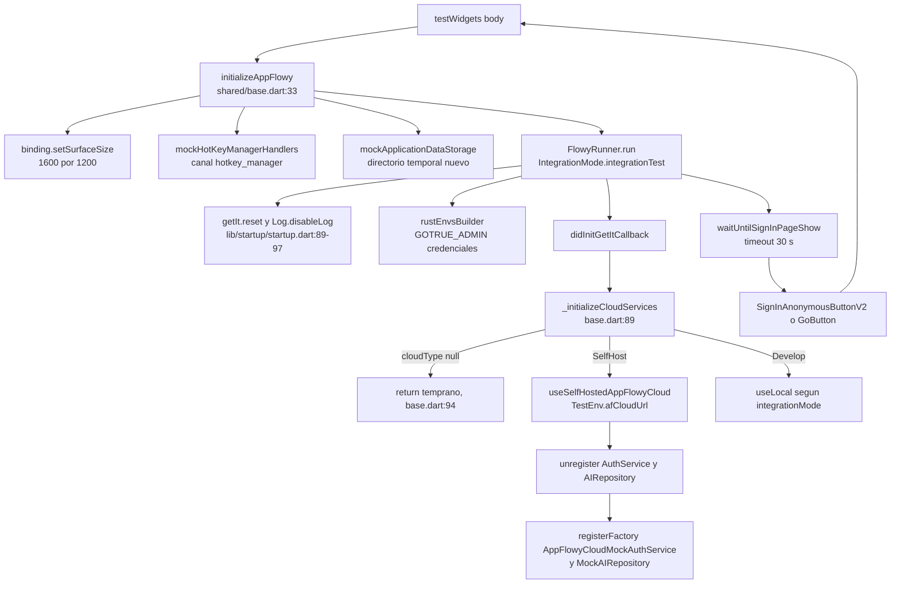
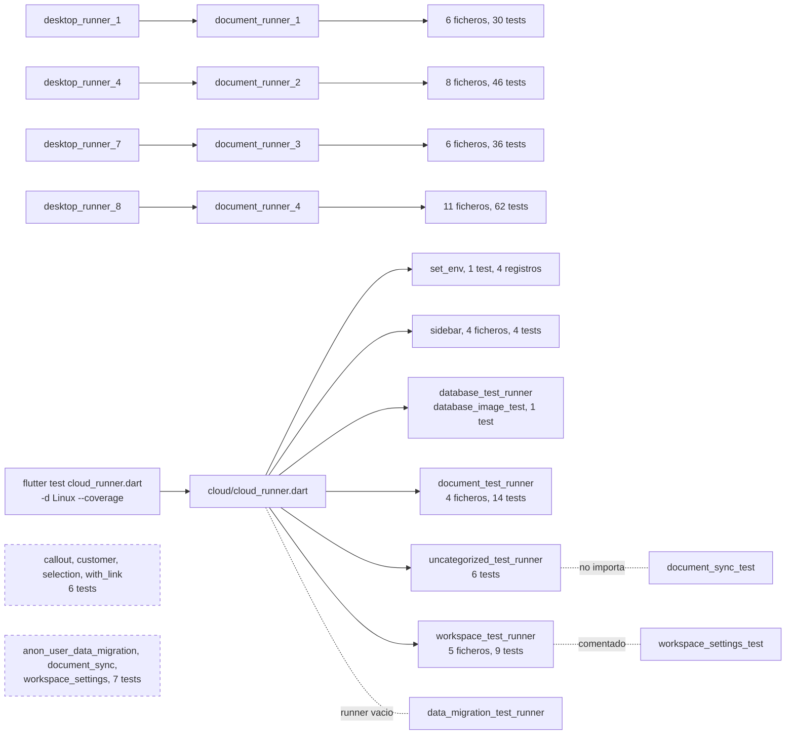
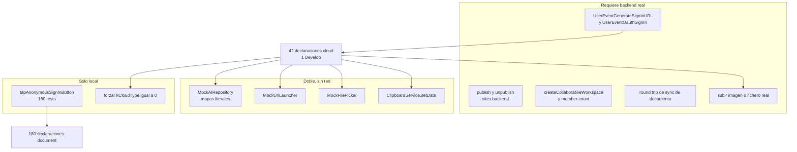
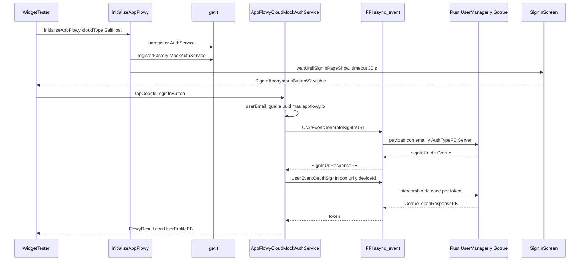
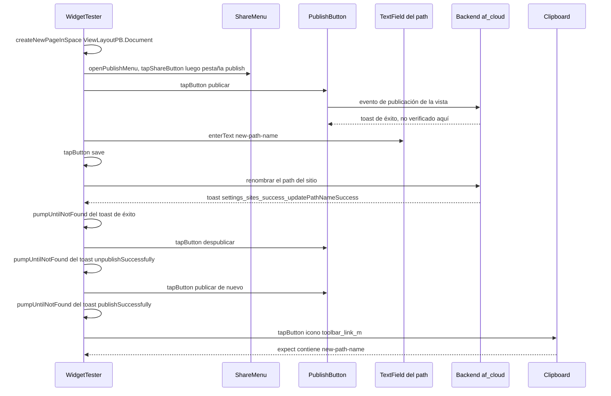
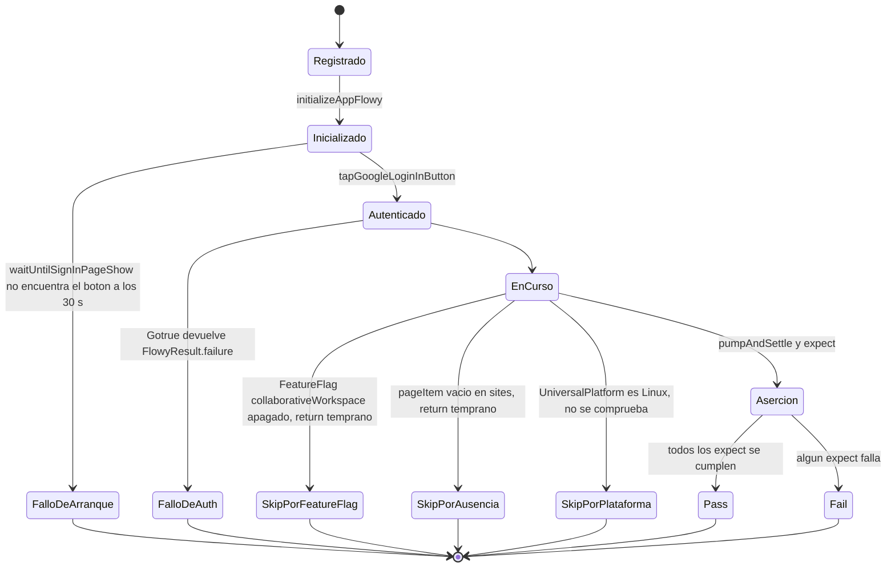

# F00.7.4 — App glue: integration_test desktop — documento y cloud

## 1. Resumen

Esta unidad documenta los **65 ficheros Dart** de `integration_test/desktop/document/**` y `integration_test/desktop/cloud/**` del cliente Flutter: los **39** de la suite de documento de escritorio (7 938 líneas) y los **26** del árbol cloud (2 395 líneas), 10 333 líneas en total. Aquí no hay una sola clase de producción: es el **código que arranca la aplicación real dentro del proceso de test**, el que decide qué modo de autenticación se inyecta, el que parchea el `getIt` con dobles de prueba y el que decide qué tests se ejecutan, en qué orden y cuántas veces. Su valor documental está en la **frontera cloud/local**: cómo se distingue un caso cloud de uno local, qué se simula y qué exige un backend real, y qué ocurre cuando el backend no está. La unidad alimenta `19-testing.md` (`[[B6.2]]`).

## 2. Alcance

**Incluye** los 65 ficheros de `OUT/_ledger/units/F00.7.4.json`. Recuento medido con `rg -o 'testWidgets\('`: **222 declaraciones `testWidgets`** (180 en `desktop/document/`, 42 en `desktop/cloud/`) y **53 declaraciones `group`**. Hay **11 ficheros `*_test_runner.dart`** que actúan de puntos de entrada: cinco de nivel superior (`cloud/cloud_runner.dart` y `document/document_test_runner_{1..4}.dart`) y seis intermedios.

**Correcciones de scope obligatorias**, declaradas aquí y desarrolladas en §13:

1. **Los nueve `integration_test/desktop_runner_N.dart`** y el helper de arranque compartido (`integration_test/shared/base.dart`, `common_operations.dart`, `expectation.dart`, `workspace.dart`, `database_test_op.dart`, `document_test_operations.dart`, `mock/**`) están en `[[F00.7.3]]`. Aquí se documentan **como contrato de llamada**, con evidencia `ruta:línea`, sin reexplicar su implementación.
2. **El resto de suites de escritorio** (`desktop/board/**`, `desktop/chat/**`, `desktop/command_palette/**`, `desktop/database/**`, `desktop/first_test/**`, `desktop/grid/**`, `desktop/reminder/**`, `desktop/settings/**`, `desktop/sidebar/**`, `desktop/uncategorized/**`) y la suite móvil están en `[[F00.7.5]]`. Aquí se cubre el sub-árbol `desktop/document/**` completo y el sub-árbol `desktop/cloud/**` completo (que incluye `cloud/sidebar/**`, `cloud/workspace/**`, `cloud/uncategorized/**` y `cloud/data_migration/**`).
3. **Los tests unitarios, de BLoC y de widget** (`frontend/appflowy_flutter/test/**`) están en `[[F00.7.6]]`; los **tests Rust** (`frontend/rust-lib/**/tests`) en `[[F00.3]]`.
4. **Los fixtures** `assets/test/workspaces/*` y `assets/template/readme.afdoc` están en `[[F00.7.2]]`. Los literales `'assets/test/images/sample.jpeg'`, `sample.png` y `sample.gif` que aparecen en el código (p. ej. `appflowy/frontend/appflowy_flutter/integration_test/desktop/document/document_copy_and_paste_test.dart:217`) **no están en `inventario.json`**: se citan como literal de cadena, nunca como ruta.
5. **El código de producción ejercitado** se documenta en `[[F01]]` (documento), `[[F02]]` (base de datos), `[[F12]]` (compartir/publicar), `[[F05]]` (auth) y `[[F06]]` (servidores). Esta unidad remite, no reclama.
6. **`AppFlowyCloudMockAuthService`** (`appflowy/frontend/appflowy_flutter/lib/user/application/auth/af_cloud_mock_auth_service.dart:16`) está en `[[F05.1]]`; los **traits de servidor** (`AuthService`, `AppFlowyAIService`) en `[[F06]]`; las **variables de entorno** `TestEnv` y `Env` en `[[F00.7.2]]`.

## 3. Modelos de datos

No hay modelo de datos de dominio. Los tres "modelos" que esta unidad declara son (a) la taxonomía cloud/local que consumen los tests, (b) el árbol de descubrimiento por runners y (c) el catálogo de dobles de prueba que parchean singletons globales.

### 3.1 Taxonomía cloud/local: el enum `AuthenticatorType`

Es la única pieza de configuración que separa un test cloud de uno local. Se pasa a `initializeAppFlowy(cloudType: …)` y decide tres cosas: los `rustEnvs` que se pasan al SDK, el servicio de autenticación que se registra en `getIt` y la URL del backend.

| Valor del enum | `rustEnvs` inyectados | Auth registrado en `getIt` | Backend | Fichero:línea |
|---|---|---|---|---|
| `null` (por defecto) | `{}` | el de producción (local) | ninguno | `appflowy/frontend/appflowy_flutter/integration_test/shared/base.dart:73-76` |
| `AuthenticatorType.local` | `{}` | `useLocalServer()` | `local_server` de Rust | `appflowy/frontend/appflowy_flutter/integration_test/shared/base.dart:97-99` |
| `AuthenticatorType.appflowyCloudSelfHost` | `GOTRUE_ADMIN_EMAIL=admin@example.com` y `GOTRUE_ADMIN_PASSWORD=password` | `AppFlowyCloudMockAuthService` | `useSelfHostedAppFlowyCloud(TestEnv.afCloudUrl)` | `appflowy/frontend/appflowy_flutter/integration_test/shared/base.dart:77-81`, `:100-106`, `:127` |
| `AuthenticatorType.appflowyCloudDevelop` | idénticos a `SelfHost` | `AppFlowyCloudMockAuthService` | `useLocal ? useAppFlowyCloudDevelop("http://localhost") : useSelfHostedAppFlowyCloud(TestEnv.afCloudUrl)` | `appflowy/frontend/appflowy_flutter/integration_test/shared/base.dart:78-79`, `:107-113`, `:124-128` |
| cualquier otro | — | — | `throw Exception("Unsupported cloud type: …")` | `appflowy/frontend/appflowy_flutter/integration_test/shared/base.dart:82-83`, `:114-115` |

[VERIFICADO] El enum declara además `AuthenticatorType.appflowyCloud`, que **no** aparece en ninguno de los dos `switch` de `base.dart`; elegirlo lanzaría la excepción de la última fila (`appflowy/frontend/appflowy_flutter/lib/env/cloud_env.dart:112-117`, `appflowy/frontend/appflowy_flutter/integration_test/shared/base.dart:114-115`).

[VERIFICADO] **`appflowyCloudDevelop` es indistinguible de `appflowyCloudSelfHost` bajo `flutter test`.** El discriminante es `integrationMode().isDevelop` (`appflowy/frontend/appflowy_flutter/integration_test/shared/base.dart:109`), y `integrationMode()` devuelve `IntegrationMode.unitTest` siempre que `FLUTTER_TEST` esté presente en el entorno (`appflowy/frontend/appflowy_flutter/lib/startup/startup.dart:311-321`). [INFERIDO] Consecuencia: el único caso que usa `appflowyCloudDevelop` (`appflowy/frontend/appflowy_flutter/integration_test/desktop/cloud/document/document_ai_writer_test.dart:139`, caso `'ask ai'`) no contacta con el cloud de desarrollo sino con el mismo self-hosted local que los otros 41 casos cloud.

### 3.2 El modelo de "doble de prueba": parcheo de singletons globales

Cinco singletons se sustituyen antes o durante el arranque. El patrón es siempre `getIt.unregister<T>()` seguido de `getIt.registerFactory<T>()`.

| Singleton parcheado | Doble | Efecto sobre el estado global | Fichero:línea |
|---|---|---|---|
| `AuthService` | `AppFlowyCloudMockAuthService` | Sustituye la autenticación real por OAuth sintético con email generado | `appflowy/frontend/appflowy_flutter/integration_test/shared/base.dart:130-135` |
| `AIRepository` | `MockAIRepository` | Sustituye el LLM por respuestas fijas de un mapa literal | `appflowy/frontend/appflowy_flutter/integration_test/shared/base.dart:131`, `:136-138` |
| `FilePickerService` | `MockFilePicker` | Devuelve rutas locales en vez de abrir el diálogo del SO | `appflowy/frontend/appflowy_flutter/integration_test/shared/mock/mock_file_picker.dart:61-67` |
| `UrlLauncherPlatform.instance` | `MockUrlLauncher` | Intercepta la apertura de enlaces externos | `appflowy/frontend/appflowy_flutter/integration_test/desktop/document/document_with_link_test.dart:16-19` |
| `RecentIcons.enable` | flag estático `false` | Vacía la persistencia de iconos recientes y hace determinista el selector | `appflowy/frontend/appflowy_flutter/lib/shared/icon_emoji_picker/recent_icons.dart:18-19` |

[VERIFICADO] `MockAIRepository` valida el prompt antes de responder: si `StreamCompletionValidator.validate(...)` devuelve `false` lanza `Exception('Invalid completion')` (`appflowy/frontend/appflowy_flutter/integration_test/shared/mock/mock_ai.dart:99-110`); si el prompt no está en su mapa literal lanza `Exception('No mock ai found for …')` (`appflowy/frontend/appflowy_flutter/integration_test/shared/mock/mock_ai.dart:115-119`). El validador que usa el único caso con `validator` es una clase privada del propio test (`appflowy/frontend/appflowy_flutter/integration_test/desktop/cloud/document/document_ai_writer_test.dart:183-233`).

[VERIFICADO] Además del parcheo por `getIt`, cuatro ficheros de la suite de documento **mutan estado global estático**: `RecentIcons.enable` se apaga en `setUpAll` y se restaura en `tearDownAll` en tres ficheros (`appflowy/frontend/appflowy_flutter/integration_test/desktop/document/document_callout_test.dart:19`, `:23`; `appflowy/frontend/appflowy_flutter/integration_test/desktop/document/document_with_cover_image_test.dart:26`, `:30`; `appflowy/frontend/appflowy_flutter/integration_test/desktop/document/document_sub_page_test.dart:46`, `:50`) y en `appflowy/frontend/appflowy_flutter/integration_test/desktop/cloud/sidebar/sidebar_icon_test.dart:20`, `:24`.

## 4. Eventos FFI

Ningún fichero de la unidad **define** eventos; todos los **consumen**. Los tres eventos Rust que los tests cloud usan de forma observable son los de la cadena de autenticación, invocados por `AppFlowyCloudMockAuthService`.

| Evento enviado | Payload | Respuesta | Dónde se dispara | Fichero:línea |
|---|---|---|---|---|
| `UserEventGenerateSignInURL` | `SignInUrlPayloadPB` con `authenticator = AuthTypePB.Server` y `email = userEmail` | `SignInUrlResponsePB` (URL de Gotrue) | `signUpWithOAuth` | `appflowy/frontend/appflowy_flutter/lib/user/application/auth/af_cloud_mock_auth_service.dart:50-56` |
| `UserEventOauthSignIn` | `OauthSignInPB` con `signInURL` y `deviceId` | `GotrueTokenResponsePB` | `signUpWithOAuth` | `appflowy/frontend/appflowy_flutter/lib/user/application/auth/af_cloud_mock_auth_service.dart:60-68` |
| (implícito) `getUser` | — | `UserProfilePB` | `getUser` → `UserBackendService.getCurrentUserProfile()` | `appflowy/frontend/appflowy_flutter/lib/user/application/auth/af_cloud_mock_auth_service.dart:107-109` |

[VERIFICADO] `signUpAsGuest` **sí** va al backend real: delega en `BackendAuthService(AuthTypePB.Server).signUpAsGuest()` (`appflowy/frontend/appflowy_flutter/lib/user/application/auth/af_cloud_mock_auth_service.dart:22-23`, `:92-96`). Es la ruta que usa el caso `'sign in as anonymous'` (`appflowy/frontend/appflowy_flutter/integration_test/desktop/cloud/uncategorized/appflowy_cloud_auth_test.dart:54`) y el test de migración de usuario anónimo (`appflowy/frontend/appflowy_flutter/integration_test/desktop/cloud/data_migration/anon_user_data_migration_test.dart:18`).

[VERIFICADO] `signUp`, `signInWithEmailPassword`, `signInWithMagicLink` y `signInWithPasscode` lanzan `UnimplementedError()` sin tocar la red (`appflowy/frontend/appflowy_flutter/lib/user/application/auth/af_cloud_mock_auth_service.dart:32`, `:42`, `:103`, `:116`). La suite nunca las invoca porque el login se hace siempre pulsando el botón de Google, cuyo handler llama a `signUpWithOAuth` (`appflowy/frontend/appflowy_flutter/integration_test/shared/auth_operation.dart:13-18`).

## 5. Notificaciones

Ningún fichero de la unidad **implementa** un listener Rust→Dart. Lo que sí hay son **esperas activas sobre notificaciones**, es decir, llamadas a `pumpUntilFound` / `pumpUntilNotFound` que sustituyen a un `expectLater` sobre un `Stream`. La tabla recoge las esperas más significativas y su timeout.

| Espera | Timeout | Dónde | Qué prouve |
|---|---|---|---|
| `waitUntilSignInPageShow` | **30 s** | `appflowy/frontend/appflowy_flutter/integration_test/shared/base.dart:152-162` | que el arranque llega a la pantalla de login |
| `pumpUntilFound` / `pumpUntilNotFound` | 10 s por defecto, `pumpInterval` 50 ms | `appflowy/frontend/appflowy_flutter/integration_test/shared/base.dart:168-202` | aparición/desaparición de un widget con animación |
| toasts de publicación y renombrado | 10 s | `appflowy/frontend/appflowy_flutter/integration_test/desktop/cloud/document/document_publish_test.dart:93-94`, `:106-107`, `:119-120`, `:133-134` | respuesta del backend a publicar/despublicar |
| `waitForSeconds(6)` — sincronización | 6 s fijos | `appflowy/frontend/appflowy_flutter/integration_test/desktop/cloud/uncategorized/document_sync_test.dart:35` | que el documento llegó al servidor |
| `pumpAndSettle(Duration(seconds: 6))` tras cambiar el nombre | 6 s | `appflowy/frontend/appflowy_flutter/integration_test/desktop/cloud/uncategorized/user_setting_sync_test.dart:28` | sincronización del perfil de usuario |
| `tester.wait(1000)` / `wait(2000)` tras publicar | 1–2 s | `appflowy/frontend/appflowy_flutter/integration_test/desktop/cloud/workspace/workspace_settings_test.dart:115`, `:173`, `:256` | que el backend ya devolvió la lista de sitios |

[VERIFICADO] `pumpUntilFound` **no falla por timeout**: agota el bucle, cancela el temporizador y sale sin lanzar excepción (`appflowy/frontend/appflowy_flutter/integration_test/shared/base.dart:174-184`). La aserción real la hace el `expect(...)` que el test escribe justo después. Esto explica los tests que "pasan en vacío" descritos en §13.4.

[VERIFICADO] `tester.wait(...)` es un `Future.delayed` sobre el reloj real, no sobre el reloj del binding (`appflowy/frontend/appflowy_flutter/integration_test/shared/base.dart:279`): durante un test de integración el isolate sigue vivo, por lo que la espera es efectiva, pero consume tiempo de reloj sin avanzar frames.
## 6. BLoCs / Cubits

Ningún fichero de la unidad **define** un BLoC. Los BLoCs que aparecen lo hacen sólo para leer su estado desde una aserción, y esa lectura es la forma más directa de verificar la cadena colabsync→Rust→Dart.

| BLoC | Cómo se observa | Qué verifica el test | Fichero:línea |
|---|---|---|---|
| `ReminderBloc` | `getIt<ReminderBloc>().state.reminders` | que crear, copiar/pegar, cortar y deshacer un bloque fecha actualiza la pila de recordatorios | `appflowy/frontend/appflowy_flutter/integration_test/desktop/document/document_with_date_reminder_test.dart:285`, `:315-318`, `:337`, `:355-358`, `:426`, `:438`, `:450`, `:463` |
| `DocumentSyncBloc` (implícito) | `waitForSeconds(6)` + re-login | que el documento local se ha subido al servidor | `appflowy/frontend/appflowy_flutter/integration_test/desktop/cloud/uncategorized/document_sync_test.dart:35`, `:52` |

[VERIFICADO] `document_with_date_reminder_test.dart` es el único fichero de la unidad que consulta un BLoC: hace cinco aserciones distintas sobre `ReminderBloc` (conteo de ids, conjunto de ids, `isEmpty`) que atan el estado del recordatorio al estado del documento (`appflowy/frontend/appflowy_flutter/integration_test/desktop/document/document_with_date_reminder_test.dart:285`, `:315-318`, `:337`, `:355-358`, `:438`, `:463`). Esto cubre el reminder Rust→Dart que documenta `[[F01]]`.

[VERIFICADO] El test de sincronización de documento **no consulta ningún BLoC**: su única garantía es un `waitForSeconds(6)` (`appflowy/frontend/appflowy_flutter/integration_test/desktop/cloud/uncategorized/document_sync_test.dart:34-35`) seguido de un logout/re-login en el test siguiente del mismo grupo, que comparte la variable `email` de nivel de fichero (`appflowy/frontend/appflowy_flutter/integration_test/desktop/cloud/uncategorized/document_sync_test.dart:11`). Es el único mecanismo de sincronización real de la unidad, y **no se ejecuta** (§12.3).

## 7. Servicios e inyección de dependencias

### 7.1 La función de arranque

Todo caso de la unidad arranca con `tester.initializeAppFlowy(...)`. La firma completa y su efecto se leen en `appflowy/frontend/appflowy_flutter/integration_test/shared/base.dart:33-69`:

1. `binding.setSurfaceSize(Size(1600, 1200))` en Linux/Windows/macOS (`:43-45`).
2. `mockHotKeyManagerHandlers()` — intercepta el canal `hotkey_manager` (`:48`, `:141-150`).
3. `mockApplicationDataStorage(...)` — crea un directorio temporal nuevo por caso (`:49-52`).
4. `FlowyRunner.run(AppFlowyApplication(), IntegrationMode.integrationTest, rustEnvsBuilder: …, didInitGetItCallback: …)` (`:54-63`).
5. `await waitUntilSignInPageShow()` (`:65`).

[VERIFICADO] `FlowyRunner.run` hace **`getIt.reset()`** antes de re-registrar (`appflowy/frontend/appflowy_flutter/lib/startup/startup.dart:97`), desactiva el log (`appflowy/frontend/appflowy_flutter/lib/startup/startup.dart:89`) y guarda `IntegrationTestHelper.didInitGetItCallback` sólo si no es release (`appflowy/frontend/appflowy_flutter/lib/startup/startup.dart:83-86`). Esto es lo que permite que **220 de los 222 tests de la unidadvivan en el mismo isolate**: cada `testWidgets` relanza la app entera desde cero.

### 7.2 Registro condicional de los servicios cloud

El callback `didInitGetItCallback` es `_initializeCloudServices` (`appflowy/frontend/appflowy_flutter/integration_test/shared/base.dart:89-117`), y su primera línea es `if (cloudType == null) return;` (`:94`). Ése es el punto exacto de separación entre la suite local y la cloud: **un test es cloud si y sólo si pasa `cloudType:` a `initializeAppFlowy`**. La distribución real en la unidad es:

| Suite | `cloudType` | Auth | Conteo de declaraciones `testWidgets` |
|---|---|---|---|
| `desktop/cloud/**` (ficheros de test) | `appflowyCloudSelfHost` | Google / invitado / logout | 38 |
| `desktop/cloud/document/document_ai_writer_test.dart` (1 caso) | `appflowyCloudDevelop` | Google | 1 |
| `desktop/document/**` (ficheros de test) | *(ninguno: `initializeAppFlowy()`)* | `tapAnonymousSignInButton()` | 180 |

[VERIFICADO] Los 180 tests de `desktop/document/**` llaman a `initializeAppFlowy()` **sin argumentos** y encadenan `tapAnonymousSignInButton()`, que pulsa `GoButton` si existe (variante local) o `SignInAnonymousButtonV2` si no (variante cloud) (`appflowy/frontend/appflowy_flutter/integration_test/shared/common_operations.dart:64-76`). Ninguno de esos 180 toca `getIt` para reconfigurar el backend.

[VERIFICADO] `cloud/sidebar/sidebar_icon_test.dart` y `cloud/sidebar/sidebar_rename_untitled_test.dart` declaran sus `testWidgets` **fuera de cualquier `group`**, y `cloud/sidebar/sidebar_search_test.dart` inicializa el binding dentro de `setUpAll` en lugar de en el cuerpo de `main` (`appflowy/frontend/appflowy_flutter/integration_test/desktop/cloud/sidebar/sidebar_search_test.dart:14-16`). Son los tres únicos ficheros de la unidad con esa forma.

## 8. Persistencia

Ninguno de los 65 ficheros abre una base de datos. Las cinco formas de persistencia que la suite manipula son todas **aserciones sobre almacenamiento ya existente**.

| Recurso | Cómo se toca | Dónde | Qué se verifica |
|---|---|---|---|
| `KVKeys.kCloudType` | `getIt<KeyValueStorage>().set(KVKeys.kCloudType, '0')` | `appflowy/frontend/appflowy_flutter/integration_test/desktop/cloud/database/database_image_test.dart:65`, `appflowy/frontend/appflowy_flutter/integration_test/desktop/document/document_with_image_block_test.dart:65`, `appflowy/frontend/appflowy_flutter/integration_test/desktop/document/document_with_multi_image_block_test.dart:77`, `appflowy/frontend/appflowy_flutter/integration_test/desktop/document/document_with_file_test.dart:49` | fuerza almacenamiento local para que la subida de fichero no dependa del backend |
| `KVKeys.showRenameDialogWhenCreatingNewFile` | lectura con `getWithFormat` | `appflowy/frontend/appflowy_flutter/integration_test/shared/common_operations.dart:399-406` | decide si `createOpenRenameDocumentUnderParent` pulsa OK |
| Caché local de imagen | `deleteImageFromLocalStorage` incrementa `deleteImageTestCounter` | `appflowy/frontend/appflowy_flutter/lib/plugins/document/presentation/editor_plugins/image/image_util.dart:121-128` | se comprueba con `expect(deleteImageTestCounter, 1)` en `appflowy/frontend/appflowy_flutter/integration_test/desktop/document/document_with_cover_image_test.dart:118` |
| Ficheros temporales | `getTemporaryDirectory()` + `File.writeAsBytesSync`, borrado al final | `appflowy/frontend/appflowy_flutter/integration_test/desktop/cloud/database/database_image_test.dart:56-59`, `:76` | los assets binarios se cargan con `rootBundle.load` y se vuelcan a disco |
| URLs de fichero en el nodo | atributos `url`, `urlType`, `name` del nodo | `appflowy/frontend/appflowy_flutter/integration_test/desktop/document/document_with_file_test.dart:57-66`, `:146-158` | que el nombre se extrae de la ruta local y del nombre de fichero de la URL |

[VERIFICADO] `deleteImageTestCounter` es un `int` global de `lib/` anotado con `@visibleForTesting` que **no se reinicia entre tests** (`appflowy/frontend/appflowy_flutter/lib/plugins/document/presentation/editor_plugins/image/image_util.dart:121-122`). El único test que lo comprueba es `'document cover local image tests'`, y espera exactamente `1` (`appflowy/frontend/appflowy_flutter/integration_test/desktop/document/document_with_cover_image_test.dart:118`); si otro test anterior hubiera borrado una imagen, la aserción fallaría.

## 9. Diagramas de flujo

### 9.1 Arranque de un caso cloud

Muestra las capas que atraviesa `testWidgets` desde la declaración hasta que la pantalla de login está en pantalla.

**Lectura**: el arranque es idempotente por diseño — `getIt.reset()` en `appflowy/frontend/appflowy_flutter/lib/startup/startup.dart:97` permite que los 222 tests compartan isolate. La frontera cloud/local está en un único `if` (`appflowy/frontend/appflowy_flutter/integration_test/shared/base.dart:94`): si `cloudType` es `null` el callback no hace nada y la app arranca en modo local. Cuando sí es cloud, se desregistran dos singletons y se vuelven a registrar con dobles, lo que explica por qué ningún test cloud depende del proveedor OAuth real.

### 9.2 Árbol de descubrimiento de los runners

Muestra qué ficheros alcanzan los cinco puntos de entrada y qué queda fuera.

**Lectura**: los cinco puntos de entrada son `cloud_runner.dart` (invocado por la CI con `-d Linux --coverage`, `appflowy/.github/workflows/flutter_ci.yaml:339`) y `document_test_runner_{1..4}.dart`, alcanzados a través de `desktop_runner_1/4/7/8` respectivamente (`appflowy/frontend/appflowy_flutter/integration_test/desktop_runner_1.dart:14`, `appflowy/frontend/appflowy_flutter/integration_test/desktop_runner_4.dart:15`, `appflowy/frontend/appflowy_flutter/integration_test/desktop_runner_7.dart:15`, `appflowy/frontend/appflowy_flutter/integration_test/desktop_runner_8.dart:15`). Los nodos discontinuos son **13 tests huérfanos**: 6 en `desktop/document/` y 7 en `desktop/cloud/`. Los cinco runners intermedios (`database_test_runner.dart`, `document_test_runner.dart`, `workspace_test_runner.dart`, `uncategorized_test_runner.dart`, `data_migration_test_runner.dart`) suman 5 + 9 + 7 + 20 + 16 = 57 líneas y son los únicos ficheros de la unidad sin una sola declaración `testWidgets`.

### 9.3 Clasificación por dependencia de backend

Muestra qué suites necesitan un AppFlowy-Cloud levantando y qué suites se resuelven con dobles o almacenamiento local.

**Lectura**: **las 42 declaraciones de `desktop/cloud/` exigen un backend levantando** — ninguna se resuelve con un doble de red. Los únicos dobles de la unidad (`MockAIRepository`, `MockUrlLauncher`, `MockFilePicker`, `ClipboardService.setData`) sustituyen *el servicio de IA*, *el launcher del SO*, *el selector de ficheros* y *el portapapeles*, nunca el transporte HTTP. Por eso el job `cloud_integration_test` levanta el stack completo de AppFlowy-Cloud con `docker compose` antes de compilar Dart (`appflowy/.github/workflows/flutter_ci.yaml:248-288`).

## 10. Diagramas de secuencia

### 10.1 Autenticación de un caso cloud (mock de Dart, red real)

Muestra el camino que recorre `tapGoogleLoginInButton()` en un test cloud, que es donde la simulación y la red coexisten.

**Lectura**: el doble actúa **antes** de la red, no en lugar de ella. `AppFlowyCloudMockAuthService` genera un email único por instancia (`appflowy/frontend/appflowy_flutter/lib/user/application/auth/af_cloud_mock_auth_service.dart:17-20`) y salta el diálogo OAuth del navegador, pero los dos eventos que lanza (`UserEventGenerateSignInURL` y `UserEventOauthSignIn`) sí viajan por el FFI hasta Gotrue (`appflowy/frontend/appflowy_flutter/lib/user/application/auth/af_cloud_mock_auth_service.dart:56`, `:68`). Si Gotrue devuelve error, el mock hace `debugPrint("mock auth service error: …")` y devuelve `FlowyResult.failure` (`appflowy/frontend/appflowy_flutter/lib/user/application/auth/af_cloud_mock_auth_service.dart:79-82`): **no hay reintento ni skip**.

### 10.2 Publicar, renombrar, despublicar y republicar

Muestra el caso representativo más completo de la suite cloud activa: `'re-publish the document'` (`appflowy/frontend/appflowy_flutter/integration_test/desktop/cloud/document/document_publish_test.dart:153-218`).

**Lectura**: el caso no verifica **el contenido** del primer toast de publicación — sólo la presencia y la posterior desaparición de tres toasts (`appflowy/frontend/appflowy_flutter/integration_test/desktop/cloud/document/document_publish_test.dart:189-192`, `:198-201`, `:207-210`) y, al final, que el portapapeles contiene el nuevo nombre de ruta (`appflowy/frontend/appflowy_flutter/integration_test/desktop/cloud/document/document_publish_test.dart:213-217`). La verificación fuerte de los errores de validación sí está en el caso hermano `'rename path name'`, que comprueba tres toasts de error distintos (`appflowy/frontend/appflowy_flutter/integration_test/desktop/cloud/document/document_publish_test.dart:89-94`, `:103-107`, `:116-120`).

## 11. Diagramas de estado

### 11.1 Ciclo de vida de un caso cloud y sus tres salidas

Muestra por qué un test cloud puede terminar en cuatro estados distintos, tres de ellos "verdes".

**Lectura**: los cuatro tests que producen `Pass` sin haber comprobado nada son un problema de fiabilidad, no de estilo. El skip por feature flag es un `return` desnudo dentro del `testWidgets` (`appflowy/frontend/appflowy_flutter/integration_test/desktop/cloud/workspace/collaborative_workspace_test.dart:22-24`, `:77-79`, `:103-105`; `appflowy/frontend/appflowy_flutter/integration_test/desktop/cloud/workspace/change_name_and_icon_test.dart:22-24`, `:56-58`); el skip por ausencia comprueba `pageItem.evaluate().isEmpty` y devuelve (`appflowy/frontend/appflowy_flutter/integration_test/desktop/cloud/workspace/workspace_settings_test.dart:123-125`, `:264-266`); el skip por plataforma protege la aserción con `if (!UniversalPlatform.isLinux)` (`appflowy/frontend/appflowy_flutter/integration_test/desktop/cloud/sidebar/sidebar_move_page_test.dart:58`). Ninguno usa `markTestSkipped` ni `skip:`.

## 12. Archivos cubiertos (del ledger)

**65 ficheros**, **10 333 líneas** reales, los de la unidad `OUT/_ledger/units/F00.7.4.json`. Los conteos de `testWidgets` y `group` están medidos con `rg -o`, no estimados.

### 12.1 Suite cloud: 26 ficheros, 2 395 líneas, 42 `testWidgets`, 20 `group`

| Fichero | LOC | `testWidgets` | `group` | Qué comportamiento verifica |
|---|---:|---:|---:|---|
| `appflowy/frontend/appflowy_flutter/integration_test/desktop/cloud/cloud_runner.dart` | 51 | 0 | 0 | Punto de entrada; cinco bloques que invocan `preset_af_cloud_env_test.main()` (`:18`, `:31`, `:41`, `:48`) |
| `appflowy/frontend/appflowy_flutter/integration_test/desktop/cloud/set_env.dart` | 20 | 1 | 1 | Arranque en `appflowyCloudSelfHost` sin login; el propio comentario lo llama *"meaningless"* (`:7`) |
| `appflowy/frontend/appflowy_flutter/integration_test/desktop/cloud/data_migration/data_migration_test_runner.dart` | 3 | 0 | 0 | Runner **vacío**: `// anon_user_test.main();` (`:2`) |
| `appflowy/frontend/appflowy_flutter/integration_test/desktop/cloud/data_migration/anon_user_data_migration_test.dart` | 50 | 1 | 1 | Anónimo → firmar con Google → abrir el space importado (`:13-48`). **No se ejecuta** |
| `appflowy/frontend/appflowy_flutter/integration_test/desktop/cloud/database/database_test_runner.dart` | 9 | 0 | 0 | Runner de una sola suite (`:8`) |
| `appflowy/frontend/appflowy_flutter/integration_test/desktop/cloud/database/database_image_test.dart` | 80 | 1 | 1 | Subir una imagen al bloque de detalle de fila de un grid cloud (`:29-78`) |
| `appflowy/frontend/appflowy_flutter/integration_test/desktop/cloud/document/document_test_runner.dart` | 16 | 0 | 0 | Runner de 4 suites (`:12-15`) |
| `appflowy/frontend/appflowy_flutter/integration_test/desktop/cloud/document/document_ai_writer_test.dart` | 234 | 4 | 1 | Transacción de IA sólo en memoria (`:23`), *Improve writing* (`:55`), corrección gramatical (`:96`) y *ask ai* con validador de historial (`:137`) |
| `appflowy/frontend/appflowy_flutter/integration_test/desktop/cloud/document/document_copy_link_to_block_test.dart` | 275 | 4 | 1 | Portapapeles con patrón de enlace (`:23`), mención entre páginas (`:44`), misma página (`:128`) y mención sin acceso tras borrar el original (`:208`) |
| `appflowy/frontend/appflowy_flutter/integration_test/desktop/cloud/document/document_option_actions_test.dart` | 114 | 3 | 1 | Arrastrar bloque al inicio (`:17`), anidar bajo otro bloque (`:44`), borrar con hover (`:71`) |
| `appflowy/frontend/appflowy_flutter/integration_test/desktop/cloud/document/document_publish_test.dart` | 220 | 3 | 1 | Publicar/despublicar (`:20`), renombrar el path con tres validaciones de error (`:54`), republicar y copiar enlace (`:153`) |
| `appflowy/frontend/appflowy_flutter/integration_test/desktop/cloud/sidebar/sidebar_icon_test.dart` | 62 | 1 | 0 | Cambiar el icono del space desde el popup (`:27`) |
| `appflowy/frontend/appflowy_flutter/integration_test/desktop/cloud/sidebar/sidebar_move_page_test.dart` | 108 | 1 | 1 | Mover una página a *Getting started* y verificar el icono de prohibido (`:17`) |
| `appflowy/frontend/appflowy_flutter/integration_test/desktop/cloud/sidebar/sidebar_rename_untitled_test.dart` | 55 | 1 | 0 | El diálogo de renombrado precarga el nombre por defecto de página nueva (`:17`) |
| `appflowy/frontend/appflowy_flutter/integration_test/desktop/cloud/sidebar/sidebar_search_test.dart` | 42 | 1 | 0 | Buscar y llegar a la entrada *Ask AI* (`:18`) |
| `appflowy/frontend/appflowy_flutter/integration_test/desktop/cloud/uncategorized/uncategorized_test_runner.dart` | 7 | 0 | 0 | Runner de 2 suites (`:5-6`); **no importa** `document_sync_test.dart` |
| `appflowy/frontend/appflowy_flutter/integration_test/desktop/cloud/uncategorized/appflowy_cloud_auth_test.dart` | 91 | 4 | 1 | Login (`:16`), logout con confirmación (`:24`), invitado (`:50`) e interruptor de sincronización (`:65`) |
| `appflowy/frontend/appflowy_flutter/integration_test/desktop/cloud/uncategorized/document_sync_test.dart` | 55 | 2 | 1 | Ida y vuelta al servidor de un documento (`:18`, `:42`). **No se ejecuta** |
| `appflowy/frontend/appflowy_flutter/integration_test/desktop/cloud/uncategorized/user_setting_sync_test.dart` | 52 | 2 | 1 | Cambiar el nombre y recuperarlo tras re-login (`:16`, `:34`) |
| `appflowy/frontend/appflowy_flutter/integration_test/desktop/cloud/workspace/workspace_test_runner.dart` | 20 | 0 | 0 | Runner de 5 suites; `workspace_settings_test` comentado (`:8`, `:14`) |
| `appflowy/frontend/appflowy_flutter/integration_test/desktop/cloud/workspace/change_name_and_icon_test.dart` | 75 | 2 | 0 | Cambiar nombre e icono (`:20`) y reverificarlo tras relanzar (`:54`); comparten el `email` de `:18` |
| `appflowy/frontend/appflowy_flutter/integration_test/desktop/cloud/workspace/collaborative_workspace_test.dart` | 207 | 3 | 1 | Crear y borrar workspace (`:19`), conteo de miembros (`:74`), comportamiento del popover (`:101`) |
| `appflowy/frontend/appflowy_flutter/integration_test/desktop/cloud/workspace/share_menu_test.dart` | 65 | 1 | 1 | Copiar enlace de página y descomponerlo en `workspaceId` y `pageId` (`:20`) |
| `appflowy/frontend/appflowy_flutter/integration_test/desktop/cloud/workspace/tabs_test.dart` | 87 | 2 | 1 | Cerrar pestañas al cambiar de workspace (`:18`); la vista de space no se abre (`:76`) |
| `appflowy/frontend/appflowy_flutter/integration_test/desktop/cloud/workspace/workspace_icon_test.dart` | 44 | 1 | 1 | Eliminar el icono no dispara toast de éxito (`:16`) |
| `appflowy/frontend/appflowy_flutter/integration_test/desktop/cloud/workspace/workspace_settings_test.dart` | 353 | 4 | 2 | Ancho de documento y reset (`:27`), página publicada en *Sites* (`:85`), actualizar namespace (`:162`) y more-actions de página publicada (`:221`). **No se ejecuta** |

### 12.2 Suite de documento: 39 ficheros, 7 938 líneas, 180 `testWidgets`, 33 `group`

| Fichero | LOC | `testWidgets` | `group` | Qué comportamiento verifica |
|---|---:|---:|---:|---|
| `appflowy/frontend/appflowy_flutter/integration_test/desktop/document/document_test_runner_1.dart` | 23 | 0 | 0 | Agrupa 6 ficheros (`:16-21`) |
| `appflowy/frontend/appflowy_flutter/integration_test/desktop/document/document_test_runner_2.dart` | 26 | 0 | 0 | Agrupa 8 ficheros (`:18-25`) |
| `appflowy/frontend/appflowy_flutter/integration_test/desktop/document/document_test_runner_3.dart` | 22 | 0 | 0 | Agrupa 6 ficheros (`:14-19`) |
| `appflowy/frontend/appflowy_flutter/integration_test/desktop/document/document_test_runner_4.dart` | 33 | 0 | 0 | Agrupa 11 ficheros (`:22-32`) |
| `appflowy/frontend/appflowy_flutter/integration_test/desktop/document/document_alignment_test.dart` | 101 | 2 | 1 | Alineación por barra (`:15`) y por atajo `ctrl/cmd+shift+R/C/L` (`:52`) |
| `appflowy/frontend/appflowy_flutter/integration_test/desktop/document/document_app_lifecycle_test.dart` | 72 | 3 | 1 | Selección recuperada, nula y no colapsada tras `AppLifecycleState.inactive` (`:13`, `:32`, `:52`) |
| `appflowy/frontend/appflowy_flutter/integration_test/desktop/document/document_block_option_test.dart` | 47 | 1 | 1 | El menú de opción cambia la selección a tipo bloque sin mutarla (`:11`) |
| `appflowy/frontend/appflowy_flutter/integration_test/desktop/document/document_callout_test.dart` | 67 | 1 | 0 | Callout con icono del selector de emoji (`:26`). **No se ejecuta** |
| `appflowy/frontend/appflowy_flutter/integration_test/desktop/document/document_codeblock_paste_test.dart` | 62 | 1 | 1 | Pegar tres líneas en un bloque de código (`:17`) |
| `appflowy/frontend/appflowy_flutter/integration_test/desktop/document/document_copy_and_paste_test.dart` | 567 | 19 | 1 | Matriz de pegado: texto multilínea (`:25`), HTML (`:49`, `:300`, `:312`), código de VSCode (`:107`), JSON interno (`:131`), lista parcial (`:178`), imágenes png/jpeg/gif (`:216`, `:227`, `:238`), URL→enlace (`:249`), HTML+imagen (`:281`), previsualización de enlace (`:320`), deshacer (`:370`), nodos sin delta (`:408`), URL sin protocolo (`:461`), Markdown (`:494`, `:508`) |
| `appflowy/frontend/appflowy_flutter/integration_test/desktop/document/document_create_and_delete_test.dart` | 76 | 3 | 1 | Crear (`:11`), borrar y restaurar (`:29`), borrar permanentemente (`:52`) |
| `appflowy/frontend/appflowy_flutter/integration_test/desktop/document/document_customer_test.dart` | 61 | 2 | 1 | Backtick inline (`:12`) y triple backtick → code block (`:41`). **No se ejecuta** |
| `appflowy/frontend/appflowy_flutter/integration_test/desktop/document/document_deletion_test.dart` | 84 | 1 | 1 | `TrashBreadcrumb` al navegar a una página borrada y restaurarla (`:17`) |
| `appflowy/frontend/appflowy_flutter/integration_test/desktop/document/document_find_menu_test.dart` | 160 | 1 | 0 | `ctrl/cmd+F`, coincidencia, siguiente, envolver y cerrar con `Esc` (`:26`) |
| `appflowy/frontend/appflowy_flutter/integration_test/desktop/document/document_inline_page_reference_test.dart` | 136 | 3 | 1 | Mención por slash menu (`:16`), por `[[` (`:43`) y por `+` (`:63`); exporta 3 helpers reutilizados por `document_deletion_test.dart` |
| `appflowy/frontend/appflowy_flutter/integration_test/desktop/document/document_inline_sub_page_test.dart` | 382 | 6 | 1 | Mención de sub-página: insertar/borrar/deshacer/papelera (`:37`), cortar y pegar (`:109`, `:195`), convertir heading↔párrafo (`:251`), duplicar (`:287`), cancelar con espacio (`:334`) |
| `appflowy/frontend/appflowy_flutter/integration_test/desktop/document/document_link_preview_test.dart` | 453 | 21 | 4 | Cuatro grupos: *Paste as URL* (4, `:121`–`:160`), *Paste as Mention* (6, `:205`–`:281`), *Paste as Bookmark* (7, `:320`–`:383`) y *Paste as Embed* (4, `:416`–`:443`) |
| `appflowy/frontend/appflowy_flutter/integration_test/desktop/document/document_more_actions_test.dart` | 140 | 2 | 1 | Duplicar y borrar desde el menú (`:17`); conteo de palabras y caracteres incluyendo el título (`:41`) |
| `appflowy/frontend/appflowy_flutter/integration_test/desktop/document/document_option_action_test.dart` | 178 | 4 | 1 | Botón `+` antes/después (`:30`), *turn into* en una y varias líneas (`:63`, `:101`), selección del padre deselecciona hijos (`:146`) |
| `appflowy/frontend/appflowy_flutter/integration_test/desktop/document/document_selection_test.dart` | 88 | 2 | 1 | Selección por gesto de arrastre (`:13`) y borrado palabra a palabra (`:52`). **No se ejecuta** |
| `appflowy/frontend/appflowy_flutter/integration_test/desktop/document/document_shortcuts_test.dart` | 140 | 2 | 1 | Corte de línea completa (`:13`) y copia de línea con selección colapsada (`:94`) |
| `appflowy/frontend/appflowy_flutter/integration_test/desktop/document/document_sub_page_test.dart` | 529 | 13 | 1 | Ciclo completo del `SubPageBlock`: insertar (`:54`), renombrar y borrar (`:68`), copiar/pegar (`:87`, `:134`), cortar/pegar (`:188`, `:223`), deshacer (`:269`), rehacer (`:307`), borrar desde el sidebar (`:350`), duplicar (`:373`), arrastrar (`:392`), convertir en página (`:413`), icono (`:456`) |
| `appflowy/frontend/appflowy_flutter/integration_test/desktop/document/document_text_direction_test.dart` | 57 | 1 | 1 | Los tres iconos de dirección sólo aparecen con el toggle RTL (`:11`) |
| `appflowy/frontend/appflowy_flutter/integration_test/desktop/document/document_title_test.dart` | 373 | 11 | 1 | Foco título↔cuerpo con flechas, Intro y Retroceso (`:18`, `:116`, `:145`, `:173`), persistencia (`:82`), deshacer/rehacer (`:225`), `Esc` (`:280`), flecha abajo (`:304`), cover (`:332`), pegado en el título (`:351`) |
| `appflowy/frontend/appflowy_flutter/integration_test/desktop/document/document_toolbar_test.dart` | 454 | 8 | 2 | Familia de fuente (`:47`), H1–H3 (`:73`), toggle 1–3 (`:127`), no-rebuild de la barra (`:188`); grupo *link*: crear/quitar (`:252`), editar (`:308`), limpiar nombre (`:370`), limpiar y quitar (`:411`) |
| `appflowy/frontend/appflowy_flutter/integration_test/desktop/document/document_with_cover_image_test.dart` | 224 | 6 | 1 | Portada asset/color/red (`:34`), portada local (`:71`), icono (`:124`), icono+portada (`:157`), aleatorio (`:181`), tono de piel (`:194`) |
| `appflowy/frontend/appflowy_flutter/integration_test/desktop/document/document_with_database_test.dart` | 343 | 8 | 1 | Grids/boards/calendarios referenciados (`:22`, `:50`, `:66`, `:117`) e inline (`:133`, `:149`, `:165`), más *load more* con 100 filas (`:181`) |
| `appflowy/frontend/appflowy_flutter/integration_test/desktop/document/document_with_date_reminder_test.dart` | 466 | 5 | 1 | Fecha con hora (`:29`), con recordatorio (`:82`), copiar/cortar/pegar (`:132`, `:220`), borrar/deshacer/rehacer (`:361`) |
| `appflowy/frontend/appflowy_flutter/integration_test/desktop/document/document_with_file_test.dart` | 161 | 2 | 1 | Subir fichero local y renombrarlo (`:26`); subir desde URL de red (`:100`) |
| `appflowy/frontend/appflowy_flutter/integration_test/desktop/document/document_with_image_block_test.dart` | 143 | 2 | 1 | Una imagen local (`:29`) y dos a la vez (`:79`) |
| `appflowy/frontend/appflowy_flutter/integration_test/desktop/document/document_with_inline_math_equation_test.dart` | 225 | 4 | 1 | Insertar y editar (`:19`), quitar el formato (`:70`), texto después en la misma línea (`:120`), atajo `ctrl+shift+E` (`:175`) |
| `appflowy/frontend/appflowy_flutter/integration_test/desktop/document/document_with_inline_page_test.dart` | 141 | 7 | 1 | Mención de grid, board, calendar y document (`:14`, `:25`, `:36`, `:47`), renombrar (`:58`), borrar (`:77`), escribir después (`:98`) |
| `appflowy/frontend/appflowy_flutter/integration_test/desktop/document/document_with_link_test.dart` | 82 | 1 | 1 | Insertar, editar y abrir un enlace con `MockUrlLauncher` (`:21`). **No se ejecuta** |
| `appflowy/frontend/appflowy_flutter/integration_test/desktop/document/document_with_multi_image_block_test.dart` | 291 | 2 | 1 | Galería local con visor interactivo (`:36`) y galería de red con borrado (`:135`) |
| `appflowy/frontend/appflowy_flutter/integration_test/desktop/document/document_with_outline_block_test.dart` | 210 | 3 | 1 | Insertar esquema (`:18`), esquema con encabezados visibles (`:33`), control de profundidad 1/2/3 (`:93`) |
| `appflowy/frontend/appflowy_flutter/integration_test/desktop/document/document_with_simple_table_test.dart` | 783 | 18 | 1 | Insertar y foco en celda (`:20`), seleccionar todo (`:50`), añadir/borrar fila y columna (`:98`), cabecera fila/columna (`:187`), duplicar (`:239`), insertar izquierda/derecha (`:271`), arriba/abajo (`:303`), ancho a página (`:336`, `:361`), repartir (`:386`, `:415`), menú de opción (`:444`), seleccionar todo y borrar (`:482`), Tab/Shift+Tab (`:513`), Shift+Intro (`:544`), alineación (`:565` **y `:631`, nombre duplicado**), slash menu en celda (`:697`) |
| `appflowy/frontend/appflowy_flutter/integration_test/desktop/document/document_with_toggle_heading_block_test.dart` | 123 | 3 | 1 | Insertar toggle heading 1–3 (`:20`), por atajos en ambos órdenes (`:43`), convertir a heading (`:67`) |
| `appflowy/frontend/appflowy_flutter/integration_test/desktop/document/document_with_toggle_list_test.dart` | 288 | 10 | 1 | `>` a toggle (`:38`), Intro con lista cerrada (`:81`) y abierta (`:119`), vaciado (`:154`), `cmd/ctrl+Intro` (`:182`), `>`+`#` en ambos órdenes (`:233`–`:260`), párrafo vacío (`:269`) |
| `appflowy/frontend/appflowy_flutter/integration_test/desktop/document/edit_document_test.dart` | 127 | 2 | 1 | Deshacer/rehacer la conversión a lista numerada (`:14`) y escritura de un readme (`:68`), con golden file comentado (`:92-95`) |

### 12.3 Los 13 tests huérfanos

Ninguno de los cinco puntos de entrada alcanza trece de las 222 declaraciones. La lista es exhaustiva y se obtuvo cruzando los `import` de los once runners con las declaraciones reales.

| Fichero huérfano | Tests | Motivo literal | Fichero:línea |
|---|---:|---|---|
| `appflowy/frontend/appflowy_flutter/integration_test/desktop/document/document_callout_test.dart` | 1 | ningún runner lo importa | — |
| `appflowy/frontend/appflowy_flutter/integration_test/desktop/document/document_customer_test.dart` | 2 | ningún runner lo importa | — |
| `appflowy/frontend/appflowy_flutter/integration_test/desktop/document/document_selection_test.dart` | 2 | ningún runner lo importa | — |
| `appflowy/frontend/appflowy_flutter/integration_test/desktop/document/document_with_link_test.dart` | 1 | ningún runner lo importa | — |
| `appflowy/frontend/appflowy_flutter/integration_test/desktop/cloud/data_migration/anon_user_data_migration_test.dart` | 1 | `// anon_user_test.main();` | `appflowy/frontend/appflowy_flutter/integration_test/desktop/cloud/data_migration/data_migration_test_runner.dart:2` |
| `appflowy/frontend/appflowy_flutter/integration_test/desktop/cloud/uncategorized/document_sync_test.dart` | 2 | su runner no lo importa | `appflowy/frontend/appflowy_flutter/integration_test/desktop/cloud/uncategorized/uncategorized_test_runner.dart:1-2` |
| `appflowy/frontend/appflowy_flutter/integration_test/desktop/cloud/workspace/workspace_settings_test.dart` | 4 | import y llamada comentados | `appflowy/frontend/appflowy_flutter/integration_test/desktop/cloud/workspace/workspace_test_runner.dart:8`, `:14` |

[VERIFICADO] Conteo final: **222 declarados − 13 huérfanos + 3 registros duplicados de `set_env.dart` = 212 casos realmente registrados**. Los 3 duplicados vienen de que `cloud_runner.dart` llama `preset_af_cloud_env_test.main()` cuatro veces (`:18`, `:31`, `:41`, `:48`), lo que registra el mismo `testWidgets` cuatro veces con el mismo nombre (`appflowy/frontend/appflowy_flutter/integration_test/desktop/cloud/set_env.dart:11-19`).
## 13. Riesgos y casos límite

### 13.1 Trece tests declarados que la CI nunca ejecuta

El hallazgo más caro de la unidad. Los cuatro ficheros de `desktop/document/` huérfanos (`document_callout_test.dart`, `document_customer_test.dart`, `document_selection_test.dart`, `document_with_link_test.dart`) suman 6 tests; los tres de `desktop/cloud/` (`anon_user_data_migration_test.dart`, `document_sync_test.dart`, `workspace_settings_test.dart`) suman 7. [VERIFICADO] Los tres casos cloud están deshabilitados de forma explícita y comentada: `data_migration_test_runner.dart` tiene su única línea comentada (`appflowy/frontend/appflowy_flutter/integration_test/desktop/cloud/data_migration/data_migration_test_runner.dart:2`) y `workspace_test_runner.dart` repite el bloqueo en el import y en la llamada (`appflowy/frontend/appflowy_flutter/integration_test/desktop/cloud/workspace/workspace_test_runner.dart:8`, `:14`, con el motivo literal *"Enable it after implementing the share feature"* en `:13`). [INFERIDO] El caso `document_sync_test.dart` es el peor de los tres: nadie deactivate — simplemente nadie lo importó, y es **el único round-trip real de sincronización documento↔servidor de toda la unidad** (`appflowy/frontend/appflowy_flutter/integration_test/desktop/cloud/uncategorized/document_sync_test.dart:18`, `:42`). Es decir: la sincronización de documentos contra AppFlowy-Cloud no tiene ninguna cobertura efectiva en CI.

### 13.2 `set_env.dart` se registra cuatro veces

`cloud_runner.dart` llama `preset_af_cloud_env_test.main()` en los cuatro bloques de su `main()` (`appflowy/frontend/appflowy_flutter/integration_test/desktop/cloud/cloud_runner.dart:18`, `:31`, `:41`, `:48`), con el comentario *"don't remove this test, it can prevent the test from failing"* repetido en los cuatro (`appflowy/frontend/appflowy_flutter/integration_test/desktop/cloud/cloud_runner.dart:16`, `:29`, `:39`, `:46`). [VERIFICADO] El fichero registrado define un único `group('Preset cloud env')` con un único `testWidgets('use self-hosted cloud')` cuyo comentario dice *"This test is meaningless, just for preventing the CI from failing"* (`appflowy/frontend/appflowy_flutter/integration_test/desktop/cloud/set_env.dart:7`, `:11-19`). [INFERIDO] La consecuencia práctica es un coste real y una señal ruidosa: la app completa se arranca cuatro veces para comprobar lo mismo, y cuatro casos de test comparten nombre completo, lo que hace el informe de fallos más difícil de leer que si hubiera uno solo.

### 13.3 Cuatro formas distintas de inicializar el binding

[VERIFICADO] La unidad usa cuatro convenciones distintas: (a) `IntegrationTestWidgetsFlutterBinding.ensureInitialized()` en el cuerpo de `main()` — el patrón mayoritario; (b) el mismo binding **más** `TestWidgetsFlutterBinding.ensureInitialized()` en cuatro ficheros (`appflowy/frontend/appflowy_flutter/integration_test/desktop/document/document_with_toggle_list_test.dart:15-16`, `appflowy/frontend/appflowy_flutter/integration_test/desktop/document/document_with_image_block_test.dart:25-26`, `appflowy/frontend/appflowy_flutter/integration_test/desktop/document/document_with_file_test.dart:22-23`, `appflowy/frontend/appflowy_flutter/integration_test/desktop/document/document_with_inline_math_equation_test.dart:15-16`); (c) `ensureInitialized()` dentro de `setUp` o `setUpAll` (`appflowy/frontend/appflowy_flutter/integration_test/desktop/cloud/sidebar/sidebar_search_test.dart:14-16`, `appflowy/frontend/appflowy_flutter/integration_test/desktop/document/document_with_date_reminder_test.dart:23-26`, `appflowy/frontend/appflowy_flutter/integration_test/desktop/document/document_with_multi_image_block_test.dart:30-33`); (d) captura del binding en una variable de `main()` para poder simular el ciclo de vida (`appflowy/frontend/appflowy_flutter/integration_test/desktop/document/document_app_lifecycle_test.dart:10`). Además, los runners intermedios vuelven a llamar a `ensureInitialized()` aunque el nivel superior ya lo hizo (`appflowy/frontend/appflowy_flutter/integration_test/desktop/cloud/database/database_test_runner.dart:6`, `appflowy/frontend/appflowy_flutter/integration_test/desktop/cloud/document/document_test_runner.dart:10`). [INFERIDO] La forma (b) es un smell: registrar dos bindings en el mismo isolate es una llamada idempotente en la práctica, pero expresa una duda sobre cuál usar; la (c) es la única que difiere semánticamente, porque `setUp` se ejecuta antes de **cada** test.

### 13.4 Once tests pueden pasar sin comprobar nada

Es el riesgo de fiabilidad más extendido. Ninguno usa `skip:` ni `markTestSkipped`.

| Mecanismo | Tests afectados | Fichero:línea |
|---|---:|---|
| `if (!FeatureFlag.collaborativeWorkspace.isOn) return;` | 5 | `appflowy/frontend/appflowy_flutter/integration_test/desktop/cloud/workspace/collaborative_workspace_test.dart:22-24`, `:77-79`, `:103-105`; `appflowy/frontend/appflowy_flutter/integration_test/desktop/cloud/workspace/change_name_and_icon_test.dart:22-24`, `:56-58` |
| `if (pageItem.evaluate().isEmpty) return;` | 2 | `appflowy/frontend/appflowy_flutter/integration_test/desktop/cloud/workspace/workspace_settings_test.dart:123-125`, `:264-266` |
| `if (!UniversalPlatform.isLinux)` alrededor de las aserciones | 1 | `appflowy/frontend/appflowy_flutter/integration_test/desktop/cloud/sidebar/sidebar_move_page_test.dart:58-72` |
| `if (UniversalPlatform.isMacOS)` alrededor de la aserción de redo | 1 | `appflowy/frontend/appflowy_flutter/integration_test/desktop/document/document_title_test.dart:267-277` |
| `if (UniversalPlatform.isLinux) await tester.wait(250);` (no salta, pero degrada) | 1 | `appflowy/frontend/appflowy_flutter/integration_test/desktop/document/document_title_test.dart:96-99` |

[VERIFICADO] El feature flag `collaborativeWorkspace` está **encendido por defecto** (`appflowy/frontend/appflowy_flutter/lib/shared/feature_flags.dart:98-113`, `:127-129`), de modo que esos cinco tests sí se ejecutan hoy. Los dos de `workspace_settings_test.dart` no: como §12.3 muestra, ese fichero está comentado en su runner, así que sus dos retornos tempranos sólo se activarían si alguien lo rehabilitara. El caso `sidebar_move_page_test.dart` incluye un comentario que explica la degradación: *"skip the length check on Linux temporarily, because it failed in expect check but the previous pumpUntilFound is successful"* (`appflowy/frontend/appflowy_flutter/integration_test/desktop/cloud/sidebar/sidebar_move_page_test.dart:56-57`).

### 13.5 Si el backend no está, el test falla — no salta y no cuelga

Ésta es la respuesta al caso límite que pedía el encargo, y se obtiene leyendo las tres etapas:

1. **La pantalla de login sí aparece sin backend**, porque `waitUntilSignInPageShow` sólo busca un widget del login (`appflowy/frontend/appflowy_flutter/integration_test/shared/base.dart:152-162`). El `expect(finder, findsOneWidget)` de la línea siguiente sí aborta si pasan los 30 s.
2. **La autenticación falla de forma explícita**: si `UserEventGenerateSignInURL` devuelve error, `AppFlowyCloudMockAuthService` imprime `mock auth service error: …` y devuelve `FlowyResult.failure` (`appflowy/frontend/appflowy_flutter/lib/user/application/auth/af_cloud_mock_auth_service.dart:79-82`), sin reintento.
3. **El fallo aflora en la siguiente aserción**, que es siempre `expectToSeeHomePageWithGetStartedPage()` — invocado en las 38 declaraciones cloud (p. ej. `appflowy/frontend/appflowy_flutter/integration_test/desktop/cloud/document/document_publish_test.dart:25`, `appflowy/frontend/appflowy_flutter/integration_test/desktop/cloud/database/database_image_test.dart:34`).

[VERIFICADO] Además, `pumpUntilFound` y `pumpUntilNotFound` agotan su timeout **sin lanzar excepción** (`appflowy/frontend/appflowy_flutter/integration_test/shared/base.dart:174-184`, `:192-202`): el timeout por sí solo nunca hace fallar un test, siempre hace fallar el `expect` que le sigue. [INFERIDO] Consecuencia práctica: sin AppFlowy-Cloud levantado, `cloud_integration_test` falla en el primer caso, no se cuelga, y el mensaje de error es el del `expect` de la home — no dice "no hay backend". Es un diagnóstico pobre para un fallo de infraestructura frecuente.

### 13.6 La URL del backend es siempre `http://localhost` por defecto

[VERIFICADO] `TestEnv.afCloudUrl` se lee de `.env.cloud.test` con `defaultValue: 'http://localhost'` (`appflowy/frontend/appflowy_flutter/lib/env/cloud_env_test.dart:13-18`), y ese fichero **no existe** en el repo: el único `.env` versionado bajo `frontend/` es `frontend/appflowy_flutter/dev.env`, y el único `.env` del árbol es `frontend/rust-lib/flowy-sqlite/.env`. [VERIFICADO] La CI tampoco lo crea: el paso *"Run Flutter integration tests"* es un `flutter test integration_test/desktop/cloud/cloud_runner.dart -d Linux --coverage` sin `--dart-define` ni variables de entorno (`appflowy/.github/workflows/flutter_ci.yaml:334-340`). [INFERIDO] La consecuencia: no es posible apuntar la suite cloud a un AppFlowy-Cloud remoto sin crear un `.env.cloud.test` no versionado; el único backend posible es el `docker compose` local que levanta el propio job (`appflowy/.github/workflows/flutter_ci.yaml:248-288`), y su URL externa se fija a `http://localhost` en el `sed` de preparación (`:246`).

### 13.7 Cuatro tests dependen del orden de ejecución dentro del mismo fichero

[VERIFICADO] Tres ficheros de `desktop/cloud/` declaran una variable `email` a nivel de `main()` y la comparten entre dos tests, de modo que el segundo sólo es válido si el primero tuvo éxito:

- `appflowy/frontend/appflowy_flutter/integration_test/desktop/cloud/uncategorized/document_sync_test.dart:11` — `final email = '${uuid()}@appflowy.io';`, comentario explícito *"use the same email to check the next test"* en el equivalente `appflowy/frontend/appflowy_flutter/integration_test/desktop/cloud/workspace/change_name_and_icon_test.dart:28` y `:62`.
- `appflowy/frontend/appflowy_flutter/integration_test/desktop/cloud/uncategorized/user_setting_sync_test.dart:12` y `:37`.
- `appflowy/frontend/appflowy_flutter/integration_test/desktop/cloud/workspace/change_name_and_icon_test.dart:18`, `:60`, `:62`.

[INFERIDO] Con `flutter_test` el orden de declaración dentro de un grupo es estable, así que hoy funciona; pero `fail-fast` no está configurado y un fallo del primer test no impide que el segundo se ejecute, lo que produce un segundo fallo redundante y ruido en el informe.

### 13.8 Seis tests tienen un nombre que no describe lo que hacen

[VERIFICADO] `appflowy/frontend/appflowy_flutter/integration_test/desktop/document/document_customer_test.dart` declara dos `testWidgets` llamados exactamente `'backtick issue - inline code'`, con cuerpos distintos (inline code en `:12`, code block en `:41`). `appflowy/frontend/appflowy_flutter/integration_test/desktop/document/document_with_simple_table_test.dart` declara dos `testWidgets` llamados exactamente `'using option menu to set table align'` en `:565` y `:631`, con cuerpos **idénticos línea a línea** (ambos ocupan 65 líneas y llegan al mismo `expect(afterAlign3, TableAlign.left)`). [VERIFICADO] Un tercer caso es el más engañoso: los tres últimos `testWidgets` del grupo *Paste as Embed* se llaman `'paste a link as bookmark and convert to mention'`, `'… convert to url'` y `'… convert to bookmark'` (`appflowy/frontend/appflowy_flutter/integration_test/desktop/document/document_link_preview_test.dart:424`, `:434`, `:443`) pero sus cuerpos llaman a `pasteAsEmbed` (`:419`, `:428`, `:437`), no a `pasteAsBookmark`: el nombre dice *bookmark* y la aserción es `checkEmbed`. [INFERIDO] Consecuencia: el del par de la tabla es un copy-paste sin renombrar que se ejecuta dos veces con coste doble, y los tres del link-preview mienten sobre el punto de entrada, de modo que un fallo hay que diagnosticarlo releyendo el cuerpo, no el nombre del test.

### 13.9 Los helpers de test redefinen singletons sin restaurarlos

[VERIFICADO] `MockFilePicker` se registra con `getIt.unregister<FilePickerService>()` + `registerFactory` (`appflowy/frontend/appflowy_flutter/integration_test/shared/mock/mock_file_picker.dart:62-65`) y se llama desde cuatro tests (`appflowy/frontend/appflowy_flutter/integration_test/desktop/cloud/database/database_image_test.dart:61`, `appflowy/frontend/appflowy_flutter/integration_test/desktop/document/document_with_cover_image_test.dart:103`, `appflowy/frontend/appflowy_flutter/integration_test/desktop/document/document_with_image_block_test.dart:61`, `appflowy/frontend/appflowy_flutter/integration_test/desktop/document/document_with_multi_image_block_test.dart:75`, `appflowy/frontend/appflowy_flutter/integration_test/desktop/document/document_with_file_test.dart:47`). [VERIFICADO] Ninguno de esos tests lo restaura, pero el siguiente `initializeAppFlowy` hace `getIt.reset()` (`appflowy/frontend/appflowy_flutter/lib/startup/startup.dart:97`), lo que sí lo limpia. [INFERIDO] El riesgo no es la contaminación entre tests de la unidad, sino el caso del **único `return` temprano** que se produce a mitad de un test sin reiniciar la app (`appflowy/frontend/appflowy_flutter/integration_test/desktop/cloud/workspace/workspace_settings_test.dart:123-125`): si el siguiente test no llamara a `initializeAppFlowy`, heredaría el `MockFilePicker`. Los cuatro ficheros que sí usan el mock restauran `RecentIcons.enable` en `tearDownAll` (`appflowy/frontend/appflowy_flutter/integration_test/desktop/document/document_callout_test.dart:23`, `appflowy/frontend/appflowy_flutter/integration_test/desktop/document/document_with_cover_image_test.dart:30`, `appflowy/frontend/appflowy_flutter/integration_test/desktop/document/document_sub_page_test.dart:50`, `appflowy/frontend/appflowy_flutter/integration_test/desktop/cloud/sidebar/sidebar_icon_test.dart:24`), lo que muestra que la intención era explícita.

### 13.10 `UrlLauncherPlatform.instance` se sobrescribe y nunca se restaura

[VERIFICADO] `document_with_link_test.dart` instala el doble en `setUp` sin `tearDown` que lo revierta (`appflowy/frontend/appflowy_flutter/integration_test/desktop/document/document_with_link_test.dart:16-19`). [INFERIDO] Como ese fichero no lo ejecuta ningún runner (§12.3), el defecto está hoy latente; si se reconstruye el runner, el doble sobreviviría al test. Es un buen argumento para no simplemente "añadir el import" sin añadir también el `tearDown`.

### 13.11 Una aserción del test de IA usa `assert` en vez de `expect`

[VERIFICADO] `_CompletionHistoryValidator._assertMessage` compara con `assert(actual.trim() == expected, "expected '$expected', but got …")` (`appflowy/frontend/appflowy_flutter/integration_test/desktop/cloud/document/document_ai_writer_test.dart:228-233`). [INFERIDO] Bajo `flutter test` la app se compila en debug y los `assert` están activos, así que hoy el fallo se propaga; pero el mismo código ejecutado en un perfil release los eliminaría y el test pasaría en silencio. Es la única aserción de la unidad que no usa `expect`.

### 13.12 Cuatro pruebas de la suite cloud dependen de esperas fijas de reloj

[VERIFICADO] Ninguna sincroniza con una señal de red: usan esperas de duración fija — 6 s en `appflowy/frontend/appflowy_flutter/integration_test/desktop/cloud/uncategorized/document_sync_test.dart:35`, 6 s en `appflowy/frontend/appflowy_flutter/integration_test/desktop/cloud/uncategorized/user_setting_sync_test.dart:28`, 5 s en `appflowy/frontend/appflowy_flutter/integration_test/desktop/cloud/uncategorized/appflowy_cloud_auth_test.dart:46`, y 1000/2000 ms en `appflowy/frontend/appflowy_flutter/integration_test/desktop/cloud/workspace/workspace_settings_test.dart:115`, `:173`, `:256`. [INFERIDO] En un runner de CI saturado — el mismo proceso levanta Docker Compose con AppFlowy-Cloud, GoTrue, Postgres y Redis (`appflowy/.github/workflows/flutter_ci.yaml:248-288`) — esas esperas son la fuente más probable de *flakiness* de la suite cloud: si la subida no termina en 6 s, el test falla sin que haya un bug de producto.

### 13.13 El presupuesto de tiempo del job cloud es invisible

[VERIFICADO] La matriz de `cloud_integration_test` declara `flutter_profile: development-linux-x86_64` (`appflowy/.github/workflows/flutter_ci.yaml:227`) que **ningún paso del job consume**, y no hay `timeout-minutes` en el job (`:219-229`). [INFERIDO] Sumado a §13.12, un cuelgue de red no lo corta ningún temporizador del workflow: sólo el timeout por defecto de Actions. El único límite explícito de toda la suite es el de 30 s de `waitUntilSignInPageShow` (`appflowy/frontend/appflowy_flutter/integration_test/shared/base.dart:155`) y los 10 s de `pumpUntilFound` (`appflowy/frontend/appflowy_flutter/integration_test/shared/base.dart:170`).

### 13.14 Cuatro ficheros de la suite de documento importan código compartido de otro test

[VERIFICADO] `document_deletion_test.dart` importa `document_inline_page_reference_test.dart` para usar sus tres helpers públicos (`appflowy/frontend/appflowy_flutter/integration_test/desktop/document/document_deletion_test.dart:11`, que usa `createDocumentToReference` en `:23`, `triggerReferenceDocumentBySlashMenu` en `:27` y `enterDocumentText` en `:30`). `document_deletion_test.dart` está en el runner 2 e `document_inline_page_reference_test.dart` en el runner 4 (`appflowy/frontend/appflowy_flutter/integration_test/desktop/document/document_test_runner_2.dart:21`, `appflowy/frontend/appflowy_flutter/integration_test/desktop/document/document_test_runner_4.dart:24`). [INFERIDO] Eso significa que el fichero importado se **registra dos veces en la misma ejecución de `flutter test`**: una desde su propio runner y otra como módulo auxiliar. Sus 3 `testWidgets` se ejecutan una sola vez (sólo se llama a su `main()` desde el runner 4), pero la dependencia cruzada entre runners es frágil: mover cualquiera de los dos ficheros a otro runner rompe la suite.

## 14. Evidencias y etiquetas

- **Referencias `ruta:línea`**: todas las afirmaciones técnicas de este documento anclan a `OUT/_ledger/inventario.json`. Los conteos de la tabla de §12.1 y §12.2 se obtuvieron con `rg -o 'testWidgets\(' | wc -l` y `rg -o 'group\(' | wc -l` sobre cada fichero, no con estimación.
- **Etiquetas usadas**: `[VERIFICADO]` para todo lo que se lee literalmente en el código (literales de enum, líneas de `switch`, contadores, líneas comentadas); `[INFERIDO]` para las siete consecuencias que requieren razonar sobre el comportamiento (`:3.1` el colapso de `appflowyCloudDevelop`, `:13.1` la ausencia de cobertura de sync, `:13.2` el coste de los registros duplicados, `:13.5` el diagnóstico pobre sin backend, `:13.6` la imposibilidad de apuntar a un cloud remoto, `:13.12` la causa de la flakiness, `:13.14` la fragilidad de la dependencia cruzada).
- **Etiquetas `[NO DETERMINADO]`**: cuatro, listadas en §18 y destined a `OUT/22-preguntas-abiertas.md`.
- **Fragmentos de código**: ninguno. Las cifras de §12 y §16 se apoyan en tablas, no en fragmentos citados; los seis diagramas llevan todas sus anclas en la prosa que los rodea, según `SKILL/references/diagram-conventions.md`.
- **Trato de ficheros no-Dart**: los binarios (`assets/test/images/sample.jpeg|png|gif`) y los fixtures `assets/test/workspaces/*` se citan **sólo como literal de cadena dentro de un fichero Dart inventariado**, nunca como ruta, porque los primeros no están en el inventario y los segundos pertenecen a `[[F00.7.2]]` (§2, punto 4).

## 15. Pruebas

Esta unidad **es** un conjunto de pruebas; no hay nada que probar por encima de ellas. Lo que aporta a `19-testing.md` (`[[B6.2]]`) es el inventario y la clasificación de §12.

| Suite | Ficheros | Casos declarados | Casos registrados | Requiere backend |
|---|---:|---:|---:|---|
| `desktop/document/document_test_runner_1.dart` | 6 | 30 | 30 | no |
| `desktop/document/document_test_runner_2.dart` | 8 | 46 | 46 | no |
| `desktop/document/document_test_runner_3.dart` | 6 | 36 | 36 | no |
| `desktop/document/document_test_runner_4.dart` | 11 | 62 | 62 | no |
| `desktop/cloud/cloud_runner.dart` | 20 | 42 | 38 | **sí** |
| **Total** | **51** | **222** | **212** | 38 de 212 |

[VERIFICADO] Los cuatro runners de documento se invocan desde la matriz `test_number: [1..9]` de `flutter_integration_test` (`appflowy/.github/workflows/flutter_ci.yaml:349`, `:361`), que los reparte así: runner 1 ← `desktop_runner_1.dart`, runner 2 ← `desktop_runner_4.dart`, runner 3 ← `desktop_runner_7.dart`, runner 4 ← `desktop_runner_8.dart` (`appflowy/frontend/appflowy_flutter/integration_test/desktop_runner_1.dart:14`, `appflowy/frontend/appflowy_flutter/integration_test/desktop_runner_4.dart:15`, `appflowy/frontend/appflowy_flutter/integration_test/desktop_runner_7.dart:15`, `appflowy/frontend/appflowy_flutter/integration_test/desktop_runner_8.dart:15`). El runner cloud se invoca aparte, con su propio comando y su propio stack de Docker (`appflowy/.github/workflows/flutter_ci.yaml:339`).

[VERIFICADO] Los cinco ficheros que la suite de documento reimplementa helpers locales, en lugar de importarlos de `shared/`, son: `insertCodeBlockInDocument` (`appflowy/frontend/appflowy_flutter/integration_test/desktop/document/document_codeblock_paste_test.dart:53-62`), `insertTableInDocument` y `clickMoreActionItemInTableMenu` (`appflowy/frontend/appflowy_flutter/integration_test/desktop/document/document_with_simple_table_test.dart:731-738`, `:740-782`), `insertOutlineInDocument` y `insertHeadingComponent` (`appflowy/frontend/appflowy_flutter/integration_test/desktop/document/document_with_outline_block_test.dart:174-182`, `:195-210`), `insertLinkedDatabase` y `createInlineDatabase` (`appflowy/frontend/appflowy_flutter/integration_test/desktop/document/document_with_database_test.dart:285-317`, `:319-343`), y `insertInlinePage` (`appflowy/frontend/appflowy_flutter/integration_test/desktop/document/document_with_inline_page_test.dart:115-141`).

## 16. Métricas

| Métrica | Valor | Cómo se midió |
|---|---:|---|
| Ficheros cubiertos | 65 | `OUT/_ledger/units/F00.7.4.json` |
| Líneas totales | 10 333 | `wc -l` sobre los 65 |
| Líneas de la suite cloud | 2 395 (26 ficheros) | ídem |
| Líneas de la suite de documento | 7 938 (39 ficheros) | ídem |
| Declaraciones `testWidgets` | 222 | `rg -o 'testWidgets\(' \| wc -l` |
| Declaraciones `testWidgets` en `desktop/cloud/` | 42 | ídem |
| Declaraciones `testWidgets` en `desktop/document/` | 180 | ídem |
| Declaraciones `group` | 53 | `rg -o 'group\(' \| wc -l` |
| Ficheros `*_test_runner.dart` | 11 (5 de nivel superior, 6 intermedios) | listado de §12 |
| Casos realmente registrados | **212** | 222 − 13 huérfanos + 3 duplicados de `set_env` |
| Casos que exigen AppFlowy-Cloud | 38 (18 % del total) | §9.3 |
| Casos que sólo usan backend local | 174 (82 %) | 212 − 38 |
| Ficheros con `initializeAppFlowy()` sin `cloudType` | 35 | `rg -c` sobre `desktop/document/` |
| Ficheros con `cloudType: appflowyCloudSelfHost` | 20 | `rg -c` sobre `desktop/cloud/` |
| Ficheros con `cloudType: appflowyCloudDevelop` | 1 | `appflowy/frontend/appflowy_flutter/integration_test/desktop/cloud/document/document_ai_writer_test.dart:139` |
| Singletons parcheados por la suite | 5 | §3.2 |
| Doble de test con validaciones fallidas silenciosas | 1 | §13.4 |
| Golden files activos | **0** (el único está comentado) | `appflowy/frontend/appflowy_flutter/integration_test/desktop/document/edit_document_test.dart:92-95` |
| Ficheros de test que reutilizan un test como librería | 1 | `appflowy/frontend/appflowy_flutter/integration_test/desktop/document/document_deletion_test.dart:11` |
| Tests por fichero (máximo) | 21 (`document_link_preview_test.dart`) | §12.2 |
| Tests por fichero (mínimo activo) | 1 (14 ficheros) | §12.1 y §12.2 |

## 17. Pendientes

- **Reconectar los 13 tests huérfanos**, empezando por `document_sync_test.dart`: es el único round-trip documento↔servidor de la unidad y no se ejecuta (§13.1). Basta con añadir el `import` y la llamada a `uncategorized_test_runner.dart`.
- **Decidir el destino de `workspace_settings_test.dart`.** Está comentado con el motivo *"Enable it after implementing the share feature"* (`appflowy/frontend/appflowy_flutter/integration_test/desktop/cloud/workspace/workspace_test_runner.dart:13`), pero sus tres casos de *Sites* ya están implementados en `document_publish_test.dart` (`appflowy/frontend/appflowy_flutter/integration_test/desktop/cloud/document/document_publish_test.dart:54-218`). O se rehabilita y se adaptan los toasts que el plan gratuito ya no emite, o se borra el fichero y sus 353 líneas.
- **Rehabilitar o borrar `anon_user_data_migration_test.dart`.** Su runner tiene una única línea comentada (`appflowy/frontend/appflowy_flutter/integration_test/desktop/cloud/data_migration/data_migration_test_runner.dart:2`); 50 líneas de test de migración de usuario anónimo sin ejecutar desde que se.comments ese runner.
- **Sustituir los once `return` tempranos por `markTestSkipped(...)`** para que el informe diga qué no se probó (§13.4).
- **Registrar `set_env.dart` una sola vez** en `cloud_runner.dart` y eliminar las otras tres llamadas, o convertirlas en una sola comprobación explícita de disponibilidad del backend (§13.2).
- **Renombrar los seis tests con nombre engañoso**: el par duplicado de `appflowy/frontend/appflowy_flutter/integration_test/desktop/document/document_with_simple_table_test.dart:631` (65 líneas idénticas a `:565`), el par homónimo de `appflowy/frontend/appflowy_flutter/integration_test/desktop/document/document_customer_test.dart` y los tres del grupo *Paste as Embed* que dicen *bookmark* pero ejecutan `pasteAsEmbed` (§13.8).
- **Añadir `tearDown` que restaure `UrlLauncherPlatform.instance`** en `document_with_link_test.dart` antes de conectarlo a un runner (§13.10).
- **Cambiar el `assert` de `_CompletionHistoryValidator._assertMessage` por `expect`** (§13.11).
- **Unificar la inicialización del binding** en los cuatro ficheros que registran `IntegrationTestWidgetsFlutterBinding` y `TestWidgetsFlutterBinding` a la vez, y en los tres que la hacen dentro de `setUp`/`setUpAll` (§13.3).
- **Dar `timeout-minutes` al job `cloud_integration_test`** y usar o eliminar el `flutter_profile` muerto de su matriz (§13.13).
- **Extraer las cuatro esperar fijas** de 5–6 s a un mecanismo basado en señal de red o en estado de BLoC (§13.12).

## 18. Preguntas abiertas

- **¿Se ejecuta `document_sync_test.dart` deliberadamente o es un olvido?** Es el único test de ida y vuelta al servidor de toda la unidad, su cabecera documenta la intención con claridad (`appflowy/frontend/appflowy_flutter/integration_test/desktop/cloud/uncategorized/document_sync_test.dart:14-16`) y su runner simplemente no lo importa (`appflowy/frontend/appflowy_flutter/integration_test/desktop/cloud/uncategorized/uncategorized_test_runner.dart:1-2`). `[NO DETERMINADO]` si la omisión es una decisión —p. ej. porque el round-trip era intermitente— o un descuido sin registrar. `OUT/22-preguntas-abiertas.md` debe recibir esta pregunta.
- **¿Por qué `workspace_settings_test.dart` se descomentó antes de que existiera el caso de *Publish* que hoy lo cubre?** El comentario dice *"Enable it after implementing the share feature"* (`appflowy/frontend/appflowy_flutter/integration_test/desktop/cloud/workspace/workspace_test_runner.dart:13`), pero el fichero contiene tres bloques comentados dentro de sus propios tests con el motivo *"it's not allowed to update the namespace in free plan"* (`appflowy/frontend/appflowy_flutter/integration_test/desktop/cloud/workspace/workspace_settings_test.dart:129`, `:187`, `:199`). `[NO DETERMINADO]` si el bloqueo es por plan de AppFlowy-Cloud (fuera de alcance, `[[F06]]`) o por una limitación del self-hosted de la CI.
- **¿Existe un `.env.cloud.test` en algún entorno de desarrollo que no esté en el repo?** `TestEnv.afCloudUrl` lo declara con `defaultValue: 'http://localhost'` (`appflowy/frontend/appflowy_flutter/lib/env/cloud_env_test.dart:13-18`) y el fichero no está versionado ni lo crea la CI (`appflowy/.github/workflows/flutter_ci.yaml:334-340`). `[NO DETERMINADO]` si algún desarrollador apunta así la suite a un cloud remoto, o si el valor por defecto es efectivamente el único modo soportado (§13.6).
- **¿El segundo `testWidgets` de `appflowy/frontend/appflowy_flutter/integration_test/desktop/document/document_with_simple_table_test.dart:631` es un olvido o una variante deliberada?** Los dos `testWidgets` tienen el mismo nombre y cuerpos idénticos línea a línea. `[NO DETERMINADO]` si el segundo iba a probar algo distinto (por ejemplo el efecto sobre una celda en edición) y se quedó copiado (§13.8).

## 19. Relacionado con

- **`[[F00.7.3]]`** — los nueve `integration_test/desktop_runner_N.dart` y todo `integration_test/shared/**` (`base.dart`, `common_operations.dart`, `expectation.dart`, `workspace.dart`, `database_test_op.dart`, `document_test_operations.dart`, `ime.dart`, `keyboard.dart`, `emoji.dart`, `settings.dart`, `data.dart`, `dir.dart`, `mock/**`). Esta unidad los cita como contrato de llamada en §3, §7, §8, §11 y §15 y no reexplica su implementación. Los cinco puntos de entrada que esta unidad analiza se invocan desde allí (`appflowy/frontend/appflowy_flutter/integration_test/desktop_runner_1.dart:14`, `appflowy/frontend/appflowy_flutter/integration_test/desktop_runner_4.dart:15`, `appflowy/frontend/appflowy_flutter/integration_test/desktop_runner_7.dart:15`, `appflowy/frontend/appflowy_flutter/integration_test/desktop_runner_8.dart:15`).
- **`[[F00.7.5]]`** — el resto de suites de escritorio (`board`, `chat`, `command_palette`, `database`, `grid`, `settings`, `sidebar`, `uncategorized`, `reminder`, `first_test`) y la suite móvil. Los domains que la comparación de huecos de §12.3 usa como referencia son `desktop/database/**` (filter, sort, campos, media, recordatorios, compartir) y `desktop/uncategorized/**`.
- **`[[F00.7.6]]`** — los tests unitarios, de BLoC y de widget de `frontend/appflowy_flutter/test/**`.
- **`[[F00.7.2]]`** — `pubspec.yaml`, `analysis_options.yaml` y los assets, incluidos `assets/test/workspaces/*` y `assets/template/readme.afdoc`, y las variables de entorno `Env` / `TestEnv` de `lib/env/`.
- **`[[F00.3]]`** — los tests Rust de `frontend/rust-lib/**/tests` y el perfil `cargo make` que compila el SDK antes de que corra cualquiera de estos tests.
- **`[[F00.7.0]]`** — la raíz del repo y la CI. De ahí viene el único dato de infraestructura que esta unidad necesita: el comando exacto `flutter test integration_test/desktop/cloud/cloud_runner.dart -d Linux --coverage` (`appflowy/.github/workflows/flutter_ci.yaml:339`) y el `docker compose` que lo precede (`appflowy/.github/workflows/flutter_ci.yaml:248-288`).
- **`[[F01]]`** — el plugin de documento. Los 180 tests de `desktop/document/**` son su red de seguridad: cubren bloques (imagen, fichero, tabla simple, galería, outline, callout, toggle), menús (slash, más opciones, barra flotante, find/replace), título, pegado, sub-páginas y lifecycle del editor.
- **`[[F02]]`** — el plugin de base de datos. Los 8 tests de `document_with_database_test.dart` más el único `database_image_test.dart` cloud son la única cobertura de base de datos de esta unidad.
- **`[[F12]]`** — compartir y publicar. `document_publish_test.dart` (3 casos) y `share_menu_test.dart` (1 caso) son sus tests end-to-end contra backend.
- **`[[F05]]` / `[[F05.1]]`** — autenticación. `appflowy_cloud_auth_test.dart` (4 casos) prueba login, logout, invitado e interruptor de sincronización; el doble `AppFlowyCloudMockAuthService` está en `[[F05.1]]`.
- **`[[F06]]`** — los traits de servidor y el contrato de AppFlowy-Cloud. La URL efectiva (`http://localhost` por defecto) y el hecho de que la suite no pueda apuntar a otro sitio son límites de ese contrato, no de la suite.
- **`[[F03]]`** — la IA. `document_ai_writer_test.dart` (4 casos) es la única cobertura del *AI Writer* de toda la unidad y funciona enteramente contra `MockAIRepository`.
- **`[[B6.2]]`** — `19-testing.md`. Esta unidad es su fuente primaria para la suite de escritorio: qué runners existen, qué registran, cuántos casos hay, cuáles no se ejecutan y cuáles exigen backend.
- **`[[B6.1]]`** — `18-build-ci-distribucion.md`, para la cadena que produce el binario que estos tests ejercitan (matriz de perfiles, artefacto `appflowy_flutter.tar.gz`).
- **`OUT/_ledger/inventario.json`** — fuente de la verdad de las 65 rutas cubiertas.