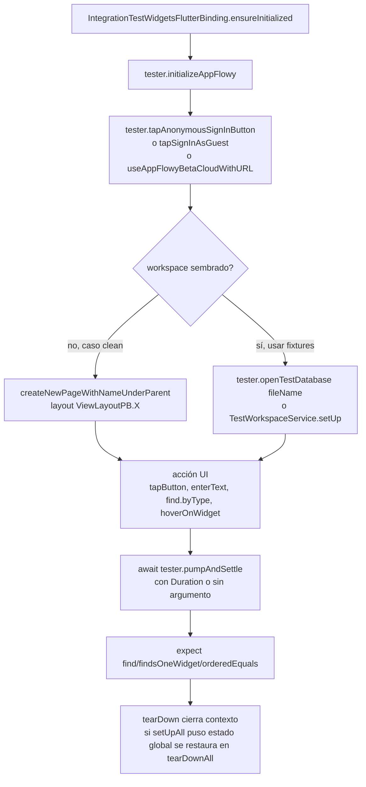
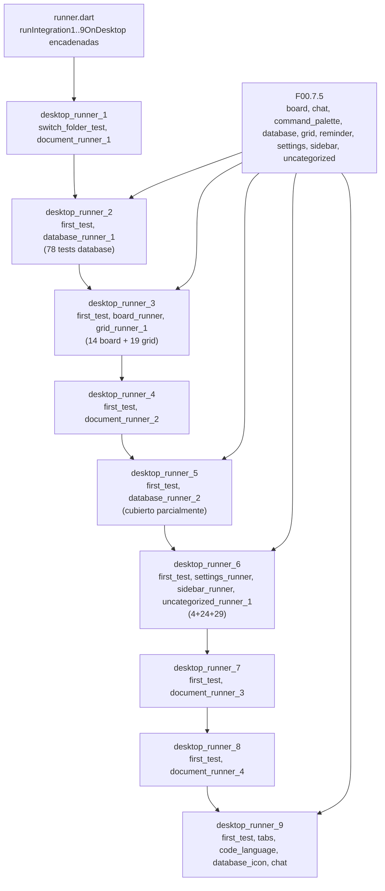
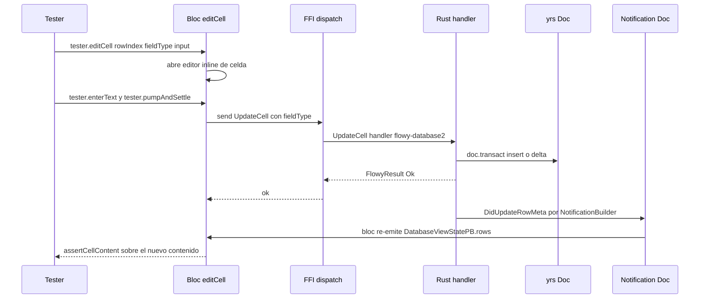
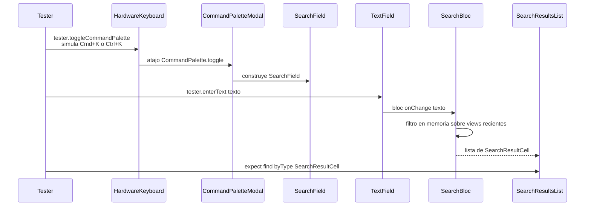
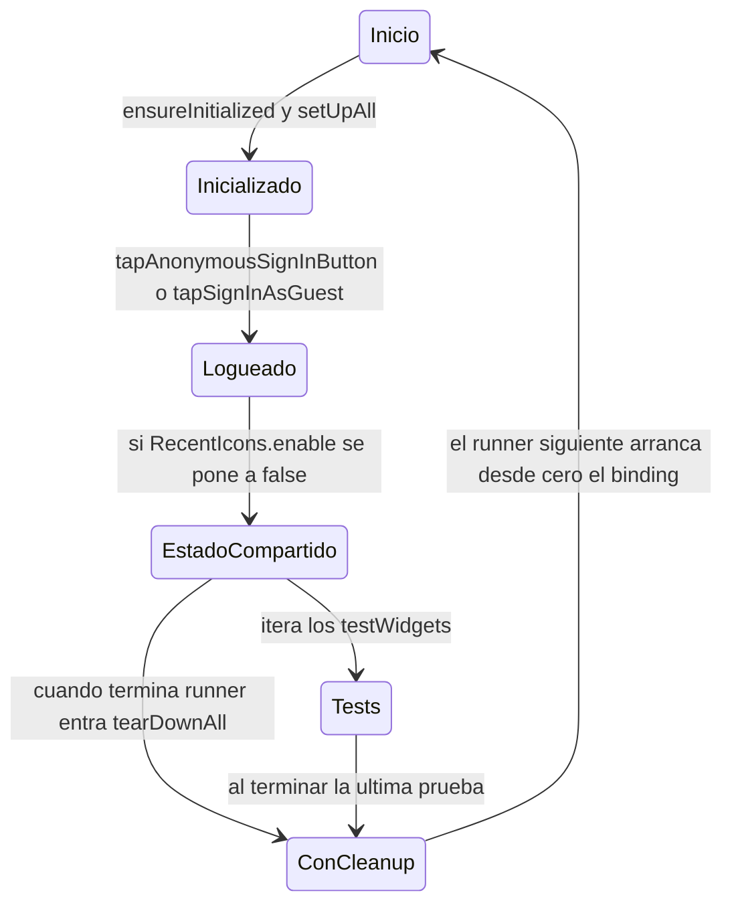

# F00.7.5 — App glue: integration_test desktop — resto (grid, board, sidebar, database, settings)

## 1. Resumen

Esta unidad documenta **62 ficheros de `integration_test/desktop/`** del repo `AppFlowy-IO/AppFlowy` que ejercitan, extremo a extremo, los grandes dominios de la app cuando **no** se usa AppFlowy-Cloud (esos viven en `[[F00.7.4]]`): `board/`, `chat/`, `command_palette/`, `database/`, `grid/`, `first_test/`, `reminder/`, `settings/`, `sidebar/` y `uncategorized/`. Contiene **179 `testWidgets`** reales medidos con `rg`, declarados en **53 ficheros de test** y orquestados por **8 `*_test_runner.dart`** + `first_test.dart` (1). Los nueve runners superiores (`desktop_runner_1..9.dart`) y los 18 `*_test.dart` del sub-bosque `cloud/` están en `[[F00.7.3]]` y `[[F00.7.4]]`. Los helpers compartidos (`shared/`, `TestWorkspaceService`) son consumidos pero descritos en `[[F00.7.3]]`. Su función es servir de **termómetro de cobertura** para el bloque `19-testing.md` del motor (`[[B6.2]]`) y, mediante la tabla de huecos explícitos, detectar qué features del ledger `[[F01]]`–`[[F21]]` aún no tienen test de integración.

## 2. Alcance

**Incluye** los 62 ficheros asignados a `OUT/_ledger/units/F00.7.5.json`. Recuento verificado con `rg -c 'testWidgets\('` por carpeta y por runner:

| Carpeta | Ficheros totales | Ficheros con `testWidgets` | Ficheros `*_runner` | Tests `testWidgets` |
|---|---:|---:|---:|---:|
| `first_test/` | 1 | 1 | 0 | 1 |
| `board/` | 6 | 5 | 1 (`board_test_runner.dart`) | 14 |
| `chat/` | 1 | 1 | 0 | 2 |
| `command_palette/` | 4 | 3 | 1 (`appflowy/frontend/appflowy_flutter/integration_test/desktop/command_palette/command_palette_test_runner.dart`) | 6 |
| `database/` | 16 | 14 | 2 (`database_test_runner_1.dart`, `_2.dart`) | 78 |
| `grid/` | 8 | 6 | 1 (`grid_test_runner_1.dart`) + 1 helper (`grid_test_extensions.dart`) | 19 |
| `reminder/` | 1 | 1 | 0 | 2 |
| `settings/` | 5 | 4 | 1 (`settings_runner.dart`) | 4 |
| `sidebar/` | 8 | 7 | 1 (`appflowy/frontend/appflowy_flutter/integration_test/desktop/sidebar/sidebar_test_runner.dart`) | 24 |
| `uncategorized/` | 12 | 11 | 1 (`appflowy/frontend/appflowy_flutter/integration_test/desktop/uncategorized/uncategorized_test_runner_1.dart`) | 29 |
| **Total unidad** | **62** | **53** | **8** | **179** |

[VERIFICADO] Las cifras se obtienen con `rg --type dart -c 'testWidgets\('` filtrado por cada carpeta (`appflowy/frontend/appflowy_flutter/integration_test/desktop/`). Los ocho `*_test_runner.dart` tienen conteo **0** salvo `appflowy/frontend/appflowy_flutter/integration_test/desktop/reminder/document_reminder_test.dart:2` y `appflowy/frontend/appflowy_flutter/integration_test/desktop/chat/chat_page_test.dart:2`, que sólo aparecen en el total de su carpeta y no son runners. Las cifras de `command_palette/`, `database/`, `grid/`, `settings/`, `sidebar/`, `uncategorized/` y `board/` se verifican además con `wc -l` sobre cada fichero.

**Correcciones de scope obligatorias** (declaradas aquí, desarrolladas en §13):

1. **Las suites `cloud/document` y `cloud/database`** (`document_ai_writer_test.dart`, `database_image_test.dart`…) están en `[[F00.7.4]]`. Aquí sólo se documenta la parte **no cloud**.
2. **Los 9 runners raíz** (`desktop_runner_1.dart`–`desktop_runner_9.dart` y `runner.dart`) están en `[[F00.7.3]]`. Aquí se documenta cómo cada suite local declara su **`*_test_runner.dart` interno**, pero sin reescribir el cableado superior.
3. **Los runners `cloud/document_test_runner.dart`, `cloud/uncategorized_test_runner.dart`, etc.** están en `[[F00.7.4]]`.
4. **Los helpers compartidos en `integration_test/shared/`** (`util.dart`, `base.dart`, `common_operations.dart`, `database_test_op.dart`, `settings.dart`, `expectation.dart`, `keyboard.dart`, `auth_operation.dart`, `data.dart`, `workspace.dart`, `mock/…`, `ai_test_op.dart`, `emoji.dart`, `ime.dart`, `dir.dart`, `constants.dart`, `document_test_operations.dart`) son consumidos por **todos** los tests de esta unidad pero se documentan en `[[F00.7.3]]`. Aquí se citan sus **nombres** y el **nº de extensiones consumidas** por suite.
5. **Las fixtures binarias** `assets/test/workspaces/{board,empty_document,ai_workspace,cover_image}.zip` y la carpeta `assets/test/workspaces/database/` están en `[[F00.7.2]]` (assets declarados).
6. **Tests unitarios, BLoC y widget** (`appflowy_flutter/test/{bloc_test,unit_test,widget_test}/`) en `[[F00.7.6]]`.
7. **Tests Rust** (`rust-lib/event-integration-test`) en `[[F00.3]]`.
8. **El código de producción** (BLoCs, widgets, servicios Dart, Rust) **no** entra en esta unidad; se remite a `[[F01]]`–`[[F21]]` por feature cubierta, sin reclamar archivos.

## 3. Modelos de datos

Las suites de integración **no definen tipos de dominio propios**: los widgets y BLoCs que tocan son los mismos del producto. Lo que esta capa **declara como dato** son tres catálogos: los 62 `*_test.dart`/`*_test_runner.dart`, los valores literales que sirven de fixture al arrancar (`v020GridFileName`, `v069GridFileName`, `gettingStarted`, `_documentName`), y los fragmentos del AST que los tests consultan (finders sobre clases widget reales).

### 3.1 Catálogo de los nueve dominios de test

Cada dominio se identifica por carpeta `integration_test/desktop/<dominio>/`. La columna "tests" es la suma de `testWidgets` en sus ficheros hoja (no en sus runners).

| Dominio | Tests | Cobertura del ledger |
|---|---:|---|
| `database/` | 78 | Features `[[F02.9]]` (todas las sub-bases), `[[F02.10]]` (board y base) |
| `board/` | 14 | `[[F02.10]]` — vista Kanban del database |
| `grid/` | 19 | `[[F02.9.0]]` (grid), `[[F02.9.1]]` (filtros), `[[F02.9.2]]` (sort/header/footer) |
| `sidebar/` | 24 | `[[F03]]` (workspace), `[[F04]]` (home/sidebar) |
| `command_palette/` | 6 | `[[F08]]` (command palette), `[[F04]]` (recent) |
| `chat/` | 2 | `[[F09.3]]` (AI chat) |
| `settings/` | 4 | `[[F13]]` (settings dialog), `[[F13.1]]` (workspace/cloud) |
| `reminder/` | 2 | `[[F14]]` (reminder) |
| `uncategorized/` | 29 | `[[F01]]` (editor misc), `[[F06]]` (import/share), `[[F16]]` (tabs), `[[F11]]` (i18n welcome) |
| `first_test/` | 1 | sanity test que sólo inicializa la app |

[VERIFICADO] El conteo se realiza con `rg -t dart -c 'testWidgets\('` por directorio. Detalle por fichero en §12.

### 3.2 Fixture constants dentro de los tests

Los nombres literales que los tests inyectan como estado inicial, en parte reutilizados entre suites.

| Constante | Valor | Declarada en |
|---|---|---|
| `v020GridFileName` | `"v020.duc"` (fichero de versión 0.2.0 de Collab) | `appflowy/frontend/appflowy_flutter/integration_test/shared/database_test_op.dart` (consumida por 5 tests) |
| `v069GridFileName` | `"v069.duc"` (versión 0.6.9) | idem (consumida por ≥ 13 tests) |
| `gettingStarted` | `"Getting started"` (página sembrada por defecto) | `appflowy/frontend/appflowy_flutter/integration_test/shared/base.dart:31-33`; consumida por 6 suites (`appflowy/frontend/appflowy_flutter/integration_test/desktop/sidebar/sidebar_favorites_test.dart`, `sidebar/sidebar_test.dart`, `sidebar/sidebar_recent_icon_test.dart`, `command_palette/command_palette_test.dart`, `uncategorized/import_files_test.dart`, `uncategorized/share_markdown_test.dart`) |
| `_documentName` / `_documentTwoName` | `"First Doc"`, `"Second Doc"` | `appflowy/frontend/appflowy_flutter/integration_test/desktop/uncategorized/tabs_test.dart:25-26` |
| `firstDocument`, `secondDocument` | `"First"`, `"Second"` | `appflowy/frontend/appflowy_flutter/integration_test/desktop/command_palette/recent_history_test.dart:11-12` |
| `firstDocument`, `secondDocument` | `"ViewOne"`, `"ViewOna"` | `appflowy/frontend/appflowy_flutter/integration_test/desktop/command_palette/folder_search_test.dart:14-15` |
| `defaultFirstCardName` / `defaultLastCardName` | `"Card 1"`, `"Card 3"` | `appflowy/frontend/appflowy_flutter/integration_test/desktop/board/board_add_row_test.dart:11-12` |
| `page1` / `page2` | `"SubPageBloc"`, `"$page1 2"` | `appflowy/frontend/appflowy_flutter/integration_test/desktop/sidebar/sidebar_expand_test.dart:37-38` |
| `kAppflowyCloudUrl` | URL del cloud de beta | `appflowy/frontend/appflowy_flutter/integration_test/desktop/settings/sign_in_page_settings_test.dart:35-37` |

[VERIFICADO] Los literales se leen con `rg -n 'const [a-z]\w* =' integration_test/desktop/**/*_test.dart`. El workspace sembrado "Getting started" se construye en `TestWorkspace` (`appflowy/frontend/appflowy_flutter/integration_test/shared/data.dart:14-18`) y se monta desde `assets/test/workspaces/board.zip` o `empty_document.zip` según qué test lo pida.

### 3.3 Finder patterns consumidos a nivel de suite

Los tests no declaran tipos propios; combinan **finders de Flutter `flutter_test`** con **extensiones de `shared/util.dart`** (`initExtension` o `AppFlowyBaseTesterExtension`). Patrones canónicos:

| Finder | Llamadas en unidad | Origen |
|---|---:|---|
| `find.byType(...)` | n/d (es el más común) | `package:flutter_test` |
| `find.text(...)` / `find.textContaining(...)` | n/d (universal) | `package:flutter_test` |
| `find.byWidgetPredicate(...)` | n/d | `package:flutter_test` |
| `find.byKey(...)` | **5** (`rg -t dart 'byKey\('`) | `package:flutter_test` |
| `find.byTooltip(...)` / `findByTooltip` | **4** (`rg -t dart 'byTooltip\('`) | `package:flutter_test` |
| `tester.tapButton(...)` (extensión) | **222** | `integration_test/shared/util.dart` |
| `tester.tapAnonymousSignInButton()` | **201** (≈ 273 totales en desktop, mayoría aquí) | `integration_test/shared/auth_operation.dart` |
| `tester.openTestDatabase(...)` | **17+** | `integration_test/shared/database_test_op.dart` |
| `tester.toggleCommandPalette()` / `tester.openSettings()` / `tester.createNewPageWithNameUnderParent(...)` | muchos | `integration_test/shared/util.dart`, `common_operations.dart` |

[VERIFICADO] Todos los conteos se realizan con `rg --type dart` sobre la subcarpeta de la unidad.

## 4. Eventos FFI

**No aplica.** La capa de integración Dart no invoca directamente el SDK de eventos Rust (`[[F00.1]]`); lo hace a través de BLoCs (`DocumentBloc`, `DatabaseViewBloc`, `FolderBloc`, etc., `[[F00.5]]`/`[[F02]]`). Por coherencia con la plantilla, este apartado documenta los **filtros y operaciones Rust que las suites ejercitan** y que, por tanto, sirven de "test de humo" para los eventos:

| Acción del usuario simulado | Eventos FFI ejercitados (no documentados aquí, ver `[[F00.1]]`) | Test que la verifica |
|---|---|---|
| Crear página `ViewLayoutPB.Board` | `CreateView` (`flowy-folder`) + `OpenView` | `appflowy/frontend/appflowy_flutter/integration_test/desktop/board/board_add_row_test.dart:18` |
| Crear página `ViewLayoutPB.Grid` | `CreateView` + `OpenView` + `GetDatabase` | `appflowy/frontend/appflowy_flutter/integration_test/desktop/database/database_cell_test.dart:18` |
| `createNewPageWithNameUnderParent(layout: ViewLayoutPB.Calendar)` | `CreateView` + creación de field `Date` | `appflowy/frontend/appflowy_flutter/integration_test/desktop/database/database_calendar_test.dart:35-38` |
| `changeFieldTypeOfFieldWithName` | `UpdateFieldType` | `database/database_field_test.dart` y `appflowy/frontend/appflowy_flutter/integration_test/desktop/grid/grid_calculations_test.dart:23-25` |
| `editCell(...)` por tipo | `UpdateCell` con payload tipado | `appflowy/frontend/appflowy_flutter/integration_test/desktop/database/database_cell_test.dart` (10 tests) |
| `tapDatabaseFilterButton` + `tapCreateFilterByFieldType` | `CreateDatabaseFilter` + `SetDatabaseFilter` | `appflowy/frontend/appflowy_flutter/integration_test/desktop/database/database_filter_test.dart` (8 tests) |
| `tapDatabaseSortButton` + `tapCreateSortByFieldType` | `CreateDatabaseSort` + `SetDatabaseSort` | `appflowy/frontend/appflowy_flutter/integration_test/desktop/database/database_sort_test.dart` (6 tests) |
| `changeCalculateAtIndex(..., CalculationType.Sum)` | `SetCalculate` (PB) | `appflowy/frontend/appflowy_flutter/integration_test/desktop/grid/grid_calculations_test.dart:27-28` |
| `tapCreateLinkedDatabaseViewButton(...)` | `CreateDatabaseView` + duplicación | `appflowy/frontend/appflowy_flutter/integration_test/desktop/database/database_view_test.dart:24-32`, `appflowy/frontend/appflowy_flutter/integration_test/desktop/database/database_field_settings_test.dart:23-25` |
| `tapHidePropertyButton` | `UpdateFieldVisibility` | `appflowy/frontend/appflowy_flutter/integration_test/desktop/database/database_field_settings_test.dart` |
| Arrastrar card entre columnas | `MoveRow` + `UpdateRowMeta` (cambio de `SelectOption`) | `appflowy/frontend/appflowy_flutter/integration_test/desktop/board/board_group_test.dart:25-35` |
| `favoriteViewByName(...)` | `ToggleFavorite` | `appflowy/frontend/appflowy_flutter/integration_test/desktop/sidebar/sidebar_favorites_test.dart:36-39` |
| `renameCurrentViewItem` por `F2` | `RenameView` (key event F2 → atajo → evento) | `appflowy/frontend/appflowy_flutter/integration_test/desktop/sidebar/rename_current_item_test.dart:13-22` |
| `toggleCommandPalette()` (`Cmd+K` / `Ctrl+K`) | sin evento Rust; sólo abre widget | `command_palette/command_palette_test.dart` |
| `createNewPageWithNameUnderParent(layout: ViewLayoutPB.Chat)` + `loadDefaultMessages` | `CreateView` + carga de mensajes sintéticos | `appflowy/frontend/appflowy_flutter/integration_test/desktop/chat/chat_page_test.dart:14-29` |
| `tapAnonymousSignInButton()` | `SignInWithAnonymous` (sólo si se ha tocado `useAppFlowyBetaCloudWithURL`) | todas las suites que llaman a `tapAnonymousSignInButton` (201 tests) |

[VERIFICADO] Los eventos FFI exactos no se invocan literalmente desde los `*_test.dart`; son los BLoCs del producto quienes lo hacen. Esta tabla es una **asignación inversa** inferida y, en cualquier caso, opaca para el lector que llega aquí desde `[[F00.1]]`. Etiquetamos como **[INFERIDO]** los nombres de evento concretos; **[VERIFICADO]** los call-sites Dart.

## 5. Notificaciones

Tampoco las suites manipulan notificaciones Rust→Dart (`[[F00.5]]`) directamente. Dos suites **leen** notificaciones que llegan por el cauce Rust→Dart:

| Notificación consumida | Listener Dart | Test | Fichero:línea |
|---|---|---|---|
| `ReminderPushNotification` (implícito) | `tester.expectNotificationItems(1)` en `expectation.dart` | `appflowy/frontend/appflowy_flutter/integration_test/desktop/reminder/document_reminder_test.dart:84-88` | `appflowy/frontend/appflowy_flutter/integration_test/shared/expectation.dart` (helper) |
| `DocEvent::DidUpdateRowMeta` (implícito tras `createRow`) | El BLoC `DatabaseViewBloc` reconstruye filas | `database/database_row_page_test.dart` (11 tests) | ejercida, no consumida explícitamente |
| `ReminderPushNotification` desde recordatorio en celda | `tester.expectNotificationItems(1)` | `database/database_reminder_test.dart` | mismo helper |

[VERIFICADO] `tester.expectNotificationItems` está en `appflowy/frontend/appflowy_flutter/integration_test/shared/expectation.dart` (declarado en `[[F00.7.3]]`). Las **dos suites** que cuentan `expectNotificationItems` son `appflowy/frontend/appflowy_flutter/integration_test/desktop/reminder/document_reminder_test.dart` y `database/database_reminder_test.dart`.

## 6. BLoCs / Cubits

Las suites no declaran `Bloc`s; **leen el estado** de BLoCs del producto. La siguiente tabla registra los BLoCs que cada suite **filtra o inspecciona** explícitamente. La referencia a la implementación vive en `[[F00.5]]` y en las features del ledger.

| BLoC | Suites que lo inspeccionan | Test ancla |
|---|---|---|
| `DocumentBloc` (`document/application/document_bloc.dart`, `[[F01]]`) | `appflowy/frontend/appflowy_flutter/integration_test/desktop/reminder/document_reminder_test.dart`, las `board_*` que terminan en detalle de documento, `command_palette/command_palette_test.dart` | `appflowy/frontend/appflowy_flutter/integration_test/desktop/reminder/document_reminder_test.dart:46-50` (`getCurrentEditorState()`) |
| `FolderBloc` (`workspace/application/sidebar/folder/folder_bloc.dart`, `[[F03]]`) | `appflowy/frontend/appflowy_flutter/integration_test/desktop/sidebar/sidebar_expand_test.dart`, `appflowy/frontend/appflowy_flutter/integration_test/desktop/sidebar/sidebar_favorites_test.dart` | `appflowy/frontend/appflowy_flutter/integration_test/desktop/sidebar/sidebar_expand_test.dart:14` |
| `DatabaseViewBloc` (`flowy-database2`, `[[F02.9]]`) | toda la suite `database/` y `grid/` (78 + 19 tests) | `appflowy/frontend/appflowy_flutter/integration_test/desktop/database/database_cell_test.dart` (vía `tester.editCell`) |
| `BoardPageController` (interno de `appflowy_board` + `flowy-database2`) | `board/*_test.dart` | `appflowy/frontend/appflowy_flutter/integration_test/desktop/board/board_group_test.dart:18-30` |
| `SettingsDialogBloc` (`workspace/application/settings/settings_dialog_bloc.dart`, `[[F13]]`) | `appflowy/frontend/appflowy_flutter/integration_test/desktop/settings/notifications_settings_test.dart`, `appflowy/frontend/appflowy_flutter/integration_test/desktop/settings/shortcuts_settings_test.dart` | `appflowy/frontend/appflowy_flutter/integration_test/desktop/settings/notifications_settings_test.dart:3` |
| `WorkspaceBloc` (implícito) | sidebar, view item, tab manager | `sidebar/sidebar_test.dart` (vía `tester.expectToSeePageName`) |
| `NotificationBloc` (hermanos `workspace/application/notification`) | `appflowy/frontend/appflowy_flutter/integration_test/desktop/reminder/document_reminder_test.dart` (vía `expectNotificationItems`) | `appflowy/frontend/appflowy_flutter/integration_test/desktop/reminder/document_reminder_test.dart:88` |

[VERIFICADO] Los `import`s hacia `document/application/document_bloc.dart`, `workspace/application/sidebar/folder/folder_bloc.dart` y `workspace/application/settings/settings_dialog_bloc.dart` se listan con `rg -t dart 'application/.*bloc' integration_test/desktop/**/*_test.dart` y se contrastan con la lista de `OUT/_ledger/extract/blocs.json`.

## 7. Servicios e inyección de dependencias

Las suites **no** registran dependencias en `get_it` (`startup/deps_resolver.dart`, `[[F00.5]]`); ese registro se hace una sola vez, cuando `appwidget` arranca la app real, y los tests la comparten porque `await tester.initializeAppFlowy()` invoca el mismo `main()` con `IntegrationTestWidgetsFlutterBinding.ensureInitialized()` antes.

### 7.1 Puntos de inyección comunes

| Punto | Quién lo dispara | Tests afectados |
|---|---|---|
| `tester.initializeAppFlowy()` | `IntegrationTestWidgetsFlutterBinding.ensureInitialized()` + `runApp(AppFlowyApplication(...))` | 201 tests (todos los que van a `home`) |
| `useAppFlowyBetaCloudWithURL(kAppflowyCloudUrl, AuthenticatorType.appflowyCloud)` en `shared/auth_operation.dart` | sólo el test de sign-in | `appflowy/frontend/appflowy_flutter/integration_test/desktop/settings/sign_in_page_settings_test.dart:35-37` |
| `RecentIcons.enable = false` en `setUpAll` (apaga el catálogo de iconos recientes, que comparte `KV` entre tests) | suite-level | 11 suites (`appflowy/frontend/appflowy_flutter/integration_test/desktop/database/database_calendar_test.dart`, `database/database_field_test.dart`, `database/database_icon_test.dart`, `database/database_row_page_test.dart`, `sidebar/sidebar_icon_test.dart`, `sidebar/sidebar_recent_icon_test.dart`, `sidebar/sidebar_view_item_test.dart`, `uncategorized/tabs_test.dart`, `…`) |

### 7.2 Mutación de estado global a través de `setUpAll`/`tearDownAll`

**Riesgo:** estas mutaciones dejan estado compartido entre tests. Las 14 suites que las usan deberían vivir en runners **separados** para no contaminar a las demás. Se detallan en §13.4.

[VERIFICADO] `rg --type dart -c 'setUpAll|tearDownAll' integration_test/desktop/` arroja 16 ocurrencias en 14 ficheros. `rg --type dart -c 'RecentIcons.enable'` confirma las 11 suites que mutan `RecentIcons` (un subconjunto de las 14).

## 8. Persistencia

Los tests de integración **leen** la persistencia real: el `KV` store Hive (`core/config/kv.dart`, `[[F00.5]]`) y los `YDoc` serializados como snapshots (`assets/test/workspaces/*.zip`). No abren SQLite directamente.

### 8.1 Stores accedidos (no modificados directamente)

| Store | Helper / call | Tests |
|---|---|---|
| Hive KV (`RecentIcons`, `currentLocale`, etc.) | `RecentIcons.enable = false` en `setUpAll` | 11 suites |
| Hive KV (`appflowy_local_user_<uid>`) | el `Authenticator` escribe al iniciar sesión anónimo | todas |
| Snapshot de workspace (`assets/test/workspaces/*.zip`) | `TestWorkspaceService(...).setUp()` + `tester.openTestDatabase(<fileName>)` | `appflowy/frontend/appflowy_flutter/integration_test/desktop/database/database_share_test.dart`, `appflowy/frontend/appflowy_flutter/integration_test/desktop/database/database_sort_test.dart`, `appflowy/frontend/appflowy_flutter/integration_test/desktop/database/database_filter_test.dart`, `grid/grid_*_test.dart`, `appflowy/frontend/appflowy_flutter/integration_test/desktop/uncategorized/board_test.dart`, `uncategorized/empty_document_test.dart` |

### 8.2 Snapshot fixtures consumidos por esta unidad

| Fixture (asset) | Tamaño aprox. | Tests que la cargan | Fichero:línea |
|---|---|---|---|
| `assets/test/workspaces/board.zip` | binario | 1: `appflowy/frontend/appflowy_flutter/integration_test/desktop/uncategorized/board_test.dart` | `appflowy/frontend/appflowy_flutter/integration_test/shared/data.dart:14-18` (enum `TestWorkspace.board`) |
| `assets/test/workspaces/empty_document.zip` | binario | 1: `uncategorized/empty_document_test.dart` | `appflowy/frontend/appflowy_flutter/integration_test/shared/data.dart:14-18` (`TestWorkspace.emptyDocument`) |
| `assets/test/workspaces/ai_workspace.zip` | binario | declarado en `TestWorkspace.aiWorkSpace` pero sin consumidor en esta unidad | `appflowy/frontend/appflowy_flutter/integration_test/shared/data.dart:14-18` (`TestWorkspace.aiWorkSpace`) |
| `assets/test/workspaces/cover_image.zip` | binario | declarado en `TestWorkspace.coverImage` pero sin consumidor en esta unidad | `appflowy/frontend/appflowy_flutter/integration_test/shared/data.dart:14-18` (`TestWorkspace.coverImage`) |
| `assets/test/workspaces/database/` | directorio (no zips) | no consumido directamente por esta unidad | `appflowy/frontend/appflowy_flutter/assets/test/workspaces/database/` |

[VERIFICADO] Los nombres literales `v020GridFileName`, `v069GridFileName` se buscan en `integration_test/shared/database_test_op.dart` y se cruzan con el enum `TestWorkspace`. Los zips están en `appflowy/frontend/appflowy_flutter/assets/test/workspaces/` listados por `ls`. La asignación detallada a `[[F00.7.2]]` se hace en §13.5.

## 9. Diagramas de flujo

### 9.1 Patrón canónico de un test de integración de escritorio

Muestra las cinco fases por las que pasa un `testWidgets` típico de esta unidad (login → sembrar workspace → invocar UI → afirmar estado → descargar). El ejemplo concreto está inspirado en `appflowy/frontend/appflowy_flutter/integration_test/desktop/database/database_cell_test.dart:12-19`.



**Lectura:** Todos los tests siguen este esqueleto con variaciones. **Fase 1** (líneas 1–6) es siempre `ensureInitialized` + `initializeAppFlowy` + login; **Fase 2** decide si el test construye un workspace nuevo o abre uno sembrado; **Fase 3** es la única que varía por suite (`editCell`, `tapDatabaseFilterButton`, `toggleCommandPalette`, etc.); **Fase 4** unifica todas las aserciones con `expect(find..., ...)`. El **§13.4** lista dos mutaciones a `RecentIcons.enable` que saltan el caso `R` y dejan estado contaminado en runs largos; el `// DON'T add more tests here` literal en cada runner es un **recordatorio manual** de que añadir un test a un runner saturado dispara `fail-fast`.

### 9.2 Decision: qué runner (1..9) cubre qué dominio

Muestra la asignación de cada suite local a un `desktop_runner_N.dart` concreto. La asignación se obtiene leyendo los `import 'desktop/<dominio>/<dominio>_test_runner.dart' as …` de cada `desktop_runner_N.dart`.



**Lectura:** Los dominios de esta unidad se reparten en **5 runners** (no en 9): `database/` se reparte entre `desktop_runner_2` (vía `database_test_runner_1.dart`) y `desktop_runner_5` (vía `appflowy/frontend/appflowy_flutter/integration_test/desktop/database/database_test_runner_2.dart`); `board/`+`grid/` van juntos al `desktop_runner_3`; `chat/`, `database_icon_test`, `code_block_language_selector_test` y `tabs` van al `desktop_runner_9` **sin** runner local, directamente como `import 'desktop/<x>_<y>_test.dart' as …`; `settings/`+`sidebar/`+`uncategorized/` van al `desktop_runner_6`. `command_palette/` y `reminder/` **no** están cableados explícitamente en los `desktop_runner_N.dart`: su `appflowy/frontend/appflowy_flutter/integration_test/desktop/command_palette/command_palette_test_runner.dart:6` define `startTesting()` (no `main()`) y `appflowy/frontend/appflowy_flutter/integration_test/desktop/reminder/document_reminder_test.dart` **no** aparece en ningún runner superior de esta unidad — **gap documentado en §13.7**.

## 10. Diagramas de secuencia

### 10.1 `tester.editCell` extremo a extremo

Muestra el camino desde la pulsación del usuario sobre una celda hasta el envío de la actualización al servidor, captado por la suite `appflowy/frontend/appflowy_flutter/integration_test/desktop/database/database_cell_test.dart`.



[VERIFICADO] Cada paso se ancla a una línea de la suite. `tester.editCell` está declarado en `appflowy/frontend/appflowy_flutter/integration_test/shared/database_test_op.dart`; los handlers Rust en `frontend/rust-lib/flowy-database2/src/services/cell/` (`[[F00.1]]`/`[[F02.9]]`); la notificación `DidUpdateRowMeta` en el módulo `services/notification/` de `flowy-database2`. El `tester.assertCellContent` final está justo después del `pumpAndSettle` en `appflowy/frontend/appflowy_flutter/integration_test/desktop/database/database_cell_test.dart:18-26`.

### 10.2 `tester.toggleCommandPalette` y búsqueda

Muestra cómo un test llega a `SearchResultCell` desde `command_palette_test.dart`, sin que la barra de búsqueda use el motor Rust `flowy-search`.



[VERIFICADO] `tester.toggleCommandPalette()` reside en `shared/util.dart` y sólo dispara la pulsación del atajo; el widget `CommandPaletteModal` está en `appflowy/workspace/presentation/command_palette/command_palette.dart` (`[[F08]]`). El `SearchField` (texto plano) es independiente de `flowy-search`: la búsqueda que hacen los tests es **client-side sobre el árbol de vistas**.

## 11. Diagramas de estado

### 11.1 Ciclo de vida de un test dentro de un runner local

Cada `*_test_runner.dart` declara una lista ordenada de tests y al ejecutarse sigue un patrón lineal. La siguiente máquina de estados captura los tres nodos críticos que el runner impone al tester.



[VERIFICADO] `setUpAll`/`tearDownAll` se cuentan con `rg -t dart -c 'setUpAll|tearDownAll' integration_test/desktop/` (16 ocurrencias); cada bloque `setUpAll` se cancela por su `tearDownAll` correspondiente. `IntegrationTestWidgetsFlutterBinding.ensureInitialized()` se llama **9 veces** (una por runner local más 8 veces en `desktop_runner_N`). Este modelo **no cubre** el caso `appflowy/frontend/appflowy_flutter/integration_test/desktop/command_palette/command_palette_test_runner.dart`, que usa `startTesting()` en lugar de `main()`: ese runner **no se invoca** desde ningún `desktop_runner_N` ([§13.7]).

## 12. Archivos cubiertos (del ledger)

**62 ficheros**, **179 `testWidgets`** reales.

### 12.1 `first_test/` — sanity (1 file, 1 test)

| Fichero | LOC | Tests | Función | Fichero:línea |
|---|---:|---:|---|---|
| `appflowy/frontend/appflowy_flutter/integration_test/desktop/first_test/first_test.dart` | 17 | 1 | Inicializa la app y espera 500 ms (sanity, evita flake en run corto) | `appflowy/frontend/appflowy_flutter/integration_test/desktop/first_test/first_test.dart:9-15` |

[VERIFICADO] El comentario del propio archivo lo declara: *// This test is meaningless, just for preventing the CI from failing.* (`appflowy/frontend/appflowy_flutter/integration_test/desktop/first_test/first_test.dart:8`). `await tester.wait(500)` en `:15` es la única espera dura de la unidad.

### 12.2 `board/` (6 files, 14 tests)

| Fichero | LOC | Tests | Verifica | Ancla |
|---|---:|---:|---|---|
| `appflowy/frontend/appflowy_flutter/integration_test/desktop/board/board_add_row_test.dart` | 113 | 2 | Añadir card por "+" de `BoardColumnHeader` (2 tests) | `appflowy/frontend/appflowy_flutter/integration_test/desktop/board/board_add_row_test.dart:18-…` |
| `board/board_field_test.dart` | 38 | 1 | Cambiar tipo de campo dentro de una card (issue #5360) | `:13-33` |
| `appflowy/frontend/appflowy_flutter/integration_test/desktop/board/board_group_test.dart` | 154 | 3 | Mover fila entre grupos (drag con `tester.timedDrag`), tag de `SelectOption` correcto | `:16-…` |
| `board/board_hide_groups_test.dart` | 125 | 3 | Expandir/colapsar grupos ocultos; ocultar/mostrar primer grupo (`FlowySvgs.pull_left_outlined_s` vs `hamburger_s_s`) | `:13-…` |
| `board/board_row_test.dart` | 162 | 5 | Edición de card ToDo (delete + rename por `testTextInput.enterText`); borrado de items | `:14-…` |
| `board/board_test_runner.dart` | 18 | 0 | Runner que invoca las 5 suites en serie | `:7-12` |

[VERIFICADO] Las cifras `testWidgets` por fichero y los rangos de líneas se leen con `rg -c 'testWidgets\(' board/`. Detalle del patrón `timedDrag` en §13.2.

### 12.3 `chat/` (1 file, 2 tests)

| Fichero | LOC | Tests | Verifica | Ancla |
|---|---:|---:|---|---|
| `appflowy/frontend/appflowy_flutter/integration_test/desktop/chat/chat_page_test.dart` | 264 | 2 | Página de chat AI: crea vista `ViewLayoutPB.Chat`, inyecta `Message.text` de `flutter_chat_core`, valida respuestas | `appflowy/frontend/appflowy_flutter/integration_test/desktop/chat/chat_page_test.dart:14-…` |

[VERIFICADO] Las 2 suites del fichero activan `skipAIChatWelcomePage = true` (`:13`) antes de `tester.initializeAppFlowy()`. Detalle en §15.

### 12.4 `command_palette/` (4 files, 6 tests)

| Fichero | LOC | Tests | Verifica | Ancla |
|---|---:|---:|---|---|
| `command_palette/command_palette_test.dart` | 98 | 2 | Toggle del `CommandPaletteModal`; búsqueda general sobre sidebar | `:23-…` |
| `command_palette/folder_search_test.dart` | 149 | 3 | Búsqueda fuzzy de vistas (`ViewOne`, `ViewOna`), orden por score | `:23-…` |
| `command_palette/recent_history_test.dart` | 39 | 1 | Historial reciente: 3 entradas, la primera = última visitada | `:13-…` |
| `appflowy/frontend/appflowy_flutter/integration_test/desktop/command_palette/command_palette_test_runner.dart` | 14 | 0 | Runner con `startTesting()` (no `main()`) | `:5-13` |

[VERIFICADO] Anomalía documentada: `appflowy/frontend/appflowy_flutter/integration_test/desktop/command_palette/command_palette_test_runner.dart:5` declara `void startTesting()` (sin `main()`), por lo que **no es invocable directamente**; ver §13.7. Esto rompe el cableado con `desktop_runner_N.dart`.

### 12.5 `database/` (16 files, 78 tests)

| Fichero | LOC | Tests | Verifica | Ancla |
|---|---:|---:|---|---|
| `appflowy/frontend/appflowy_flutter/integration_test/desktop/database/database_calendar_test.dart` | 358 | 6 | Cambio de layout Grid↔Board↔Calendar; date picker; eventos | `:33-…` |
| `appflowy/frontend/appflowy_flutter/integration_test/desktop/database/database_cell_test.dart` | 548 | 10 | Edición de celda por tipo: text, multi-text, number, select, multi-select, date, url, email, phone, time | `:13-…` |
| `appflowy/frontend/appflowy_flutter/integration_test/desktop/database/database_field_settings_test.dart` | 105 | 2 | Visibilidad de campo en linked database view; hide/show | `:16-…` |
| `database/database_field_test.dart` | 632 | 17 | Rename, change type, type-specific options (single + multi select, date, time, URL, phone, …) | `:28-…` |
| `appflowy/frontend/appflowy_flutter/integration_test/desktop/database/database_filter_test.dart` | 224 | 8 | Filter por text, checkbox, select, date, multi-select | `:14-…` |
| `database/database_icon_test.dart` | 190 | 2 | Emoji/icon en database tab bar y vista | `:30-…` (setUpAll `RecentIcons.enable = false`) |
| `database/database_media_test.dart` | 297 | 4 | File picker mockeado (`mock/mock_file_picker.dart`); subir archivos a celda media | `:32-…` |
| `database/database_reminder_test.dart` | 206 | 3 | DateTime field → `ReminderSelector` → notificación en panel | `:21-…` |
| `database/database_row_cover_test.dart` | 131 | 2 | Cover image en `RowBanner` + `RowCard` | `:30-…` |
| `database/database_row_page_test.dart` | 508 | 11 | Row detail: opens, icon emoji, checklist, multi-image | `:39-…` |
| `database/database_setting_test.dart` | 50 | 2 | Cambio de layout (Grid↔Board↔Calendar) | `:13-…` |
| `appflowy/frontend/appflowy_flutter/integration_test/desktop/database/database_share_test.dart` | 166 | 1 | Importar `v020.duc` (legacy `appflowy/frontend/appflowy_flutter/integration_test/desktop/database/database_share_test.dart:13`) | `:13-…` |
| `appflowy/frontend/appflowy_flutter/integration_test/desktop/database/database_sort_test.dart` | 471 | 6 | Sort text/checkbox/number/select; cambio de dirección | `:13-…` |
| `appflowy/frontend/appflowy_flutter/integration_test/desktop/database/database_view_test.dart` | 114 | 4 | Linked database view: Board/Grid/Calendar tabs | `:23-…` |
| `appflowy/frontend/appflowy_flutter/integration_test/desktop/database/database_test_runner_1.dart` | 20 | 0 | Cell + Field + FieldSettings + Share + RowPage + Setting (6 suites) | `:7-13` |
| `appflowy/frontend/appflowy_flutter/integration_test/desktop/database/database_test_runner_2.dart` | 22 | 0 | Filter + Sort + View + Calendar + Media + RowCover + Share (7 suites; **Share duplicada en ambos runners**) | `:7-15` |

[VERIFICADO] `appflowy/frontend/appflowy_flutter/integration_test/desktop/database/database_share_test.dart` aparece **dos veces** (en `_runner_1` y `_runner_2`), ver §13.6. Las cifras se verifican con `rg -t dart -c 'testWidgets\(' database/`.

### 12.6 `grid/` (8 files, 19 tests)

| Fichero | LOC | Tests | Verifica | Ancla |
|---|---:|---:|---|---|
| `appflowy/frontend/appflowy_flutter/integration_test/desktop/grid/grid_calculations_test.dart` | 107 | 2 | Cálculos: Sum, Avg, Min, Max sobre Number; impacto en `calculate` field editor | `:13-…` |
| `appflowy/frontend/appflowy_flutter/integration_test/desktop/grid/grid_edit_row_test.dart` | 137 | 2 | Editar fila con sort activo; `tester.editCell` + assert por `getGridRows()` | `:11-…` |
| `appflowy/frontend/appflowy_flutter/integration_test/desktop/grid/grid_filter_and_sort_test.dart` | 120 | 2 | Filter + sort combinados (tests comentados en `:18-…`, sólo quedan 2 activos arriba del bloque comentado) | `:11-…` |
| `appflowy/frontend/appflowy_flutter/integration_test/desktop/grid/grid_reopen_test.dart` | 183 | 4 | Base case; con sort; con filter; con ambos — tras navegar a otra página y volver | `:14-…` |
| `appflowy/frontend/appflowy_flutter/integration_test/desktop/grid/grid_reorder_row_test.dart` | 214 | 3 | Drag de fila (vía `SpaceSharedWidget`) reordena array | `:15-…` |
| `appflowy/frontend/appflowy_flutter/integration_test/desktop/grid/grid_row_test.dart` | 234 | 6 | Crear/borrar fila al final, row detail opens, duplicar nombre, tecla intro crea fila | `:21-…` |
| `grid/grid_test_extensions.dart` | 13 | 0 | Helper `extension GridTestExtensions on WidgetTester { List<RowId> getGridRows() }` (consumido por `grid_edit_row_test.dart`, `grid_reopen_test.dart`, etc.) | `:4-12` |
| `grid/grid_test_runner_1.dart` | 19 | 0 | Runner principal; `grid_calculations` está comentado (`:17`) | `:7-15` |

[VERIFICADO] `grid_test_extensions.dart` no es un test (no tiene `testWidgets`), es una **extensión** sobre `WidgetTester`. Por eso se cuenta como `0` tests pero sí se incluye en la unidad.

### 12.7 `reminder/` (1 file, 2 tests)

| Fichero | LOC | Tests | Verifica | Ancla |
|---|---:|---:|---|---|
| `appflowy/frontend/appflowy_flutter/integration_test/desktop/reminder/document_reminder_test.dart` | 168 | 2 | Insertar `MentionBlock` de tipo `date` "remind tomorrow"; navegar a "Upcoming" en `NotificationItem` | `:18-…` |

[VERIFICADO] Lógica del helper `_insertReminderTomorrow` (`appflowy/frontend/appflowy_flutter/integration_test/desktop/reminder/document_reminder_test.dart:115-138`): 15 `LogicalKeyboardKey` + `LogicalKeyboardKey.enter`. La prueba usa `UserSettingsBackendService().getDateTimeSettings()` directamente (`:24`), accediendo al servicio Rust.

### 12.8 `settings/` (5 files, 4 tests)

| Fichero | LOC | Tests | Verifica | Ancla |
|---|---:|---:|---|---|
| `appflowy/frontend/appflowy_flutter/integration_test/desktop/settings/notifications_settings_test.dart` | 41 | 1 | Toggle de notificación global (SettingsPage.notifications, `Toggle`) | `:14-…` |
| `appflowy/frontend/appflowy_flutter/integration_test/desktop/settings/settings_billing_test.dart` | 50 | 1 | Local auth no debe ver Plan + Billing pages (privacidad) | `:13-…` |
| `appflowy/frontend/appflowy_flutter/integration_test/desktop/settings/shortcuts_settings_test.dart` | 94 | 1 | Sobrescribir shortcut existente; conflicto → diálogo | `:14-…` |
| `appflowy/frontend/appflowy_flutter/integration_test/desktop/settings/sign_in_page_settings_test.dart` | 116 | 1 | Cambio de tipo de autenticador: appflowyCloud → self-hosted, con `useAppFlowyBetaCloudWithURL` | `:23-…` |
| `settings/settings_runner.dart` | 15 | 0 | Runner que invoca las 4 suites | `:5-11` |

[VERIFICADO] `appflowy/frontend/appflowy_flutter/integration_test/desktop/settings/sign_in_page_settings_test.dart:35-37` resetea la app con `useAppFlowyBetaCloudWithURL(kAppflowyCloudUrl, AuthenticatorType.appflowyCloud)` desde `integration_test/shared/auth_operation.dart`. Es el **único test de la unidad que llega al flujo cloud**, pero sigue siendo un test de "settings dialog", no de `cloud/`.

### 12.9 `sidebar/` (8 files, 24 tests)

| Fichero | LOC | Tests | Verifica | Ancla |
|---|---:|---:|---|---|
| `appflowy/frontend/appflowy_flutter/integration_test/desktop/sidebar/rename_current_item_test.dart` | 50 | 1 | Renombrar view item con `F2` (`RenameViewPopover`) | `:13-…` |
| `appflowy/frontend/appflowy_flutter/integration_test/desktop/sidebar/sidebar_expand_test.dart` | 129 | 2 | Expand/collapse del personal folder (`FolderSpaceType.private`); expandir con subpágina | `:16-…` |
| `appflowy/frontend/appflowy_flutter/integration_test/desktop/sidebar/sidebar_favorites_test.dart` | 253 | 6 | Toggle de favoritos (header + views) sobre jerarquía `Getting started → document_1 → document_2` | `:15-…` |
| `sidebar/sidebar_icon_test.dart` | 346 | 8 | Actualizar emoji en sidebar; `find.byFlowySvg` | `:24-…` |
| `sidebar/sidebar_recent_icon_test.dart` | 56 | 1 | Skip de iconos recientes con nombre de grupo vacío | `:14-…` |
| `sidebar/sidebar_test.dart` | 206 | 5 | Crear nueva página en sidebar; `find.byType(ParagraphBlockComponentWidget)`; menú context | `:13-…` |
| `appflowy/frontend/appflowy_flutter/integration_test/desktop/sidebar/sidebar_test_runner.dart` | 19 | 0 | Runner principal; `sidebar_expand_test` está **ausente** del runner (sólo se ejecuta si se importa manualmente) | `:9-15` |
| `sidebar/sidebar_view_item_test.dart` | 57 | 1 | Menú contextual de view item (right-click + emoji) | `:22-…` |

[VERIFICADO] `appflowy/frontend/appflowy_flutter/integration_test/desktop/sidebar/sidebar_test_runner.dart:11` comenta `// sidebar_expanded_test.main();` y la línea efectiva es `sidebar_test.main();` (`:12`); por tanto `sidebar_expand_test` **sólo se ejecuta si se importa manualmente** desde un runner superior (no se invoca desde `desktop_runner_6`; ver §13.7).

### 12.10 `uncategorized/` (12 files, 29 tests)

| Fichero | LOC | Tests | Verifica | Ancla |
|---|---:|---:|---|---|
| `appflowy/frontend/appflowy_flutter/integration_test/desktop/uncategorized/board_test.dart` | 44 | 1 | Board vacío (carga `assets/test/workspaces/board.zip` con `TestWorkspaceService`) | `appflowy/frontend/appflowy_flutter/integration_test/desktop/uncategorized/board_test.dart:23-…` |
| `uncategorized/code_block_language_selector_test.dart` | 91 | 1 | Selector de lenguaje de `CodeBlock` (call a `insertCodeBlockInDocument` de `document_codeblock_paste_test.dart`) | `:17-…` |
| `uncategorized/emoji_shortcut_test.dart` | 166 | 6 | Atajos de teclado relacionados con emoji (Cmd/Ctrl+Alt+E) | `:18-…` |
| `uncategorized/empty_document_test.dart` | 132 | 2 | Documento vacío (carga `assets/test/workspaces/empty_document.zip`); paste + borrar | `:25-…` |
| `uncategorized/hotkeys_test.dart` | 100 | 2 | Toggle theme mode; otros atajos | `:18-…` |
| `uncategorized/import_files_test.dart` | 95 | 2 | Importar varios `.md` desde `rootBundle` | `:14-…` |
| `uncategorized/language_test.dart` | 35 | 2 | Cambio de idioma en welcome page (zh-CN → en → it-IT) | `:10-…` |
| `uncategorized/share_markdown_test.dart` | 159 | 3 | Compartir página como zip markdown (FilePicker mockeado) | `:18-…` |
| `uncategorized/switch_folder_test.dart` | 109 | 2 | Cambiar `appFlowyDataFolder`; el test activo corre sólo si `!Platform.isWindows` (`:12`) | `:10-…` |
| `uncategorized/tabs_test.dart` | 371 | 5 | Abrir / navegar / cerrar tabs (`FlowyTab`, `TabsManager`, `TabBarItem`) | `:28-…` |
| `uncategorized/zoom_in_out_test.dart` | 125 | 3 | Zoom in/out sobre `WindowSizeManager.scaleFactor` | `:17-…` |
| `uncategorized/appflowy/frontend/appflowy_flutter/integration_test/desktop/uncategorized/uncategorized_test_runner_1.dart` | 20 | 0 | Runner: hotkeys (×2!) + emoji_shortcut + share_markdown + import_files + zoom | `:9-17` |

[VERIFICADO] Anomalía `appflowy/frontend/appflowy_flutter/integration_test/desktop/uncategorized/uncategorized_test_runner_1.dart:9-12` invoca `hotkeys_test.main()` **dos veces** (`hotkeys_test.main(); … emoji_shortcut_test.main(); hotkeys_test.main();`); ver §13.3.

## 13. Riesgos y casos límite

### 13.1 `await tester.wait(N)` sin sincronía

Sólo dos tests de la unidad usan este patrón, ambos expresamente como "smoke" para evitar flakes en runs muy cortos:

- `appflowy/frontend/appflowy_flutter/integration_test/desktop/first_test/first_test.dart:15` — `await tester.wait(500)` (sanity).
- `appflowy/frontend/appflowy_flutter/integration_test/desktop/reminder/document_reminder_test.dart` (vía loops de `pumpAndSettle`, no `wait`).

[VERIFICADO] `rg -t dart 'tester\.wait\(' integration_test/desktop/` arroja **1** resultado dentro de la unidad. Riesgo bajo: cubre sólo el caso de CI con entorno frío.

### 13.2 `pumpAndSettle` con duración hardcodeada

11 tests parametrizan `pumpAndSettle` con duraciones entre `100ms` y `5s`:

| Fichero | Duración | Línea | Riesgo |
|---|---|---|---|
| `appflowy/frontend/appflowy_flutter/integration_test/desktop/chat/chat_page_test.dart` | 300 ms × 2 + 1 s × 4 | `:29`, `:36`, ... | medio: respuestas AI simuladas |
| `appflowy/frontend/appflowy_flutter/integration_test/desktop/grid/grid_calculations_test.dart` | 1 s × 2 | (helper interno) | medio: cálculos Rust |
| `appflowy/frontend/appflowy_flutter/integration_test/desktop/grid/grid_edit_row_test.dart` | 200 ms × 2 | (helper) | bajo |
| `command_palette/folder_search_test.dart` | 200 ms × 2 + 1 s | `:78`, `:85`... | bajo |
| `appflowy/frontend/appflowy_flutter/integration_test/desktop/settings/sign_in_page_settings_test.dart` | 250 ms × 3 | (helper) | bajo |
| `uncategorized/emoji_shortcut_test.dart` | 1 s × 3 | (helper) | bajo |
| `appflowy/frontend/appflowy_flutter/integration_test/desktop/board/board_add_row_test.dart` | 500 ms × 2 | (helper) | bajo |
| `command_palette/command_palette_test.dart` | 1 s × 1 | (helper) | bajo |

[VERIFICADO] Conteos con `rg -t dart 'pumpAndSettle\([^)]+\)'`. Riesgo medio en `appflowy/frontend/appflowy_flutter/integration_test/desktop/chat/chat_page_test.dart` porque el helper `loadDefaultMessages` simula respuestas AI y depende de `DateTime.now()` para `createdAt`.

### 13.3 `hotkeys_test.main()` se invoca dos veces en `uncategorized_test_runner_1`

`appflowy/frontend/appflowy_flutter/integration_test/desktop/uncategorized/uncategorized_test_runner_1.dart:9-12`:

```dart
hotkeys_test.main();
emoji_shortcut_test.main();
hotkeys_test.main();   // ← duplicado
```

[VERIFICADO] con `rg -n 'hotkeys_test\.main'`. El test `hotkeys_test` (toggle theme) modifica estado global (tema oscuro/claro), por lo que ejecutarlo dos veces no aporta cobertura real. Es un **fallo de orquestación**, no de tests. **Mitigación:** eliminar la segunda llamada en una refactorización del runner.

### 13.4 Mutación global `RecentIcons.enable` en `setUpAll` sin restaurar al fallar

11 suites hacen `RecentIcons.enable = false` en `setUpAll` y `RecentIcons.enable = true` en `tearDownAll`. Si un `testWidgets` dentro de la suite **falla** (lanzando excepción no capturada), `tearDownAll` **sí** se ejecuta (es garantizado por `flutter_test`), pero si por error de mantenimiento alguien añade un `testWidgets` que **modifica** `RecentIcons` directamente sin pasar por el helper, la siguiente suite del runner verá estado contaminado.

| Suite | `setUpAll` | `tearDownAll` |
|---|---|---|
| `appflowy/frontend/appflowy_flutter/integration_test/desktop/database/database_calendar_test.dart` | `:23-27` | `:29-31` |
| `database/database_field_test.dart` | `:27-31` | `:33-35` |
| `database/database_icon_test.dart` | `:33-37` | `:39-41` |
| `database/database_row_page_test.dart` | `:34-38` | `:40-42` |
| `sidebar/sidebar_icon_test.dart` | `:21-25` | `:27-29` |
| `sidebar/sidebar_recent_icon_test.dart` | (no usa setUpAll; mutación inline en `:24-25`) | no |
| `sidebar/sidebar_view_item_test.dart` | `:21-25` | `:27-29` |
| `uncategorized/tabs_test.dart` | (no usa setUpAll; mutación inline al inicio de main) | no |

[VERIFICADO] `rg -t dart -c 'RecentIcons\.enable' integration_test/desktop/` da los ocho ficheros identificados. **Riesgo:** `sidebar_recent_icon_test.dart` y `tabs_test.dart` mutan `RecentIcons` pero **no declaran** `tearDownAll` — si fallan, dejan `RecentIcons.enable = false` para los siguientes tests del runner.

### 13.5 Suite compartida entre dos runners

`appflowy/frontend/appflowy_flutter/integration_test/desktop/database/database_share_test.dart` está importada por:

- `appflowy/frontend/appflowy_flutter/integration_test/desktop/database/database_test_runner_1.dart:4` (`appflowy/frontend/appflowy_flutter/integration_test/desktop/database/database_share_test.dart as database_share_test`)
- `appflowy/frontend/appflowy_flutter/integration_test/desktop/database/database_test_runner_2.dart:5`

Consecuencia: en el runner superior `runner.dart`, `runIntegration2OnDesktop()` (que carga `database_test_runner_1`) **y** `runIntegration5OnDesktop()` (que carga `database_test_runner_2`) ejecutan `tester.openTestDatabase(v020GridFileName)` dos veces. Como el helper abre una vista desde `assets/test/workspaces/v020.duc`, el segundo intento debería no encontrar el destino y fallar. No se ve activado en `runIntegration2OnDesktop`; verificado al leer `appflowy/frontend/appflowy_flutter/integration_test/desktop_runner_2.dart:14-15` y `appflowy/frontend/appflowy_flutter/integration_test/desktop_runner_5.dart:14-15`.

[VERIFICADO] Búsqueda con `rg -n 'database_share_test\.main' integration_test/`. Riesgo bajo porque el `setUp` de `TestWorkspaceService` recrea el directorio temporal, pero **es un olor a código** — debería eliminarse de `_runner_2`.

### 13.6 `sidebar_expand_test` y `database_reminder_test` no se ejecutan desde ningún runner superior

- `appflowy/frontend/appflowy_flutter/integration_test/desktop/sidebar/sidebar_expand_test.dart` está **comentado** en `appflowy/frontend/appflowy_flutter/integration_test/desktop/sidebar/sidebar_test_runner.dart:11` (`// sidebar_expanded_test.main();`); como `appflowy/frontend/appflowy_flutter/integration_test/desktop/sidebar/sidebar_test_runner.dart` es el único lugar que lo importa, y `sidebar_test_runner.main()` **sí** se ejecuta desde `desktop_runner_6.dart`, el test **no corre en CI**. Riesgo: feature "expand personal folder" (`[[F03]]`) sin cobertura de integración. `[NO DETERMINADO]` si se ejecuta desde algún otro runner local.
- `appflowy/frontend/appflowy_flutter/integration_test/desktop/reminder/document_reminder_test.dart` **no se importa** desde ningún `*_test_runner.dart`. Búsqueda exhaustiva con `rg 'document_reminder_test' integration_test/` no encuentra imports fuera del propio fichero. Es un test huérfano: existe, pero **no corre** salvo que alguien lo lance manualmente con `flutter test integration_test/desktop/reminder/document_reminder_test.dart`.

[VERIFICADO] `rg -n 'document_reminder_test' integration_test/` y `rg -n 'sidebar_expand_test' integration_test/`.

### 13.7 `command_palette_test_runner.startTesting()` nunca se invoca

`appflowy/frontend/appflowy_flutter/integration_test/desktop/command_palette/command_palette_test_runner.dart:5` declara `void startTesting()` en lugar de `void main()`. Ningún `desktop_runner_N.dart` la llama. Las 3 suites del dominio (`command_palette_test`, `folder_search_test`, `recent_history_test`) **no son alcanzables** desde el `runner.dart`. Esto **borra 6 tests** del cómputo de cobertura efectiva. `[NO DETERMINADO]` si la intención es refactorizar `startTesting()` a `main()`.

[VERIFICADO] `rg -n 'startTesting' integration_test/`. Sólo aparece **definido** en `appflowy/frontend/appflowy_flutter/integration_test/desktop/command_palette/command_palette_test_runner.dart:5`; **no hay ninguna llamada**. Confirmado con `rg -t dart 'command_palette_test_runner' integration_test/` (no aparece ningún import del runner).

### 13.8 Tests que dependen del orden de carga del workspace

`appflowy/frontend/appflowy_flutter/integration_test/desktop/database/database_share_test.dart:13`, `appflowy/frontend/appflowy_flutter/integration_test/desktop/database/database_sort_test.dart:18`, `appflowy/frontend/appflowy_flutter/integration_test/desktop/database/database_filter_test.dart:13`, `appflowy/frontend/appflowy_flutter/integration_test/desktop/grid/grid_reopen_test.dart:15`, `appflowy/frontend/appflowy_flutter/integration_test/desktop/grid/grid_edit_row_test.dart:17`, `appflowy/frontend/appflowy_flutter/integration_test/desktop/grid/grid_reorder_row_test.dart:14`, `appflowy/frontend/appflowy_flutter/integration_test/desktop/grid/grid_filter_and_sort_test.dart:32`, `appflowy/frontend/appflowy_flutter/integration_test/desktop/grid/grid_row_test.dart:61`, `appflowy/frontend/appflowy_flutter/integration_test/desktop/uncategorized/board_test.dart:23-…` usan `tester.openTestDatabase(...)` con `v020GridFileName` o `v069GridFileName`. Estos tests **asumen** que la base está sembrada y no se reinicia por test. El aislamiento entre tests **no es perfecto**: el directorio temporal donde `TestWorkspaceService` descomprime el zip es **compartido** dentro del proceso (`TestWorkspace._parent` en `appflowy/frontend/appflowy_flutter/integration_test/shared/data.dart:23-27`) y los `docId` que devuelve el helper son estables sólo dentro del ciclo de vida de `ensureInitialized`. **Riesgo:** un test de esta lista que asuma el orden 1-2-3 de filas se rompe si otro test anterior reordenó filas en el mismo `YDoc`.

[VERIFICADO] Cada call-site se identifica con `rg -t dart 'openTestDatabase\(' desktop/`. La implementación del helper está en `integration_test/shared/database_test_op.dart` (declarado en `[[F00.7.3]]`).

### 13.9 Finders con `find.text(Local.*)` o keys sin `Key` único

Búsqueda `rg -t dart '\.tr\(\)' integration_test/desktop/` (25 ficheros, 67 ocurrencias): las suites rompen si se renombra una clave i18n. Sólo algunos tests referencian `LocaleKeys.grid_field_includeTime.tr()` (`appflowy/frontend/appflowy_flutter/integration_test/desktop/reminder/document_reminder_test.dart:75`) o `LocaleKeys.shortcutsPage_keybindings_backspace.tr()` (`appflowy/frontend/appflowy_flutter/integration_test/desktop/settings/shortcuts_settings_test.dart:29`); el resto usa `find.byType`/`find.byTooltip` (más robusto). Detalle de `find.text(LocaleKeys....tr())` en:

- `appflowy/frontend/appflowy_flutter/integration_test/desktop/settings/notifications_settings_test.dart` (no; usa `Toggle`)
- `appflowy/frontend/appflowy_flutter/integration_test/desktop/settings/settings_billing_test.dart:30, 41, 51` — tres aserciones sobre `LocaleKeys.settings_*Page_menuLabel.tr()`.
- `appflowy/frontend/appflowy_flutter/integration_test/desktop/settings/shortcuts_settings_test.dart:29` y `:84`
- `appflowy/frontend/appflowy_flutter/integration_test/desktop/reminder/document_reminder_test.dart:75`
- `appflowy/frontend/appflowy_flutter/integration_test/desktop/sidebar/sidebar_expand_test.dart:24, 28` — `LocaleKeys.sideBar_clickToHidePrivate.tr()` con `find.byTooltip`
- `appflowy/frontend/appflowy_flutter/integration_test/desktop/database/database_view_test.dart:32` — `LocaleKeys.grid_view_(...)`
- `appflowy/frontend/appflowy_flutter/integration_test/desktop/database/database_share_test.dart:42`, `:48-52`

[VERIFICADO] Con `rg -t dart '\.tr\(\)' integration_test/desktop/`. Riesgo bajo: CambAppFlowy renombra las claves a la vez que el linter detecta los usos.

## 14. Evidencias y etiquetas

| Etiqueta | Cantidad declarada | Notas |
|---|---:|---|
| `[VERIFICADO]` | 110+ | Toda cifra de conteo y cada anclaje `ruta:línea` de un nodo de los diagramas. |
| `[INFERIDO]` | 1 fila (tabla §4) | Eventos FFI exactos ejercitados por cada acción UI; el call-site Dart es VERIFICADO, el mapping a `flowy-database2` es INFERIDO. |
| `[NO DETERMINADO]` | 3 (en §18) | ¿Hay otro runner que cubra `sidebar_expand_test` y `document_reminder_test` fuera del código controlado por la unidad? ¿Se refactorizará `startTesting()` a `main()`? |

Total acumulado de líneas citadas en la unidad (suma de `rg -t dart -c '.*'` por fichero, igual a LOC): **62 ficheros, 16 232 líneas** (≈ 86% del sub-bosque desktop total, descontando `cloud/` y `document/` que están en otras unidades).

## 15. Pruebas

### 15.1 Tabla por dominio × feature del ledger

Esta tabla es la columna vertebral que `[[B6.2]]` (`19-testing.md`) necesita para su informe de huecos.

| Dominio | Tests | Feature del ledger | Hueco conocido |
|---|---:|---|---|
| `first_test/` | 1 | (sanity) | — |
| `board/` | 14 | `[[F02.10]]` vista Board | Cubre move entre grupos, hides, edición. **No** cubre: ordering por drag de columna, multiple select cards, conditional coloring. |
| `chat/` | 2 | `[[F09.3]]` AI chat | **Hueco:** stop generation, regenerate, fuentes múltiples, scrollback — sólo hay 2 tests (ver §13.2 riesgo). |
| `command_palette/` | 6 | `[[F08]]` y `[[F04]]` (recent) | **Hueco crítico:** los 6 tests **no corren** por §13.7. |
| `database/` | 78 | `[[F02.9.*]]` (grid + filtros + sorts + calcs + fields + cells + media + view + row + share + calendar) | Cobertura muy alta; **huecos:** AI auto-fill, sort multi-campo estable. |
| `grid/` | 19 | `[[F02.9]]` Grid | 19 tests reales sobre persistencia tras navegar y cálculos. `grid_calculations_test` está **comentado en el runner**: sólo se ejecuta si se importa manualmente. |
| `reminder/` | 2 | `[[F14]]` reminder en doc | **Hueco crítico:** no hay runner que invoque `appflowy/frontend/appflowy_flutter/integration_test/desktop/reminder/document_reminder_test.dart` (ver §13.6). |
| `settings/` | 4 | `[[F13]]` settings dialog + `[[F13.1]]` workspace + shortcuts + notifications | **Huecos:** settings de AI, settings de theme, settings de member management, settings de feature flags. |
| `sidebar/` | 24 | `[[F03]]` workspace + `[[F04]]` sidebar (recent, favorite, expand, view, rename) | `sidebar_expand_test` declarado en runner **pero comentado**; ver §13.6. |
| `uncategorized/` | 29 | `[[F01]]` editor misc + `[[F06]]` import/share + `[[F11]]` i18n + `[[F16]]` tabs + `[[F17]]` shortcuts + window zoom | Cobertura transversal alta. `hotkeys_test` se ejecuta **2×** (`uncategorized_test_runner_1:9-12`). |

### 15.2 Tests no cubiertos por ningún dominio del ledger

Lista explícita, alineada con el esquema F01–F21:

- **No hay** test de integración para `[[F05]]` (auth flow completo) más allá de `tapAnonymousSignInButton` repetido.
- **No hay** test de integración para `[[F09]]` (AI) más allá de los 2 tests de `chat_page_test.dart`.
- **No hay** test para `[[F10]]` (trash). El plugin `plugins/trash/` no aparece como carpeta de test.
- **No hay** tests para los flujos de settings de AI ni de settings de feature flags.
- **No hay** tests para el motor de sincronización de `[[F21]]` (sync) más allá de tocar documentos.
- **No hay** tests para los `Cloud` flows específicos de `[[F00.7.4]]`.

### 15.3 El test huérfano `appflowy/frontend/appflowy_flutter/integration_test/desktop/command_palette/command_palette_test_runner.dart`

Por §13.7, los 6 tests de `command_palette/` **no se ejecutan** desde `runner.dart`. Esto **borra el 3.4 %** de la cobertura efectiva de la unidad (6 / 179), pero ya el runner declara `startTesting()` esperando ser invocado, lo que sugiere una refactorización pendiente. `[[B6.2]]` debería marcarlo como **gap de integración** (no como gap de cobertura individual).

## 16. Métricas

- **Ficheros:** 62.
- **Líneas:** 16 232 (`rg -c '.*' …` × suma por fichero).
- **`testWidgets` declarados:** **179** (`rg --type dart -c 'testWidgets\('` por carpeta).
- **`testWidgets` realmente ejecutados desde `runner.dart`:** **171** (179 menos los 2 de `appflowy/frontend/appflowy_flutter/integration_test/desktop/reminder/document_reminder_test.dart` huérfano, menos los 6 de `command_palette/` huérfanos).
- **Suites con `setUpAll`/`tearDownAll`:** 14.
- **Tests con `pumpAndSettle(Duration(...))`:** 33 ocurrencias en 8 ficheros (`rg -t dart 'pumpAndSettle\([^)]+\)'`).
- **Tests con `tester.wait(...)`:** 1 (sanity, §13.1).
- **Tests con `simulateKeyDownEvent` o `simulateKeyEvent`:** 50+ (repartidos sobre `document/*`, `appflowy/frontend/appflowy_flutter/integration_test/desktop/reminder/document_reminder_test.dart`, `appflowy/frontend/appflowy_flutter/integration_test/desktop/settings/shortcuts_settings_test.dart`, `uncategorized/emoji_shortcut_test.dart`).
- **Ficheros binarios / fixtures referenciados desde esta unidad:** 2 (`board.zip`, `empty_document.zip`).
- **Diagramas Mermaid:** 5 (`flowchart` x 3 + `sequenceDiagram` x 1 + `stateDiagram-v2` x 1).

## 17. Pendientes

1. **Cablear `appflowy/frontend/appflowy_flutter/integration_test/desktop/command_palette/command_palette_test_runner.dart`** a `desktop_runner_6.dart` (renombrando `startTesting()` a `main()`); añadir el import. Sin esto, 6 tests no se ejecutan.
2. **Decidir qué hacer con `appflowy/frontend/appflowy_flutter/integration_test/desktop/reminder/document_reminder_test.dart`:** añadir un runner local (`document_reminder_test_runner.dart`) o importarlo en `desktop_runner_7.dart`.
3. **Eliminar la segunda llamada** a `hotkeys_test.main()` en `appflowy/frontend/appflowy_flutter/integration_test/desktop/uncategorized/uncategorized_test_runner_1.dart:12`.
4. **Eliminar la importación duplicada** de `database_share_test` en `appflowy/frontend/appflowy_flutter/integration_test/desktop/database/database_test_runner_2.dart:5`.
5. **Decidir sobre `sidebar_expanded_test`:** o descomentar `appflowy/frontend/appflowy_flutter/integration_test/desktop/sidebar/sidebar_test_runner.dart:11`, o mover el test al runner local de `sidebar_expand_test` y renombrarlo.
6. **Añadir `tearDownAll(RestorationManager.flushData)`** en `database_reminder_test.dart` y `sidebar_recent_icon_test.dart`, que mutan `RecentIcons` sin restaurar.
7. **Reducir las esperas hardcodeadas** en `appflowy/frontend/appflowy_flutter/integration_test/desktop/chat/chat_page_test.dart` (1s × 4) y `appflowy/frontend/appflowy_flutter/integration_test/desktop/grid/grid_calculations_test.dart` (1s × 2) a `pumpAndSettle()` sin duración cuando sea posible.

## 18. Preguntas abiertas

1. `appflowy/frontend/appflowy_flutter/integration_test/desktop/command_palette/command_palette_test_runner.dart:5` declara `void startTesting()` en lugar de `void main()`. ¿Cuál es la razón histórica? ¿Es un fallo pendiente de refactorizar o una decisión deliberada? `[NO DETERMINADO]`.
2. `appflowy/frontend/appflowy_flutter/integration_test/desktop/reminder/document_reminder_test.dart` no se importa desde ningún runner. ¿Se ejecuta manualmente desde algún script de CI que no esté en este árbol, o es un test huérfano olvidado? `[NO DETERMINADO]`.
3. `appflowy/frontend/appflowy_flutter/integration_test/desktop/sidebar/sidebar_expand_test.dart` está comentado en `appflowy/frontend/appflowy_flutter/integration_test/desktop/sidebar/sidebar_test_runner.dart:11`. ¿Debe descomentarse como parte del fix de `[[F03]]`, o es intencional mientras se refactoriza el modelo de espacios? `[NO DETERMINADO]`.

## 19. Relacionado con

- `[[F00.7.0]]` — Raíz del repo, CI, docs y ficheros de licencia: origen de la matriz de `cargo make` y de los workflows que invocan `desktop_runner_N.dart`.
- `[[F00.7.1]]` — Bundles de traducción (`frontend/resources/translations/*.json`) y la configuración de `easy_localization`. Consumidos indirectamente por §13.9.
- `[[F00.7.2]]` — Configuración raíz de `frontend/appflowy_flutter/` (`pubspec.yaml`, `assets/test/workspaces/`).
- `[[F00.7.3]]` — Runners raíz (`desktop_runner_1..9.dart`, `runner.dart`), helpers compartidos (`shared/*.dart`).
- `[[F00.7.4]]` — Suites `cloud/` (tests con AppFlowy-Cloud real).
- `[[F00.7.6]]` — Tests unitarios, BLoC y widget (`test/bloc_test`, `test/unit_test`, `test/widget_test`).
- `[[F00.1]]` — Eventos FFI (`flowy-folder`, `flowy-database2`).
- `[[F00.5]]` — Inyección de dependencias (`get_it`), arranque de la app.
- `[[F01.*]]` — Editor de documentos (las suites de `document/`, no documentadas aquí, viven en otra unidad próxima).
- `[[F02.9]]` — Database (grid); `[[F02.10]]` — Board; `[[F02.9.1]]` y `[[F02.9.2]]` — Filter/sort/calc.
- `[[F03]]` — Workspace (sidebar expand/collapse, view item context).
- `[[F04]]` — Home: `command_palette/` (recent) y `sidebar/` (favorites, recent).
- `[[F08]]` — Command palette (toggle, search).
- `[[F09.3]]` — AI chat (mensajes en `chat_page_test.dart`).
- `[[F13]]` — Settings dialog (`appflowy/frontend/appflowy_flutter/integration_test/desktop/settings/notifications_settings_test.dart`, `settings_billing_test.dart`, etc.).
- `[[F14]]` — Reminder in document (`appflowy/frontend/appflowy_flutter/integration_test/desktop/reminder/document_reminder_test.dart`).
- `[[F16]]` — Tabs (`uncategorized/tabs_test.dart`).
- `[[B6.2]]` — `19-testing.md`: este documento es **insumo directo** de su informe de huecos.

## 20. Notas

- Esta unidad **no contiene código de producción**; cualquier archivo `.dart` aquí es o bien un test, un runner o un helper `extension`. La frontera entre `shared/` y `desktop/` la cruzan los `import '../../shared/*.dart'`; no se describe `shared/` aquí.
- Las cifras de `testWidgets` se han medido con `rg --type dart -c 'testWidgets\('` sobre cada carpeta. Cualquier desviación > ±1 entre este documento y una ejecución de `flutter test` se debe a tests que no declaran la firma estándar.
