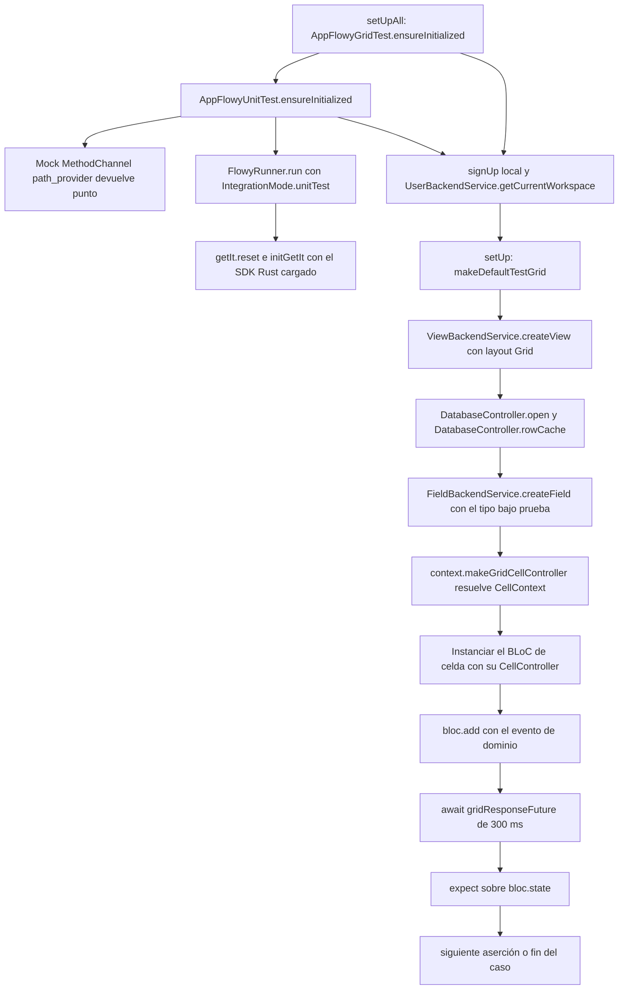
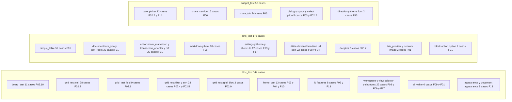
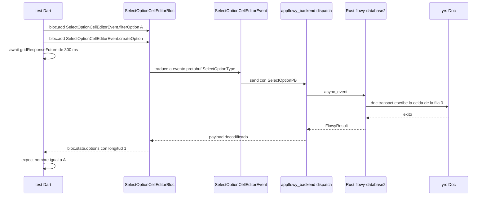
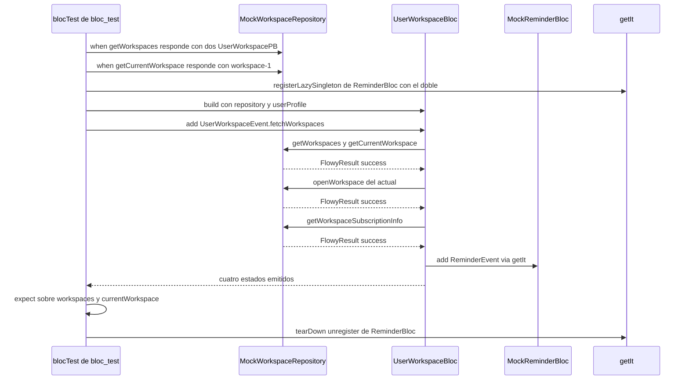
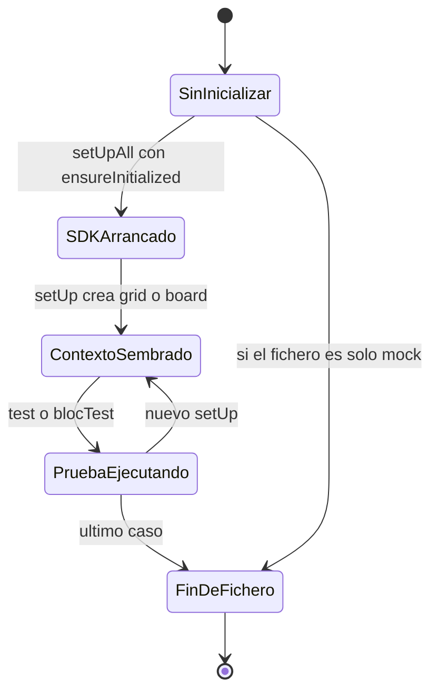
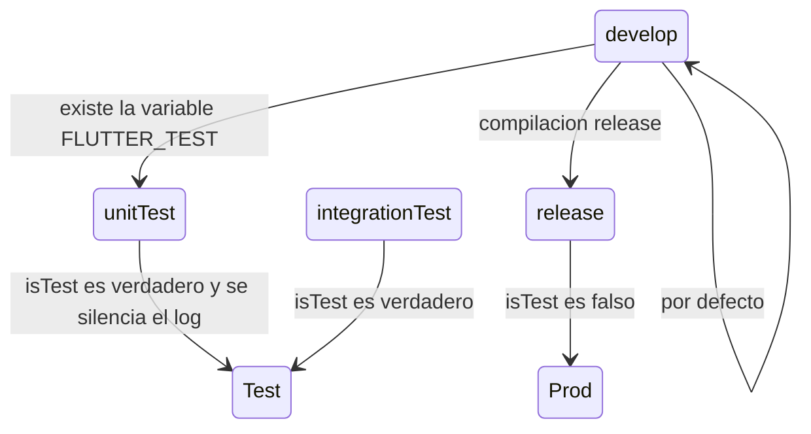

# F00.7.6 — App glue: test/ — bloc_test, unit_test, widget_test

## 1. Resumen

Esta unidad documenta los **94 ficheros de `frontend/appflowy_flutter/test/`** del repo `AppFlowy-IO/AppFlowy` (commit `5cf3a36`): 33 en `test/bloc_test/`, 37 en `test/unit_test/`, 23 en `test/widget_test/` y el helper raíz `test/util.dart`. Suman **15 579 líneas** y **369 casos de test declarados**, medidos con `rg -o` sobre el árbol real: 91 `test(` + 53 `blocTest(` en `bloc_test/`, 170 `test(` + 3 `testWidgets(` en `unit_test/`, y 52 `testWidgets(` en `widget_test/`. La unidad **no contiene código de producción**: describe el arnés de pruebas que consume las features `[[F01]]`–`[[F21]]`, y su valor para `[[B6.2]]` (`19-testing.md`) es doble: el **mapa suite → feature** (§15.1) y el **inventario de huecos y tests muertos** (§13), donde se documentan 5 casos que `flutter test` nunca descubre, 1 test vacío, 1 test sin aserciones y un camino de importación de bases de datos legacy (`v020.afdb`/`v069.afdb`) que quedó sin ejercitar.

## 2. Alcance

**Incluye** los 94 ficheros asignados a `OUT/_ledger/units/F00.7.6.json`. Las tres suites se distinguen por lo que montan, no por su nombre: `bloc_test/` levanta el SDK real (o lo sustituye por mocks), `unit_test/` prueba lógica pura sin widget en la mayoría de casos, `widget_test/` monta un árbol de widgets sobre `MaterialApp`/`WidgetTestWrapper` **sin** arrancar el SDK salvo dos excepciones.

| Suite | Ficheros | LOC | `test(` | `blocTest(` | `testWidgets(` | `group(` | Qué capa prueba |
|---|---:|---:|---:|---:|---:|---:|---|
| `test/bloc_test/` | 33 | 5 525 | 91 | 53 | 0 | 30 | Capa de aplicación: BLoCs/Cubits reales sobre SDK Rust en modo `unitTest`, o repositorios simulados con `mocktail`. |
| `test/unit_test/` | 37 | 7 390 | 170 | 0 | 3 | 36 | Lógica pura: parsers de markdown/HTML, `TextRobot`, `TurnInto`, tablas simples, tema, ajustes, deeplinks, regex. |
| `test/widget_test/` | 23 | 2 552 | 0 | 0 | 52 | 17 | Widgets aislados con `pumpWidget`, finders sobre el árbol y `mocktail` para BLoCs externos. |
| `test/util.dart` (raíz) | 1 | 112 | 0 | 0 | 0 | 0 | Andamiaje compartido: `AppFlowyUnitTest.ensureInitialized()` y los temporizadores `blocResponseFuture`. |
| **Total** | **94** | **15 579** | **261** | **53** | **55** | **83** | — |

[VERIFICADO] Conteos con `rg -o '\btest\('`, `rg -o 'blocTest[\(<]'`, `rg -o 'testWidgets\('`, `rg -o '\bgroup\('` y `find … -exec cat {} + | wc -l` sobre `SRC/appflowy/frontend/appflowy_flutter/test/`. La suite `widget_test/` no contiene **ningún** `test(`: los 52 casos son `testWidgets`.

**Correcciones de scope obligatorias** (declaradas aquí, desarrolladas en §13):

1. **`integration_test/` completo** (los 9 runners raíz `desktop_runner_1..9.dart`, `runner.dart`, `shared/*.dart`, `mobile/` y las suites `cloud/` y `document/` de escritorio) **queda fuera**: son `[[F00.7.3]]` (runners y helpers raíz), `[[F00.7.4]]` (suites cloud) y `[[F00.7.5]]` (el resto de escritorio). Aquí sólo se documentan los **dos imports** que esta unidad hace hacia `integration_test/shared/util.dart` (§13.6).
2. **Tests Rust** de `frontend/rust-lib/event-integration-test/` y `cargo test` de los crates son `[[F00.3]]`.
3. **Tests de los paquetes Dart internos** (`packages/appflowy_backend/test/`, `packages/appflowy_result/test/`, `packages/flowy_infra/test/`, etc.) son `[[F00.5.*]]`; ninguno de sus ficheros aparece en esta unidad.
4. **Fixtures binarias** `assets/test/workspaces/database/v020.afdb`, `assets/test/workspaces/database/v069.afdb`, `assets/test/images/sample.jpeg` y `assets/template/readme.json` son `[[F00.7.2]]`. Aquí sólo se documenta **quién las referencia** (§8).
5. **El código de producción probado** (BLoCs, widgets, servicios Dart, handlers Rust) no entra en la unidad; se remite a `[[F01]]`–`[[F21]]` feature por feature en §15.1, sin reclamar archivos.
6. **`flowy-date`** (parsing de fechas en Rust) no se prueba desde aquí; su contrato se documenta en `[[F15.2]]`. El único test Dart de tiempo es `appflowy/frontend/appflowy_flutter/test/unit_test/util/time.dart` sobre `appflowy/frontend/appflowy_flutter/lib/util/time.dart:1–24`.
7. **Tema y colores** (`AppTheme`, `DefaultColorScheme`, `theme_missing_keys_test.dart`) remiten a `[[F13.*]]` y `[[F00.5.5]]`; aquí sólo se documenta cómo se prueban.

## 3. Modelos de datos

Las suites no definen entidades de dominio: reutilizan `ViewPB`, `FieldInfo`, `RowInfo`, `FilterPB`, `SharedPage` y `Document`. Lo que **sí** declaran es un catálogo propio de **andamiaje** (fábricas de contexto, dobles de prueba y stubs) que es la clave para entender cómo se puede probar el producto.

### 3.1 Andamiaje compartido (raíz y por suite)

| Helper | Tipo | Qué hace | Ancla |
|---|---|---|---|
| `AppFlowyUnitTest` | clase | Punto de entrada común: arranca el SDK Rust en modo `IntegrationMode.unitTest`, registra un usuario local con `signUp`, carga el workspace y expone `createWorkspace()`. | `appflowy/frontend/appflowy_flutter/test/util.dart:15–88` |
| `AppFlowyApplicationUnitTest` | `EntryPoint` | Devuelve `SizedBox.shrink()` como `create()`: arranca el arranque completo sin materializar ningún widget. | `appflowy/frontend/appflowy_flutter/test/util.dart:99–104` |
| `_pathProviderInitialized()` | función | Mockea el `MethodChannel('plugins.flutter.io/path_provider')` para que devuelva `'.'`; sin esto el SDK Rust no encuentra el directorio de datos. | `appflowy/frontend/appflowy_flutter/test/util.dart:90–97` |
| `blocResponseFuture` / `blocResponseDuration` | helpers | Espera fija de **200 ms** (`blocResponseDuration`) usada como sincronización barata tras `bloc.add(...)`. | `appflowy/frontend/appflowy_flutter/test/util.dart:106–112` |
| `AppFlowyGridTest` / `GridTestContext` | clases | Crea una vista `ViewLayoutPB.Grid` real vía `ViewBackendService.createView`, abre su `DatabaseController` y expone `createField(FieldType)` y `makeGridCellController(i, j)`. | `appflowy/frontend/appflowy_flutter/test/bloc_test/grid_test/util.dart:22–54`, `:77–109` |
| `AppFlowyBoardTest` / `BoardTestContext` | clases | Igual, pero con `BoardPluginBuilder().layoutType`, más `singleSelectFieldContext()`, `textFieldContext()` y `checkboxFieldContext()`. | `appflowy/frontend/appflowy_flutter/test/bloc_test/board_test/util.dart:16–51`, `:61–122` |
| `AppFlowyChatTest` | clase | Crea una vista `ViewLayoutPB.Chat` con `AIChatPluginBuilder()`. | `appflowy/frontend/appflowy_flutter/test/bloc_test/chat_test/util.dart:7–36` |
| `TrashTestContext` | clase | Siembra 3 vistas hijas y expone `allViews`; es el contexto del único test de papelera. | `appflowy/frontend/appflowy_flutter/test/bloc_test/home_test/trash_bloc_test.dart:8–51` |
| `WidgetTestWrapper` | widget | `ToastificationWrapper` + `MaterialApp` + `Material` + `AppFlowyTheme` (claro u oscuro según `Theme.of(context).brightness`). | `appflowy/frontend/appflowy_flutter/test/widget_test/widget_test_wrapper.dart:5–26` |
| `WidgetTestApp` | widget | `EasyLocalization` con `en-US` + `MaterialApp` + `AFThemeExtension` donde **todos los colores son `Colors.transparent`** y los `TextStyle` van vacíos. | `appflowy/frontend/appflowy_flutter/test/widget_test/test_material_app.dart:7–75` |
| `TestAssetBundle` / `TestBundleAssetLoader` | clases | Sustituyen el bundle por defecto para sortear el límite de 10 KB de `AssetManifest.json` al cargar traducciones. | `appflowy/frontend/appflowy_flutter/test/widget_test/test_asset_bundle.dart:17–48` |
| `createEditorStateAndTable` y helpers de tabla | funciones | Fábrica de `EditorState` + `Node` de tabla simple, usada por los 8 ficheros de `simple_table/`. | `appflowy/frontend/appflowy_flutter/test/unit_test/simple_table/simple_table_test_helper.dart:4–24`, `:26–86` |

[VERIFICADO] Los tres helpers de temporización usan esperas fijas distintas: 200 ms en `appflowy/frontend/appflowy_flutter/test/util.dart:110`, 300 ms en `appflowy/frontend/appflowy_flutter/test/bloc_test/grid_test/util.dart:155` y **2 000 ms** en `appflowy/frontend/appflowy_flutter/test/bloc_test/board_test/util.dart:57`. Esa diferencia es la causa principal de lentitud de la suite board.

### 3.2 Dobles de prueba (`mocktail`) y sustituciones de plataforma

| Doble / stub | Sustituye a |technique | Ancla |
|---|---|---|---|
| `_MockAIRepository`, `_MockAIRepositoryLess`, `_MockAIRepositoryMore`, `_MockErrorRepository`, `_MockCompletionStream` | `AppFlowyAIService` (interfaz `AIRepository`) | `Mock` + `override` de `streamCompletion` que emite N líneas sintéticas | `appflowy/frontend/appflowy_flutter/test/bloc_test/ai_writer_test/ai_writer_bloc_test.dart:18–151` |
| `registerMockRepository(AppFlowyAIService mock)` | contenedor `getIt` | `unregister` + `registerFactory` de `AIRepository` | `appflowy/frontend/appflowy_flutter/test/bloc_test/ai_writer_test/ai_writer_bloc_test.dart:153–158` |
| `MockWorkspaceRepository`, `MockReminderBloc`, `FakeWorkspaceTypePB`, `FakeReminderEvent` | `WorkspaceRepository`, `ReminderBloc` | `Mock` + `Fake` con `registerFallbackValue` en `setUpAll` | `appflowy/frontend/appflowy_flutter/test/bloc_test/workspace_test/workspace_bloc_test.dart:15–31` |
| `MockSettingsShortcutService` | `SettingsShortcutService` | `Mock` con `when(...).thenAnswer` | `appflowy/frontend/appflowy_flutter/test/bloc_test/shortcuts_test/shortcuts_cubit_test.dart:11–12`, `:19–32` |
| `MockSettingsRepository` | `SettingsRepository` | `Mock` de la feature `settings` | `appflowy/frontend/appflowy_flutter/test/bloc_test/lib/features/settings/data_location_bloc_test.dart:7` |
| `MockSharePagesRepository` | `SharedPagesRepository` | `Mock` de la feature `shared_section` | `appflowy/frontend/appflowy_flutter/test/bloc_test/lib/features/share_section/shared_section_bloc_test.dart:11` |
| `MockBuildContext` | `BuildContext` | `Mock`; el test sólo verifica que `EditorStyleCustomizer.baseTextStyle` degrada a `fontFamily == null` con una familia inexistente | `appflowy/frontend/appflowy_flutter/test/unit_test/editor/editor_style_test.dart:10`, `:33–43` |
| `MockPluginService` | `FlowyPluginService` | Implementación manual (no `mocktail`) que lanza `UnimplementedError` en todo menos en `plugins` | `appflowy/frontend/appflowy_flutter/test/unit_test/theme/theme_test.dart:9–24` |
| `MockKeyValueStorage` | `KeyValueStorage` | `Mock` registrado en `GetIt.I` en `setUp` | `appflowy/frontend/appflowy_flutter/test/widget_test/lib/features/share_section/shared_pages_list_test.dart:67`, `:15–29` |
| `_MockClipboardService` | `ClipboardService` | `Mock` registrado con `registerSingleton` tras `unregister` | `appflowy/frontend/appflowy_flutter/test/widget_test/lib/features/share_tab/copy_link_widget_test.dart:56`, `:19–24` |
| `MockAppearanceSettingsBloc` / `MockAppearanceSettingsCubit` / `MockAppearanceSettingsState` / `MockDocumentAppearance` / `MockDocumentAppearanceCubit` | BLoCs y estado de apariencia | `Mock` / `MockBloc` con `stream` de un solo elemento | `appflowy/frontend/appflowy_flutter/test/widget_test/direction_setting_test.dart:18–25`; `appflowy/frontend/appflowy_flutter/test/widget_test/theme_font_family_setting_test.dart:14–23` |
| `_DatePickerDataStub` / `_MockDatePicker` | El `DatePicker` real y su modelo de datos | Widget de estado propio que reimplementa lazo de datos-tiempo para aislar el date picker | `appflowy/frontend/appflowy_flutter/test/widget_test/date_picker_test.dart:23–41`, `:43–56` |
| `MemoryFileSystem` + `mockFile` | `dart:io File` de `shortcuts.json` | Filesystem en memoria del paquete `file` | `appflowy/frontend/appflowy_flutter/test/unit_test/settings/shortcuts/settings_shortcut_service_test.dart:16–19` |
| `SharedPreferences.setMockInitialValues({})` | Almacén de preferencias | Sustituye el plugin real por un mapa en memoria | `appflowy/frontend/appflowy_flutter/test/util.dart:23`; también en `appflowy/frontend/appflowy_flutter/test/widget_test/confirm_dialog_test.dart:19` y `appflowy/frontend/appflowy_flutter/test/widget_test/date_picker_test.dart:149` |

[VERIFICADO] Sólo **12 ficheros** de los 94 importan `package:mocktail/mocktail.dart`, y dos de ellos (`widget_test/direction_setting_test.dart` y `unit_test/editor/editor_style_test.dart`) lo usan exclusivamente para evitar tocar singletons reales. El resto son tests de integración ligera contra el SDK.

## 4. Eventos FFI

Las tres suites **no invocan eventos FFI de forma sistemática**: los BLoCs lo hacen por debajo. Sólo cinco llamadas directas a `.send()` existen en toda la unidad, todas contra `flowy-folder`:

| Llamada directa | Evento | Fichero:línea | Qué comprueba |
|---|---|---|---|
| `FolderEventGetCurrentWorkspaceSetting().send()` (×4) | `GetCurrentWorkspaceSetting` | `appflowy/frontend/appflowy_flutter/test/bloc_test/home_test/home_bloc_test.dart:17–19`, `:29–31`; `appflowy/frontend/appflowy_flutter/test/bloc_test/home_test/view_bloc_test.dart:186–191`, `:201–206` | Que `HomeBloc` refleje el workspace actual y que `latestView` se actualice al navegar. |
| `FolderEventSetLatestView(ViewIdPB(value: …)).send()` | `SetLatestView` | `appflowy/frontend/appflowy_flutter/test/bloc_test/home_test/home_bloc_test.dart:55` | Que la vista creada sea la "última abierta" del workspace. |

[VERIFICADO] `rg '\.send\(\)' test/` devuelve exactamente 5 coincidencias, todas en `bloc_test/home_test/`. `home_bloc_test.dart` importa el paquete de despacho generado (`appflowy/frontend/appflowy_flutter/test/bloc_test/home_test/home_bloc_test.dart:4`), igual que `appflowy/frontend/appflowy_flutter/test/bloc_test/home_test/view_bloc_test.dart:3`.

El resto del tráfico FFI de `bloc_test/` es **indirecto pero real**: `ViewBackendService.createView`, `FieldBackendService.createField/updateField/updateType/delete`, `RowBackendService.createRow/updateMeta`, `FilterBackendService.insertTextFilter`, `DatabaseController.open()` e `ImportBackendService.importPages` (`appflowy/frontend/appflowy_flutter/test/bloc_test/grid_test/util.dart:36–43`, `:56–74`, `:111–146`) son todos clientes del dispatcher `[[F00.1]]`. `[INFERIDO]` el mapping evento↔test es indirecto: el nombre del evento Rust concreto no aparece en el código de test, lo que impide atribuir cobertura evento a evento desde este árbol.

`share_tab_bloc_test.dart` es un caso hybrid[VERIFICADO]: usa el repositorio **real** `LocalShareWithUserRepositoryImpl` (`appflowy/frontend/appflowy_flutter/test/bloc_test/lib/features/share_tab/share_tab_bloc_test.dart:14`, `:32–35`) con `pageId`/`workspaceId` ficticios, por lo que sí atraviesa FFI con identificadores que no existen en el servidor. El riesgo se documenta en §13.4.

## 5. Notificaciones

**No aplica.** Ninguna de las 94 suites se suscribe a notificaciones Rust→Dart (`[[F00.5]]`): no hay ningún `import 'package:appflowy_backend/rust_stream.dart'` ni listener `*_listener.dart` en el árbol, y `rg 'rust_stream|NotificationListener'` sobre `test/` no devuelve ninguna coincidencia. La única aproximación es **indirecta**: `DateCellEditorBloc` escribe sobre un `ReminderBloc` real y el test comprueba que `reminderBloc.state.reminders` cambia (`appflowy/frontend/appflowy_flutter/test/bloc_test/grid_test/cell/date_cell_bloc_test.dart:263`, `:277`, `:290–293`), lo que de hecho fuerza un `ReminderEvent.refresh()` contra el SDK (`appflowy/frontend/appflowy_flutter/test/bloc_test/grid_test/cell/date_cell_bloc_test.dart:291`). El panel de notificaciones como tal (`NotificationBloc`, `NotificationItem`) sólo se ejercita en integración, en `[[F00.7.5]]`.

## 6. BLoCs / Cubits

La tabla registra las **25 clases BLoC/Cubit que las suites instancian directamente**, con el número de construcciones medido con `rg -o`. `bloc_test/` es elgrundel del contrato de aplicación; `widget_test/` sólo usa BLoC reales en un caso (`ShareTabBloc`).

| BLoC / Cubit | Instanciaciones en `bloc_test/` | Fichero(s) de test | Qué verifica | Ancla del BLoC en producción |
|---|---:|---|---|---|
| `UserWorkspaceBloc` | 13 | `appflowy/frontend/appflowy_flutter/test/bloc_test/workspace_test/workspace_bloc_test.dart` | Estados iniciales, `fetchWorkspaces`, apertura, icono, suscripción | `appflowy/frontend/appflowy_flutter/lib/features/workspace/logic/workspace_bloc.dart` |
| `DateCellEditorBloc` | 13 | `appflowy/frontend/appflowy_flutter/test/bloc_test/grid_test/cell/date_cell_bloc_test.dart` | 11 casos: rango, hora, formatos, 4 escenarios de recordatorio | `appflowy/frontend/appflowy_flutter/lib/plugins/database/application/cell/bloc/date_cell_editor_bloc.dart` |
| `ViewSelectorCubit` | 11 | `appflowy/frontend/appflowy_flutter/test/bloc_test/view_selector_test.dart` | Selección padre/hijo, `partiallySelected`, filtrado por texto, `isDisabled` | `appflowy/frontend/appflowy_flutter/lib/ai/service/view_selector_cubit.dart` |
| `BoardBloc` | 10 | `board_test/*.dart` (6 ficheros) | Nº de grupos, creación de card, agrupación por checkbox/fecha/multi-select/unsupported | `appflowy/frontend/appflowy_flutter/lib/plugins/database/board/application/board_bloc.dart` |
| `ReminderBloc` | 11 | `date_cell_bloc_test.dart`, `group_by_date_test.dart` | Estado de recordatorios tras fijar fecha | `appflowy/frontend/appflowy_flutter/lib/user/application/reminder/reminder_bloc.dart` |
| `ViewBloc` | 8 | `view_bloc_test.dart`, `home_bloc_test.dart`, `trash_bloc_test.dart` | Renombrar, duplicar, borrar, anidar, crear por layout | `appflowy/frontend/appflowy_flutter/lib/workspace/application/view/view_bloc.dart` |
| `SelectOptionCellEditorBloc` | 8 | `select_option_cell_test.dart`, `group_by_multi_select_field_test.dart` | CRUD de opciones, selección múltiple, filtro y sugerencia | `appflowy/frontend/appflowy_flutter/lib/plugins/database/application/cell/bloc/select_option_cell_editor_bloc.dart` |
| `TextCellBloc` | 6 | `text_cell_bloc_test.dart` | Texto, wrap, emoji, `hasDocument`, campo no primario | `appflowy/frontend/appflowy_flutter/lib/plugins/database/application/cell/bloc/text_cell_bloc.dart` |
| `AiWriterCubit` | 6 | `ai_writer_bloc_test.dart` | 2 `blocTest` + 4 `test`: streaming, límite de respuesta, accept/discard | `appflowy/frontend/appflowy_flutter/lib/plugins/document/presentation/editor_plugins/ai/operations/ai_writer_cubit.dart` |
| `DatabaseGroupBloc` | 5 | `group_by_*_test.dart` (4 ficheros) | `setGroupByField` y su efecto en el nº de columnas del board | `appflowy/frontend/appflowy_flutter/lib/plugins/database/application/setting/group_bloc.dart` |
| `ChecklistCellBloc` | 5 | `checklist_cell_bloc_test.dart` | Crear, renombrar, seleccionar, borrar, reordenar tareas | `appflowy/frontend/appflowy_flutter/lib/plugins/database/application/cell/bloc/checklist_cell_bloc.dart` |
| `FieldEditorBloc` | 4 | `field_editor_bloc_test.dart`, `create_or_edit_field_test.dart`, `group_by_unsupport_field_test.dart` | Renombrar, icono, cambiar tipo, `typeOptionData`, visibilidad, wrap, insertar izq/der | `appflowy/frontend/appflowy_flutter/lib/plugins/database/application/field/field_editor_bloc.dart` |
| `AppearanceSettingsCubit` | 4 | `appearance_test.dart` | Tema por defecto, `setKeyValue`/`getValue`, `AppTheme.fallback` | `appflowy/frontend/appflowy_flutter/lib/workspace/application/settings/appearance/appearance_cubit.dart` |
| `GridBloc` | 3 | `grid_bloc_test.dart` | Crear fila (3→4), borrar última (→2), reordenar con `moveRow` | `appflowy/frontend/appflowy_flutter/lib/plugins/database/grid/application/grid_bloc.dart` |
| `SidebarSectionsBloc` | 2 | `sidebar_section_bloc_test.dart` | Sección pública vs privada, creación con índice 0 | `appflowy/frontend/appflowy_flutter/lib/workspace/application/menu/sidebar_sections_bloc.dart` |
| `ShortcutsCubit` | 2 | `shortcuts_cubit_test.dart` | 1 `test` + 9 `blocTest`: carga, fallo, guardado, conflictos | `appflowy/frontend/appflowy_flutter/lib/workspace/application/settings/shortcuts/settings_shortcuts_cubit.dart` |
| `HomeBloc` | 2 | `home_bloc_test.dart` | `hasLatestView()` tras `SetLatestView` | `appflowy/frontend/appflowy_flutter/lib/workspace/application/home/home_bloc.dart` |
| `FieldCellBloc` | 2 | `field_cell_bloc_test.dart` | Ancho de columna y suelo de 50 px | `appflowy/frontend/appflowy_flutter/lib/plugins/database/application/field/field_cell_bloc.dart` |
| `DocumentBloc` | 2 | `appflowy/frontend/appflowy_flutter/test/bloc_test/home_test/view_bloc_test.dart:195`, `appflowy/frontend/appflowy_flutter/test/bloc_test/home_test/home_bloc_test.dart:52` | Sólo se instancia para provocar la carga del documento | `appflowy/frontend/appflowy_flutter/lib/plugins/document/application/document_bloc.dart` |
| `FilterEditorBloc` | 1 | `filter_editor_bloc_test.dart` | Crear/cambiar/borrar/actualizar filtro y su reacción a cambios de campo | `appflowy/frontend/appflowy_flutter/lib/plugins/database/grid/application/filter/filter_editor_bloc.dart` |
| `SortEditorBloc` | 1 | `sort_editor_bloc_test.dart` | 8 casos: crear, reordenar, dirección, borrar, borrado masivo, campo renombrado | `appflowy/frontend/appflowy_flutter/lib/plugins/database/grid/application/sort/sort_editor_bloc.dart` |
| `TrashBloc` | 1 | `trash_bloc_test.dart` | `putback`, `delete`, `deleteAll` sobre 3 vistas sembradas | `appflowy/frontend/appflowy_flutter/lib/plugins/trash/application/trash_bloc.dart` |
| `SharedSectionBloc` | 1 | `shared_section_bloc_test.dart` | Emisión de `sharedPages` (repositorio simulado) | `appflowy/frontend/appflowy_flutter/lib/features/shared_section/logic/shared_section_bloc.dart` |
| `ShareTabBloc` | 1 | `share_tab_bloc_test.dart` | Invitar, quitar, cambiar nivel, convertir invitado en miembro | `appflowy/frontend/appflowy_flutter/lib/features/share_tab/logic/share_tab_bloc.dart` |
| `DataLocationBloc` | 1 | `data_location_bloc_test.dart` | Reset a por defecto y ruta personalizada (repositorio simulado) | `appflowy/frontend/appflowy_flutter/lib/features/settings/…/data_location_bloc.dart` |
| `DocumentAppearanceCubit` | 1 | `document_appearance_test.dart` | 4 casos sobre `SharedPreferences` | `appflowy/frontend/appflowy_flutter/lib/plugins/document/application/document_appearance_cubit.dart` |
| `BlockActionOptionCubit` | 1 | `block_action_option_cubit_test.dart` | `OptionAction.delete` y `.duplicate` sobre selección de bloque | `appflowy/frontend/appflowy_flutter/lib/plugins/document/presentation/editor_plugins/actions/block_action_option_cubit.dart` |

[VERIFICADO] Los conteos salen de `rg -o '\b[A-Z][A-Za-z0-9]*(Bloc|Cubit)\(' bloc_test -g '*.dart' | … | sort | uniq -c`. Los BLoCs de las filas marcadas "repositorio simulado" (`DataLocationBloc`, `SharedSectionBloc`, `ShortcutsCubit`, `UserWorkspaceBloc`, `AiWriterCubit`) **no tocan el SDK**: el test es puro `mocktail` y corre en milisegundos.

## 7. Servicios e inyección de dependencias

Aquí está la diferencia de fondo entre las tres suites: **`bloc_test/` decide en tiempo de ejecución si arranca el SDK o no**, según el fichero.

### 7.1 Los tres modos de arranque

| Modo | disparador | Ficheros | Qué registra |
|---|---|---|---|
| **SDK real** | `AppFlowyUnitTest.ensureInitialized()` en `setUpAll` | 25 ficheros de test (los que aparecen en el barrido de `ensureInitialized`) | `FlowyRunner.run(AppFlowyApplicationUnitTest(), IntegrationMode.unitTest)` → `getIt.reset()` completo y `initGetIt` |
| **Solo mocks** | `mocktail` + `getIt.registerFactory` puntual | `ai_writer_bloc_test.dart`, `workspace_bloc_test.dart`, `shortcuts_cubit_test.dart`, `data_location_bloc_test.dart`, `shared_section_bloc_test.dart`, `copy_link_widget_test.dart`, `shared_pages_list_test.dart`, `shared_page_actions_button_test.dart` | Sólo el doble inyectado; el resto del contenedor no existe |
| **Sin contenedor** | — | `unit_test/` en general y `widget_test/` salvo 2 excepciones | `SharedPreferences` y/o `path_provider` simulados, nada más |

[VERIFICADO] `AppFlowyUnitTest.ensureInitialized()` está en `appflowy/frontend/appflowy_flutter/test/util.dart:21–37` y su llamada a `FlowyRunner.run(..., IntegrationMode.unitTest)` está en `appflowy/frontend/appflowy_flutter/test/util.dart:26–29`. `FlowyRunner.run` hace `await getIt.reset()` (`appflowy/frontend/appflowy_flutter/lib/startup/startup.dart:96–97`) y `initGetIt(getIt, mode, f, config)` (`appflowy/frontend/appflowy_flutter/lib/startup/startup.dart:109`), y fuerza `version: '1.0.0'` porque en modo unitario no se puede usar `package_info_plus` (`appflowy/frontend/appflowy_flutter/lib/startup/startup.dart:99–106`).

### 7.2 Manipulación de `getIt` desde los tests

| Operación | Fichero:línea | Nota |
|---|---|---|
| `getIt.reset()` (implícito, dentro de `FlowyRunner.run`) | `appflowy/frontend/appflowy_flutter/lib/startup/startup.dart:97` | **Borra todo** el contenedor en cada arranque; por eso ningún test puede registrar singletons en `setUpAll` y esperar que sobrevivan al `setUp` de otro. |
| `getIt.unregister<AIRepository>()` + `registerFactory` | `appflowy/frontend/appflowy_flutter/test/bloc_test/ai_writer_test/ai_writer_bloc_test.dart:154–157` | Sustitución idempotente. |
| `getIt.registerLazySingleton<ReminderBloc>` + `unregister` en `tearDown` | `appflowy/frontend/appflowy_flutter/test/bloc_test/workspace_test/workspace_bloc_test.dart:48`, `:82–84` | Único caso con `tearDown` que restaura el contenedor. |
| `getIt.registerSingleton<ClipboardService>` tras `unregister` | `appflowy/frontend/appflowy_flutter/test/widget_test/lib/features/share_tab/copy_link_widget_test.dart:20–23` | Sin `tearDown`: el singleton sobrevive al test. |
| `getIt.registerFactory<KeyValueStorage>(() => DartKeyValue())` | `appflowy/frontend/appflowy_flutter/test/unit_test/util/recent_icons_test.dart:15` | `setUpAll` sin `tearDownAll`. |
| `getIt.registerSingleton<ClipboardService>(ClipboardService())` | `appflowy/frontend/appflowy_flutter/test/unit_test/simple_table/simple_table_contente_operation_test.dart:12` | Se registra el servicio **real**, dentro de un test unitario. |
| `GetIt.I.registerSingleton<KeyValueStorage>` + `GetIt.I.reset()` en `tearDown` | `appflowy/frontend/appflowy_flutter/test/widget_test/lib/features/share_section/shared_pages_list_test.dart:23`, `:27–29`; `appflowy/frontend/appflowy_flutter/test/widget_test/lib/features/share_section/shared_page_actions_button_test.dart:24`, `:28–30` | `GetIt.I.reset()` es global: si otro test del mismo isolate hubiera arrancado el SDK, lo destruye. |

[VERIFICADO] `rg 'getIt\.(reset|register|unregister)|GetIt\.I\.' test/` devuelve las 11 líneas de la tabla. Las 25 llamadas a `AppFlowy*Test.ensureInitialized()` se cuentan con `rg -l 'AppFlowy(UnitTest|GridTest|BoardTest|ChatTest)\.ensureInitialized' test/`, que devuelve 27 ficheros (los 25 de test más los dos `util.dart` de grid y board que la reexportan).

### 7.3 Silenciamiento de logs

Cinco ficheros de `unit_test/` ponen `Log.shared.disableLog = true` en `setUpAll` y lo restauran en `tearDownAll`: `appflowy/frontend/appflowy_flutter/test/unit_test/document/option_menu/block_action_option_cubit_test.dart:9–15`, `appflowy/frontend/appflowy_flutter/test/unit_test/document/document_diff/document_diff_test.dart:8–14`, `appflowy/frontend/appflowy_flutter/test/unit_test/document/shortcuts/format_shortcut_test.dart:8–14`, `appflowy/frontend/appflowy_flutter/test/unit_test/document/shortcuts/toggle_list_shortcut_test.dart:14–20`, `appflowy/frontend/appflowy_flutter/test/unit_test/image/appflowy_network_image_test.dart:7–13`. Dos más lo hacen sin restaurar en `tearDownAll`: `appflowy/frontend/appflowy_flutter/test/unit_test/simple_table/simple_table_style_operation_test.dart:11–15` y `appflowy/frontend/appflowy_flutter/test/unit_test/document/turn_into/turn_into_test.dart:72`. `appflowy/frontend/appflowy_flutter/test/unit_test/util/recent_icons_test.dart:16` lo activa en `setUpAll` y **nunca lo restaura**. En la parte que arranca el SDK no hace falta: `FlowyRunner.run` lo fuerza con `Log.shared.disableLog = mode.isTest` (`appflowy/frontend/appflowy_flutter/lib/startup/startup.dart:88–89`).

## 8. Persistencia

Ninguna suite abre SQLite directamente; el acceso a disco ocurre siempre **a través del SDK Rust** o de los dobles que se registran en `getIt`.

| Recurso | Cómo lo sustituye el test | Fichero:línea |
|---|---|---|
| Directorio de datos de la app (`path_provider`) | `MethodChannel` mockeado que devuelve `'.'`, así todo se escribe en el CWD del proceso de test | `appflowy/frontend/appflowy_flutter/test/util.dart:90–97` |
| `SharedPreferences` (tamaño de fuente del documento, fuente, tema) | `SharedPreferences.setMockInitialValues({})` | `appflowy/frontend/appflowy_flutter/test/util.dart:23`; `appflowy/frontend/appflowy_flutter/test/bloc_test/app_setting_test/document_appearance_test.dart:15`; `appflowy/frontend/appflowy_flutter/test/unit_test/util/recent_icons_test.dart:14` |
| `KeyValueStorage` (Hive o `DartKeyValue`) | `MockKeyValueStorage` registrado en `GetIt.I` | `appflowy/frontend/appflowy_flutter/test/widget_test/lib/features/share_section/shared_page_actions_button_test.dart:16–26` |
| `shortcuts.json` del usuario | `MemoryFileSystem.test()` del paquete `file` | `appflowy/frontend/appflowy_flutter/test/unit_test/settings/shortcuts/settings_shortcut_service_test.dart:17–18` |
| SQLite + collabs (`flowy-sqlite`, `yrs`) | **No se sustituye**: el SDK Rust real los abre cuando arranca `FlowyRunner` | `appflowy/frontend/appflowy_flutter/lib/startup/startup.dart:109` |
| Bundle de assets | `TestAssetBundle` (evita el límite de 10 KB de `AssetManifest.json`) + `TestBundleAssetLoader` | `appflowy/frontend/appflowy_flutter/test/widget_test/test_asset_bundle.dart:17–48` |

[VERIFICADO] Sólo **dos** ficheros de test leen assets reales: `appflowy/frontend/appflowy_flutter/test/unit_test/editor/editor_migration_test.dart:13` carga `assets/template/readme.json` con `rootBundle.loadString`, y `appflowy/frontend/appflowy_flutter/test/unit_test/editor/editor_drop_test.dart:24` referencia el fichero binario `assets/test/images/sample.jpeg` a través de `XFile`. Ninguno de los dos figura como ruta inventariada (los assets binarios no se inventarían), de ahí que se citen por su línea de test y no por ruta propia. El tercer consumidor, `makeTestGridFromImportedData`, carga `assets/test/workspaces/database/<fileName>` (`appflowy/frontend/appflowy_flutter/test/bloc_test/grid_test/util.dart:118–119`) pero **nunca se invoca** (§13.2).

## 9. Diagramas de flujo

### 9.1 Ciclo de vida de un test de BLoC que arranca el SDK

Muestra las cinco fases por las que pasa el caso más caro de la suite: `AppFlowyGridTest.ensureInitialized` en `setUpAll`, siembra de un grid por `setUp`, ciclo `bloc.add` → espera fija → `expect`, y `tearDown` implícito. El ejemplo literal es `appflowy/frontend/appflowy_flutter/test/bloc_test/grid_test/cell/date_cell_bloc_test.dart:16–34`.



**Lectura:** `setUpAll` ocurre **una sola vez por fichero**, pero `setUp` se repite por caso y **crea un grid nuevo cada vez** (`:25`), lo que explica el crecimiento del directorio de datos en el CWD y parte del tiempo de la suite. La espera de 300 ms es fija y no observable: si el dispatcher Rust tardase más, el test fallaría sin que el mensaje indique la causa. Los 12 `DateCellEditorBloc` del fichero se construyen **a mano** dentro de cada `test` (`:38–41`, `:58–61`, …) en lugar de en `setUp`, lo que multiplica el trabajo de arranque por 11.

### 9.2 Mapa suite → feature cubierta

Muestra qué subárbol de pruebas corresponde a cada feature del ledger `[[F01]]`–`[[F21]]`, con el número de casos medido. El nodo raíz es la decisión "¿arranca el SDK?".



**Lectura:** la base de datos domina `bloc_test/` (74 de 144 casos, el 51 %); el editor domina `unit_test/` (117 de 173, el 68 %); y `widget_test/` es, salvo el date picker (12 casos), casi enteramente la feature `share_tab`/`shared_section` (40 de 52). **[NO DETERMINADO]** las features sin ninguna carpeta de test se listan en §15.2; la pregunta abierta concreta es si el desequilibrio refleja prioridades del equipo o un recorte de la suite.

## 10. Diagramas de secuencia

### 10.1 `bloc.add` con SDK Rust real (camino `bloc_test`)

Muestra la interacción completa desde el `bloc.add` del test hasta la notificación que vuelve al estado, leída en `appflowy/frontend/appflowy_flutter/test/bloc_test/grid_test/cell/select_option_cell_test.dart:29–39`.



[VERIFICADO] El evento se construye literalmente en `appflowy/frontend/appflowy_flutter/test/bloc_test/grid_test/cell/select_option_cell_test.dart:33–34` y la aserción en `:37–38`. La cadena `bloc → evento generado → FFI → Rust` es el patrón §5.3 de `AGENTS.md`; los nombres exactos de los handlers Rust y de la notificación emitida **no** son observables desde el test, por lo que la última mitad del diagrama es `[INFERIDO]` a partir de `[[F00.1]]` y `[[F02.2]]`.

### 10.2 `blocTest` con repositorio simulado (camino sin SDK)

Muestra el otro patrón, el de `appflowy/frontend/appflowy_flutter/test/bloc_test/workspace_test/workspace_bloc_test.dart:130–198`: cero FFI, cero disco, sólo `mocktail` y los estados emitidos.



[VERIFICADO] Los cuatro `predicate<UserWorkspaceState>` esperados están en `appflowy/frontend/appflowy_flutter/test/bloc_test/workspace_test/workspace_bloc_test.dart:157–185` y el `verify` en `:186–197`. La diferencia esencial con §10.1 es que **el test controla el resultado del servicio**, de modo que puede provocar errores (`FlowyResult.failure(FlowyError()..code = ErrorCode.Internal)` en `appflowy/frontend/appflowy_flutter/test/bloc_test/workspace_test/workspace_bloc_test.dart:52–56`) que con el SDK real no son alcanzables; es la vía por la que se prueban los caminos de error.

## 11. Diagramas de estado

### 11.1 Ciclo de vida de un fichero de test de `bloc_test/`

Captura los cinco estados por los que pasa un fichero de la suite `bloc_test` cuando depende del SDK, y en qué punto se paga el coste de arranque.



[VERIFICADO] `setUpAll` con `ensureInitialized` aparece en los 25 ficheros SDK-dependientes (p. ej. `appflowy/frontend/appflowy_flutter/test/bloc_test/grid_test/cell/date_cell_bloc_test.dart:16–18`, `appflowy/frontend/appflowy_flutter/test/bloc_test/board_test/group_by_date_test.dart:18–20`, `appflowy/frontend/appflowy_flutter/test/bloc_test/home_test/trash_bloc_test.dart:55–57`). El estado "solo mock" corresponde a los ocho ficheros listados en §7.1 que nunca llaman a `ensureInitialized`. El coste de `SDKArrancado` se paga **una vez por fichero**, pero como `flutter test --concurrency=1` serializa los ficheros (`appflowy/frontend/scripts/makefile/tests.toml:35`), el tiempo total de CI es la suma de 25 arranques del SDK.

### 11.2 Modos de `IntegrationMode` que decide el arranque

El enum que `FlowyRunner.run` consume es el discriminante entre la app real y el arnés de test.



[VERIFICADO] `integrationMode()` devuelve `IntegrationMode.unitTest` si el entorno contiene `FLUTTER_TEST` (`appflowy/frontend/appflowy_flutter/lib/startup/startup.dart:311–314`), y `FlowyRunner.run` silencia el log con `mode.isTest` (`appflowy/frontend/appflowy_flutter/lib/startup/startup.dart:88–89`). El enum y sus cuatro predicados están en `appflowy/frontend/appflowy_flutter/lib/startup/startup.dart:291–309`. Esto explica por qué **cualquier** test que importe `startup.dart` arrastra el SDK aunque no lo llame explícitamente.

## 12. Archivos cubiertos (del ledger)

**94 ficheros**, **15 579 líneas**, **369 casos declarados** (261 `test(`, 53 `blocTest(`, 55 `testWidgets(`). La columna "SDK" indica si el fichero arranca el SDK Rust.

### 12.1 `test/util.dart` (1 fichero, 112 líneas, 0 casos)

| Fichero | LOC | Casos | SDK | Contenido | Ancla |
|---|---:|---:|:--:|---|---|
| `appflowy/frontend/appflowy_flutter/test/util.dart` | 112 | 0 | sí | `AppFlowyUnitTest` (clase, `ensureInitialized`, `_signIn`, `_loadWorkspace`, `_initialServices`, `createWorkspace`), `AppFlowyApplicationUnitTest`, `_pathProviderInitialized`, `blocResponseFuture`, `blocResponseDuration` | `appflowy/frontend/appflowy_flutter/test/util.dart:15–112` |

### 12.2 `test/bloc_test/` (33 ficheros, 5 525 líneas, 144 casos)

| Fichero | LOC | `test(` | `blocTest(` | SDK | Cubre | Ancla |
|---|---:|---:|---:|:--:|---|---|
| `appflowy/frontend/appflowy_flutter/test/bloc_test/ai_writer_test/ai_writer_bloc_test.dart` | 436 | 4 | 2 | no | `AiWriterCubit`: streaming, límite, accept/discard, resultado menor/mayor | `appflowy/frontend/appflowy_flutter/test/bloc_test/ai_writer_test/ai_writer_bloc_test.dart:171–434` |
| `appflowy/frontend/appflowy_flutter/test/bloc_test/app_setting_test/appearance_test.dart` | 86 | 0 | 4 | sí | `AppearanceSettingsCubit` (tema, key/value, fallback) | `appflowy/frontend/appflowy_flutter/test/bloc_test/app_setting_test/appearance_test.dart:31–84` |
| `appflowy/frontend/appflowy_flutter/test/bloc_test/app_setting_test/document_appearance_test.dart` | 64 | 4 | 0 | no | `DocumentAppearanceCubit` sobre `SharedPreferences` | `appflowy/frontend/appflowy_flutter/test/bloc_test/app_setting_test/document_appearance_test.dart:28–62` |
| `appflowy/frontend/appflowy_flutter/test/bloc_test/board_test/create_card_test.dart` | 57 | 1 | 0 | sí | Crear card en el grupo "No status" (4 grupos por defecto) | `appflowy/frontend/appflowy_flutter/test/bloc_test/board_test/create_card_test.dart:15–56` |
| `appflowy/frontend/appflowy_flutter/test/bloc_test/board_test/create_or_edit_field_test.dart` | 80 | 3 | 0 | sí | Board predefinido, renombrar campo, crear checkbox | `appflowy/frontend/appflowy_flutter/test/bloc_test/board_test/create_or_edit_field_test.dart:15–79` |
| `appflowy/frontend/appflowy_flutter/test/bloc_test/board_test/group_by_checkbox_field_test.dart` | 49 | 1 | 0 | sí | Agrupar por checkbox (4 grupos → 2) | `appflowy/frontend/appflowy_flutter/test/bloc_test/board_test/group_by_checkbox_field_test.dart:17–48` |
| `appflowy/frontend/appflowy_flutter/test/bloc_test/board_test/group_by_date_test.dart` | 116 | 2 | 0 | sí | Agrupar por fecha, hoy y por año (`DateConditionPB.Year`) | `appflowy/frontend/appflowy_flutter/test/bloc_test/board_test/group_by_date_test.dart:22–115` |
| `appflowy/frontend/appflowy_flutter/test/bloc_test/board_test/group_by_multi_select_field_test.dart` | 101 | 2 | 0 | sí | Multi-select sin opciones (1 grupo) y con 2 (3 grupos) | `appflowy/frontend/appflowy_flutter/test/bloc_test/board_test/group_by_multi_select_field_test.dart:18–100` |
| `appflowy/frontend/appflowy_flutter/test/bloc_test/board_test/group_by_unsupport_field_test.dart` | 54 | 0 | 2 | sí | Cambiar el campo de agrupación a RichText → 1 grupo | `appflowy/frontend/appflowy_flutter/test/bloc_test/board_test/group_by_unsupport_field_test.dart:26–53` |
| `appflowy/frontend/appflowy_flutter/test/bloc_test/board_test/util.dart` | 122 | 0 | 0 | sí (helper) | `AppFlowyBoardTest`, `BoardTestContext`, temporizador de 2 000 ms | `appflowy/frontend/appflowy_flutter/test/bloc_test/board_test/util.dart:16–122` |
| `appflowy/frontend/appflowy_flutter/test/bloc_test/chat_test/chat_load_message_test.dart` | 16 | 1 | 0 | sí | **Test vacío** (ver §13.1) | `appflowy/frontend/appflowy_flutter/test/bloc_test/chat_test/chat_load_message_test.dart:13–15` |
| `appflowy/frontend/appflowy_flutter/test/bloc_test/chat_test/util.dart` | 36 | 0 | 0 | sí (helper) | `AppFlowyChatTest.createChat()` | `appflowy/frontend/appflowy_flutter/test/bloc_test/chat_test/util.dart:7–36` |
| `appflowy/frontend/appflowy_flutter/test/bloc_test/grid_test/cell/checklist_cell_bloc_test.dart` | 154 | 5 | 0 | sí | `ChecklistCellBloc`: 5 operaciones | `appflowy/frontend/appflowy_flutter/test/bloc_test/grid_test/cell/checklist_cell_bloc_test.dart:32–152` |
| `appflowy/frontend/appflowy_flutter/test/bloc_test/grid_test/cell/date_cell_bloc_test.dart` | 355 | 11 | 0 | sí | `DateCellEditorBloc`: 11 casos, el fichero más denso | `appflowy/frontend/appflowy_flutter/test/bloc_test/grid_test/cell/date_cell_bloc_test.dart:36–353` |
| `appflowy/frontend/appflowy_flutter/test/bloc_test/grid_test/cell/select_option_cell_test.dart` | 217 | 7 | 0 | sí | `SelectOptionCellEditorBloc`: 7 casos | `appflowy/frontend/appflowy_flutter/test/bloc_test/grid_test/cell/select_option_cell_test.dart:29–215` |
| `appflowy/frontend/appflowy_flutter/test/bloc_test/grid_test/cell/text_cell_bloc_test.dart` | 109 | 5 | 0 | sí | `TextCellBloc`: texto, wrap, emoji, `hasDocument`, no primario | `appflowy/frontend/appflowy_flutter/test/bloc_test/grid_test/cell/text_cell_bloc_test.dart:30–107` |
| `appflowy/frontend/appflowy_flutter/test/bloc_test/grid_test/field/field_cell_bloc_test.dart` | 55 | 0 | 2 | sí | `FieldCellBloc`: ancho y suelo de 50 px | `appflowy/frontend/appflowy_flutter/test/bloc_test/grid_test/field/field_cell_bloc_test.dart:22–53` |
| `appflowy/frontend/appflowy_flutter/test/bloc_test/grid_test/field/field_editor_bloc_test.dart` | 132 | 7 | 0 | sí | `FieldEditorBloc`: 7 casos | `appflowy/frontend/appflowy_flutter/test/bloc_test/grid_test/field/field_editor_bloc_test.dart:32–130` |
| `appflowy/frontend/appflowy_flutter/test/bloc_test/grid_test/filter/filter_editor_bloc_test.dart` | 192 | 7 | 0 | sí | `FilterEditorBloc`: 7 casos, incluida la reacción a `updateType` | `appflowy/frontend/appflowy_flutter/test/bloc_test/grid_test/filter/filter_editor_bloc_test.dart:35–190` |
| `appflowy/frontend/appflowy_flutter/test/bloc_test/grid_test/filter/filter_entities_test.dart` | 602 | 8 | 0 | no | Deserialización de `FilterPB` por tipo (text, number, checkbox, checklist, select, multi-select, date) | `appflowy/frontend/appflowy_flutter/test/bloc_test/grid_test/filter/filter_entities_test.dart:25–596` |
| `appflowy/frontend/appflowy_flutter/test/bloc_test/grid_test/grid_bloc_test.dart` | 80 | 0 | 3 | sí | `GridBloc`: crear, borrar y reordenar filas | `appflowy/frontend/appflowy_flutter/test/bloc_test/grid_test/grid_bloc_test.dart:24–78` |
| `appflowy/frontend/appflowy_flutter/test/bloc_test/grid_test/sort/sort_editor_bloc_test.dart` | 204 | 8 | 0 | sí | `SortEditorBloc`: 8 casos | `appflowy/frontend/appflowy_flutter/test/bloc_test/grid_test/sort/sort_editor_bloc_test.dart:33–202` |
| `appflowy/frontend/appflowy_flutter/test/bloc_test/grid_test/util.dart` | 157 | 0 | 0 | sí (helper) | `AppFlowyGridTest`, `GridTestContext`, `createFieldEditor`, importación `.afdb` **sin uso** | `appflowy/frontend/appflowy_flutter/test/bloc_test/grid_test/util.dart:19–157` |
| `appflowy/frontend/appflowy_flutter/test/bloc_test/home_test/home_bloc_test.dart` | 61 | 2 | 0 | sí | `HomeBloc` + `SetLatestView` | `appflowy/frontend/appflowy_flutter/test/bloc_test/home_test/home_bloc_test.dart:16–60` |
| `appflowy/frontend/appflowy_flutter/test/bloc_test/home_test/sidebar_section_bloc_test.dart` | 57 | 2 | 0 | sí | `SidebarSectionsBloc`: secciones y orden de inserción | `appflowy/frontend/appflowy_flutter/test/bloc_test/home_test/sidebar_section_bloc_test.dart:13–56` |
| `appflowy/frontend/appflowy_flutter/test/bloc_test/home_test/trash_bloc_test.dart` | 115 | 1 | 0 | sí | `TrashBloc`: putback, delete, deleteAll | `appflowy/frontend/appflowy_flutter/test/bloc_test/home_test/trash_bloc_test.dart:66–113` |
| `appflowy/frontend/appflowy_flutter/test/bloc_test/home_test/view_bloc_test.dart` | 231 | 8 | 0 | sí | `ViewBloc`: 8 casos, incluida la creación iterativa por cada `ViewLayoutPB` | `appflowy/frontend/appflowy_flutter/test/bloc_test/home_test/view_bloc_test.dart:28–230` |
| `appflowy/frontend/appflowy_flutter/test/bloc_test/lib/features/settings/data_location_bloc_test.dart` | 90 | 0 | 3 | no | `DataLocationBloc` con repositorio simulado | `appflowy/frontend/appflowy_flutter/test/bloc_test/lib/features/settings/data_location_bloc_test.dart:31–89` |
| `appflowy/frontend/appflowy_flutter/test/bloc_test/lib/features/share_section/shared_section_bloc_test.dart` | 57 | 0 | 1 | no | `SharedSectionBloc` con repositorio simulado | `appflowy/frontend/appflowy_flutter/test/bloc_test/lib/features/share_section/shared_section_bloc_test.dart:42–56` |
| `appflowy/frontend/appflowy_flutter/test/bloc_test/lib/features/share_tab/share_tab_bloc_test.dart` | 164 | 0 | 4 | parcial | `ShareTabBloc` con repositorio **real** e IDs ficticios | `appflowy/frontend/appflowy_flutter/test/bloc_test/lib/features/share_tab/share_tab_bloc_test.dart:29–162` |
| `appflowy/frontend/appflowy_flutter/test/bloc_test/shortcuts_test/shortcuts_cubit_test.dart` | 164 | 1 | 9 | no | `ShortcutsCubit` con servicio simulado | `appflowy/frontend/appflowy_flutter/test/bloc_test/shortcuts_test/shortcuts_cubit_test.dart:34–163` |
| `appflowy/frontend/appflowy_flutter/test/bloc_test/view_selector_test.dart` | 363 | 0 | 11 | no | `ViewSelectorCubit` con `ViewPB` fabricate | `appflowy/frontend/appflowy_flutter/test/bloc_test/view_selector_test.dart:10–361` |
| `appflowy/frontend/appflowy_flutter/test/bloc_test/workspace_test/workspace_bloc_test.dart` | 749 | 1 | 12 | no | `UserWorkspaceBloc`, el fichero más grande de la unidad | `appflowy/frontend/appflowy_flutter/test/bloc_test/workspace_test/workspace_bloc_test.dart:113–747` |

### 12.3 `test/unit_test/` (37 ficheros, 7 390 líneas, 173 casos)

| Fichero | LOC | `test(` | `testWidgets(` | SDK | Cubre | Ancla |
|---|---:|---:|---:|:--:|---|---|
| `appflowy/frontend/appflowy_flutter/test/unit_test/algorithm/levenshtein_test.dart` | 34 | 6 | 0 | no | `levenshtein()` con y sin sensibilidad a mayúsculas | `appflowy/frontend/appflowy_flutter/test/unit_test/algorithm/levenshtein_test.dart:5–33` |
| `appflowy/frontend/appflowy_flutter/test/unit_test/deeplink/deeplink_test.dart` | 64 | 5 | 0 | no | `DeepLinkHandlerRegistry` con 4 handlers registrados | `appflowy/frontend/appflowy_flutter/test/unit_test/deeplink/deeplink_test.dart:10–62` |
| `appflowy/frontend/appflowy_flutter/test/unit_test/document/document_diff/document_diff_test.dart` | 403 | 9 | 0 | no | `DocumentDiff.diffDocument` + replay de operaciones | `appflowy/frontend/appflowy_flutter/test/unit_test/document/document_diff/document_diff_test.dart:28–401` |
| `appflowy/frontend/appflowy_flutter/test/unit_test/document/html/_html_samples.dart` | 541 | 0 | 0 | no | 5 tablas HTML como literales (`tableFromNotion`, `GoogleDocs`, `GoogleSheets`, `ChatGPT`, `AppleNotes`) | `appflowy/frontend/appflowy_flutter/test/unit_test/document/html/_html_samples.dart:6–541` |
| `appflowy/frontend/appflowy_flutter/test/unit_test/document/html/paste_from_html_test.dart` | 69 | 5 | 0 | no | `EditorState.blank().convertHtmlToNodes` sobre las 5 muestras | `appflowy/frontend/appflowy_flutter/test/unit_test/document/html/paste_from_html_test.dart:10–53` |
| `appflowy/frontend/appflowy_flutter/test/unit_test/document/option_menu/block_action_option_cubit_test.dart` | 81 | 2 | 0 | no | `BlockActionOptionCubit.handleAction` delete/duplicate | `appflowy/frontend/appflowy_flutter/test/unit_test/document/option_menu/block_action_option_cubit_test.dart:17–79` |
| `appflowy/frontend/appflowy_flutter/test/unit_test/document/shortcuts/format_shortcut_test.dart` | 103 | 3 | 0 | no | `=`+`>`, `-`+`>`, `--` con undo | `appflowy/frontend/appflowy_flutter/test/unit_test/document/shortcuts/format_shortcut_test.dart:16–101` |
| `appflowy/frontend/appflowy_flutter/test/unit_test/document/shortcuts/toggle_list_shortcut_test.dart` | 114 | 0 | 3 | no | `testWidgets` (no `test`): toggle list desde heading, con hijos, y Enter | `appflowy/frontend/appflowy_flutter/test/unit_test/document/shortcuts/toggle_list_shortcut_test.dart:22–112` |
| `appflowy/frontend/appflowy_flutter/test/unit_test/document/text_robot/markdown_text_robot_test.dart` | 1 153 | 11 | 0 | no | 3 grupos: parseo, refresh y reemplazo en una/multiple línea | `appflowy/frontend/appflowy_flutter/test/unit_test/document/text_robot/markdown_text_robot_test.dart:8–914` |
| `appflowy/frontend/appflowy_flutter/test/unit_test/document/text_robot/text_robot_test.dart` | 549 | 2 | 0 | no | Inserción automática en modo sentence | `appflowy/frontend/appflowy_flutter/test/unit_test/document/text_robot/text_robot_test.dart:16–63` |
| `appflowy/frontend/appflowy_flutter/test/unit_test/document/turn_into/turn_into_test.dart` | 914 | 17 | 0 | no | 17 `test` **declarados**, expandidos a ~40 casos por los bucles `for` sobre tipos | `appflowy/frontend/appflowy_flutter/test/unit_test/document/turn_into/turn_into_test.dart:79–880` |
| `appflowy/frontend/appflowy_flutter/test/unit_test/editor/editor_drop_test.dart` | 90 | 4 | 0 | **sí** | `dropImages`/`dropFiles` sobre `XFile` real | `appflowy/frontend/appflowy_flutter/test/unit_test/editor/editor_drop_test.dart:10–88` |
| `appflowy/frontend/appflowy_flutter/test/unit_test/editor/editor_migration_test.dart` | 20 | 1 | 0 | no | `EditorMigration.migrateDocument` sobre `assets/template/readme.json` | `appflowy/frontend/appflowy_flutter/test/unit_test/editor/editor_migration_test.dart:12–18` |
| `appflowy/frontend/appflowy_flutter/test/unit_test/editor/editor_style_test.dart` | 45 | 2 | 0 | no | `EditorStyleCustomizer.baseTextStyle` con `MockBuildContext` | `appflowy/frontend/appflowy_flutter/test/unit_test/editor/editor_style_test.dart:26–43` |
| `appflowy/frontend/appflowy_flutter/test/unit_test/editor/file_block_test.dart` | 46 | 2 | 0 | no | `insertEmptyFileBlock` en párrafo con y sin texto | `appflowy/frontend/appflowy_flutter/test/unit_test/editor/file_block_test.dart:8–44` |
| `appflowy/frontend/appflowy_flutter/test/unit_test/editor/share_markdown_test.dart` | 195 | 6 | 0 | no | `documentToMarkdown` con parsers personalizados | `appflowy/frontend/appflowy_flutter/test/unit_test/editor/share_markdown_test.dart:9–194` |
| `appflowy/frontend/appflowy_flutter/test/unit_test/editor/transaction_adapter_test.dart` | 396 | 5 | 0 | no | `Transaction.toBlockAction` → `BlockActionPB` (el puente editor↔Rust) | `appflowy/frontend/appflowy_flutter/test/unit_test/editor/transaction_adapter_test.dart:11–395` |
| `appflowy/frontend/appflowy_flutter/test/unit_test/image/appflowy_network_image_test.dart` | 35 | 1 | 0 | no | `FlowyNetworkRetryCounter` y su limpieza | `appflowy/frontend/appflowy_flutter/test/unit_test/image/appflowy_network_image_test.dart:15–33` |
| `appflowy/frontend/appflowy_flutter/test/unit_test/link_preview/link_preview_test.dart` | 47 | 1 | 0 | no | **Sin aserciones**: recorre 19 URLs reales y las imprime | `appflowy/frontend/appflowy_flutter/test/unit_test/link_preview/link_preview_test.dart:6–46` |
| `appflowy/frontend/appflowy_flutter/test/unit_test/markdown/markdown_parser_test.dart` | 97 | 5 | 0 | no | `customDocumentToMarkdown`: file, link preview, multi-image, subpage, date | `appflowy/frontend/appflowy_flutter/test/unit_test/markdown/markdown_parser_test.dart:12–95` |
| `appflowy/frontend/appflowy_flutter/test/unit_test/search/split_search_test.dart` | 72 | 5 | 0 | no | `splitIncludeSeparator`; usa `assert()` en vez de `expect()` | `appflowy/frontend/appflowy_flutter/test/unit_test/search/split_search_test.dart:16–70` |
| `appflowy/frontend/appflowy_flutter/test/unit_test/select_option_split_text_input.dart` | 48 | 3 | 0 | no | `splitInput`; **fichero sin sufijo `_test`** (§13.3) | `appflowy/frontend/appflowy_flutter/test/unit_test/select_option_split_text_input.dart:8–46` |
| `appflowy/frontend/appflowy_flutter/test/unit_test/settings/shortcuts/settings_shortcut_service_test.dart` | 170 | 6 | 0 | no | `SettingsShortcutService` sobre `MemoryFileSystem` | `appflowy/frontend/appflowy_flutter/test/unit_test/settings/shortcuts/settings_shortcut_service_test.dart:39–163` |
| `appflowy/frontend/appflowy_flutter/test/unit_test/settings/theme_missing_keys_test.dart` | 32 | 2 | 0 | no | `FlowyColorScheme.getMissingKeys` | `appflowy/frontend/appflowy_flutter/test/unit_test/settings/theme_missing_keys_test.dart:7–30` |
| `appflowy/frontend/appflowy_flutter/test/unit_test/simple_table/simple_table_contente_operation_test.dart` | 216 | 7 | 0 | no | Limpiar/copiar/cortar contenido | `appflowy/frontend/appflowy_flutter/test/unit_test/simple_table/simple_table_contente_operation_test.dart:25–216` |
| `appflowy/frontend/appflowy_flutter/test/unit_test/simple_table/simple_table_delete_operation_test.dart` | 236 | 9 | 0 | no | Borrar filas/columnas con atributos | `appflowy/frontend/appflowy_flutter/test/unit_test/simple_table/simple_table_delete_operation_test.dart:17–236` |
| `appflowy/frontend/appflowy_flutter/test/unit_test/simple_table/simple_table_duplicate_operation_test.dart` | 229 | 8 | 0 | no | Duplicar fila/columna con atributos | `appflowy/frontend/appflowy_flutter/test/unit_test/simple_table/simple_table_duplicate_operation_test.dart:17–228` |
| `appflowy/frontend/appflowy_flutter/test/unit_test/simple_table/simple_table_header_operation_test.dart` | 59 | 2 | 0 | no | Activar cabecera de fila y de columna | `appflowy/frontend/appflowy_flutter/test/unit_test/simple_table/simple_table_header_operation_test.dart:17–58` |
| `appflowy/frontend/appflowy_flutter/test/unit_test/simple_table/simple_table_insert_operation_test.dart` | 256 | 11 | 0 | no | Insertar filas/columnas con atributos | `appflowy/frontend/appflowy_flutter/test/unit_test/simple_table/simple_table_insert_operation_test.dart:17–255` |
| `appflowy/frontend/appflowy_flutter/test/unit_test/simple_table/simple_table_markdown_test.dart` | 177 | 3 | 0 | no | Tabla simple ↔ markdown en ambos sentidos | `appflowy/frontend/appflowy_flutter/test/unit_test/simple_table/simple_table_markdown_test.dart:16–176` |
| `appflowy/frontend/appflowy_flutter/test/unit_test/simple_table/simple_table_reorder_operation_test.dart` | 335 | 9 | 0 | no | Reordenar columnas y filas (3 grupos) | `appflowy/frontend/appflowy_flutter/test/unit_test/simple_table/simple_table_reorder_operation_test.dart:17–334` |
| `appflowy/frontend/appflowy_flutter/test/unit_test/simple_table/simple_table_style_operation_test.dart` | 238 | 8 | 0 | no | Ancho, alineación, color de fila/columna/tabla | `appflowy/frontend/appflowy_flutter/test/unit_test/simple_table/simple_table_style_operation_test.dart:18–237` |
| `appflowy/frontend/appflowy_flutter/test/unit_test/simple_table/simple_table_test_helper.dart` | 86 | 0 | 0 | no | Fábrica de tabla y actualizadores de atributos | `appflowy/frontend/appflowy_flutter/test/unit_test/simple_table/simple_table_test_helper.dart:4–86` |
| `appflowy/frontend/appflowy_flutter/test/unit_test/theme/theme_test.dart` | 81 | 4 | 0 | no | `AppTheme.fallback`, `builtins`, `fromName` y su error | `appflowy/frontend/appflowy_flutter/test/unit_test/theme/theme_test.dart:29–79` |
| `appflowy/frontend/appflowy_flutter/test/unit_test/url_launcher/url_launcher_test.dart` | 19 | 1 | 0 | no | `localPathRegex` con URIs locales | `appflowy/frontend/appflowy_flutter/test/unit_test/url_launcher/url_launcher_test.dart:6–17` |
| `appflowy/frontend/appflowy_flutter/test/unit_test/util/recent_icons_test.dart` | 116 | 3 | 0 | no | `RecentIcons.putEmoji`/`putIcon` con `KeyValueStorage` real | `appflowy/frontend/appflowy_flutter/test/unit_test/util/recent_icons_test.dart:25–116` |
| `appflowy/frontend/appflowy_flutter/test/unit_test/util/time.dart` | 24 | 2 | 0 | no | `parseTime`/`formatTime`; **fichero sin sufijo `_test`** (§13.3) | `appflowy/frontend/appflowy_flutter/test/unit_test/util/time.dart:5–23` |

### 12.4 `test/widget_test/` (23 ficheros, 2 552 líneas, 52 casos)

| Fichero | LOC | `testWidgets(` | SDK | Montaje | Cubre | Ancla |
|---|---:|---:|:--:|---|---|---|
| `appflowy/frontend/appflowy_flutter/test/widget_test/confirm_dialog_test.dart` | 95 | 1 | no | `WidgetTestApp` | Atajos `Escape` y `Enter` de `ConfirmPopup` | `appflowy/frontend/appflowy_flutter/test/widget_test/confirm_dialog_test.dart:54–94` |
| `appflowy/frontend/appflowy_flutter/test/widget_test/date_picker_test.dart` | 913 | 12 | no | `WidgetTestApp` + `_MockDatePicker` | Formatos, rangos, hora y recordatorios | `appflowy/frontend/appflowy_flutter/test/widget_test/date_picker_test.dart:181–913` |
| `appflowy/frontend/appflowy_flutter/test/widget_test/direction_setting_test.dart` | 159 | 1 | **sí** | `MaterialApp` + `MultiBlocProvider` con `MockBloc` | `TextDirectionSelect` propaga a ambos cubits | `appflowy/frontend/appflowy_flutter/test/widget_test/direction_setting_test.dart:39–158` |
| `appflowy/frontend/appflowy_flutter/test/widget_test/lib/features/share_section/refresh_button_test.dart` | 25 | 1 | no | `WidgetTestWrapper` | `RefreshSharedSectionButton` y su `onTap` | `appflowy/frontend/appflowy_flutter/test/widget_test/lib/features/share_section/refresh_button_test.dart:9–23` |
| `appflowy/frontend/appflowy_flutter/test/widget_test/lib/features/share_section/shared_page_actions_button_test.dart` | 273 | 11 | no | `WidgetTestWrapper` + `MockKeyValueStorage` | Menú contextual por nivel de acceso | `appflowy/frontend/appflowy_flutter/test/widget_test/lib/features/share_section/shared_page_actions_button_test.dart:71–272` |
| `appflowy/frontend/appflowy_flutter/test/widget_test/lib/features/share_section/shared_pages_list_test.dart` | 67 | 1 | no | `WidgetTestWrapper` + `MockKeyValueStorage` | `SharedPageList` con 2 páginas | `appflowy/frontend/appflowy_flutter/test/widget_test/lib/features/share_section/shared_pages_list_test.dart:32–64` |
| `appflowy/frontend/appflowy_flutter/test/widget_test/lib/features/share_section/shared_section_error_test.dart` | 18 | 1 | no | `WidgetTestWrapper` | `SharedSectionError` | `appflowy/frontend/appflowy_flutter/test/widget_test/lib/features/share_section/shared_section_error_test.dart:8–16` |
| `appflowy/frontend/appflowy_flutter/test/widget_test/lib/features/share_section/shared_section_header_test.dart` | 22 | 1 | no | `WidgetTestWrapper` | `SharedSectionHeader` y su i18n | `appflowy/frontend/appflowy_flutter/test/widget_test/lib/features/share_section/shared_section_header_test.dart:10–20` |
| `appflowy/frontend/appflowy_flutter/test/widget_test/lib/features/share_section/shared_section_loading_test.dart` | 17 | 1 | no | `WidgetTestWrapper` | `SharedSectionLoading` | `appflowy/frontend/appflowy_flutter/test/widget_test/lib/features/share_section/shared_section_loading_test.dart:8–15` |
| `appflowy/frontend/appflowy_flutter/test/widget_test/lib/features/share_tab/access_level_list_widget_test.dart` | 64 | 1 | no | `WidgetTestWrapper` | Los 4 niveles y las dos acciones extra | `appflowy/frontend/appflowy_flutter/test/widget_test/lib/features/share_tab/access_level_list_widget_test.dart:12–62` |
| `appflowy/frontend/appflowy_flutter/test/widget_test/lib/features/share_tab/copy_link_widget_test.dart` | 56 | 1 | parcial | `WidgetTestWrapper` + `BlocProvider.value` | `CopyLinkWidget` escribe en `ClipboardService` (doble) | `appflowy/frontend/appflowy_flutter/test/widget_test/lib/features/share_tab/copy_link_widget_test.dart:27–53` |
| `appflowy/frontend/appflowy_flutter/test/widget_test/lib/features/share_tab/edit_access_level_widget_test.dart` | 34 | 1 | no | `WidgetTestWrapper` | Apertura del popover | `appflowy/frontend/appflowy_flutter/test/widget_test/lib/features/share_tab/edit_access_level_widget_test.dart:10–32` |
| `appflowy/frontend/appflowy_flutter/test/widget_test/lib/features/share_tab/general_access_section_test.dart` | 28 | 1 | no | `WidgetTestWrapper` | `GeneralAccessSection` | `appflowy/frontend/appflowy_flutter/test/widget_test/lib/features/share_tab/general_access_section_test.dart:11–26` |
| `appflowy/frontend/appflowy_flutter/test/widget_test/lib/features/share_tab/people_with_access_section_test.dart` | 36 | 1 | no | `WidgetTestWrapper` | Lista de usuarios con acceso | `appflowy/frontend/appflowy_flutter/test/widget_test/lib/features/share_tab/people_with_access_section_test.dart:9–34` |
| `appflowy/frontend/appflowy_flutter/test/widget_test/lib/features/share_tab/share_with_user_widget_test.dart` | 31 | 1 | no | `WidgetTestWrapper` | Invitación por email válido | `appflowy/frontend/appflowy_flutter/test/widget_test/lib/features/share_tab/share_with_user_widget_test.dart:11–29` |
| `appflowy/frontend/appflowy_flutter/test/widget_test/lib/features/share_tab/shared_group_widget_test.dart` | 36 | 1 | no | `WidgetTestWrapper` | `SharedGroupWidget` y sus dos opciones | `appflowy/frontend/appflowy_flutter/test/widget_test/lib/features/share_tab/shared_group_widget_test.dart:11–34` |
| `appflowy/frontend/appflowy_flutter/test/widget_test/lib/features/share_tab/shared_user_widget_test.dart` | 303 | 11 | no | `WidgetTestWrapper` | Matriz de permisos por rol y tipo de página | `appflowy/frontend/appflowy_flutter/test/widget_test/lib/features/share_tab/shared_user_widget_test.dart:16–302` |
| `appflowy/frontend/appflowy_flutter/test/widget_test/select_option_text_field_test.dart` | 69 | 1 | **sí (parcial)** | `MaterialApp` plano | `SelectOptionTextField`: submit, paste con comas | `appflowy/frontend/appflowy_flutter/test/widget_test/select_option_text_field_test.dart:38–67` |
| `appflowy/frontend/appflowy_flutter/test/widget_test/spae_cion_test.dart` | 58 | 2 | no | `MaterialApp` plano | `SpaceIcon` con icono vacío y con `null` | `appflowy/frontend/appflowy_flutter/test/widget_test/spae_cion_test.dart:11–56` |
| `appflowy/frontend/appflowy_flutter/test/widget_test/test_asset_bundle.dart` | 48 | 0 | no | — | `TestAssetBundle` y `TestBundleAssetLoader` | `appflowy/frontend/appflowy_flutter/test/widget_test/test_asset_bundle.dart:17–48` |
| `appflowy/frontend/appflowy_flutter/test/widget_test/test_material_app.dart` | 75 | 0 | no | — | `WidgetTestApp` con `EasyLocalization` y `AFThemeExtension` transparente | `appflowy/frontend/appflowy_flutter/test/widget_test/test_material_app.dart:7–75` |
| `appflowy/frontend/appflowy_flutter/test/widget_test/theme_font_family_setting_test.dart` | 99 | 1 | no | `MaterialApp` + `MultiBlocProvider` con dobles | `ThemeFontFamilySetting` propaga a ambos cubits | `appflowy/frontend/appflowy_flutter/test/widget_test/theme_font_family_setting_test.dart:40–98` |
| `appflowy/frontend/appflowy_flutter/test/widget_test/widget_test_wrapper.dart` | 26 | 0 | no | — | `WidgetTestWrapper` con `AppFlowyTheme` real | `appflowy/frontend/appflowy_flutter/test/widget_test/widget_test_wrapper.dart:5–26` |

## 13. Riesgos y casos límite

### 13.1 Test vacío: `send message` del chat AI

`appflowy/frontend/appflowy_flutter/test/bloc_test/chat_test/chat_load_message_test.dart:13–15` declara un caso cuyo cuerpo es únicamente un comentario:

```dart
  test('send message', () async {
    // final context = await chatTest.createChat();
  });
```

[VERIFICADO] El fichero tiene 16 líneas, un solo `test(` y ninguna aserción. Peor: su `setUpAll` **arranca el SDK completo** (`appflowy/frontend/appflowy_flutter/test/bloc_test/chat_test/chat_load_message_test.dart:9–11`) para no comprobar nada. Es el caso más claro de deuda de la suite: `[[F09.3]]` (AI chat) no tiene **ningún** test de BLoC real, sólo este cascarón más el helper `AppFlowyChatTest` (`appflowy/frontend/appflowy_flutter/test/bloc_test/chat_test/util.dart:7–36`), cuyo único método `createChat()` tampoco tiene consumidor.

### 13.2 Camino de importación de bases legacy sin ejercitar

`appflowy/frontend/appflowy_flutter/test/bloc_test/grid_test/util.dart:111–146` define `makeTestGridFromImportedData(String fileName)`, que carga `assets/test/workspaces/database/<fileName>` con `rootBundle.loadString` (`:118–119`) y lo importa con `ImportBackendService.importPages(..., ImportTypePB.AFDatabase)` (`:121–129`). Junto con ella están las constantes `v020GridFileName = "v020.afdb"` y `v069GridFileName = "v069.afdb"` (`appflowy/frontend/appflowy_flutter/test/bloc_test/grid_test/util.dart:19–20`).

[VERIFICADO] `rg 'makeTestGridFromImportedData|v020GridFileName|v069GridFileName' test/` devuelve **sólo las tres definiciones**: no hay ninguna llamada. Es decir, la importación de una base de datos exportada por una versión antigua de AppFlowy (formato `.afdb`) **no tiene ningún test** en `bloc_test/`, ni de éxito ni de error. La cobertura de importación de bases sólo existe para `.duc` en integración (`[[F00.7.5]]`), donde los ficheros tienen otro formato. **Hueco de cobertura** para `[[F06]]` (import/export) que `[[B6.2]]` debe reportar.

### 13.3 Cinco casos que `flutter test` nunca descubre

`flutter test` selecciona por defecto los ficheros cuyo nombre termina en `_test.dart`. Once de los 94 ficheros de esta unidad **no** cumplen el patrón:

| Fichero | Casos que contiene | Naturaleza |
|---|---:|---|
| `appflowy/frontend/appflowy_flutter/test/unit_test/select_option_split_text_input.dart` | 3 | Tests reales de `splitInput` |
| `appflowy/frontend/appflowy_flutter/test/unit_test/util/time.dart` | 2 | Tests reales de `parseTime`/`formatTime` |
| `appflowy/frontend/appflowy_flutter/test/unit_test/document/html/_html_samples.dart` | 0 | Fixtures |
| `appflowy/frontend/appflowy_flutter/test/unit_test/simple_table/simple_table_test_helper.dart` | 0 | Helpers |
| `appflowy/frontend/appflowy_flutter/test/bloc_test/board_test/util.dart` | 0 | Helper |
| `appflowy/frontend/appflowy_flutter/test/bloc_test/chat_test/util.dart` | 0 | Helper |
| `appflowy/frontend/appflowy_flutter/test/bloc_test/grid_test/util.dart` | 0 | Helper |
| `appflowy/frontend/appflowy_flutter/test/util.dart` | 0 | Helper raíz |
| `appflowy/frontend/appflowy_flutter/test/widget_test/test_asset_bundle.dart` | 0 | Helper |
| `appflowy/frontend/appflowy_flutter/test/widget_test/test_material_app.dart` | 0 | Helper |
| `appflowy/frontend/appflowy_flutter/test/widget_test/widget_test_wrapper.dart` | 0 | Helper |

[VERIFICADO] `find … -name '*.dart' | grep -v '_test\.dart$'` sobre `test/` devuelve exactamente esos 11 ficheros. De ellos, **dos contienen casos de prueba reales** (`select_option_split_text_input.dart` con 3 y `util/time.dart` con 2): esos **5 casos no se ejecutan** ni en local con `cargo make flutter_test` sobre un fichero, ni en CI, salvo que se invoquen por ruta explícita. El propio `tests.toml` documenta la forma de hacerlo: `cargo make flutter_test 'ruta/al/fichero'` (`appflowy/frontend/scripts/makefile/tests.toml:3–9`). Los otros 9 ficheros son legítimamente helpers/fixtures, pero comparten nomenclatura con los de test, lo que hace el contrato de descubrimiento ambiguo. **Riesgo:** alguien renombrando un helper a algo terminado en `_test.dart` (o al revés) cambia el conjunto ejecutado sin tocar ningún `main()`.

### 13.4 `share_tab_bloc_test.dart` usa el repositorio real con identificadores ficticios

`appflowy/frontend/appflowy_flutter/test/bloc_test/lib/features/share_tab/share_tab_bloc_test.dart:14` instancia `LocalShareWithUserRepositoryImpl()` sin ningún doble, y `setUp` usa `pageId: 'test_page_id'` y `workspaceId: 'test_workspace_id'` (`:16–19`). Los cuatro `blocTest` —invitar, quitar, cambiar nivel y convertir invitado— (`appflowy/frontend/appflowy_flutter/test/bloc_test/lib/features/share_tab/share_tab_bloc_test.dart:29–162`) emiten `users.any((u) => u.email == email)` como `isTrue`.

[VERIFICADO] No hay `setUpAll` con `AppFlowyUnitTest.ensureInitialized()` en el fichero, a diferencia del resto de `bloc_test/`. Esto significa que el test depende de que la biblioteca nativa esté disponible en el isolate de `flutter test` (lo está, porque el backend se compila como `cdylib` para los tests, §15.3) y de que el repositorio **no**Contacts red. `[NO DETERMINADO]` si `LocalShareWithUserRepositoryImpl` degrada a un almacén local en memoria cuando no hay servidor, o si depende de FFI de `flowy-user`; el resultado esperado (`isTrue`) sugiere lo primero, pero no se ha ejecutado el test para confirmarlo.

### 13.5 El test de link preview no aserta nada y sale a Internet

`appflowy/frontend/appflowy_flutter/test/unit_test/link_preview/link_preview_test.dart:6–46` recorre una lista de 19 URLs reales (baidu, figma, youtube, google, appflowy) y, para cada una, **imprime** con `debugPrint` (`appflowy/frontend/appflowy_flutter/test/unit_test/link_preview/link_preview_test.dart:38`, `:40`) el resultado de `DefaultParser().parse(...)`. No hay ni un `expect`. El único parámetro de control es `timeout: const Timeout(Duration(seconds: 120))` (`appflowy/frontend/appflowy_flutter/test/unit_test/link_preview/link_preview_test.dart:45`).

[VERIFICADO] `rg 'expect\(' unit_test/link_preview/` no devuelve nada. **Riesgo doble:** (a) el test **no puede fallar**, así que no aporta cobertura; (b) depende de la red, con lo que en un runner sin salida a Internet o bajo un proxy corporativo se queda colgado hasta 120 s o lanza excepción de socket. Es el único `timeout:` explícito de toda la unidad (`rg 'timeout:' test/` devuelve 1 resultado). **Mitigación:** eliminarlo o convertirlo en `expect` sobre la presencia de `LinkInfo`.

### 13.6 Dos ficheros de `widget_test/` importan de `integration_test/`

`appflowy/frontend/appflowy_flutter/test/widget_test/confirm_dialog_test.dart:10` y `appflowy/frontend/appflowy_flutter/test/widget_test/date_picker_test.dart:18` hacen `import '../../integration_test/shared/util.dart';`.

[VERIFICADO] `rg 'integration_test/shared' test/` devuelve exactamente esas dos líneas. La importación arrastra un árbol de utilidades de integración (finders, constantes de datos, mockeadores de file picker) a un test unitario que no usa la mayoría. Consecuencia práctica: **`test/` y `integration_test/` no son árboles independientes**, lo que contradice la separación que asume el organigrama de unidades (`[[F00.7.3]]` vs `[[F00.7.6]]`). Además, la ruta es relativa (`../../`), así que un cambio de ubicación de `integration_test/shared/util.dart` rompe estos dos tests unitarios sin señal alguna en el workflow de integración. **Riesgo:** bajo hoy, medio a medio plazo.

### 13.7 `setUpAll` sin `await` en el arranque del SDK

`appflowy/frontend/appflowy_flutter/test/widget_test/select_option_text_field_test.dart:11–13` declara:

```dart
  setUpAll(() {
    AppFlowyGridTest.ensureInitialized();
  });
```

[VERIFICADO] El callback **no es `async`** y el `Future` devuelto por `ensureInitialized()` se descarta sin `await` ni `unawaited`. El arranque del SDK queda como tarea huérfana del isolate; el test único del fichero (`appflowy/frontend/appflowy_flutter/test/widget_test/select_option_text_field_test.dart:38–67`) monta un `MaterialApp` plano y no usa el grid, por lo que en la práctica pasa — pero el resultado es que **el arranque se ejecuta en segundo plano y su resultado no está garantizado antes del test**. `direction_setting_test.dart` sí lo hace bien con `await AppFlowyUnitTest.ensureInitialized()` (`appflowy/frontend/appflowy_flutter/test/widget_test/direction_setting_test.dart:32`), lo que demuestra que el patrón correcto existe en el mismo árbol. **Mitigación:** `setUpAll(() async { await AppFlowyGridTest.ensureInitialized(); });`.

### 13.8 `assert()` en vez de `expect()` en 85 sitios

`bloc_test/` usa `assert(` 55 veces y `expect(` 332; `unit_test/` usa `assert(` 30 veces y `expect(` 729. Los ficheros con mayor proporción de `assert` son `board_test/` (casi todos sus casos) y `unit_test/search/split_search_test.dart` (sus 5 casos), `unit_test/util/recent_icons_test.dart` (sus 3 casos) y `unit_test/document/option_menu/…`.

[VERIFICADO] Conteos con `rg -o '\bassert\(' test/bloc_test -g '*.dart'` y `rg -o '\bexpect\(' …`. Ejemplo literal en `appflowy/frontend/appflowy_flutter/test/unit_test/search/split_search_test.dart:23` (`assert(contents.join() == content);`). En Dart `assert` se **elimina en compilación release**; `flutter test` compila en modo debug, así que hoy funciona, pero un cambio a `--release` en la invocación de CI convertiría esos 85 casos en no-ops silenciosos. Además `assert` no produce el diff legible de `expect`, lo que dificulta el diagnóstico. `appflowy/frontend/appflowy_flutter/test/unit_test/util/recent_icons_test.dart:34` es el caso más frágil: comprueba `emojiIds` **sin reasignarlo** tras `await RecentIcons.putEmoji('2')`, por lo que sólo pasa si `getEmojiIds()` devuelve una referencia mutable al almacén interno.

### 13.9 Esperas fijas como sincronización, con tres valores distintos

| Valor | Helper | Ficheros consumidores |
|---:|---|---|
| 200 ms | `blocResponseDuration` | `appflowy/frontend/appflowy_flutter/test/util.dart:110` → 7 ficheros (`app_setting_test`, `home_test`, `trash_bloc_test`, `view_selector_test`) |
| 300 ms | `gridResponseDuration` | `appflowy/frontend/appflowy_flutter/test/bloc_test/grid_test/util.dart:155` → 8 ficheros |
| 2 000 ms | `boardResponseDuration` | `appflowy/frontend/appflowy_flutter/test/bloc_test/board_test/util.dart:57` → 6 ficheros |

[VERIFICADO] Además hay esperas ad-hoc que suben el valor: `await blocResponseFuture(millisecond: 1000)` en `appflowy/frontend/appflowy_flutter/test/bloc_test/home_test/view_bloc_test.dart:52`, `:225`; `await blocResponseFuture(millisecond: 400)` en `appflowy/frontend/appflowy_flutter/test/bloc_test/home_test/view_bloc_test.dart:116`; `await gridResponseFuture(milliseconds: 600)` en `appflowy/frontend/appflowy_flutter/test/bloc_test/grid_test/cell/text_cell_bloc_test.dart:37`; `await blocResponseFuture(millisecond: 1000)` en `appflowy/frontend/appflowy_flutter/test/bloc_test/home_test/trash_bloc_test.dart:78`, `:85`, `:95`, `:103`, `:108`. **Riesgo:** bajo en macOS locales (el SDK es rápido), medio en CI con `--concurrency=1` bajo carga; los 2 000 ms de la suite board suman por sí solos ≈ 50 s sólo en esperas. **Mitigación:** `expectLater(bloc.stream, emitsInOrder(...))` en lugar de `await`.

### 13.10 Estado global que no se restaura

| Qué | Dónde | Por qué importa |
|---|---|---|
| `Log.shared.disableLog = true` sin restaurar | `appflowy/frontend/appflowy_flutter/test/unit_test/util/recent_icons_test.dart:16` | Silencia el log del isolate completo. |
| `getIt.registerSingleton<ClipboardService>` sin `tearDown` | `appflowy/frontend/appflowy_flutter/test/widget_test/lib/features/share_tab/copy_link_widget_test.dart:20–23` | El doble sobrevive; si otro test del mismo fichero espera el servicio real, falla. |
| `getIt.registerFactory<KeyValueStorage>` en `setUpAll` | `appflowy/frontend/appflowy_flutter/test/unit_test/util/recent_icons_test.dart:15` | Contaminación si `FlowyRunner.run` se llama después (haría `getIt.reset()`, §7.2). |
| `SharedPreferences.setMockInitialValues({})` en `setUpAll` | `appflowy/frontend/appflowy_flutter/test/bloc_test/app_setting_test/document_appearance_test.dart:15` | Se limpia con `preferences.clear()` en `tearDown` (`:24`), lo cual sí es correcto. |

[VERIFICADO] Cada fila se localiza con `rg 'disableLog|registerSingleton|registerFactory|setMockInitialValues' test/`. El riesgo real es bajo porque `flutter test` ejecuta cada fichero en su propio isolate; el riesgo residual es dentro de un mismo fichero con varios `group`.

### 13.11 Tests sin cobertura de error que sí declaran su nombre

`appflowy/frontend/appflowy_flutter/test/bloc_test/grid_test/cell/date_cell_bloc_test.dart:143–164` y `:166–189` cubren los casos "null inesperado" y "rango inesperado" — los dos mejores tests de la unidad. En contraste, `appflowy/frontend/appflowy_flutter/test/bloc_test/board_test/create_card_test.dart:15–56` sólo cubre el camino feliz. **[INFERIDO]** la asimetría refleja que el equipo escribió primero los tests de celda (los más estables) y después derivó los de board por copia, sin revisar la matriz de casos. Es una hipótesis, no un hecho del código.

### 13.12 Bloque comentado que marca trabajo pendiente

`appflowy/frontend/appflowy_flutter/test/bloc_test/grid_test/filter/filter_entities_test.dart:599–601` deja comentado un `group('write to buffer')` con un `test('text')` vacío. Suggestiona que falta la cobertura del sentido inverso de `DatabaseFilter.fromPB` (es decir, serializar a `FilterPB`). Es el **único** bloque de código comentado en toda la unidad: `rg 'TODO|FIXME|HACK|XXX' test/` no devuelve **ninguna** coincidencia en los 94 ficheros, y `rg '\bprint\('` tampoco. Ese nivel de higiene (cero `TODO`, cero `print`) es excepcional y merece registrarse en `[[B6.2]]` como dato positivo.

## 14. Evidencias y etiquetas

| Etiqueta | Cantidad | Notas |
|---|---:|---|
| `[VERIFICADO]` | 150+ | Todas las cifras de la tabla §2 y §12, todos los anclajes `ruta:línea` de las tablas §3, §6, §7, §8, §12, y cada hallazgo de §13. |
| `[INFERIDO]` | 4 | (a) mapping evento FFI ↔ test en §4; (b) cola del diagrama §10.1 a partir de `[[F00.1]]`; (c) asimetría fecha/board en §13.11; (d) intención de diseño de los tests "menos/más" en `ai_writer_bloc_test.dart`. |
| `[NO DETERMINADO]` | 3 (§18) | Comportamiento de `LocalShareWithUserRepositoryImpl` sin servidor; si `v020.afdb` sigue siendo un formato soportado; si el desequilibrio de cobertura es intencionado. |

Todas las cifras se obtuvieron con `rg` y `wc` sobre `SRC/appflowy/frontend/appflowy_flutter/test/`; ninguna es estimada.

## 15. Pruebas

### 15.1 Cobertura por feature del ledger

La tabla que `[[B6.2]]` necesita: para cada carpeta de test, la feature ya documentada, el número de casos y el hueco conocido.

| Carpeta de test | Casos | Feature del ledger | Hueco conocido |
|---|---:|---|---|
| `bloc_test/grid_test/cell/` | 28 | `[[F02.2]]` (celdas) | No hay test de BLoC para `NumberCellBloc`, `URLCellBloc`, `AIBaseCellBloc`, `CheckListCellBloc` vs `ChecklistCellBloc` distinction, ni celda de archivo/imagen. `date` está bien cubierto (11 casos). |
| `bloc_test/grid_test/field/` | 9 | `[[F02.1]]` (campos) | Sin test de `toggleFieldVisibility` combinado con filtros, ni de reordenación de columnas de campo. |
| `bloc_test/grid_test/filter/` | 15 | `[[F02.4]]` (filtros) | `appflowy/frontend/appflowy_flutter/test/bloc_test/grid_test/filter/filter_entities_test.dart:599–601` tiene el sentido inverso (serializar) comentado. Sin filtros de checklist ni de número en `filter_editor_bloc_test.dart` (sí en `filter_entities_test.dart`). |
| `bloc_test/grid_test/sort/` | 8 | `[[F02.5]]` (orden) | Sin orden multi-campo simultáneo con dirección mixta. |
| `bloc_test/grid_test/grid_bloc_test.dart` | 3 | `[[F02.9]]` (grid) | Cobertura muy baja para el grid: 3 casos frente a 28 de celdas. |
| `bloc_test/board_test/` | 11 | `[[F02.10]]` (board) | Sin agrupar por `SingleSelect` real (sólo se crea el campo), sin ordenación de columnas, sin arrastre de card entre grupos. |
| `bloc_test/home_test/view_bloc_test.dart` | 8 | `[[F03]]` / `[[F04]]` (vistas) | `appflowy/frontend/appflowy_flutter/test/bloc_test/home_test/view_bloc_test.dart:192` y `:207` escriben `workspaceLatest.latestView.id == …` como expresión **sin asignar**: la aserción no existe (dead assertion). |
| `bloc_test/home_test/sidebar_section_bloc_test.dart` | 2 | `[[F04]]` (sidebar) | Sin Favoritos, sin vistas privadas, sin "espacio" raíz. |
| `bloc_test/home_test/home_bloc_test.dart` | 2 | `[[F04]]` (home) | Sin navegación por tabs ni estado de carga. |
| `bloc_test/home_test/trash_bloc_test.dart` | 1 | `[[F10]]` (papelera) | Un único caso que cubre 5 acciones encadenadas; sin caso de restauración tras `deleteAll`. |
| `bloc_test/workspace_test/workspace_bloc_test.dart` | 13 | `[[F03]]` (workspaces) | Cobertura excelente de la feature nueva (crear, abrir, renombrar, icono, suscripción, facturación). |
| `bloc_test/view_selector_test.dart` | 11 | `[[F09]]` (IA, selector de fuentes) | Sin caso del límite `maxSelectedParentPageCount` como aserción (sólo como parámetro en `:349`). |
| `bloc_test/shortcuts_test/` | 10 | `[[F17]]` (atajos) | Bien cubierto con doble de servicio; falta la integración con el registro global de `hotkey_manager`. |
| `bloc_test/ai_writer_test/` | 6 | `[[F09]]` / `[[F01]]` | Es el único test de IA en la unidad y **sólo** cubre el editor, no el chat (§13.1). |
| `bloc_test/app_setting_test/` | 8 | `[[F13.*]]` (apariencia) | Sin test de temas personalizados (plugins) ni de `themeMode` persistido. |
| `bloc_test/lib/features/` | 8 | `[[F06]]` (compartir) y `[[F13.1]]` (datos) | Ver §13.4: `share_tab_bloc_test.dart` usa el repositorio real. |
| `bloc_test/chat_test/` | 1 | `[[F09.3]]` (chat IA) | **Test vacío** (§13.1). Cobertura efectiva: 0. |
| `unit_test/simple_table/` | 57 | `[[F01]]` (tabla simple) | La mejor cobertura de toda la unidad: 8 ficheros, todas las operaciones. |
| `unit_test/document/turn_into/` | 17 (+~40 casos por bucles) | `[[F01]]` (turn into) | Cobertura alta; falta el tipo `ToggleListBlockKeys` en la conversión desde lista numerada anidada. |
| `unit_test/document/text_robot/` | 13 | `[[F01]]` (text robot) | `text_robot_test.dart` sólo tiene 2 casos de "sentence mode"; falta el resto de modos. |
| `unit_test/editor/` | 18 | `[[F01]]` (editor) y `[[F00.1]]` (puente) | `transaction_adapter_test.dart` es el test más valioso para `[[F00.1]]`: valida `Operation → BlockActionPB`. Sin test de `undo_redo` ni de `keyboard_interceptor`. |
| `unit_test/document/html/` + `markdown/` | 10 | `[[F06]]` (import/export) | Cobertura de **entrada** (HTML → nodos, markdown → documento) pero **no de salida** a `.md` con anidamiento profundo; y nada de importación `.afdb` (§13.2). |
| `unit_test/document/document_diff/` | 9 | `[[F01]]` (diff de documento) | Sin casos de nodos eliminados con hijos. |
| `unit_test/settings/` + `theme/` | 12 | `[[F13.*]]`, `[[F00.5.5]]` | Sin test de carga de tema desde fichero JSON de usuario. |
| `unit_test/deeplink/` | 5 | `[[F00.7]]` (deeplinks) | Sin caso de `appflowy-flutter://payment-success` con parámetros. |
| `unit_test/algorithm/`, `search/`, `url_launcher/`, `select_option_split_text_input.dart`, `util/time.dart` | 22 (+5 no descubiertos) | `[[F08]]`, `[[F04]]`, `[[F02.2]]` | **5 de esos 27 casos no se ejecutan** (§13.3). |
| `unit_test/link_preview/`, `image/` | 2 | `[[F01]]` | 1 de los 2 no aserta nada y sale a Internet (§13.5). |
| `widget_test/date_picker_test.dart` | 12 | `[[F02.2]]`, `[[F14]]` (recordatorios) | Cobertura amplia con un `_MockDatePicker` propio; sin caso de zona horaria ni de `DateFormatPB` no soportado. |
| `widget_test/lib/features/share_tab/` + `share_section/` | 40 | `[[F06]]` (compartir) | Es la feature mejor cubierta en `widget_test/`; falta el estado de error de red y el flujo de "copiar enlace" con `ShareTabBloc` real (sólo con `ClipboardService` doble). |
| `widget_test/` restantes | 8 | `[[F03]]`, `[[F13.*]]`, `[[F02.2]]` | `direction_setting_test.dart` y `theme_font_family_setting_test.dart` anidan dos `MultiBlocProvider` idénticos (`:79–87` y `:90–98`; `:43–51` y `:53–61`): código muerto. |

### 15.2 Features del ledger sin ningún test en esta unidad

Estas features **no tienen ninguna** carpeta propia en `test/`. Tampoco existe cobertura equivalente en la capa de integración (`[[F00.7.3]]`–`[[F00.7.5]]`), salvo indicación contraria:

- **`[[F05]]` (auth / login)** — ni un solo `test()`. La única señal es el `signUp` anónimo que hace `AppFlowyUnitTest._signIn` (`appflowy/frontend/appflowy_flutter/test/util.dart:39–58`).
- **`[[F09.3]]` (chat IA)** — cobertura efectiva 0 (§13.1).
- **`[[F21]]` (sincronización / cloud)** — nada; los únicos tests que tocan `af_cloud` son de integración.
- **`[[F12]]` (importación de ficheros: CSV, ZIP)** — nada, pese a que `share_tab_bloc_test.dart` usa un repositorio real.
- **`[[F15]]` (búsqueda con `flowy-search`)** — nada; `unit_test/search/split_search_test.dart` prueba sólo el helper de split de query móvil (`appflowy/frontend/appflowy_flutter/lib/mobile/presentation/search/mobile_search_cell.dart`), no el motor Rust.
- **`[[F14]]` (reminders) como entidad** — sólo a través de `ReminderBloc` desde `date_cell_bloc_test.dart`; no hay suite propia.

### 15.3 ¿Se ejecutan en CI?

**Sí.** El job `unit_test` de `appflowy/.github/workflows/flutter_ci.yaml:125` tiene un paso *"Run Flutter unit tests"* (`appflowy/.github/workflows/flutter_ci.yaml:204–219`) que exporta `DISABLE_EVENT_LOG: true` y `DISABLE_CI_TEST_LOG: "true"` (`:206–207`), se ejecuta en `frontend` (`:208`) y lanza:

```sh
if [ "$RUNNER_OS" == "macOS" ]; then
  cargo make dart_unit_test
elif [ "$RUNNER_OS" == "Linux" ]; then
  cargo make dart_unit_test_no_build
elif [ "$RUNNER_OS" == "Windows" ]; then
  cargo make dart_unit_test_no_build
fi
```

[VERIFICADO] Las tres ramas están en `appflowy/.github/workflows/flutter_ci.yaml:210–216`. `cargo make dart_unit_test` delega en `run_dart_unit_test`, que depende de `inner_build_test_backend` (`appflowy/frontend/scripts/makefile/tests.toml:29–36`) y acaba en `flutter test -j, --concurrency=1 --coverage` ejecutado en `appflowy_flutter` (`appflowy/frontend/scripts/makefile/tests.toml:33–36`). `dart_unit_test_no_build` sustituye la dependencia por `copy-from-build-to-sandbox-folder` (`appflowy/frontend/scripts/makefile/tests.toml:53–61`). El perfil de cargo-make fija `TEST_CRATE_TYPE = "cdylib"` para que el SDK Rust se cargue por `DynamicLibrary` en lugar de link estático (`appflowy/frontend/Makefile.toml:259–283`).

Consecuencias:
1. **Los tests de esta unidad sí corren en los tres SO** (macOS, Linux, Windows), a diferencia de los tests de integración que sólo corren en Linux (`appflowy/.github/workflows/flutter_ci.yaml:361`).
2. **Se ejecutan con `--coverage`**, lo que alimenta cualquier informe de cobertura que `[[B6.2]]` pueda construir.
3. **El backend Rust debe compilarse antes**: `inner_build_test_backend` encadena `setup-test-crate-type` → `compile_test_backend` → `copy-to-sandbox-folder` → `restore-test-crate-type` (`appflowy/frontend/scripts/makefile/tests.toml:229–237`). Es la razón de que `[[F00.7.0]]` documente la matriz de `cargo make`.
4. **`--concurrency=1` serializa los ficheros**, así que el tiempo es la suma de los 25 arranques de SDK (§11.1).
5. Las dos variables de entorno apagan respectively el log de eventos del crate `lib-log` (`appflowy/frontend/rust-lib/lib-log/src/lib.rs:139`) y el filtro de log de test de `flowy-core` (`appflowy/frontend/rust-lib/flowy-core/src/log_filter.rs:15`).
6. Los paquetes de test son `bloc_test: ^10.0.0` y `mocktail: ^1.0.1` (`appflowy/frontend/appflowy_flutter/pubspec.yaml:158`, `:170`), más `run_with_network_images` (`:173`) declarado pero no usado en esta unidad.

## 16. Métricas

- **Ficheros cubiertos:** 94 (33 `bloc_test` + 37 `unit_test` + 23 `widget_test` + 1 raíz).
- **Líneas:** 15 579 (`bloc_test` 5 525 + `unit_test` 7 390 + `widget_test` 2 552 + raíz 112).
- **Casos declarados:** **369** = 261 `test(` + 53 `blocTest(` + 55 `testWidgets(`.
- **Casos ejecutados por el pipeline de CI:** **364** (los 5 de los dos ficheros sin sufijo `_test`, §13.3).
- **Casos con valor real:** **362** (menos el test vacío del chat y el test sin aserciones de link preview, §13.1 y §13.5).
- **Ficheros que arrancan el SDK Rust:** 25 de test + 2 helpers = 27 (`rg -l 'AppFlowy(UnitTest|GridTest|BoardTest|ChatTest)\.ensureInitialized'`).
- **Ficheros que usan `mocktail`:** 12.
- **Ficheros con `setUpAll`:** 45; con `setUp`: 24; con `tearDown`: 7; con `tearDownAll`: 16.
- **BLoCs/Cubits distintos instanciados en `bloc_test/`:** 24 (+1 doble `MockReminderBloc`).
- **Llamadas directas a `.send()`** (evento FFI explícito): 5, todas `flowy-folder`.
- **`assert(` en lugar de `expect(`:** 85 (55 en `bloc_test`, 30 en `unit_test`).
- **Valores de espera fija distintos:** 3 (200/300/2 000 ms) más 4 valores ad-hoc (400, 600, 1 000 ms).
- **Ficheros con `skip:`:** 1 (`appflowy/frontend/appflowy_flutter/test/bloc_test/view_selector_test.dart`, 5 apariciones, §18.1).
- **Ficheros con `TODO`/`FIXME`/`print` de depuración:** 0.
- **Diagramas Mermaid:** 5 (2 `flowchart`, 2 `sequenceDiagram`, 2 `stateDiagram-v2` en §9–§11).

## 17. Pendientes

1. **Renombrar** `appflowy/frontend/appflowy_flutter/test/unit_test/select_option_split_text_input.dart` → `select_option_split_text_input_test.dart` y `appflowy/frontend/appflowy_flutter/test/unit_test/util/time.dart` → `time_test.dart`, para que sus 5 casos entren en el descubrimiento por defecto. Es el arreglo de mayor relación coste/beneficio de toda la unidad.
2. **Reescribir o borrar** `appflowy/frontend/appflowy_flutter/test/unit_test/link_preview/link_preview_test.dart`: hoy no aserta nada y depende de la red (§13.5).
3. **Implementar** el `test('send message')` de `appflowy/frontend/appflowy_flutter/test/bloc_test/chat_test/chat_load_message_test.dart` o eliminar el fichero y `AppFlowyChatTest`, que quedarían sin consumidor (§13.1).
4. **Añadir el `await`** en `setUpAll` de `appflowy/frontend/appflowy_flutter/test/widget_test/select_option_text_field_test.dart:11–13` (§13.7).
5. **Conectar `makeTestGridFromImportedData`** a un caso nuevo que importe `v020GridFileName`, o borrar el método y las dos constantes si la importación `.afdb` ya no se soporta (§13.2).
6. **Sustituir `assert(` por `expect(`** en los 85 sitios, empezando por `unit_test/search/split_search_test.dart` y los seis ficheros de `board_test/` (§13.8).
7. **Convertir** `appflowy/frontend/appflowy_flutter/test/bloc_test/home_test/view_bloc_test.dart:192` y `:207` en `expect(...)` reales: hoy son expresiones cuyo resultado se descarta, así que no comprueban nada.
8. **Eliminar el doble `MultiBlocProvider`** de `appflowy/frontend/appflowy_flutter/test/widget_test/direction_setting_test.dart:79–103` y `appflowy/frontend/appflowy_flutter/test/widget_test/theme_font_family_setting_test.dart:43–68`.
9. **Eliminar la importación cruzada** `import '../../integration_test/shared/util.dart'` de `appflowy/frontend/appflowy_flutter/test/widget_test/confirm_dialog_test.dart:10` y `appflowy/frontend/appflowy_flutter/test/widget_test/date_picker_test.dart:18`, extrayendo lo que necesiten a `test/util.dart` (§13.6).
10. **Restaurar `Log.shared.disableLog = false`** en `tearDownAll` de `appflowy/frontend/appflowy_flutter/test/unit_test/util/recent_icons_test.dart` y de `appflowy/frontend/appflowy_flutter/test/unit_test/document/turn_into/turn_into_test.dart:72` (§13.10).
11. **Añadir `tearDown` con `unregister`** a `appflowy/frontend/appflowy_flutter/test/widget_test/lib/features/share_tab/copy_link_widget_test.dart` (§13.10).
12. **Revisar** el temporizador de 2 000 ms de `appflowy/frontend/appflowy_flutter/test/bloc_test/board_test/util.dart:57`, que es el mayor coste fijo de la suite y el candidato más probable a flakes en CI (§13.9).

## 18. Preguntas abiertas

1. `appflowy/frontend/appflowy_flutter/test/bloc_test/view_selector_test.dart:142`, `:188`, `:222`, `:253`, `:283` usan `skip: N` dentro de `blocTest`. En el paquete `bloc_test` ese parámetro descarta los **primeros N estados** de la lista `expect`, no desactiva el caso, de modo que ninguno de los 11 tests queda sin ejecutar. `[NO DETERMINADO]` si el equipo conoce esta semántica o si 일부 de esos `skip` se Menjadi con la intención de desactivar tests; si fuera lo segundo, 5 de los 11 casos de `ViewSelectorCubit` estarían muertos sin señal visible. Debe confirmarse con una ejecución real del fichero.
2. `appflowy/frontend/appflowy_flutter/test/bloc_test/lib/features/share_tab/share_tab_bloc_test.dart:14` usa `LocalShareWithUserRepositoryImpl()` real sin backend inicializado mediante `AppFlowyUnitTest.ensureInitialized()`. `[NO DETERMINADO]` si el repositorio resuelve contra FFI (y por tanto contra la `cdylib` cargada por el perfil de test) o contra un almacén en memoria, y si el test es estable en un runner limpio. Requiere ejecutar `flutter test bloc_test/lib/features/share_tab/share_tab_bloc_test.dart` y observar.
3. `appflowy/frontend/appflowy_flutter/test/bloc_test/grid_test/util.dart:19–20` declara `v020GridFileName`/`v069GridFileName` para ficheros `.afdb` que existen en `assets/test/workspaces/database/`, pero su único consumidor (`makeTestGridFromImportedData`) no se invoca en ninguna parte. `[NO DETERMINADO]` si el formato `.afdb` sigue siendo soportado por `ImportTypePB.AFDatabase` en `flowy-folder` (`[[F06]]`) o si son restos de una migración ya retirada; en el segundo caso el código debería borrarse para que no sugiera cobertura inexistente.

## 19. Relacionado con

- `[[F00.7.0]]` — Raíz del repo, CI y docs: origen de `appflowy/.github/workflows/flutter_ci.yaml` y de la matriz de `cargo make` (§15.3).
- `[[F00.7.2]]` — Configuración raíz de `appflowy_flutter/` y assets de test (`assets/test/workspaces/database/*.afdb`, `assets/test/images/`, `assets/template/readme.json`) referenciados desde §8.
- `[[F00.7.3]]` — Runners raíz de `integration_test/` y `integration_test/shared/*.dart`, de donde vienen los dos imports cruzados de §13.6.
- `[[F00.7.4]]` — Suites `cloud/` de integración, ausentes por diseño (§2, punto 1).
- `[[F00.7.5]]` — Suites de integración de escritorio: la otra mitad del termómetro de cobertura que alimenta `[[B6.2]]`.
- `[[F00.1]]` — Eventos FFI y dispatcher: el destino de los `.send()` de §4 y de todo el tráfico implícito de `bloc_test/`.
- `[[F00.3]]` — Tests Rust (`event-integration-test/`, `cargo test`), que no entran en esta unidad.
- `[[F00.5]]`, `[[F00.5.5]]` — Inyección de dependencias con `get_it` y el paquete `flowy_infra` (tema/colores); §7 y `unit_test/theme/`.
- `[[B6.2]]` — `19-testing.md`: este documento es **insumo directo**: mapa suite→feature (§15.1), features sin test (§15.2), ejecución en CI (§15.3) y huecos (§13).
- `[[F01]]`–`[[F01.*]]` — Editor: `unit_test/document/`, `unit_test/editor/`, `simple_table/`, `text_robot/`, `turn_into/` (117 casos).
- `[[F02.1]]`–`[[F02.10]]` — Database: campos, celdas, filtros, orden, grid, board (74 casos).
- `[[F03]]`, `[[F04]]` — Workspace, sidebar y home: `workspace_bloc_test.dart`, `view_bloc_test.dart`, `home_bloc_test.dart`, `sidebar_section_bloc_test.dart`.
- `[[F06]]` — Compartir e importar: `share_tab_bloc_test.dart`, `shared_section_bloc_test.dart`, las 40 pruebas de widget de compartir, `paste_from_html_test.dart`, `markdown_parser_test.dart`.
- `[[F09]]`, `[[F09.3]]` — IA: `ai_writer_bloc_test.dart`, `view_selector_test.dart` y el test vacío de `[[F09.3]]`.
- `[[F10]]` — Papelera: `trash_bloc_test.dart`.
- `[[F13.*]]` — Ajustes: `appearance_test.dart`, `document_appearance_test.dart`, `data_location_bloc_test.dart`, `direction_setting_test.dart`, `theme_font_family_setting_test.dart`.
- `[[F14]]` — Recordatorios: casos de `date_cell_bloc_test.dart` y `date_picker_test.dart`.
- `[[F15.2]]` — `flowy-date`: contrato documentado allí; el único test Dart de tiempo es `unit_test/util/time.dart`, que además no se ejecuta (§13.3).
- `[[F17]]` — Atajos: `shortcuts_cubit_test.dart` y `settings_shortcut_service_test.dart`.

## 20. Notas

- Esta unidad **no contiene código de producción**: cualquier `.dart` aquí es un test, un runner o un helper. La frontera con `lib/` está marcada exclusivamente por los `import 'package:appflowy/...'` de la cabecera de cada fichero.
- Las cifras de la tabla §2 y §12 se han medido con `rg -o` y `wc -l` sobre el árbol real; cualquier desviación respecto a una ejecución de `flutter test` se debe a (a) los 5 casos no descubiertos de §13.3 y (b) los bucles `for` que expanden tests dinámicamente, sobre todo en `appflowy/frontend/appflowy_flutter/test/unit_test/document/turn_into/turn_into_test.dart:169`, `:233`, `:312`, `:408`.
- `turn_into_test.dart` declara 17 llamadas `test(` pero genera aproximadamente 40 casos en runtime, porque cuatro de ellas están dentro de bucles que iteran sobre `ViewLayoutPB.values` o tipos de bloque. Es el caso donde `rg -c` subestima el número real de pruebas, y conviene tenerlo presente al comparar con la salida de `flutter test`.