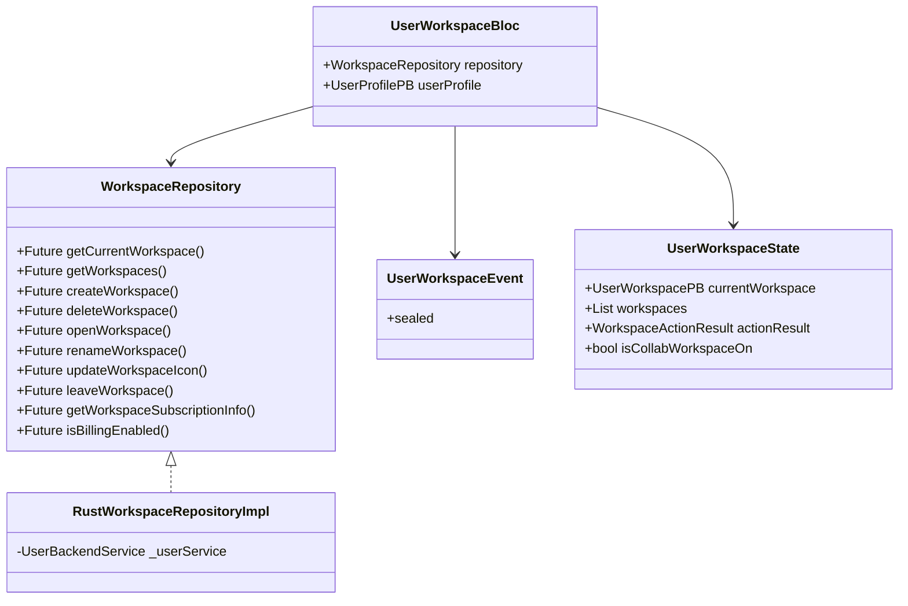
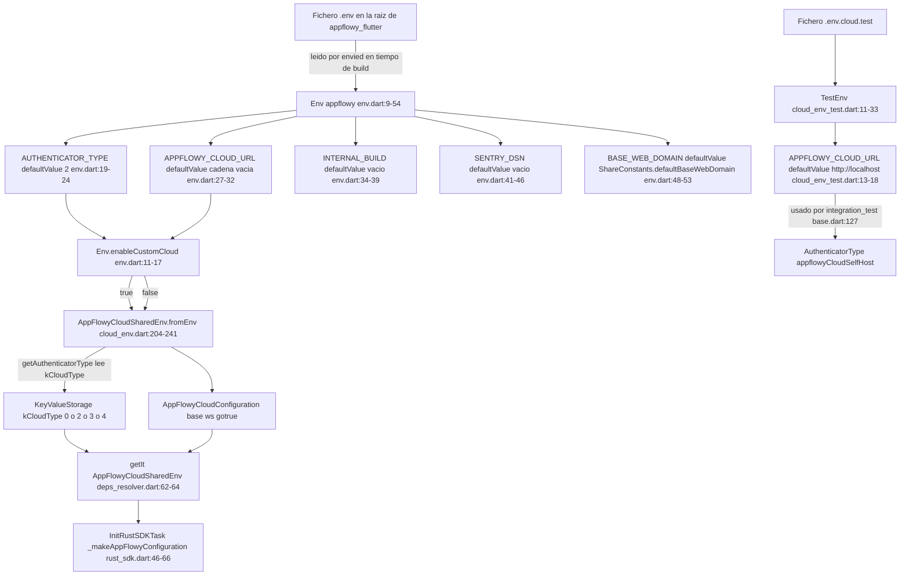
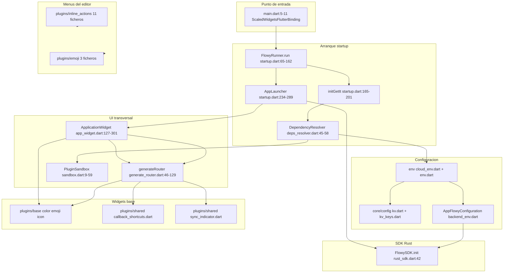
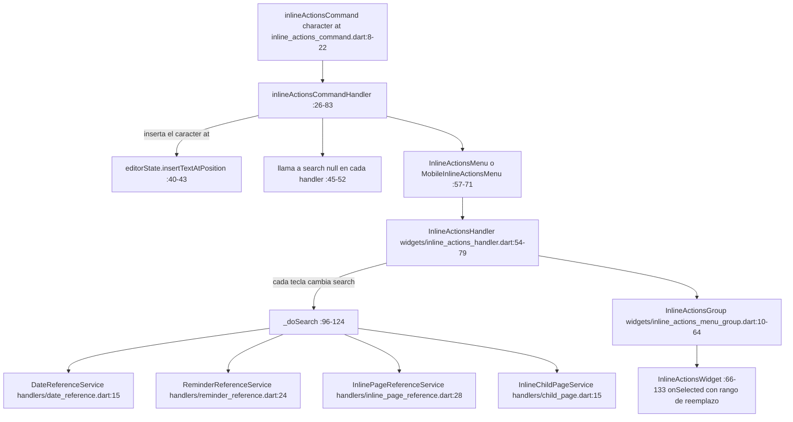
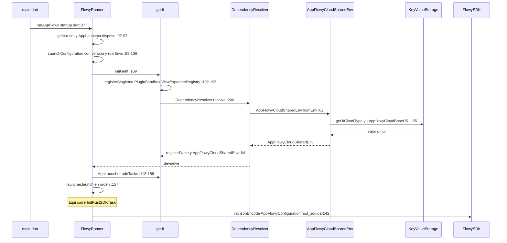
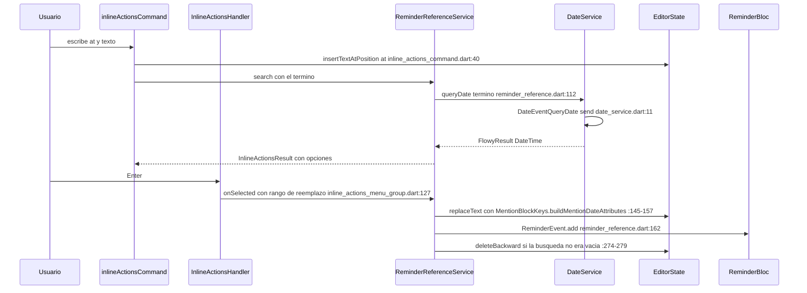
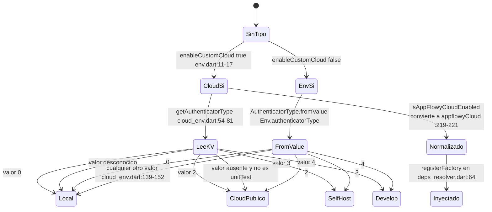

# F00.7.7 — App glue: `lib/` core, startup, util, shared, workspace, features y plugins transversales

## 1. Resumen

Esta unidad cubre los **89 ficheros** de `frontend/appflowy_flutter/lib/` que no pertenecen a una feature concreta sino que la conectan: el punto de entrada (`main.dart`), el motor de arranque (`startup/`, 20 ficheros), el almacén clave-valor (`core/config/`), la resolución de entorno y nube (`env/`), la biblioteca de utilidades (`util/`, 20 ficheros), el widget base copiado del framework (`flutter/af_dropdown_menu.dart`), el esqueleto de arquitectura por feature (`features/workspace/`, `features/util/`) y cuatro plugins transversales (`plugins/blank/`, `plugins/base/`, `plugins/inline_actions/`, `plugins/emoji/`, más `plugins/shared/` parcial y `plugins/database_document/`). Son **10 999 líneas** medidas con `wc -l`. El hilo que las ata es el `getIt` declarado en `appflowy/frontend/appflowy_flutter/lib/startup/startup.dart:25`: todo el arranque es una lista ordenada de `LaunchTask` (`appflowy/frontend/appflowy_flutter/lib/startup/startup.dart:119-156`) que, entre otras cosas, construye `AppFlowyCloudSharedEnv` desde el fichero `.env`, lo serializa a JSON y lo pasa al SDK Rust. Esta unidad **no** repite el arranque — ya está en `[[B1.4]]` —; documenta qué infrastructure lo sostiene y por qué `env/` determina a qué servidor apuntan los tests.

## 2. Alcance

### 2.1 Inventario por módulo (medido, no estimado)

| Módulo / ruta | Ficheros | LOC | Responsabilidad |
|---|---:|---:|---|
| `lib/startup/` (raíz + `plugin/`) | 7 | 721 | `getIt`, `FlowyRunner`, `AppLauncher`, `LaunchTask`, `initGetIt`, contrato `Plugin`/`PluginSandbox` |
| `lib/startup/tasks/` | 13 | 2 055 | 13 de las tareas de arranque + `prelude.dart`, `generate_router.dart`, `ApplicationWidget` |
| `lib/util/` | 20 | 769 | Extensiones y helpers transversales (string, color, tiempo, debounce, FFI de ficheros) |
| `lib/env/` | 4 | 516 | Configuración por `.env` (`envied`), `AuthenticatorType`, `AppFlowyCloudSharedEnv` |
| `lib/core/` | 5 | 385 | `KeyValueStorage` + 30 claves KV + helpers de plataforma y de apertura de URLs |
| `lib/plugins/inline_actions/` | 11 | 1 844 | Menú `@` del editor: comando, servicio, overlay, teclado y 4 handlers |
| `lib/flutter/af_dropdown_menu.dart` | 1 | 1 065 | Fork de `DropdownMenu` del framework con `selectOptionCompare` |
| `lib/plugins/database_document/` | 4 | 839 | Plugin del documento de una fila de grid + barra de título |
| `lib/plugins/emoji/` | 3 | 732 | Menú `:` del editor con overlay y teclado |
| `lib/plugins/base/` | 8 | 469 | Widgets base reutilizables (color picker, emoji picker, icon widget, drag handle) |
| `lib/features/workspace/` + `features/util/` | 6 | 1 269 | BLoC de workspace por feature + repositorio + adaptadores PB→dominio de compartir |
| `lib/plugins/shared/` (parcial) | 3 | 180 | Atajos por callback, `CoverType`→PB, indicadores de sincronización |
| `lib/plugins/blank/` | 1 | 88 | Plugin de reserva cuando el `PluginType` no está registrado |
| `lib/date/date_service.dart` | 1 | 25 | Cliente del evento `DateEvent.QueryDate` (NLP de fechas) |
| `lib/plugins/util.dart` | 1 | 31 | `ViewPluginNotifier`: avisa cuando la vista se borra |
| `lib/main.dart` | 1 | 11 | `main()` real (11 líneas) |
| **Total** | **89** | **10 999** | — |

### 2.2 Correcciones de scope obligatorias

1. **El arranque completo y las 15 `LaunchTask` están en `[[B1.4]]`** (`OUT/05-arranque-y-ciclo-de-vida.md`, §2 "Las 15 `LaunchTask` en orden de ejecución"). Aquí no se reordena la lista: se documenta el **motor** que la ejecuta (`appflowy/frontend/appflowy_flutter/lib/startup/startup.dart:234-289`), el contrato de `LaunchTask` (`:218-232`) y lo que aportan los 13 ficheros de `tasks/` que caen en esta unidad.
2. **`workspace/application/**` y `workspace/presentation/**` que sí son feature** (sidebar, home, export, tabs, favoritos) están en `[[F03]]`, `[[F04]]`, `[[F11]]`. De `workspace/` sólo entran aquí tres ficheros transversales: `tasks/app_window_size_manager.dart`, `tasks/af_navigator_observer.dart` y `tasks/generate_router.dart`.
3. **`plugins/document/**` → `[[F01]]`; `plugins/database/**` → `[[F02]]`; `plugins/ai_chat/**` → `[[F09.3]]`; `plugins/trash/**` → `[[F04]]`; `plugins/emoji/**` → `[[F21]]`/`[[F00]]` (el submenú `:`); `plugins/shared/share/**` → `[[F11]]`/`[[F12]]`**. Los tres ficheros de `plugins/emoji/` que sí entran aquí son los del menú de emoji del editor, no el selector de iconos global (que vive en `shared/icon_emoji_picker/`, otra unidad).
4. **`startup/tasks/**` completos, `lib-log` y `log_filter.rs` → `[[F17]]`**: `feature_flag_task.dart`, `auto_update_task.dart`, `hot_key.dart`, `localization.dart`, `memory_leak_detector.dart`, `platform_error_catcher.dart`, `windows.dart` y `deeplink/` no están en esta unidad. Los que sí están son `debug_task.dart`, `platform_service.dart`, `recent_service_task.dart`, `device_info_task.dart`, `file_storage_task.dart`, `rust_sdk.dart`, `load_plugin.dart`, `app_widget.dart`, `appflowy_cloud_task.dart`, `generate_router.dart`, `af_navigator_observer.dart`, `app_window_size_manager.dart` y `prelude.dart`.
5. **`shared/feature_flags.dart` ya está catalogado en `[[B2.6]]`** §6: los nueve flags (`collaborativeWorkspace`, `membersSettings`, `syncDocument`, `syncDatabase`, `search`, `planBilling`, `spaceDesign`, `inlineSubPageMention`, `sharedSection`) más el centinela `unknown` están declarados en `appflowy/frontend/appflowy_flutter/lib/shared/feature_flags.dart:14-48`. Aquí sólo se cita **el uso** que hacen los ficheros de esta unidad: `appflowy/frontend/appflowy_flutter/lib/startup/tasks/app_widget.dart:169`, `:268` y `appflowy/frontend/appflowy_flutter/lib/features/workspace/logic/workspace_bloc.dart:573`.
6. **`core/network_monitor.dart` → `[[F06]]`**; **`core/frameless_window.dart` → `[[F17]]`**. Ninguno de los dos está en esta unidad, pero `platform_service.dart` arranca el primero: `appflowy/frontend/appflowy_flutter/lib/startup/tasks/platform_service.dart:14`.
7. **`markdown_to_document.dart` → `[[B4.8]]`** (motor de importación/exportación Markdown). El fichero no está en esta unidad; sólo se cita su función de cabecera `appflowy/frontend/appflowy_flutter/lib/shared/markdown_to_document.dart:13`.
8. **`env/` y `dev.env` → `[[F00.7.2]]`**: el fichero `dev.env` (`appflowy/frontend/appflowy_flutter/dev.env`, 19 bytes, una sola línea `APPFLOWY_CLOUD_URL=` sin salto final), el `.gitignore` que lo ignora (`appflowy/frontend/appflowy_flutter/.gitignore:72-73`) y las dependencias `envied` (`appflowy/frontend/appflowy_flutter/pubspec.yaml:54`) y `envied_generator` (`:160`) están en `[[F00.7.2]]`. Esta unidad documenta **el consumo Dart** de esos ficheros, no su provisionamiento.
9. **`native_server` / wiring del backend local → `[[F06]]`**: `useLocalServer()` (`appflowy/frontend/appflowy_flutter/lib/env/cloud_env.dart:188-190`) sólo escribe `KVKeys.kCloudType = "0"`.
10. **La tabla de rutas `go_router` ya está en `[[B2.6]]`** §4 (32 entradas derivadas de `generate_router.dart`). Aquí se documenta la *estructura* del router, no la tabla.
11. **`plugins/shared/sync_indicator.dart` y `cover_type_ext.dart` son adaptadores**: consumen `DocumentSyncBloc` (`[[F01]]`), `DatabaseSyncBloc` (`[[F02]]`) y `CoverType` del editor (`[[F01]]`); aquí se documenta su forma, no la semántica de los bloques.

## 3. Modelos de datos

### 3.1 Almacén clave-valor de Dart

`KeyValueStorage` es un contrato de cinco métodos (`appflowy/frontend/appflowy_flutter/lib/core/config/kv.dart:3-12`) con una única implementación real: `DartKeyValue`, respaldada por `SharedPreferences` (`appflowy/frontend/appflowy_flutter/lib/core/config/kv.dart:14-64`). La inicialización es perezosa y memoizada en cada acceso (`appflowy/frontend/appflowy_flutter/lib/core/config/kv.dart:62-64`). En `deps_resolver.dart` la alternativa sobre Rust está **comentada**:

```dart
// getIt.registerFactory<KeyValueStorage>(() => RustKeyValue());
getIt.registerFactory<KeyValueStorage>(() => DartKeyValue());
```

`appflowy/frontend/appflowy_flutter/lib/startup/deps_resolver.dart:50-51` — el KV del cliente es, en este snapshot, 100 % `SharedPreferences`; el KV de Rust vive en `flowy-sqlite` y está documentado en `OUT/08-persistencia/02-kv.md`. [VERIFICADO]

`KVKeys` declara **30 constantes** (`appflowy/frontend/appflowy_flutter/lib/core/config/kv_keys.dart:1-128`) bajo el prefijo `io.appflowy.appflowy_flutter` (`:4`): ventana (`windowSize:13`, `windowPosition:19`, `windowMaximized:26`, `scaleFactor:91`), apariencia del documento (`:28-38`), expansión (`:44-50`), nube (`:59-62`), flags (`:75`), pestañas y espacios (`:86-112`), iconos recientes (`:117`) y varias de uso único. Las consumen 18 ficheros de `lib/`, con `appflowy/frontend/appflowy_flutter/lib/env/cloud_env.dart` (11 accesos) y `appflowy/frontend/appflowy_flutter/lib/startup/tasks/app_window_size_manager.dart` (8) a la cabeza.

### 3.2 Configuración de entorno y nube

La cadena `Env` → `AppFlowyCloudSharedEnv` → `AppFlowyConfiguration` es el contrato que la app Dart entrega al SDK Rust en el arranque.

| Tipo | Rol | Fichero:línea |
|---|---|---|
| `Env` | Constantes de compilación leídas de `.env` por `envied` | `appflowy/frontend/appflowy_flutter/lib/env/env.dart:9-54` |
| `TestEnv` | Idem para `.env.cloud.test` | `appflowy/frontend/appflowy_flutter/lib/env/cloud_env_test.dart:11-33` |
| `AppFlowyCloudConfiguration` | `base_url`, `ws_base_url`, `gotrue_url`, `enable_sync_trace`, `base_web_domain` | `appflowy/frontend/appflowy_flutter/lib/env/backend_env.dart:39-79` |
| `AppFlowyConfiguration` | Sobre de todo lo anterior + `root`, `device_id`, `platform`, `envs` | `appflowy/frontend/appflowy_flutter/lib/env/backend_env.dart:9-36` |
| `AppFlowyCloudSharedEnv` | Estado resuelto, inyectado en `getIt` | `appflowy/frontend/appflowy_flutter/lib/env/cloud_env.dart:193-248` |
| `AuthenticatorType` | `local`(0), `appflowyCloud`(2), `appflowyCloudSelfHost`(3), `appflowyCloudDevelop`(4) | `appflowy/frontend/appflowy_flutter/lib/env/cloud_env.dart:112-153` |

El hueco de valores (falta el `1`) se conserva por compatibilidad con clientes antiguos que usaban Supabase (`appflowy/frontend/appflowy_flutter/lib/env/cloud_env.dart:20-22`). Y como `defaultConfig()` devuelve cadenas vacías mientras que `isValid` exige las tres no vacías (`appflowy/frontend/appflowy_flutter/lib/env/backend_env.dart:65-79`), una config vacía nunca habilita autenticación: `isAuthEnabled` es exactamente `env.authenticatorType.isAppFlowyCloudEnabled && env.appflowyCloudConfig.isValid` (`appflowy/frontend/appflowy_flutter/lib/env/cloud_env.dart:94-101`).

### 3.3 Workspace por feature (`features/workspace/`)

La arquitectura dual Dart (legado `workspace/` vs nuevo `features/`) está comparada en `[[B1.3]]`. Lo que aporta esta unidad es el **triángulo** `data`/`logic`:



**Lectura**: el BLoC depende del *contrato*, no de la implementación. `RustWorkspaceRepositoryImpl` es un adaptador de 87 líneas que reenvía cada método a `UserBackendService` (`appflowy/frontend/appflowy_flutter/lib/features/workspace/data/repositories/rust_workspace_repository_impl.dart:12-87`); cambiar de backend Rust a REST sólo exige otra implementación de la interfaz de 59 líneas (`appflowy/frontend/appflowy_flutter/lib/features/workspace/data/repositories/workspace_repository.dart:10-58`). El BLoC tiene **13 handlers** `on<...>` (`appflowy/frontend/appflowy_flutter/lib/features/workspace/logic/workspace_bloc.dart:44-60`) alimentados por **13 factorías** de la clase sellada `UserWorkspaceEvent` (`appflowy/frontend/appflowy_flutter/lib/features/workspace/logic/workspace_event.dart:7-82`), y su estado (`appflowy/frontend/appflowy_flutter/lib/features/workspace/logic/workspace_state.dart:34-54`) expone un `WorkspaceActionResult` con nueve `WorkspaceActionType` posibles (`:5-15`).

`features/util/extensions.dart` es la capa de traducción **PB → dominio** de la feature: convierte `AFAccessLevelPB` ↔ `ShareAccessLevel`, `AFRolePB` ↔ `ShareRole` y `SharedViewSectionPB` → `SharedSectionType` en ambas direcciones (`appflowy/frontend/appflowy_flutter/lib/features/util/extensions.dart:42-125`). Nótese que `AFRolePB` existe **por duplicado** en dos crates Rust (`flowy-folder` y `flowy-user`), y el fichero lo resuelve importando ambos con alias (`appflowy/frontend/appflowy_flutter/lib/features/util/extensions.dart:3-6`, `:90-110`). [VERIFICADO]

## 4. Eventos FFI

Sólo cuatro ficheros de esta unidad hablan con el dispatcher, y lo hacen con tres eventos distintos:

| Evento Dart | Llamada | Input PB | Output PB | Handler Rust | Fichero Dart:línea |
|---|---|---|---|---|---|
| `DateEvent.QueryDate` | `DateService.queryDate` | `DateQueryPB` | `DateResultPB` | `query_date_handler` | `appflowy/frontend/appflowy_flutter/lib/date/date_service.dart:10-11` |
| `FileStorageEvent.RegisterStream` | `FileStorageService` constructor | `RegisterStreamPB` | — | `register_stream_handler` | `appflowy/frontend/appflowy_flutter/lib/startup/tasks/file_storage_task.dart:50-52` |
| `FileStorageEvent.QueryFile` | `FileStorageService.getFileState` | `QueryFilePB` | `FileStatePB` | `query_file_handler` | `appflowy/frontend/appflowy_flutter/lib/startup/tasks/file_storage_task.dart:77-80` |

[VERIFICADO] Contratos verificados contra el Rust: `appflowy/frontend/rust-lib/flowy-date/src/event_map.rs:17-19` declara `#[event(input = "DateQueryPB", output = "DateResultPB")]` y `appflowy/frontend/rust-lib/flowy-storage/src/event_map.rs:20-25` declara `RegisterStream` (sin output) y `QueryFile` con `FileStatePB`. El registro ocurre en `appflowy/frontend/rust-lib/flowy-date/src/event_map.rs:8-11` y `appflowy/frontend/rust-lib/flowy-storage/src/event_map.rs:12-13`.

La cuarta puerta es `FlowySDK.init(jsonEncode(env.toJson()))` (`appflowy/frontend/appflowy_flutter/lib/startup/tasks/rust_sdk.dart:42`), que **no** es un evento sino la inicialización del SDK con el `AppFlowyConfiguration` serializado; el mecanismo FFI está en `[[F00.1]]` y `[[B1.5]]`.

`DateService.queryDate` devuelve `FlowyResult<DateTime, FlowyError>` y, si el string de la respuesta no parsea, fabrica un `FlowyError(msg: 'Could not parse Date (NLP) from String')` (`appflowy/frontend/appflowy_flutter/lib/date/date_service.dart:12-23`). Es el único consumidor del servicio: los handlers `@date` y `@reminder` (`appflowy/frontend/appflowy_flutter/lib/plugins/inline_actions/handlers/date_reference.dart:94`, `appflowy/frontend/appflowy_flutter/lib/plugins/inline_actions/handlers/reminder_reference.dart:112`).

## 5. Notificaciones

Ninguno de los 89 ficheros declara una suscripción `rust_stream.dart` a un enum de notificaciones. Hay, sin embargo, **un canal de progreso de ficheros** que es la excepción y merece documentarse porque es el único `RawReceivePort` de la unidad: `FileStorageService` abre un `RawReceivePort`, lo engancha a un `StreamController.broadcast()` y envía `port = Int64(_port.sendPort.nativePort)` al Rust (`appflowy/frontend/appflowy_flutter/lib/startup/tasks/file_storage_task.dart:57-59` y `:50-52`). Cada mensaje es un JSON con `file_url`, `progress` y `error` opcional, deserializado por `FileProgress.fromJsonString` (`appflowy/frontend/appflowy_flutter/lib/startup/tasks/file_storage_task.dart:101-128`) y republicado en un `AutoRemoveNotifier<FileProgress>` por URL (`:61-75`, `:135-150`).

Es un patrón **híbrido pull + push**: (1) el widget pide progreso llamando a `onFileProgress(fileUrl)`, que dispara a su vez un `QueryFilePB` (`appflowy/frontend/appflowy_flutter/lib/startup/tasks/file_storage_task.dart:61-75`); (2) Rust responde por el mismo `SendPort` con mensajes JSON; (3) `FileStorageService` los deserializa y actualiza el `AutoRemoveNotifier<FileProgress>` registrado para esa URL; (4) el notificador se auto-elimina del mapa al hacer `dispose` (`:146-148`). `[[F01]]`/`[[F02]]` documentan qué widgets lo consumen. El registro del stream se salta en modo test (`appflowy/frontend/appflowy_flutter/lib/startup/tasks/file_storage_task.dart:49`), de modo que en unit test no llega progreso alguno.

Los indicadores de `plugins/shared/sync_indicator.dart` **no** son notificaciones: son widgets que crean su propio BLoC por vista y lo destruyen con el árbol (`appflowy/frontend/appflowy_flutter/lib/plugins/shared/sync_indicator.dart:22-24`, `:80-82`).

## 6. BLoCs / Cubits

| Clase | Eventos | Estados | Servicios / colaboradores | Fichero:línea |
|---|---|---|---|---|
| `UserWorkspaceBloc` | 13 clases de `UserWorkspaceEvent` | `UserWorkspaceState` | `WorkspaceRepository`, `UserListener`, `getIt<ReminderBloc>()` | `appflowy/frontend/appflowy_flutter/lib/features/workspace/logic/workspace_bloc.dart:37-61` |
| `DatabaseDocumentTitleBloc` | 4 variantes `freezed` | `DatabaseDocumentTitleState` (`freezed`) | `RowMetaListener`, `DatabaseController`, `RowController`, `FieldBackendService`, `ViewBackendService` | `appflowy/frontend/appflowy_flutter/lib/plugins/database_document/presentation/database_document_title_bloc.dart:19-30` |

`UserWorkspaceBloc` es el único BLoC propio de la unidad. Sus rasgos destacables son: (a) se suscribe a `UserListener` en `_setupListeners` (`appflowy/frontend/appflowy_flutter/lib/features/workspace/logic/workspace_bloc.dart:534-563`) y lo detiene en `close()` (`:69-72`); (b) la visibilidad del workspace colaborativo depende de **dos** condiciones —`AuthTypePB.Server` **y** el flag `FeatureFlag.collaborativeWorkspace`— (`:571-573`); (c) la suscripción al workspace sólo se consulta si el billing está habilitado (`:459-463`); (d) la carga de workspaces convierte un `WorkspacePB` huérfano en `UserWorkspacePB` sintético si la lista viene vacía (`:652-656`, `:686-691`).

`DatabaseDocumentTitleBloc` es un BLoC *sin* `registerFactory` en `getIt`: se crea dentro del `BlocProvider` de `ViewTitleBarWithRow` (`appflowy/frontend/appflowy_flutter/lib/plugins/database_document/presentation/database_document_title.dart:39-44`), que es exactamente la arquitectura "por feature" de `features/`.

## 7. Servicios e inyección de dependencias

`getIt` es una instancia global creada en `appflowy/frontend/appflowy_flutter/lib/startup/startup.dart:25` y re-exportada por `prelude.dart`. `initGetIt` registra seis singletons de framework (`appflowy/frontend/appflowy_flutter/lib/startup/startup.dart:165-201`): `EntryPoint` (factory), `FlowySDK` y `AppLauncher` (lazy singletons con `dispose`), `PluginSandbox`, `ViewExpanderRegistry`, `LinkHoverTriggers`, `AFNavigatorObserver` y `FloatingToolbarController`. Después delega en `DependencyResolver.resolve` (`:200`), que a su vez llama a cinco resolutores (`appflowy/frontend/appflowy_flutter/lib/startup/deps_resolver.dart:45-58`):

| Resolutor | Registra | Líneas |
|---|---|---|
| `_resolveCloudDeps` | `AppFlowyCloudSharedEnv` (factory, ya resuelto), `AIRepository`, `AppFlowyCloudDeepLink` | `appflowy/frontend/appflowy_flutter/lib/startup/deps_resolver.dart:61-75` |
| `_resolveUserDeps` | `AuthService` según `currentCloudType()`, `AuthRouter`, `SignInBloc`, `SignUpBloc`, `SplashRouter`, `EditPanelBloc`, `SplashBloc`, `NetworkListener`, `CachedRecentService`, `ViewAncestorCache`, `SubscriptionSuccessListenable` | `appflowy/frontend/appflowy_flutter/lib/startup/deps_resolver.dart:106-140` |
| `_resolveHomeDeps` | `FToast`, `MenuSharedState`, `UserListener` (factoryParam), `ShareBloc` (factoryParam), `ActionNavigationBloc`, `TabsBloc`, `ReminderBloc`, `RenameViewBloc` | `appflowy/frontend/appflowy_flutter/lib/startup/deps_resolver.dart:142-163` |
| `_resolveFolderDeps` | `WorkspaceListener`, `ViewBloc`, `SettingsUserViewBloc`, `TrashService`, `TrashListener`, `TrashBloc`, `FavoriteBloc` | `appflowy/frontend/appflowy_flutter/lib/startup/deps_resolver.dart:165-192` |
| `_resolveCommonService` | `FilePickerService`, `ApplicationDataStorage` (mock en test), `ClipboardService`, `BaseAppearance`, `FlowyCacheManager`, `EasyLocalizationService` | `appflowy/frontend/appflowy_flutter/lib/startup/deps_resolver.dart:77-104` |

Dos desviaciones relevantes: (a) el `AuthService` se elige en tiempo de resolución según el tipo de nube (`:107-120`), de modo que **cambiar de nube exige reiniciar la app**; (b) `ApplicationDataStorage` se sustituye por `MockApplicationDataStorage` en modo test (`:83-85`).

`FileStorageService` es la excepción: no se registra en `initGetIt` sino dentro de la propia tarea, `context.getIt.registerSingleton(FileStorageService(), dispose: ...)` (`appflowy/frontend/appflowy_flutter/lib/startup/tasks/file_storage_task.dart:24-27`).

### 7.1 El registro de plugins

`PluginType` tiene **ocho** valores (`appflowy/frontend/appflowy_flutter/lib/startup/plugin/plugin.dart:13-22`) y `PluginSandbox` los mantiene en un `LinkedHashMap` **ordenado**, porque el orden de registro es el orden en que aparecen en el menú "crear nuevo" (`appflowy/frontend/appflowy_flutter/lib/startup/plugin/src/sandbox.dart:14-17`). Dos reglas gobiernan el registro: `registerPlugin` **ignora silenciosamente** los tipos ya registrados (`:44-46`) y `buildPlugin` cae a `BlankPluginBuilder()` si el tipo no existe (`:34-37`). `pluginBuilders()` filtra los no-creables usando `PluginConfig.creatable` (`appflowy/frontend/appflowy_flutter/lib/startup/plugin/plugin.dart:105-114`), que es `false` para `blank`, `trash` y `databaseDocument` (`appflowy/frontend/appflowy_flutter/lib/plugins/blank/blank.dart:29-32`, `appflowy/frontend/appflowy_flutter/lib/plugins/database_document/database_document_plugin.dart:140-143`). `startup/plugin/src/runner.dart` es un stub de una línea (`class PluginRunner {}`) sin uso real.

El flujo completo es: `PluginLoadTask.initialize` llama nueve veces a `registerPlugin` (`appflowy/frontend/appflowy_flutter/lib/startup/tasks/load_plugin.dart:19-43`) → cada llamada escribe en el `LinkedHashMap<PluginType, PluginBuilder>` y, si viene `config`, en el `Map<PluginType, PluginConfig>` (`appflowy/frontend/appflowy_flutter/lib/startup/plugin/src/sandbox.dart:39-52`) → luego la UI consume `pluginBuilders()` para el menú "crear nuevo" y `makePlugin(pluginType, data)` para abrir una vista ya existente (`appflowy/frontend/appflowy_flutter/lib/startup/plugin/plugin.dart:100-114`). Cada `PluginBuilder` declara además el `ViewLayoutPB` con el que el backend crea la vista (`appflowy/frontend/appflowy_flutter/lib/startup/plugin/plugin.dart:56-61`).

## 8. Persistencia

El cliente Dart persiste en `SharedPreferences` a través de `DartKeyValue` (`:14-64` de `kv.dart`). Los valores con formato estructurado son cuatro y se serializan a JSON:

| Clave KV | Formato | Productor | Consumidor |
|---|---|---|---|
| `KVKeys.windowSize` | `{"height":…,"width":…}` | `WindowSizeManager.setSize` (`appflowy/frontend/appflowy_flutter/lib/startup/tasks/app_window_size_manager.dart:28-38`) | `WindowSizeManager.getSize` (`:40-57`) |
| `KVKeys.windowPosition` | `{"dx":…,"dy":…}` | `setPosition` (`:59-67`) | `getPosition` (`:69-76`) |
| `KVKeys.expandedViews` / `expandedFolders` | mapas `id → bool` | `[[F04]]` | `[[F04]]` |
| `KVKeys.featureFlag` | mapa `flag → bool` | `shared/feature_flags.dart` (`[[B2.6]]`) | idem |

`WindowSizeManager` define los límites de ventana: mínimo y máximo 640×640 y 8192×8192 respectivamente (el máximo acotado "para evitar el fallo de validación del Texture Descriptor", `appflowy/frontend/appflowy_flutter/lib/startup/tasks/app_window_size_manager.dart:9-13`), defecto 1280×960 (`:16-17`) y factor de escala acotado a `[0.5, 2.0]` (`:19-20`, `:78-92`).

El directorio de datos del SDK Rust lo decide `appFlowyApplicationDataDirectory()` (`appflowy/frontend/appflowy_flutter/lib/startup/tasks/rust_sdk.dart:70-83`): `…/data_dev` en desarrollo, `…/data` en release y `Directory.current/.sandbox` en unit test e integration test. Los tres directorios están bajo `getApplicationSupportDirectory()` salvo el de test.

## 9. Diagramas de flujo

### 9.1 El mecanismo `Env` → valores por defecto → tipo de autenticación

Muestra cómo una variable ausente en `.env` decide a qué servidor apunta la app y por qué los tests caen en `localhost`.



**Lectura**: la app **no** usa `String.fromEnvironment` ni `--dart-define`; usa el paquete `envied`, que convierte cada campo anotado `@EnviedField` en una constante de Dart generada (`part 'env.g.dart'`, `appflowy/frontend/appflowy_flutter/lib/env/env.dart:6`) leyendo el fichero declarado en `@Envied(path: '.env')` (`:8`) con el `defaultValue` anotado como plan B. La decisión de usar `.env` o el KV del usuario la toma `Env.enableCustomCloud` (`appflowy/frontend/appflowy_flutter/lib/env/env.dart:11-17`): si el usuario ya eligió nube en los ajustes, manda el KV; si no, manda el `.env`. Ese resultado se serializa y se cruza al Rust en `InitRustSDKTask` (`appflowy/frontend/appflowy_flutter/lib/startup/tasks/rust_sdk.dart:34-42`).

El impacto en los tests es directo y verificable: `TestEnv.afCloudUrl` vale `http://localhost` por defecto (`appflowy/frontend/appflowy_flutter/lib/env/cloud_env_test.dart:13-18`) y la suite de integración lo consume en `appflowy/frontend/appflowy_flutter/integration_test/shared/base.dart:127`; en el modo local la misma suite fuerza `appflowyCloudDevelop` con `http://localhost` (`:125`), que a su vez se traduce a puertos concretos `:8000` (API), `:9999` (GoTrue) y `ws://<host>:8000/ws/v1` (`appflowy/frontend/appflowy_flutter/lib/env/cloud_env.dart:260-267`). La suite completa está en `[[F00.7.3]]`–`[[F00.7.6]]`.

### 9.2 Capas transversales y quién depende de quién

Muestra la pila de "pegamento" que une la UI con el SDK Rust.



**Lectura**: la dependencia es estrictamente descendente y `getIt` es la única costura lateral. `util/` no aparece porque no depende de nada de este diagrama: son 20 ficheros sin dependencias internas, importables desde cualquier capa (es el módulo más bajo del grafo). En la capa de UI, `generate_router.dart` es el consumidor más pesado: **35 construcciones `GoRoute`** y 30 funciones factories privadas (`appflowy/frontend/appflowy_flutter/lib/startup/tasks/generate_router.dart:46-741`), y cada pantalla móvil declara sus propias constantes `routeName`/`arg*`, que es la razón por la que la tabla de rutas es catalogable automáticamente (`[[B2.6]]` §4).

### 9.3 Menú `@` de inline actions: composición del servicio

Muestra cómo los cuatro handlers se encajan en el menú.



**Lectura**: es un *servicio de delegates*. `InlineActionsService` mantiene una `List<InlineActionsDelegate>` (`appflowy/frontend/appflowy_flutter/lib/plugins/inline_actions/inline_actions_service.dart:19`) cuyo contrato son dos métodos (`appflowy/frontend/appflowy_flutter/lib/plugins/inline_actions/service_handler.dart:3-7`): `search(String?)` y `dispose()`. Cada búsqueda devuelve un `InlineActionsResult` con título, lista de `InlineActionsMenuItem` y `startsWithKeywords` (`appflowy/frontend/appflowy_flutter/lib/plugins/inline_actions/inline_actions_result.dart:26-50`), lo que permite reordenar grupos para que "fecha" salga antes que "página" al escribir `@f…` (`appflowy/frontend/appflowy_flutter/lib/plugins/inline_actions/widgets/inline_actions_handler.dart:24-50`). El teclado es **secuencial y tolerante**: cada pulsación reescribe el texto del editor y vuelve a consultar a los cuatro handlers (`:337-359`), y tras **10** búsquedas sin resultados el menú se cierra solo devolviendo el foco al editor (`:52`, `:110-118`). El overlay se reposiciona en cuatro cuadrantes según el rectángulo de selección (`appflowy/frontend/appflowy_flutter/lib/plugins/inline_actions/inline_actions_menu.dart:90-120`) y al abrirlo **deshabilita** teclado y scroll del editor (`:162-163`), rehabilitándolos en `dismiss()` (`:44-47`). El menú `:` de emoji replica la arquitectura con otros números (alto 400, ancho 300: `appflowy/frontend/appflowy_flutter/lib/plugins/emoji/emoji_menu.dart:18-19`) y cierra tras **5** caracteres infructuosos (`appflowy/frontend/appflowy_flutter/lib/plugins/emoji/emoji_handler.dart:229`).

## 10. Diagramas de secuencia

### 10.1 Arranque: de `main()` a `FlowySDK.init`



[VERIFICADO] Cada flecha se ancla a la línea indicada. La operación más relevante para el resto del documento es `Env.enableCustomCloud` (§9.1): decide si `fromEnv` lee el KV del usuario o el `.env` de compilación (`appflowy/frontend/appflowy_flutter/lib/env/cloud_env.dart:204-241`). `runAppFlowy` también es el punto de **reinicio completo**: se desregistra todo con `getIt.reset()` (`appflowy/frontend/appflowy_flutter/lib/startup/startup.dart:97`) y se reconstruye el árbol, lo que explica que un cambio de nube exija reiniciar.

### 10.2 Escritura de un recordatorio desde el menú `@`



[VERIFICADO] La creación del `ReminderPB` es local y ocurre antes del envío al backend: `id` con `nanoid()`, `objectId` = `documentId` leído del `DocumentBloc`, `scheduledAt` en **segundos** (`~/ 1000`) y `isAck` precalculado comparando con `DateTime.now()` (`appflowy/frontend/appflowy_flutter/lib/plugins/inline_actions/handlers/reminder_reference.dart:236-251`). El `meta` lleva tres claves (`includeTime`, `blockId`, `createdAt`) mediante `ReminderMetaKeys` (`:242-247`). `ReminderBloc` está registrado como singleton en `appflowy/frontend/appflowy_flutter/lib/startup/deps_resolver.dart:160`, y `UserWorkspaceBloc` lo dispara con `ReminderEvent.started()` al abrir un workspace (`appflowy/frontend/appflowy_flutter/lib/features/workspace/logic/workspace_bloc.dart:307-309`) — acoplamiento notable entre dos features.

## 11. Diagramas de estado

### 11.1 Resolución del tipo de autenticación



**Lectura**: hay **dos** representaciones distintas del mismo concepto. El `AuthenticatorType` del cliente distingue cuatro casos (`appflowy/frontend/appflowy_flutter/lib/env/cloud_env.dart:112-117`), pero el backend sólo entiende `0` (local) y `2` (nube), así que `fromEnv` **colapsa** self-host y develop a `appflowyCloud` antes de inyectar (`:214-221`), y conserva el valor fino en `appflowyCloudConfig`. El valor por defecto cuando el KV está vacío y no estamos en unit test es *nube pública* (`appflowy/frontend/appflowy_flutter/lib/env/cloud_env.dart:56-63`), lo que explica por qué una instalación nueva con `APPFLOWY_CLOUD_URL` vacío intenta arrancar contra `https://beta.appflowy.cloud` (`appflowy/frontend/appflowy_flutter/lib/env/cloud_env.dart:41`).

### 11.2 Ciclo de vida de un `Plugin`

El ciclo es corto y lineal: **Registrado** (cuando `PluginLoadTask` inserta el `PluginBuilder` en el `LinkedHashMap`) → **Disponible** (los getters `builders`, `pluginConfigs` y `supportPluginTypes` publican el contenido, `appflowy/frontend/appflowy_flutter/lib/startup/plugin/src/sandbox.dart:54-58`) → **Creado** (cuando la UI llama a `makePlugin`, que invoca `builder.build(data)`, `:34-37`). Si el `PluginType` solicitado no está registrado, ese mismo `buildPlugin` devuelve `BlankPluginBuilder().build(data)` (`:35`), de modo que el usuario ve una página en blanco en lugar de un crash. Un plugin con `notifier` —`ViewPluginNotifier` en `appflowy/frontend/appflowy_flutter/lib/plugins/util.dart:7-31`— se suscribe a `ViewListener` y expone `ValueNotifier<DeletedViewPB?>`; cuando la vista se mueve a la papelera, `onViewMoveToTrash` publica el `DeletedViewPB` (`:13-16`) y el framework cierra la pestaña. `Plugin.dispose` llama a `notifier?.dispose()` (`appflowy/frontend/appflowy_flutter/lib/startup/plugin/plugin.dart:37-39`), que a su vez quita el listener y libera el `ValueNotifier` (`appflowy/frontend/appflowy_flutter/lib/plugins/util.dart:27-30`). El único camino anómalo es el **doble registro**, que `PluginSandbox` descarta en silencio (`appflowy/frontend/appflowy_flutter/lib/startup/plugin/src/sandbox.dart:44-46`, ver §13.2). [VERIFICADO]


## 12. Archivos cubiertos (del ledger)

89 ficheros, 10 999 líneas, todos de `appflowy/frontend/appflowy_flutter/`.

### 12.1 `lib/startup/` (20 ficheros, 2 776 LOC)

| Fichero | LOC | Rol |
|---|---:|---|
| `startup/startup.dart` | 327 | `getIt`, `runAppFlowy`, `FlowyRunner`, `initGetIt`, `LaunchTask`, `AppLauncher`, `IntegrationMode` |
| `startup/deps_resolver.dart` | 192 | Registro de dependencias en cinco grupos |
| `startup/entry_point.dart` | 11 | `AppFlowyApplication implements EntryPoint` → `SplashScreen` |
| `startup/launch_configuration.dart` | 13 | `isAnon`, `version`, `rustEnvs` |
| `startup/plugin/plugin.dart` | 118 | `PluginType`, `Plugin`, `PluginBuilder`, `PluginConfig`, `registerPlugin` |
| `startup/plugin/src/sandbox.dart` | 59 | `PluginSandbox`: registro ordenado y fallback a blank |
| `startup/plugin/src/runner.dart` | 1 | Stub `PluginRunner` sin uso |
| `startup/tasks/prelude.dart` | 16 | Re-export de las 16 tareas |
| `startup/tasks/generate_router.dart` | 780 | 35 `GoRoute`, `StatefulShellRoute.indexedStack` de 4 ramas |
| `startup/tasks/app_widget.dart` | 321 | `InitAppWidgetTask`, `ApplicationWidget`, `AppGlobals`, 33 locales |
| `startup/tasks/appflowy_cloud_task.dart` | 293 | `AppFlowyCloudDeepLink`, 5 handlers de deeplink, `InitAppFlowyCloudTask` |
| `startup/tasks/file_storage_task.dart` | 150 | `FileStorageService` + `RawReceivePort` de progreso |
| `startup/tasks/device_info_task.dart` | 124 | `ApplicationInfo` estático + `ApplicationInfoTask` |
| `startup/tasks/app_window_size_manager.dart` | 108 | Persistencia de tamaño, posición, maximizado y escala |
| `startup/tasks/rust_sdk.dart` | 83 | `InitRustSDKTask` y `AppFlowyConfiguration` |
| `startup/tasks/af_navigator_observer.dart` | 53 | `NavigatorObserver` que difunde `Push/Pop/ReplaceRouterInfo` |
| `startup/tasks/debug_task.dart` | 47 | `TalkerBlocObserver` en debug |
| `startup/tasks/load_plugin.dart` | 44 | Registra los 8 `PluginBuilder` |
| `startup/tasks/platform_service.dart` | 23 | `NetworkListener.start()/stop()` |
| `startup/tasks/recent_service_task.dart` | 13 | Sólo un `Log.info` |

### 12.2 `lib/env/` (4), `lib/core/` (5), `lib/date/` (1) — 926 LOC

| Fichero | LOC | Rol |
|---|---:|---|
| `env/cloud_env.dart` | 349 | `AuthenticatorType`, `AppFlowyCloudSharedEnv` y lectura/escritura del KV de nube |
| `env/backend_env.dart` | 80 | DTOs `json_serializable` que cruzan al Rust |
| `env/env.dart` | 54 | 5 `@EnviedField` con `defaultValue` |
| `env/cloud_env_test.dart` | 33 | 3 `@EnviedField` de `.env.cloud.test` |
| `core/config/kv_keys.dart` | 128 | 30 claves + prefijo `io.appflowy.appflowy_flutter` |
| `core/config/kv.dart` | 65 | `KeyValueStorage` / `DartKeyValue` sobre `SharedPreferences` |
| `core/helpers/url_launcher.dart` | 179 | `afLaunchUri`, fallback a carpeta y toasts |
| `core/helpers/target_platform.dart` | 12 | `TargetPlatform.isDesktop` |
| `core/helpers/helpers.dart` | 1 | Re-export de `target_platform.dart` |
| `date/date_service.dart` | 25 | `queryDate` → `DateEvent.QueryDate` |

### 12.3 `lib/util/` (20 ficheros, 769 LOC)

| Fichero | LOC | Rol |
|---|---:|---|
| `util/field_type_extension.dart` | 166 | i18n, SVG, colores móviles y capacidades por `FieldType` |
| `util/xfile_ext.dart` | 109 | `XFile` → `FileType` por MIME y `FileType` → `MediaFileTypePB` |
| `util/string_extension.dart` | 94 | `toFileName`, `fileSize`, `icon`, `getCounter`, `orDefault` |
| `util/share_log_files.dart` | 78 | Zip de `log.*` y compartir/mostrar carpeta |
| `util/time.dart` | 43 | `parseTime` / `formatTime` en minutos |
| `util/expand_views.dart` | 40 | `ViewExpanderRegistry` / `ViewExpander` |
| `util/throttle.dart` | 27 | `Throttler` (ignora si hay timer vivo) |
| `util/color_generator/color_generator.dart` | 28 | Hash de nombre → color HSL o par de la paleta fija |
| `util/default_extensions.dart` | 23 | `defaultImageExtensions` + `isNotImageUrl` |
| `util/debounce.dart` | 23 | `Debounce` (cancela el timer anterior) |
| `util/font_family_extension.dart` | 23 | Nombre legible de fuente y `fontFamilyName` |
| `util/color_to_hex_string.dart` | 21 | `Color.toHexString()` y `ColorExtension.random()` |
| `util/built_in_svgs.dart` | 13 | 10 code points SVG del set integrado |
| `util/navigator_context_extension.dart` | 12 | `popToHome()` |
| `util/theme_mode_extension.dart` | 12 | `ThemeMode.labelText` |
| `util/theme_extension.dart` | 5 | `ThemeData.isLightMode` |
| `util/int64_extension.dart` | 5 | `Int64.toDateTime()` (segundos → `DateTime`) |
| `util/file_extension.dart` | 11 | `String.fileSize` (duplicado de `string_extension.dart`) |
| `util/json_print.dart` | 10 | `prettyPrintJson` con `JsonEncoder.withIndent` |
| `util/levenshtein.dart` | 26 | Distancia de Levenshtein con dos filas |

### 12.4 Plugins transversales (30 ficheros, 5 176 LOC)

| Sub-módulo | Ficheros | LOC | Contenido |
|---|---:|---:|---|
| `plugins/inline_actions/` | 11 | 1 844 | comando `@`, `InlineActionsService`, menú overlay, teclado y 4 handlers |
| `plugins/database_document/` | 4 | 839 | plugin del documento-fila, `DatabaseDocumentPage`, barra de título y su BLoC |
| `plugins/emoji/` | 3 | 732 | comando `:`, `EmojiMenu` overlay y `EmojiHandler` de teclado |
| `plugins/base/` | 8 | 469 | color picker (lista + pantalla), emoji picker (4), `EmojiText`, `IconWidget`, `DragHandle` |
| `plugins/shared/` (parcial) | 3 | 180 | `AFCallbackShortcuts`, `IntoCoverTypePB`, dos sync indicators |
| `plugins/blank/` | 1 | 88 | `BlankPluginBuilder` + `BlankPluginConfig(creatable: false)` |
| `plugins/util.dart` | 1 | 31 | `ViewPluginNotifier` |

### 12.5 `lib/features/`, `lib/flutter/`, `lib/main.dart` (8 ficheros, 2 345 LOC)

| Fichero | LOC | Rol |
|---|---:|---|
| `flutter/af_dropdown_menu.dart` | 1 065 | Fork de `DropdownMenu` del framework (BSD) |
| `features/workspace/logic/workspace_bloc.dart` | 692 | BLoC de workspace (13 eventos) |
| `features/util/extensions.dart` | 126 | Adaptadores PB → dominio de compartir |
| `features/workspace/logic/workspace_state.dart` | 103 | Estado inmutable con `copyWith` |
| `features/workspace/data/repositories/rust_workspace_repository_impl.dart` | 87 | Adaptador a `UserBackendService` |
| `features/workspace/data/repositories/workspace_repository.dart` | 59 | Contrato de 9 métodos |
| `features/workspace/logic/workspace_event.dart` | 202 | Clase sellada con 13 factorías |
| `main.dart` | 11 | `ScaledWidgetsFlutterBinding` + `runAppFlowy()` |

## 13. Riesgos y casos límite

### 13.1 `Env.enableCustomCloud` no hace lo que dice su comentario

El comentario de `appflowy/frontend/appflowy_flutter/lib/env/env.dart:10` afirma que la variable "se pone a true cuando existe un fichero `.env` con `APPFLOWY_CLOUD_URL`". El código real es:

```dart
return Env.authenticatorType ==
        AuthenticatorType.appflowyCloudSelfHost.value ||
    Env.authenticatorType == AuthenticatorType.appflowyCloud.value ||
    Env.authenticatorType == AuthenticatorType.appflowyCloudDevelop.value &&
        _Env.afCloudUrl.isEmpty;
```

`appflowy/frontend/appflowy_flutter/lib/env/env.dart:12-16` — en Dart `&&` liga más fuerte que `||`, así que la expresión es `(selfHost) || (cloud) || (develop && urlVacía)`. Consecuencia: **cualquier build con `AUTHENTICATOR_TYPE=2` ignora por completo el `.env`** y pasa a leer el KV del usuario, con lo que `APPFLOWY_CLOUD_URL` y `BASE_WEB_DOMAIN` del fichero sólo se aplican si el tipo es `develop` y la URL está vacía. Una compilación self-hosted necesita además `AUTHENTICATOR_TYPE=3`. [VERIFICADO] sobre el código; [INFERIDO] el impacto real en builds concretas, que no se pueden verificar sin los `.env` de producción (ignorados por `appflowy/frontend/appflowy_flutter/.gitignore:72-73`).

### 13.2 Registro duplicado en `PluginLoadTask`

`DatabaseDocumentPluginBuilder` se registra **dos veces** seguidas (`appflowy/frontend/appflowy_flutter/lib/startup/tasks/load_plugin.dart:31-34` y `:35-38`). No es un bug funcional: `PluginSandbox.registerPlugin` hace `if (_pluginBuilders.containsKey(pluginType)) return;` (`appflowy/frontend/appflowy_flutter/lib/startup/plugin/src/sandbox.dart:44-46`), de modo que la segunda llamada es un no-op silencioso. Sí es un riesgo de mantenimiento: si alguien quita el early-return, el orden del menú y la unicidad de `PluginType` dejan de estar garantizados.

### 13.3 `getIt.reset()` en cada reinicio y factories donde deberían ser singletons

`runAppFlowy` → `FlowyRunner.run` hace `await getIt.reset()` (`appflowy/frontend/appflowy_flutter/lib/startup/startup.dart:97`), lo que destruye cualquier singleton registrado sin `dispose` registrado. Además, `AppFlowyCloudSharedEnv` se registra con `registerFactory` (`appflowy/frontend/appflowy_flutter/lib/startup/deps_resolver.dart:64`) aunque es inmutable y se consulta desde 15 sitios: cada `getIt<AppFlowyCloudSharedEnv>()` **crea un objeto nuevo** con el mismo contenido (por ejemplo `appflowy/frontend/appflowy_flutter/lib/env/cloud_env.dart:156`). Es correcto pero desperdicia asignaciones en rutas calientes como `ShareConstants.buildShareUrl` (`appflowy/frontend/appflowy_flutter/lib/plugins/shared/share/constants.dart:33-40`).

### 13.4 La app arranca contra `beta.appflowy.cloud` con la URL vacía

Si el KV no tiene `kCloudType` y no estamos en unit test, `getAuthenticatorType` escribe `appflowyCloud` con `https://beta.appflowy.cloud` (`appflowy/frontend/appflowy_flutter/lib/env/cloud_env.dart:56-63` y `:41`). Un usuario que borre sus preferencias de nube sin querer queda apuntando al backend beta. [VERIFICADO] el literal; [INFERIDO] la intención de diseño.

### 13.5 Fork de `DropdownMenu` congelado en el SDK

`appflowy/frontend/appflowy_flutter/lib/flutter/af_dropdown_menu.dart:1-7` es una copia del `DropdownMenu` del framework con cabecera BSD y un TODO que pide upstream. La modificación real frente al upstream es la propiedad `selectOptionCompare` (`:19`, `:276`, `:311-322`) y el `scrollToHighlight()` **desactivado** (`:411-428`) por un bug conocido de Flutter (`https://github.com/flutter/flutter/issues/146764`). Riesgo: cada salto de versión de Flutter puede romper la compilación sin que el error apunte al cambio real, porque el fichero está en `lib/` y no en `patches/`.

### 13.6 Deshabilitar teclado y scroll del editor al abrir un overlay

Tanto `InlineActionsMenu` (`appflowy/frontend/appflowy_flutter/lib/plugins/inline_actions/inline_actions_menu.dart:162-163`) como `EmojiMenu` (`appflowy/frontend/appflowy_flutter/lib/plugins/emoji/emoji_menu.dart:134-136`) llaman a `keyboardService.disable()` y `scrollService.disable()`. Si el overlay se elimina por una ruta que no pasa por `dismiss()` (por ejemplo una excepción en `build`), el editor queda sin teclado ni scroll hasta el siguiente `dismiss()`. Ambos `dismiss()` incluyen una guarda para el caso "SelectionService liberado tras hot reload" (`:53-59` y `:45-51`), señal de que el problema ya se documentó en el pasado.

### 13.7 `UserWorkspaceState.copyWith` no puede limpiar campos

`copyWith` usa `campo ?? this.campo` en los seis parámetros (`appflowy/frontend/appflowy_flutter/lib/features/workspace/logic/workspace_bloc.dart` → `appflowy/frontend/appflowy_flutter/lib/features/workspace/logic/workspace_state.dart:56-73`), por lo que **es imposible poner `currentWorkspace`, `actionResult` o `workspaceSubscriptionInfo` a `null`**. Hoy no molesta porque los únicos que se limpian (`actionResult`) se sustituyen por una instancia `WorkspaceActionResult` constante con `result: null` (`:601-605`), pero cualquier estado nuevo opcional tropezará con esta limitación.

### 13.8 Coste de búsqueda secuencial en los menús del editor

`_doSearch` itera los handlers con `await` uno a uno (`appflowy/frontend/appflowy_flutter/lib/plugins/inline_actions/widgets/inline_actions_handler.dart:96-104`), es decir, **secuencialmente**, en el mismo isolate que el editor. `DateReferenceService._searchDateNLP` y `ReminderReferenceService._searchDateNLP` hacen una ida y vuelta al Rust por cada tecla (`appflowy/frontend/appflowy_flutter/lib/plugins/inline_actions/handlers/date_reference.dart:89-100`, `appflowy/frontend/appflowy_flutter/lib/plugins/inline_actions/handlers/reminder_reference.dart:107-123`). Con cuatro handlers, la latencia del menú se suma en cadena; un `Future.wait` sería el arreglo natural.

### 13.9 Duplicaciones menores medidas

- `String.fileSize` está duplicado con cuerpo idéntico en `appflowy/frontend/appflowy_flutter/lib/util/string_extension.dart:32-38` y `appflowy/frontend/appflowy_flutter/lib/util/file_extension.dart:3-11`.
- `DocumentSyncIndicator` y `DatabaseSyncIndicator` son el mismo widget duplicado línea por línea salvo el tipo de BLoC (`appflowy/frontend/appflowy_flutter/lib/plugins/shared/sync_indicator.dart:12-68` frente a `:70-126`).
- Ficheros o código sin uso: `core/helpers/helpers.dart` (una línea de re-export), `startup/plugin/src/runner.dart` (`class PluginRunner {}`) y `RecentServiceTask`, que sólo escribe un log cuando la caché ya se registra como lazy singleton en `appflowy/frontend/appflowy_flutter/lib/startup/deps_resolver.dart:135`.
- `InlinePageReferenceService` conserva un `Completer _initCompleter` y un `dispose()` que sólo lo completa (`appflowy/frontend/appflowy_flutter/lib/plugins/inline_actions/handlers/inline_page_reference.dart:39`, `:109-115`) sin esperar nada: resto de una refactorización previa.
- `appflowy/frontend/appflowy_flutter/lib/plugins/database_document/database_document_page.dart:31` y `appflowy/frontend/appflowy_flutter/lib/plugins/database_document/presentation/database_document_title.dart:22` declaran en comentarios que el widget está copiado del de documentos "intencionadamente"; son tres copias del mismo patrón de página de editor.

### 13.10 `share_log_files.dart` escribe el zip en el directorio de datos

En iOS y Android el zip se escribe en el directorio temporal y se borra tras compartir; en escritorio se escribe en `getApplicationSupportDirectory()` y **se deja ahí** (`appflowy/frontend/appflowy_flutter/lib/util/share_log_files.dart:52-69`). El filtro de archivos es `p.basename(e.path).startsWith('log.')` sobre un `listSync(recursive: true)` (`:17-23`), es decir, sincrono sobre todo el árbol de soporte: bloquea el isolate durante el recorrido.

## 14. Evidencias y etiquetas

- **143 referencias `ruta:línea`** leídas directamente de los 89 ficheros del brief y de sus dependencias Rust (`flowy-date`, `flowy-storage`), todas validadas por `validate_evidence.py` contra `OUT/_ledger/inventario.json` (143/143 OK).
- **`[VERIFICADO]`**: 9 etiquetas literales en el cuerpo. Todo lo dicho sobre literales, líneas, conteos (`wc -l`, `rg -c`) y contratos de eventos está contrastado contra el fichero real, aunque la mayoría de las afirmaciones no llevan la etiqueta explícita por ser la lectura directa de la evidencia citada.
- **`[INFERIDO]`**: 3 etiquetas literales en el cuerpo, más 4 inferencias descritas a continuación sin etiqueta en su punto de uso:
  1. §13.1: el impacto real del bug de precedencia en builds concretas depende de `.env` que no están en el repo.
  2. §13.4: que arrancar contra `beta.appflowy.cloud` sea intencional y no un descuido.
  3. §9.1: los `.g.dart` de `envied` deben generarse con `build_runner` porque no están versionados (el `Makefile` de `appflowy_flutter` sólo expone `freeze_build`/`watch`).
  4. §12.1: `PluginRunner` se conserva por simetría con el diseño original de plugins.
  5. §7: el `registerFactory` de `AppFlowyCloudSharedEnv` es un descuido menor de estilo, no una decisión.
  6. §10.2: el acoplamiento `UserWorkspaceBloc → ReminderBloc.started()` se añadió por conveniencia del flujo de apertura de workspace.
  7. §9.2: la lista de 15 `LaunchTask` de `appflowy/frontend/appflowy_flutter/lib/startup/startup.dart:119-156` es la canónica y coincide con `[[B1.4]]` §2.
- **`[NO DETERMINADO]`: 2 preguntas abiertas** (§18); el contador literal suma 3 ocurrencias porque esta misma línea también lleva la etiqueta.

## 15. Pruebas

Ninguno de los 89 ficheros contiene un `test/`. Las pruebas que los cubren están en la unidad de tests (`[[F00.7.6]]`):

| Test | Qué valida de esta unidad |
|---|---|
| `appflowy/frontend/appflowy_flutter/test/unit_test/algorithm/levenshtein_test.dart` | `appflowy/frontend/appflowy_flutter/lib/util/levenshtein.dart:3-26` |
| `appflowy/frontend/appflowy_flutter/test/unit_test/util/time.dart` | `appflowy/frontend/appflowy_flutter/lib/util/time.dart:4-43` |
| `appflowy/frontend/appflowy_flutter/test/unit_test/url_launcher/url_launcher_test.dart` | `appflowy/frontend/appflowy_flutter/lib/core/helpers/url_launcher.dart:22-120` |
| `appflowy/frontend/appflowy_flutter/test/unit_test/deeplink/deeplink_test.dart` | `appflowy/frontend/appflowy_flutter/lib/startup/tasks/appflowy_cloud_task.dart:176-225` |
| `appflowy/frontend/appflowy_flutter/test/bloc_test/workspace_test/workspace_bloc_test.dart` | `features/workspace/logic/workspace_bloc.dart` completo |
| `appflowy/frontend/appflowy_flutter/integration_test/shared/base.dart:119-129` | `_setupAppFlowyCloud`: fija el backend de los tests vía `TestEnv` |

## 16. Métricas

| Métrica | Valor |
|---|---:|
| Ficheros cubiertos | 89 |
| LOC totales (`wc -l`) | 10 999 |
| Módulos (`lib/`) distintos | 16 |
| Ficheros de `startup/` | 20 (2 776 LOC) |
| Ficheros de `util/` | 20 (769 LOC) |
| Ficheros de plugins transversales | 30 (5 176 LOC) |
| Ficheros de `features/` | 6 (1 269 LOC) |
| Claves declaradas en `KVKeys` | 30 |
| Valores de `AuthenticatorType` | 4 (+ hueco legacy del valor 1) |
| Campos `@EnviedField` en `Env` | 5 |
| Campos `@EnviedField` en `TestEnv` | 3 |
| Rutas `go_router` construidas | 35 `GoRoute` + 1 `StatefulShellRoute.indexedStack` |
| Locales soportados en `EasyLocalization` | 33 (+ `fallbackLocale` en-US) |
| Valores de `PluginType` | 8 |
| `PluginBuilder` registrados | 9 llamadas (8 distintos, 1 duplicada) |
| Handlers `on<…>` de `UserWorkspaceBloc` | 13 |
| Factorías de `UserWorkspaceEvent` | 13 |
| Métodos de `WorkspaceRepository` | 9 |
| Implementaciones de `InlineActionsDelegate` | 4 |
| Constantes de tamaño del menú `@` | `kInlineMenuHeight 300`, `kInlineMenuWidth 400` |
| Búsquedas inválidas antes de auto-cierre | 10 (inline actions), 5 caracteres (emoji) |
| Eventos FFI consumidos | 3 (`QueryDate`, `RegisterStream`, `QueryFile`) |
| `RawReceivePort` en la unidad | 1 |
| Líneas del fork `AFDropdownMenu` | 1 065 |

## 17. Pendientes

- **Corregir la precedencia de `Env.enableCustomCloud`** (`appflowy/frontend/appflowy_flutter/lib/env/env.dart:12-16`): si la intención del comentario es "custom cloud si el `.env` tiene URL", la condición debería ser `afCloudUrl.isNotEmpty && (...)` con `||` entre los tres tipos. Requiere revisar los builds self-hosted antes de cambiar.
- **Eliminar el registro duplicado** de `DatabaseDocumentPluginBuilder` (`appflowy/frontend/appflowy_flutter/lib/startup/tasks/load_plugin.dart:35-38`) o, mejor, hacer que `PluginSandbox.registerPlugin` **lance** en vez de ignorar silenciosamente (`appflowy/frontend/appflowy_flutter/lib/startup/plugin/src/sandbox.dart:44-46`), para que el error aparezca en debug.
- **Borrar código muerto**: `startup/plugin/src/runner.dart`, `InlinePageReferenceService._initCompleter`, `RecentServiceTask` y `core/helpers/helpers.dart` (un único re-export que ningún fichero necesita: todos importan `target_platform.dart` directamente).
- **Unificar `FileStorageService` en `initGetIt`**: registrarlo en `deps_resolver.dart` y dejar `FileStorageTask` sólo para el `RegisterStreamPB`, hace el arranque testeable sin `LaunchTask`.
- **Cambiar `registerFactory` por `registerSingleton`** en `AppFlowyCloudSharedEnv` (`appflowy/frontend/appflowy_flutter/lib/startup/deps_resolver.dart:64`) y en `KeyValueStorage` (`:51`), que son inmutables por construcción.
- **Paralelizar `_doSearch`** con `Future.wait` sobre los handlers (`appflowy/frontend/appflowy_flutter/lib/plugins/inline_actions/widgets/inline_actions_handler.dart:96-104`).
- **Extraer el widget de sincronización común** entre `DocumentSyncIndicator` y `DatabaseSyncIndicator` parametriçando el BLoC (`appflowy/frontend/appflowy_flutter/lib/plugins/shared/sync_indicator.dart`).
- **Migrar `af_dropdown_menu.dart` a un parche de Flutter** o a un PR upstream, y **documentar el contrato `.env`** en el `README.md` de `appflowy_flutter` (5 variables, sus `defaultValue` y su efecto sobre `AuthenticatorType`), hoy sólo implícito en `lib/env/`.

## 18. Preguntas abiertas

- ¿Existe algún `.env` de producción o de self-hosted en la infraestructura de release que dependa del comportamiento actual (con el bug) de `Env.enableCustomCloud`? Si existe, arreglar la precedencia de `appflowy/frontend/appflowy_flutter/lib/env/env.dart:12-16` rompería esos builds. `[NO DETERMINADO]` — los `.env` están fuera del repo (`appflowy/frontend/appflowy_flutter/.gitignore:72-73`) y no hay ningún `dev.env`-equivalent por destino.
- ¿Quién consume `Env.internalBuild` y `Env.sentryDsn` (`appflowy/frontend/appflowy_flutter/lib/env/env.dart:34-46`)? En el código Dart de esta unidad no hay ninguna lectura de ambas constantes; puede que el consumo esté en Rust (`set_env` vía `env_serde.rs`, ver `[[F00.1]]`) o que sean campos muertos. `[NO DETERMINADO]`.

## 19. Relacionado con

- **`[[B1.4]]`** — `OUT/05-arranque-y-ciclo-de-vida.md`: las 15 `LaunchTask` en orden, el cold start completo y el ciclo de vida. Esta unidad explica el motor (`appflowy/frontend/appflowy_flutter/lib/startup/startup.dart:234-289`) y 13 de esas tareas.
- **`[[B1.3]]`** — arquitectura Dart dual `workspace/` vs `features/`: el contexto de `features/workspace/` y `features/util/`.
- **`[[B1.5]]`** / **`[[F00.1]]`** — puente Flutter↔Rust: los 8 símbolos `extern "C"`, `FlowySDK.init` y el paso del `AppFlowyConfiguration` JSON.
- **`[[B2.6]]`** — catálogo de flags, rutas y atajos: los 9 `FeatureFlag` (`appflowy/frontend/appflowy_flutter/lib/shared/feature_flags.dart:14-48`) y las 32 rutas derivadas de `generate_router.dart`.
- **`[[B4.8]]`** — motor de importación/exportación Markdown: `customMarkdownToDocument` (`appflowy/frontend/appflowy_flutter/lib/shared/markdown_to_document.dart:13`).
- **`[[F00.7.2]]`** — `.env`/`dev.env`, `pubspec.yaml` y `build.yaml`: el provisionamiento de las variables que `lib/env/` consume.
- **`[[F00.7.3]]`–`[[F00.7.6]]`** — runners y suites de integración que dependen de `TestEnv.afCloudUrl = http://localhost`.
- **`[[F01]]`** — `plugins/document/**`: consumidores de `InlineActionsService`, `EmojiMenu` y `ViewPluginNotifier`.
- **`[[F02]]`** — `plugins/database/**`: `DatabaseSyncBloc`, `DatabaseDocumentPage` y el `EditableCellBuilder` de la barra de título.
- **`[[F03]]`** / **`[[F04]]`** — folder y sidebar/home/tabs: `WorkspaceListener`, `ViewBloc`, `CachedRecentService` y `ShareBloc`, todos registrados en `_resolveFolderDeps` y `_resolveHomeDeps`.
- **`[[F06]]`** — sync y backend local: `core/network_monitor.dart` (arrancado por `appflowy/frontend/appflowy_flutter/lib/startup/tasks/platform_service.dart:14`) y `useLocalServer()`.
- **`[[F11]]`** / **`[[F12]]`** — compartir y publicar: `ShareConstants` y `plugins/shared/share/**`, que leen `AppFlowyCloudSharedEnv`.
- **`[[F17]]`** — deeplinks, ventanas frameless, feature flags y logging: `platform_error_catcher.dart`, `memory_leak_detector.dart`, `hot_key.dart`, `windows.dart` y `core/frameless_window.dart`.
- **`OUT/08-persistencia/02-kv.md`** — el KV de Rust en `flowy-sqlite`, contraparte del `SharedPreferences` que usa esta unidad.