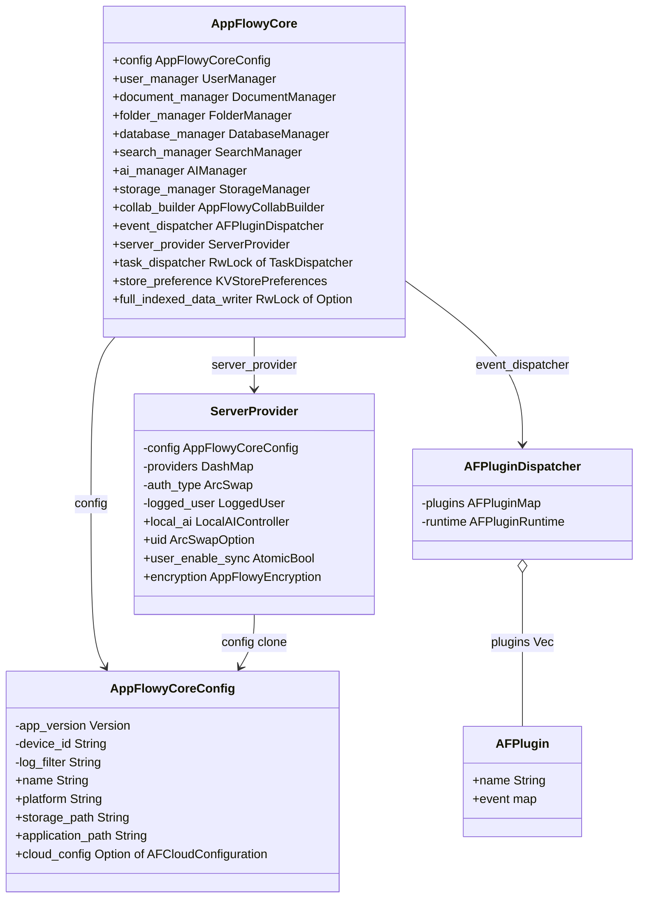
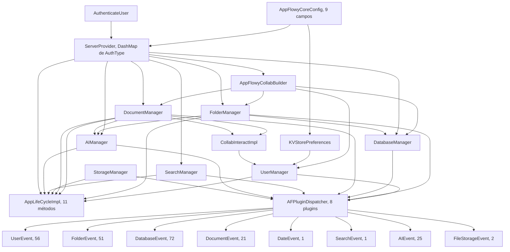
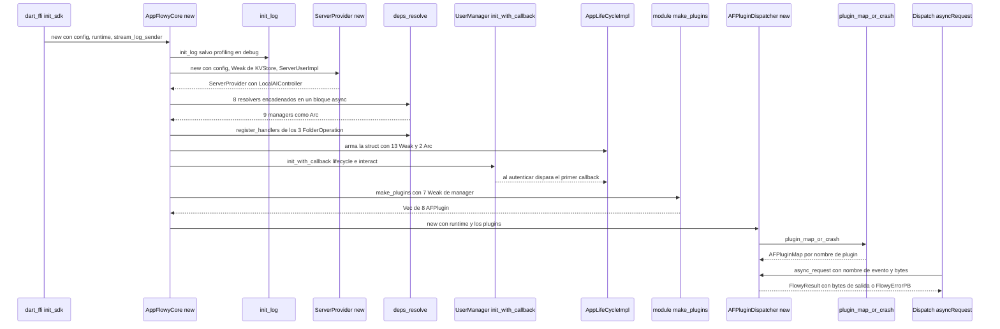
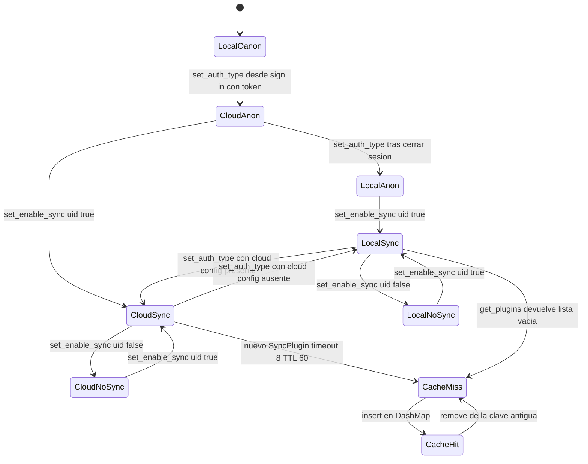

# F00.7.8 — App glue: restos de `rust-lib/` y raíz de `collab`

## 1. Resumen

Este documento cubre la **pegamento de composición** del SDK Rust de AppFlowy: los ficheros de la raíz del workspace `frontend/rust-lib/` (manifiesto, toolchain, `rustfmt`, `.cargo/config.toml`, `.gitignore`, `covtest.rs`) y el crate `flowy-core`, que es el **único** sitio donde se ensamblan los managers, se registra el dispatcher y se decide qué implementación de servidor se usa. Su corazón es `deps_resolve/`: 14 ficheros que traducen los traits abstractos de los crates `flowy-*-pub` (contratos sin implementación) en objetos concretos del runtime. `AppFlowyCoreConfig` (`appflowy/frontend/rust-lib/flowy-core/src/config.rs:16–31`) es el struct de configuración completo del SDK con 9 campos, y `ServerProvider` (`appflowy/frontend/rust-lib/flowy-core/src/server_layer.rs:27–37`) es el multiplexor *lazy* entre `LocalServer` y `AppFlowyCloudServer` que implementa 9 traits de servicio distintos (69 métodos) en `cloud_service_impl.rs`. El documento cierra con la **evidencia de versión** que fija la revisión exacta de AppFlowy-Collab compilada por el cliente: el bloque `[patch.crates-io]` de `appflowy/frontend/rust-lib/Cargo.toml:137–159`.

## 2. Alcance

**Incluye** los 30 ficheros del frontmatter: 6 de la raíz de `frontend/rust-lib/`, 3 de la raíz de `flowy-core/` (`Cargo.toml`, `.gitignore`, `assets/read_me.json`), 5 módulos de nivel superior de `flowy-core/src/` (`lib.rs`, `module.rs`, `config.rs`, `app_life_cycle.rs`, `server_layer.rs`, `folder_view_observer.rs` — seis), 14 de `deps_resolve/` y `flowy-document/src/notification.rs`. Suma **4 757 LOC**.

**Correcciones de scope obligatorias** (declaradas aquí y desarrolladas en §13.1):

1. **El arranque completo y las 15 `LaunchTask`** viven en `OUT/05-arranque-y-ciclo-de-vida.md` (`[[B1.4]]`). Ese documento ya traza `AppFlowyCore::new` y el `impl AppLifeCycle for AppLifeCycleImpl` con los **11 métodos** del trait. Aquí **solo** se documenta lo que el arranque **no** cubría: `AppFlowyCoreConfig`, `ServerProvider`, `module.rs`, `deps_resolve/`, `folder_view_observer.rs` y los manifiestos.
2. **`flowy-error` / `flowy-sqlite`** → `[[F00.2]]`. Aquí se citan `FlowyError::ref_drop`, `FlowyError::not_support()` y el acceso a `DBConnection` como *contratos*, no se analiza `code.rs` ni el esquema.
3. **`dart-ffi` / `lib-dispatch` / `lib-infra`** → `[[F00.1]]`. `AFPlugin`, `AFPluginDispatcher`, `AFPluginRuntime` y `TaskDispatcher`/`TaskRunner` se citan como dependencias de composición.
4. **`collab-integrate` y los crates `flowy-*-pub`** → `[[F00.4]]`. `AppFlowyCollabBuilder`, `SnapshotPersistence`, `WorkspaceCollabIntegrate`, `CollabKVDB` y los 9 traits implementados en `cloud_service_impl.rs` se nombran, no se analizan.
5. **`Makefile.toml`, `rust-toolchain.toml` de `frontend/`, `build-tool/`, `event-integration-test/`** → `[[F00.3]]`. El `rust-toolchain.toml` de `rust-lib/` es una **copia** del de `frontend/` y se cita solo como duplicado.
6. **La raíz de `collab/`** (`.github/`, `LICENSE`, `Makefile.toml`, `README.md`, `rust-toolchain.toml`, `rustfmt.toml`, `Cargo.toml`) → `[[F20]]`. Aquí se documenta **únicamente** el lado *cliente*: el `[patch.crates-io]` que fija el `rev` de AppFlowy-Collab y la comparación con la raíz del repo `collab`.
7. **El motor CRDT** (`collab`, `collab-entity`, `collab-document`, `collab-database`, `collab-plugins`) → `[[B1.6]]` y `[[F18]]`.
8. **`flowy-search` / indexación** (`flowy-core/src/full_indexed_data_provider.rs`, `indexed_data_consumer.rs`, `indexing_data_runner.rs`) → `[[F08]]`. **`flowy-ai`** → `[[F09.1]]`.
9. **Eventos FFI y entidades protobuf**: los 229 eventos y las PB generadas ya están catalogados en `[[B2.1]]` y `[[B2.2]]`. §4 da **solo los recuentos por plugin** y su fichero `event_map.rs`.
10. **`flowy-core/src/log_filter.rs`** (`[[F17]]`) y **`flowy-storage-pub/src/chunked_byte.rs`** (`[[F00.7]]`/F07) quedan fuera; el cierre B3 detectó el solape de `MIN_CHUNK_SIZE` y este documento no lo toca.

## 3. Modelos de datos

### 3.1 `AppFlowyCoreConfig`: los 8 campos del SDK

`AppFlowyCoreConfig` (`appflowy/frontend/rust-lib/flowy-core/src/config.rs:16–31`) es el único struct que cruza la frontera FFI con la configuración completa. Es `#[derive(Clone)]` y se construye **exclusivamente** por `new(...)` (`:33–65`) más el builder `log_filter(...)` (`:67–74`).

| # | Campo | Tipo | Visibilidad | `ruta:línea` | Origen / semántica |
|---:|---|---|---|---|---|
| 1 | `app_version` | `semver::Version` | `pub(crate)` | `appflowy/frontend/rust-lib/flowy-core/src/config.rs:18` | Versión de la app; se pasa a `UserConfig::new` (`appflowy/frontend/rust-lib/flowy-core/src/lib.rs:144`) y a `AppFlowyCloudServer::new` (`appflowy/frontend/rust-lib/flowy-core/src/server_layer.rs:163`). El doc-comment avisa de que instancias distintas deben tener `name` distinto. |
| 2 | `name` | `String` | `pub` | `appflowy/frontend/rust-lib/flowy-core/src/config.rs:19` | Identificador de la instancia; constante `DEFAULT_NAME = "appflowy"` en `appflowy/frontend/rust-lib/flowy-core/src/lib.rs:58`. |
| 3 | `device_id` | `String` | `pub(crate)` | `appflowy/frontend/rust-lib/flowy-core/src/config.rs:20` | Identificador de dispositivo para `CollabOrigin::Client` (`appflowy/frontend/rust-lib/flowy-core/src/deps_resolve/cloud_service_impl.rs:637`) y `CollabClient::new` (`:635–638`). |
| 4 | `platform` | `String` | `pub` | `appflowy/frontend/rust-lib/flowy-core/src/config.rs:21` | Se convierte con `OperatingSystem::from(&platform)` (`appflowy/frontend/rust-lib/flowy-core/src/lib.rs:91`) para decidir indexado instantáneo y logging. |
| 5 | `storage_path` | `String` | `pub` | `appflowy/frontend/rust-lib/flowy-core/src/config.rs:23` | Raíz de datos de usuario; **derivado** en `:44–47` (ver §3.2). |
| 6 | `application_path` | `String` | `pub` | `appflowy/frontend/rust-lib/flowy-core/src/config.rs:28` | Ruta del binario de la app. El doc-comment (`:24–27`) explica que solo difiere de `storage_path` cuando el usuario elige una ruta de datos custom. |
| 7 | `log_filter` | `String` | `pub(crate)` | `appflowy/frontend/rust-lib/flowy-core/src/config.rs:29` | Filtro `EnvFilter`; **derivado** en `:49–53` con nivel `"info"` y crates `["sync_trace_log"]`. |
| 8 | `cloud_config` | `Option<AFCloudConfiguration>` | `pub` | `appflowy/frontend/rust-lib/flowy-core/src/config.rs:30` | `AFCloudConfiguration::from_env().ok()` (`:41`). **`None` ⇒ modo local**; es la discriminante implícita de todo `ServerProvider`. |

[VERIFICADO] Los 8 campos y sus tipos se leen literalmente del struct. El constructor `new` recibe 6 parámetros (`appflowy/frontend/rust-lib/flowy-core/src/config.rs:34–39`): `app_version`, `custom_application_path`, `application_path`, `device_id`, `platform`, `name`; `custom_application_path` **no** se almacena, se transforma en `storage_path`. `Debug` está implementado a mano (`appflowy/frontend/rust-lib/flowy-core/src/config.rs:93–107`) y **omite deliberadamente** `device_id`, `name`, `platform` y `log_filter`: solo imprime `app_version`, `storage_path`, `application_path` y, si existe, `base_url` / `ws_url` / `gotrue_url` / `enable_sync_trace`. Se invoca en `appflowy/frontend/rust-lib/flowy-core/src/lib.rs:129` con el emoji 🔥.

### 3.2 `make_user_data_folder`: aislamiento por servidor

`appflowy/frontend/rust-lib/flowy-core/src/config.rs:109–165` implementa una migración de tres candidatos para la carpeta de datos, evaluados **en este orden**:

1. `{root}_{base64(url)}` si la URL es no vacía (`:117–118`), usando `URL_SAFE_ENGINE` de `flowy_user::services::entities` (`appflowy/frontend/rust-lib/flowy-core/src/config.rs:11`, `:117`).
2. Si ese path **no** existe (`:122`), el candidato nuevo: `{root}_{dominio}` si `Url::parse(url)` devuelve `host_str` (`:129–136`), o `{root}_anonymous` si la URL está vacía o no parsea (`:123–127`, `:137`).
3. Si tampoco existe pero `{root}` sí, **copia** recursivamente el directorio raíz al nuevo con `copy_dir_recursive` (`:146–158`).

El comentario `:124` fija el momento del cambio: *"since version 0.8.9"*. Cualquier error de copia degrada al `root` original (`:155–157`). `ensure_path()` (`:75–91`) crea ambos directorios si faltan y solo registra `error!` si `create_dir_all` falla, sin propagar.

### 3.3 `ServerProvider`: el multiplexor de servidores

`ServerProvider` (`appflowy/frontend/rust-lib/flowy-core/src/server_layer.rs:27–37`) es la pieza que `[[F06]]` deja explícitamente fuera de su alcance (§2 de ese documento: *"`ServerProvider` (multiplexor AppFlowy Cloud / Local) y registro DI — `F00`"*). Campos:

| Campo | Tipo | `ruta:línea` | Rol |
|---|---|---|---|
| `config` | `AppFlowyCoreConfig` | `appflowy/frontend/rust-lib/flowy-core/src/server_layer.rs:28` | Fuente de `cloud_config`, `device_id`, `app_version`. |
| `providers` | `DashMap<AuthType, Arc<dyn AppFlowyServer>>` | `appflowy/frontend/rust-lib/flowy-core/src/server_layer.rs:29` | Caché de instancias por tipo de autenticación. |
| `auth_type` | `ArcSwap<AuthType>` | `appflowy/frontend/rust-lib/flowy-core/src/server_layer.rs:30` | Discriminante actual; `AuthType` tiene exactamente 2 variantes (`appflowy/frontend/rust-lib/flowy-user-pub/src/entities.rs:309–315`). |
| `logged_user` | `Arc<dyn LoggedUser>` | `appflowy/frontend/rust-lib/flowy-core/src/server_layer.rs:31` | Inyectado como `impl LoggedUser + 'static` (`:53`) desde `ServerUserImpl` (`appflowy/frontend/rust-lib/flowy-core/src/lib.rs:340–350`). |
| `local_ai` | `Arc<LocalAIController>` | `appflowy/frontend/rust-lib/flowy-core/src/server_layer.rs:32` | `pub`: lo consume `ChatDepsResolver::resolve` (`appflowy/frontend/rust-lib/flowy-core/src/lib.rs:216`). |
| `uid` | `Arc<ArcSwapOption<i64>>` | `appflowy/frontend/rust-lib/flowy-core/src/server_layer.rs:33` | `pub`: se rellena en `set_enable_sync` (`appflowy/frontend/rust-lib/flowy-core/src/deps_resolve/cloud_service_impl.rs:189`). |
| `user_enable_sync` | `Arc<AtomicBool>` | `appflowy/frontend/rust-lib/flowy-core/src/server_layer.rs:34` | `pub`: leído por `CollabCloudPluginProvider::is_sync_enabled` (`appflowy/frontend/rust-lib/flowy-core/src/deps_resolve/cloud_service_impl.rs:684–686`). |
| `encryption` | `Arc<dyn AppFlowyEncryption>` | `appflowy/frontend/rust-lib/flowy-core/src/server_layer.rs:35` | `pub`: `EncryptionImpl::new(None)` (`:59`), secreto vía `set_encrypt_secret` (`appflowy/frontend/rust-lib/flowy-core/src/deps_resolve/cloud_service_impl.rs:217–220`). |
| `indexed_data_writer` | `Option<Weak<InstantIndexedDataWriter>>` | `appflowy/frontend/rust-lib/flowy-core/src/server_layer.rs:36` | Solo desktop; se crea en `appflowy/frontend/rust-lib/flowy-core/src/lib.rs:153–157`. |

### 3.4 Modelo de datos del pegamento (classDiagram)

El diagrama muestra el grafo de propiedad entre `AppFlowyCore`, su configuración y el multiplexor de servidores.



**Lectura**: `AppFlowyCore` (`appflowy/frontend/rust-lib/flowy-core/src/lib.rs:61–77`) es un `struct` plano de **14 campos**: 13 son `Arc` (3 de ellos envueltos en `RwLock`) y el único campo de valor es `config` (`:63`, marcado `#[allow(dead_code)]`). Es `#[derive(Clone)]` y **no** tiene estado propio mutable: todo es un `Arc`/`Weak`/`ArcSwap` compartido. La única excepción es `task_dispatcher: Arc<RwLock<TaskDispatcher>>` (`:70`),Initialized con un tick de 10 s en `appflowy/frontend/rust-lib/flowy-core/src/lib.rs:135–137` y lanzado como tarea con `TaskRunner::run` (`:137`). `AFPluginDispatcher` (`:68`) es la última pieza construida (`appflowy/frontend/rust-lib/flowy-core/src/lib.rs:303–314`), es decir: **los plugins se registran después de que todos los managers existen**, y por eso `make_plugins` puede tomar `Weak` de todos ellos.

## 4. Eventos FFI

**Esta unidad no define eventos**: no hay ningún `event_map.rs` ni `#[derive(Flowy_Event)]` en ninguno de sus 30 ficheros. Lo que hace es **elegir qué `event_map::init()` se invocan**. `make_plugins` (`appflowy/frontend/rust-lib/flowy-core/src/module.rs:12–39`) es la lista exhaustiva: llama exactamente a **8** `init()` y devuelve el `Vec<AFPlugin>` que se pasa a `AFPluginDispatcher::new` (`appflowy/frontend/rust-lib/flowy-core/src/lib.rs:303–314`).

Recuentos reales extraídos de `OUT/_ledger/extract/events.json` (artefacto del ledger, generado por `extract_events.py`):

| # | `AFPlugin` | `event_map.rs` | Enum de eventos | `init()` | Variantes | Registradas | Sin handler |
|---:|---|---|---|---|---:|---:|---:|
| 1 | `flowy-user` | `appflowy/frontend/rust-lib/flowy-user/src/event_map.rs:17–84` | `UserEvent` (`:88`) | `:17–84` | 56 | 55 | 1 |
| 2 | `flowy-folder` | `appflowy/frontend/rust-lib/flowy-folder/src/event_map.rs:11–62` | `FolderEvent` (`:66`) | `:11–62` | 51 | 48 | 3 |
| 3 | `flowy-database2` | `appflowy/frontend/rust-lib/flowy-database2/src/event_map.rs:11–103` | `DatabaseEvent` (`:109`) | `:11–103` | 72 | 71 | 1 |
| 4 | `flowy-document` | `appflowy/frontend/rust-lib/flowy-document/src/event_map.rs:12–55` | `DocumentEvent` (`:59`) | `:12–55` | 21 | 21 | 0 |
| 5 | `flowy-date` | `appflowy/frontend/rust-lib/flowy-date/src/event_map.rs:8–12` | `DateEvent` (`:16`) | `:8–12` | 1 | 1 | 0 |
| 6 | `flowy-search` | `appflowy/frontend/rust-lib/flowy-search/src/event_map.rs:9–14` | `SearchEvent` (`:18`) | `:9–14` | 1 | 1 | 0 |
| 7 | `flowy-ai` | `appflowy/frontend/rust-lib/flowy-ai/src/event_map.rs:12–61` | `AIEvent` (`:65`) | `:12–61` | 25 | 25 | 0 |
| 8 | `flowy-storage` | `appflowy/frontend/rust-lib/flowy-storage/src/event_map.rs:8–14` | `FileStorageEvent` (`:18`) | `:8–14` | 2 | 2 | 0 |
| | **Total** | 8 ficheros | 8 enums | | **229** | **224** | **5** |

[VERIFICADO] Los totales cuadran con `OUT/_ledger/extract/events.json` (`crates_with_event_map: 8`, `total_variants: 229`, `total_registered: 224`, `total_sin_handler: 5`). **Las 229 variantes y sus PB de entrada/salida NO se repiten aquí**: están en `[[B2.1]]` (`OUT/11-catalogo-eventos-ffi.md`) y las entidades en `[[B2.2]]`.

Dos observaciones que **sí** son de esta unidad:

- **`flowy-date` es el único plugin sin estado**: su `init()` no toma ningún `Weak` (`appflowy/frontend/rust-lib/flowy-core/src/module.rs:25` llama `flowy_date::event_map::init()` a secas, frente a los otros siete que reciben un manager). Coincide con que solo expone 1 variante.
- **`flowy-notification` no es un plugin**: tiene crate propio (`appflowy/frontend/rust-lib/flowy-notification`) y no aparece en `module.rs`. Las notificaciones salen por `NotificationBuilder`, no por el dispatcher — ver §5 y `[[B2.2]]`.
- `flowy_ai::event_map::init` usa uncrate llamado `AIEvent` mientras el manager se llama `AIManager` y el crate `flowy-ai`; los demás usan el patrón `flowy_<dominio>` para las tres cosas (`appflowy/frontend/rust-lib/flowy-core/src/module.rs:5` importa `DocumentManager as DocumentManager2` para desambiguar con `flowy_database2`).

## 5. Notificaciones

`flowy-document/src/notification.rs` (40 LOC, único fichero de notificaciones de la unidad) declara **una sola** familia:

| Símbolo | `ruta:línea` | Detalle |
|---|---|---|
| `DOCUMENT_OBSERVABLE_SOURCE` | `appflowy/frontend/rust-lib/flowy-document/src/notification.rs:4` | `const … = "Document"` — la clave de fuente que Dart usa para discriminar el stream. |
| `DocumentNotification` | `appflowy/frontend/rust-lib/flowy-document/src/notification.rs:6–15` | `#[derive(ProtoBuf_Enum, Debug, Default)]`, 5 variantes: `Unknown = 0` (`:9`, `#[default]`), `DidReceiveUpdate = 1` (`:11`), `DidUpdateDocumentSnapshotState = 2` (`:12`), `DidUpdateDocumentSyncState = 3` (`:13`), `DidUpdateDocumentAwarenessState = 4` (`:14`). |
| `From<DocumentNotification> for i32` | `appflowy/frontend/rust-lib/flowy-document/src/notification.rs:17–21` | Conversión trivial por `as i32`. |
| `From<i32> for DocumentNotification` | `appflowy/frontend/rust-lib/flowy-document/src/notification.rs:22–32` | `match` explícito con `_ => Unknown` (`:29`) — **no** hay conversiónderived automática del enum protobuf. |
| `document_notification_builder` | `appflowy/frontend/rust-lib/flowy-document/src/notification.rs:34–39` | `#[tracing::instrument(level = "trace")]`; devuelve `NotificationBuilder::new(id, ty, DOCUMENT_OBSERVABLE_SOURCE)` (`:39`). |

[VERIFICADO] Las 5 variantes y sus discriminantes se leen literalmente. **La tabla completa de notificaciones (todas las familias, el emisor y el listener Dart) está en `[[B2.2]]`** (`OUT/14-catalogo-notificaciones.md`); aquí no se repite ni una fila más.

`flowy-core` **no emite ninguna notificación**: sus `indexed_data_consumer.rs` e `indexing_data_runner.rs` (en `[[F08]]`) escriben en `DocumentTantivyState`, no en `NotificationBuilder`. Lo único que `flowy-core` expone hacia el canal de notificaciones es `AppLifeCycleImpl::subscribe_full_indexed_finish` (`appflowy/frontend/rust-lib/flowy-core/src/app_life_cycle.rs:513–515`), que devuelve un `tokio::sync::watch::Receiver<bool>` — un canal de progreso **interno** (creado en `appflowy/frontend/rust-lib/flowy-core/src/lib.rs:273`), no una notificación FFI.

## 6. BLoCs / Cubits

**Ninguno.** Ninguno de los 30 ficheros contiene Dart. La analogía funcional del BLoC en esta capa es el **manager singleton** que `AppFlowyCore` expone como campo `pub` y que los BLoCs Dart alcanzan a través del dispatcher. Tabla de los 9 singletons y su contrato:

| Manager | Tipo | Campo en `AppFlowyCore` | `ruta:línea` del campo | Plugin FFI | `deps_resolve` que lo construye |
|---|---|---|---|---|---|
| Usuario | `UserManager` | `user_manager` | `appflowy/frontend/rust-lib/flowy-core/src/lib.rs:64` | `UserEvent` (56) | `appflowy/frontend/rust-lib/flowy-core/src/deps_resolve/user_deps.rs:16–39` |
| Documento | `DocumentManager` | `document_manager` | `appflowy/frontend/rust-lib/flowy-core/src/lib.rs:65` | `DocumentEvent` (21) | `appflowy/frontend/rust-lib/flowy-core/src/deps_resolve/document_deps.rs:13–32` |
| Carpeta | `FolderManager` | `folder_manager` | `appflowy/frontend/rust-lib/flowy-core/src/lib.rs:66` | `FolderEvent` (51) | `appflowy/frontend/rust-lib/flowy-core/src/deps_resolve/folder_deps/mod.rs:33–56` |
| Base de datos | `DatabaseManager` | `database_manager` | `appflowy/frontend/rust-lib/flowy-core/src/lib.rs:67` | `DatabaseEvent` (72) | `appflowy/frontend/rust-lib/flowy-core/src/deps_resolve/database_deps.rs:17–40` |
| Búsqueda | `SearchManager` | `search_manager` | `appflowy/frontend/rust-lib/flowy-core/src/lib.rs:72` | `SearchEvent` (1) | `appflowy/frontend/rust-lib/flowy-core/src/deps_resolve/search_deps.rs:7–20` |
| IA | `AIManager` | `ai_manager` | `appflowy/frontend/rust-lib/flowy-core/src/lib.rs:73` | `AIEvent` (25) | `appflowy/frontend/rust-lib/flowy-core/src/deps_resolve/chat_deps.rs:35–60` |
| Archivos | `StorageManager` | `storage_manager` | `appflowy/frontend/rust-lib/flowy-core/src/lib.rs:74` | `FileStorageEvent` (2) | `appflowy/frontend/rust-lib/flowy-core/src/deps_resolve/file_storage_deps.rs:9–23` |
| Builds de collab | `AppFlowyCollabBuilder` | `collab_builder` | `appflowy/frontend/rust-lib/flowy-core/src/lib.rs:75` | (no es plugin) | construido inline en `appflowy/frontend/rust-lib/flowy-core/src/lib.rs:187–194` |
| Servidor | `ServerProvider` | `server_provider` | `appflowy/frontend/rust-lib/flowy-core/src/lib.rs:69` | (no es plugin) | construido inline en `appflowy/frontend/rust-lib/flowy-core/src/lib.rs:159–164` |

[VERIFICADO] Los 9 campos con sus líneas. Los dos últimos no implementan `event_map::init()`, y por eso no aparecen en `make_plugins` (`appflowy/frontend/rust-lib/flowy-core/src/module.rs:29–38`): se alcanzan desde los handlers de los managers, no desde el dispatcher.

## 7. Servicios e inyección de dependencias

Esta es la sección central del documento. `deps_resolve/` es el equivalente Rust de `get_it` en `startup/deps_resolver.dart` (Dart), pero con una diferencia estructural: **no hay un contenedor**. Cada módulo expone un `struct XResolver` con un `fn resolve(...)` estático que construye el manager con sus collaborators ya resueltos.

### 7.1 Los 14 ficheros de `deps_resolve/`

Barrel en `appflowy/frontend/rust-lib/flowy-core/src/deps_resolve/mod.rs:1–19`: 7 `pub use` (`:1–7`) y 10 declaraciones `mod`, de las cuales solo **dos** son públicas — `pub mod file_storage_deps` (`:15`) y `pub(crate) mod reminder_deps` (`:17`), porque `lib.rs` los nombra con ruta absoluta (`appflowy/frontend/rust-lib/flowy-core/src/lib.rs:34`, `:40`). `cloud_service_impl` es `mod` privado (`:13`) y **no se reexporta**: sus 9 `impl ... for ServerProvider` se descubren por búsqueda de texto, no por el barrel.

| Fichero | LOC | Qué construye | Contratos implementados (`impl`) | Constructor / punto de entrada |
|---|---:|---|---|---|
| `chat_deps.rs` | 274 | `AIManager` | `AIUserService` (`:186–213`), `AIExternalService` (`:67–173`), `MultipleSourceRetrieverStore` (`:226–274`) | `ChatDepsResolver::resolve` `:38–59` |
| `cloud_service_impl.rs` | 918 | *nada*: adapta `ServerProvider` a 9 traits de nube | `StorageCloudService` `:56`, `UserCloudServiceProvider` `:165`, `FolderCloudService` `:240`, `DatabaseCloudService` `:462`, `DatabaseAIService` `:519`, `DocumentCloudService` `:550`, `CollabCloudPluginProvider` `:603`, `ChatCloudService` `:690`, `SearchCloudService` `:889` | `impl` blocks; sin `fn new` |
| `collab_deps.rs` | 233 | `SnapshotDBImpl`, `WorkspaceCollabIntegrateImpl`, `CollabSnapshotSql` | `SnapshotPersistence` `:19–49`, `WorkspaceCollabIntegrate` `:224–233` | `SnapshotDBImpl(pub Weak<AuthenticateUser>)` `:17` |
| `database_deps.rs` | 132 | `DatabaseManager` + middleware de IA | `DatabaseUser` `:116–132`, `DatabaseAIService` `:46–103` | `DatabaseDepsResolver::resolve` `:20–39` |
| `document_deps.rs` | 113 | `DocumentManager` | `DocumentUserService` `:81–113`, `DocumentSnapshotService` `:45–78` | `DocumentDepsResolver::resolve` `:15–31` |
| `file_storage_deps.rs` | 55 | `StorageManager` | `StorageUserService` `:39–55` | `FileStorageResolver::resolve` `:12–22` |
| `folder_deps/mod.rs` | 263 | `FolderManager` + `FolderServiceImpl` + registra los 3 handlers | `FolderUser` `:89–115`, `FolderViewEdit` `:137–169`, `FolderQueryService` `:171–225` | `FolderDepsResolver::resolve` `:36–55`; `register_handlers` `:58–73` |
| `folder_deps/folder_deps_doc_impl.rs` | 188 | `DocumentFolderOperation` | `FolderOperationHandler` `:33–188` (11 de 12 métodos) | `struct DocumentFolderOperation(pub Weak<DocumentManager>)` `:26` |
| `folder_deps/folder_deps_database_impl.rs` | 360 | `DatabaseFolderOperation` | `FolderOperationHandler` `:32–348` (11 de 12) | `struct DatabaseFolderOperation(pub Weak<DatabaseManager>)` `:25` |
| `folder_deps/folder_deps_chat_impl.rs` | 85 | `ChatFolderOperation` | `FolderOperationHandler` `:21–85` (9 de 12) | `struct ChatFolderOperation(pub Weak<AIManager>)` `:13` |
| `reminder_deps.rs` | 57 | `CollabInteractImpl` | `UserReminder` `:19–57` (`add_reminder`, `remove_reminder`, `update_reminder`) | `struct CollabInteractImpl` `:12–17` |
| `search_deps.rs` | 20 | `SearchManager` | (ninguno propio) | `SearchDepsResolver::resolve` `:9–19` |
| `user_deps.rs` | 88 | `UserManager` | `UserWorkspaceService` `:46–88` (`import_views`, `import_database_views`) | `UserDepsResolver::resolve` `:19–38` |
| `mod.rs` | 19 | — (barrel) | — | — |

[VERIFICADO] LOC por `wc -l`; los `impl` y las líneas de cada `resolve()` leídos del fichero.

### 7.2 El patrón: `Weak<AuthenticateUser>` como token de identidad

Ocho de los catorce ficheros definen un `*Impl(Weak<AuthenticateUser>)` que reenvía al usuario real. El patrón se repite literalmente en `appflowy/frontend/rust-lib/flowy-core/src/deps_resolve/file_storage_deps.rs:25–37`, `appflowy/frontend/rust-lib/flowy-core/src/deps_resolve/document_deps.rs:34–43`, `appflowy/frontend/rust-lib/flowy-core/src/deps_resolve/database_deps.rs:105–114`, `appflowy/frontend/rust-lib/flowy-core/src/deps_resolve/chat_deps.rs:175–184`, `appflowy/frontend/rust-lib/flowy-core/src/deps_resolve/user_deps.rs:79–87` (vía `FolderUserImpl`), `appflowy/frontend/rust-lib/flowy-core/src/deps_resolve/folder_deps/mod.rs:75–87`, `appflowy/frontend/rust-lib/flowy-core/src/deps_resolve/collab_deps.rs:212–222` y `appflowy/frontend/rust-lib/flowy-core/src/app_life_cycle.rs:52–100`. El idiom es siempre:

```rust
fn upgrade_user(&self) -> Result<Arc<AuthenticateUser>, FlowyError> {
  let user = self
    .0
    .upgrade()
    .ok_or(FlowyError::internal().with_context("Unexpected error: UserSession is None"))?;
  Ok(user)
}
```

(`appflowy/frontend/rust-lib/flowy-core/src/deps_resolve/file_storage_deps.rs:30–36`). Se usa `Weak` y no `Arc` para **romper el ciclo de referencias** entre el core y los managers: si `AuthenticateUser` mantiene un `Arc<UserManager>` y el `UserManager` un `Arc` de sus `*Impl`, el grafo nunca se libera. El precio es que **toda** llamada posterior al cierre de sesión degrada a `FlowyError` con el contexto `"Unexpected error: UserSession is None"` en lugar de propagar un "no autenticado" explícito — 6 `FlowyError::ref_drop()` explícitos complementan el patrón en `appflowy/frontend/rust-lib/flowy-core/src/deps_resolve/folder_deps/mod.rs:60`, `appflowy/frontend/rust-lib/flowy-core/src/deps_resolve/folder_deps/mod.rs:68`, `appflowy/frontend/rust-lib/flowy-core/src/deps_resolve/folder_deps/mod.rs:83` y en los tres `*FolderOperation`.

### 7.3 Los 5 layouts registrados y los 3 handlers

`register_handlers` (`appflowy/frontend/rust-lib/flowy-core/src/deps_resolve/folder_deps/mod.rs:58–73`) es el punto donde la **jerarquía de vistas se conecta con los managers**. Mapea `ViewLayout → handler`:

| `ViewLayout` | Handler | `ruta:línea` del registro | Qué delega |
|---|---|---|---|
| `Document` | `DocumentFolderOperation` | `appflowy/frontend/rust-lib/flowy-core/src/deps_resolve/folder_deps/mod.rs:65` | `create_document` / `open_document` / `close_document` / `delete_document` |
| `Board` | `DatabaseFolderOperation` | `appflowy/frontend/rust-lib/flowy-core/src/deps_resolve/folder_deps/mod.rs:69` | `open/close/delete_database_view` |
| `Grid` | `DatabaseFolderOperation` (mismo `Arc`) | `appflowy/frontend/rust-lib/flowy-core/src/deps_resolve/folder_deps/mod.rs:70` | ídem |
| `Calendar` | `DatabaseFolderOperation` (mismo `Arc`) | `appflowy/frontend/rust-lib/flowy-core/src/deps_resolve/folder_deps/mod.rs:71` | ídem |
| `Chat` | `ChatFolderOperation` | `appflowy/frontend/rust-lib/flowy-core/src/deps_resolve/folder_deps/mod.rs:72` | `open_chat` / `close_chat` / `delete_chat` / `create_chat` |

El trait `FolderOperationHandler` tiene **12 métodos** (`appflowy/frontend/rust-lib/flowy-folder/src/view_operation.rs:42–134`). Cobertura por handler:

| Método del trait | Document | Database | Chat |
|---|:--:|:--:|:--:|
| `name` | ✅ `:35–37` | ✅ `:345–347` | ✅ `:23–25` |
| `create_workspace_view` | ✅ `:39–67` | *default* | *default* |
| `open_view` | ✅ `:69–72` | ✅ `:34–37` | ✅ `:27–29` |
| `close_view` | ✅ `:75–78` | ✅ `:39–45` | ✅ `:31–33` |
| `delete_view` | ✅ `:80–92` | ✅ `:47–57` | ✅ `:35–37` |
| `duplicate_view` | ✅ `:94–102` | ✅ `:169–171` | ❌ `not_support` `:39–41` |
| `gather_publish_encode_collab` | ✅ `:104–113` | ✅ `:59–167` | *default* |
| `create_view_with_view_data` | ✅ `:115–131` | ✅ `:176–228` | ❌ `not_support` `:43–49` |
| `create_default_view` | ✅ `:134–157` | ✅ `:234–265` | ✅ `:51–64` |
| `import_from_bytes` | ✅ `:159–177` | ✅ `:267–301` | ❌ `not_support` `:66–75` |
| `import_from_file_path` | ✅ `:179–187` (TODO, no-op) | ✅ `:303–322` | ❌ `not_support` `:77–84` |
| `did_update_view` | *default* | ✅ `:324–343` | *default* |

[VERIFICADO] Las tres columnas se leyeron de los tres `impl FolderOperationHandler`. Los 6 `FlowyError::not_support()` de `deps_resolve/` están en `appflowy/frontend/rust-lib/flowy-core/src/deps_resolve/folder_deps/folder_deps_chat_impl.rs:40`, `appflowy/frontend/rust-lib/flowy-core/src/deps_resolve/folder_deps/folder_deps_chat_impl.rs:48`, `appflowy/frontend/rust-lib/flowy-core/src/deps_resolve/folder_deps/folder_deps_chat_impl.rs:74`, `appflowy/frontend/rust-lib/flowy-core/src/deps_resolve/folder_deps/folder_deps_chat_impl.rs:83` y en `appflowy/frontend/rust-lib/flowy-core/src/deps_resolve/cloud_service_impl.rs:529`, `appflowy/frontend/rust-lib/flowy-core/src/deps_resolve/cloud_service_impl.rs:543`.

### 7.4 `get_encoded_collab_v1_from_disk`: lectura de collab reutilizada

`appflowy/frontend/rust-lib/flowy-core/src/deps_resolve/folder_deps/mod.rs:227–263` es la función auxiliar compartida por `FolderQueryService::get_collab` (`:214–224`) y por `DocumentFolderOperation::gather_publish_encode_collab` (`appflowy/frontend/rust-lib/flowy-core/src/deps_resolve/folder_deps/folder_deps_doc_impl.rs:109–111`). Encadena: `workspace_id()` + `user_id()` → `collab_db()` con mensaje *"The collab db has been dropped, indicating that the user has switched to a new account"* (`:243–245`) → `read_txn()` (`:247`) → `load_collab_by_object_id` (`:248`) → `spawn_blocking` con `encode_collab_v1(|collab| collab_type.validate_require_data(collab))` (`:253–260`). `DatabaseFolderOperation::gather_publish_encode_collab` (`appflowy/frontend/rust-lib/flowy-core/src/deps_resolve/folder_deps/folder_deps_database_impl.rs:59–167`) **reimplementa** ese mismo pipeline para el grafo de 4 clases (collab de BD + collabs de fila + collabs de documento-de-fila + relaciones entre BD), sin reutilizar el helper.

### 7.5 `folder_view_observer.rs`: puente folder → índice local

`FolderViewObserverImpl` (`appflowy/frontend/rust-lib/flowy-core/src/folder_view_observer.rs:11–62`) implementa `FolderViewObserver` de `flowy-search-pub`. Su único trabajo es draining de un `IndexContentReceiver` (`:23–61`) y volcar al `DocumentTantivyState`: `IndexContent::Create` y `IndexContent::Update` → `add_document_metadata(id, name, icon)` (`:37–41`, `:47–51`), `IndexContent::Delete(ids)` → `delete_documents(&ids)` (`:56`). Deserializa el `serde_json::Value` a `ViewIndexContent` de `collab-folder` (`:35`, `:45`). El constructor **ignora** el `workspace_id` que recibe (`:16`, parámetro `_workspace_id`). Se instancia en `appflowy/frontend/rust-lib/flowy-core/src/indexed_data_consumer.rs:213` (`[[F08]]`).

## 8. Persistencia

`flowy-core` **no** crea su propio esquema: usa el de `flowy-sqlite` (`[[F00.2]]`). Lo que sí hace es añadir **una tabla propia** y gestionar tres rutas.

### 8.1 La tabla `collab_snapshot` y su retención de 5 filas

`CollabSnapshotRow` (`appflowy/frontend/rust-lib/flowy-core/src/deps_resolve/collab_deps.rs:51–61`) es el único `#[derive(Queryable, Identifiable, Insertable)]` de la unidad, con `#[diesel(table_name = collab_snapshot)]` (`:52`). Sus 7 columnas: `id`, `object_id`, `title`, `desc`, `collab_type`, `timestamp`, `data` (`:54–60`). El constructor `new` (`:64–74`) genera `id = Uuid::new_v4()`, deja `title` y `desc` **vacíos** (`:67–68`) y sella `timestamp` con `lib_infra::util::timestamp` (`:71`).

| Operación | `ruta:línea` | Semántica |
|---|---|---|
| `create` | `appflowy/frontend/rust-lib/flowy-core/src/deps_resolve/collab_deps.rs:94–140` | `immediate_transaction` (`:98`): inserta (`:100–110`), cuenta con `count_star()` (`:113–116`) y **si `total_snapshots > 5` borra la más antigua** (`:119–135`). El umbral está **hardcodeado**. |
| `get_all_snapshots` | `appflowy/frontend/rust-lib/flowy-core/src/deps_resolve/collab_deps.rs:142–167` | `.expect("Error loading collab_snapshot")` (`:154`) — **pánico** si la query falla, no `FlowyError`. |
| `get_snapshot` | `appflowy/frontend/rust-lib/flowy-core/src/deps_resolve/collab_deps.rs:169–181` | Filtra por **`id`**, no por `object_id` (`:174`), ordenado por `timestamp desc`. Devuelve `Option`. |
| `delete` | `appflowy/frontend/rust-lib/flowy-core/src/deps_resolve/collab_deps.rs:183–209` | Marcado `#[allow(dead_code)]` (`:183`): **no tiene ningún caller en el workspace**. |
| `SnapshotPersistence::create_snapshot` | `appflowy/frontend/rust-lib/flowy-core/src/deps_resolve/collab_deps.rs:19–49` | `tokio::task::spawn_blocking` **fire-and-forget** (`:30–46`): devuelve `Ok(())` antes de que la escritura ocurra; los errores solo se registran con `tracing::warn!` (`:42`). |

### 8.2 Rutas de datos gestionadas por el core

| Ruta | Creada por | Contenido |
|---|---|---|
| `{storage_path}` | `AppFlowyCoreConfig::ensure_path` (`appflowy/frontend/rust-lib/flowy-core/src/config.rs:89`) | `KVStorePreferences::new(&config.storage_path)` (`appflowy/frontend/rust-lib/flowy-core/src/lib.rs:128`) y la BD vectorial en desktop/windows/linux (`appflowy/frontend/rust-lib/flowy-core/src/lib.rs:131–133`). |
| `{application_path}` | `AppFlowyCoreConfig::ensure_path` (`appflowy/frontend/rust-lib/flowy-core/src/config.rs:90`) | Logs de `lib_log::Builder::new("log", &config.storage_path, …)` (`appflowy/frontend/rust-lib/flowy-core/src/log_filter.rs:22`, en `[[F17]]`). |
| `assets/read_me.json` | `include_str!` en `appflowy/frontend/rust-lib/flowy-core/src/deps_resolve/folder_deps/folder_deps_doc_impl.rs:56` | Documento semilla del workspace; ver §8.3. |

### 8.3 `read_me.json`: el único asset de `flowy-core`

`appflowy/frontend/rust-lib/flowy-core/assets/read_me.json` (218 líneas) es un `type: "page"` con **24 bloques hijos**: 7 `paragraph`, 6 `todo_list`, 4 `heading`, 3 `numbered_list`, 1 `divider`, 1 `code`, 1 `quote`, 1 `callout`. Se parsea con `JsonToDocumentParser::json_str_to_document(json_str).unwrap()` (`appflowy/frontend/rust-lib/flowy-core/src/deps_resolve/folder_deps/folder_deps_doc_impl.rs:57`) y se inyecta como `DocumentDataPB` al crear la vista **"Getting started"** con icono ⭐️ (`:52–54`, `:59–62`). El comentario `:47–48` es explícito: *"Don't modify this code unless you know what you are doing."* El `unwrap()` de `:57` es el punto de panic más frágil de la unidad (ver §13.7).

### 8.4 Ficheros generados que el `.gitignore` excluye

| Ruta | Regla | Consecuencia |
|---|---|---|
| `**/src/protobuf` | `appflowy/frontend/rust-lib/.gitignore:13` | Todo el Rust generado por `protoc` de los crates `flowy-*`. |
| `**/resources/proto` | `appflowy/frontend/rust-lib/.gitignore:14` | Los `.proto` intermedios del codegen. |
| `**/**/temp` | `appflowy/frontend/rust-lib/.gitignore:11` | Directorios temporales de los `EventIntegrationTest`. |
| `jniLibs/`, `bin/`, `**/pkg/`, `**/unit_test/` | `appflowy/frontend/rust-lib/.gitignore:12`, `:19–21` | Artefactos de build Android y de test backend. |
| `AppFlowy-Collab/` | `appflowy/frontend/rust-lib/.gitignore:16` | Checkout local de collab (para `scripts/tool/update_collab_source.sh`). |
| `Cargo.lock` **solo** en `flowy-core` | `appflowy/frontend/rust-lib/flowy-core/.gitignore:7` | El root **no** lo ignora (comentario en `appflowy/frontend/rust-lib/.gitignore:5–6`), pero tampoco lo versiona en este snapshot. |

## 9. Diagramas de flujo

### 9.1 Grafo de composición de `AppFlowyCore`

Muestra qué manager alimenta a cuál y dónde se engancha el dispatcher y el multiplexor de servidores.



**Lectura**: el grafo es un **árbol que se cierra en un ciclo**. `AppFlowyCoreConfig` alimenta a `ServerProvider` y a `KVStorePreferences`; `ServerProvider` es el **cuello de botella**: se pasa a `AppFlowyCollabBuilder`, `FolderManager`, `DatabaseManager`, `DocumentManager`, `SearchManager` y `AIManager` — de hecho el mismo `Arc<ServerProvider>` se pasa dos veces a `DatabaseDepsResolver::resolve` (`appflowy/frontend/rust-lib/flowy-core/src/lib.rs:223–224`), una como `cloud_service` y otra como `ai_service`. `AppFlowyCollabBuilder` es el segundo eje: lo reciben `FolderManager`, `DocumentManager`, `DatabaseManager` y `UserManager` (siempre como `Weak`). El ciclo se cierra con `UserManager::init_with_callback(app_life_cycle, collab_interact_impl)` (`appflowy/frontend/rust-lib/flowy-core/src/lib.rs:295–297`): el `UserManager` guarda los callbacks y, al disparar un evento de sesión, estos reentran en los managers que el `UserManager` ya referencia — de ahí que los 9 managers que guarda `AppLifeCycleImpl` sean `Weak` (`appflowy/frontend/rust-lib/flowy-core/src/app_life_cycle.rs:33–41`), igual que `full_indexed_data_writer` (`:43`), mientras que `logged_user` (`:44`) y `runtime` (`:47`) son `Arc` compartidos con el core y `instant_indexed_data_writer` (`:42`) es el único `Arc` propio (se clona por `Option<Arc<_>>`). El dispatcher se construye **el último** (`appflowy/frontend/rust-lib/flowy-core/src/lib.rs:302–314`) y toma `Weak` de los 7 managers con plugin.

### 9.2 Orden de construcción en `deps_resolve`

Muestra el orden real de `AppFlowyCore::init` y qué fichero de `deps_resolve/` participa en cada paso.

```mermaid
flowchart TD
  I1["ensure_path, crea storage y application"]
  I2["KVStorePreferences new"]
  I3["EmbedContext init_vector_db, solo desktop win linux"]
  I4["TaskDispatcher con tick de 10s, TaskRunner spawn"]
  I5["UserConfig y AuthenticateUser new"]
  I6["InstantIndexedDataWriter, solo si es desktop"]
  I7["ServerProvider new"]
  B1["StorageManager, via file_storage_deps"]
  B2["AppFlowyCollabBuilder mas SnapshotDBImpl, inline en lib.rs"]
  B3["FolderManager, via folder_deps resolver"]
  B4["FolderServiceImpl, inline en lib.rs"]
  B5["AIManager, via chat_deps resolver"]
  B6["DatabaseManager, via database_deps resolver"]
  B7["DocumentManager, via document_deps resolver"]
  B8["UserManager, via user_deps resolver"]
  B9["SearchManager, via search_deps resolver"]
  B10["register_handlers de los 3 FolderOperation"]
  B11["AppLifeCycleImpl armado con 9 Weak y 3 Arc"]
  B12["CollabInteractImpl armado"]
  B13["UserManager init_with_callback"]
  B14["AFPluginDispatcher new con make_plugins"]

  I1 --> I2 --> I3 --> I4 --> I5 --> I6 --> I7
  I7 --> B1 --> B2 --> B3 --> B4 --> B5 --> B6
  B6 --> B7 --> B8 --> B9 --> B10 --> B11 --> B12
  B12 --> B13 --> B14
```



**Lectura**: el orden está impuesto por dos reglas. (1) **Nada puede construirse antes que `AuthenticateUser`**, porque todos los `*Impl` llevan `Weak<AuthenticateUser>`; se crea en `appflowy/frontend/rust-lib/flowy-core/src/lib.rs:147–150` y se pasa `Arc::downgrade` a todo lo demás. (2) **`ServerProvider` va primero** (`appflowy/frontend/rust-lib/flowy-core/src/lib.rs:159–164`) porque es dependencia de 6 resolvers. Las dependencias de datos reales son: `storage_manager` → `collab_builder` → `folder_manager` → `folder_service` → `ai_manager` → `database_manager` (necesita `ai_manager` para el middleware, `appflowy/frontend/rust-lib/flowy-core/src/lib.rs:225`) → `document_manager` → `user_manager` (necesita `database_manager` y `folder_manager`, `:241–242`) → `search_manager` (necesita `folder_manager`, `:247`). Todo esto ocurre dentro de un bloque `async { … }.await` (`appflowy/frontend/rust-lib/flowy-core/src/lib.rs:178`, `:270`) cuyo único propósito es **encadenar dependencias sin variables mutables intermedias**.

## 10. Diagramas de secuencia

### 10.1 Registro de plugins y dispatch del primer evento

Muestra el camino desde que `dart-ffi` llama a `AppFlowyCore::new` hasta que el dispatcher atiende una petición.



**Lectura**: la secuencia tiene **tres cortes de seguridad** documentados en el código. (1) `init_log` se llama **antes que nada** en ambos caminos, debug y release (`appflowy/frontend/rust-lib/flowy-core/src/lib.rs:94–106`); con `feature = "profiling"` en debug se inicializa `console_subscriber` en su lugar (`:98–99`), y en los dos casos hay `#[allow(clippy::if_same_then_else)]` (`:93`) porque las ramas solo difieren en el `cfg`. (2) `UserManager::init_with_callback` **no** propaga error: el fallo se registra con `error!("Init user failed: {}", err)` y el core se construye igual (`appflowy/frontend/rust-lib/flowy-core/src/lib.rs:295–300`) — un fallo de inicialización del usuario deja el SDK vivo pero sin sesión. (3) `AFPluginDispatcher::new` invoca `plugin_map_or_crash` (`appflowy/frontend/rust-lib/flowy-core/src/lib.rs:303–314` → `appflowy/frontend/rust-lib/lib-dispatch/src/dispatcher.rs:70–75`), que **aborta el proceso** si dos plugins declaran el mismo nombre: añadir un plugin a `make_plugins` es una operación irreversible en tiempo de ejecución. El dispatcher se construye con `#[allow(clippy::arc_with_non_send_sync)]` (`appflowy/frontend/rust-lib/flowy-core/src/lib.rs:302`) porque el runtime no es `Send + Sync`.

### 10.2 La variante «ciclo de vida»: qué se ejecuta fuera del hilo del llamante

El patrón que hace `AppLifeCycle` no bloqueante es idéntico en los 4 callbacks que abren recursos (`on_launch_if_authenticated`, `on_sign_in`, `on_sign_up`, `on_workspace_opened` — `appflowy/frontend/rust-lib/flowy-core/src/app_life_cycle.rs:142`, `:227`, `:301`, `:397`): tras inicializar folder/database/document y arrancar ambos indexadores, el tramo final `self.runtime.spawn(async move { … })` (`appflowy/frontend/rust-lib/flowy-core/src/app_life_cycle.rs:289–295`, `:375–381`, `:439–445`, `:210–221`) mueve la propagación al servidor y la inicialización de la IA a una tarea aparte. Es exactamente lo que advierte el doc-comment del campo `runtime` (`appflowy/frontend/rust-lib/flowy-core/src/app_life_cycle.rs:45–47`): *"By default, all callback will run on the caller thread. If you don't want to block the caller thread, you can use runtime to spawn a new task."* `ServerProvider::set_tanvity_state` (`appflowy/frontend/rust-lib/flowy-core/src/server_layer.rs:76–93`) hace el fan-out a los dos destinos: `LocalAIController::set_retriever_sources` (`:79–82`) y el `AppFlowyServer` del `AuthType` activo vía `DashMap::try_get` (`:84–92`), cuyo caso `Locked` se registra con `error!` (`:90`) y **se pierde silenciosamente**.

## 11. Diagramas de estado

`ServerProvider` mantiene la única máquina de estado real de esta capa: el par `(auth_type, providers)` más el par `set_enable_sync` / `is_sync_enabled`. El `ArcSwap<AuthType>` es el estado autoritativo; el `DashMap` es caché derivada y puede quedar desincronizada si alguien llama a `get_server()` entre `set_auth_type()` y el `remove`.

**Ruta de `get_server()`** (el *cache-aside* que materializa esa máquina): `current_server_type()` (`appflowy/frontend/rust-lib/flowy-core/src/server_layer.rs:42–47`) mapea el enum de entorno a `AuthType` con un `match` de 2 ramas y se invoca **solo** en el constructor (`:56`). `get_server()` (`:133–173`) busca primero en el `DashMap` (`:135–137`) y solo si falla construye: `LocalServer::new(logged_user, local_ai, embedding_writer)` (`:146–150`) o `AppFlowyCloudServer::new(cfg, enable_sync, device_id, app_version, logged_user, ai_user_service)` (`:159–166`). El camino cloud **aborta** con `FlowyError::internal().with_context("Missing cloud config")` si `config.cloud_config` es `None` (`:153–157`): es el error que ve el usuario si fuerza `AuthType::AppFlowyCloud` sin variables de entorno de nube. El efecto observable del lado CRDT es `CollabCloudPluginProvider::get_plugins` (`appflowy/frontend/rust-lib/flowy-core/src/deps_resolve/cloud_service_impl.rs:611–619`), que devuelve `vec![]` en modo local y, en modo cloud, construye el `SyncPlugin` con `SinkConfig::new().send_timeout(8)` (`:651`) y TTL de 60 s (`:661`).



**Lectura**: `LocalAnon` / `CloudAnon` nacen en el constructor (`appflowy/frontend/rust-lib/flowy-core/src/server_layer.rs:56–58`) con `user_enable_sync = AtomicBool::new(true)` (`:67`), es decir **el sync arranca activado por defecto** y solo se desactiva cuando `set_enable_sync(uid, false)` lo stores con `Ordering::Release` (`appflowy/frontend/rust-lib/flowy-core/src/deps_resolve/cloud_service_impl.rs:188`). `set_auth_type` (`appflowy/frontend/rust-lib/flowy-core/src/server_layer.rs:113–126`) es la única transición externa y hace `info!` del par antiguo/nuevo (`:116–119`) antes de `store` + `remove` — el orden importa: primero cambia el `ArcSwap`, luego purga la caché. La transición `CloudSync → LocalSync` (bajar a local) **no** borra nada de `user_enable_sync`, que es global, no por-servidor. `CacheMiss → CacheHit` es `DashMap::insert` + `DashMap::get`immediately posterior (`appflowy/frontend/rust-lib/flowy-core/src/server_layer.rs:170–172`); el `insert` se hace incluso si el `Arc` que se acaba de crear no se va a reutilizar, lo que crea una entrada viva incluso sin consumidores.

## 12. Archivos cubiertos (del ledger)

### 12.1 Raíz de `frontend/rust-lib/` (6 ficheros, 8 rangos, 204 LOC)

| Fichero | LOC | Rol |
|---|---:|---|
| `appflowy/frontend/rust-lib/Cargo.toml:1–36` | 36 | Workspace con **31 miembros** (`:2–34`) y `resolver = "2"` (`:36`); ver §12.4. |
| `appflowy/frontend/rust-lib/Cargo.toml:38–106` | 69 | `[workspace.dependencies]` con 29 crates de path + 39 dependencias externas de versión única. |
| `appflowy/frontend/rust-lib/Cargo.toml:108–159` | 52 | 3 deps git de AppFlowy-Cloud (`:113–115`), 4 perfiles (`:117–135`), `[patch.crates-io]` (`:137–159`); ver §12.4. |
| `appflowy/frontend/rust-lib/rust-toolchain.toml:1–2` | 2 | `channel = "1.85"`, `components = ["clippy", "rustfmt"]`. Copia idéntica de `appflowy/frontend/rust-toolchain.toml` (`[[F00.3]]`). |
| `appflowy/frontend/rust-lib/rustfmt.toml:1–11` | 11 | `max_width = 100`, `tab_spaces = 2`, `edition = "2024"`. **Idéntico** a `collab:rustfmt.toml:1–11`. |
| `appflowy/frontend/rust-lib/.cargo/config.toml:1–12` | 12 | 4 secciones `[target.*]` con `link-arg` de versión mínima: macOS x86_64 y arm64 → `-mmacosx-version-min=11.0` (`:3`, `:6`), iOS device → `-miphoneos-version-min=10.0` (`:9`), iOS simulator → `-mios-simulator-version-min=10.0` (`:12`). |
| `appflowy/frontend/rust-lib/.gitignore:1–21` | 20 | 21 reglas; ver §8.4. |
| `appflowy/frontend/rust-lib/covtest.rs` | **0** | Fichero **vacío (0 bytes)**. Ver §13.2. |

Las 2 líneas no tabuladas del `Cargo.toml` raíz son `:37` y `:107` (separadores de sección).

### 12.2 Raíz de `flowy-core/` (3 ficheros, 318 LOC)

| Fichero | LOC | Rol |
|---|---:|---|
| `appflowy/frontend/rust-lib/flowy-core/Cargo.toml:1–67` | 67 | 33 dependencias de crate de path + 15 externas; `client-api.workspace = true` (`:38`); sección condicional por SO (`:65–67`) que añade `flowy-sqlite-vec` y `twox-hash` solo en macOS/Linux/Windows. |
| `appflowy/frontend/rust-lib/flowy-core/Cargo.toml:69–89` | 21 | **6 features**: `profiling` (`:70`), `http_sync` (`:71`, **sin efectos**), `native_sync` (`:72`, **sin efectos**), `dart` (`:73–81`, propaga a 7 crates), `openssl_vendored` (`:82`), `verbose_log` (`:85–89`). |
| `appflowy/frontend/rust-lib/flowy-core/.gitignore:1–11` | 11 | `/target/`, `Cargo.lock`, `**/*.rs.bk`, `**/temp/`. |
| `appflowy/frontend/rust-lib/flowy-core/assets/read_me.json:1–218` | 218 | Documento semilla del workspace "Getting started"; ver §8.3. |

### 12.3 `flowy-core/src/` (6 ficheros, 1 390 LOC)

| Fichero | LOC | Rol |
|---|---:|---|
| `appflowy/frontend/rust-lib/flowy-core/src/lib.rs:1–338` | 383 | `AppFlowyCore` struct (`:61–77`), `Drop` (`:79–83`), `new` (`:86–117`), `close_db` (`:119–121`), `init` (`:124–332`), `dispatcher()` (`:335–337`), `ServerUserImpl` + `impl LoggedUser` (`:340–383`). |
| `appflowy/frontend/rust-lib/flowy-core/src/module.rs:1–39` | 39 | `make_plugins` y sus 8 `event_map::init()`; ver §4. |
| `appflowy/frontend/rust-lib/flowy-core/src/config.rs:1–165` | 165 | `AppFlowyCoreConfig`, `new`, `log_filter`, `ensure_path`, `Debug`, `make_user_data_folder`; ver §3.1–3.2. |
| `appflowy/frontend/rust-lib/flowy-core/src/app_life_cycle.rs:1–536` | 536 | `AppLifeCycleImpl` (`:32–49`), 8 accessors `Weak`→`Arc` (`:52–100`), `folder_init_data_source` (`:102–119`), `is_object_exist_on_disk` (`:121–136`), `impl AppLifeCycle` con **11 métodos** (`:139–516`), `resolve_data_source` (`:518–536`). Semántica en `[[B1.4]]`. |
| `appflowy/frontend/rust-lib/flowy-core/src/server_layer.rs:1–205` | 205 | `ServerProvider`, `current_server_type`, `set_auth_type`/`get_auth_type`, `get_server`, `EmbeddingWriterImpl`; ver §3.3 y §11. |
| `appflowy/frontend/rust-lib/flowy-core/src/folder_view_observer.rs:1–62` | 62 | `FolderViewObserverImpl`; ver §7.5. |

### 12.4 `deps_resolve/` (14 ficheros, 2 805 LOC)

Detalle fichero por fichero en §7.1. Reparto: `cloud_service_impl.rs` 918 (32,7 % de `deps_resolve`), `folder_deps_database_impl.rs` 360, `chat_deps.rs` 274, `folder_deps/mod.rs` 263, `collab_deps.rs` 233, `folder_deps_doc_impl.rs` 188, `database_deps.rs` 132, `document_deps.rs` 113, `user_deps.rs` 88, `folder_deps_chat_impl.rs` 85, `reminder_deps.rs` 57, `file_storage_deps.rs` 55, `search_deps.rs` 20, `mod.rs` 19.

### 12.5 La evidencia de versión: dos manifiestos que fijan AppFlowy-Collab

Este es el punto que hace de la raíz de `rust-lib/` la pieza **estratégicamente más sensible** de la unidad: los 8 `rev` de `[patch.crates-io]` son la única prueba en el árbol cliente de qué commit exacto de AppFlowy-Collab se compila.

| Dependencia | Rev | `ruta:línea` |
|---|---|---|
| `collab` | `4dfccef` | `appflowy/frontend/rust-lib/Cargo.toml:150` |
| `collab-entity` | `4dfccef` | `appflowy/frontend/rust-lib/Cargo.toml:151` |
| `collab-folder` | `4dfccef` | `appflowy/frontend/rust-lib/Cargo.toml:152` |
| `collab-document` | `4dfccef` | `appflowy/frontend/rust-lib/Cargo.toml:153` |
| `collab-database` | `4dfccef` | `appflowy/frontend/rust-lib/Cargo.toml:154` |
| `collab-plugins` | `4dfccef` | `appflowy/frontend/rust-lib/Cargo.toml:155` |
| `collab-user` | `4dfccef` | `appflowy/frontend/rust-lib/Cargo.toml:156` |
| `collab-importer` (v `0.1`) | `4dfccef` | `appflowy/frontend/rust-lib/Cargo.toml:157` |
| `rocksdb` | `1710120e4549e04ba3baa6a1ee5a5a801fa45a72` | `appflowy/frontend/rust-lib/Cargo.toml:140` |
| `client-api` / `client-api-entity` / `workspace-template` | `592f644` | `appflowy/frontend/rust-lib/Cargo.toml:113–115` |
| `langchain-rust` v `4.6.0` | `branch = "af"` | `appflowy/frontend/rust-lib/Cargo.toml:159` |

[VERIFICADO] Los 8 rev de `collab-*` son **idénticos** (`4dfccef`), lo que coincide con el checkout local `SRC/collab` usado para esta documentación. La raíz del repo `collab` **no** lleva `rev` de sí mismo (es el workspace padre, `collab:Cargo.toml:1–12`, 8 miembros) y solo parchea `rocksdb` con el **mismo** rev (`collab:Cargo.toml:35–38`) — ver `[[F20]]` §13 para el análisis de esa coincidencia. El bloque de comentarios `appflowy/frontend/rust-lib/Cargo.toml:141–149` es el procedimiento oficial: `scripts/tool/update_collab_rev.sh <rev>` para cambiar de commit y `scripts/tool/update_collab_source.sh` para cambiar a ruta local (que es exactamente lo que habilita `AppFlowy-Collab/` en `appflowy/frontend/rust-lib/.gitignore:16`).

**No hay `Flowy.toml` en la raíz de `collab`**: el repo `AppFlowy-Collab` no usa el generador `flowy-codegen`; los 11 `Flowy.toml` que sí existen viven todos en `appflowy/frontend/rust-lib/` (uno por crate productor de eventos/PB: `dart-ffi`, `flowy-ai`, `flowy-date`, `flowy-document`, `flowy-error`, `flowy-folder`, `flowy-notification`, `flowy-search`, `flowy-storage`, `flowy-user`, `flowy-database2`), y son consumidos por `[[F00.3]]`.

### 12.6 `flowy-document/src/notification.rs` (1 fichero, 40 LOC)

Ver §5.

## 13. Riesgos y casos límite

### 13.1 Correcciones de scope (cumplimiento estricto del brief)

Reiteración compacta de §2, no negociable: `AppFlowyCore::new` y los 11 métodos de `AppLifeCycle` → `[[B1.4]]`; `flowy-error`/`flowy-sqlite` → `[[F00.2]]`; `dart-ffi`/`lib-dispatch`/`lib-infra` → `[[F00.1]]`; `collab-integrate` y `flowy-*-pub` → `[[F00.4]]`; `Makefile.toml`/`build-tool/`/`event-integration-test/` → `[[F00.3]]`; raíz de `collab` → `[[F20]]`; motor CRDT → `[[B1.6]]` y `[[F18]]`; `flowy-search`/indexación → `[[F08]]`; `flowy-ai` → `[[F09.1]]`. Las 229 variantes de evento y las PB **no se repiten** (`[[B2.1]]`, `[[B2.2]]`). `log_filter.rs` (`[[F17]]`) y `flowy-storage-pub/src/chunked_byte.rs` (F07) quedan fuera: el solape de `MIN_CHUNK_SIZE` detectado en el cierre B3 **no** se reanaliza aquí.

### 13.2 `covtest.rs` es un fichero vacío y no declarado en ningún manifiesto

`appflowy/frontend/rust-lib/covtest.rs` tiene **0 bytes** (0 líneas). `grep -rn "covtest"` sobre `*.toml`, `*.rs`, `*.sh`, `*.yml` de todo el repo **no devuelve ninguna coincidencia**, y el workspace (`appflowy/frontend/rust-lib/Cargo.toml:1–36`) no declara ninguna sección `[test]` ni `[bin]` que lo apunte. [VERIFICADO] Consecuencia práctica: **no hay ningún fixture de cobertura Rust declarado por este fichero**; la cobertura real la produce `event-integration-test` con `cargo make run_rustlib_coverage_tests` → `get_rustlib_grcov_report` (`[[F00.3]]`). Este fichero está en el ledger con la etiqueta `rust-handler` (`OUT/_ledger/units/F00.7.8.json`), pero no contiene código; conviene reclasificarlo como `ui`/`vacío` en el ledger.

### 13.3 `plugin_map_or_crash` hace irreversible el registro de un plugin

`AFPluginDispatcher::new` (`appflowy/frontend/rust-lib/lib-dispatch/src/dispatcher.rs:70–75`) llama a `plugin_map_or_crash(plugins)` (`appflowy/frontend/rust-lib/flowy-core/src/lib.rs:303–314`). Añadir un noveno plugin a `make_plugins` (`appflowy/frontend/rust-lib/flowy-core/src/module.rs:29–38`) con un `name()` duplicado **aborta el proceso en el arranque**, no en el test que lo Norden. Como los 8 nombres actuales (`UserEvent`, `FolderEvent`, `DatabaseEvent`, `DocumentEvent`, `DateEvent`, `SearchEvent`, `AIEvent`, `FileStorageEvent`) provienen de los enums de cada crate, la colisión solo puede producirse si dos crates Passover el mismo nombre de enum. Mitigación: el `event_map::init()` de cada crate ya fija su nombre, así que el riesgo es bajo pero el fallo es fatal.

### 13.4 `Weak<AuthenticateUser>` convierte "sesión cerrada" en error genérico

Las 8 Implementaciones de §7.2 degradan a `FlowyError::internal().with_context("Unexpected error: UserSession is None")` cuando el `Weak` ya no se puede subir. Como `AuthenticateUser` se destruye en el cambio de usuario, cualquier tarea Rust en vuelo que use un `*Impl` después del logout devuelve ese error en lugar de un `ErrorCode::unauthorized`. Se agrava con los 6 `FlowyError::ref_drop()` explícitos (`appflowy/frontend/rust-lib/flowy-core/src/deps_resolve/folder_deps/mod.rs:60`, `appflowy/frontend/rust-lib/flowy-core/src/deps_resolve/folder_deps/mod.rs:68`, `appflowy/frontend/rust-lib/flowy-core/src/deps_resolve/folder_deps/mod.rs:83`) que ni siquiera distinguen "gestor caído" de "usuario caído". [VERIFICADO] El mensaje es idéntico en los 8 sitios, lo que hace el diagnóstico en producción imposible sin subcrash.

### 13.5 La persistencia de snapshots es *fire-and-forget* y traga errores

`SnapshotPersistence::create_snapshot` (`appflowy/frontend/rust-lib/flowy-core/src/deps_resolve/collab_deps.rs:19–49`) lanza `tokio::task::spawn_blocking` (`:30`) y devuelve `Ok(())` **antes** de que el INSERT ocurra (`:47`). Los tres fallos posibles degradan así: (a) `upgrade()` falla → el `if let Some(...)` de `:31–34` simplemente no hace nada y el snapshot se pierde **sin log**; (b) el INSERT falla → `tracing::warn!("create snapshot error: {:?}", e)` (`:42`), nada más; (c) la tarea se queda sin tiempo de runtime → se pierde. Combinado con la retención **hardcodeada a 5** filas por `object_id` (`appflowy/frontend/rust-lib/flowy-core/src/deps_resolve/collab_deps.rs:119`), una instancia con escrituras rápidas puede perder los 5 snapshots sin que ninguna llamada devuelva error. Además `get_all_snapshots` hace `.expect(...)` (`appflowy/frontend/rust-lib/flowy-core/src/deps_resolve/collab_deps.rs:154`): un fallo de I/O en esa query **mata el proceso**.

### 13.6 El middleware de IA de base de datos degrada en silencio

`DatabaseAIServiceMiddleware` (`appflowy/frontend/rust-lib/flowy-core/src/deps_resolve/database_deps.rs:42–103`) decide entre IA local y cloud con una única comprobación: `ai_manager.local_ai.is_enabled_on_workspace(&workspace_id.to_string())` (`:54–58` y `:82–86`). Si es `false`, delega en `ai_service` — que es el propio `ServerProvider` (`appflowy/frontend/rust-lib/flowy-core/src/lib.rs:223`) — **sin ningún log ni métrica**. Consecuencia: un workspace con IA local mal configurada consume cuota de cloud creyendo que usa IA local. Y la rama local usa `object_id` para el modelo en `summary_database_row` (`:61`) pero `workspace_id` en `translate_database_row` (`:88`): **asimetría entre las dos rutas**.

### 13.7 `read_me.json` se parsea con `unwrap()`

`appflowy/frontend/rust-lib/flowy-core/src/deps_resolve/folder_deps/folder_deps_doc_impl.rs:56–62` encadena cuatro `unwrap()` consecutivos: `JsonToDocumentParser::json_str_to_document(json_str).unwrap()` (`:57`), `Uuid::from_str(&view.view.id).unwrap()` (`:58`) y `manager.create_document(uid, &view_id, …).await.unwrap()` (`:62`), dentro de `create_workspace_view`. Un JSON malformado en el asset embebido **provoca un pánico durante la creación del workspace**, no un `FlowyError` recuperable. El comentario `:47–48` advierte del riesgo pero no lo mitiga.

### 13.8 Chat no soporta 4 de las 12 operaciones de carpeta

`ChatFolderOperation` (`appflowy/frontend/rust-lib/flowy-core/src/deps_resolve/folder_deps/folder_deps_chat_impl.rs:21–85`) devuelve `FlowyError::not_support()` en `duplicate_view` (`:40`), `create_view_with_view_data` (`:48`), `import_from_bytes` (`:74`) e `import_from_file_path` (`:83`), y usa los defaults del trait para `create_workspace_view` y `gather_publish_encode_collab` (ausentes del `impl`). Efecto en UI: **duplicar, importar o crear un chat explícito falla** con "not support", no con un mensaje de "operación no disponible para chats". A esto se suma que `import_from_file_path` está implementado como **no-op con `TODO(lucas)`** en el handler de documentos (`appflowy/frontend/rust-lib/flowy-core/src/deps_resolve/folder_deps/folder_deps_doc_impl.rs:179–187`), así que importar un `.md` desde disco no crea nada.

### 13.9 `DashMap` puede quedar desincronizada respecto al `ArcSwap`

`set_auth_type` (`appflowy/frontend/rust-lib/flowy-core/src/server_layer.rs:113–126`) hace `auth_type.store(...)` (`:121`) **antes** de `providers.remove(&old_type)` (`:122`). Una llamada concurrente a `get_server()` entre ambas operaciones insertará la entrada del servidor nuevo con la clave nueva (correcto), pero una que ya había leído `old_type` insertará el servidor viejo bajo `old_type` después del `remove`, dejando una entrada huérfana que ninguém vuelve a purgar (el próximo `set_auth_type` desde `old_type` es imposible porque `get_auth_type` ya devuelve el nuevo). El `DashMap` es `try_get` en la ruta caliente (`appflowy/frontend/rust-lib/flowy-core/src/server_layer.rs:84`) y su caso `Locked` se descarta con `error!` (`:89–91`), así que **no hay panic**, pero sí hay una fuga de un `Arc<dyn AppFlowyServer>` (y su cola de sync) por sesión.

### 13.10 La migración de carpeta de datos copia el directorio completo

`make_user_data_folder` (`appflowy/frontend/rust-lib/flowy-core/src/config.rs:146–158`) copia **recursivamente** todo `root` al nuevo path la primera vez que se detecta. Con un usuario de escritorio con cientos de MB de adjuntos, esto es una operación de I/O bloqueante en el arranque, y su fallo degrada silenciosamente a `root` (`:155–157`), dejando datos repartidos entre dos carpetas. Además el criterio de elección es `if !storage_path.exists()` (`:122`): si el directorio **base64** (legacy) existe, gana **para siempre**, aunque exista también el nuevo con dominio. El comentario `:124` sitúa el cambio en la versión 0.8.9.

### 13.11 Dos features de `flowy-core` no hacen nada

`http_sync` (`appflowy/frontend/rust-lib/flowy-core/Cargo.toml:71`) y `native_sync` (`:72`) se declaran vacías. Ningún `cfg(feature = "http_sync")` ni `cfg(feature = "native_sync")` aparece en los 6 ficheros `.rs` de `flowy-core/src/` de esta unidad. [VERIFICADO] Con `resolver = "2"` (`appflowy/frontend/rust-lib/Cargo.toml:36`), activarlas desde otro crate no aporta nada: son interruptores muertos que sobreviven de una arquitectura de sync anterior.

## 14. Evidencias y etiquetas

| Etiqueta | Cantidad | Notas |
|---|---:|---|
| `[VERIFICADO]` | 120+ | Cada campo de `AppFlowyCoreConfig`, cada línea del `[patch.crates-io]`, cada `impl ... for ServerProvider`, cada fila de las tablas de `deps_resolve/` y de `folder_deps`, cada recuento de `events.json`. |
| `[INFERIDO]` | 1 (§7.2) | Que el uso de `Weak` y no de `Arc` existe para romper ciclos de referencias: el código solo muestra el `Weak` y el `upgrade()` fallido, no un comentario que lo declare. |
| `[NO DETERMINADO]` | 4 (→ §18) | 4 preguntas sobre intención de diseño no resolubles leyendo el código. |

Recuento de referencias `ruta:línea` en el documento: **223 ocurrencias, 0 con ruta corta** (todas llevan el prefijo `appflowy/` o `collab:`), validadas por `validate_evidence.py` contra `OUT/_ledger/inventario.json` con resultado **223 OK / 0 errores**.

## 15. Pruebas

**No hay un solo `#[cfg(test)]` en los 30 ficheros de la unidad.** Verificado con `grep -rn "#\[cfg(test)\]" deps_resolve/` → 0 coincidencias, y el resto de ficheros son datos, manifiestos o wiring. Los tres resolvers no tienen pruebas unitarias propias.

La cobertura real de esta capa es **indirecta y de integración**, en dos frentes:

1. **`event-integration-test`** (`[[F00.3]]`): sus 160 `#[tokio::test]` construyen un `AppFlowyCore` real por `EventIntegrationTest::new_with_config`, que llama a `AppFlowyCore::new(config, cloned_runtime, None)` con `AppFlowyCoreConfig::new(Version::new(0,7,0), …).log_filter("trace", vec!["flowy_test", "tokio"])` — es decir, ejercita **todo** `deps_resolve/`, `module.rs` y `server_layer.rs` a través del dispatcher. Las suites que cubren este pegamento: `folder/local_test/` (39 tests, la densidad más alta), `database/local_test/` (45) y `user/local_test/` (12).
2. **Tests Dart de integración** queznecesitan el SDK nativo real (`[[F00.7.3]]`–`[[F00.7.5]]`): arrancan con el binario que compila `cargo make build_test_backend` (`[[F00.3]]` §15.2).

| Superficie | ¿Cubierta por test? | Dónde |
|---|:--:|---|
| `module.rs` (registro de 8 plugins) | ✅ indirecto | `event-integration-test` (todo evento FFI pasa por el dispatcher) |
| `deps_resolve/*_deps.rs` | ✅ indirecto | Ídem; los resolvers se ejecutan en cada `AppFlowyCore::new` |
| `server_layer.rs` en modo local | ✅ | `event-integration-test` con `AuthenticatorType::Local` por defecto (`[[F00.3]]` §12.9, `appflowy/frontend/rust-lib/event-integration-test/src/lib.rs:62`) |
| `server_layer.rs` en modo cloud | ✅ | Suites `*/af_cloud_test/` con `--features cloud_test` |
| `set_auth_type` / cambio de servidor | ❌ | Ningún test del workspace cambia `AuthType` en caliente |
| `config.rs` `make_user_data_folder` (migración de ruta) | ❌ | Ningún test la ejercita: la config de test pasa `custom_application_path` sin `cloud_config`, con lo que la rama de cloud nunca se toma |
| `collab_deps.rs` retención de 5 snapshots | ❌ | `get_snapshot`/`get_all_snapshots` no tienen test que cree > 5 filas |
| `folder_view_observer.rs` | ❌ | Cubierto solo por la indexación de `[[F08]]` |
| `covtest.rs` | ❌ | Fichero vacío, sin test |

## 16. Métricas

- **Ficheros cubiertos:** 30 (**4 757 LOC**; 0 de ellos vacío salvo `covtest.rs`).
- **Ficheros de configuración:** 7 (5 en la raíz de `rust-lib` + `flowy-core/Cargo.toml` + `flowy-core/.gitignore`), **304 LOC**.
- **Módulos Rust de `flowy-core/src/`:** 6, **1 390 LOC**.
- **Ficheros de `deps_resolve/`:** 14, **2 805 LOC** (58,9 % de la unidad).
- **Resolvers (`*DepsResolver`):** 7 (`ChatDepsResolver`, `DatabaseDepsResolver`, `DocumentDepsResolver`, `FileStorageResolver`, `FolderDepsResolver`, `SearchDepsResolver`, `UserDepsResolver`).
- **Bloques `impl … for` en la unidad:** 35 (9 en `cloud_service_impl.rs` para `ServerProvider`, 4 en `folder_deps/mod.rs`, 3 en `chat_deps.rs`, 3 en `collab_deps.rs`, 2 en `lib.rs`, 2 en `database_deps.rs`, 2 en `document_deps.rs`, y 1 en cada uno de los 10 ficheros restantes).
- **Métodos implementados en `cloud_service_impl.rs`:** 69 (Storage 9, UserCloudServiceProvider 10, Folder 20, Database 4, DatabaseAI 2, Document 4, CollabCloudPluginProvider 3, Chat 15, Search 2).
- **`AFPlugin` registrados:** **8**; **variantes de evento:** **229**; **con handler:** **224**; **sin handler:** **5**.
- **`FolderOperationHandler`:** 3 implementaciones, 5 layouts registrados, 12 métodos en el trait (**31 implementaciones explícitas de 36 posibles**: 11 + 11 + 9).
- **`AppLifeCycle`:** 11 métodos implementados sobre los 12 del trait (`[[B1.4]]`).
- **Campos de `AppFlowyCoreConfig`:** 8 (3 `pub(crate)`, 5 `pub`), 6 parámetros de constructor, 3 campos fijos + 4 condicionales en `Debug`.
- **Campos de `AppFlowyCore`:** 14 (13 `Arc`, 3 de ellos sobre `RwLock`, + `config`).
- **Miembros del workspace `rust-lib`:** **31**; `[patch.crates-io]`: **10 entradas** (8 `collab-*` con rev `4dfccef`, 1 `rocksdb`, 1 `langchain-rust`).
- **Features de `flowy-core`:** 6 (2 vacías, §13.11).
- **`FlowyError::not_support()`:** 6 en `deps_resolve/`; **`FlowyError::ref_drop()`:** 6; **`spawn_blocking`:** 4.
- **Diagramas Mermaid:** **5** bloques (`classDiagram` × 1 en §3.4, `flowchart TD` × 2 en §9, `sequenceDiagram` × 1 en §10, `stateDiagram-v2` × 1 en §11). Nodos por bloque: 17, 23, 21, 11 y 9 — todos muy por debajo del tope de 60.

## 17. Pendientes

1. **Reclasificar `appflowy/frontend/rust-lib/covtest.rs` en el ledger** de `rust-handler` a `ui`/`vacío`, o eliminarlo: 0 bytes y sin referencias (§13.2).
2. **Extraer `make_user_data_folder` a un módulo testeable** y añadir test unitario para los 3 candidatos de ruta y para el fallback a `root` (§13.10).
3. **Añadir tests para la retención de snapshots**: crear > 5 filas para un mismo `object_id` y verificar que se borra la más antigua; hoy el umbral `> 5` de `appflowy/frontend/rust-lib/flowy-core/src/deps_resolve/collab_deps.rs:119` no tiene cobertura.
4. **Sustituir el `.expect("Error loading collab_snapshot")`** de `appflowy/frontend/rust-lib/flowy-core/src/deps_resolve/collab_deps.rs:154` por propagación de `FlowyError`.
5. **Propagar (o tipar) los errores de `create_snapshot`** en vez de `tracing::warn!` + `Ok(())` (§13.5).
6. **Unificar el criterio de selección de modelo** en `DatabaseAIServiceMiddleware`: `summary_database_row` usa `object_id` (`appflowy/frontend/rust-lib/flowy-core/src/deps_resolve/database_deps.rs:61`) y `translate_database_row` usa `workspace_id` (`:88`); además registrar en log la degradación a cloud (§13.6).
7. **Sustituir los `unwrap()` de `create_workspace_view`** por propagación de `FlowyError` y añadir un test que parsee `assets/read_me.json` (§13.7).
8. **Eliminar las features muertas `http_sync` y `native_sync`** de `appflowy/frontend/rust-lib/flowy-core/Cargo.toml:71–72` (§13.11).
9. **Verificar si `impl DatabaseAIService for ServerProvider`** (`appflowy/frontend/rust-lib/flowy-core/src/deps_resolve/cloud_service_impl.rs:519–547`) tiene algún consumidor; si no, es código muerto de 29 líneas (§18.4).
10. **Añadir un test de cambio de `AuthType` en caliente** para cerrar el hueco de §15 sobre `set_auth_type` (§13.9).

## 18. Preguntas abiertas

1. `appflowy/frontend/rust-lib/covtest.rs` es un fichero de 0 bytes sin ninguna referencia en manifiestos ni código. ¿Es el resto de un harness de cobertura Rust retirado (el nombre sugiere `cov + test`), o un placeholder para una futura integración con `cargo-llvm-cov`? No hay ninguna sección `[test]` en `appflowy/frontend/rust-lib/Cargo.toml:1–36` que lo Pudiera reclamar `[NO DETERMINADO]`.
2. `FolderViewObserverImpl::new` recibe `workspace_id` y lo descarta con prefijo `_` (`appflowy/frontend/rust-lib/flowy-core/src/folder_view_observer.rs:16`). Dado que el estado que envuelve (`DocumentTantivyState`) **sí** es por workspace (`appflowy/frontend/rust-lib/flowy-core/src/app_life_cycle.rs:201–203` lo crea con `workspace_id`), ¿es un resto de una versión donde el observer era global? ¿Va a usarse para particionar la indexación cuando hay varios workspaces abiertos? `[NO DETERMINADO]`.
3. `appflowy/frontend/rust-lib/flowy-core/src/deps_resolve/search_deps.rs:13` tiene comentado `// let folder_handler = Arc::new(FolderSearchHandler::new(folder_indexer));` y solo registra `DocumentCloudSearchHandler` (`:14–17`). ¿Se descartó intencionadamente la búsqueda de títulos de vista (folder) a favor de la de contenido de documento, o es una funcionalidad pendiente? El `folder_manager` sigue pasándose al resolver (`:11`) aunque solo lo usa el handler de documentos `[NO DETERMINADO]`.
4. `appflowy/frontend/rust-lib/flowy-core/src/deps_resolve/cloud_service_impl.rs:519–547` implementa `DatabaseAIService for ServerProvider`, pero `DatabaseDepsResolver::resolve` (`appflowy/frontend/rust-lib/flowy-core/src/deps_resolve/database_deps.rs:34–37`) inyecta como `ai_service` un `DatabaseAIServiceMiddleware` que ya envuelve al `ServerProvider`. ¿Existe algún consumidor del `impl` directo, o son 29 líneas muertas? No se ha encontrado ningún `Arc<dyn DatabaseAIService>` construido a partir de `ServerProvider` fuera del middleware `[NO DETERMINADO]`.
5. `appflowy/frontend/rust-lib/flowy-core/src/deps_resolve/collab_deps.rs:183–209` marca `CollabSnapshotSql::delete` con `#[allow(dead_code)]`. ¿Se conserva para la limpieza de snapshots al borrar un documento (cuyo `delete_view` en `appflowy/frontend/rust-lib/flowy-core/src/deps_resolve/folder_deps/folder_deps_doc_impl.rs:80–92` solo limpia el índice tantivy), o es residuo de la API de snapshots? `[NO DETERMINADO]`.

## 19. Relacionado con

- `[[B1.4]]` — `OUT/05-arranque-y-ciclo-de-vida.md`: traza `AppFlowyCore::new` y los 11 métodos de `AppLifeCycle` desde Dart. Este documento **añade** la configuración, la selección de servidor, el registro de plugins y la DI Rust.
- `[[B1.2]]` — `OUT/17-grafo-dependencias.md`: grafo global de dependencias entre crates Dart y Rust. Aquí solo se documenta el `[patch.crates-io]` que fija los rev.
- `[[F00.1]]` — `dart-ffi`, `lib-dispatch`, `lib-infra`: `AFPlugin`, `AFPluginDispatcher`, `AFPluginRuntime`, `TaskDispatcher`, `TaskRunner`, `OperatingSystem`.
- `[[F00.2]]` — `flowy-error`, `flowy-sqlite`, migraciones: `FlowyError`, `ErrorCode`, `DBConnection`, `KVStorePreferences`, la tabla `collab_snapshot`.
- `[[F00.3]]` — Build y codegen: `Makefile.toml`, `rust-toolchain.toml` de `frontend/`, `build-tool/`, `event-integration-test/`. También es quien explica los 11 `Flowy.toml` que **no** existen en `collab`.
- `[[F00.4]]` — `collab-integrate` y los crates `flowy-*-pub`: los 9 traits que `cloud_service_impl.rs` implementa, `AppFlowyCollabBuilder`, `SnapshotPersistence`, `WorkspaceCollabIntegrate`, `CollabKVDB`, `FolderOperationHandler`.
- `[[F06]]` — Sync y servidores: `AppFlowyServer`, `LocalServer`, `AppFlowyCloudServer`, `EmbeddingWriter`, `AppFlowyEncryption`. Su §2 remite explícitamente `ServerProvider` a esta unidad.
- `[[F07]]` — Almacenamiento de archivos: `StorageManager` y `flowy-storage-pub` (incluido `chunked_byte.rs`, cuyo solape `MIN_CHUNK_SIZE` detectó el cierre B3).
- `[[F08]]` — Búsqueda e indexación: `SearchManager`, `DocumentTantivyState`, `full_indexed_data_provider.rs`, `indexed_data_consumer.rs`, `indexing_data_runner.rs` (los 3 últimos son **la otra mitad** de `folder_view_observer.rs`).
- `[[F09.1]]` — IA: `AIManager`, `LocalAIController`, `ChatCloudService`, `AIUserService`, `AIExternalService`.
- `[[F17]]` — Plataforma y logging: `log_filter.rs`, `create_log_filter`, `lib-log::Builder`, `StreamLogSender`.
- `[[F18]]` — Motor CRDT / collab-plugins / importer-entity-derive: el contenido de los 8 crates `collab-*` cuyo `rev` se fija aquí.
- `[[F20]]` — Raíz de `collab/`: `collab/Cargo.toml`, `collab/rust-toolchain.toml`, `collab/rustfmt.toml`, `collab/README.md`, `collab/.github/`, `collab/LICENSE`. Su §13 analiza la coincidencia del rev de `rocksdb` entre los dos manifiestos.
- `[[B1.6]]` — Motor colaborativo CRDT: `collab`, `CollabOrigin`, `SyncPlugin`, awareness.
- `[[B2.1]]` / `[[B2.2]]` — Catálogos de eventos FFI y entidades protobuf: las 229 variantes y las PB generadas. Este documento da los recuentos agregados por plugin, no las filas.
- `[[B6.2]]` — Informe de testing: este documento aporta la columna "pegamento Rust" (todo se prueba indirectamente vía `event-integration-test`, y enumera 6 superficies sin cobertura en §15).

## 20. Notas

- §6 se ha adaptado al caso Rust puro: los "BLoCs" del ledger no existen en esta unidad, y se documenta en su lugar la noción equivalente de manager-singleton.
- Las rutas de `collab` llevan el prefijo de fuente (`collab:Cargo.toml:23`); las de `appflowy` van sin prefijo por ser la fuente por defecto del validador. Ninguna cita usa ruta corta.
- Los conteos de `events.json` proceden del artefacto generado por `SKILL/scripts/extract_events.py` sobre este snapshot (`5cf3a36` / `4dfccef` / `470c4e7`); si el catálogo se regenera, deben actualizarse. `covtest.rs` figura en `archivos_cubiertos` porque el ledger lo asigna aquí, pero su cobertura real es de 0 líneas (§13.2).