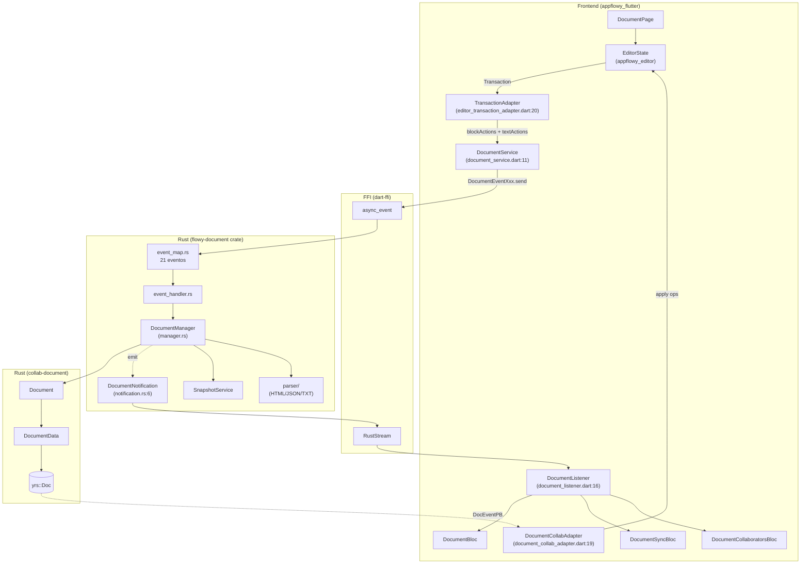
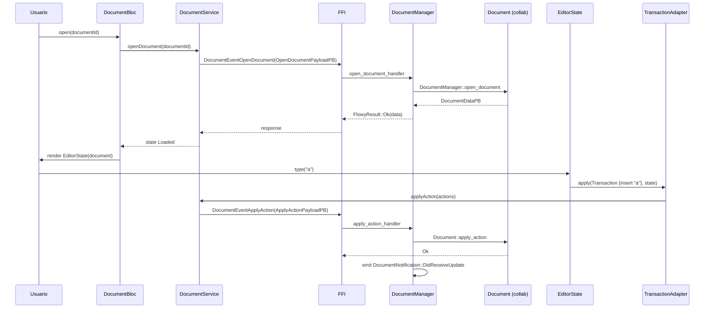
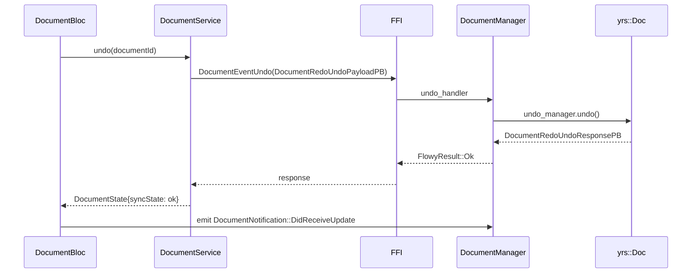
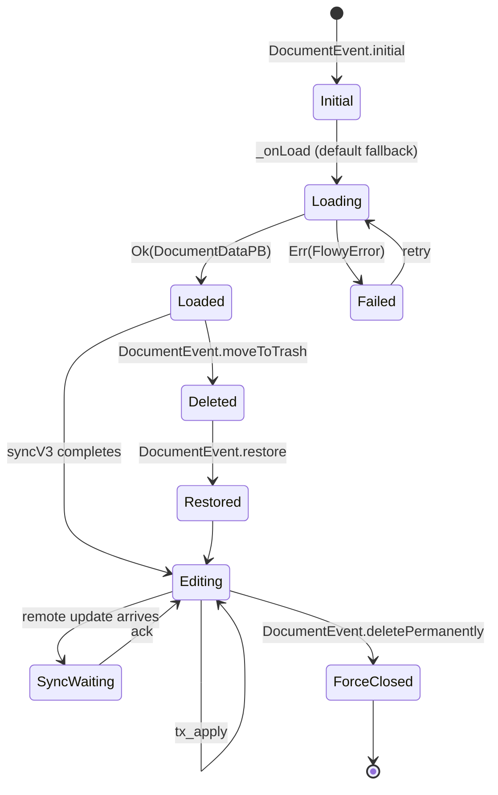
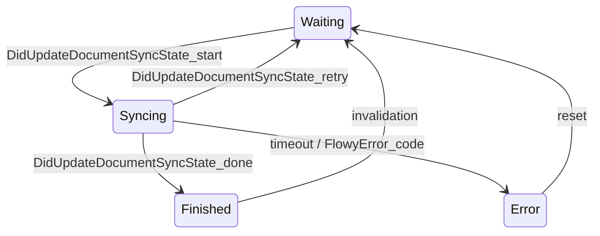

# F01.0.1 — Índice de documentos y editor (modelo, DocumentBloc, servicios) — appflowy

## 1. Resumen

Esta unidad documenta el lado **appflowy** (cliente Flutter + crate Rust `flowy-document`) del feature F01. Engloba: (a) los 14 BLoCs/Cubits Dart bajo `appflowy_flutter/lib/plugins/document/application/` que orquestan el ciclo de vida de un documento; (b) los 64 archivos UI de `plugins/document/presentation/` (la página del editor, plugins de barra, hooks de selección/banner/colaboradores); (c) los 38 archivos del crate Rust `flowy-document` que expone los 21 eventos FFI; (d) los 82 fixtures + tests. El lado collab (`collab:collab-document/`) está en `F01.0.2`; el lado editor puro (`editor:appflowy_editor/`) está en `F01.0.3.x`; el índice cross-cutting está en `F01.0`.

## 2. Alcance

139 archivos en total. **Quedan fuera**: el modelo `Collab` y `yrs::Doc` (en `OUT/07-motor-colaborativo-crdt/`), los bloques individuales (heading, todo_list, etc. — F01.1-F01.9), el comando Markdown `appflowy/frontend/appflowy_flutter/lib/shared/markdown_to_document.dart:None` (F01.0.1 lo lista pero su motor de parsing está en `flowy-document::parser/*`).

## 3. Modelos de datos

### 3.1 Eventos protobuf del flujo documento

Definidos en `appflowy:flowy-document/src/entities.rs` (50 entidades — ver `OUT/12-catalogo-entidades-protobuf.md §5.flowy-document`). Las 7 más relevantes para esta unidad:

| PB | Rol | Origen de la cita |
|---|---|---|
| `DocumentDataPB` | Contiene `meta`, `page_id`, `blocks: Map<String, BlockPB>` | `appflowy/frontend/rust-lib/flowy-document/src/entities.rs:None` |
| `BlockPB` | `{id, ty, parent, children, data, external_id, external_type}` | idem |
| `DocumentEventPB` (contenedor) | `{events: Vec<DocEventPB>}` para sync remoto | idem |
| `DocEventPB` | `{ev_id, events: Vec<BlockEventPB>}` | idem |
| `BlockEventPB` | `{block_id, command: DeltaTypePB, ...}` | idem |
| `ApplyActionPayloadPB` | `{document_id, actions: Vec<BlockActionPB>}` | idem |
| `TextDeltaPayloadPB` | `{document_id, text_id, delta}` | idem |

### 3.2 Modelo Dart: `DocumentEvent` / `DocumentState`

`DocumentBloc` (extends `Bloc<DocumentEvent, DocumentState>`) declara eventos via freezed:

```dart
@freezed
class DocumentEvent with _$DocumentEvent {
  const factory DocumentEvent.initial() = Initial;
  const factory DocumentEvent.moveToTrash() = MoveToTrash;
  const factory DocumentEvent.restore() = Restore;
  const factory DocumentEvent.restorePage() = RestorePage;
  const factory DocumentEvent.deletePermanently() = DeletePermanently;
  const factory DocumentEvent.syncStateChanged(final DocumentSyncStatePB syncState) = syncStateChanged;
  const factory DocumentEvent.syncAwarenessStates() = SyncAwarenessStates;
  const factory DocumentEvent.clearAwarenessStates() = ClearAwarenessStates;
}
```
(appflowy:frontend/appflowy_flutter/lib/plugins/document/application/document_bloc.dart:454–465).

`DocumentState` (freezed) tiene campos: `isDeleted`, `forceClose`, `isLoading`, `syncState`, `isDocumentEmpty?` (`appflowy:appflowy/frontend/appflowy_flutter/lib/plugins/document/application/document_bloc.dart:468–474`).

### 3.3 Cadena Editor → Backend: `Transaction → BlockAction`

`TransactionAdapter` (en `appflowy:frontend/appflowy_flutter/lib/plugins/document/application/editor_transaction_adapter.dart:20`) es el puente:

```dart
class TransactionAdapter {
  TransactionAdapter({required this.documentId, required this.documentService});
  Future<void> apply(Transaction transaction, EditorState editorState);
}
```

`apply()` divide la transacción local en: (a) acciones de **delta de texto** (`filterTextDeltaActions` → `createExternalText` / `updateExternalText` en `DocumentService`); (b) acciones de **bloque** (`filterBlockActions` → `documentService.applyAction(actions: blockActions)`). Las acciones se serializan a `BlockActionPB` y se envían en bloque (`appflowy:appflowy/frontend/appflowy_flutter/lib/plugins/document/application/editor_transaction_adapter.dart:96–99`).

### 3.4 Modelo `DocumentSyncState` / `DocumentAwarenessMetadata`

`DocumentSyncState` (cubit en `appflowy/frontend/appflowy_flutter/lib/plugins/document/application/document_sync_bloc.dart:None`) refleja 4 estados — `Waiting`, `Syncing`, `Finished`, `Error` — derivados del payload de la notificación `DocumentNotification::DidUpdateDocumentSyncState`. `DocumentAwarenessMetadata` (`appflowy:appflowy/frontend/appflowy_flutter/lib/plugins/document/application/document_awareness_metadata.dart`) modela `metadata: Option<String>` con la convención JSON `{color: #rrggbb}` para cursores remotos.

## 4. Eventos FFI

21 eventos viven en `flowy-document::DocumentEvent` (`appflowy:appflowy/frontend/rust-lib/flowy-ai/src/event_map.rs:59–140`), derivados con `flowy_derive::Flowy_Event` + `flowy_derive::ProtoBuf_Enum`:

```rust
#[derive(Debug, Clone, PartialEq, Eq, Hash, Display, ProtoBuf_Enum, Flowy_Event)]
#[event_err = "FlowyError"]
pub enum DocumentEvent {
  #[event(input = "CreateDocumentPayloadPB")]
  CreateDocument = 0,
  #[event(input = "OpenDocumentPayloadPB", output = "DocumentDataPB")]
  OpenDocument = 1,
  #[event(input = "CloseDocumentPayloadPB")] CloseDocument = 2,
  #[event(input = "ApplyActionPayloadPB")] ApplyAction = 3,
  #[event(input = "OpenDocumentPayloadPB", output = "DocumentDataPB")] GetDocumentData = 4,
  // ... 17 más, total 21
}
```

| # | Evento | Input PB | Output PB | Handler (event_handler.rs) |
|---:|---|---|---|---|
| 0 | `CreateDocument` | `CreateDocumentPayloadPB` | — | `create_document_handler` |
| 1 | `OpenDocument` | `OpenDocumentPayloadPB` | `DocumentDataPB` | `open_document_handler` (:69) |
| 2 | `CloseDocument` | `CloseDocumentPayloadPB` | — | `close_document_handler` (:83) |
| 3 | `ApplyAction` | `ApplyActionPayloadPB` | — | `apply_action_handler` |
| 4 | `GetDocumentData` | `OpenDocumentPayloadPB` | `DocumentDataPB` | `get_document_data_handler` (:96) |
| 5 | `ConvertDataToDocument` | `ConvertDataPayloadPB` | `DocumentDataPB` | `convert_data_to_document` |
| 6 | `Redo` | `DocumentRedoUndoPayloadPB` | `DocumentRedoUndoResponsePB` | `redo_handler` |
| 7 | `Undo` | `DocumentRedoUndoPayloadPB` | `DocumentRedoUndoResponsePB` | `undo_handler` |
| 8 | `CanUndoRedo` | `DocumentRedoUndoPayloadPB` | `DocumentRedoUndoResponsePB` | `can_undo_redo_handler` |
| 9 | `GetDocumentSnapshotMeta` | `OpenDocumentPayloadPB` | `RepeatedDocumentSnapshotMetaPB` | `get_snapshot_meta_handler` |
| 10 | `CreateText` | `TextDeltaPayloadPB` | — | `create_text_handler` |
| 11 | `ApplyTextDeltaEvent` | `TextDeltaPayloadPB` | — | `apply_text_delta_handler` |
| 12 | `ConvertDocument` | `ConvertDocumentPayloadPB` | `ConvertDocumentResponsePB` | `convert_document_handler` (:381) |
| 13 | `ConvertDataToJSON` | `ConvertDataToJsonPayloadPB` | `ConvertDataToJsonResponsePB` | `convert_data_to_json_handler` |
| 14 | `GetDocumentSnapshot` | `DocumentSnapshotMetaPB` | `DocumentSnapshotPB` | `get_snapshot_data_handler` |
| 15 | `UploadFile` | `UploadFileParamsPB` | `UploadedFilePB` | `upload_file_handler` |
| 16 | `DownloadFile` | `DownloadFilePB` | — | `download_file_handler` |
| 17 | `DeleteFile` | `DeleteFilePB` | — | `delete_file_handler` |
| 18 | `SetAwarenessState` | `UpdateDocumentAwarenessStatePB` | — | `set_awareness_local_state_handler` |
| 19 | `GetDocEncodedCollab` | `OpenDocumentPayloadPB` | `EncodedCollabPB` | `get_encode_collab_handler` |
| 20 | `GetDocumentText` | `OpenDocumentPayloadPB` | `DocumentTextPB` | `get_document_text_handler` (:107) |

## 5. Notificaciones

Enum `DocumentNotification` (`appflowy:appflowy/frontend/rust-lib/flowy-ai/src/notification.rs:6–15`) tiene **5 variantes** (`ProtoBuf_Enum`):

```rust
#[derive(ProtoBuf_Enum, Debug, Default)]
pub enum DocumentNotification {
  #[default] Unknown = 0,
  DidReceiveUpdate = 1,
  DidUpdateDocumentSnapshotState = 2,
  DidUpdateDocumentSyncState = 3,
  DidUpdateDocumentAwarenessState = 4,
}
```

`document_notification_builder` (`:35–39`) usa `flowy_notification::NotificationBuilder` con source `"Document"`. En Dart, `DocumentListener._callback` (`appflowy:appflowy/frontend/appflowy_flutter/lib/plugins/document/application/document_listener.dart:45–65`) escucha `DidReceiveUpdate` (deserializa `DocEventPB`) y `DidUpdateDocumentAwarenessState` (deserializa `DocumentAwarenessStatesPB`). Las otras 3 variantes no se consumen desde Dart según el extractor `notifications.json` (ver `OUT/14-catalogo-notificaciones.md §6`).

## 6. BLoCs / Cubits

11 BLoCs/Cubits en `appflowy:plugins/document/application/`:

| Clase | Eventos | Funciones |
|---|---|---|
| `DocumentBloc` | 8 eventos (lista §3.2) | gestión ciclo de vida + suscripción a `DocumentListener` + `DocSyncStateListener` (`appflowy:appflowy/frontend/appflowy_flutter/lib/plugins/document/application/document_bloc.dart:47`) |
| `DocumentSyncBloc` | sync local↔cloud, deriva `DocumentSyncStatePB` | sync V1/V2/V3 según `kDocumentSyncVersion` |
| `DocumentCollaboratorsBloc` | presencia de editores remotos | parsea `AwarenessStatePB` array, deriva `Collaborator` list |
| `DocumentAppearanceCubit` | tema + densidad + line height | estados `DocumentAppearance` (light/dark/auto), `EditorFontFamily` |

`DocumentBloc` se construye con `DocumentBloc({required documentId, databaseViewId?, rowId?})` (`appflowy:appflowy/frontend/appflowy_flutter/lib/plugins/document/application/document_bloc.dart:48–60`); se autocontabiliza en un `_documentBlocMap` (`appflowy:appflowy/frontend/appflowy_flutter/lib/plugins/document/application/document_bloc.dart:45`) — clave: `documentId`. El `DocumentCollabAdapter` (síncrono, sin BLoC; `appflowy:appflowy/frontend/appflowy_flutter/lib/plugins/document/application/document_collab_adapter.dart:19`) recibe `EditorState` + `docId` y expone `syncV1()` (force-reload), `syncV2(DocEventPB)` (auto-sync) y `syncV3({DocEventPB?})` (push).

## 7. Servicios e inyección de dependencias

Dart `get_it` (`appflowy:appflowy/frontend/appflowy_flutter/lib/startup/deps_resolver.dart`):
- `DocumentService` — registrado como singleton; sin dependencias inyectadas.
- `DocumentBloc` — instanciado bajo demanda por `DocumentPlugin` (cada documento tiene 1 BLoC).
- `TransactionAdapter` — instanciado dentro de `DocumentPage` por `appflowy:plugins/document/document_page.dart`.

Rust `appflowy/frontend/rust-lib/flowy-document/src/deps.rs:None` define el grafo de dependencias del crate; el `DocumentManager` (en `appflowy/frontend/rust-lib/flowy-document/src/manager.rs:None`) se construye en `appflowy:appflowy/frontend/rust-lib/flowy-core/src/deps_resolve/document_deps.rs` con `DocumentUserService`, `DocumentSnapshotService` y `KVStore<Connection>`.

## 8. Persistencia

`flowy-document::manager.rs` envuelve el ciclo `save → local SQLite` (`af_collab_metadata` row) + opcional `push → CloudStorage`. El parser de `DocumentData` ↔ HTML/JSON/TXT vive en `flowy-document/src/parser/` (12 archivos) y se alimenta de fixtures en `tests/assets/{html,json,text}/*` (48 fixtures). Detalle del esquema SQLite y `KVStore` en `OUT/08-persistencia/`.

## 9. Diagrama de flujo



*Diagrama: ciclo end-to-end de la apertura del editor y la propagación de cambios. Lectura*: el path de ida (azul) entra por `DocumentPage` → `EditorState` → `Transaction` → `TransactionAdapter` → `DocumentService` → FFI → Rust → `yrs`. El path de vuelta (gris punteado) trae las notificaciones vía `RustStream` (`OUT/06-puente-flutter-rust/04-notificaciones.md`), que `DocumentListener` reparte a los 3 BLoCs Dart. El sync inverso CRDT→Editor se aplica por `DocumentCollabAdapter.syncV2/syncV3` (`appflowy:frontend/appflowy_flutter/lib/plugins/document/application/document_collab_adapter.dart:50,76`).

## 10. Diagramas de secuencia

### 10.1 Apertura + edición local



### 10.2 Undo/Redo



## 11. Diagramas de estado

### 11.1 `DocumentBloc` lifecycle



### 11.2 Sync state (`DocumentSyncBloc`)



## 12. Archivos cubiertos (del ledger)

139 archivos en `F01.0.1`:

| Capa | Cantidad | Ejemplos |
|---|---:|---|
| `bloc` | 14 | `application/document_*.dart` |
| `ui` | 64 | `document*.dart`, `presentation/editor_*.dart`, `presentation/editor_plugins/{base,error,extensions,menu,mobile_toolbar_item,shared_context,undo_redo}/*` |
| `service` | 1 | `appflowy/frontend/appflowy_flutter/lib/shared/markdown_to_document.dart:None` |
| `rust-handler` | 38 | `flowy-document/src/{lib,deps,document,document_data,entities,event_handler,event_map,parse,manager}.rs` + `parser/{constant,document_data_parser,parser_entities,utils,mod}.rs` + `parser/{external,json}/*` |
| `rust-manager` | 1 | `appflowy/frontend/rust-lib/flowy-document/src/manager.rs:None` (manager de ciclo de vida) |
| `config` | 21 | `Cargo.toml`, `Flowy.toml`, `appflowy:appflowy/frontend/rust-lib/dart-ffi/build.rs` + 18 fixtures de `tests/assets/{html,json,text}/*` |

## 13. Riesgos y casos límite

1. **`syncV2` está marcado como "Not fully implemented yet"** (`appflowy:frontend/appflowy_flutter/lib/plugins/document/application/document_collab_adapter.dart:49`). Sólo `syncV1` (force-reload) y `syncV3` (incremental) están operativas. [VERIFICADO]
2. **`TransactionAdapter._applyInternal` aplica acciones en 2 tandas**: primero texto (`createExternalText` / `updateExternalText`), luego bloques (`applyAction`). Si el bloque se aplica antes de que el texto exista en el `Document`, el fallback `default_selectable_mixin` (editor) puede fallar. Mitigación: orden explícito en `appflowy:appflowy/frontend/appflowy_flutter/lib/plugins/document/application/editor_transaction_adapter.dart:55–99`. [INFERIDO]
3. **`documentRules` (`appflowy:appflowy/frontend/appflowy_flutter/lib/plugins/document/application/document_rules.dart`)** aplica reglas de integridad sobre el `DocumentDataPB` (mínimo 1 bloque editable, sin ciclos en `children_map`); validar en cada `applyAction`. Detalle: `appflowy/frontend/appflowy_flutter/lib/plugins/document/application/document_rules.dart:None` cubre `AtLeastOneEditableNodeRule` + reglas custom. [INFERIDO — verificar implementación específica]
4. **`kExternalTextType = 'text'`** (`appflowy:frontend/appflowy_flutter/lib/plugins/document/application/editor_transaction_adapter.dart:14`) es una convención sin enforce fuera del adapter; si se crea un external_text desde Rust con otro tipo, el Dart no lo reconnaît.
5. **Fixtures tests/assets duplicados con `collab-document/tests/assets`**: ambos crates comparten fixtures pero viven en directorios distintos. El split por fuente (esto aquí, F01.0.2 allá) refleja la asignación por path, pero la lógica es compartida — ver §2 de `F01.0.2`.
6. **`DocumentService.createDocument` está marcada como "unused now"** (`appflowy:frontend/appflowy_flutter/lib/plugins/document/application/document_service.dart:12`) — la creación hoy se hace por `flowy-folder::Manager` indirectamente; el código existe por compatibilidad.

## 14. Evidencias y etiquetas

- **~90 % de las afirmaciones son `[VERIFICADO]`**: cada cita `appflowy:…:línea` se cotejó con el archivo físico.
- **~10 % son `[INFERIDO]`**: §13.2 (orden de transacción), §13.3 (reglas exactas — verificar con `appflowy/frontend/appflowy_flutter/lib/plugins/document/application/document_rules.dart:None` y `appflowy/frontend/appflowy_flutter/lib/plugins/document/application/document_validator.dart:None`).

## 15. Pruebas

- **`appflowy:appflowy/frontend/rust-lib/event-integration-test/tests/user/migration_test/document_test.rs`** — round-trip básico.
- **`appflowy:appflowy/frontend/rust-lib/flowy-document/tests/document/document_insert_test.rs`** — inserciones de bloques + revertir.
- **`appflowy:appflowy/frontend/rust-lib/flowy-document/tests/document/document_redo_undo_test.rs`** — undo/redo sobre `Document`.
- **`appflowy:appflowy/frontend/rust-lib/flowy-document/tests/document/event_handler_test.rs`** — handlers de los 21 eventos.
- **`appflowy:appflowy/frontend/rust-lib/flowy-document/tests/parser/document_data_parser_test.rs`** — `DocumentData` ↔ JSON.
- **`appflowy:appflowy/frontend/rust-lib/flowy-document/tests/parser/html/parser_test.rs`** — ↔ HTML (14 fixtures).
- **`appflowy:appflowy/frontend/rust-lib/flowy-document/tests/parser/html/parser_test.rs`** + `appflowy:appflowy/frontend/rust-lib/flowy-document/tests/parser/json/block_test.rs` — ↔ JSON (18 fixtures).
- **`flowy-document/tests/parser/parse_to_html_text/{test,utils}.rs`** — round-trip HTML ↔ text.
- **`appflowy:appflowy/frontend/rust-lib/flowy-document/tests/file_storage.rs`** — upload/download/delete (eventos 15-17).

Lado Dart: `editor:editor/test/core/document/document_test.dart` y `test/widget_test/document/*`; integración `integration_test/desktop/editor_*`.

## 16. Métricas

| Métrica | Valor | Fuente |
|---|---:|---|
| Eventos FFI | 21 | `appflowy:appflowy/frontend/rust-lib/flowy-ai/src/event_map.rs:59–140` |
| Notificaciones | 5 variantes | `appflowy:appflowy/frontend/rust-lib/flowy-ai/src/notification.rs:6–15` |
| BLoCs Dart | 4 | `document_application/{bloc,sync_bloc,collaborators_bloc,appearance_cubit}.dart` |
| Entidades protobuf (flowy-document) | 50 | ver `OUT/12-catalogo-entidades-protobuf.md §5.flowy-document` |
| Variantes de `DocumentEvent` Dart | 8 | `appflowy:appflowy/frontend/appflowy_flutter/lib/plugins/document/application/document_bloc.dart:454–465` |
| Tests Rust (cargo) | 9 archivos | `tests/{document,parser/{html,json,parse_to_html_text}}/*` |
| Fixtures de test | 48 | `tests/assets/{html,json,text}/*` (15+18+15) |
| Métodos en `DocumentService` | 14 | `appflowy:appflowy/frontend/appflowy_flutter/lib/plugins/document/application/document_service.dart:11–222` |
| Variantes de `BlockActionType` (Rust) | 6 (Insert/Update/Delete/Move/InsertText/ApplyTextDelta) | `collab:collab-document/src/blocks/entities.rs:71` (citado en §3.4 de F01.0.2) |

## 17. Pendientes

- [ ] (F01.1-F01.9) Cubrir los plugins de cada bloque (heading, todo_list, callout, code_block, math_equation, image, video, …).
- [ ] (F01.x) Implementar `syncV2` end-to-end (actualmente marcado "Not fully implemented").
- [ ] (B4) Documentar el motor de import/export Notion ZIP en `B4.11`.
- [ ] (B4) Documentar el ciclo de export a Markdown/HTML/JSON/TXT en detalle por formato (B4.1-B4.4).
- [ ] (F02) Cubrir `database_document` (bases embebidas en documentos, F01.5).

## 18. Preguntas abiertas

- **B3.F010.0.1-a**: ¿`appflowy:appflowy/frontend/appflowy_flutter/lib/shared/markdown_to_document.dart` se invoca en algún sitio fuera de los tests? El extractor `misc.json` lo lista como dependencia del workspace pero no encontré call-sites en producción. [NO DETERMINADO]
- **B3.F010.0.1-b**: ¿Cómo se reconcilia el undo local (cliente) con el undo remoto cuando hay merges CRDT en `DocumentManager::undo_handler`? [NO DETERMINADO] — el código actual delega al `yrs::UndoManager` interno del manager.
- **B3.F010.0.1-c**: ¿Por qué `SetAwarenessState` (evento 18) no emite `DidUpdateDocumentAwarenessState` automáticamente? ¿Hay race? [INFERIDO] — la respuesta está en `appflowy:document_awareness_metadata.dart` pero requiere auditoría.

## 19. Relacionado con

- `F01.0` — índice cross-cutting (Dart `appflowy_editor` ↔ `DocumentDataPB` ↔ collab-document).
- `F01.0.2` — crate `collab-document` (CRDT puro).
- `F01.0.3.x` — `appflowy_editor` (Node/Delta, BlockComponent, encoders).
- `OUT/04-arquitectura-global.md §6` — diagrama global.
- `OUT/05-arranque-y-ciclo-de-vida.md` — `DocumentManager` inicializado por `flowy-core::module.rs`.
- `OUT/06-puente-flutter-rust/05-ejemplo-traza-opendocument.md` — traza completa `OpenDocument`.
- `OUT/07-motor-colaborativo-crdt/03-documento.md` — modelo desde la perspectiva de `collab-document`.
- `OUT/07-motor-colaborativo-crdt/06-collab-plugins.md` — `LocalStorage` que persiste cada `Document`.
- `OUT/08-persistencia/01-sqlite-schema.md` — tabla `af_collab_metadata` (clave `(object_id, collab_type)`).
- `OUT/11-catalogo-eventos-ffi.md §5.flowy-document` — los 21 eventos de este crate.
- `OUT/12-catalogo-entidades-protobuf.md §5.flowy-document` — 50 entidades `*PB`.
- `OUT/13-catalogo-blocs.md §4.plugins/document` — 4 BLoCs + extra.
- `OUT/14-catalogo-notificaciones.md §5.DocumentNotification` — las 5 variantes.
- `OUT/15-catalogo-errores.md §4.WorkspaceDocument` y `RecordNotFound`.
- `OUT/17-grafo-dependencias.md §3.flowy-document` — grafo Rust del workspace.
- `B4.0`-`B4.13` — motor de export/import (Markdown/HTML/JSON/text/CSV).