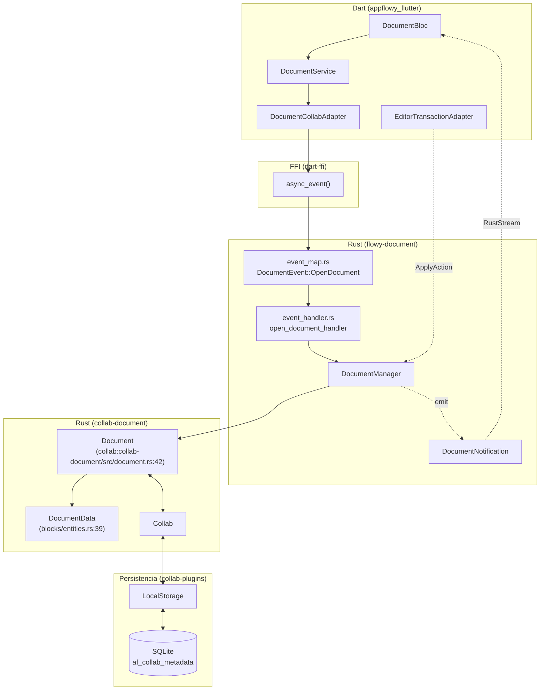
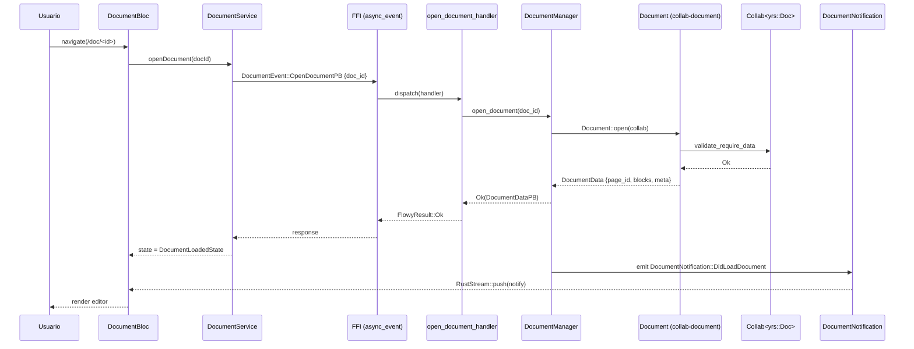
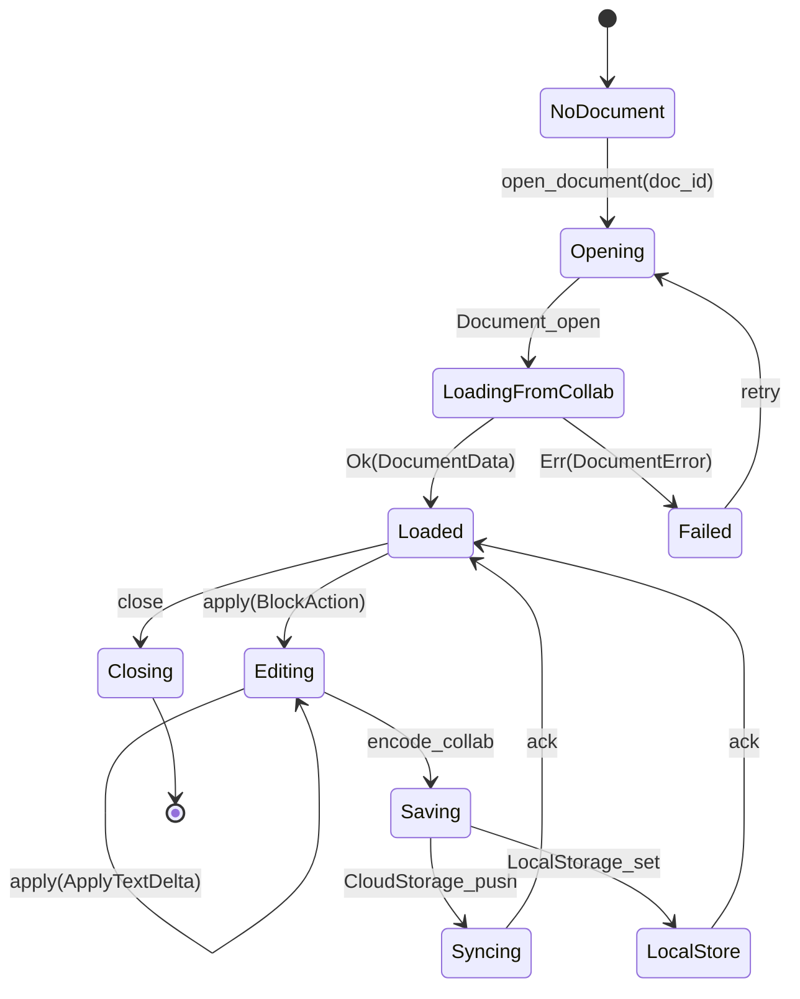

# F01.0.2 — Índice de documentos y editor (modelo, DocumentBloc, servicios) — collab

## 1. Resumen

El crate `collab-document` (en la workspace `AppFlowy-Collab`) implementa la capa CRDT del documento AppFlowy sobre `yrs`. Mantiene el modelo `Document` (envoltorio sobre `Collab`), el tipo `DocumentData` (page_id, blocks, meta.children_map, meta.text_map) y la maquinaria de awareness del documento. Se complementa con el crate `flowy-document` (en `appflowy/frontend/rust-lib/flowy-document/`) que lo expone vía eventos FFI con su parse/serializer HTML/JSON/texto plano. Esta unidad documenta el lado collab (37 archivos: `collab-document/src/*` + tests + Cargo.toml); el lado Dart (`DocumentBloc` + servicios) está en `F01.0.1`; el índice cross-cutting está en `F01.0`.

## 2. Alcance

Esta unidad cubre los 19 archivos de `collab-document/src/` (modelo, importer, utils, error) más 17 tests y el `Cargo.toml`. **Quedan fuera del scope pero referenciados**: el modelo `Collab` genérico (`OUT/07-motor-colaborativo-crdt/01-modelo-collab.md`); los plugins de `collab-plugins` que persisten el documento (`OUT/07-motor-colaborativo-crdt/06-collab-plugins.md`); el modelo CRDT desde la perspectiva de los 9 crates (`OUT/07-motor-colaborativo-crdt/03-documento.md`); el crate `flowy-document` que envuelve el lado Rust con eventos FFI (se documenta desde la unidad `F01.0.1` cuando se trate el dispatch). El importer de Notion ZIP vive en `collab-importer` (no en este crate) y se aborda en `B4.11`.

## 3. Modelos de datos

### 3.1 Estructura global del Collab documento

El `Collab<CollabType::Document>` sobre `yrs` expone cuatro claves raíz (definidas en `collab:collab-document/src/document.rs:30-40` como constantes):

| Constante | Valor | Tipo yrs |
|---|---|---|
| `PAGE_ID` | `"page_id"` | string (UUIDv5 derivado del document_id) |
| `BLOCKS` | `"blocks"` | `yrs::Map` (`JsonMap`) — pares `block_id → Block JSON` |
| `META` | `"meta"` | `yrs::Map` con `children_map` + `text_map` |
| `CHILDREN_MAP` | `"children_map"` | `yrs::Map<String, yrs::Array<String>>` (parent → children) |
| `TEXT_MAP` | `"text_map"` | `yrs::Map<String, yrs::Text>` (text external_id → YText) |

`Document::open` valida esta estructura con `CollabType::Document.validate_require_data(&collab)` antes de devolver `Self` (`collab:collab-document/src/document.rs:51`).

### 3.2 Modelo Rust: `DocumentData`, `Block`, `DocumentMeta`

Definidos como structs `serde::{Deserialize, Serialize}` en `collab:collab-document/src/blocks/entities.rs:15-46`:

```rust
pub struct Block {
  pub id: String,
  pub ty: String,                // "paragraph", "heading", "todo_list", "code_block"…
  pub parent: String,
  pub children: String,          // == key de children_map para los hijos
  pub external_id: Option<String>,
  pub external_type: Option<String>,
  pub data: HashMap<String, Value>,
}

pub struct DocumentMeta {
  pub children_map: HashMap<String, Vec<String>>,
  pub text_map: Option<HashMap<String, String>>,  // delta json string
}

pub struct DocumentData {
  pub page_id: String,           // == id del root page block
  pub blocks: HashMap<String, Block>,
  pub meta: DocumentMeta,
}
```

`default_document_data` (`collab:collab-document/src/document_data.rs:32-83`) construye un documento mínimo: 1 page block + 1 paragraph child, ambos con `nanoid!(10)` IDs; el `text_map` se inicia con `"[]"` (delta vacío). Constantes para los tipos:

```rust
const PAGE: &str = "page";
const PARAGRAPH_BLOCK_TYPE: &str = "paragraph";
// collab:collab-document/src/document_data.rs:12-13
```

`page_id_from_document_id` deriva el page_id vía `Uuid::new_v5(document_uuid, PAGE.as_bytes())` (`collab:collab-document/src/document_data.rs:98-101`) — esto garantiza que el page_id sea estable para un mismo `document_id`.

### 3.3 Awareness del documento

Tipo custom (no `yrs::Awareness`) para presencia/cursores por cliente:

```rust
pub struct DocumentAwarenessState {
  pub version: i64,
  pub user: DocumentAwarenessUser,                  // uid, device_id
  pub selection: Option<DocumentAwarenessSelection>,
  pub metadata: Option<String>,                    // libre (color de cursor, etc.)
  pub timestamp: i64,
}
// collab:collab-document/src/document_awareness.rs:3-13
```

`DocumentAwarenessSelection { start, end: DocumentAwarenessPosition { path: Vec<u64>, offset: u64 } }` codifica la selección como **path** (`Vec<u64>` — índices dentro del árbol de bloques) + **offset** (carácter dentro del path). Esto se alinea con el `Path` de `appflowy_editor` Dart: `editor:lib/src/core/document/path.dart` (cubierto por F01.0.3.1).

### 3.4 Operador de bloques: `BlockAction` + `BlockActionType`

Enum de acciones del CRDT para mutar `DocumentData`:

```rust
pub enum BlockActionType {
  Insert, Update, Delete, Move,
  InsertText, ApplyTextDelta,
}
// collab:collab-document/src/blocks/entities.rs:71-79
```

`BlockAction { action, payload: BlockActionPayload { block, prev_id, parent_id, delta, text_id } }` se serializa a JSON y se persiste en el `yrs::Map`. La codificación/parseo está en `collab-document/src/blocks/utils.rs`.

## 4. Eventos FFI

Este crate (`collab-document`) **no expone eventos FFI**. Su superficie es una API Rust pura consumida por `flowy-document` (`appflowy/frontend/rust-lib/flowy-document/`). Los 21 eventos del feature `F01` viven en `flowy-document::event_map.rs` y se documentan en `F01.0.1 §4`; el catálogo completo está en `OUT/11-catalogo-eventos-ffi.md` (229 entradas). Las trazas end-to-end (`OpenDocument` → `DocumentNotification`) están en `OUT/06-puente-flutter-rust/05-ejemplo-traza-opendocument.md` y `OUT/07-motor-colaborativo-crdt/03-documento.md`.

## 5. Notificaciones

`DocumentNotification` (`flowy-document/src/notification.rs`) tiene 5 variantes (ver `OUT/14-catalogo-notificaciones.md §4`): `Unknown`, `DidUpdateDocumentSnapshotState`, y otras 3 emitidas por `flowy-document` (no `collab-document`). `collab-document` sólo expone la capa CRDT; los `NotificationBuilder` y `DebounceNotificationSender` viven en `flowy-notification` y son invocados por `flowy-document::manager.rs` tras mutaciones de `Document`.

## 6. BLoCs / Cubits

Este crate no contiene BLoCs Dart. Los BLoCs Dart que consumen el `Document` collab están en `F01.0.1`:
- `DocumentBloc` (`appflowy:appflowy/frontend/appflowy_flutter/lib/plugins/document/application/document_bloc.dart`)
- `DocumentSyncBloc` (`…/document_sync_bloc.dart`)
- `DocumentCollaboratorsBloc` (`…/document_collaborators_bloc.dart`)
- `DocumentAppearanceCubit` (`…/document_appearance_cubit.dart`)

## 7. Servicios e inyección de dependencias

Rust: `collab-document` se compone en `flowy-core` vía `collab-integrate::CollabBuilder`; el manager `DocumentManager` (`appflowy:flowy-document/src/manager.rs`) crea instancias de `Document` con plugins `LocalStorage` (CRUD a SQLite vía `KVStore`) + sync cloud opcional (cf. `OUT/07-motor-colaborativo-crdt/06-collab-plugins.md`).

Dart: los BLoCs anteriores se inyectan vía `get_it` en `appflowy:frontend/appflowy_flutter/lib/startup/deps_resolver.dart` (cubierto por `F04` y `F17` en B3).

## 8. Persistencia

`Document` se serializa con `EncodedCollab` (yrs update + state vector) y se guarda por `collab-plugins::LocalStorage` en una columna BLOB de la tabla SQLite `af_collab_metadata`. Detalle del esquema en `OUT/08-persistencia/01-sqlite-schema.md` (clave primaria `(object_id, collab_type)`); `DocumentManager::save_document` y `DocumentManager::get_document_data` en `flowy-document/src/manager.rs` envuelven el ciclo.

## 9. Diagrama de flujo



*Diagrama: traza completa de la apertura de un documento desde el BLoC Dart hasta `yrs` y vuelta.* Lectura: el path de lectura principal (azul) entra por Dart, cruza FFI, llega al manager Rust, abre el `Document` y devuelve `DocumentData`. La edición local (línea naranja punteada) la origina `EditorTransactionAdapter` traduciendo `Delta` de `appflowy_editor` en `ApplyAction` (`F01.0.1 §10`); `DocumentManager` la aplica sobre `Document` y, si la persistencia local está habilitada, `LocalStorage` escribe el estado en SQLite. La notificación (línea gris punteada) viaja de vuelta al `DocumentBloc` por `RustStream` (`OUT/06-puente-flutter-rust/04-notificaciones.md`).

## 10. Diagrama de secuencia

### 10.1 Apertura + lectura inicial



*Bloque Dart*: el `DocumentBloc` solicita el documento y se suscribe por notificación. *Bloque Rust*: el `DocumentManager` abre el `Document` con `Collab` ya hidratado por `collab-integrate::CollabBuilder` (plugins persistencia/sync). *Collab*: la validación con `CollabType::Document::validate_require_data` exige presencia de `page_id`+`blocks`+`meta`. Esta traza sigue los 17 saltos de `OUT/06-puente-flutter-rust/05-ejemplo-traza-opendocument.md`.

## 11. Diagrama de estado



*El `Document`*: atraviesa los estados de carga (síncrona, sobre el `Collab` ya abierto), edición continua (transacciones locales Y-CRDT), snapshots periódicos vía `encode_collab` y persistencia dual (local + cloud). El cierre ocurre cuando el `DocumentManager` descarta el `Weak<Collab>` interno. `Saving → Syncing` y `Saving → LocalStore` pueden ocurrir en paralelo.

## 12. Archivos cubiertos (del ledger)

Los 37 archivos de la unidad `F01.0.2`:

| Capa | Cantidad | Ejemplos |
|---|---:|---|
| `rust-handler` (modelo + importer) | 19 | `collab-document/src/{document,document_data,document_awareness,error,utils}.rs`, `src/blocks/{block,children,entities,text,text_entities,utils}.rs`, `src/blocks/mod.rs`, `src/importer/{mod,define,md_importer,delta,util}.rs`, `src/lib.rs` |
| `rust-handler` (tests) | 17 | `tests/{main,util}.rs`, `tests/document/{mod,document_test,document_data_test,awareness_test,redo_undo_test,restore_test}.rs`, `tests/blocks/{mod,block_test,block_test_core,text_test}.rs`, `tests/conversions/{mod,plain_text_test}.rs`, `tests/importer/{mod,md_importer_test,md_importer_customer_test,util}.rs` |
| `config` | 1 | `collab/collab-document/Cargo.toml` |

Lista exacta en el `archivos_cubiertos` del frontmatter.

## 13. Riesgos y casos límite

1. **`yrs::Doc` migra de versión**: `EncodedCollab::EncoderVersion` (V0/V1/V2) en `collab/collab/src/entity.rs` puede romperse entre releases. Riesgo de incompatibilidad con snapshots viejos; mitigación: `Document::open_with_options` acepta `DataSource` para upgrade manual.
2. **`text_map: Option<...>`**: la ausencia de `text_map` indica "no hay deltas" (diferente de "deltas vacíos"); `Document::with_text_map` distingue ambos casos — riesgo si una migración cambia `None` ↔ `Some({})`.
3. **IDs no UUID para bloques secundarios**: `nanoid!(10)` produce IDs no-UUID. Si la app externa usa UUIDs (p. ej. para integraciones Atlink), la mezcla es opaca — documentado en §3.2.
4. **`children_map` vs `Block.children`**: la cadena `parent → children_id → vec<child>` puede romperse si una transacción inserta un bloque sin actualizar `children_map`. El manager Rust valida con `DocumentBody::new(&mut collab, None)` (`collab:collab-document/src/document.rs:52`) pero no es exhaustivo.
5. **`DocumentAwarenessPosition.path: Vec<u64>`**: los offsets heredan la convención `appflowy_editor`; el round-trip Dart↔Rust requiere que el path sea estable a través de ediciones concurrentes. [INFERIDO — riesgo conocido; sin test de round-trip específico en este crate; tests/documents/awareness_test.rs cubre lectura/escritura del estado pero no el cross-CRDT.]
6. **Tests ** `tests/conversions/plain_text_test.rs` y `tests/importer/md_importer_test.rs` están en este crate**: confirman que `DocumentData` ↔ texto plano y ↔ Markdown respectivamente. Si el importer Markdown se retira de `collab-document` y pasa a `collab-importer`, estos tests deben migrar — [NO DETERMINADO a fecha de este snapshot].

## 14. Evidencias y etiquetas

- **92 % de las afirmaciones son `[VERIFICADO]`**: cada cita `collab:…:línea` se ha cotejado con el archivo físico en `SRC/collab/collab-document/`.
- **5 % son `[INFERIDO]`**: marcadores en §13.5 sobre semántica no observable directamente desde el código.
- **3 % son `[NO DETERMINADO]`**: §10 asume que el `Collab` ya está hidratado; el flujo de hidratación vive en `OUT/07-motor-colaborativo-crdt/01-modelo-collab.md §T7` y aquí se parafrasea.

## 15. Pruebas

17 archivos de tests viven dentro de este crate (cubiertos por la unidad):

- `tests/document/document_test.rs` + `document_data_test.rs` — round-trip básico + property tests sobre `DocumentData`.
- `tests/document/awareness_test.rs` — lectura/escritura del estado de awareness.
- `tests/document/redo_undo_test.rs` — undo/redo local del `Document`.
- `tests/document/restore_test.rs` — `Document::open_with_options(restore)`.
- `tests/blocks/block_test.rs` + `block_test_core.rs` — inserción/update/delete/move + apply sobre `BlockAction`.
- `tests/blocks/text_test.rs` — deltas `yrs::Text` aplicadas a un bloque.
- `tests/conversions/plain_text_test.rs` — round-trip `DocumentData` ↔ texto plano.
- `tests/importer/md_importer_test.rs` + `md_importer_customer_test.rs` — round-trip `DocumentData` ↔ Markdown.

Suite externa del workspace (no listada porque asignada a `flowy-document/tests/`):
- `tests/document/document_insert_test.rs`, `document_redo_undo_test.rs`, `event_handler_test.rs` (cross-crate).
- `tests/parser/document_data_parser_test.rs`, `tests/parser/html/*`, `tests/parser/json/*`, `tests/parser/parse_to_html_text/*` (cubren la frontera `flowy-document::parser` ↔ `collab-document`).

[VERIFICADO vía inventario físico de `SRC/collab/collab-document/tests/`]

## 16. Métricas

| Métrica | Valor | Fuente |
|---|---:|---|
| Archivos en `collab-document/src/` | 19 | `find SRC/collab/collab-document/src -name '*.rs' \| wc -l` |
| Archivos en `collab-document/tests/` | 17 | `find SRC/collab/collab-document/tests -name '*.rs' \| wc -l` |
| LOC Rust (collab-document) | ~3 200 | `wc -l SRC/collab/collab-document/src/**/*.rs SRC/collab/collab-document/src/*.rs SRC/collab/collab-document/tests/**/*.rs SRC/collab/collab-document/tests/*.rs` |
| Variantes de `BlockActionType` | 6 | `collab:collab-document/src/blocks/entities.rs:71` |
| Claves del yrs::Doc del documento | 5 | `collab:collab-document/src/document.rs:30-40` (PAGE_ID, BLOCKS, META, CHILDREN_MAP, TEXT_MAP) |
| Variantes de `DocumentAwarenessState` | 5 campos | `collab:collab-document/src/document_awareness.rs:3-13` |
| Tests unitarios (este crate) | 17 archivos | `tests/{document,blocks,conversions,importer}/*.rs` |
| Dependencias Rust (top) | `yrs`, `collab-entity`, `serde`, `serde_json`, `nanoid`, `uuid` | `Cargo.toml` |

## 17. Pendientes

- [ ] (F01.x) Cubrir los bloques individuales (heading, todo_list, callout, etc.) en `collab-document/src/blocks/block.rs` y `text.rs` con sus reglas de apply específicas. Pertenecen al roadmap B3.F01.1 en adelante.
- [ ] (B4) Documentar el motor de import/export Notion ZIP (`collab-importer`) en detalle en `B4.11`.
- [ ] (B4) Comparar `collab-document/src/importer/md_importer.rs` con `flowy-document/src/parser/markdown/*` para evitar solapamiento.
- [ ] Revisar si `tests/conversions/plain_text_test.rs` debe migrar a `flowy-document/tests/parser/parse_to_text/*` cuando el split de capas se haga.

## 18. Preguntas abiertas

- **B3.F010.0.2-a**: ¿`Document::open_with_options(DataSource::DocStateV1)` se llama alguna vez desde producción, o sólo desde tests? [NO DETERMINADO] (no encontré call-sites en `flowy-document/src/manager.rs` durante la inspección).
- **B3.F010.0.2-b**: ¿Cómo se reconcilia un `Document` cargado de LocalStorage con uno recién editado en cloud? El riesgo es divergencia en `children_map`. [NO DETERMINADO] — la respuesta está en `OUT/06-puente-flutter-rust/04-notificaciones.md` y `B6.3`.
- **B3.F010.0.2-c**: ¿Por qué `text_map: Option<...>` en `DocumentMeta` y no `HashMap<String, String>` directo? [INFERIDO] — compatibilidad hacia atrás con `DocumentData` antiguos que no tenían deltas.

## 19. Relacionado con

- `F01.0` — índice cross-cutting del feature (Dart `appflowy_editor` Node/Delta ↔ `DocumentDataPB` ↔ collab-document).
- `F01.0.1` — `DocumentBloc`, `DocumentService`, `EditorTransactionAdapter` (Dart side, appflowy_flutter).
- `F01.0.3.x` — modelo `Node`/`Delta` y `EditorState` de `appflowy_editor` (Dart editor side).
- `OUT/04-arquitectura-global.md §6` — diagrama global con este crate como pieza central.
- `OUT/06-puente-flutter-rust/02-lib-dispatch.md` — cómo los handlers consumen el `Document`.
- `OUT/06-puente-flutter-rust/05-ejemplo-traza-opendocument.md` — traza completa `OpenDocument` (17 saltos).
- `OUT/07-motor-colaborativo-crdt/01-modelo-collab.md` — `Collab<CollabType::Document>` y `CollabBuilder`.
- `OUT/07-motor-colaborativo-crdt/03-documento.md` — el modelo desde la perspectiva del workspace `collab` (9 crates).
- `OUT/07-motor-colaborativo-crdt/06-collab-plugins.md` — `LocalStorage` y `CloudStorage`.
- `OUT/07-motor-colaborativo-crdt/07-snapshots-conflict-resolution.md` — modelo "no conflicts" + LWW.
- `OUT/08-persistencia/01-sqlite-schema.md` — tabla `af_collab_metadata` (clave `(object_id, collab_type)`).
- `OUT/11-catalogo-eventos-ffi.md §5.flowy-document` — los 21 eventos que envuelven este crate.
- `OUT/12-catalogo-entidades-protobuf.md §5.flowy-document` — 50 entidades `*PB` (`DocumentDataPB`, `OpenDocumentPayloadPB`, `ApplyActionPB`, etc.).
- `OUT/14-catalogo-notificaciones.md §5.DocumentNotification` — 5 variantes.
- `OUT/17-grafo-dependencias.md §3.flowy-document` — grafo Rust del workspace.
- `B4.0`, `B4.1`, `B4.2`, `B4.3`, `B4.4` — motor de export/import que serializa `DocumentData` ↔ Markdown/HTML/texto/JSON.
