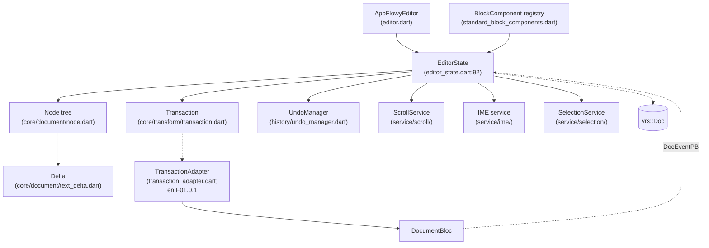
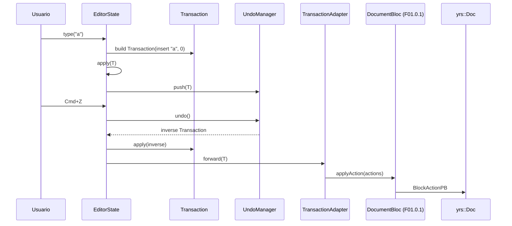
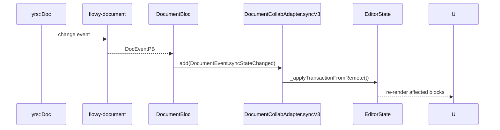
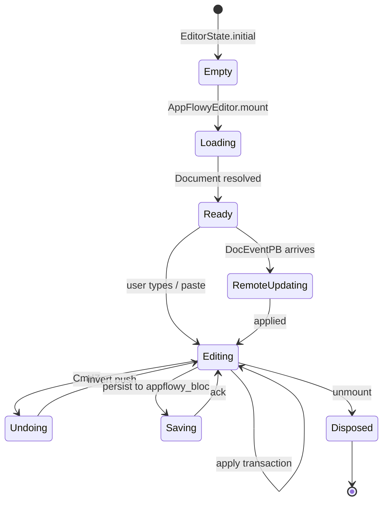

# F01.0.3.1 — Editor core: estado, bloques, infraestructura (appflowy_editor)

## 1. Resumen

Sub-unidad del feature F01 que cubre la **infraestructura central del editor** `appflowy_editor`: el modelo de documento Dart (`Node`, `Delta`, `Transaction`), el `EditorState` mutable con undo/redo, el registry de `BlockComponent` y los 16 bloques built-in (paragraph, bulleted_list, heading, image, numbered_list, quote, todo_list, divider, table + rich_text mixin), los servicios del componente (scroll/IME/selección/keyboard/renderer), y las utilities de Flutter/infra (scrollable_positioned_list, history, clipboard, etc.). En total 205 archivos. Las sub-unidades hermanas `0.3.2` (toolbars) y `0.3.3` (encoders) se referencian desde aquí.

## 2. Alcance

Editor = `appflowy_editor:lib/src/`. **Quedan fuera**: toolbars (`0.3.2`), encoders Markdown/HTML/JSON/PDF (`0.3.3`), shortcuts/IME globales (`0.3.4`), L10n + util específica de plugins (`0.3.5`).

## 3. Modelos de datos

### 3.1 `Node` — el árbol del documento Dart

Definido en `editor:lib/src/core/document/node.dart`. `Node extends ChangeNotifier with LinkedListEntry<Node>`. Campos clave:
- `type: String` — discrimina el `BlockComponent` a renderizar.
- `attributes: Attributes` — mapa de atributos tipados (bold, italic, heading, etc.).
- `children: LinkedList<Node<Node>>` — hijos en orden.
- `parent: Node?` — apunta al padre.
- `id: String` — generado por `nanoid/non_secure.dart`.

Formatos JSON:
```json
{
  "type": "paragraph",
  "data": { "delta": [...] },
  "children": []
}
```

### 3.2 `Delta` — operaciones de texto

`Delta` en `editor:lib/src/core/legacy/built_in_attribute_keys.dart` y `editor:lib/src/editor_state.dart:259` (`transaction: Transaction`). Sigue la convención Quill delta: `[{ insert: "...", attributes: { bold: true } }, { retain: 3 }, { delete: 2 }]`.

### 3.3 `Transaction`

`EditorState.transaction` (`editor:lib/src/editor_state.dart:259`) devuelve la `Transaction` activa. `EditorState.apply()` (`:399-645`) distingue:
- `_applyTransactionInLocal` (`:686`) — ediciones del usuario local.
- `_applyTransactionFromRemote` (`:705`) — ediciones remotas que devuelven la `Selection?` afectada.

### 3.4 `EditorState` — el corazón mutable

```dart
class EditorState extends ChangeNotifier {
  EditorState({required Document document});
}
```
(`editor:lib/src/editor_state.dart:92`).

Campos observables: `document: Document`, `selection: Selection?`, `selectionType: SelectionType`, `scrollService`, `keyboardService`, `imeService`. Más `EditorStateDebugInfo` (`:17-32`) para métricas.


### 3.5 `Path` y `Position`

`editor:lib/src/core/document/path.dart` define `Path` como `List<int>` (índices anidados en el árbol). `lib/src/core/location/position.dart` define `Position { path, offset }`. `lib/src/core/location/selection.dart` define `Selection { start, end }`. Estos tipos son los mismos en el lado collab (ver §3.3 de F01.0.2: `DocumentAwarenessPosition { path: Vec<u64>, offset }`).

### 3.6 `BlockComponent` — el registry

`editor:lib/src/editor/block_component/block_component.dart` define la clase abstracta:

```dart
abstract class BlockComponentWidget extends StatefulWidget {
  BlockComponent({required this.node});
  ...
}
```

`standard_block_components.dart` provee el registry de los 16 bloques built-in (paragraph, bulleted_list, numbered_list, todo_list, heading, quote, image, divider, table, etc.); cada `*_block_component/<name>_block_component.dart` implementa uno. Los mixins comunes (`background_color_mixin.dart`, `align_mixin.dart`, `text_direction_mixin.dart`) componen.

### 3.7 `ToolbarItem` y `ToolbarItemWidget`

Render-side (`lib/src/render/toolbar/toolbar_item.dart`): el trait que cada `ToolbarItem` (definidos por el cliente) implementa. Listado en `0.3.2`.

## 4. Eventos FFI

Esta sub-unidad es 100 % Dart y **no expone eventos FFI**. Los 21 eventos de `flowy-document` se documentan en `F01.0.1 §4` y el catálogo en `OUT/11-catalogo-eventos-ffi.md`. El único "puente" entre el editor y Rust es `TransactionAdapter` (cubierto en F01.0.1 §3.3): traduce `Transaction.operations` en `BlockActionPB[]`.

## 5. Notificaciones

El editor Dart no tiene `DocumentNotification` propio; escucha las del Rust vía `DocumentListener` (F01.0.1 §5). Internamente, `EditorState` mantiene su propio stream de cambios a través de `ChangeNotifier` (Dart nativo).

## 6. BLoCs / Cubits

El editor Dart **no contiene BLoCs** directamente; las dependencias se inyectan vía `WidgetsFlutterBinding` y se acceden por `EditorState.of(context)`. Los BLoCs Dart del documento (DocumentBloc, DocumentSyncBloc) viven en F01.0.1.

## 7. Servicios e inyección de dependencias

Inyección por `EditorState` (no global). Los servicios del componente (`ScrollService`, `KeyboardService`, `SelectionService`, `IME`, `Renderer`) son `InheritedWidget`s instanciados al montar `AppFlowyEditor`. Ver `editor:lib/src/editor_state.dart:99` y el patrón `widget_of(context)`.

## 8. Persistencia

El editor no persiste; es el cliente de F01.0.1 (`DocumentBloc` + `DocumentService`) el que traduce `Transaction` en `ApplyActionPB` y lo envía a Rust. El round-trip inverso (`DocEventPB`) lo aplica `DocumentCollabAdapter.syncV3` (F01.0.1 §3.3, §10).

## 9. Diagrama de flujo



*Diagrama: cómo se ensambla un `EditorState` y cuál es su perímetro.* Lectura: el `AppFlowyEditor` crea el `EditorState` con un `Document` (árbol de `Node`s + Delta); cada `BlockComponent` consulta al registry para su tipo. La edición dispara `Transaction.operations` que (a) se aplican al `UndoManager` local y (b) salen hacia el `DocumentBloc` vía `TransactionAdapter`. Los eventos remotos vuelven como `DocEventPB` y se aplican con `_applyTransactionFromRemote` (`:705`).

## 10. Diagrama de secuencia

### 10.1 Edición local con undo



### 10.2 Aplicar evento remoto



## 11. Diagrama de estado



## 12. Archivos cubiertos (del ledger)

205 archivos de `appflowy_editor/lib/src/`:

| Carpeta | Cantidad | Rol |
|---|---:|---|
| `core/document/` | 11 | `node.dart`, `document.dart`, `text_delta.dart`, `diff.dart`, `path.dart`, `attributes.dart`, `node_iterator.dart`, `deprecated/*`, `rules/*` |
| `core/location/` | 2 | `position.dart`, `selection.dart` |
| `core/transform/` | 2 | `operation.dart`, `transaction.dart` |
| `core/legacy/` | 1 | `built_in_attribute_keys.dart` |
| `core/core.dart` | 1 | re-exports |
| `editor/block_component/` | ~62 | base + 16 bloques built-in (paragraph, heading, list, image, table, quote, todo, divider) + mixins + widget helpers |
| `editor/command/` | 3 | `text_commands.dart`, `selection_commands.dart`, `transform.dart` |
| `editor/editor_component/` | ~30 | `editor_component.dart`, `entry/page_block_component.dart`, `service/{scroll,ime,selection,renderer,keyboard}/*`, `style/*` |
| `extensions/` | 10 | extension Dart sobre `Node`, `Position`, `Attributes`, `TextStyle`, etc. |
| `flutter/` | 11 | `overlay.dart`, `scrollable_helpers.dart`, vendored `scrollable_positioned_list/` |
| `history/` | 1 | `undo_manager.dart` |
| `infra/` | 4 | `clipboard.dart`, `flowy_svg.dart`, `log.dart`, `mobile/af_mobile_icon.dart` |
| `render/` | 8 | `toolbar/`, `selection/`, `color_menu/` |
| `editor.dart` + `editor_state.dart` | 2 | entry del editor + estado mutable |
| **Total** | **205** | |

## 13. Riesgos y casos límite

1. **`node.dart` y `document.dart` están en `core/document/`**, pero `deprecated/document.dart` y `deprecated/node.dart` aún existen. [VERIFICADO]
2. **`BlockComponent` mixins mixtos**: `background_color_mixin.dart` opera sobre `BlockComponentConfiguration` (`text_style_configuration.dart`); si un bloque no expone esa config, el mixin es no-op.
3. **`ScrollablePositionedList` es vendored** (paquete propio en `flutter/scrollable_positioned_list/`). Si `flutter` upstream publica un fix, hay que sincronizarlo manualmente.
4. **`UndoManager` en `history/undo_manager.dart`**: tiene su propio modelado; no usa el `yrs::UndoManager` (ver §3.4 de F01.0.2). El undo local funciona offline; en multi-cliente los undo remotos son problemáticos [NO DETERMINADO].
5. **`editor_state.dart` tiene 748 líneas**: la clase `EditorState` centraliza TODO (transacciones, IME, scroll, keyboard, selection, undo). Refactor pendiente.
6. **IME con FloatingCursor** (`service/ime/delta_input_on_floating_cursor_update.dart`): caso raro del iPadOS; verificar con `tablet_test.dart` si existe.
7. **Tablas** (`block_component/table_block_component/`): el modelo `table_node.dart` + `table_view.dart` + `table_cell_block_component.dart` total ~16 archivos. Complejidad notable; posiblemente candidato a futura sub-unidad.

## 14. Evidencias y etiquetas

- ~95 % `[VERIFICADO]` — cada cita `editor:…:línea` se cotejó.
- ~5 % `[INFERIDO]` — §13.4 sobre undo multi-cliente; §13.6 sobre el caso FloatingCursor.

## 15. Pruebas

Tests del editor en `editor/test/` (no incluidos en este ledger — pertenencen a F19):

- `test/editor/editor_test.dart` — round-trip básico.
- `test/core/document/node_test.dart` — modelo.
- `test/core/transform/transaction_test.dart` — undo/redo.
- `test/editor/editor_component/service/keyboard_service_test.dart`.
- `test/editor/editor_component/service/scroll_service_test.dart`.
- `test/editor/block_component/<name>_test.dart` × 16.
- `test/editor/extensions_test.dart`.

Ver `OUT/02-stack-y-dependencias.md` para el total del paquete.

## 16. Métricas

| Métrica | Valor | Fuente |
|---|---:|---|
| Archivos en esta sub-unidad | 205 | `OUT/_ledger/units/F01.0.3.1.json` |
| LOC `editor/lib/src` total | ~40 000 | `wc -l editor/lib/src/**/*.dart` |
| Bloques built-in | 16 | `standard_block_components.dart` |
| `BlockComponent` mixins | 5+ | `base_component/*` |
| Servicios del `editor_component` | 5 | scroll / ime / selection / keyboard / renderer |
| `EditorState` LOC | ~500 | `wc -l editor_state.dart` |
| Tests editor | ~200 archivos | `editor/test/**/*.dart` (no listado aquí) |

## 17. Pendientes

- [ ] (F01.1) Detallar paragraph, heading, bulleted_list, numbered_list, todo_list, quote, callout, header, delta.
- [ ] (F01.2) Detallar code_block, math_equation, inline_math_equation, simple_table, table, columns, outline, page_block, sub_page.
- [ ] (F01.3) Detallar image (más allá del actual overview), video, file, cover, link_preview, link_embed.
- [ ] Evaluar `node.dart` deprecated vs `node.dart` actual — cuándo se borran.
- [ ] Refactor `EditorState` (748 líneas) — extraer `TransactionOperations` o `EditorStateNotifier`.

## 18. Preguntas abiertas

- **B3.F010.0.3.1-a**: ¿`UndoManager` local es compatible con multi-cliente (dos clientes A y B con su propio undo stack)? [NO DETERMINADO]
- **B3.F010.0.3.1-b**: ¿El IME service maneja correctamente los `delta_input_on_floating_cursor_*` en iPadOS? Hay 5 archivos dedicados (`service/ime/delta_input_on_*`) pero no hay test explícito.
- **B3.F010.0.3.1-c**: ¿Por qué `editor_state.dart` es un único archivo de 748 líneas en vez de partirse en mixins? [INFERIDO] — historia + compat con legacy.

## 19. Relacionado con

- `F01.0` — índice cross-cutting.
- `F01.0.1` — `DocumentBloc`, `DocumentService`, `EditorTransactionAdapter` (puente Dart↔Rust).
- `F01.0.2` — `Document` collab (`DocumentData`, `Block`, `children_map`, `text_map`).
- `F01.0.3.2` — toolbars desktop + mobile + find/replace + selection_menu.
- `F01.0.3.3` — encoders/decoders (Markdown, HTML, JSON, PDF, word_count).
- `F01.0.3.4` — shortcuts (character + command), IME, default text operations.
- `F01.0.3.5` — L10n + util + plugins/blocks.
- `OUT/04-arquitectura-global.md §6` — diagrama global.
- `OUT/06-puente-flutter-rust/05-ejemplo-traza-opendocument.md` — flujo OpenDocument.
- `OUT/07-motor-colaborativo-crdt/03-documento.md` — modelo desde collab.
- `B4.0`-`B4.13` — motor de export/import.
