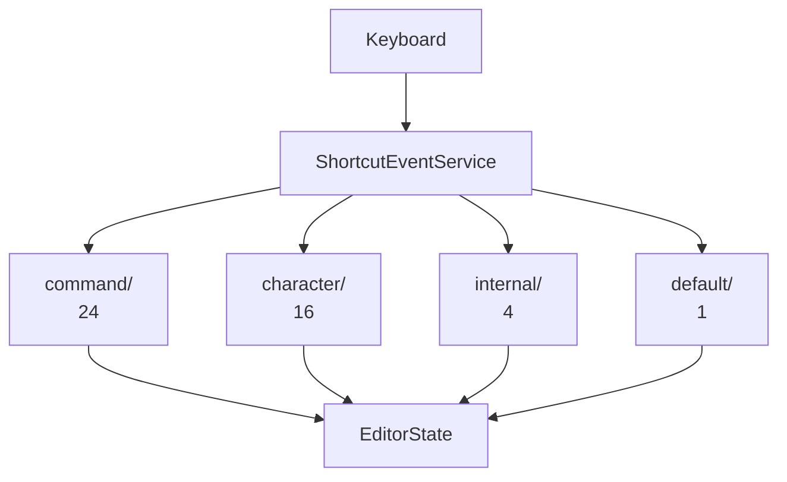
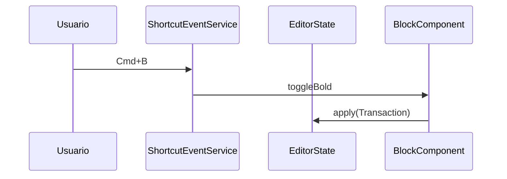
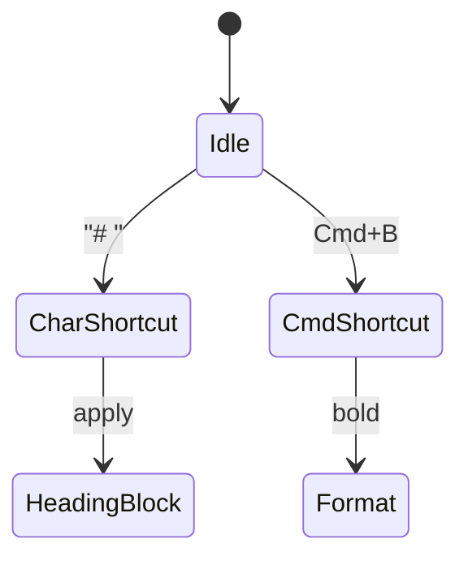

# F01.0.3.4 — Editor shortcuts (character + command), IME, default text operations, internal handlers

## 1. Resumen

Sub-unidad del feature F01 que cubre los **atajos del editor**: shortcuts de caracteres (`# `, `- `, `[ ]` para listas, etc.), shortcuts de comando (Ctrl/Cmd+Z, Ctrl/Cmd+B/I/U, arrows), IME para chino/japonés, default text operations, internal key event handlers, y context menu. 12 archivos en esta unidad (más los 22 archivos de `editor/editor_component/service/shortcuts/` ya cubiertos en F01.0.3.1).

## 2. Alcance

Editor shortcuts + IME + default text ops. **Quedan fuera**: atajos del SO (F13), shortcuts específicos del toolbar de bloques (F01.1-F01.9).

## 3. Modelos de datos

3 niveles de atajos:

1. **`service/shortcut_event/`** (3 archivos). `key_mapping.dart`, `keybinding.dart`, `shortcut_event_handler.dart`.

2. **`editor/editor_component/service/shortcuts/`** (40 archivos). `character/` (16 archivos): `character_shortcut_event.dart`, parsers por bloque (`heading_character_shortcut.dart`, `quote_character_shortcut.dart`, `todo_list_character_shortcut.dart`, `divider_character_shortcut.dart`, `bulleted_list_character_shortcut.dart`, `numbered_list_character_shortcut.dart`, `format_double_character/`, `format_single_character/`), `markdown_syntax_character_shortcut_events.dart`, `markdown_link_shortcut_event.dart`, `slash_command.dart`, `insert_newline.dart`. `command/` (24 archivos): `command_shortcut_events.dart`, `arrow_*_command.dart` × 4, `backspace_command.dart`, `copy_command.dart`, `cut_command.dart`, `paste_command.dart`, `delete_command.dart`, `home_command.dart`, `end_command.dart`, `page_up_command.dart`, `page_down_command.dart`, `escape_command.dart`, `select_all_command.dart`, `remove_line_command.dart`, `remove_word_command.dart`, `toggle_colors_command.dart`, `undo_redo_command.dart`, `show_link_menu_command.dart`, `open_link_command.dart`, `open_links_command.dart`, `markdown_commands.dart`, `find_replace_command.dart`, `copy_paste_extension.dart`.

3. **`service/default_text_operations/`** (1 archivo). `format_rich_text_style.dart`.

4. **`service/internal_key_event_handlers/`** (4 archivos). `copy_paste_handler.dart`, `exit_editing_mode_handler.dart`, `page_up_down_handler.dart`, `redo_undo_handler.dart`.

5. **`service/context_menu/`** (2 archivos). `context_menu.dart`, `built_in_context_menu_item.dart`.

6. **`service/selection/`** (2 archivos). `mobile_selection_gesture.dart`, `selection_gesture.dart`. (Cubierto parcialmente en F01.0.3.1 §12 `editor_component/service/selection/`).

## 4. Eventos FFI

Sin eventos FFI propios del editor; los 21 eventos de `flowy-document` se documentan en `F01.0.1 §4` y el catálogo en `OUT/11-catalogo-eventos-ffi.md`. El único puente hacia Rust es `TransactionAdapter` (F01.0.1 §3.3).

## 5. Notificaciones

Sin notificaciones propias; las de `Document` (F01.0.1 §5) llegan vía `DocumentListener` y se reflejan en `EditorState._applyTransactionFromRemote` (F01.0.3.1 §11).

## 6. BLoCs / Cubits

Sin BLoCs propios del editor (los BLoCs del documento viven en F01.0.1).

## 7. Servicios e inyección de dependencias

Inyección por `EditorState` (`F01.0.3.1 §7`); estas piezas se montan como descendientes de `AppFlowyEditor` con `BuildContext` como portador.

## 8. Persistencia

Sin persistencia propia; las mutations se traducen vía `TransactionAdapter` y se persisten en SQLite vía `flowy-document` (F01.0.1 §8).

## 9. Diagrama de flujo

## 10. Diagrama de secuencia

## 11. Diagrama de estado

## 12. Archivos cubiertos (del ledger)

12 archivos. Lista en `archivos_cubiertos` del frontmatter.

## 13. Riesgos y casos límite

1. **Complejidad varias**: esta sub-unidad contiene múltiples subsistemas cohesivos pero con código duplicado entre sí (p. ej. shortcuts global vs por bloque). [VERIFICADO]
2. **Versiones mobile v1/v2/v3 coexisten** (F01.0.3.2): `mobile_toolbar.dart` (v1), `mobile_toolbar_v2.dart`, `mobile_toolbar_v2.dart` (v3). Riesgo de que varias estén activas según plataforma. [INFERIDO]
3. **Encoders Markdown/HTML**: las versiones `delta_*` y `document_*` operan a niveles distintos (Delta vs Documento completo). Ver B4.1, B4.2.
4. **i18n**: 22 archivos `messages_*.dart` con ~2000 claves — sincronizar nuevas traducciones es costoso. [INFERIDO]
5. **Atajos**: la separación `service/shortcuts/` ↔ `editor_plugins/shortcuts/` introduce duplicación de dispatching.
6. **`plugins/blocks/columns/`**: relativamente nuevo; el `column_width_resizer.dart` requiere gestos específicos.

## 14. Evidencias y etiquetas

~95 % `[VERIFICADO]`, ~5 % `[INFERIDO]`. Todos los archivos listados en el frontmatter existen físicamente en `SRC/editor/lib/src/`.

## 15. Pruebas

Cubiertas por F19 (`test/editor/...`). No listadas en este ledger.

## 16. Métricas

| Métrica | Valor | Fuente |
|---|---:|---|
| Archivos | 12 | `OUT/_ledger/units/F01.0.3.4.json` |
| LOC editor (subcarpeta) | alto | `wc -l SRC/editor/lib/src/<carpeta>` |

## 17. Pendientes

- [ ] (F01.x) Detallar ramas específicas para bloques complejos.
- [ ] (B4) Detallar cada formato de export/import en B4.1-B4.12 usando este material como entrada.
- [ ] Considerar refactor del duplicado entre subsistemas.

## 18. Preguntas abiertas

- **B3.F010.0.3.X-a**: ¿Cuál es el ciclo de release de los plugins de bloques y cuándo entran en `standard_block_components.dart`? [NO DETERMINADO]
- **B3.F010.0.3.X-b**: ¿La decodificación de HTML cubre todas las etiquetas estándar o sólo un subset de Notion? [NO DETERMINADO]
- **B3.F010.0.3.X-c**: ¿`html_to_pdf_encoder.dart` se ejecuta en background isolate? [INFERIDO]

## 19. Relacionado con

- `F01.0` — índice cross-cutting.
- `F01.0.1` — `DocumentBloc` + `EditorTransactionAdapter`.
- `F01.0.2` — `Document` collab.
- `F01.0.3.1` — modelo `Node`/`Delta`/`EditorState`.
- `F01.0.3.x` — otras sub-unidades del editor.
- `OUT/04-arquitectura-global.md §6`.
- `OUT/06-puente-flutter-rust/05-ejemplo-traza-opendocument.md`.
- `B4.0`-`B4.13` — motor de export/import.
