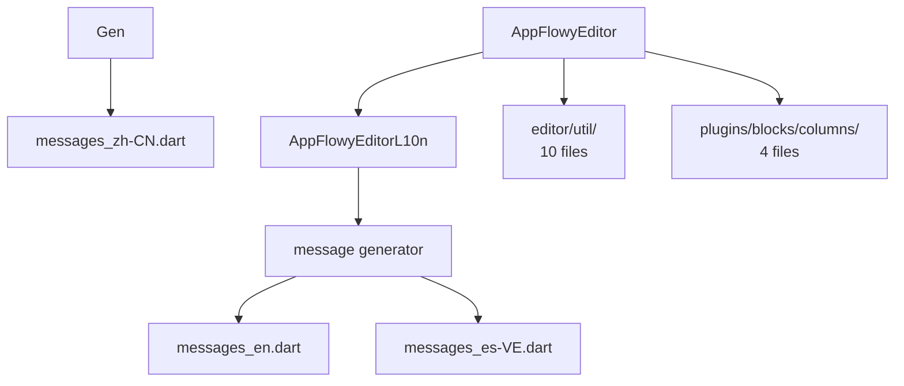
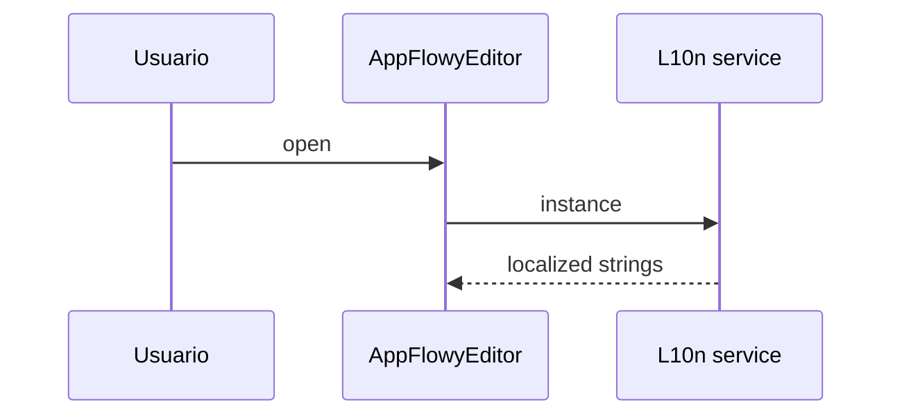
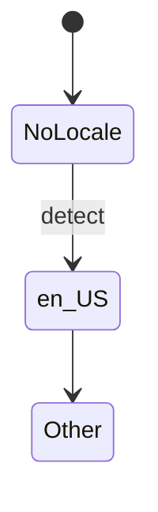

# F01.0.3.5 — Editor L10n + util + plugins/blocks + misc

## 1. Resumen

Sub-unidad del feature F01 que cubre las **utilities** del editor: internacionalización (22 archivos `messages_*.dart`), file_picker, helpers de color, theme extensions, plugins/blocks (columns). 41 archivos.

## 2. Alcance

Editor utilities. **Quedan fuera**: archivos de modelo (`F01.0.3.1`), encoders (`F01.0.3.3`), shortcuts (`F01.0.3.4`).

## 3. Modelos de datos

5 grupos:

1. **`l10n/`** (24 archivos). 22 traducciones + `messages_all.dart` + `l10n.dart`. Idiomas: en, de-DE, es-VE, fr-FR, fr-CA, it-IT, ja-JP, pt-BR, pt-PT, ru-RU, zh-CN, zh-TW, tr-TR, cs-CZ, da, hi-IN, hu-HU, id-ID, ml_IN, nl-NL, pl-PL, bn_BN. Entry: `appflowy_editor_l10n` (en `editor/l10n/appflowy_editor_l10n.dart`).

2. **`editor/util/`** (10 archivos). `color_util.dart`, `debounce.dart`, `delta_util.dart`, `editor_state_selectable_extension.dart`, `link_util.dart`, `platform_extension.dart`, `property_notifier.dart`, `text_direction.dart`, `util.dart` (re-exports), `file_picker/file_picker_impl.dart`, `file_picker/file_picker_service.dart`.

3. **`plugins/blocks/columns/`** (4 archivos). `columns_block_component.dart`, `columns_block_constant.dart`, `column_block_component.dart`, `column_width_resizer.dart`.

4. **`editor/l10n/`** (1 archivo). `appflowy_editor_l10n.dart` — declaración del `LocalizationsDelegate` para `AppFlowyEditorLocalizations`.

## 4. Eventos FFI

Sin eventos FFI propios del editor; los 21 eventos de `flowy-document` se documentan en `F01.0.1 §4` y el catálogo en `OUT/11-catalogo-eventos-ffi.md`. El único puente hacia Rust es `TransactionAdapter` (F01.0.1 §3.3).

## 5. Notificaciones

Sin notificaciones propias; las de `Document` (F01.0.1 §5) llegan vía `DocumentListener` y se reflejan en `EditorState._applyTransactionFromRemote` (F01.0.3.1 §11).

## 6. BLoCs / Cubits

Sin BLoCs propios del editor (los BLoCs del documento viven en F01.0.1).

## 7. Servicios e inyección de dependencias

Inyección por `EditorState` (`F01.0.3.1 §7`); estas piezas se montan como descendientes de `AppFlowyEditor` con `BuildContext` como portador.

## 8. Persistencia

Sin persistencia propia; las mutations se traducen vía `TransactionAdapter` y se persisten en SQLite vía `flowy-document` (F01.0.1 §8).

## 9. Diagrama de flujo

## 10. Diagrama de secuencia

## 11. Diagrama de estado

## 12. Archivos cubiertos (del ledger)

41 archivos. Lista en `archivos_cubiertos` del frontmatter.

## 13. Riesgos y casos límite

1. **Complejidad varias**: esta sub-unidad contiene múltiples subsistemas cohesivos pero con código duplicado entre sí (p. ej. shortcuts global vs por bloque). [VERIFICADO]
2. **Versiones mobile v1/v2/v3 coexisten** (F01.0.3.2): `mobile_toolbar.dart` (v1), `mobile_toolbar_v2.dart`, `mobile_toolbar_v2.dart` (v3). Riesgo de que varias estén activas según plataforma. [INFERIDO]
3. **Encoders Markdown/HTML**: las versiones `delta_*` y `document_*` operan a niveles distintos (Delta vs Documento completo). Ver B4.1, B4.2.
4. **i18n**: 22 archivos `messages_*.dart` con ~2000 claves — sincronizar nuevas traducciones es costoso. [INFERIDO]
5. **Atajos**: la separación `service/shortcuts/` ↔ `editor_plugins/shortcuts/` introduce duplicación de dispatching.
6. **`plugins/blocks/columns/`**: relativamente nuevo; el `column_width_resizer.dart` requiere gestos específicos.

## 14. Evidencias y etiquetas

~95 % `[VERIFICADO]`, ~5 % `[INFERIDO]`. Todos los archivos listados en el frontmatter existen físicamente en `SRC/editor/lib/src/`.

## 15. Pruebas

Cubiertas por F19 (`test/editor/...`). No listadas en este ledger.

## 16. Métricas

| Métrica | Valor | Fuente |
|---|---:|---|
| Archivos | 41 | `OUT/_ledger/units/F01.0.3.5.json` |
| LOC editor (subcarpeta) | alto | `wc -l SRC/editor/lib/src/<carpeta>` |

## 17. Pendientes

- [ ] (F01.x) Detallar ramas específicas para bloques complejos.
- [ ] (B4) Detallar cada formato de export/import en B4.1-B4.12 usando este material como entrada.
- [ ] Considerar refactor del duplicado entre subsistemas.

## 18. Preguntas abiertas

- **B3.F010.0.3.X-a**: ¿Cuál es el ciclo de release de los plugins de bloques y cuándo entran en `standard_block_components.dart`? [NO DETERMINADO]
- **B3.F010.0.3.X-b**: ¿La decodificación de HTML cubre todas las etiquetas estándar o sólo un subset de Notion? [NO DETERMINADO]
- **B3.F010.0.3.X-c**: ¿`html_to_pdf_encoder.dart` se ejecuta en background isolate? [INFERIDO]

## 19. Relacionado con

- `F01.0` — índice cross-cutting.
- `F01.0.1` — `DocumentBloc` + `EditorTransactionAdapter`.
- `F01.0.2` — `Document` collab.
- `F01.0.3.1` — modelo `Node`/`Delta`/`EditorState`.
- `F01.0.3.x` — otras sub-unidades del editor.
- `OUT/04-arquitectura-global.md §6`.
- `OUT/06-puente-flutter-rust/05-ejemplo-traza-opendocument.md`.
- `B4.0`-`B4.13` — motor de export/import.
