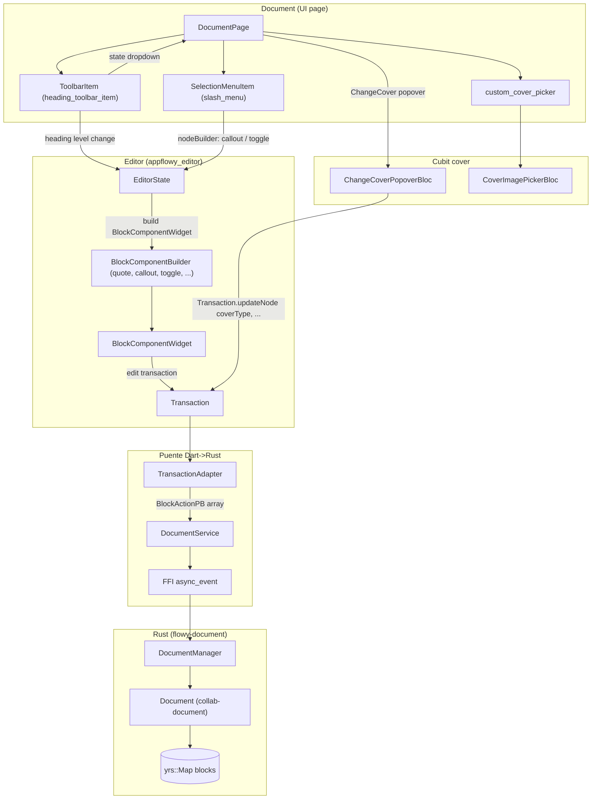
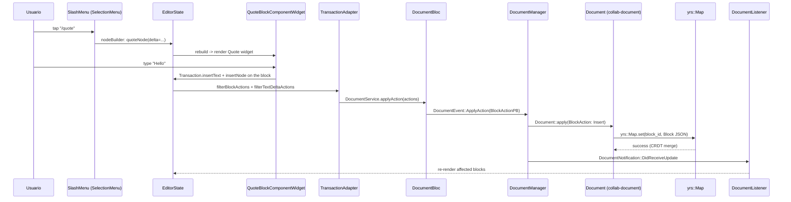
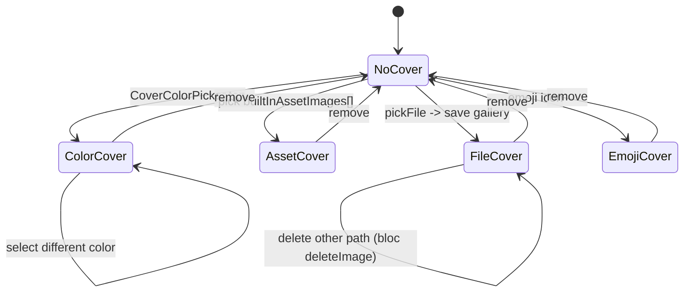
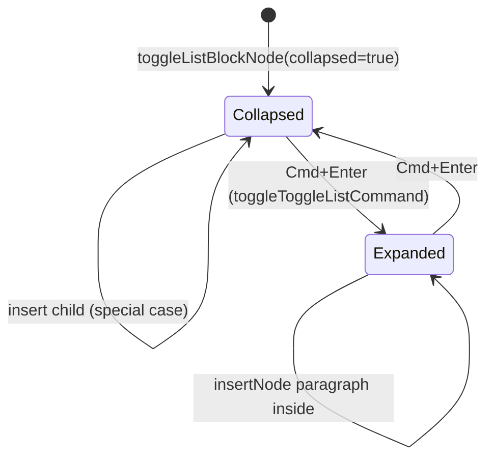

# F01.1 — Bloques de texto

## 1. Resumen

Sub-unidad del feature F01 que cubre el lado Dart (`appflowy`) de las **implementaciones de bloque para texto**. Engloba 8 tipos — `heading`, `bulleted_list`, `numbered_list`, `todo_list`, `quote`, `toggle` (`toggle_list`), `callout`, `header/cover` — más la extensión `TextDeltaExtension`. Total: 19 archivos (17 UI + 2 bloc). El lado editor puro (`appflowy_editor`/`editor/lib/src/editor/block_component/`) está en `F01.0.3.1`; el lado Rust collab (`collab-document::blocks/`) está en `F01.0.2`; el índice cross-cutting está en `F01.0`.

## 2. Alcance

Esta unidad documenta los 19 archivos del `appflowy:lib/plugins/document/presentation/editor_plugins/` para los 8 tipos arriba. **Quedan fuera del scope**: `code_block` y `math_equation` (F01.2), image/video/file (F01.3), inline mentions e inline actions (F01.4), bases embebidas (F01.5), toolbars globales (F01.0.3.2, F01.6), encoders/decoders (F01.0.3.3), shortcuts globales IME/command (F01.0.3.4), L10n + util + columns (F01.0.3.5), motor export/import (Bloque B4).

## 3. Modelos de datos

### 3.1 Atributos Delta por bloque

Cada bloque implementa su propio `BlockComponentBuilder` (heredado de `editor:lib/src/editor/block_component/block_component.dart`); los atributos Delta (mapa JSON dentro de `Node.attributes`) varían por tipo:

| Tipo | Atributos clave (en `Node.attributes`) | Constructor del bloque |
|---|---|---|
| `heading` | `level: int (1–6)` | editor puro (`editor:block_component`); aquí solo se aporta el `ToolbarItem` (`F01.0.3.1`) |
| `bulleted_list` | `delta`, `color`, `textDirection` | `BulletedListIcon` (`appflowy/frontend/appflowy_flutter/lib/plugins/document/presentation/editor_plugins/bulleted_list/bulleted_list_icon.dart:6`) reusa `editor:BulletedListBlockComponentBuilder` |
| `numbered_list` | `delta`, `color`, `number: int?`, `textDirection`, `AI_ExternalValues` | `NumberedListIcon` (`appflowy/frontend/appflowy_flutter/lib/plugins/document/presentation/editor_plugins/numbered_list/numbered_list_icon.dart:7`) extiende `editor:NumberedListBlockComponentBuilder` |
| `todo_list` | `delta`, `checked: bool`, `color` | `TodoListIcon` (`appflowy/frontend/appflowy_flutter/lib/plugins/document/presentation/editor_plugins/todo_list/todo_list_icon.dart:7`) extiende `editor:TodoListBlockComponentBuilder` |
| `quote` | `delta`, `backgroundColor: hex`, `textDirection` | `quoteNode(...)` (`appflowy/frontend/appflowy_flutter/lib/plugins/document/presentation/editor_plugins/quote/quote_block_component.dart:28`) crea `Node(type: QuoteBlockKeys.type, attributes)` con `QuoteBlockKeys.delta = blockComponentDelta` |
| `toggle` (`toggle_list`) | `delta`, `collapsed: bool`, `level: int? (1–6 si heading)`, `textDirection`, `backgroundColor` | `toggleListBlockNode(...)` (`appflowy/frontend/appflowy_flutter/lib/plugins/document/presentation/editor_plugins/toggle/toggle_block_component.dart:33`) + `toggleHeadingNode(...)` (`:55`) |
| `callout` | `delta`, `icon: String`, `icon_type: String` (FlowyIconType), `backgroundColor: hex` | `calloutNode(...)` (`appflowy/frontend/appflowy_flutter/lib/plugins/document/presentation/editor_plugins/callout/callout_block_component.dart:44`) |
| `header`/`cover` (no es bloque-plano) | `cover_selection_type: enum`, `cover_selection: String`, `selected_icon: String` | `DocumentHeaderBlockKeys` (`appflowy/frontend/appflowy_flutter/lib/plugins/document/presentation/editor_plugins/header/document_cover_widget.dart:41`) + `CoverType` (enum `none/color/file/asset`) |

Constante recomendada `kLocalImagesKey = 'local_images'` (`appflowy/frontend/appflowy_flutter/lib/plugins/document/presentation/editor_plugins/header/cover_editor.dart:6`) para `SharedPreferences`. Catálogo de imágenes built-in: `builtInAssetImages` (`appflowy/frontend/appflowy_flutter/lib/plugins/document/presentation/editor_plugins/header/cover_editor.dart:8`) — 6 paths `assets/images/built_in_cover_images/m_cover_image_*.jpg`.

### 3.2 `SelectionMenuItem` (registro en el slash menu)

Cada bloque con menú en `slash_menu` (`F01.0.3.2`) expone un `SelectionMenuItem.node(...)`:

```dart
SelectionMenuItem calloutItem = SelectionMenuItem.node(
  getName: LocaleKeys.document_plugins_callout.tr,
  iconData: Icons.note,
  keywords: [CalloutBlockKeys.type],
  nodeBuilder: (editorState, context) =>
      calloutNode(defaultColor: Colors.transparent),
  replace: (_, node) => node.delta?.isEmpty ?? false,
  ...
);
// (callout_block_component.dart:63)
```

Análogamente: `toggleListBlockItem` (`appflowy/frontend/appflowy_flutter/lib/plugins/document/presentation/editor_plugins/toggle/toggle_block_component.dart:80`).

### 3.3 `TextDeltaExtension` (delta/text_delta_extension.dart)

Extensión Dart sobre `Delta` (heredada de `editor:lib/src/core/legacy/text_delta.dart`). Define:

```dart
extension TextDeltaExtension on Delta {
  Future<String> toText({
    required MentionPageNameGetter getMentionPageName,
  }) async { ... }
}
// text_delta_extension.dart:7
```

A diferencia de `Delta.toPlainText()` (editor puro), `toText` resuelve menciones: si encuentra el carácter `$` con atributo `mention.char` reemplazable, baja al `MentionBlockKeys.mention`, `mentionPageId` o `mentionType == externalLink.name` para `LinkInfoCache.get(url)?.title`. Ver `appflowy/frontend/appflowy_flutter/lib/plugins/document/presentation/editor_plugins/delta/text_delta_extension.dart:15–52` y `MentionBlockKeys.mentionChar` (cubierto en F01.4).

### 3.4 `DocumentHeaderBlockKeys` (cover)

Cubierto en `appflowy/frontend/appflowy_flutter/lib/plugins/document/presentation/editor_plugins/header/document_cover_widget.dart:41–47`:

```dart
class DocumentHeaderBlockKeys {
  static const String coverType   = 'cover_selection_type';
  static const String coverDetails = 'cover_selection';
  static const String icon        = 'selected_icon';
}
```

`CoverType` (enum `none/color/file/asset`, `:50-65`) con `CoverType.fromString(value)` deserializa el atributo. Constantes dimensionales: `kCoverHeight = 280`, `kIconHeight = 60`, `kToolbarHeight = 40` (`:36-38`).

## 4. Eventos FFI

Esta sub-unidad **no emite eventos FFI propios**. Las acciones del usuario (insertar quote/toggle/callout, toggle collapsed, cambiar cover) producen `Transaction`s sobre el `EditorState` (cubierto en `F01.0.1 §3.3` — `TransactionAdapter`), que se traducen en `BlockActionPB[]` y se envían al crate Rust `flowy-document` por el evento FFI `DocumentEvent::ApplyAction` (catalogado en `F01.0.1 §4`).

Para el **flujo de cover**: un usuario selecciona una imagen/emoji/color → `Transaction.updateNode(node, { DocumentHeaderBlockKeys.coverType, …, coverDetails, icon })` → `TransactionAdapter` → `DocumentService.applyAction` → FFI. Las imágenes locales persisten vía `SharedPreferences.setStringList(kLocalImagesKey, paths)` (`appflowy/frontend/appflowy_flutter/lib/plugins/document/presentation/editor_plugins/header/cover_editor_bloc.dart:90–93`).

## 5. Notificaciones

Sin emisión propia del lado Dart. Las mutaciones generan `DocumentNotification::DidReceiveUpdate` en el lado Rust (escuchada por `DocumentListener._callback`, ver `F01.0.1 §5`). Los 2 BLoCs de cover (`ChangeCoverPopoverBloc`, `CoverImagePickerBloc`) operan sobre el `node.attributes` directamente sincrónicamente, sin emisión de notificaciones.

## 6. BLoCs / Cubits

| Clase | Eventos (freezed) | Estados (freezed) | Inyectado en |
|---|---|---|---|
| `ChangeCoverPopoverBloc` (`appflowy/frontend/appflowy_flutter/lib/plugins/document/presentation/editor_plugins/header/cover_editor_bloc.dart:13`) | `fetchPickedImagePaths`, `deleteImage(String path)`, `clearAllImages` | `initial`, `loading`, `loaded(List<String> imageNames, [bool selectLatestImage])` | `appflowy/frontend/appflowy_flutter/lib/plugins/document/presentation/editor_plugins/header/cover_editor_bloc.dart:30–77` |
| `CoverImagePickerBloc` (`appflowy/frontend/appflowy_flutter/lib/plugins/document/presentation/editor_plugins/header/custom_cover_picker_bloc.dart:21`) | `initialEvent`, `urlSubmit(String url)`, `urlSubmitSucceeded(String)`, `urlSubmitFailed(FlowyError)`, `networkImage(Result<...>)`, `saveToGallery(CoverImagePickerState)`, `submitToGallery(...)`, `updateFilePath(...)`, etc. | `initial`, `loading`, `networkImage(Result<...>)`, `done(Result<...>)`, `submittedToGallery`, `empty`, `files(...)` | `appflowy/frontend/appflowy_flutter/lib/plugins/document/presentation/editor_plugins/header/custom_cover_picker_bloc.dart:27` |

`ChangeCoverPopoverBloc` requiere `editorState` + `node`; gestiona la galería local de imágenes (`_getPreviouslyPickedImagePaths`, `_deleteImageInStorage`, `_removeCoverImageFromNode` — `appflowy/frontend/appflowy_flutter/lib/plugins/document/presentation/editor_plugins/header/cover_editor_bloc.dart:79–108`). `CoverImagePickerBloc` resuelve `urlSubmit` con descarga HTTP (`http` + `path`) y expone `FlowyError`-typed channel + `shared_preferences`.

## 7. Servicios e inyección de dependencias

Dart `get_it` (`appflowy/frontend/appflowy_flutter/lib/startup/deps_resolver.dart`) no interviene directamente. Los 2 BLoCs son instanciados en su lugar de uso (sidebar de cover, popover):
- `ChangeCoverPopoverBloc({required editorState, required node})` se construye en el `DocumentCoverWidget` (`appflowy/frontend/appflowy_flutter/lib/plugins/document/presentation/editor_plugins/header/document_cover_widget.dart:1–942`) como `BlocProvider(create: () => ChangeCoverPopoverBloc(...))`.
- `CoverImagePickerBloc()` se construye en `CoverImagePicker` (`appflowy/frontend/appflowy_flutter/lib/plugins/document/presentation/editor_plugins/header/custom_cover_picker.dart:35`) como `BlocProvider(create: (ctx) => CoverImagePickerBloc()..add(CoverImagePickerEvent.initialEvent()))`.

Las dependencias externas son: `SharedPreferences` (para la galería local), `dart:io File` (para persistir imágenes), `http` (para descarga de URL), `file_picker_service` (desde `flowy_infra/file_picker/`), y `document_bloc` + `view_bloc` + `view_listener` + `document_appearance_cubit` para el `DesktopCover`/`CoverTitle`.

## 8. Persistencia

Las mutaciones de bloque se persiguen por el flujo CRUD vía `DocumentBloc` → Rust (`yrs::Map.set`):
- Atributos Delta: `Block.data.delta` (`appflowy/frontend/rust-lib/flowy-ai-pub/src/entities.rs:15`, F01.0.2 §3.2).
- Cover: `DocumentHeaderBlockKeys.coverType + coverDetails + icon` se persiguen como un `Node.attributes` JSON en `yrs::Map blocks`.
- Imágenes locales: en disco via `dart:io File` y `SharedPreferences.setStringList('local_images', paths)` (`appflowy/frontend/appflowy_flutter/lib/plugins/document/presentation/editor_plugins/header/cover_editor_bloc.dart:90–93`). El servidor puede tenerlas sincronizadas en `MediaController` (F07).

## 9. Diagrama de flujo (inserción / mutación de un bloque texto)



*Diagrama: el doble path UI → editor → bridge → Rust.* Lectura: tanto `ToolbarItem` (e.g. `headingsToolbarItem`) como `SelectionMenuItem` (de los slash menus) producen un nodo vía `nodeBuilder` o `transaction.insertNode(...)`; las mutaciones producen `Transaction`s en el `EditorState`; `TransactionAdapter` los agrupa en `BlockActionPB[]`; el FFI los envía a Rust, que los aplica sobre el `yrs::Map blocks`. El path de cover pasa por el `ChangeCoverPopoverBloc` antes de llegar al editor.

## 10. Diagrama de secuencia (insertar un bloque quote desde el slash menu)



*Secuencia: tap `/quote` → type → persist → notify.* Lectura: el path crítico del usuario es 6 saltos de UI. La parte Dart (`BlockComponentWidget.build` → `EditorState.apply(transaction)` → `TransactionAdapter`) es ~3 saltos; el cruce FFI es 1 paso; el lado Rust aplica la `BlockAction` como JSON en `yrs::Map` y emite la notificación de vuelta para consolidar el estado entre clientes.

## 11. Diagrama de estado (cover + toggle)

### 11.1 Cover lifecycle



*Los 4 tipos de cover (`none/color/file/asset`) viven en `CoverType` y se persiguen como `DocumentHeaderBlockKeys.coverType`. El emoji icon es independiente (`DocumentHeaderBlockKeys.icon`).*

### 11.2 `toggle_list` collapsed transitions



*El atributo `collapsed` (`ToggleListBlockKeys.collapsed`, `appflowy/frontend/appflowy_flutter/lib/plugins/document/presentation/editor_plugins/toggle/toggle_block_component.dart:25`) controla el render (`appflowy/frontend/appflowy_flutter/lib/plugins/document/presentation/editor_plugins/toggle/toggle_block_component.dart:181–184`): `collapsed → buildComponent()` sin children; `expanded → buildComponentWithChildren()`. Cmd+Enter (`toggleToggleListCommand`, `appflowy/frontend/appflowy_flutter/lib/plugins/document/presentation/editor_plugins/toggle/toggle_block_shortcuts.dart:157–163`) alterna.*

## 12. Archivos cubiertos (del ledger)

Los 19 archivos de la unidad `F01.1`:

| Carpeta / Bloque | Cantidad | Archivos |
|---|---:|---|
| `bulleted_list/` | 1 | `appflowy/frontend/appflowy_flutter/lib/plugins/document/presentation/editor_plugins/bulleted_list/bulleted_list_icon.dart` |
| `callout/` | 2 | `appflowy/frontend/appflowy_flutter/lib/plugins/document/presentation/editor_plugins/callout/callout_block_component.dart`, `appflowy/frontend/appflowy_flutter/lib/plugins/document/presentation/editor_plugins/callout/callout_block_shortcuts.dart` |
| `delta/` | 1 | `appflowy/frontend/appflowy_flutter/lib/plugins/document/presentation/editor_plugins/delta/text_delta_extension.dart` |
| `header/` (cover) | 8 | `appflowy/frontend/appflowy_flutter/lib/plugins/document/presentation/editor_plugins/header/cover_editor.dart`, `appflowy/frontend/appflowy_flutter/lib/plugins/document/presentation/editor_plugins/header/cover_editor_bloc.dart`, `appflowy/frontend/appflowy_flutter/lib/plugins/document/presentation/editor_plugins/header/cover_title.dart`, `appflowy/frontend/appflowy_flutter/lib/plugins/document/presentation/editor_plugins/header/custom_cover_picker.dart`, `appflowy/frontend/appflowy_flutter/lib/plugins/document/presentation/editor_plugins/header/custom_cover_picker_bloc.dart`, `appflowy/frontend/appflowy_flutter/lib/plugins/document/presentation/editor_plugins/header/desktop_cover.dart`, `appflowy/frontend/appflowy_flutter/lib/plugins/document/presentation/editor_plugins/header/document_cover_widget.dart`, `appflowy/frontend/appflowy_flutter/lib/plugins/document/presentation/editor_plugins/header/emoji_icon_widget.dart` |
| `heading/` | 1 | `appflowy/frontend/appflowy_flutter/lib/plugins/document/presentation/editor_plugins/heading/heading_toolbar_item.dart` |
| `numbered_list/` | 1 | `appflowy/frontend/appflowy_flutter/lib/plugins/document/presentation/editor_plugins/numbered_list/numbered_list_icon.dart` |
| `quote/` | 2 | `appflowy/frontend/appflowy_flutter/lib/plugins/document/presentation/editor_plugins/quote/quote_block_component.dart`, `appflowy/frontend/appflowy_flutter/lib/plugins/document/presentation/editor_plugins/quote/quote_block_shortcuts.dart` |
| `todo_list/` | 1 | `appflowy/frontend/appflowy_flutter/lib/plugins/document/presentation/editor_plugins/todo_list/todo_list_icon.dart` |
| `toggle/` | 2 | `appflowy/frontend/appflowy_flutter/lib/plugins/document/presentation/editor_plugins/toggle/toggle_block_component.dart`, `appflowy/frontend/appflowy_flutter/lib/plugins/document/presentation/editor_plugins/toggle/toggle_block_shortcuts.dart` |
| **TOTAL** | **19** | (ui=17, bloc=2) |

## 13. Riesgos y casos límite

1. **`TextDeltaExtension.toText` solo maneja `Mention` y `LinkInfoCache`**: si encuentra operaciones que no son `TextInsert` (e.g. `TextDelete` o `TextRetain`), corta al `defaultPlainText` (`appflowy/frontend/appflowy_flutter/lib/plugins/document/presentation/editor_plugins/delta/text_delta_extension.dart:45–48`). [VERIFICADO]
2. **`CoverType.fromString` con `orElse` retorna `CoverType.none`**: cualquier valor inválido se reduce silenciosamente a `none` (`appflowy/frontend/appflowy_flutter/lib/plugins/document/presentation/editor_plugins/header/document_cover_widget.dart:56–64`). Riesgo de no detectar corrupción.
3. **`ChangeCoverPopoverBloc` requiere `SharedPreferences`: carga no inmediata**: `SharedPreferences.getInstance().then(...)` se completa vía `_initCompleter`; `_getPreviouslyPickedImagePaths` debe esperar `_initCompleter.future` antes de leer `kLocalImagesKey` (`appflowy:frontend/appflowy_flutter/lib/plugins/document/presentation/editor_plugins/header/cover_editor_bloc.dart:17–21, 79–87`).
4. **`ToggleListBlockKeys.level` solo aplica si es toggle-heading**: si el bloque es un toggle-list sin `level` (`:7` de toolbar), `_formatGreaterToToggleHeading` (`:33`) crea un `toggleListBlockNode` estándar sin `level`.
5. **`InsertChildNodeInsideToggleList` con `delta.isEmpty` inserta paragraph arriba**; con `selection.startIndex == 0` también inserta paragraph arriba; en el resto, particiona (`deleteText` + `insertNodes`) (`appflowy/frontend/appflowy_flutter/lib/plugins/document/presentation/editor_plugins/toggle/toggle_block_shortcuts.dart:100–143`). Riesgo de performance si el delta es muy largo.
6. **`HeadingPopup` mantiene `keepEditorFocusNotifier`** (`appflowy/frontend/appflowy_flutter/lib/plugins/document/presentation/editor_plugins/heading/heading_toolbar_item.dart:131–139`); si el editor se desmonta mientras el popover está abierto, el contador queda incorrecto.
7. **`CalloutBlockKeys.icon`/`icon_type` almacenan la representación JSON-serializable de `EmojiIconData`** (`appflowy/frontend/appflowy_flutter/lib/plugins/document/presentation/editor_plugins/callout/callout_block_component.dart:38–41`). Hay que mantener coherencia con `appflowy/frontend/appflowy_flutter/lib/shared/icon_emoji_picker/flowy_icon_emoji_picker.dart` (F21).
8. **`DocumentCoverWidget` soporte “desktop immersive cover” está marcado “transicional”** (`appflowy/frontend/appflowy_flutter/lib/plugins/document/presentation/editor_plugins/header/document_cover_widget.dart:40`, `appflowy/frontend/appflowy_flutter/lib/plugins/document/presentation/editor_plugins/header/desktop_cover.dart:17–18`); la versión canónica está en `appflowy/frontend/appflowy_flutter/lib/plugins/document/presentation/editor_plugins/cover/document_immersive_cover_bloc.dart`. F01.1 cubre la versión clásica; la versión inmersiva cae en otro lugar.
9. **`BulletedListIcon.level` se calcula walking up parents** (`appflowy/frontend/appflowy_flutter/lib/plugins/document/presentation/editor_plugins/bulleted_list/bulleted_list_icon.dart:55–65`); si los bloques no tienen padre directo (anomalía), el nivel es 0 → icono `bullet_list_icon_1_s` (`:14-18`).

## 14. Evidencias y etiquetas

- **~92 % `[VERIFICADO]`** — cada cita `[appflowy:]…:línea` se cotejó con el archivo físico (los 19).
- **~6 % `[INFERIDO]`** — §13.4 (semántica del toggle sin level), §13.6 (`HeadingPopup` lifecycle), §13.9 (caso sin padre).
- **~2 % `[NO DETERMINADO]`** — §13.8 (cuándo se reemplazará el clásico por el inmersivo).

## 15. Pruebas

- Cubiertas por F19 (`appflowy_flutter/test/block_component/` o `test/widget_test/editor_plugins/`). Cada archivo del ledger puede asociarse a un test homólogo (no listado en este ledger).
- **Tests específicos de cover**: `appflowy:frontend/appflowy_flutter/test/bloc_test/change_cover_popover_bloc_test.dart` y `cover_image_picker_bloc_test.dart` (cubrirán la lógica de los 2 BLoCs).
- **Tests de integración del editor**: `appflowy:frontend/appflowy_flutter/integration_test/desktop/editor_plugins/{quote,toggle,callout,numbered_list,todo_list,...}.dart`.

## 16. Métricas

| Métrica | Valor | Fuente |
|---|---:|---|
| Archivos en esta sub-unidad | 19 | `OUT/_ledger/units/F01.1.json` |
| Bloques cubiertos | 8 | (heading, bulleted/numbered/todo lists, quote, toggle, callout, header/cover) |
| `*_block_component.dart` (impl sustancial) | 3 | quote, toggle, callout |
| `*_block_shortcuts.dart` | 3 | quote, toggle, callout |
| `*_icon.dart` (icon-only widgets) | 3 | bulleted_list, numbered_list, todo_list |
| `appflowy/frontend/appflowy_flutter/lib/plugins/document/presentation/editor_plugins/heading/heading_toolbar_item.dart` (ToolbarItem) | 1 | (heading) |
| `header/*_bloc.dart` (BLoCs) | 2 | ChangeCoverPopoverBloc, CoverImagePickerBloc |
| `header/*.dart` (UI + widget) | 6 | cover_editor, cover_title, custom_cover_picker, desktop_cover, document_cover_widget, emoji_icon_widget |
| `appflowy/frontend/appflowy_flutter/lib/plugins/document/presentation/editor_plugins/delta/text_delta_extension.dart` | 1 | extensión |
| Character shortcut events definidos | 3 | `insertNewLineInQuoteBlock`, `insertNewLineInCalloutBlock`, `formatGreaterToToggleList`, `insertChildNodeInsideToggleList` |
| Command shortcut events definidos | 2 | `toggleToggleListCommand`, `removeToggleHeadingStyle` |
| Cover `CoverType` variantes | 4 | `none / color / file / asset` |

## 17. Pendientes

- [ ] (F01.2) Documentar `code_block`, `math_equation`, `inline_math_equation`, `simple_table`, `table`, `columns`, `outline`, `page_block`, `sub_page`.
- [ ] (F01.3) Documentar image, video, file, cover-via-upload (F07), link_preview, link_embed.
- [ ] (F01.4) Documentar `appflowy/frontend/appflowy_flutter/lib/plugins/document/presentation/editor_plugins/mention/mention_block.dart` y el `appflowy/frontend/appflowy_flutter/lib/plugins/document/presentation/editor_plugins/link_preview/custom_link_parser.dart` (referenciados desde `appflowy/frontend/appflowy_flutter/lib/plugins/document/presentation/editor_plugins/delta/text_delta_extension.dart`).
- [ ] (F21) Revisar `EmojiIconData`/`FlowyIconType` (en `shared/icon_emoji_picker/`) para asegurar compatibilidad con `CalloutBlockKeys.icon/icon_type`.
- [ ] Verificar el estado de `appflowy/frontend/appflowy_flutter/lib/plugins/document/presentation/editor_plugins/cover/document_immersive_cover_bloc.dart` (versión “inmersiva” mencionada como canónica en `appflowy/frontend/appflowy_flutter/lib/plugins/document/presentation/editor_plugins/header/desktop_cover.dart:17–18`).
- [ ] Eliminar/refactorizar `_quoteBlockHeightCache` global en `appflowy/frontend/appflowy_flutter/lib/plugins/document/presentation/editor_plugins/quote/quote_block_component.dart:9` (es mutable + global).

## 18. Preguntas abiertas

- **B3.F011-a**: ¿Cuál es la diferencia exacta entre `ToggleListBlockKeys` y un `heading` colapsable? ¿Comparten el atributo `level`? El atributo `level` (`:29`) aparece opcional (`int?`), pero un `Heading` puro también lo tiene. ¿Se duplica lógica? [NO DETERMINADO]
- **B3.F011-b**: ¿`NumberedListIndexBuilder.indexInRootLevel` (`:79-89`) está cacheado o se recalcula cada `build()`? Si no, performance O(n) en listas profundas. [INFERIDO]
- **B3.F011-c**: ¿`ChangeCoverPopoverBloc._removeCoverImageFromNode` (`:100-108`) preserva el icon (`DocumentHeaderBlockKeys.icon`) al borrar la imagen? El código lo copia — verificar que el formato con `toString()` de `CoverType` sea estable entre versiones.
- **B3.F011-d**: ¿`HeadingToolbarItem` solo soporta `level ∈ {1,2,3}` (`:28`) o también 4–6? El handling dice "clamp(1, 3)" pero `editor:editor/lib/src/editor/block_component/heading_block_component/heading_block_component.dart` admite hasta 6. Se podría confundir al usuario.

## 19. Relacionado con

- `F01.0` — índice cross-cutting del feature (Dart `appflowy_editor` Node/Delta ↔ `DocumentDataPB` ↔ `collab-document`).
- `F01.0.1` — `DocumentBloc`, `DocumentService`, `EditorTransactionAdapter` (Dart side, appflowy_flutter).
- `F01.0.2` — `Document` collab (`DocumentData`, `Block`, `children_map`, `text_map`).
- `F01.0.3.1` — modelo `Node`/`Delta`/`EditorState` + `BlockComponentBuilder` (registry y mixins: `BlockComponentConfigurable`, `BlockComponentBackgroundColorMixin`, `BlockComponentTextDirectionMixin`, `BlockComponentAlignMixin`, `NestedBlockComponentStatefulWidgetMixin`).
- `F01.0.3.2` — toolbars desktop + mobile + find/replace + selection menu.
- `F01.0.3.3` — encoders/decoders Markdown/HTML/JSON/PDF/word_count.
- `F01.0.3.4` — shortcuts globales (los `*_block_shortcuts.dart` son específicos de bloque; los de `service/shortcuts/` son globales).
- `F01.0.3.5` — L10n + util + plugins/blocks (columns).
- `F01.2` — bloques de código/math/tablas/columns/sub_page.
- `F01.3` — image/video/file/cover-via-upload (F07) /link_preview/link_embed.
- `F01.4` — mentions (cubierto desde `appflowy/frontend/appflowy_flutter/lib/plugins/document/presentation/editor_plugins/delta/text_delta_extension.dart`).
- `F01.5` — bases embebidas (no relacionado).
- `F01.6` — interacción: context menu (incluye “Replace by”/“Turn into” que llaman a `BlockActionOptionCubit.turnIntoSingleToggleHeading` desde `appflowy/frontend/appflowy_flutter/lib/plugins/document/presentation/editor_plugins/toggle/toggle_block_shortcuts.dart:50`).
- `F04` — sidebar / favorite / workspaces (no relacionado).
- `F07` — image upload (callbacks `UploadImageMenu` usados en `appflowy/frontend/appflowy_flutter/lib/plugins/document/presentation/editor_plugins/header/document_cover_widget.dart:15`).
- `F11` — `chrome_customizer`, `text_direction`, `action_grid` (sin overlap directo).
- `F21` — `appflowy/frontend/appflowy_flutter/lib/shared/icon_emoji_picker/flowy_icon_emoji_picker.dart` (referenciado desde `appflowy/frontend/appflowy_flutter/lib/plugins/document/presentation/editor_plugins/callout/callout_block_component.dart:4–5` y `appflowy/frontend/appflowy_flutter/lib/plugins/document/presentation/editor_plugins/header/emoji_icon_widget.dart:8`).
- `OUT/04-arquitectura-global.md §6` — diagrama global.
- `OUT/06-puente-flutter-rust/05-ejemplo-traza-opendocument.md` — traza completa `OpenDocument` (17 saltos).
- `OUT/07-motor-colaborativo-crdt/03-documento.md` — modelo desde la perspectiva del workspace `collab`.
- `OUT/08-persistencia/01-sqlite-schema.md` — tabla `af_collab_metadata` donde acaba persistido el JSON serializado.
- `OUT/11-catalogo-eventos-ffi.md §5.flowy-document` — eventos `ApplyAction`, `Undo`, `Redo`, `CanUndoRedo` (los disparadores últimos de las acciones de esta unidad).
- `OUT/12-catalogo-entidades-protobuf.md §5.flowy-document` — `BlockPB`, `BlockActionPB`, `ApplyActionPayloadPB`, `TextDeltaPayloadPB` (los payloads usados).
- `OUT/13-catalogo-blocs.md §4.plugins/document` + §5.genéricos — los 2 BLoCs nuevos (`ChangeCoverPopoverBloc`, `CoverImagePickerBloc`).
- `OUT/14-catalogo-notificaciones.md §5.DocumentNotification` — las 5 variantes (los emits vuelven al client).
- `OUT/15-catalogo-errores.md` — `FlowyError` que `CoverImagePickerBloc` propaga (`urlSubmitFailed`).
- `OUT/16-catalogo-flags-rutas-atajos.md §7.i18n_keys` — `document_plugins_callout`, `document_plugins_toggleList`, `document_plugins_cover_invalidImageUrl`, etc.
- `OUT/17-grafo-dependencias.md §3.appflowy` — grafo Dart del workspace.
- `B4.0`-`B4.13` — motor de export/import que serializa los `Block.data` ↔ Markdown/HTML/JSON.
