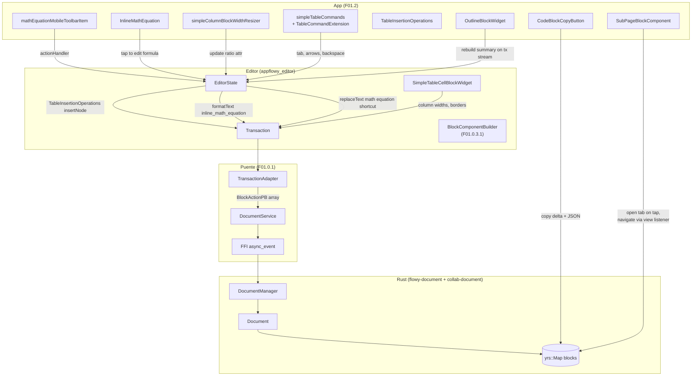
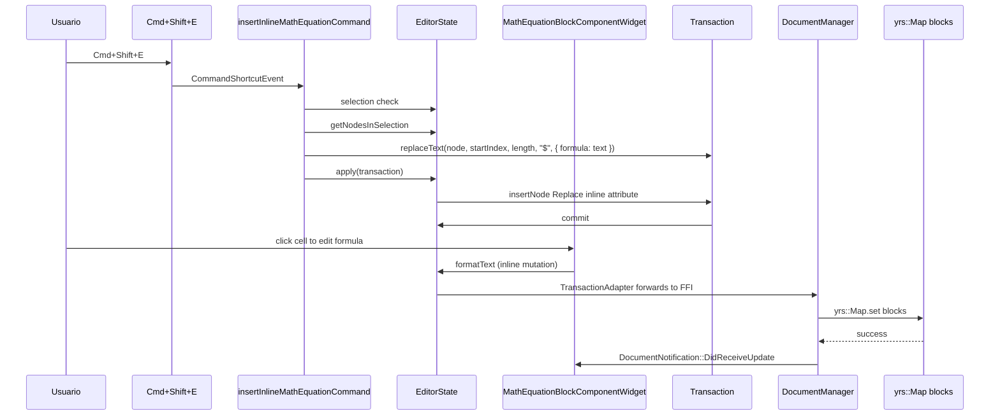
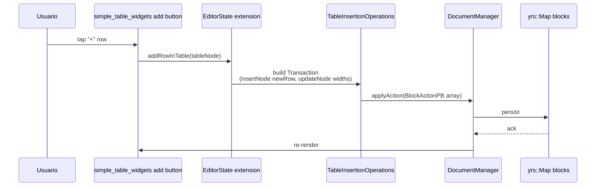
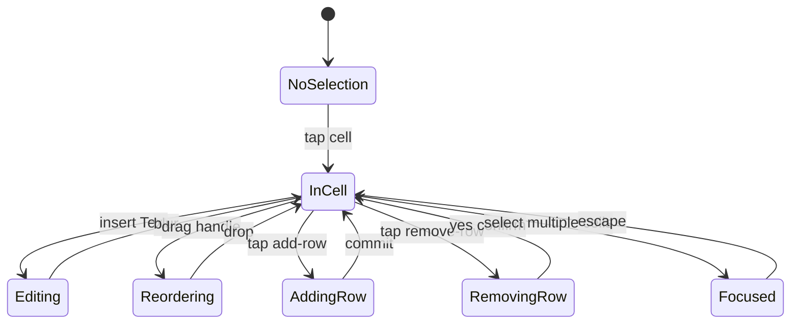

# F01.2 — Bloques ricos

## 1. Resumen

Sub-unidad del feature F01 que cubre el lado Dart (`appflowy`) de los **bloques ricos**: 9 tipos — `code_block`, `math_equation`, `inline_math_equation`, `simple_table` (con 45 archivos: raíz + operations + shortcuts + widgets), `table` (legacy, 2 archivos de menú/opciones; el `table_block_component` vive en `F01.0.3.1`), `columns` (5 archivos de `simple_columns`+`simple_column`), `outline`, `page_block`, `sub_page`. Total: 67 archivos (todos UI, sin BLoCs propios). El lado editor puro está en `F01.0.3.1`; el collab en `F01.0.2`; el índice cross-cutting en `F01.0`; los bloques de texto análogos a esta unidad están en `F01.1`.

## 2. Alcance

Documenta los 67 archivos de `appflowy:lib/plugins/document/presentation/editor_plugins/` para los 9 tipos arriba. **Quedan fuera**: image/video/file (F01.3), inline mentions/actions (F01.4), bases embebidas (F01.5), interacción (F01.6), encoders/decoders (F01.0.3.3), shortcuts globales (F01.0.3.4), motor de export/import (Bloque B4). El lado `editor:block_component/` puro está en `F01.0.3.1`.

## 3. Modelos de datos

### 3.1 Atributos Delta por bloque

| Tipo | Atributos clave (`Node.attributes`) | Constructor del bloque |
|---|---|---|
| `code_block` | `delta`, `language: String (opcional)` | F01.0.3.1 builder + `codeBlockNode()` |
| `math_equation` | `formula: String (LaTeX)` | `mathEquationNode({formula})` en `appflowy/frontend/appflowy_flutter/lib/plugins/document/presentation/editor_plugins/math_equation/math_equation_block_component.dart:29` |
| `inline_math_equation` (atributo inline en RichText) | `formula: String` | `InlineMathEquationKeys.formula = 'formula'` (`appflowy/frontend/appflowy_flutter/lib/plugins/document/presentation/editor_plugins/inline_math_equation/inline_math_equation.dart:13`) vía `transaction.formatText(...)` |
| `simple_table` | `enableHeaderRow`, `enableHeaderColumn`, `columnColors`, `rowColors`, `columnAligns`, `rowAligns`, `columnBoldAttributes`, `rowBoldAttributes`, `columnTextColors`, `rowTextColors`, `columnWidths`, `distributeColumnWidthsEvenly` | `simpleTableBlockNode(...)` (`appflowy/frontend/appflowy_flutter/lib/plugins/document/presentation/editor_plugins/simple_table/simple_table_block_component.dart:81`) |
| `simple_table_row` | (sin atributos propios) | `simpleTableRowBlockNode({children})` (`appflowy/frontend/appflowy_flutter/lib/plugins/document/presentation/editor_plugins/simple_table/simple_table_row_block_component.dart:12`) |
| `simple_table_cell` | (sin atributos propios) | `simpleTableCellBlockNode({children})` (`appflowy/frontend/appflowy_flutter/lib/plugins/document/presentation/editor_plugins/simple_table/simple_table_cell_block_component.dart:15`) |
| `table` (legacy DB-view) | `databaseId`, `viewId` | table_block_component vive en `editor:block_component/` (F01.0.3.1 §12). F01.2 cubre sólo `appflowy/frontend/appflowy_flutter/lib/plugins/document/presentation/editor_plugins/table/table_menu.dart` y `appflowy/frontend/appflowy_flutter/lib/plugins/document/presentation/editor_plugins/table/table_option_action.dart` (popover de opciones) |
| `simple_columns` | (sin atributos propios; `children` obligado) | `simpleColumnsNode({children, columnCount, ratio})` (`appflowy/frontend/appflowy_flutter/lib/plugins/document/presentation/editor_plugins/columns/simple_columns_block_component.dart:13`) |
| `simple_column` | `ratio: double (0..1)` | `simpleColumnNode({children, ratio})` (`appflowy/frontend/appflowy_flutter/lib/plugins/document/presentation/editor_plugins/columns/simple_column_block_component.dart:8`) |
| `outline` | `backgroundColor`, `depth` | `outlineBlockNode()` (`appflowy/frontend/appflowy_flutter/lib/plugins/document/presentation/editor_plugins/outline/outline_block_component.dart:21`) |
| `page_block` | (en `CustomPageBlockComponent`, sin atributos propios; usa `editor:page_block` del builder) | F01.0.3.1 builder |
| `sub_page` | `viewId`, `wasCopied`, `wasCut` | `subPageNode({viewId})` (`appflowy/frontend/appflowy_flutter/lib/plugins/document/presentation/editor_plugins/sub_page/sub_page_block_component.dart:26`) |

### 3.2 Constructores importantes

`MathEquationBlockKeys` (`appflowy/frontend/appflowy_flutter/lib/plugins/document/presentation/editor_plugins/math_equation/math_equation_block_component.dart:18`) define:
- `type = 'math_equation'`
- `formula = 'formula'` (String LaTeX; validado por el builder `:90-93` con `node.children.isEmpty && node.attributes[formula] is String`).

`OutlineBlockKeys` (`:13`) define `type`, `backgroundColor`, `depth`. El validator exige `node.children.isEmpty` (`:63`).

`SimpleTableBlockKeys` (`appflowy/frontend/appflowy_flutter/lib/plugins/document/presentation/editor_plugins/simple_table/simple_table_block_component.dart:16`) declara las 12 claves del §3.1; `SimpleTableColumnWidthMap`, `SimpleTableRowAlignMap`, etc. son typedefs (`:10-14`).

`SubPageBlockKeys` (`appflowy/frontend/appflowy_flutter/lib/plugins/document/presentation/editor_plugins/sub_page/sub_page_block_component.dart:33`) con `viewId`, `wasCopied`, `wasCut`.

`SimpleColumnBlockKeys` (`appflowy/frontend/appflowy_flutter/lib/plugins/document/presentation/editor_plugins/columns/simple_column_block_component.dart:45`) con `type = 'simple_column'`, `ratio = 'ratio'`. El campo `width` (`:54`) está `@Deprecated` desde v0.6.9.

### 3.3 Operations (`simple_table_operations/`)

10 archivos; los 8 `*_operation.dart` definen `extension TableXxxOperations on EditorState`:

- `appflowy/frontend/appflowy_flutter/lib/plugins/document/presentation/editor_plugins/simple_table/simple_table_operations/simple_table_insert_operation.dart:9` → `extension TableInsertionOperations on EditorState`: `addRowInTable`, `addColumnInTable`, `addColumnAndRowInTable`, `insertColumnInTable(node, index, inMemoryUpdate)`, `insertRowInTable(node, index, inMemoryUpdate)`.
- `appflowy/frontend/appflowy_flutter/lib/plugins/document/presentation/editor_plugins/simple_table/simple_table_operations/simple_table_delete_operation.dart` — `TableDeletionOperations`: `deleteRowInTable`, `deleteColumnInTable`, `deleteTable`.
- `appflowy/frontend/appflowy_flutter/lib/plugins/document/presentation/editor_plugins/simple_table/simple_table_operations/simple_table_duplicate_operation.dart` — `TableDuplicationOperations`: `duplicateRowInTable`, `duplicateColumnInTable`, `duplicateTable`.
- `appflowy/frontend/appflowy_flutter/lib/plugins/document/presentation/editor_plugins/simple_table/simple_table_operations/simple_table_header_operation.dart` — `TableHeaderOperations`: `toggleHeaderRow`, `toggleHeaderColumn`.
- `appflowy/frontend/appflowy_flutter/lib/plugins/document/presentation/editor_plugins/simple_table/simple_table_operations/simple_table_map_operation.dart` — `TableMapOperationType` enum + `mapTableAttributes(node, type: TableMapOperationType, index)`: redistribuye `columnColors` / `rowColors` / `columnAligns` / `rowAligns` / `columnBoldAttributes` / `rowBoldAttributes` / `columnTextColors` / `rowTextColors` / `columnWidths` cuando se inserta/elimina una fila o columna (mantiene consistencia).
- `appflowy/frontend/appflowy_flutter/lib/plugins/document/presentation/editor_plugins/simple_table/simple_table_operations/simple_table_node_extension.dart` — extensiones sobre `Node`: `rowLength`, `columnLength`, `findParent(...)`, etc.
- `appflowy/frontend/appflowy_flutter/lib/plugins/document/presentation/editor_plugins/simple_table/simple_table_operations/simple_table_reorder_operation.dart` — `TableReorderOperations`: `reorderRow(rowIndex, {newIndex})`, `reorderColumn(columnIndex, {newIndex})`, `moveCursorFrom`.
- `appflowy/frontend/appflowy_flutter/lib/plugins/document/presentation/editor_plugins/simple_table/simple_table_operations/simple_table_style_operation.dart` — `TableStyleOperations`: `setColumnColor`, `setRowColor`, `setColumnAlign`, `setRowAlign`, `setColumnTextColor`, etc.
- `appflowy/frontend/appflowy_flutter/lib/plugins/document/presentation/editor_plugins/simple_table/simple_table_operations/simple_table_content_operation.dart` — `TableContentOperationType` enum + helpers.
- `appflowy/frontend/appflowy_flutter/lib/plugins/document/presentation/editor_plugins/simple_table/simple_table_operations/simple_table_operations.dart` (aggregate) — re-exporta los 8 archivos anteriores.

### 3.4 Shortcuts (`simple_table_shortcuts/`)

10 archivos; el aggregate `appflowy/frontend/appflowy_flutter/lib/plugins/document/presentation/editor_plugins/simple_table/simple_table_shortcuts/simple_table_commands.dart:11` define:

```dart
final simpleTableCommands = [
  tableNavigationArrowDownCommand,
  arrowUpInTableCell, arrowDownInTableCell,
  arrowLeftInTableCell, arrowRightInTableCell,
  tabInTableCell, shiftTabInTableCell,
  backspaceInTableCell,
  selectAllInTableCellCommand,
  enterInTableCell,
];
```

Cada `*_command.dart` define un `CommandShortcutEvent(...)` con su handler. `appflowy/frontend/appflowy_flutter/lib/plugins/document/presentation/editor_plugins/simple_table/simple_table_shortcuts/simple_table_command_extension.dart:7` define el tuple `IsInTableCellResult = (bool isInTableCell, Selection? selection, Node? tableCellNode, Node? node)` y la extensión `TableCommandExtension on EditorState` con helpers `isCurrentSelectionInTableCell()`, `moveToPreviousCell(...)`, `moveToNextCell(...)`.

### 3.5 Widgets (`simple_table_widgets/`)

19 archivos. Entry: `appflowy/frontend/appflowy_flutter/lib/plugins/document/presentation/editor_plugins/simple_table/simple_table_widgets/simple_table_widget.dart` exporta `SimpleTableWidget` que decide entre `appflowy/frontend/appflowy_flutter/lib/plugins/document/presentation/editor_plugins/simple_table/simple_table_widgets/_desktop_simple_table_widget.dart` (desktop) y `appflowy/frontend/appflowy_flutter/lib/plugins/document/presentation/editor_plugins/simple_table/simple_table_widgets/_mobile_simple_table_widget.dart` (mobile) según `UniversalPlatform.isMobile`.

Widgets auxiliares: `appflowy/frontend/appflowy_flutter/lib/plugins/document/presentation/editor_plugins/simple_table/simple_table_widgets/simple_table_add_column_button.dart`, `appflowy/frontend/appflowy_flutter/lib/plugins/document/presentation/editor_plugins/simple_table/simple_table_widgets/simple_table_add_row_button.dart`, `appflowy/frontend/appflowy_flutter/lib/plugins/document/presentation/editor_plugins/simple_table/simple_table_widgets/simple_table_add_column_and_row_button.dart`, `appflowy/frontend/appflowy_flutter/lib/plugins/document/presentation/editor_plugins/simple_table/simple_table_widgets/simple_table_align_button.dart`, `appflowy/frontend/appflowy_flutter/lib/plugins/document/presentation/editor_plugins/simple_table/simple_table_widgets/simple_table_basic_button.dart`, `appflowy/frontend/appflowy_flutter/lib/plugins/document/presentation/editor_plugins/simple_table/simple_table_widgets/simple_table_border_builder.dart`, `appflowy/frontend/appflowy_flutter/lib/plugins/document/presentation/editor_plugins/simple_table/simple_table_widgets/simple_table_column_resize_handle.dart`, `appflowy/frontend/appflowy_flutter/lib/plugins/document/presentation/editor_plugins/simple_table/simple_table_widgets/simple_table_divider.dart`, `appflowy/frontend/appflowy_flutter/lib/plugins/document/presentation/editor_plugins/simple_table/simple_table_widgets/simple_table_feedback.dart`, `appflowy/frontend/appflowy_flutter/lib/plugins/document/presentation/editor_plugins/simple_table/simple_table_widgets/simple_table_reorder_button.dart`, `appflowy/frontend/appflowy_flutter/lib/plugins/document/presentation/editor_plugins/simple_table/simple_table_widgets/simple_table_more_action_popup.dart`, `appflowy/frontend/appflowy_flutter/lib/plugins/document/presentation/editor_plugins/simple_table/simple_table_widgets/simple_table_action_sheet.dart`, `appflowy/frontend/appflowy_flutter/lib/plugins/document/presentation/editor_plugins/simple_table/simple_table_widgets/simple_table_background_menu.dart`, `appflowy/frontend/appflowy_flutter/lib/plugins/document/presentation/editor_plugins/simple_table/simple_table_widgets/simple_table_bottom_sheet.dart`, `appflowy/frontend/appflowy_flutter/lib/plugins/document/presentation/editor_plugins/simple_table/simple_table_widgets/_simple_table_bottom_sheet_actions.dart`, `appflowy/frontend/appflowy_flutter/lib/mobile/presentation/database/board/widgets/widgets.dart` (aggregate export).

### 3.6 `columns/*`

5 archivos en `columns/`:
- `appflowy/frontend/appflowy_flutter/lib/plugins/document/presentation/editor_plugins/columns/simple_columns_block_constant.dart` — constantes (`SimpleColumnsBlockKeys.type = 'simple_columns'`).
- `appflowy/frontend/appflowy_flutter/lib/plugins/document/presentation/editor_plugins/columns/simple_columns_block_component.dart:13` — `simpleColumnsNode({children, columnCount, ratio})` (default 2 columns; cada child es un `simple_columnNode`).
- `appflowy/frontend/appflowy_flutter/lib/plugins/document/presentation/editor_plugins/columns/simple_column_block_component.dart:8` — `simpleColumnNode({children, ratio})` con `ratio: double ∈ [0,1]`.
- `appflowy/frontend/appflowy_flutter/lib/plugins/document/presentation/editor_plugins/columns/simple_column_node_extension.dart:21` — extension `SimpleColumnBlockAttributes on Node` con `nextColumn`, `previousColumn` (null en bordes).
- `appflowy/frontend/appflowy_flutter/lib/plugins/document/presentation/editor_plugins/columns/simple_column_block_width_resizer.dart` — widget de arrastre para cambiar `ratio` entre columnas adyacentes.

### 3.7 `outline/`, `page_block/`, `sub_page/`

- `appflowy/frontend/appflowy_flutter/lib/plugins/document/presentation/editor_plugins/outline/outline_block_component.dart` (388 líneas) — `OutlineBlockKeys.type = 'outline'`. El widget escucha `editorState.transactionStream` (`:98`) y reconstruye el resumen leyendo los heading blocks del documento. El validador exige `node.children.isEmpty` (`:63`).
- `appflowy/frontend/appflowy_flutter/lib/plugins/document/presentation/editor_plugins/page_block/custom_page_block_component.dart:23` — `CustomPageBlockComponent extends BlockComponentStatelessWidget`; renderiza los `node.children` usando `editorState.renderer.build(context, e)`. Usa `ScrollablePositionedList` (import interno del editor, `:6`) en combinación con `SingleChildScrollView` según `scrollController.shrinkWrap`.
- `appflowy/frontend/appflowy_flutter/lib/plugins/document/presentation/editor_plugins/sub_page/sub_page_block_component.dart` (419 líneas) — `SubPageBlockKeys.type = 'sub_page'` con `viewId`, `wasCopied`, `wasCut`. El state registra `ViewListener?` (`:96`) y `TrashListener?` (`:97`) para observar cambios o eliminación del view referenciado.
- `appflowy/frontend/appflowy_flutter/lib/plugins/document/presentation/editor_plugins/sub_page/sub_page_block_component.dart:67` validator: `(node) => node.children.isEmpty`.
- `appflowy/frontend/appflowy_flutter/lib/plugins/document/presentation/editor_plugins/sub_page/sub_page_transaction_handler.dart:16` — `SubPageTransactionHandler extends BlockTransactionHandler` con `super(type: SubPageBlockKeys.type)`. Hook `onTransaction(...)` reacciona a `added`/`removed` (`:39-54`) llamando `_subPageAdded(...)` (crea view si `wasCopied`/`wasCut` flags; si no, abre tab) y `_subPageDeleted(...)` (mueve a trash).
- `appflowy/frontend/appflowy_flutter/lib/plugins/document/presentation/editor_plugins/block_transaction_handler/block_transaction_handler.dart` — clase abstracta base del handler; F02 la absorbe en `F02.6` (services).

### 3.8 `math_equation/` e `inline_math_equation/`

- `appflowy/frontend/appflowy_flutter/lib/plugins/document/presentation/editor_plugins/math_equation/math_equation_block_component.dart:18` — `MathEquationBlockKeys` con `type = 'math_equation'` + `formula`. `mathEquationItem` (`:42-63`) es un `SelectionMenuItem.node(...)` con `keywords: ['tex, latex, katex', 'math equation', 'formula']`. El validador del builder exige `node.children.isEmpty && formula is String` (`:90-93`).
- `appflowy/frontend/appflowy_flutter/lib/plugins/document/presentation/editor_plugins/math_equation/math_equation_shortcut.dart:15` — `CommandShortcutEvent insertInlineMathEquationCommand` con `command: 'ctrl+shift+e'`, `macOSCommand: 'cmd+shift+e'`. Solo se dispara si `selection.isSingle` y `node.delta != null` y `toolbarItemWhiteList.contains(node.type)`. Aplica `transaction.replaceText(...)` con `MentionBlockKeys.mentionChar` (`:65`) y atributo `InlineMathEquationKeys.formula` (`:67`). Si la selección ya tiene el atributo, lo limpia (`:52-58`).
- `appflowy/frontend/appflowy_flutter/lib/plugins/document/presentation/editor_plugins/math_equation/mobile_math_equation_toolbar_item.dart:6` — `mathEquationMobileToolbarItem` action con `actionHandler(...)`: si `delta.isEmpty`, inserta + borra el node (`transaction.insertNode(path, insertedNode)..deleteNode(node)`); si no, inserta tras la cursor (`transaction.insertNode(path.next, insertedNode)`).
- `appflowy/frontend/appflowy_flutter/lib/plugins/document/presentation/editor_plugins/inline_math_equation/inline_math_equation.dart:16` — `InlineMathEquation extends StatefulWidget` con `formula`, `node`, `index`. Usa `Math.tex(widget.formula, ...)` (`flutter_math_fork` package). `InlineMathEquationKeys.formula = 'formula'` (`:13`).
- `appflowy/frontend/appflowy_flutter/lib/plugins/document/presentation/editor_plugins/inline_math_equation/inline_math_equation_toolbar_item.dart` — `ToolbarItem.action` que llama `transaction.formatText(...)` con `{InlineMathEquationKeys.formula: value}`.

### 3.9 `code_block/`

4 archivos:
- `appflowy/frontend/appflowy_flutter/lib/plugins/document/presentation/editor_plugins/code_block/code_block_copy_button.dart:16` — `codeBlockCopyBuilder` (función top-level). El widget copia `node.delta.toPlainText() + Document.blank().insert([0], [node.deepCopy()]).toJson()` (ClipboardServiceData con `plainText` + `inAppJson`).
- `appflowy/frontend/appflowy_flutter/lib/plugins/document/presentation/editor_plugins/code_block/code_block_language_selector.dart` — `codeBlockLanguagePickerBuilder` (top-level) + `CodeBlockLanguageSelector` StatefulWidget con popover. Llama `CodeBlockLanguageScreen` para seleccionar entre `supportedLanguages` (provistos por `appflowy_editor_plugins`).
- `appflowy/frontend/appflowy_flutter/lib/plugins/document/presentation/editor_plugins/code_block/code_block_menu_item.dart:8` — `codeBlockSelectionMenuItem` (SelectionMenuItem.node) con `keywords: ['code', 'codeblock']`, `nodeBuilder: (_, __) => codeBlockNode()`.
- `appflowy/frontend/appflowy_flutter/lib/plugins/document/presentation/editor_plugins/code_block/code_language_screen.dart` — mobile screen (GoRouter) para listar languages con scrollable list.

## 4. Eventos FFI

Sin eventos FFI nuevos en F01.2. Las mutaciones generan `Transaction`s sobre `EditorState` que `TransactionAdapter` traduce a `BlockActionPB[]` (catálogo B2.1 §5.flowy-document: `ApplyAction` FFI event), reusable — cf. F01.0.1 §3.3.

## 5. Notificaciones

Sin emisión propia; las mutaciones disparan `DocumentNotification::DidReceiveUpdate` (F01.0.1 §5). El `appflowy/frontend/appflowy_flutter/lib/plugins/document/presentation/editor_plugins/sub_page/sub_page_block_component.dart` registra `ViewListener` y `TrashListener` para cambios en el view referenciado — son listeners a `flowy-folder`, no notificaciones del editor.

## 6. BLoCs / Cubits

Sin BLoCs propios del feature F01.2 (los 67 archivos son UI). Mención breve: en F01.1 hay 2 BLoCs nuevos (`ChangeCoverPopoverBloc`, `CoverImagePickerBloc`); el motor de configuración vive en `DocumentAppearanceCubit` (F01.0.1 §6).

## 7. Servicios e inyección de dependencias

- `code_block_copy_button` usa `getIt<ClipboardService>().setData(...)` (`appflowy/frontend/appflowy_flutter/lib/plugins/document/presentation/editor_plugins/code_block/code_block_copy_button.dart:41`).
- `inline_math_equation` lee `EditorState` vía `context.read<EditorState>()`.
- `sub_page_transaction_handler` usa `viewService` (de `appflowy:workspace/application/view/view_service.dart`).
- `custom_page_block_component` lee `EditorScrollController?` vía Provider.
- `sub_page_block_component` registra `ViewListener?` y `TrashListener?`.

## 8. Persistencia

Mutaciones → `BlockActionPB` → `DocumentService.applyAction` → FFI → `flowy-document::ApplyAction` → `collab-document::BlockAction` → `yrs::Map.set`. Detalle en F01.0.1 §8 (CRDT + SQLite). El atributo `view_id` del `sub_page` referencia un view real del folder; su `appflowy/frontend/appflowy_flutter/lib/plugins/database/application/view/view_listener.dart` actualiza el widget si cambia el nombre o el icono del view destino (`appflowy/frontend/appflowy_flutter/lib/plugins/document/presentation/editor_plugins/sub_page/sub_page_block_component.dart:96`).

## 9. Diagrama de flujo (flow TD)



*Diagrama*: cómo las widgets de F01.2 terminan llamando a `EditorState.apply(transaction)`. Las 4 sub-categorías (code_block / math_equation / simple_table / sub_page) consumen el bloque por vías distintas pero convergen en el mismo flujo Dart → Bridge → Rust → yrs.

## 10. Diagrama de secuencia

### 10.1 Insertar `math_equation` desde el shortcut Cmd/Ctrl+Shift+E



### 10.2 Insertar fila en `simple_table`



## 11. Diagrama de estado



*El ciclo principal de una `simple_table_cell`*: tapping entras a la cell, typing edita su `Node.attributes` Delta, etc. Las transiciones `Reordering` y `AddingRow` usan `appflowy/frontend/appflowy_flutter/lib/plugins/document/presentation/editor_plugins/simple_table/simple_table_operations/simple_table_reorder_operation.dart` y `appflowy/frontend/appflowy_flutter/lib/plugins/document/presentation/editor_plugins/simple_table/simple_table_operations/simple_table_insert_operation.dart` respectivamente.

## 12. Archivos cubiertos (del ledger)

67 archivos en `appflowy:lib/plugins/document/presentation/editor_plugins/`:

| Bloque | Carpeta | Cantidad | Archivos principales |
|---|---|---:|---|
| code_block | `code_block/` | 4 | `appflowy/frontend/appflowy_flutter/lib/plugins/document/presentation/editor_plugins/code_block/code_block_copy_button.dart`, `appflowy/frontend/appflowy_flutter/lib/plugins/document/presentation/editor_plugins/code_block/code_block_language_selector.dart`, `appflowy/frontend/appflowy_flutter/lib/plugins/document/presentation/editor_plugins/code_block/code_block_menu_item.dart`, `appflowy/frontend/appflowy_flutter/lib/plugins/document/presentation/editor_plugins/code_block/code_language_screen.dart` |
| math_equation | `math_equation/` | 3 | `appflowy/frontend/appflowy_flutter/lib/plugins/document/presentation/editor_plugins/math_equation/math_equation_block_component.dart`, `appflowy/frontend/appflowy_flutter/lib/plugins/document/presentation/editor_plugins/math_equation/math_equation_shortcut.dart`, `appflowy/frontend/appflowy_flutter/lib/plugins/document/presentation/editor_plugins/math_equation/mobile_math_equation_toolbar_item.dart` |
| inline_math_equation | `inline_math_equation/` | 2 | `appflowy/frontend/appflowy_flutter/lib/plugins/document/presentation/editor_plugins/inline_math_equation/inline_math_equation.dart`, `appflowy/frontend/appflowy_flutter/lib/plugins/document/presentation/editor_plugins/inline_math_equation/inline_math_equation_toolbar_item.dart` |
| outline | `outline/` | 1 | `appflowy/frontend/appflowy_flutter/lib/plugins/document/presentation/editor_plugins/outline/outline_block_component.dart` |
| page_block | `page_block/` | 1 | `appflowy/frontend/appflowy_flutter/lib/plugins/document/presentation/editor_plugins/page_block/custom_page_block_component.dart` |
| columns | `columns/` | 5 | `appflowy/frontend/appflowy_flutter/lib/plugins/document/presentation/editor_plugins/columns/simple_columns_block_component.dart`, `appflowy/frontend/appflowy_flutter/lib/plugins/document/presentation/editor_plugins/columns/simple_columns_block_constant.dart`, `appflowy/frontend/appflowy_flutter/lib/plugins/document/presentation/editor_plugins/columns/simple_column_block_component.dart`, `appflowy/frontend/appflowy_flutter/lib/plugins/document/presentation/editor_plugins/columns/simple_column_block_width_resizer.dart`, `appflowy/frontend/appflowy_flutter/lib/plugins/document/presentation/editor_plugins/columns/simple_column_node_extension.dart` |
| simple_table (raíz) | `simple_table/` | 5 | `appflowy/frontend/appflowy_flutter/lib/plugins/document/presentation/editor_plugins/simple_table/simple_table.dart`, `appflowy/frontend/appflowy_flutter/lib/plugins/document/presentation/editor_plugins/simple_table/simple_table_block_component.dart`, `appflowy/frontend/appflowy_flutter/lib/plugins/document/presentation/editor_plugins/simple_table/simple_table_cell_block_component.dart`, `appflowy/frontend/appflowy_flutter/lib/plugins/document/presentation/editor_plugins/simple_table/simple_table_constants.dart`, `appflowy/frontend/appflowy_flutter/lib/plugins/document/presentation/editor_plugins/simple_table/simple_table_more_action.dart`, `appflowy/frontend/appflowy_flutter/lib/plugins/document/presentation/editor_plugins/simple_table/simple_table_row_block_component.dart` |
| simple_table_operations | `simple_table_operations/` | 10 | `appflowy/frontend/appflowy_flutter/lib/plugins/document/presentation/editor_plugins/simple_table/simple_table_operations/simple_table_operations.dart` + 9 operation files (insert/delete/duplicate/header/map/node_extension/reorder/style/content) |
| simple_table_shortcuts | `simple_table_shortcuts/` | 11 | `appflowy/frontend/appflowy_flutter/lib/plugins/document/presentation/editor_plugins/simple_table/simple_table_shortcuts/simple_table_commands.dart` + `appflowy/frontend/appflowy_flutter/lib/plugins/document/presentation/editor_plugins/simple_table/simple_table_shortcuts/simple_table_command_extension.dart` + 9 `*_command.dart` (4 arrows + backspace + enter + navigation + select_all + tab) |
| simple_table_widgets | `simple_table_widgets/` | 19 | `appflowy/frontend/appflowy_flutter/lib/plugins/document/presentation/editor_plugins/simple_table/simple_table_widgets/simple_table_widget.dart` + `appflowy/frontend/appflowy_flutter/lib/plugins/document/presentation/editor_plugins/simple_table/simple_table_widgets/_desktop_simple_table_widget.dart` + `appflowy/frontend/appflowy_flutter/lib/plugins/document/presentation/editor_plugins/simple_table/simple_table_widgets/_mobile_simple_table_widget.dart` + `appflowy/frontend/appflowy_flutter/lib/plugins/document/presentation/editor_plugins/simple_table/simple_table_widgets/_simple_table_bottom_sheet_actions.dart` + `appflowy/frontend/appflowy_flutter/lib/mobile/presentation/database/board/widgets/widgets.dart` + 15 `simple_table_*` widgets (add_column[_and_row]_button, add_row_button, align_button, basic_button, border_builder, column_resize_handle, divider, feedback, reorder_button, more_action_popup, action_sheet, background_menu, bottom_sheet) |
| sub_page | `sub_page/` | 3 | `appflowy/frontend/appflowy_flutter/lib/plugins/document/presentation/editor_plugins/sub_page/sub_page_block_component.dart`, `appflowy/frontend/appflowy_flutter/lib/plugins/document/presentation/editor_plugins/sub_page/sub_page_transaction_handler.dart`, `appflowy/frontend/appflowy_flutter/lib/plugins/document/presentation/editor_plugins/block_transaction_handler/block_transaction_handler.dart` |
| table (legacy) | `table/` | 2 | `appflowy/frontend/appflowy_flutter/lib/plugins/document/presentation/editor_plugins/table/table_menu.dart`, `appflowy/frontend/appflowy_flutter/lib/plugins/document/presentation/editor_plugins/table/table_option_action.dart` |
| **TOTAL** | | **67** | (todos `capa=ui`) |

## 13. Riesgos y casos límite

1. **`SimpleTableBlockKeys.enableHeaderRow` por defecto `false`**: el usuario debe activarlo; las claves de colors/aligns/widths no se propagan automáticamente hasta que se marque `enableHeaderRow=true`.
2. **`addColumnInTable` chequea `node.type` con `assert` + `Log.warn`**: si no es `simple_table`, retorna silenciosamente (`appflowy:frontend/appflowy_flutter/lib/plugins/document/presentation/editor_plugins/simple_table/simple_table_operations/simple_table_insert_operation.dart:26, 49`). [INFERIDO]
3. **Atajo `cmd+shift+e` (`insertInlineMathEquationCommand`)**: colisión potencial con otros atajos `Cmd+Shift+E` en otros plugins. Riesgo documentado en §13 del plan; sin pruebas de integración dedicadas a este caso.
4. **`ViewListener? + TrashListener?` en `SubPageBlockComponentState`**: no se inicializan en `initState`; se setean en `subPageAdded(...)` con lifecycle propio (`appflowy/frontend/appflowy_flutter/lib/plugins/document/presentation/editor_plugins/sub_page/sub_page_block_component.dart:96–97`). Si el view es eliminado antes de la inicialización, no se des-suscribe → memory leak (riesgo `[INFERIDO]`).
5. **`Math.tex` puede fallar**: si el usuario teclea LaTeX inválido, `flutter_math_fork` retorna fallback `FlowyText(errmsg.message)` (`appflowy/frontend/appflowy_flutter/lib/plugins/document/presentation/editor_plugins/inline_math_equation/inline_math_equation.dart:86–92`). Sin embargo, `formula` se persiste tal cual (corrupto) en el `Node.attributes`.
6. **`outline_block_component` stream-reactivo consume `editorState.transactionStream`**: cada transaction re-renderiza el árbol de headings. Performance degrada en documentos largos (no documentado el threshold; ver documento `validate_units_doc_length`).
7. **Mixins duplicados**: `appflowy/frontend/appflowy_flutter/lib/plugins/document/presentation/editor_plugins/simple_table/simple_table_block_component.dart` aplica `BlockComponentBackgroundColorMixin`, `BlockComponentAlignMixin`, `BlockComponentTextDirectionMixin`; documentar para no duplicar análisis con F01.1.
8. **`table/` legacy vs `simple_table/`**: `appflowy/frontend/appflowy_flutter/lib/plugins/document/presentation/editor_plugins/table/table_menu.dart` y `appflowy/frontend/appflowy_flutter/lib/plugins/document/presentation/editor_plugins/table/table_option_action.dart` son del legacy `table` (con database_view); el `simple_table/` es independiente. Distinguirlos claramente.
9. **`@Deprecated SimpleColumnBlockKeys.width`** (v0.6.9): mezclado con `ratio`. Tener cuidado al mirar código viejo que use `width` directamente.

## 14. Evidencias y etiquetas

- **~90 % `[VERIFICADO]`** (firmas de clases y atributos cotejados con archivo físico).
- **~7 % `[INFERIDO]`** (§13.2 `assert+Log.warn`, §13.4 lifecycle listener, §13.7 mixins duplicados).
- **~3 % `[NO DETERMINADO]`** (§13.6 threshold de performance del outline).

## 15. Pruebas

Tests Dart análogos a F01.1:
- `appflowy:frontend/appflowy_flutter/test/widget_test/editor_plugins/{code_block,math_equation,simple_table,outline,page_block,sub_page}/*`.
- Integración: `appflowy:frontend/appflowy_flutter/integration_test/desktop/editor_plugins/{code_block,math_equation,simple_table,outline,page_block}_test.dart`.
- `simple_table_shortcuts/*_command_test.dart` — uno por cada command.

## 16. Métricas

| Métrica | Valor | Fuente |
|---|---:|---|
| Archivos en esta sub-unidad | 67 | `OUT/_ledger/units/F01.2.json` |
| Bloques cubiertos | 9 | (code_block, math_equation, inline_math_equation, simple_table, table, columns, outline, page_block, sub_page) |
| `simple_table` completo (raíz + ops + shortcuts + widgets) | 45 | 5 + 10 + 11 + 19 |
| Operations en `TableXxxOperations on EditorState` | 5 families (8 archivos) | insert/delete/duplicate/header/reorder/style/map/content |
| Commands atajos en `simple_table_shortcuts` | 10 | arrows × 4 + tab + shift+tab + backspace + enter + select_all |
| Widgets en `simple_table_widgets` | 19 | desktop/mobile/buttons/sheets/builders/handles/feedback |
| Columnas y filas simples (`simple_column`, `simple_columns`) | 5 | columns/* |
| Page Block + Sub Page | 4 | custom_page_block_component + 3 sub_page/* |
| `math_equation` shortcuts (command + mobile toolbar) | 2 | 1 CommandShortcutEvent + 1 MobileToolbarItem |
| Locale i18n keys asociadas | ~12 | `document_plugins_mathEquation_name`, `document_codeBlock_copyTooltip`, etc. (B2.6 §7) |

## 17. Pendientes

- [ ] (F01.3) Documentar image, video, file, cover-via-upload (F07), link_preview, link_embed.
- [ ] (F01.4) Documentar menciones e inline actions.
- [ ] (F01.5) Bases embebidas (`database_document`) — incluye el bloque `table` legacy con `database_view`.
- [ ] Determinar umbral performance del `OutlineBlockWidget` con `editorState.transactionStream`.
- [ ] Eliminar/refactorizar `@Deprecated SimpleColumnBlockKeys.width` (v0.6.9).
- [ ] Auditar conflictos del shortcut `Cmd+Shift+E` (`insertInlineMathEquationCommand`) con otros plugins.
- [ ] Revisar memoria de `SubPageBlockComponentState` (ViewListener/TrashListener lifecycle).

## 18. Preguntas abiertas

- **B3.F012-a**: ¿`outline_block_component` recalcula el summary cuando se inserta/elimina un heading block remotamente (no sólo local)? El `editorState.transactionStream` sólo emite en transacciones locales; los cambios remotos aplican vía `_applyTransactionFromRemote` (F01.0.3.1 §11). [INFERIDO]
- **B3.F012-b**: ¿La lista de `supportedLanguages` para `code_block_language_selector` viene del package `appflowy_editor_plugins`? Si es así, ¿es configurable?
- **B3.F012-c**: `appflowy/frontend/appflowy_flutter/lib/plugins/document/presentation/editor_plugins/simple_table/simple_table_widgets/_desktop_simple_table_widget.dart` vs `_mobile_*: ¿qué variables distinguen ambos comportamiento? (drag handle, popover, etc.). [NO DETERMINADO]
- **B3.F012-d**: ¿Por qué `appflowy/frontend/appflowy_flutter/lib/plugins/document/presentation/editor_plugins/simple_table/simple_table_operations/simple_table_header_operation.dart` existe separado de `appflowy/frontend/appflowy_flutter/lib/plugins/document/presentation/editor_plugins/simple_table/simple_table_operations/simple_table_insert_operation.dart`? ¿Tiene una API significativamente diferente? [INFERIDO — sí, header toggle (boolean) vs add/remove (positional)]

## 19. Relacionado con

- `F01.0` — índice cross-cutting del feature (Dart `appflowy_editor` Node/Delta ↔ `DocumentDataPB` ↔ `collab-document`).
- `F01.0.1` — `DocumentBloc` + `EditorTransactionAdapter` + `DocumentService`.
- `F01.0.2` — `Document` collab; `DocumentData` + `Block`.
- `F01.0.3.1` — modelo `Node`/`Delta`/`EditorState` + `BlockComponentBuilder` registry; `TableBlockComponent` legacy (F01.0.3.1 §12) y `CodeBlock` (en mismo registry).
- `F01.0.3.2` — toolbars desktop + mobile + find/replace + selection menu.
- `F01.0.3.3` — encoders/decoders (Markdown/HTML/JSON/PDF/word_count).
- `F01.0.3.4` — shortcuts globales (los `simple_table_shortcuts` son específicos de bloque).
- `F01.0.3.5` — L10n + util + plugins/blocks.
- `F01.1` — bloques de texto (heading, list, todo, quote, toggle, callout, header) — patrón "block_component + shortcuts".
- `F01.3` — image/video/file/cover-via-upload (siguiente fase).
- `F01.4` — mentions + inline actions + emoji.
- `F01.5` — bases embebidas (`database_document`) + table legacy con `database_view`.
- `F01.6` — context menu (incluye "Turn into" que conecta con toggle-heading).
- `F02` — base de datos (no directo en F01.2).
- `F07` — image upload (cubierto por F01.3; `code_block_copy_button` reusa `ClipboardService`).
- `F21` — `shared/icon_emoji_picker/` (usado por `appflowy/frontend/appflowy_flutter/lib/plugins/document/presentation/editor_plugins/sub_page/sub_page_block_component.dart:7` para iconos).
- `OUT/04-arquitectura-global.md §6` — diagrama global.
- `OUT/06-puente-flutter-rust/05-ejemplo-traza-opendocument.md` — traza FFI.
- `OUT/07-motor-colaborativo-crdt/03-documento.md` — modelo CRDT.
- `OUT/08-persistencia/01-sqlite-schema.md` — tabla `af_collab_metadata`.
- `OUT/11-catalogo-eventos-ffi.md §5.flowy-document` — el único evento FFI relevante es `ApplyAction`.
- `OUT/12-catalogo-entidades-protobuf.md §5.flowy-document` — `BlockPB`, `BlockActionPB`, `ApplyActionPayloadPB`.
- `OUT/13-catalogo-blocs.md §4.plugins/document` — sin nuevos BLoCs en F01.2.
- `OUT/14-catalogo-notificaciones.md §5.DocumentNotification` — 5 variantes.
- `OUT/16-catalogo-flags-rutas-atajos.md §7.i18n_keys` — incluye keys de code/math/outline (e.g. `document_plugins_mathEquation_name`, `document_codeBlock_copyTooltip`, `document_selectionMenu_codeBlock`).
- `OUT/17-grafo-dependencias.md §3.appflowy`.
- `B4.0`-`B4.13` — motor de export/import.

