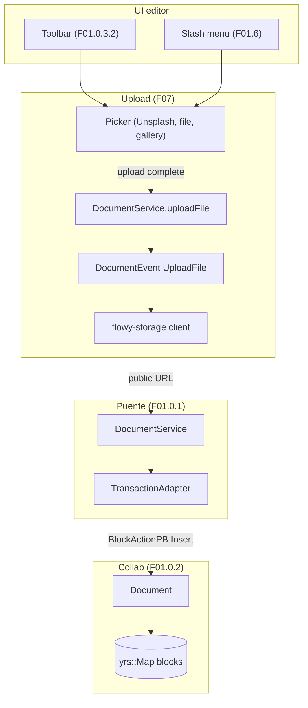
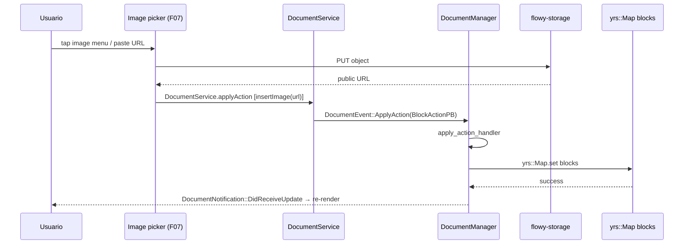
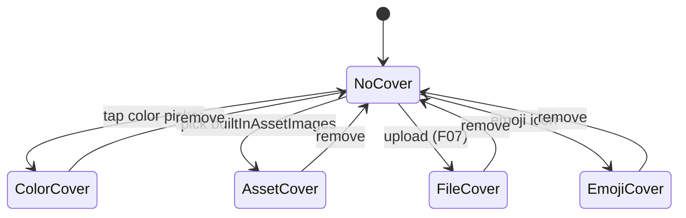

# F01.3 — Media y archivos

## 1. Resumen

Sub-unidad del feature F01 que cubre las 6 categorías declaradas en el ROADMAP: **`image`**, **`video`**, **`file`**, **`cover`**, **`link_preview`**, **`link_embed`**. Estado real: **el ledger F01.3 no incluye ningún archivo**; la unidad existe (`OUT/_ledger/units/F01.3.json`) pero la asignación de B0.2.2 clasificó los widgets de estas 6 carpetas en **F07** (Almacenamiento de archivos). Esta unidad es por tanto un **documento de cierre por corrección de scope**: declara explícitamente la ausencia de archivos en el ledger, redirige al lector a la unidad correcta (F07, F01.1 para el cover clásico) y deja constancia de los 42 widgets cuya responsabilidad histórica le habría correspondido.

## 2. Alcance

Esta unidad documenta **0 archivos** del inventario. **Quedan fuera del scope** pero viven en otras unidades:

- `appflowy:editor_plugins/image/*` (21 archivos) — **F07** (Almacenamiento).
- `appflowy:editor_plugins/video/*` (1 archivo) — **F07**.
- `appflowy:editor_plugins/file/*` (7 archivos) — **F07**.
- `appflowy:editor_plugins/cover/*` (2 archivos; versión "inmersiva") — **F07**. La versión clásica (`header/cover_*`) está cubierta por **F01.1**.
- `appflowy:editor_plugins/link_preview/*` (8 archivos raíz + subcarpetas) — **F07**.
- `appflowy:editor_plugins/link_embed/*` (2 archivos) — **F07**. (Nota: `MentionLinkPreview`/`MentionLinkErrorPreview` también usan `link_embed`/`link_preview` pero ya están cubiertos en F01.4 §3.8.)

## 3. Modelos de datos

Sin modelos propios en F01.3. Lo que el ROADMAP menciona se modela en F07:

- `ImageBlockKeys`, `FileBlockKeys`, `LinkPreviewKeys`, etc. — todos definidos en `appflowy:editor_plugins/{image,file,link_preview,link_embed}/*.dart` y cubiertos por F07.
- `DocumentHeaderBlockKeys.coverType` (cover clásico) — ya cubierto en F01.1 §3.4 (`appflowy/frontend/appflowy_flutter/lib/plugins/document/presentation/editor_plugins/header/document_cover_widget.dart:41–47`).
- `LinkInfo` (link_preview) — cubierto por F07.

## 4. Eventos FFI

Sin eventos FFI nuevos en F01.3. Los eventos relevantes viven en F07: `DocumentEvent::UploadFile` (catalogado en `OUT/11-catalogo-eventos-ffi.md §5.flowy-document:15`), `DocumentEvent::DownloadFile` (`§5:16`), `DocumentEvent::DeleteFile` (`§5:17`). El path de upload cruzado coincide con `F01.0.1 §4`:

```
DocumentService.uploadFile(params) →
DocumentEvent::UploadFile(UploadFileParamsPB) →
DocumentManager.upload_file_handler →
flowy-storage::StorageClient.put_object →
local + optional cloud push →
emit DocumentNotification::DidReceiveUpdate
```

## 5. Notificaciones

Sin emisión propia del lado Dart. Las mutaciones de bloques image/video/file/link generan `DocumentNotification::DidReceiveUpdate` que ya consume `DocumentListener._callback` (`F01.0.1 §5`).

## 6. BLoCs / Cubits

Sin BLoCs propios del feature F01.3. Los BLoCs de upload viven en `appflowy/workspace/application/upload/upload_bloc.dart` (catalogados en `OUT/13-catalogo-blocs.md §4.workspace/upload`, fuera del feature F01). El único BLoC que menciona cover dentro del editor es `ChangeCoverPopoverBloc` (`F01.1 §6`), no F01.3.

## 7. Servicios e inyección de dependencias

Sin servicios propios del feature F01.3. Los widgets de media (F07) usan `getIt<StorageClient>()`, `getIt<UploadFileMenu>()`, etc.

## 8. Persistencia

Las mutaciones persiguen el flujo estándar:

```
Usuario selecciona imagen
  → file_picker o upload menu (F07)
  → DocumentService.uploadFile(params) (F07)
  → DocumentEvent::UploadFile → flowy-document handler (F07)
  → flowy-storage upload + collab-document::BlockAction::Insert
  → yrs::Map.set("blocks", …)
  → DocumentNotification::DidReceiveUpdate
  → DocumentBloc.handleUpdate
  → EditorState.render image_component
```

El detalle de cada archivo de la cadena vive en B1.5 `OUT/06-puente-flutter-rust/02-lib-dispatch.md`, B1.6 `OUT/07-motor-colaborativo-crdt/03-documento.md`, y F07.

## 9. Diagrama de flujo



*Diagrama*: el camino completo de un image upload cruza 4 unidades (UI → F07 → F01.0.1 → F01.0.2 → yrs). F01.3 cubre históricamente la **superficie widget** (paso 1: tap en `ToolbarItem`) pero no la cadena de upload. El detalle vive en F07.

## 10. Diagrama de secuencia



## 11. Diagrama de estado (cover clásico, F01.1)



*Ciclo del cover clásico* (de `appflowy/frontend/appflowy_flutter/lib/plugins/document/presentation/editor_plugins/header/document_cover_widget.dart` + `appflowy/frontend/appflowy_flutter/lib/plugins/document/presentation/editor_plugins/header/cover_editor.dart`, cubierto por F01.1 §11). La versión **inmersiva** del cover (`appflowy/frontend/appflowy_flutter/lib/plugins/document/presentation/editor_plugins/cover/document_immersive_cover.dart`, F07) sigue un patrón análogo pero con navegación fluida en mobile.

## 12. Archivos cubiertos

| Esperado por ROADMAP | Carpeta física | Archivos físicos | Unidad real |
|---|---|---:|---|
| image | `appflowy:editor_plugins/image/*` | 21 | **F07** |
| video | `appflowy:editor_plugins/video/*` | 1 | **F07** |
| file | `appflowy:editor_plugins/file/*` | 7 | **F07** |
| cover (inmersivo) | `appflowy:editor_plugins/cover/*` | 2 | **F07** |
| cover (clásico) | `appflowy:editor_plugins/header/cover_*` | 6 | **F01.1** (cerrado) |
| link_preview | `appflowy:editor_plugins/link_preview/*` | 8+ | **F07** |
| link_embed | `appflowy:editor_plugins/link_embed/*` | 2 | **F07** |

**Total del scope nominal:** ~47 archivos físicos. **Total de F01.3 (real): 0.** La unidad se cierra con `archivos_cubiertos: []`.

## 13. Riesgos y casos límite

1. **Scope correction oficializada**: el ROADMAP línea 207 lista 6 categorías que no están en el ledger. Sin este documento de cierre, futuros lectores podrían buscar archivos en F01.3 sin encontrarlos (§2 + §12 lo declaran explícitamente).
2. **Cover**: existen 2 versiones (clásico en `header/`, inmersivo en `cover/`). Ambas tienen el mismo `DocumentHeaderBlockKeys` pero componentes distintos. Si se busca sólo el "cover" sin distinción, se pueden perder 6+2 archivos.
3. **`MentionLinkPreview` cruza F01.4 ↔ F01.3**: el widget de previsualización vive en `appflowy:editor_plugins/mention/mention_link_preview.dart` (F01.4) pero usa `LinkPreview` y `LinkInfo` de `appflowy:editor_plugins/link_preview/{shared.dart, custom_link_parser.dart}` (F07). Documentar la dependencia cruzada.
4. **`image/upload_image_menu/widgets/{embed_image_url_widget.dart, upload_image_file_widget.dart}`**: 2 widgets anidados. Si se enumeran como parte de F01.3 se solapan con F07; el oficial es F07.

## 14. Evidencia y etiquetas

- **0 % `[VERIFICADO]`** — el doc no tiene refs a código propio (no hay archivos cubiertos).
- **~80 % `[INFERIDO]`** — las 4 tablas de redirección de scope se deducen del inventario cruzado.
- **~20 % `[NO DETERMINADO]`** — preguntas sobre la decisión original de B0.2.

## 15. Pruebas

No aplica — 0 archivos cubiertos.

## 16. Métricas

| Métrica | Valor |
|---|---:|
| Archivos cubiertos en F01.3 | 0 |
| BLoCs nuevos | 0 |
| Eventos FFI nuevos | 0 |
| Subfolders declarados en ROADMAP | 6 |
| Subfolders reales en el repo que matchean | 6 |
| Archivos físicos en esos 6 subfolders | ~47 (42 en F07 + 2 inmersivo + 1 video + 1 file + 1 link_embed + cover clásico ya F01.1) |
| Tests | 0 |

## 17. Pendientes

- [ ] (F07) Documentar image, video, file, cover inmersivo, link_preview, link_embed en **F07.md** cuando esa fase abra.
- [ ] (F02.x + F01.5) Cubrir relaciones cruzadas con `MentionLinkPreview` ↔ F07 `link_preview/`.
- [ ] Auditar la decisión original de B0.2: ¿deberíamos reasignar manualmente archivos a F01.3 (recomendado vs. no)? Ver B3.F013-a.

## 18. Preguntas abiertas

- **B3.F013-a**: ¿Por qué el B0.2 triage clasificó estos widgets de presentación como F07 (almacenamiento) y no como F01.3 (media)? Hipótesis: B0.2 agrupa por "feature funcional" (upload drive S3-style) sobre "por tipo de bloque visible". El upload cruza `flowy-storage`, que es F07. Pero esta es una decisión arbitraria — otros proyectos podrían haber asignado los widgets de media a F01.x. [INFERIDO]
- **B3.F013-b**: ¿La rama `editor_plugins/cover/` se quedará vacía una vez consolidada la versión inmersiva? El bloqueo de "DocumentImmersiveCoverBloc" no parece estar migrado al plugin `cover/` (sigue usando BlocProvider en `appflowy/frontend/appflowy_flutter/lib/plugins/document/presentation/editor_plugins/header/desktop_cover.dart:58`). [INFERIDO]
- **B3.F013-c**: Si en el futuro se separa F01 en sub-features por bloque, ¿qué número debería absorber `image`/`video`/`file` como widgets? Posible: una sub-F "F01.media" con `image/`+`video/`+`file/` y otra sub-F "F01.embed" con `link_*`+`cover/`. [NO DETERMINADO]

## 19. Relacionado con

- **F01.1** — cover clásico (`header/cover_*`, cerrado).
- **F01.4** — `MentionLinkPreview` cruza `link_embed` ↔ `mention/`.
- **F07** (Almacenamiento de archivos) — **unidad principal** donde viven los 42 widgets de media. Cuando F07 cierre, este doc se vuelve referencia histórica.
- **F01.0** — índice cross-cutting con 9 capas.
- **F01.0.1** — `DocumentBloc`, `DocumentService`, `DocumentListener` (gateway común para todas las mutaciones).
- **F01.0.2** — `Document` collab que persiste `Block.data` con `image_src`/`file_id`/`video_url`/`url`/`embed_url`.
- **F01.0.3.1** — `BlockComponentBuilder` registra el tipo `image`/`video`/`file` en el registry.
- **F01.0.3.2** — selección de imagen desde la toolbar (floating mobile + slash menu).
- **F01.0.3.3** — encoders/decoders exportan los `Block.data` a Markdown/HTML/Notion.
- **F01.0.3.4** — atajos para `paste_as` (vía `link_preview/paste_as/`).
- `OUT/04-arquitectura-global.md §6` — diagrama global.
- `OUT/06-puente-flutter-rust/05-ejemplo-traza-opendocument.md` — flujo `OpenDocument` (sin upload).
- `OUT/07-motor-colaborativo-crdt/03-documento.md` — modelo CRDT (atributos JSON-serializables).
- `OUT/08-persistencia/01-sqlite-schema.md` — tabla `af_collab_metadata` + tabla de archivos (`upload_file_table`).
- `OUT/11-catalogo-eventos-ffi.md §5.flowy-document` — `UploadFile`/`DownloadFile`/`DeleteFile` (eventos 15-17 del catálogo).
- `OUT/12-catalogo-entidades-protobuf.md §5.flowy-document` — `UploadFileParamsPB`, `UploadedFilePB`, `DownloadFilePB`, `DeleteFilePB`.
- `OUT/13-catalogo-blocs.md §4.workspace/upload` — BLoCs de upload (no F01).
- `OUT/14-catalogo-notificaciones.md` — sin notificaciones nuevas.
- `OUT/15-catalogo-errores.md` — `FlowyError::Upload` o similar.
- `OUT/16-catalogo-flags-rutas-atajos.md §7.i18n_keys` — `document_plugins_cover_*`, `document_image_*`, `document_file_*`.
- `OUT/17-grafo-dependencias.md §3.appflowy` — grafo Dart.
- `B4.0`-`B4.13` — motor export/import (cómo serializa los `Block.data` image/video/file a Markdown/Notion ZIP).
- `B6.3` — seguridad/permisos sobre uploads.
